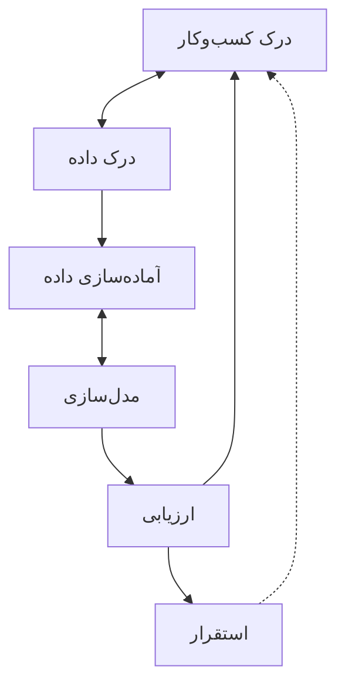

# جلسه ۲ — فرایند CRISP-DM و محیط کار

## چرا به یک فرایند استاندارد نیاز داریم؟

در جلسه قبل دیدیم که داده‌کاوی فقط اجرای یک الگوریتم نیست ← [[۱ - مقدمه‌ای بر داده‌کاوی]] پروژه‌های واقعی داده‌کاوی اغلب نه به دلیل الگوریتم ضعیف، بلکه به این دلایل شکست می‌خورند:

- مسئله کسب‌وکار درست تعریف نشده است.
- داده مناسب در دسترس نیست یا کیفیت آن پایین است.
- مدل ساخته می‌شود، اما هرگز در عمل به کار گرفته نمی‌شود.
- معیار موفقیت از ابتدا مشخص نبوده است.

> [!important] نکته کلیدی یک فرایند استاندارد مانند **نقشه راه** است: به تیم کمک می‌کند هیچ گام مهمی فراموش نشود، کار قابل تکرار باشد و همه اعضای تیم زبان مشترکی داشته باشند.

---

## فرایند CRISP-DM

چارچوب **CRISP-DM** (Cross-Industry Standard Process for Data Mining) در اواخر دهه ۱۹۹۰ توسط گروهی از شرکت‌های صنعتی اروپایی تدوین شد و هنوز پرکاربردترین چارچوب پروژه‌های داده‌کاوی است. ویژگی‌های اصلی آن:

- **مستقل از صنعت:** در بانکداری، پزشکی، خرده‌فروشی و هر حوزه دیگری کاربرد دارد.
- **مستقل از ابزار:** به نرم‌افزار یا زبان برنامه‌نویسی خاصی وابسته نیست.
- **چرخه‌ای و تکرارشونده:** بازگشت به گام‌های قبلی بخشی طبیعی از فرایند است.



### فاز ۱ — درک کسب‌وکار (Business Understanding)

در این فاز مسئله را از دید **کسب‌وکار** می‌فهمیم و آن را به یک مسئله داده‌کاوی تبدیل می‌کنیم.

- تعیین اهداف کسب‌وکار و معیار موفقیت آن
- ارزیابی وضعیت: منابع، محدودیت‌ها، ریسک‌ها و هزینه‌ها
- تبدیل هدف کسب‌وکار به هدف داده‌کاوی و تعیین معیار موفقیت فنی
- تهیه برنامه پروژه

> [!example] مثال — شرکت مخابرات هدف کسب‌وکار: «کاهش ۱۰ درصدی ریزش مشترکان در سال آینده» هدف داده‌کاوی: «ساخت مدل طبقه‌بندی که مشترکان در معرض ریزش در سه ماه آینده را شناسایی کند» معیار موفقیت فنی: «شناسایی دست‌کم ۷۰ درصد از مشترکانی که واقعاً ریزش می‌کنند»

### فاز ۲ — درک داده (Data Understanding)

در این فاز با داده آشنا می‌شویم و کیفیت آن را می‌سنجیم.

- جمع‌آوری داده اولیه
- توصیف داده: تعداد رکوردها، ویژگی‌ها و انواع آن‌ها
- کاوش داده: آمار توصیفی و نمودارهای اولیه
- ارزیابی کیفیت داده

این فاز موضوع بخش‌های **شناخت داده** و **تحلیل اکتشافی** این درس است ← [[۳ - انواع داده و ویژگی‌ها]] تا [[9 - مطالعه موردی EDA]]

### فاز ۳ — آماده‌سازی داده (Data Preparation)

در این فاز داده خام را به داده‌ای قابل استفاده برای مدل‌سازی تبدیل می‌کنیم.

- انتخاب داده: کدام ویژگی‌ها و رکوردها وارد تحلیل شوند
- پاک‌سازی داده: داده گمشده، داده پرت و ناسازگاری
- ساخت داده: مهندسی ویژگی‌های جدید
- یکپارچه‌سازی داده از چند منبع
- قالب‌بندی داده متناسب با الگوریتم

این فاز موضوع بخش **پیش‌پردازش داده** است ← [[۱۰ - مدیریت داده گمشده]] تا [[۱۴- کاهش ابعاد]]

> [!warning] پرزحمت‌ترین فاز آماده‌سازی داده معمولاً **بیشترین زمان** پروژه را می‌گیرد. تجربه رایج متخصصان این است که بخش عمده وقت یک پروژه صرف درک و آماده‌سازی داده می‌شود، نه مدل‌سازی.

### فاز ۴ — مدل‌سازی (Modeling)

- انتخاب روش مدل‌سازی متناسب با مسئله
- طراحی آزمون: تقسیم داده به آموزش و آزمون، اعتبارسنجی متقابل
- ساخت مدل و تنظیم پارامترها
- ارزیابی فنی مدل

بازگشت از مدل‌سازی به آماده‌سازی داده بسیار رایج است؛ چون الگوریتم‌های مختلف به قالب‌های متفاوتی از داده نیاز دارند. این فاز موضوع بخش‌های **رگرسیون**، **طبقه‌بندی** و **خوشه‌بندی** است.

### فاز ۵ — ارزیابی (Evaluation)

تفاوت این فاز با ارزیابی فنی در فاز مدل‌سازی این است که مدل را از دید **اهداف کسب‌وکار** می‌سنجیم.

- آیا مدل به هدف کسب‌وکار پاسخ می‌دهد؟
- آیا گام مهمی فراموش شده است؟
- تصمیم‌گیری: استقرار، تکرار چرخه یا توقف پروژه

> [!question] مدل دقیق اما بی‌فایده؟ مدلی که ریزش مشترکان را با دقت بالا پیش‌بینی می‌کند، اما فقط **یک روز** پیش از ریزش هشدار می‌دهد، از نظر فنی خوب است ولی از نظر کسب‌وکار بی‌فایده است؛ چون زمانی برای اقدام باقی نمی‌گذارد.

### فاز ۶ — استقرار (Deployment)

- برنامه‌ریزی استقرار: مدل چگونه در سامانه‌های سازمان به کار گرفته شود
- پایش و نگه‌داری: عملکرد مدل در طول زمان کنترل شود
- تهیه گزارش نهایی و بازبینی پروژه

> [!tip] مدل‌ها پیر می‌شوند رفتار مشتریان، بازار و محیط در طول زمان تغییر می‌کند و دقت مدل کاهش می‌یابد. به این پدیده **رانش داده** (Data Drift) می‌گویند. به همین دلیل استقرار پایان کار نیست و پایش مدل ضروری است.

### جمع‌بندی فازها

|فاز|پرسش اصلی|خروجی نمونه|
|:-:|:-:|:-:|
|درک کسب‌وکار|چه مسئله‌ای را حل می‌کنیم؟|تعریف هدف و معیار موفقیت|
|درک داده|چه داده‌ای داریم و چه کیفیتی دارد؟|گزارش کیفیت داده|
|آماده‌سازی داده|داده را چگونه برای مدل آماده کنیم؟|مجموعه‌داده نهایی|
|مدل‌سازی|کدام مدل بهترین عملکرد را دارد؟|مدل آموزش‌دیده|
|ارزیابی|آیا مدل به هدف کسب‌وکار پاسخ می‌دهد؟|تصمیم استقرار یا تکرار|
|استقرار|مدل چگونه به کار گرفته می‌شود؟|سامانه عملیاتی و برنامه پایش|

---

## مقایسه با فرایندهای KDD و SEMMA

### فرایند SEMMA

فرایند **SEMMA** توسط شرکت SAS معرفی شد و نام آن از حروف اول پنج گام ساخته شده است:

|گام|معنا|کار اصلی|
|:-:|:-:|:-:|
|نمونه‌گیری (Sample)|انتخاب بخشی از داده|ساخت نمونه‌ای نماینده و قابل مدیریت|
|کاوش (Explore)|شناخت داده|آمار توصیفی، نمودار و کشف الگوهای اولیه|
|اصلاح (Modify)|تغییر داده|پاک‌سازی، تبدیل و ساخت ویژگی|
|مدل‌سازی (Model)|ساخت مدل|اجرای الگوریتم‌های داده‌کاوی|
|سنجش (Assess)|ارزیابی|مقایسه و ارزیابی مدل‌ها|

### مقایسه سه فرایند

|فرایند KDD|فرایند SEMMA|فرایند CRISP-DM|
|:-:|:-:|:-:|
|—|—|درک کسب‌وکار|
|انتخاب داده|نمونه‌گیری|درک داده|
|پیش‌پردازش|کاوش|درک داده|
|تبدیل داده|اصلاح|آماده‌سازی داده|
|داده‌کاوی|مدل‌سازی|مدل‌سازی|
|ارزیابی و تفسیر|سنجش|ارزیابی|
|—|—|استقرار|

|ویژگی|فرایند KDD|فرایند SEMMA|فرایند CRISP-DM|
|:-:|:-:|:-:|:-:|
|منشأ|پژوهش دانشگاهی|شرکت SAS|کنسرسیوم صنعتی|
|تمرکز|کشف دانش از داده|جنبه فنی و ابزاری|کل پروژه از کسب‌وکار تا استقرار|
|درک کسب‌وکار|ندارد|ندارد|دارد|
|استقرار|ندارد|ندارد|دارد|
|وابستگی به ابزار|ندارد|به نرم‌افزار SAS نزدیک است|ندارد|

> [!important] نکته کلیدی هر سه فرایند هسته فنی مشابهی دارند. مزیت اصلی CRISP-DM این است که پروژه را با **درک کسب‌وکار** آغاز و با **استقرار** کامل می‌کند. به همین دلیل در این درس از CRISP-DM پیروی می‌کنیم.

---

## ملاحظات اخلاقی و حریم خصوصی

داده‌کاوی ابزاری قدرتمند است و مانند هر ابزار قدرتمندی می‌تواند آسیب بزند. هر متخصص داده باید این ملاحظات را از **فاز اول** پروژه در نظر بگیرد.

### حریم خصوصی (Privacy)

- **رضایت آگاهانه:** افراد باید بدانند داده‌شان برای چه هدفی جمع‌آوری و استفاده می‌شود.
- **حداقل‌سازی داده:** فقط داده‌ای جمع‌آوری شود که واقعاً برای هدف لازم است.
- **محدودیت هدف:** داده‌ای که برای یک هدف جمع‌آوری شده، بدون اجازه برای هدف دیگری استفاده نشود.

> [!warning] ناشناس‌سازی کافی نیست حذف نام و شماره ملی، داده را لزوماً ناشناس نمی‌کند. با ترکیب چند ویژگی ظاهراً بی‌خطر (مانند کد پستی، تاریخ تولد و جنسیت) اغلب می‌توان افراد را **دوباره شناسایی** کرد. نمونه‌های مشهوری از این اتفاق رخ داده است؛ مانند شناسایی کاربران از روی داده‌های «ناشناس» امتیازدهی فیلم در مسابقه Netflix Prize.

### سوگیری و عدالت (Bias and Fairness)

مدل‌ها از داده‌های گذشته یاد می‌گیرند. اگر داده گذشته سوگیرانه باشد، مدل همان سوگیری را **بازتولید و تقویت** می‌کند.

> [!example] مثال — مدل استخدام شرکتی مدلی برای غربال رزومه‌ها بر اساس استخدام‌های ده سال گذشته می‌سازد. اگر در گذشته به‌طور عمده مردان استخدام شده باشند، مدل یاد می‌گیرد رزومه‌های زنان را امتیاز کمتری بدهد؛ حتی اگر ستون جنسیت از داده حذف شده باشد، چون ویژگی‌های دیگر (مانند نام دانشگاه یا فعالیت‌های فوق‌برنامه) می‌توانند **جانشین** جنسیت شوند.

### شفافیت و پاسخ‌گویی (Transparency and Accountability)

- افرادی که تحت تأثیر تصمیم مدل قرار می‌گیرند، حق دارند دلیل آن را بدانند (مثلاً دلیل رد درخواست وام).
- باید مشخص باشد چه کسی مسئول خطاهای مدل است.
- در حوزه‌های حساس (پزشکی، قضایی، مالی) استفاده از مدل‌های **تفسیرپذیر** اهمیت ویژه دارد.

### امنیت داده (Security)

- نگه‌داری داده در محیط امن و با دسترسی محدود
- رمزنگاری داده‌های حساس
- عدم انتشار داده خام در گزارش‌ها، ارائه‌ها یا مخازن عمومی کد

|اصل اخلاقی|پرسشی که باید پرسید|
|:-:|:-:|
|حریم خصوصی|آیا افراد از استفاده از داده‌شان آگاه‌اند و رضایت داده‌اند؟|
|عدالت|آیا مدل با گروه خاصی رفتار ناعادلانه دارد؟|
|شفافیت|آیا می‌توانیم تصمیم مدل را توضیح دهیم؟|
|پاسخ‌گویی|اگر مدل اشتباه کند، چه کسی مسئول است؟|
|امنیت|آیا داده در برابر دسترسی غیرمجاز محافظت می‌شود؟|

> [!note] چارچوب‌های قانونی بسیاری از کشورها قوانینی برای حفاظت از داده‌های شخصی دارند. شناخته‌شده‌ترین آن‌ها مقررات عمومی حفاظت از داده اتحادیه اروپا (GDPR) است که حقوقی مانند «حق دسترسی به داده» و «حق فراموش‌شدن» را برای افراد تعریف می‌کند.

---

## معرفی محیط کار

### توزیع Anaconda

نرم‌افزار **Anaconda** یک توزیع رایگان از پایتون است که بیشتر کتابخانه‌های لازم برای داده‌کاوی را از پیش نصب کرده است.

- شامل پایتون، Jupyter Notebook و کتابخانه‌های `numpy`، `pandas`، `matplotlib`، `seaborn` و `scikit-learn`
- ابزار **conda** برای مدیریت بسته‌ها و ساخت محیط‌های مجزا
- رابط گرافیکی **Anaconda Navigator** برای اجرای برنامه‌ها

ساخت یک محیط مجزا برای این درس (در Anaconda Prompt یا ترمینال):

```bash
conda create -n datamining python=3.11
conda activate datamining
conda install numpy pandas matplotlib seaborn scikit-learn jupyter
jupyter notebook
```

> [!tip] چرا محیط مجزا؟ هر پروژه ممکن است به نسخه متفاوتی از یک کتابخانه نیاز داشته باشد. محیط مجزا از تداخل نسخه‌ها جلوگیری می‌کند و پروژه را قابل تکرار می‌سازد.

### محیط Jupyter Notebook

دفترچه **Jupyter** محیطی تعاملی است که در آن کد، خروجی، نمودار و توضیح متنی کنار هم قرار می‌گیرند. همین ویژگی آن را برای تحلیل داده و گزارش‌نویسی ایده‌آل می‌کند.

هر دفترچه از **سلول‌ها** تشکیل شده است:

|نوع سلول|کاربرد|
|:-:|:-:|
|سلول کد (Code)|نوشتن و اجرای کد پایتون|
|سلول متن (Markdown)|نوشتن توضیح، عنوان، فرمول و فهرست|

|کلید میان‌بر|عملکرد|
|:-:|:-:|
|کلیدهای Shift + Enter|اجرای سلول و رفتن به سلول بعد|
|کلیدهای Ctrl + Enter|اجرای سلول و ماندن در همان سلول|
|کلید Esc|خروج از حالت ویرایش|
|کلید A یا B|افزودن سلول در بالا یا پایین|
|کلید M یا Y|تبدیل سلول به متن یا کد|
|دو بار فشردن D|حذف سلول|

> [!warning] ترتیب اجرای سلول‌ها سلول‌ها را می‌توان به هر ترتیبی اجرا کرد، و این منبع رایج خطاست. پیش از تحویل تکلیف، همیشه از منوی **Kernel** گزینه **Restart & Run All** را اجرا کنید تا مطمئن شوید دفترچه از ابتدا تا انتها بدون خطا اجرا می‌شود.

### سرویس Google Colab

سرویس **Google Colab** نسخه آنلاین و رایگان Jupyter است که نیازی به نصب ندارد.

- فقط به یک حساب گوگل و مرورگر نیاز دارد.
- کتابخانه‌های اصلی داده‌کاوی از پیش نصب شده‌اند.
- دفترچه‌ها در Google Drive ذخیره می‌شوند و قابل اشتراک‌گذاری‌اند.
- دسترسی رایگان (محدود) به پردازنده گرافیکی دارد.

بارگذاری فایل و اتصال به Google Drive در Colab:

```python
# Upload a file from your computer
from google.colab import files
uploaded = files.upload()

# Or mount Google Drive
from google.colab import drive
drive.mount("/content/drive")
```

|ویژگی|محیط Jupyter محلی|سرویس Google Colab|
|:-:|:-:|:-:|
|نصب|نیاز به نصب Anaconda|بدون نصب|
|اینترنت|لازم نیست|لازم است|
|منابع پردازشی|سخت‌افزار رایانه شما|سرور گوگل با محدودیت زمانی|
|ذخیره فایل|روی رایانه شما|روی Google Drive|
|حریم داده|داده روی رایانه شما می‌ماند|داده به سرور گوگل منتقل می‌شود|

---

## مبانی NumPy

کتابخانه **NumPy** پایه محاسبات عددی در پایتون است. ساختار اصلی آن **آرایه** (ndarray) است: مجموعه‌ای از اعداد هم‌نوع که عملیات ریاضی روی آن بسیار سریع‌تر از فهرست‌های معمولی پایتون انجام می‌شود.

```python
import numpy as np

a = np.array([12, 15, 9, 20, 14])

a.mean(), a.std(), a.max(), a.argmax()   # (14.0, 3.63, 20, 3)
a * 2                                    # [24 30 18 40 28]  vectorized, no loop
a[a > 12]                                # [15 20 14]        boolean filtering

m = np.array([[1, 2, 3],
              [4, 5, 6]])
m.shape                                  # (2, 3)
m.sum(axis=0)                            # [5 7 9]   column sums
m.sum(axis=1)                            # [ 6 15]   row sums
```

> [!tip] مفهوم برداری‌سازی (Vectorization) در NumPy به جای نوشتن حلقه، عملیات را روی کل آرایه انجام می‌دهیم. دستور `a * 2` همه عناصر را بدون حلقه دو برابر می‌کند. این روش هم کوتاه‌تر و هم چندین برابر سریع‌تر است.

> [!note] پارامتر axis در آرایه دوبعدی، مقدار `axis=0` یعنی عملیات **در امتداد سطرها** (نتیجه برای هر ستون) و مقدار `axis=1` یعنی عملیات **در امتداد ستون‌ها** (نتیجه برای هر سطر). همین قاعده در pandas نیز برقرار است.

---

## مبانی pandas

کتابخانه **pandas** ابزار اصلی کار با داده‌های جدولی در پایتون است و در تمام این درس از آن استفاده می‌کنیم. دو ساختار اصلی دارد:

|ساختار|ابعاد|شباهت|
|:-:|:-:|:-:|
|سری (Series)|یک‌بعدی|یک ستون از جدول، با برچسب برای هر مقدار|
|دیتافریم (DataFrame)|دوبعدی|یک جدول کامل؛ مجموعه‌ای از سری‌ها با اندیس مشترک|

### ساختار Series

```python
import pandas as pd

s = pd.Series([12, 15, 9, 20],
              index=["فروردین", "اردیبهشت", "خرداد", "تیر"],
              name="sales")

s["خرداد"]                 # 9      access by label
s.mean()                   # 14.0
s[s > 10].index.tolist()   # ['فروردین', 'اردیبهشت', 'تیر']
```

### ساختار DataFrame و خواندن فایل CSV

برای خواندن فایل CSV از تابع `read_csv` استفاده می‌کنیم:

```python
df = pd.read_csv("students.csv")
```

برای این‌که مثال بدون فایل خارجی قابل اجرا باشد، داده را از یک متن می‌خوانیم:

```python
from io import StringIO

csv_text = """student_id,name,gender,city,age,midterm,final
1,Ali,M,Tehran,21,14.5,16
2,Sara,F,Shiraz,22,18,17.5
3,Reza,M,Tabriz,20,9.5,11
4,Maryam,F,Tehran,23,16,
5,Hamed,M,Isfahan,21,12,13.5
6,Neda,F,Shiraz,22,19.5,18
"""
df = pd.read_csv(StringIO(csv_text))
```

> [!warning] فایل‌های CSV فارسی اگر فایل CSV با Excel ساخته شده و متن فارسی آن پس از خواندن به‌هم‌ریخته است، پارامتر کدگذاری را تنظیم کنید:
> 
> ```python
> df = pd.read_csv("data.csv", encoding="utf-8-sig")   # or encoding="cp1256"
> ```
> 
> هنگام ذخیره فایل برای باز شدن درست در Excel نیز از `encoding="utf-8-sig"` استفاده کنید.

### نگاه اولیه به داده

```python
df.head(3)      # first 3 rows
df.tail()       # last 5 rows
df.shape        # (6, 7)  -> (rows, columns)
df.columns      # column names
df.dtypes       # type of each column (text columns: object, or str in pandas 3)
df.info()       # summary: types, non-null counts, memory
df.describe()   # descriptive statistics of numeric columns
```

### انتخاب ستون

```python
df["midterm"]             # one column -> Series
df["midterm"].mean()      # 14.92
df[["name", "final"]]     # several columns -> DataFrame (note double brackets)
```

### انتخاب با loc و iloc

|روش|مبنای انتخاب|مثال|
|:-:|:-:|:-:|
|روش loc|برچسب (نام سطر و ستون)|`df.loc[2, "name"]`|
|روش iloc|موقعیت عددی (از صفر)|`df.iloc[2, 1]`|

```python
df.loc[2, "name"]                 # 'Reza'  (row label 2, column "name")
df.iloc[2, 1]                     # 'Reza'  (3rd row, 2nd column)
df.loc[0:2, ["name", "city"]]     # label slicing: includes row 2
df.iloc[0:2, 1:3]                 # position slicing: excludes row 2
```

> [!warning] تفاوت برش در loc و iloc در روش `loc` انتهای بازه **شامل** می‌شود، اما در روش `iloc` مانند فهرست‌های پایتون انتهای بازه **شامل نمی‌شود**. دستور `df.loc[0:2]` سه سطر و دستور `df.iloc[0:2]` دو سطر برمی‌گرداند.

### فیلتر داده با شرط

```python
# One condition
df.loc[df["city"] == "Tehran", ["name", "midterm"]]

# Several conditions: use & (and), | (or), ~ (not), with parentheses
df[(df["gender"] == "F") & (df["midterm"] >= 17)]      # Sara, Neda

# Membership in a list
df[df["city"].isin(["Shiraz", "Tabriz"])]["name"].tolist()   # ['Sara', 'Reza', 'Neda']

# The same filter with query()
df.query("age > 21 and final >= 15")
```

> [!warning] خطای رایج در شرط‌های ترکیبی در pandas به جای واژه‌های `and` و `or` باید از عملگرهای `&` و `|` استفاده کرد و **هر شرط را داخل پرانتز** گذاشت. نوشتن `df[df["age"] > 21 and df["final"] > 15]` خطا می‌دهد.

### مرتب‌سازی، ستون جدید و گروه‌بندی

```python
# Sort
df.sort_values("midterm", ascending=False).head(3)     # Neda, Sara, Maryam

# New column
df["total"] = 0.4 * df["midterm"] + 0.6 * df["final"]

# Group by
df.groupby("city")["midterm"].mean().round(2)
# Isfahan 12.00, Shiraz 18.75, Tabriz 9.50, Tehran 15.25
```

> [!example] تفسیر خروجی نمره کل مریم برابر `NaN` شده است، چون نمره پایان‌ترم او ثبت نشده است. هر عملیات ریاضی روی مقدار گمشده، نتیجه گمشده می‌دهد. این اولین برخورد ما با **داده گمشده** است ← [[۱۰ - مدیریت داده گمشده]]

---

## تمرین عملی کلاس

> [!example] تمرین عملی (۲۵ دقیقه) مجموعه‌داده Titanic را با دستور زیر بارگذاری کنید:
> 
> ```python
> import seaborn as sns
> df = sns.load_dataset("titanic")
> ```
> 
> 1. تعداد سطرها و ستون‌ها و نوع داده هر ستون را گزارش کنید.
> 2. میانگین سن و کرایه مسافران را محاسبه کنید.
> 3. فقط ستون‌های `sex`، `age`، `pclass` و `survived` را انتخاب کنید.
> 4. مسافران زن کلاس اول را فیلتر کنید. چند نفرند و چند درصدشان زنده ماندند؟
> 5. مسافرانی که سنشان کمتر از ۱۸ سال است و در شهر Southampton سوار شده‌اند را پیدا کنید.
> 6. با `groupby` نرخ بقا را به تفکیک جنسیت و کلاس محاسبه کنید. چه الگویی می‌بینید؟
> 7. ده مسافری که بیشترین کرایه را پرداخته‌اند نمایش دهید.

---

## پرسش‌های مرور

> [!question]- ۱. شش فاز CRISP-DM را به ترتیب نام ببرید. درک کسب‌وکار، درک داده، آماده‌سازی داده، مدل‌سازی، ارزیابی و استقرار.

> [!question]- ۲. تفاوت ارزیابی در فاز مدل‌سازی با فاز ارزیابی در CRISP-DM چیست؟ در فاز مدل‌سازی، مدل از نظر **فنی** سنجیده می‌شود (مانند دقت یا خطا). در فاز ارزیابی، مدل از نظر **اهداف کسب‌وکار** سنجیده می‌شود: آیا واقعاً مسئله را حل می‌کند و ارزش استقرار دارد؟

> [!question]- ۳. مهم‌ترین تفاوت CRISP-DM با KDD و SEMMA چیست؟ فرایند CRISP-DM دو فاز **درک کسب‌وکار** و **استقرار** را دارد که در دو فرایند دیگر وجود ندارد. به همین دلیل کل پروژه را از تعریف مسئله تا به‌کارگیری عملی پوشش می‌دهد.

> [!question]- ۴. چرا حذف ستون جنسیت از داده، مدل را لزوماً از سوگیری جنسیتی پاک نمی‌کند؟ چون ویژگی‌های دیگری که با جنسیت همبسته‌اند (مانند رشته تحصیلی یا نوع شغل قبلی) می‌توانند نقش **جانشین** جنسیت را بازی کنند و مدل همان سوگیری را از طریق آن‌ها یاد بگیرد.

> [!question]- ۵. دستورهای `df.loc[0:3]` و `df.iloc[0:3]` هر کدام چند سطر برمی‌گردانند؟ (اندیس پیش‌فرض) دستور اول **چهار سطر** (اندیس ۰ تا ۳، با احتساب انتها) و دستور دوم **سه سطر** (موقعیت ۰ تا ۲، بدون احتساب انتها) برمی‌گرداند.

> [!question]- ۶. چرا این کد خطا می‌دهد و شکل درست آن چیست؟
> 
> ```python
> df[df["age"] > 20 and df["city"] == "Tehran"]
> ```
> 
> واژه `and` در پایتون روی یک مقدار منطقی کار می‌کند، نه روی ستونی از مقادیر. شکل درست:
> 
> ```python
> df[(df["age"] > 20) & (df["city"] == "Tehran")]
> ```

---

## نکات کلیدی

> [!summary] خلاصه جلسه
> 
> - چارچوب **CRISP-DM** شش فاز دارد و چرخه‌ای است؛ بازگشت به فازهای قبلی طبیعی است.
> - پروژه با **درک کسب‌وکار** شروع می‌شود، نه با داده یا الگوریتم.
> - فاز **آماده‌سازی داده** معمولاً بیشترین زمان پروژه را می‌گیرد.
> - برتری CRISP-DM نسبت به KDD و SEMMA، پوشش درک کسب‌وکار و استقرار است.
> - ملاحظات اخلاقی شامل حریم خصوصی، عدالت، شفافیت، پاسخ‌گویی و امنیت است؛ ناشناس‌سازی ساده کافی نیست.
> - در pandas، ساختار **Series** یک ستون و ساختار **DataFrame** یک جدول است؛ روش `loc` بر اساس برچسب و روش `iloc` بر اساس موقعیت انتخاب می‌کند.

> [!todo] آمادگی برای جلسه بعد
> 
> 1. محیط کار (Anaconda یا Colab) را آماده کنید و تمرین Titanic را کامل کنید.
> 2. یکی از سه مجموعه‌داده‌ای که در جلسه قبل فهرست کردید را دانلود کرده و با `read_csv` بخوانید.
> 3. برای آن مجموعه‌داده، فاز **درک کسب‌وکار** را در یک بند بنویسید: هدف کسب‌وکار، هدف داده‌کاوی و معیار موفقیت.