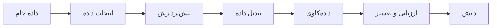

# جلسه ۱ — مقدمه‌ای بر داده‌کاوی

## چرا داده‌کاوی؟

ما در دوران **انفجار داده** زندگی می‌کنیم. هر خرید اینترنتی، هر تراکنش بانکی، هر جست‌وجو و هر حسگر صنعتی داده تولید می‌کند. مشکل امروز کمبود داده نیست، بلکه **کمبود دانش** از دل داده است.

- سازمان‌ها حجم عظیمی داده ذخیره می‌کنند، اما بخش کوچکی از آن تحلیل می‌شود.
- انسان نمی‌تواند میلیون‌ها رکورد با صدها ویژگی را به‌صورت دستی بررسی کند.
- الگوهای ارزشمند اغلب **پنهان** هستند و با پرس‌وجوی ساده پیدا نمی‌شوند.

> [!important] نکته کلیدی ما در داده غرق شده‌ایم، اما تشنه دانش هستیم. داده‌کاوی پلی است میان **داده خام** و **تصمیم آگاهانه**.

---

## تعریف داده‌کاوی

داده‌کاوی (Data Mining) فرایند **کشف خودکار یا نیمه‌خودکار الگوهای جالب** از حجم زیاد داده است.

یک الگو زمانی «جالب» است که این ویژگی‌ها را داشته باشد:

|ویژگی|معنا|مثال نقض|
|:-:|:-:|:-:|
|معتبر (Valid)|روی داده جدید نیز با اطمینان کافی برقرار باشد|الگویی که فقط تصادفاً در یک نمونه دیده شده|
|ناشناخته (Novel)|از پیش بدیهی یا شناخته‌شده نباشد|«بیماران باردار همگی زن هستند»|
|مفید (Useful)|به تصمیم یا اقدام عملی منجر شود|الگویی که هیچ اقدامی بر آن قابل انجام نیست|
|قابل فهم (Understandable)|برای انسان قابل تفسیر باشد|مدلی با هزاران قاعده درهم|

> [!example] مثال کلاسیک — پوشک و نوشابه داستان معروفی در دنیای داده‌کاوی نقل می‌شود که یک فروشگاه زنجیره‌ای دریافت مردانی که عصر روزهای کاری پوشک می‌خرند، اغلب نوشابه یا آبجو نیز می‌خرند. چه این داستان دقیق باشد چه نه، ایده اصلی **کاوش قواعد انجمنی** را به‌خوبی نشان می‌دهد: الگویی ناشناخته، معتبر و قابل استفاده برای چیدمان قفسه‌ها.

> [!question] آیا هر تحلیل داده‌ای، داده‌کاوی است؟ خیر. جست‌وجوی شماره تلفن یک مشتری در پایگاه داده، یا محاسبه مجموع فروش ماه گذشته، **بازیابی اطلاعات** یا **گزارش‌گیری** است، نه داده‌کاوی. داده‌کاوی به دنبال الگویی است که از پیش نمی‌دانستیم.

---

## کشف دانش از داده (KDD)

اصطلاح **کشف دانش از داده** (Knowledge Discovery in Databases) به کل فرایند تبدیل داده خام به دانش اشاره دارد. داده‌کاوی فقط **یک گام** از این فرایند است، هرچند گاهی این دو واژه به جای هم به کار می‌روند.



|گام|کار اصلی|جلسات مرتبط|
|:-:|:-:|:-:|
|انتخاب داده|انتخاب داده مرتبط با هدف از میان منابع موجود|جلسات ۳ تا ۶|
|پیش‌پردازش|پاک‌سازی داده گمشده، نویز، داده پرت و ناسازگاری|جلسات ۱۰ و ۱۱|
|تبدیل داده|مقیاس‌بندی، کدگذاری، مهندسی ویژگی و کاهش ابعاد|جلسات ۱۲ تا ۱۴|
|داده‌کاوی|اجرای الگوریتم برای استخراج الگو|جلسات ۱۶ تا ۲۹|
|ارزیابی و تفسیر|سنجش الگوها و ارائه آن‌ها به شکل قابل فهم|جلسات ۲۵ و ۲۹|

> [!note] دو روایت از فرایند KDD روایت بالا (پنج گام) بر اساس مقاله فیاد و همکاران (۱۹۹۶) است. در کتاب هان و همکاران، فرایند به هفت گام تقسیم شده است: پاک‌سازی، یکپارچه‌سازی، انتخاب، تبدیل، داده‌کاوی، ارزیابی الگو و ارائه دانش. محتوای هر دو روایت یکسان است.

> [!warning] تکرارشونده بودن فرایند فرایند KDD یک خط مستقیم نیست. اغلب پس از ارزیابی نتایج باید به گام‌های قبلی بازگشت؛ مثلاً ویژگی جدیدی ساخت یا داده دیگری جمع‌آوری کرد. چارچوب عملیاتی این فرایند، یعنی CRISP-DM، در جلسه بعد بررسی می‌شود ← [[2 - فرایند CRISP-DM و محیط کار]]

---

## تفاوت داده‌کاوی با حوزه‌های مرتبط

داده‌کاوی یک حوزه **میان‌رشته‌ای** است که از آمار، یادگیری ماشین، پایگاه داده و مصورسازی بهره می‌گیرد.

|حوزه|هدف اصلی|پرسش نمونه|تمرکز|
|:-:|:-:|:-:|:-:|
|آمار|استنباط درباره جامعه از روی نمونه|آیا میانگین فروش دو شعبه تفاوت معنادار دارد؟|آزمون فرضیه، عدم قطعیت، مدل‌های تفسیرپذیر|
|یادگیری ماشین|ساخت الگوریتم‌هایی که از داده یاد می‌گیرند|چگونه مدلی بسازیم که ایمیل اسپم را تشخیص دهد؟|الگوریتم، دقت پیش‌بینی، تعمیم‌پذیری|
|داده‌کاوی|کشف الگوهای جالب از داده‌های بزرگ|کدام گروه از مشتریان رفتار خرید مشابهی دارند؟|کل فرایند، مقیاس‌پذیری، کشف دانش|
|هوش تجاری|گزارش و پایش وضعیت کسب‌وکار|فروش فصل گذشته در هر استان چقدر بود؟|داشبورد، گزارش، داده گذشته|

> [!tip] یک قاعده ساده برای تشخیص
> 
> - هوش تجاری می‌پرسد: **«چه اتفاقی افتاد؟»**
> - آمار می‌پرسد: **«آیا این اتفاق معنادار است؟»**
> - داده‌کاوی می‌پرسد: **«چه الگوی پنهانی وجود دارد؟»**
> - یادگیری ماشین می‌پرسد: **«چه اتفاقی خواهد افتاد؟»**

> [!note] مرزها روشن نیستند این حوزه‌ها هم‌پوشانی زیادی دارند. بیشتر الگوریتم‌هایی که در این درس می‌خوانیم (مانند درخت تصمیم یا k-Means) هم در کتاب‌های یادگیری ماشین آمده‌اند و هم در کتاب‌های داده‌کاوی. تفاوت اصلی در **نگاه** است: داده‌کاوی بر کل فرایند از داده خام تا دانش تأکید دارد.

---

## کاربردهای داده‌کاوی

|حوزه|نمونه کاربرد|نوع وظیفه|
|:-:|:-:|:-:|
|بازاریابی|بخش‌بندی مشتریان برای کمپین تبلیغاتی|خوشه‌بندی|
|بازاریابی|پیشنهاد کالای مرتبط در فروشگاه اینترنتی|قواعد انجمنی|
|بازاریابی|پیش‌بینی ریزش مشتری (Churn)|طبقه‌بندی|
|پزشکی|تشخیص بیماری از روی نتایج آزمایش|طبقه‌بندی|
|پزشکی|پیش‌بینی مدت بستری بیمار|رگرسیون|
|مالی|اعتبارسنجی متقاضی وام|طبقه‌بندی|
|مالی|تشخیص تراکنش متقلبانه|تشخیص ناهنجاری|
|صنعت|پیش‌بینی خرابی دستگاه (نگه‌داری پیش‌گویانه)|طبقه‌بندی یا رگرسیون|
|صنعت|کنترل کیفیت خط تولید|تشخیص ناهنجاری|
|شبکه‌های اجتماعی|کشف جوامع کاربری|خوشه‌بندی|
|شبکه‌های اجتماعی|تحلیل احساسات نظرات کاربران|طبقه‌بندی|

> [!warning] ملاحظات اخلاقی داده‌کاوی می‌تواند به **حریم خصوصی** آسیب بزند یا **تبعیض** را بازتولید کند؛ مثلاً مدلی که بر اساس داده‌های گذشته، درخواست وام گروه خاصی را بیشتر رد می‌کند. این موضوع در جلسه بعد بیشتر بررسی می‌شود.

---

## دسته‌بندی وظایف داده‌کاوی

وظایف داده‌کاوی به دو دسته کلی تقسیم می‌شوند:

|ویژگی|وظایف پیش‌بینانه (Predictive)|وظایف توصیفی (Descriptive)|
|:-:|:-:|:-:|
|هدف|پیش‌بینی مقدار یک متغیر هدف برای داده جدید|توصیف الگوها و ساختار موجود در داده|
|متغیر هدف|دارد (داده برچسب‌دار)|ندارد|
|نوع یادگیری|یادگیری نظارت‌شده (Supervised)|معمولاً یادگیری بدون نظارت (Unsupervised)|
|پرسش نمونه|آیا این مشتری در ماه آینده ریزش می‌کند؟|مشتریان ما چند گروه رفتاری دارند؟|
|وظایف|طبقه‌بندی، رگرسیون|خوشه‌بندی، قواعد انجمنی، تشخیص ناهنجاری، خلاصه‌سازی|

> [!example] مثال — داده یک فروشگاه اینترنتی فرض کنید جدولی از مشتریان با ستون‌های سن، تعداد خرید، میانگین مبلغ خرید و «آیا مشتری ریزش کرده است؟» داریم.
> 
> - اگر بخواهیم ستون آخر را برای مشتریان جدید **پیش‌بینی** کنیم، وظیفه **پیش‌بینانه** است.
> - اگر ستون آخر را کنار بگذاریم و بخواهیم مشتریان را بر اساس رفتارشان **گروه‌بندی** کنیم، وظیفه **توصیفی** است.

---

## وظایف اصلی داده‌کاوی

### طبقه‌بندی (Classification)

پیش‌بینی یک **برچسب گسسته** (کلاس) برای هر نمونه، بر اساس مدلی که از داده‌های برچسب‌دار یاد گرفته شده است.

- نمونه: اسپم یا غیراسپم، بیمار یا سالم، ریزش یا ماندگاری
- الگوریتم‌ها در این درس: k-NN، بیز ساده، رگرسیون لجستیک، درخت تصمیم، روش‌های گروهی، SVM
- جلسات: [[20 -  مبانی طبقه‌بندی و k-NN]] تا [[25 - ارزیابی مدل‌های طبقه‌بندی]]

### رگرسیون (Regression)

پیش‌بینی یک **مقدار عددی پیوسته** برای هر نمونه.

- نمونه: قیمت خانه، میزان فروش ماه آینده، مدت بستری بیمار
- الگوریتم‌ها در این درس: رگرسیون خطی، رگرسیون چندجمله‌ای، Ridge، Lasso
- جلسات: [[16 - مبانی یادگیری نظارت‌شده و رگرسیون خطی ساده]] تا [[19 - منظم‌سازی در رگرسیون]]

### خوشه‌بندی (Clustering)

گروه‌بندی نمونه‌ها به‌گونه‌ای که نمونه‌های هر گروه **به هم شبیه** و با نمونه‌های گروه‌های دیگر **متفاوت** باشند؛ بدون آن‌که برچسبی از پیش وجود داشته باشد.

- نمونه: بخش‌بندی مشتریان، گروه‌بندی اسناد خبری، کشف جوامع در شبکه اجتماعی
- الگوریتم‌ها در این درس: k-Means، خوشه‌بندی سلسله‌مراتبی، DBSCAN، GMM
- جلسات: [[26 - مبانی خوشه‌بندی و k-Means]] تا [[29 - ارزیابی و تفسیر خوشه‌ها]]

### کاوش قواعد انجمنی (Association Rule Mining)

کشف روابطی به شکل «اگر A آنگاه B» میان اقلام، معمولاً در داده‌های تراکنشی.

- نمونه: «مشتریانی که نان و پنیر می‌خرند، به احتمال زیاد چای نیز می‌خرند.»
- کاربرد: چیدمان فروشگاه، سیستم‌های پیشنهاددهنده، فروش مکمل
- این موضوع در این درس فقط معرفی می‌شود و در مسیرهای ادامه یادگیری قرار دارد.

### تشخیص ناهنجاری (Anomaly Detection)

شناسایی نمونه‌هایی که رفتارشان با الگوی عمومی داده **به‌طور چشمگیری متفاوت** است.

- نمونه: تراکنش متقلبانه، نفوذ به شبکه، خرابی دستگاه
- در این درس: روش‌های آماری و مبتنی بر مدل در [[11- داده پرت، نویز و داده تکراری]] و نقاط نویز در [[28 - خوشه‌بندی چگالی‌محور و مبتنی بر مدل]]

> [!summary] جمع‌بندی وظایف
> 
> |وظیفه|دسته|خروجی|نیاز به برچسب|
> |:-:|:-:|:-:|:-:|
> |طبقه‌بندی|پیش‌بینانه|کلاس گسسته|دارد|
> |رگرسیون|پیش‌بینانه|عدد پیوسته|دارد|
> |خوشه‌بندی|توصیفی|گروه‌ها|ندارد|
> |قواعد انجمنی|توصیفی|قواعد اگر–آنگاه|ندارد|
> |تشخیص ناهنجاری|توصیفی|نمونه‌های غیرعادی|معمولاً ندارد|

---

## نگاهی سریع در پایتون

این بخش فقط برای **دیدن تفاوت وظایف** است و لازم نیست جزئیات کد را اکنون بفهمید. همه این دستورها در طول ترم آموزش داده می‌شوند.

```python
import pandas as pd
from sklearn.datasets import load_iris
from sklearn.model_selection import train_test_split
from sklearn.tree import DecisionTreeClassifier
from sklearn.cluster import KMeans
from sklearn.metrics import accuracy_score, adjusted_rand_score

iris = load_iris(as_frame=True)
X, y = iris.data, iris.target          # 150 flowers, 4 features, 3 species

# 1) Descriptive: summarize the data
print(X.describe().round(2))

# 2) Predictive: classification (uses the labels y)
X_train, X_test, y_train, y_test = train_test_split(
    X, y, test_size=0.3, random_state=42, stratify=y)
model = DecisionTreeClassifier(max_depth=3, random_state=42)
model.fit(X_train, y_train)
print("Accuracy:", round(accuracy_score(y_test, model.predict(X_test)), 3))  # ~0.98

# 3) Descriptive: clustering (labels y are NOT used)
km = KMeans(n_clusters=3, n_init=10, random_state=42)
clusters = km.fit_predict(X)
print(pd.crosstab(clusters, y, rownames=["cluster"], colnames=["species"]))
```

> [!example] تفسیر خروجی
> 
> - مدل طبقه‌بندی با دیدن برچسب‌ها، گونه گل‌های جدید را با دقت حدود ۹۸ درصد پیش‌بینی می‌کند.
> - الگوریتم خوشه‌بندی **بدون دیدن برچسب‌ها**، گونه Setosa را کاملاً جدا می‌کند، اما حدود ۱۶ گل از دو گونه دیگر را با هم اشتباه می‌گیرد؛ چون این دو گونه از نظر اندازه به هم نزدیک‌اند.
> - این همان تفاوت اصلی است: در طبقه‌بندی **پاسخ درست را به مدل نشان می‌دهیم**، اما در خوشه‌بندی مدل باید **خودش ساختار را کشف کند**.

---

## معرفی درس

> [!info] مشخصات درس
> 
> - **تعداد جلسات:** ۳۰ جلسه، هر جلسه ۸۰ دقیقه
> - **پیش‌نیاز:** آمار و احتمال مقدماتی، جبر خطی مقدماتی، آشنایی با برنامه‌نویسی پایتون
> - **ابزارها:** زبان Python، محیط Jupyter Notebook و کتابخانه‌های `pandas`، `numpy`، `matplotlib`، `seaborn` و `scikit-learn`
> - **طرح کامل درس:** [[Teaching Plan]]

### ساختار درس

|بخش|موضوع|جلسات|
|:-:|:-:|:-:|
|مقدمه|مفاهیم پایه و فرایند داده‌کاوی|۱ تا ۲|
|شناخت داده|انواع داده، آمار توصیفی، شباهت و کیفیت داده|۳ تا ۶|
|تحلیل اکتشافی داده|تحلیل تک‌متغیره، چندمتغیره و مطالعه موردی|۷ تا ۹|
|پیش‌پردازش داده|پاک‌سازی، تبدیل، مهندسی ویژگی و کاهش ابعاد|۱۰ تا ۱۴|
|میان‌ترم|مرور و آزمون|۱۵|
|رگرسیون|رگرسیون خطی، بیش‌برازش و منظم‌سازی|۱۶ تا ۱۹|
|طبقه‌بندی|الگوریتم‌های طبقه‌بندی و ارزیابی آن‌ها|۲۰ تا ۲۵|
|خوشه‌بندی|الگوریتم‌های خوشه‌بندی و تفسیر خوشه‌ها|۲۶ تا ۲۹|
|جمع‌بندی|ارائه پروژه‌ها|۳۰|

### ارزشیابی

|مورد|سهم از نمره|
|:-:|:-:|
|تکالیف (۴ تکلیف)|۲۰ درصد|
|آزمون میان‌ترم (جلسه ۱۵)|۲۵ درصد|
|پروژه پایانی|۲۵ درصد|
|آزمون پایان‌ترم|۳۰ درصد|

### پروژه پایانی

> [!tip] پروژه پایانی هر دانشجو یک مجموعه‌داده واقعی (مثلاً از Kaggle یا UCI) انتخاب کرده و کل چرخه داده‌کاوی را روی آن اجرا می‌کند. چهار تکلیف درس، گام‌های همین پروژه هستند:
> 
> |تکلیف|محتوا|زمان معرفی|
> |:-:|:-:|:-:|
> |تکلیف ۱|گزارش شناخت داده و کیفیت داده|جلسه ۶|
> |تکلیف ۲|گزارش تحلیل اکتشافی داده|جلسه ۹|
> |تکلیف ۳|پیش‌پردازش داده در قالب Pipeline|جلسه ۱۴|
> |تکلیف ۴|مدل‌سازی نظارت‌شده|جلسه ۲۵|
> 
> گزارش نهایی پروژه شامل همه این گام‌ها به‌علاوه خوشه‌بندی (در صورت تناسب با داده) است و در جلسه ۳۰ ارائه می‌شود.

> [!important] توصیه برای موفقیت در درس مجموعه‌داده پروژه را **زود** انتخاب کنید. داده‌ای انتخاب کنید که به آن علاقه دارید، دست‌کم چند صد سطر و ترکیبی از ویژگی‌های عددی و کیفی دارد و یک متغیر هدف مشخص برای پیش‌بینی در آن وجود دارد.

---

## فعالیت کلاسی

> [!example] فعالیت کلاسی (۱۵ دقیقه) برای هر یک از مسائل زیر مشخص کنید وظیفه **پیش‌بینانه** است یا **توصیفی**، و کدام وظیفه اصلی داده‌کاوی مناسب آن است:
> 
> 1. بانک می‌خواهد بداند متقاضی جدید وام را بازپرداخت می‌کند یا نه.
> 2. فروشگاه می‌خواهد بداند کدام کالاها معمولاً با هم خریده می‌شوند.
> 3. شرکت مخابرات می‌خواهد مشترکان را بر اساس الگوی مصرف به چند گروه تقسیم کند.
> 4. بنگاه املاک می‌خواهد قیمت یک آپارتمان را از روی متراژ، محله و سن بنا تخمین بزند.
> 5. شرکت کارت اعتباری می‌خواهد تراکنش‌های مشکوک را بدون داشتن نمونه‌های برچسب‌دار تقلب شناسایی کند.
> 6. نیروگاه می‌خواهد مصرف برق فردای شهر را پیش‌بینی کند.

> [!question]- پاسخ فعالیت کلاسی
> 
> |مسئله|دسته|وظیفه|
> |:-:|:-:|:-:|
> |مسئله ۱|پیش‌بینانه|طبقه‌بندی|
> |مسئله ۲|توصیفی|قواعد انجمنی|
> |مسئله ۳|توصیفی|خوشه‌بندی|
> |مسئله ۴|پیش‌بینانه|رگرسیون|
> |مسئله ۵|توصیفی|تشخیص ناهنجاری|
> |مسئله ۶|پیش‌بینانه|رگرسیون|

---

## پرسش‌های مرور

> [!question]- ۱. تفاوت داده‌کاوی و KDD چیست؟ فرایند KDD کل مسیر تبدیل داده خام به دانش است و گام‌های انتخاب، پیش‌پردازش، تبدیل، داده‌کاوی و ارزیابی را شامل می‌شود. داده‌کاوی فقط **یکی از گام‌های** این فرایند است که در آن الگوریتم برای استخراج الگو اجرا می‌شود؛ هرچند در عمل این دو واژه اغلب به جای هم به کار می‌روند.

> [!question]- ۲. چهار ویژگی یک الگوی «جالب» را نام ببرید. معتبر (روی داده جدید نیز برقرار باشد)، ناشناخته (بدیهی نباشد)، مفید (به اقدام منجر شود) و قابل فهم (برای انسان قابل تفسیر باشد).

> [!question]- ۳. گزارش «فروش ماه گذشته به تفکیک استان» داده‌کاوی است یا هوش تجاری؟ چرا؟ هوش تجاری؛ چون فقط آنچه را که اتفاق افتاده **خلاصه و گزارش** می‌کند و الگوی پنهان یا ناشناخته‌ای کشف نمی‌کند.

> [!question]- ۴. تفاوت اصلی طبقه‌بندی و خوشه‌بندی چیست؟ طبقه‌بندی **نظارت‌شده** است: کلاس‌ها از پیش مشخص‌اند و مدل از داده‌های برچسب‌دار یاد می‌گیرد. خوشه‌بندی **بدون نظارت** است: هیچ برچسبی وجود ندارد و الگوریتم خودش گروه‌ها را بر اساس شباهت کشف می‌کند.

> [!question]- ۵. پیش‌بینی «دمای فردا» طبقه‌بندی است یا رگرسیون؟ پیش‌بینی «بارانی بودن فردا» چطور؟ پیش‌بینی دما **رگرسیون** است، چون خروجی یک عدد پیوسته است. پیش‌بینی بارانی بودن **طبقه‌بندی** است، چون خروجی یک برچسب گسسته (بله یا خیر) است.

---

## نکات کلیدی

> [!summary] خلاصه جلسه
> 
> - داده‌کاوی یعنی کشف الگوهای **معتبر، ناشناخته، مفید و قابل فهم** از حجم زیاد داده.
> - داده‌کاوی یک گام از فرایند **KDD** است که شامل انتخاب، پیش‌پردازش، تبدیل، داده‌کاوی و ارزیابی می‌شود.
> - داده‌کاوی حوزه‌ای میان‌رشته‌ای است و با آمار، یادگیری ماشین و هوش تجاری هم‌پوشانی دارد.
> - وظایف **پیش‌بینانه** (طبقه‌بندی و رگرسیون) به متغیر هدف نیاز دارند؛ وظایف **توصیفی** (خوشه‌بندی، قواعد انجمنی و تشخیص ناهنجاری) ساختار داده را توصیف می‌کنند.
> - تفاوت طبقه‌بندی و رگرسیون در نوع خروجی است: کلاس گسسته در برابر عدد پیوسته.

> [!todo] آمادگی برای جلسه بعد
> 
> 1. نرم‌افزار Anaconda را نصب کنید یا یک حساب Google Colab بسازید.
> 2. از سایت‌های Kaggle و UCI بازدید کنید و سه مجموعه‌داده که برایتان جالب است فهرست کنید.
> 3. برای هر مجموعه‌داده بنویسید چه پرسشی می‌توان با آن پاسخ داد و این پرسش کدام وظیفه داده‌کاوی است.