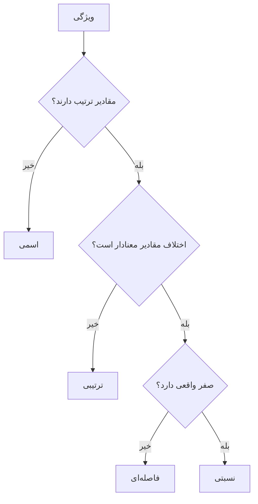

# جلسه ۳ — انواع داده و ویژگی‌ها

## چرا نوع داده مهم است؟

پیش از هر تحلیلی باید بدانیم با **چه نوع داده‌ای** سروکار داریم. نوع داده تعیین می‌کند:

- کدام آماره‌ها معنادارند (مثلاً میانگین «شهر محل تولد» بی‌معناست).
- کدام نمودار مناسب است ← [[۷ - تحلیل تک‌متغیره]]
- کدام معیار فاصله باید استفاده شود ← [[۵ - معیارهای شباهت و فاصله]]
- کدام روش پیش‌پردازش و کدگذاری لازم است ← [[۱۲ - تبدیل و یکپارچه‌سازی داده]]
- کدام الگوریتم قابل استفاده است.

> [!important] نکته کلیدی رایانه هر عددی را عدد می‌بیند، اما **هر عددی کمیت نیست**. شماره دانشجویی، کد پستی و کد ملی عدد هستند، اما جمع و میانگین آن‌ها معنایی ندارد. تشخیص نوع واقعی هر ویژگی کار تحلیل‌گر است، نه رایانه.

---

## شیء داده و ویژگی

یک مجموعه‌داده از تعدادی **شیء داده** (Data Object) تشکیل شده است و هر شیء با تعدادی **ویژگی** (Attribute) توصیف می‌شود.

|مفهوم|تعریف|نام‌های دیگر|جایگاه در جدول|
|:-:|:-:|:-:|:-:|
|شیء داده (Object)|یک موجودیت که درباره آن داده داریم|رکورد، نمونه، مشاهده، سطر، تاپل|سطر|
|ویژگی (Attribute)|یک خصوصیت یا مشخصه شیء|متغیر، فیلد، بُعد، ستون، ویژگی (Feature)|ستون|

> [!example] مثال — جدول دانشجویان
> 
> |شماره دانشجویی|جنسیت|سطح زبان|سال تولد|دمای بدن|قد (سانتی‌متر)|عضو انجمن|
> |:-:|:-:|:-:|:-:|:-:|:-:|:-:|
> |9801|زن|متوسط|1380|36.6|162.5|بله|
> |9802|مرد|پیشرفته|1381|37.2|178.0|خیر|
> |9803|مرد|مقدماتی|1379|36.9|181.2|بله|
> 
> در این جدول، هر **دانشجو** یک شیء داده و هر **ستون** یک ویژگی است. نوع هر ویژگی را تا پایان جلسه مشخص خواهیم کرد.

> [!note] ویژگی و مقدار ویژگی ویژگی با **مقدار** آن یکسان نیست. یک ویژگی مانند «قد» ممکن است با مقادیر متفاوتی (سانتی‌متر یا اینچ) اندازه‌گیری شود، و دو ویژگی متفاوت مانند «شماره دانشجویی» و «سن» ممکن است هر دو مقدار عددی داشته باشند اما ماهیت کاملاً متفاوتی داشته باشند.

---

## انواع ویژگی بر اساس مقیاس اندازه‌گیری

ویژگی‌ها بر اساس **عملیاتی که روی مقادیرشان معنادار است** به چهار نوع تقسیم می‌شوند. این طبقه‌بندی از استیونس (Stevens) گرفته شده است.

|عملیات|نماد|معنا|
|:-:|:-:|:-:|
|تمایز|= و ≠|آیا دو مقدار یکسان‌اند؟|
|ترتیب|> و <|کدام مقدار بزرگ‌تر است؟|
|تفاضل|+ و −|اختلاف دو مقدار چقدر است؟|
|نسبت|× و ÷|یک مقدار چند برابر دیگری است؟|

هر نوع ویژگی، همه عملیات نوع قبلی را دارد به‌علاوه یک عملیات جدید:

|نوع ویژگی|عملیات معنادار|مثال|آماره‌های مجاز|
|:-:|:-:|:-:|:-:|
|اسمی (Nominal)|تمایز|جنسیت، رنگ چشم، شهر، کد پستی|مد، فراوانی، آزمون کای‌دو|
|ترتیبی (Ordinal)|تمایز و ترتیب|سطح تحصیلات، رتبه، میزان رضایت|به‌علاوه میانه و صدک‌ها|
|فاصله‌ای (Interval)|تمایز، ترتیب و تفاضل|دمای سلسیوس، سال تقویم|به‌علاوه میانگین، انحراف معیار و همبستگی|
|نسبتی (Ratio)|هر چهار عملیات|قد، وزن، سن، درآمد، دمای کلوین|به‌علاوه میانگین هندسی و ضریب تغییرات|



### ویژگی اسمی (Nominal)

مقادیر فقط **نام یا برچسب** هستند و ترتیبی میان آن‌ها وجود ندارد.

- نمونه: جنسیت، گروه خونی، شهر، رشته تحصیلی، کد ملی
- فقط می‌توان پرسید «آیا دو مقدار یکسان‌اند؟»
- پرتکرارترین مقدار (مد) معنادار است، اما میانه و میانگین نه.

> [!warning] عددهایی که عدد نیستند اگر شهرها را با کد ۱ برای تهران، ۲ برای شیراز و ۳ برای تبریز ثبت کنیم، ویژگی همچنان **اسمی** است. میانگین ۲ برای این ستون به معنای «شیراز» نیست و بی‌معناست. شماره دانشجویی، کد پستی و شماره تلفن نیز ویژگی اسمی هستند.

### ویژگی ترتیبی (Ordinal)

مقادیر **ترتیب معنادار** دارند، اما فاصله میان آن‌ها مشخص یا یکسان نیست.

- نمونه: سطح تحصیلات (دیپلم، کارشناسی، ارشد، دکتری)، رتبه در مسابقه، درجه رضایت (کم، متوسط، زیاد)، نمره حرفی (A، B، C)
- می‌توان گفت «کارشناسی ارشد بالاتر از کارشناسی است»، اما نمی‌توان گفت «چقدر بالاتر».

> [!example] مثال — رتبه کنکور فاصله رتبه ۱ تا رتبه ۲ ممکن است نیم نمره باشد، اما فاصله رتبه ۱۰۰۰ تا ۱۰۰۱ ممکن است یک‌صدم نمره باشد. رتبه فقط **ترتیب** را نشان می‌دهد، نه اندازه اختلاف را.

> [!question] طیف لیکرت ترتیبی است یا فاصله‌ای؟ پاسخ‌های «کاملاً مخالفم» تا «کاملاً موافقم» که با اعداد ۱ تا ۵ کدگذاری شده‌اند، از نظر نظری **ترتیبی** هستند؛ چون معلوم نیست فاصله «مخالفم» تا «بی‌نظرم» با فاصله «بی‌نظرم» تا «موافقم» برابر باشد. با این حال در عمل بسیاری از پژوهشگران با آن‌ها مانند داده فاصله‌ای رفتار می‌کنند و میانگین می‌گیرند. این کار باید آگاهانه و با احتیاط انجام شود.

### ویژگی فاصله‌ای (Interval)

**اختلاف** مقادیر معنادار است، اما صفر **قراردادی** است و نبود کمیت را نشان نمی‌دهد. بنابراین نسبت دو مقدار بی‌معناست.

- نمونه: دمای سلسیوس و فارنهایت، سال تقویم (شمسی یا میلادی)، نمره استانداردشده
- اختلاف ۱۰ تا ۲۰ درجه با اختلاف ۲۰ تا ۳۰ درجه برابر است.
- اما ۲۰ درجه سلسیوس «دو برابر گرم‌تر» از ۱۰ درجه سلسیوس **نیست**.

### ویژگی نسبتی (Ratio)

هم اختلاف و هم **نسبت** مقادیر معنادار است، چون **صفر واقعی** دارد؛ یعنی صفر به معنای نبود کامل آن کمیت است.

- نمونه: قد، وزن، سن، درآمد، تعداد فرزندان، مدت زمان، دمای کلوین
- وزن ۸۰ کیلوگرم واقعاً دو برابر وزن ۴۰ کیلوگرم است.

> [!example] مثال حل‌شده — چرا دمای سلسیوس نسبتی نیست؟ دو دمای ۱۰ و ۲۰ درجه سلسیوس را به کلوین تبدیل می‌کنیم: $$ 10^\circ C = 283.15\ K, \qquad 20^\circ C = 293.15\ K $$ نسبت آن‌ها در مقیاس کلوین: $$ \frac{293.15}{283.15} \approx 1.035 $$ پس ۲۰ درجه فقط حدود ۳.۵ درصد «گرم‌تر» است، نه دو برابر. صفر سلسیوس (نقطه انجماد آب) قراردادی است، اما صفر کلوین نبود کامل انرژی گرمایی است.

### ویژگی کیفی و کمّی

|دسته کلی|انواع|نام‌های دیگر|
|:-:|:-:|:-:|
|ویژگی کیفی|اسمی و ترتیبی|مقوله‌ای (Categorical)، کیفی (Qualitative)|
|ویژگی کمّی|فاصله‌ای و نسبتی|عددی (Numeric)، کمّی (Quantitative)|

> [!tip] تبدیل‌های مجاز یک راه دیگر برای تشخیص نوع ویژگی، پرسیدن این است که **چه تبدیلی معنای آن را حفظ می‌کند**:
> 
> - ویژگی اسمی: هر جایگشتی از برچسب‌ها (مثلاً عوض کردن کدهای شهرها)
> - ویژگی ترتیبی: هر تبدیل صعودی (مثلاً کدگذاری ۱، ۲، ۳ یا ۱۰، ۲۰، ۳۰)
> - ویژگی فاصله‌ای: تبدیل خطی با جابه‌جایی صفر (مثلاً سلسیوس به فارنهایت)
> - ویژگی نسبتی: فقط ضرب در عدد ثابت (مثلاً متر به سانتی‌متر)

---

## ویژگی‌های گسسته و پیوسته

طبقه‌بندی دیگر ویژگی‌ها بر اساس **تعداد مقادیر ممکن** است:

|نوع|تعریف|مثال|نوع داده رایج در رایانه|
|:-:|:-:|:-:|:-:|
|گسسته (Discrete)|تعداد مقادیر متناهی یا شمارش‌پذیر|تعداد فرزندان، شهر، تعداد خرید|عدد صحیح یا متن|
|پیوسته (Continuous)|هر مقدار حقیقی در یک بازه|قد، وزن، دما، مدت زمان|عدد اعشاری|

> [!note] دو طبقه‌بندی مستقل گسسته یا پیوسته بودن با چهار نوع اسمی تا نسبتی **مستقل** است:
> 
> - ویژگی اسمی و ترتیبی معمولاً گسسته‌اند.
> - ویژگی فاصله‌ای و نسبتی می‌توانند گسسته باشند (تعداد فرزندان: نسبتی و گسسته) یا پیوسته (قد: نسبتی و پیوسته).

### ویژگی‌های دودویی (Binary)

ویژگی دودویی حالت خاصی از ویژگی اسمی گسسته است که **فقط دو مقدار** دارد (صفر و یک، بله و خیر، درست و نادرست).

|نوع|تعریف|مثال|معیار شباهت مناسب|
|:-:|:-:|:-:|:-:|
|دودویی متقارن|هر دو مقدار اهمیت یکسان دارند|جنسیت، دست غالب (چپ یا راست)|ضریب SMC|
|دودویی نامتقارن|فقط یکی از مقادیر (معمولاً یک) مهم است|نتیجه آزمایش بیماری، خرید یک کالا|ضریب جاکارد|

> [!example] مثال — آزمایش بیماری نادر در آزمایش یک بیماری نادر، نتیجه «مثبت» اطلاعات بسیار مهمی دارد، اما نتیجه «منفی» که برای اکثر افراد رخ می‌دهد، اطلاعات چندانی نمی‌دهد. اینکه دو نفر هر دو نتیجه منفی دارند، آن‌ها را شبیه هم نمی‌کند. چنین ویژگی‌ای **دودویی نامتقارن** است. جزئیات معیارهای شباهت در [[۵ - معیارهای شباهت و فاصله]] آمده است.

---

## انواع مجموعه‌داده

### ویژگی‌های کلی مجموعه‌داده‌ها

|ویژگی|معنا|اهمیت|
|:-:|:-:|:-:|
|ابعاد (Dimensionality)|تعداد ویژگی‌ها|ابعاد زیاد باعث «نفرین ابعاد» می‌شود|
|تُنُکی (Sparsity)|بیشتر مقادیر صفرند|امکان ذخیره و محاسبه بهینه|
|وضوح (Resolution)|سطح جزئیات داده|الگوها به سطح وضوح وابسته‌اند|
|اندازه (Size)|تعداد اشیاء|بر انتخاب الگوریتم و زمان اجرا اثر دارد|

> [!example] مثال — وضوح داده الگوی جزر و مد با داده‌های **ساعتی** سطح دریا دیده می‌شود، اما در داده‌های **ماهانه** کاملاً ناپدید است. وضوح نامناسب می‌تواند الگو را پنهان کند یا الگوی جعلی بسازد.

### داده جدولی (Record Data)

رایج‌ترین نوع داده: مجموعه‌ای از رکوردها که هر کدام تعداد ثابتی ویژگی دارند.

- نمونه: جدول مشتریان، جدول دانشجویان، داده‌های فرم ثبت‌نام
- بیشتر الگوریتم‌های این درس روی داده جدولی کار می‌کنند.

### داده تراکنشی (Transaction Data)

نوع خاصی از داده رکوردی که هر رکورد شامل **مجموعه‌ای از اقلام** است.

|شماره تراکنش|اقلام خریداری‌شده|
|:-:|:-:|
|تراکنش ۱|نان، شیر، پنیر|
|تراکنش ۲|نان، چای|
|تراکنش ۳|شیر، پنیر، چای، شکر|

- تعداد اقلام هر تراکنش متفاوت است.
- معمولاً به یک ماتریس دودویی **تُنُک** تبدیل می‌شود (هر ستون یک کالا).
- کاربرد اصلی: کاوش قواعد انجمنی.

### داده گرافی (Graph Data)

داده‌ای که در آن **روابط میان اشیاء** اهمیت دارد و با گره‌ها و یال‌ها نمایش داده می‌شود.

- نمونه: شبکه‌های اجتماعی (کاربران و دوستی‌ها)، صفحات وب و پیوندها، ساختار مولکول‌ها، شبکه حمل‌ونقل

### داده ترتیبی و سری زمانی (Sequential and Time Series)

داده‌ای که **ترتیب** مشاهدات در آن معنادار است.

|نوع|تعریف|مثال|
|:-:|:-:|:-:|
|سری زمانی|اندازه‌گیری یک کمیت در فواصل زمانی|قیمت روزانه سهام، دمای ساعتی|
|داده ترتیبی|دنباله‌ای از رویدادها یا نمادها|توالی DNA، مسیر کلیک کاربر در سایت|

> [!warning] خودهمبستگی زمانی در سری زمانی، مشاهدات نزدیک به هم معمولاً شبیه‌اند (دمای امروز به دمای دیروز نزدیک است). بنابراین نمی‌توان داده را مانند داده جدولی به‌صورت **تصادفی** به آموزش و آزمون تقسیم کرد؛ چون اطلاعات آینده به مدل نشت می‌کند.

### داده متنی (Text Data)

- نمونه: نظرات کاربران، مقالات خبری، ایمیل‌ها
- برای تحلیل معمولاً به **بردار شمارش واژه‌ها** تبدیل می‌شود که داده‌ای پرابعاد و تُنُک است.
- معیار شباهت رایج: شباهت کسینوسی

### داده مکانی (Spatial Data)

داده‌ای که **موقعیت جغرافیایی** در آن نقش دارد.

- نمونه: موقعیت شعب بانک، داده‌های آب‌وهوا روی نقشه، تصاویر ماهواره‌ای
- خودهمبستگی مکانی: مکان‌های نزدیک معمولاً مقادیر مشابه دارند.

---

## داده ساختاریافته، نیمه‌ساختاریافته و بدون ساختار

|نوع|تعریف|نمونه|ابزار ذخیره رایج|
|:-:|:-:|:-:|:-:|
|ساختاریافته|قالب ثابت جدولی با ستون‌های مشخص|جدول پایگاه داده، فایل CSV، Excel|پایگاه داده رابطه‌ای|
|نیمه‌ساختاریافته|دارای برچسب و سلسله‌مراتب، اما بدون قالب ثابت|فایل JSON، فایل XML، ایمیل|پایگاه داده NoSQL|
|بدون ساختار|فاقد قالب از پیش تعیین‌شده|متن آزاد، تصویر، صوت، ویدئو|سامانه فایل، دریاچه داده|

> [!note] سهم داده‌های بدون ساختار بخش بزرگی از داده‌هایی که امروز تولید می‌شود بدون ساختار است. با این حال، تقریباً همه الگوریتم‌های داده‌کاوی به ورودی **ساختاریافته** نیاز دارند. بنابراین بخش مهمی از کار، تبدیل داده بدون ساختار یا نیمه‌ساختاریافته به جدول است.

### نمونه داده نیمه‌ساختاریافته

در فایل JSON زیر، دانشجوی دوم ایمیل ندارد و تعداد درس‌ها متفاوت است؛ چیزی که در جدول ثابت به سادگی ممکن نیست:

```json
[
  {"id": 1, "name": "Ali",
   "contact": {"email": "ali@x.com", "city": "Tehran"},
   "courses": ["DM", "ML"]},
  {"id": 2, "name": "Sara",
   "contact": {"city": "Shiraz"},
   "courses": ["DM"]}
]
```

تبدیل آن به جدول با pandas:

```python
import pandas as pd

records = [
    {"id": 1, "name": "Ali",
     "contact": {"email": "ali@x.com", "city": "Tehran"}, "courses": ["DM", "ML"]},
    {"id": 2, "name": "Sara",
     "contact": {"city": "Shiraz"}, "courses": ["DM"]},
]
flat = pd.json_normalize(records)
print(flat)
#    id  name   courses contact.email contact.city
# 0   1   Ali  [DM, ML]     ali@x.com       Tehran
# 1   2  Sara      [DM]           NaN       Shiraz
```

> [!example] تفسیر خروجی ساختار تودرتوی `contact` به دو ستون جدا تبدیل شده و ایمیل گمشده سارا به `NaN` تبدیل شده است. ستون `courses` هنوز فهرست است و برای تحلیل باید بیشتر پردازش شود (مثلاً به ستون‌های دودویی برای هر درس).

---

## منابع داده عمومی

|منبع|ویژگی|مناسب برای|
|:-:|:-:|:-:|
|مخزن UCI Machine Learning Repository|قدیمی‌ترین و معتبرترین مخزن دانشگاهی؛ داده‌های تمیز و مستند|یادگیری الگوریتم‌ها و مقایسه با مقالات|
|سایت Kaggle|هزاران مجموعه‌داده واقعی، مسابقه و دفترچه‌های نمونه|پروژه‌های عملی و یادگیری از دیگران|
|سایت OpenML|دسترسی برنامه‌نویسی مستقیم، فراداده استاندارد و نتایج آزمایش‌ها|آزمایش‌های تکرارپذیر و مقایسه الگوریتم‌ها|
|موتور Google Dataset Search|جست‌وجو در میان مجموعه‌داده‌های منتشرشده در وب|یافتن داده در یک موضوع خاص|
|کتابخانه‌های پایتون|داده‌های نمونه در `sklearn.datasets` و `seaborn`|آموزش و تمرین سریع|

بارگذاری مستقیم داده از OpenML و کتابخانه‌ها:

```python
from sklearn.datasets import fetch_openml, load_iris
import seaborn as sns

iris = load_iris(as_frame=True).frame                        # built into sklearn
titanic = sns.load_dataset("titanic")                        # needs internet
adult = fetch_openml("adult", version=2, as_frame=True).frame   # from OpenML
```

> [!tip] چک‌لیست انتخاب مجموعه‌داده برای پروژه
> 
> - [ ] منبع داده و نحوه جمع‌آوری آن مستند است؟
> - [ ] مجوز استفاده از داده مشخص است؟
> - [ ] دست‌کم چند صد سطر دارد؟
> - [ ] ترکیبی از ویژگی‌های عددی و کیفی دارد؟
> - [ ] یک متغیر هدف مشخص برای پیش‌بینی دارد؟
> - [ ] معنای هر ستون (فرهنگ داده یا Data Dictionary) در دسترس است؟
> - [ ] داده کاملاً تمیز نیست؟ (برای تمرین پیش‌پردازش، کمی «کثیف» بودن مفید است!)

---

## نوع ویژگی در pandas

نوع داده‌ای که pandas به هر ستون می‌دهد (`dtype`) فقط **نحوه ذخیره‌سازی** را نشان می‌دهد، نه نوع واقعی ویژگی را.

|نوع در pandas|معنا|نوع ویژگی احتمالی|
|:-:|:-:|:-:|
|نوع `int64`|عدد صحیح|نسبتی، فاصله‌ای، ترتیبی کدگذاری‌شده یا حتی اسمی|
|نوع `float64`|عدد اعشاری|فاصله‌ای یا نسبتی پیوسته|
|نوع `object` یا `str`|متن|اسمی یا ترتیبی|
|نوع `bool`|درست یا نادرست|دودویی|
|نوع `category`|مقوله‌ای|اسمی؛ یا ترتیبی اگر مرتب‌شده باشد|
|نوع `datetime64`|تاریخ و زمان|فاصله‌ای|

### بررسی و اصلاح نوع ستون‌ها

```python
import pandas as pd

df = pd.DataFrame({
    "student_id": [9801, 9802, 9803, 9804, 9805],
    "gender":     ["F", "M", "M", "F", "F"],
    "grade":      ["B", "A", "C", "A", "B"],
    "birth_year": [1380, 1381, 1379, 1380, 1382],
    "temp_c":     [36.6, 37.2, 36.9, 38.1, 36.7],
    "height_cm":  [162.5, 178.0, 181.2, 158.4, 170.1],
    "is_member":  [True, False, True, True, False],
})
print(df.dtypes)
# student_id is int64 -> but it is nominal!
```

```python
# Nominal: an ID is a label, not a quantity
df["student_id"] = df["student_id"].astype(str)

# Nominal with few values -> category
df["gender"] = df["gender"].astype("category")

# Ordinal -> ordered category (order: C < B < A)
grade_type = pd.CategoricalDtype(categories=["C", "B", "A"], ordered=True)
df["grade"] = df["grade"].astype(grade_type)

df["grade"].min(), df["grade"].max()          # ('C', 'A')
df[df["grade"] >= "B"]["student_id"].tolist() # ['9801', '9802', '9804', '9805']
df["grade"].cat.codes.tolist()                # [1, 2, 0, 2, 1]
```

> [!tip] مزیت نوع category مرتب‌شده وقتی ستون ترتیبی را به نوع `category` مرتب‌شده تبدیل کنیم، مقایسه‌هایی مانند `>= "B"` و توابعی مانند `min` و `max` بر اساس **ترتیب واقعی** کار می‌کنند، نه ترتیب الفبایی. در ترتیب الفبایی، حرف A کوچک‌تر از C است که برای نمره حرفی نادرست است.

### جدا کردن ستون‌های عددی و کیفی

```python
num_cols = df.select_dtypes(include="number").columns.tolist()
cat_cols = df.select_dtypes(exclude="number").columns.tolist()
print(num_cols)   # ['birth_year', 'temp_c', 'height_cm']
print(cat_cols)   # ['student_id', 'gender', 'grade', 'is_member']

df.nunique()      # number of distinct values per column
```

> [!warning] فهرست عددی هنوز بازبینی می‌خواهد ستون `birth_year` در فهرست عددی قرار گرفته، اما **فاصله‌ای** است نه نسبتی؛ چون سال صفر تقویم قراردادی است. ستون‌های `temp_c` (فاصله‌ای) و `height_cm` (نسبتی) نیز هر دو عددی‌اند اما نوع متفاوتی دارند. تابع `select_dtypes` فقط نقطه شروع است.

> [!tip] قاعده سرانگشتی با nunique اگر یک ستون عددی تعداد بسیار کمی مقدار یکتا دارد (مثلاً ۲ تا ۱۰ مقدار)، احتمالاً **کدگذاری یک ویژگی کیفی** است و باید بررسی شود؛ مانند ستون `pclass` در داده Titanic.

### جمع‌بندی مثال جدول دانشجویان

|ستون|نوع ویژگی|گسسته یا پیوسته|دلیل|
|:-:|:-:|:-:|:-:|
|شماره دانشجویی|اسمی|گسسته|فقط برچسب شناسایی است|
|جنسیت|دودویی متقارن (اسمی)|گسسته|دو مقدار با اهمیت یکسان|
|سطح زبان یا نمره حرفی|ترتیبی|گسسته|ترتیب دارد، فاصله نامشخص|
|سال تولد|فاصله‌ای|گسسته|صفر تقویم قراردادی است|
|دمای بدن (سلسیوس)|فاصله‌ای|پیوسته|صفر سلسیوس قراردادی است|
|قد|نسبتی|پیوسته|صفر واقعی دارد|
|عضو انجمن|دودویی نامتقارن|گسسته|عضویت مهم‌تر از عدم عضویت است|

---

## تمرین عملی کلاس

> [!example] تمرین عملی (۲۵ دقیقه) مجموعه‌داده Titanic را بارگذاری کنید:
> 
> ```python
> import seaborn as sns
> df = sns.load_dataset("titanic")
> ```
> 
> 1. خروجی `df.dtypes` و `df.nunique()` را بررسی کنید.
> 2. برای هر ستون، نوع ویژگی (اسمی، ترتیبی، فاصله‌ای، نسبتی) و گسسته یا پیوسته بودن آن را در یک جدول بنویسید.
> 3. ستون‌هایی را پیدا کنید که نوع ذخیره‌سازی آن‌ها در pandas با نوع واقعی ویژگی سازگار نیست.
> 4. ستون `class` را به نوع `category` مرتب‌شده تبدیل کنید و بررسی کنید که مقایسه `df["class"] > "Second"` درست کار می‌کند.
> 5. کدام ستون‌ها اطلاعات تکراری دارند؟ (راهنما: `survived` و `alive`، `pclass` و `class`)
> 6. ستون‌های دودویی را پیدا کنید. کدام متقارن و کدام نامتقارن‌اند؟

> [!question]- پاسخ پیشنهادی تمرین
> 
> |ستون|نوع در pandas|نوع ویژگی|گسسته یا پیوسته|
> |:-:|:-:|:-:|:-:|
> |ستون survived|int64|دودویی (اسمی)|گسسته|
> |ستون pclass|int64|ترتیبی|گسسته|
> |ستون sex|object|دودویی متقارن (اسمی)|گسسته|
> |ستون age|float64|نسبتی|پیوسته|
> |ستون sibsp|int64|نسبتی|گسسته|
> |ستون parch|int64|نسبتی|گسسته|
> |ستون fare|float64|نسبتی|پیوسته|
> |ستون embarked|object|اسمی|گسسته|
> |ستون class|category|ترتیبی (در pandas مرتب‌نشده)|گسسته|
> |ستون who|object|اسمی|گسسته|
> |ستون adult_male|bool|دودویی|گسسته|
> |ستون deck|category|اسمی (یا ترتیبی بر اساس طبقه کشتی)|گسسته|
> |ستون embark_town|object|اسمی|گسسته|
> |ستون alive|object|دودویی (اسمی)|گسسته|
> |ستون alone|bool|دودویی|گسسته|
> 
> ناسازگاری‌ها: ستون `pclass` با وجود نوع `int64` ترتیبی است و ستون `class` با وجود نوع `category` مرتب‌نشده است. اطلاعات تکراری: ستون `alive` همان `survived`، ستون `class` همان `pclass` و ستون `embark_town` همان `embarked` است.
> 
> تبدیل ستون class به نوع مرتب‌شده:
> 
> ```python
> import pandas as pd
> class_type = pd.CategoricalDtype(["Third", "Second", "First"], ordered=True)
> df["class"] = df["class"].astype(class_type)
> (df["class"] > "Second").sum()   # 216 first-class passengers
> ```

---

## پرسش‌های مرور

> [!question]- ۱. تفاوت ویژگی فاصله‌ای و نسبتی چیست؟ برای هر کدام یک مثال بزنید. هر دو اختلاف معنادار دارند، اما فقط ویژگی **نسبتی** صفر واقعی دارد و نسبت مقادیرش معنادار است. دمای سلسیوس فاصله‌ای است (۲۰ درجه دو برابر ۱۰ درجه نیست) و وزن نسبتی است (۸۰ کیلوگرم دو برابر ۴۰ کیلوگرم است).

> [!question]- ۲. کد پستی عدد است؛ چرا ویژگی اسمی محسوب می‌شود؟ چون فقط **برچسب** یک منطقه است. جمع، تفاضل، میانگین یا حتی مقایسه بزرگ‌تر و کوچک‌تر میان کدهای پستی معنای واقعی ندارد. تنها عملیات معنادار، بررسی یکسان بودن یا نبودن است.

> [!question]- ۳. برای ستون «سطح تحصیلات» کدام آماره مرکزی مناسب است: میانگین، میانه یا مد؟ ویژگی ترتیبی است، پس **میانه** و **مد** مناسب‌اند. میانگین مناسب نیست، چون فاصله میان سطوح (مثلاً دیپلم تا کارشناسی و کارشناسی تا ارشد) مشخص و یکسان نیست.

> [!question]- ۴. «تعداد فرزندان» گسسته است یا پیوسته؟ نوع آن در طبقه‌بندی استیونس چیست؟ **گسسته** است، چون فقط مقادیر صحیح می‌گیرد. در طبقه‌بندی استیونس **نسبتی** است، چون صفر واقعی دارد (صفر فرزند یعنی نبود فرزند) و نسبت معنادار است (۴ فرزند دو برابر ۲ فرزند است).

> [!question]- ۵. سبد خرید مشتریان یک فروشگاه چه نوع مجموعه‌داده‌ای است و چه ویژگی مهمی دارد؟ داده **تراکنشی** است. هر مشتری فقط تعداد کمی از هزاران کالای فروشگاه را می‌خرد، بنابراین وقتی به ماتریس دودویی تبدیل شود بسیار **تُنُک** است و ویژگی‌هایش دودویی نامتقارن‌اند.

> [!question]- ۶. چرا نمی‌توان داده سری زمانی را به‌صورت تصادفی به آموزش و آزمون تقسیم کرد؟ چون مشاهدات نزدیک در زمان به هم وابسته‌اند. تقسیم تصادفی باعث می‌شود مدل با داده‌های **آینده** آموزش ببیند و دقت آن روی آزمون به‌طور غیرواقعی بالا برآورد شود. باید داده گذشته برای آموزش و داده آینده برای آزمون استفاده شود.

---

## نکات کلیدی

> [!summary] خلاصه جلسه
> 
> - مجموعه‌داده از **اشیاء** (سطرها) تشکیل شده که با **ویژگی‌ها** (ستون‌ها) توصیف می‌شوند.
> - چهار نوع ویژگی: **اسمی** (تمایز)، **ترتیبی** (به‌علاوه ترتیب)، **فاصله‌ای** (به‌علاوه تفاضل) و **نسبتی** (به‌علاوه نسبت و صفر واقعی).
> - نوع ویژگی تعیین می‌کند کدام آماره، نمودار، معیار فاصله و الگوریتم معنادار است.
> - گسسته یا پیوسته بودن، طبقه‌بندی مستقلی است؛ ویژگی دودویی می‌تواند **متقارن** یا **نامتقارن** باشد.
> - انواع مجموعه‌داده: جدولی، تراکنشی، گرافی، ترتیبی یا سری زمانی، متنی و مکانی.
> - داده می‌تواند ساختاریافته، نیمه‌ساختاریافته یا بدون ساختار باشد؛ الگوریتم‌ها معمولاً به ورودی ساختاریافته نیاز دارند.
> - نوع ستون در pandas فقط **نحوه ذخیره‌سازی** است؛ تعیین نوع واقعی ویژگی کار تحلیل‌گر است.

> [!todo] آمادگی برای جلسه بعد
> 
> 1. مجموعه‌داده پروژه خود را از UCI، Kaggle یا OpenML انتخاب و دانلود کنید.
> 2. برای همه ستون‌های آن، جدول نوع ویژگی (مانند پاسخ تمرین Titanic) تهیه کنید. این جدول بخشی از **تکلیف ۱** خواهد بود.
> 3. نوع ستون‌ها را در pandas اصلاح کنید (شناسه‌ها به متن، ستون‌های ترتیبی به `category` مرتب‌شده).