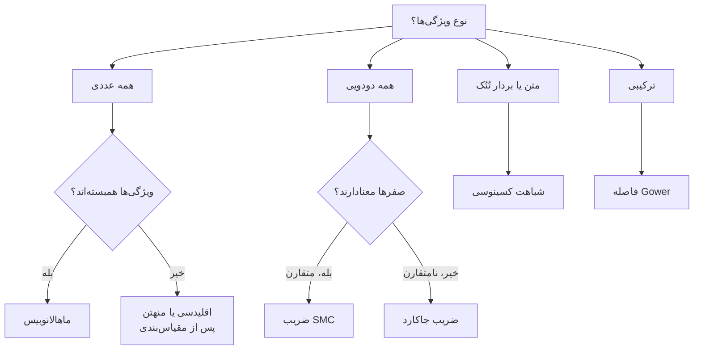

# جلسه ۵ — معیارهای شباهت و فاصله


> [!info] اهداف یادگیری  
> پس از این جلسه، دانشجو باید بتواند:
> 
> 1. تفاوت شباهت و عدم شباهت را توضیح دهد و ویژگی‌های یک **متریک** را بیان کند.
> 2. فاصله‌های اقلیدسی، منهتن، مینکوفسکی و چبیشف را برای داده عددی محاسبه کند.
> 3. برای داده دودویی بین ضریب **SMC** و ضریب **جاکارد** انتخاب درست انجام دهد.
> 4. شباهت کسینوسی را برای داده متنی محاسبه و تفسیر کند.
> 5. برای داده ترکیبی از فاصله **Gower** و برای داده همبسته از فاصله **ماهالانوبیس** استفاده کند.
> 6. اثر مقیاس ویژگی‌ها بر فاصله را توضیح دهد و آن را اصلاح کند.
---

## ۱. چرا شباهت و فاصله؟

بسیاری از روش‌های داده‌کاوی بر یک پرسش ساده بنا شده‌اند: **«این دو شیء چقدر به هم شبیه‌اند؟»**

- الگوریتم **k-NN** برای طبقه‌بندی، نزدیک‌ترین همسایه‌ها را پیدا می‌کند ← [[20 -  مبانی طبقه‌بندی و k-NN]]
- الگوریتم **k-Means** هر نقطه را به نزدیک‌ترین مرکز خوشه نسبت می‌دهد ← [[26 - مبانی خوشه‌بندی و k-Means]]
- الگوریتم **DBSCAN** همسایگی هر نقطه را با یک شعاع فاصله تعریف می‌کند ← [[28 - خوشه‌بندی چگالی‌محور و مبتنی بر مدل]]
- روش **KNN Imputer** مقدار گمشده را از روی نمونه‌های مشابه پر می‌کند ← [[۱۰ - مدیریت داده گمشده]]
- سیستم‌های توصیه‌گر، جست‌وجوی اسناد و تشخیص ناهنجاری نیز بر شباهت تکیه دارند.

> [!important] نکته کلیدی  
> انتخاب معیار فاصله، **تعریف ما از «شباهت»** است. اگر این تعریف نادرست باشد، بهترین الگوریتم هم نتیجه نادرست می‌دهد.

---

## ۲. مفاهیم پایه

### ۲.۱ شباهت و عدم شباهت

|           مفهوم           |               تعریف               |   بازه معمول    |           تفسیر            |
| :-----------------------: | :-------------------------------: | :-------------: | :------------------------: |
|    شباهت (Similarity)     |      میزان شبیه‌بودن دو شیء       |    صفر تا یک    |  عدد بزرگ‌تر یعنی شبیه‌تر  |
| عدم شباهت (Dissimilarity) |     میزان متفاوت‌بودن دو شیء      | صفر تا بی‌نهایت | عدد بزرگ‌تر یعنی متفاوت‌تر |
|     فاصله (Distance)      | عدم شباهتی که شرایط متریک را دارد | صفر تا بی‌نهایت |   عدد بزرگ‌تر یعنی دورتر   |

واژه **مجاورت (Proximity)** به هر دو مفهوم شباهت و عدم شباهت اشاره دارد.

### ۲.۲ ویژگی‌های متریک

تابع فاصله d یک **متریک** است اگر برای همه اشیاء x و y و z چهار شرط زیر برقرار باشد:

1. **نامنفی‌بودن:** فاصله هرگز منفی نیست.
2. **همانی:** فاصله صفر است اگر و تنها اگر دو شیء یکسان باشند.
3. **تقارن:** فاصله x تا y برابر فاصله y تا x است.
4. **نامساوی مثلث:** مسیر مستقیم هرگز از مسیر غیرمستقیم طولانی‌تر نیست.

$$  
\begin{aligned}  
&(1)\quad d(x, y) \geq 0 \\  
&(2)\quad d(x, y) = 0 \iff x = y \\  
&(3)\quad d(x, y) = d(y, x) \\  
&(4)\quad d(x, z) \leq d(x, y) + d(y, z)  
\end{aligned}  
$$


### ۲.۳ تبدیل شباهت و فاصله به یکدیگر

تبدیل خطی، وقتی شباهت در بازه صفر تا یک باشد:

$$  
d = 1 - s  
$$

تبدیل معکوس، وقتی فاصله در بازه صفر تا بی‌نهایت باشد:

$$  
s = \frac{1}{1 + d}  
$$

تبدیل نمایی، که در هسته‌ها (Kernels) مانند هسته RBF به کار می‌رود:

$$  
s = e^{-d}  
$$

---

## ۳. فاصله برای ویژگی‌های عددی

دو شیء x و y را با n ویژگی عددی در نظر بگیرید:

$$  
x = (x_1, x_2, \dots, x_n), \qquad y = (y_1, y_2, \dots, y_n)  
$$

### ۳.۱ فاصله مینکوفسکی (Minkowski) — حالت کلی

$$  
d_p(x, y) = \left( \sum_{k=1}^{n} |x_k - y_k|^p \right)^{1/p}  
$$

سه حالت خاص آن پرکاربردترند:

| نام فاصله | مقدار p |   نام‌های دیگر   |             شهود              |
| :-------: | :-----: | :--------------: | :---------------------------: |
|   منهتن   |    1    | City-block یا L1 | حرکت در خیابان‌های شطرنجی شهر |
|  اقلیدسی  |    2    | Euclidean یا L2  |        فاصله خط مستقیم        |
|   چبیشف   |    ∞    |  Supremum یا L∞  | بیشترین اختلاف در یک بُعد؛ نج |

فاصله منهتن:

$$  
d_1(x, y) = \sum_{k=1}^{n} |x_k - y_k|  
$$

فاصله اقلیدسی:

$$  
d_2(x, y) = \sqrt{\sum_{k=1}^{n} (x_k - y_k)^2}  
$$

فاصله چبیشف:

$$  
d_\infty(x, y) = \max_{k} |x_k - y_k|  
$$

> [!example] مثال حل‌شده  
> دو نقطه زیر را در نظر بگیرید:  
> $$  
> x = (1, 2), \qquad y = (4, 6)  
> $$  
> اختلاف در بُعد اول برابر ۳ و در بُعد دوم برابر ۴ است.
> 
> |نام فاصله|مقدار p|محاسبه|نتیجه|
> |:-:|:-:|:-:|:-:|
> |منهتن|1|3 + 4|7|
> |اقلیدسی|2|(9 + 16)√|5|
> |مینکوفسکی|3|(27 + 64)∛|4.50|
> |چبیشف|∞|max(3, 4)|4|
> 
> با افزایش p، فاصله کوچک‌تر می‌شود و به **بزرگ‌ترین اختلاف** نزدیک‌تر می‌شود.

> [!tip] کدام را انتخاب کنیم؟
> 
> - فاصله **اقلیدسی** پیش‌فرض رایج است و به اختلاف‌های بزرگ حساس است (به دلیل توان ۲).
> - فاصله **منهتن** در برابر داده پرت مقاوم‌تر است و در ابعاد بالا معمولاً بهتر عمل می‌کند.
> - فاصله **چبیشف** وقتی مناسب است که فقط بدترین اختلاف مهم باشد؛ مثلاً در کنترل کیفیت: «هیچ بُعدی بیش از حد مجاز منحرف نشود».

---

## ۴. شباهت برای ویژگی‌های دودویی

فرض کنید x و y دو بردار دودویی (صفر و یک) باشند. چهار شمارنده تعریف می‌کنیم:

- تعداد ویژگی‌هایی که در هر دو شیء برابر ۱ هستند: **f11**
- تعداد ویژگی‌هایی که در x برابر ۱ و در y برابر ۰ هستند: **f10**
- تعداد ویژگی‌هایی که در x برابر ۰ و در y برابر ۱ هستند: **f01**
- تعداد ویژگی‌هایی که در هر دو شیء برابر ۰ هستند: **f00**

### ۴.۱ ضریب تطابق ساده (SMC — Simple Matching Coefficient)

نسبت تعداد تطابق‌ها به تعداد کل ویژگی‌ها:

$$  
\text{SMC} = \frac{f_{11} + f_{00}}{f_{11} + f_{10} + f_{01} + f_{00}}  
$$

این ضریب برای ویژگی‌های دودویی **متقارن** مناسب است؛ یعنی جایی که صفر و یک اهمیت یکسان دارند (مثلاً جنسیت).

### ۴.۲ ضریب جاکارد (Jaccard Coefficient)

$$  
J = \frac{f_{11}}{f_{11} + f_{10} + f_{01}}  
$$

این ضریب برای ویژگی‌های دودویی **نامتقارن** مناسب است؛ یعنی جایی که فقط «حضور» (یک) معنادار است و «عدم حضور» (صفر) اطلاعات چندانی ندارد. به همین دلیل شمارنده f00 کنار گذاشته می‌شود.

> [!example] مثال حل‌شده — سبد خرید  
> دو مشتری و ۱۰ کالا (۱ یعنی خریده، ۰ یعنی نخریده):
> 
> |مشتری|ک۱|ک۲|ک۳|ک۴|ک۵|ک۶|ک۷|ک۸|ک۹|ک۱۰|
> |:-:|:-:|:-:|:-:|:-:|:-:|:-:|:-:|:-:|:-:|:-:|
> |مشتری اول|1|0|0|0|0|0|0|0|0|0|
> |مشتری دوم|0|0|0|0|0|0|1|0|0|1|
> 
> |شمارنده|f11|f10|f01|f00|
> |:-:|:-:|:-:|:-:|:-:|
> |مقدار|0|1|2|7|
> 
> $$  
> \text{SMC} = \frac{0 + 7}{10} = 0.7, \qquad J = \frac{0}{0 + 1 + 2} = 0  
> $$
> 
> **تفسیر:** این دو مشتری **هیچ کالای مشترکی** نخریده‌اند، اما ضریب SMC آن‌ها را ۷۰٪ شبیه نشان می‌دهد؛ فقط چون هر دو ۷ کالا را نخریده‌اند! در داده سبد خرید، **جاکارد** معیار درست است.

> [!tip] قاعده سرانگشتی  
> اگر بیشتر مقادیر صفر باشند (داده **تُنُک** یا Sparse)، از جاکارد استفاده کنید.

---

## ۵. شباهت کسینوسی (Cosine Similarity)

$$  
\cos(x, y) = \frac{x \cdot y}{\lVert x \rVert  \lVert y \rVert} = \frac{\sum_k x_k y_k}{\sqrt{\sum_k x_k^2}  \sqrt{\sum_k y_k^2}}  
$$

- شباهت کسینوسی **زاویه** بین دو بردار را می‌سنجد، نه طول آن‌ها را.
- برای بردارهای نامنفی (مانند شمارش واژه‌ها) مقدار آن بین صفر و یک است.
- مقدار یک یعنی دو بردار هم‌جهت‌اند (کاملاً شبیه) و مقدار صفر یعنی بر هم عمودند (بدون اشتراک).
- مانند جاکارد، تطابق‌های صفر–صفر را نادیده می‌گیرد، اما برخلاف آن برای داده **غیردودویی** (مثلاً تعداد تکرار واژه) هم کار می‌کند.

> [!example] مثال حل‌شده — دو سند متنی  
> بردار تعداد تکرار ۱۰ واژه در دو سند:  
> $$  
> d_1 = (3, 2, 0, 5, 0, 0, 0, 2, 0, 0), \qquad d_2 = (1, 0, 0, 0, 0, 0, 0, 1, 0, 2)  
> $$
> 
> گام‌های محاسبه:  
> $$  
> \begin{aligned}  
> d_1 \cdot d_2 &= 3 \times 1 + 2 \times 1 = 5 \\  
> \lVert d_1 \rVert &= \sqrt{9 + 4 + 25 + 4} = \sqrt{42} \approx 6.481 \\  
> \lVert d_2 \rVert &= \sqrt{1 + 1 + 4} = \sqrt{6} \approx 2.449 \\  
> \cos(d_1, d_2) &= \frac{5}{6.481 \times 2.449} \approx 0.315  
> \end{aligned}  
> $$

> [!question] چرا برای متن از فاصله اقلیدسی استفاده نمی‌کنیم؟  
> یک سند و همان سند که دو بار پشت سر هم تکرار شده باشد، فاصله اقلیدسی زیادی دارند (چون همه شمارش‌ها دو برابر شده‌اند)، اما **موضوع یکسانی** دارند. شباهت کسینوسی برای آن‌ها دقیقاً برابر یک است، چون جهت بردار تغییر نکرده است.

---

## ۶. فاصله برای ویژگی‌های ترکیبی و همبسته

### ۶.۱ فاصله Gower — داده با انواع مختلف ویژگی

داده‌های واقعی معمولاً ترکیبی از ویژگی‌های عددی، اسمی، ترتیبی و دودویی‌اند ← [[۳ - انواع داده و ویژگی‌ها]]

ایده Gower این است که برای هر ویژگی یک عدم شباهت جزئی بین صفر و یک حساب کنیم و از آن‌ها میانگین بگیریم:

$$  
d_{\text{Gower}}(x, y) = \frac{\sum_{k=1}^{n} \delta_k d_k(x, y)}{\sum_{k=1}^{n} \delta_k}  
$$

در این فرمول، وزن دلتا برای ویژگی k برابر صفر است اگر مقدار آن ویژگی در یکی از دو شیء **گمشده** باشد (یا در ویژگی دودویی نامتقارن، تطابق صفر–صفر رخ دهد)؛ در غیر این صورت برابر یک است.

|نوع ویژگی|عدم شباهت جزئی|
|:-:|:-:|
|عددی|قدر مطلق اختلاف تقسیم بر دامنه تغییرات ویژگی|
|اسمی یا دودویی|صفر اگر برابر باشند، در غیر این صورت یک|
|ترتیبی|تبدیل رتبه به بازه صفر تا یک، سپس مانند ویژگی عددی|

عدم شباهت جزئی برای ویژگی عددی (R دامنه تغییرات ویژگی است):

$$  
d_k = \frac{|x_k - y_k|}{R_k}  
$$

تبدیل رتبه برای ویژگی ترتیبی با M سطح:

$$  
z = \frac{r - 1}{M - 1}  
$$

> [!example] مثال حل‌شده — دو مشتری
> 
> |ویژگی|نوع|مشتری A|مشتری B|دامنه در کل داده|عدم شباهت جزئی|
> |:-:|:-:|:-:|:-:|:-:|:-:|
> |سن|عددی|25|45|20 تا 60|40 / 20 = 0.5|
> |جنسیت|دودویی متقارن|مرد|مرد|—|0|
> |شهر|اسمی|تهران|شیراز|—|1|
> |درآمد (میلیون تومان)|عددی|30|50|10 تا 110|100 / 20 = 0.2|
> 
> $$  
> d_{\text{Gower}}(A, B) = \frac{0.5 + 0 + 1 + 0.2}{4} = 0.425  
> $$

### ۶.۲ فاصله ماهالانوبیس (Mahalanobis) — داده همبسته

فاصله اقلیدسی فرض می‌کند ویژگی‌ها **مستقل** و با **پراکندگی یکسان** هستند. فاصله ماهالانوبیس با استفاده از ماتریس کوواریانس این دو مشکل را برطرف می‌کند:

$$  
d_M(x, y) = \sqrt{(x - y)^\top \times \Sigma^{-1} \times (x - y)}  
$$

- اگر ماتریس کوواریانس، ماتریس همانی باشد، فاصله ماهالانوبیس همان فاصله **اقلیدسی** است.
- اگر ماتریس کوواریانس قطری باشد، معادل فاصله اقلیدسی روی داده **استانداردشده** (Z-score) است.
- کاربرد مهم آن **تشخیص داده پرت چندمتغیره** است ← [[11- داده پرت، نویز و داده تکراری]]

> [!example] مثال حل‌شده  
> دو ویژگی با واریانس ۱ و همبستگی ۰٫۹ داریم:  
> $$  
> \Sigma = \begin{pmatrix} 1 & 0.9 \\ 0.9 & 1 \end{pmatrix}  
> $$  
> فاصله دو نقطه A و B را از مبدأ مختصات حساب می‌کنیم:
> 
> |نقطه|مختصات|فاصله اقلیدسی|فاصله ماهالانوبیس|
> |:-:|:-:|:-:|:-:|
> |نقطه A|(1, 1)|1.41|1.03|
> |نقطه B|(1, -1)|1.41|4.47|
> 
> **تفسیر:** از نگاه اقلیدسی هر دو نقطه به یک اندازه از مرکز دورند. اما چون دو ویژگی همبستگی مثبت قوی دارند، نقطه A با الگوی داده هماهنگ است و نقطه B (یکی زیاد، دیگری کم) **غیرعادی** است. فاصله ماهالانوبیس این را تشخیص می‌دهد.

---

## ۷. اهمیت مقیاس ویژگی‌ها

> [!warning] مشکل  
> ویژگی با **واحد یا دامنه بزرگ‌تر**، محاسبه فاصله را کاملاً در اختیار می‌گیرد و ویژگی‌های دیگر عملاً نادیده گرفته می‌شوند.

> [!example] مثال حل‌شده — سن و درآمد
> 
> |فرد|سن (سال)|درآمد (تومان)|
> |:-:|:-:|:-:|
> |فرد A|25|30,000,000|
> |فرد B|65|30,500,000|
> |فرد C|26|32,000,000|
> 
> **بدون مقیاس‌بندی** (فاصله اقلیدسی):  
> $$  
> d(A, B) \approx 500{,}000, \qquad d(A, C) \approx 2{,}000{,}000  
> $$  
> نتیجه: فرد A به B شبیه‌تر است؛ با وجود **۴۰ سال اختلاف سنی**! اختلاف ۴۰ سال در برابر اختلاف ۵۰۰ هزار تومان عملاً صفر است.
> 
> **با مقیاس‌بندی Min-Max** (سن در بازه ۱۸ تا ۷۰ و درآمد در بازه ۱۰ تا ۱۱۰ میلیون):  
> $$  
> d(A, B) \approx 0.769, \qquad d(A, C) \approx 0.028  
> $$  
> نتیجه: فرد A به C شبیه‌تر است؛ که با شهود ما سازگار است.

راه‌حل، مقیاس‌بندی ویژگی‌ها پیش از محاسبه فاصله است :

|          روش          |             خروجی             |          ویژگی          |
| :-------------------: | :---------------------------: | :---------------------: |
|  مقیاس‌بندی Min-Max   |        بازه صفر تا یک         |    حساس به داده پرت     |
| استانداردسازی Z-score | میانگین صفر و انحراف معیار یک |      رایج‌ترین روش      |
|   مقیاس‌بندی Robust   |           میانه صفر           | مقاوم در برابر داده پرت |

مقیاس‌بندی Min-Max:

$$  
x' = \frac{x - \min}{\max - \min}  
$$

استانداردسازی Z-score:

$$  
x' = \frac{x - \mu}{\sigma}  
$$

مقیاس‌بندی Robust:

$$  
x' = \frac{x - \text{median}}{\text{IQR}}  
$$

---

## ۸. جمع‌بندی: کدام معیار برای کدام داده؟



|معیار|نوع داده|نکته کلیدی|
|:-:|:-:|:-:|
|فاصله اقلیدسی|عددی|پیش‌فرض رایج؛ نیازمند مقیاس‌بندی|
|فاصله منهتن|عددی|مقاوم‌تر در برابر داده پرت و ابعاد بالا|
|فاصله چبیشف|عددی|فقط بزرگ‌ترین اختلاف|
|فاصله مینکوفسکی|عددی|حالت کلی سه معیار بالا|
|ضریب SMC|دودویی متقارن|صفر–صفر را تطابق حساب می‌کند|
|ضریب جاکارد|دودویی نامتقارن|صفر–صفر را نادیده می‌گیرد|
|شباهت کسینوسی|متن و بردارهای تُنُک|جهت مهم است، نه طول|
|فاصله Gower|ترکیبی|داده گمشده را هم مدیریت می‌کند|
|فاصله ماهالانوبیس|عددی همبسته|کوواریانس را در نظر می‌گیرد|

---

## ۹. پیاده‌سازی در پایتون

### ۹.۱ فاصله‌های عددی

```python
import numpy as np
from scipy.spatial import distance

x = np.array([1, 2])
y = np.array([4, 6])

print("Euclidean :", distance.euclidean(x, y))         # 5.0
print("Manhattan :", distance.cityblock(x, y))         # 7
print("Chebyshev :", distance.chebyshev(x, y))         # 4
print("Minkowski3:", distance.minkowski(x, y, p=3))    # ~4.498
```

### ۹.۲ داده دودویی و شباهت کسینوسی

```python
a = np.array([1, 0, 0, 0, 0, 0, 0, 0, 0, 0])
b = np.array([0, 0, 0, 0, 0, 0, 1, 0, 0, 1])

smc = np.mean(a == b)
jaccard_sim = 1 - distance.jaccard(a, b)   # scipy returns the distance
print("SMC    :", smc)                     # 0.7
print("Jaccard:", jaccard_sim)             # 0.0

d1 = np.array([3, 2, 0, 5, 0, 0, 0, 2, 0, 0])
d2 = np.array([1, 0, 0, 0, 0, 0, 0, 1, 0, 2])
cos_sim = 1 - distance.cosine(d1, d2)      # scipy returns the distance
print("Cosine :", round(cos_sim, 3))       # 0.315
```

### ۹.۳ فاصله ماهالانوبیس

```python
cov = np.array([[1.0, 0.9],
                [0.9, 1.0]])
VI = np.linalg.inv(cov)                    # inverse covariance
origin = np.zeros(2)

print(distance.mahalanobis([1,  1], origin, VI))   # ~1.03
print(distance.mahalanobis([1, -1], origin, VI))   # ~4.47
```

### ۹.۴ ماتریس فاصله و اثر مقیاس‌بندی

```python
import pandas as pd
from sklearn.metrics import pairwise_distances
from sklearn.preprocessing import MinMaxScaler

df = pd.DataFrame({
    "age":    [25, 65, 26],
    "income": [30_000_000, 30_500_000, 32_000_000],
}, index=["A", "B", "C"])

# Without scaling
D_raw = pairwise_distances(df, metric="euclidean")
print(pd.DataFrame(D_raw, index=df.index, columns=df.index).round(0))

# With Min-Max scaling, using the full-data ranges from section 7
# (age: 18–70, income: 10M–110M)
bounds = pd.DataFrame({"age": [18, 70], "income": [10_000_000, 110_000_000]})
scaler = MinMaxScaler().fit(bounds)
X_scaled = scaler.transform(df)
D_scaled = pairwise_distances(X_scaled, metric="euclidean")
print(pd.DataFrame(D_scaled, index=df.index, columns=df.index).round(3))
# d(A,B) ≈ 0.769 , d(A,C) ≈ 0.028
```

> [!note] نکته  
> در عمل، مقیاس‌بند `MinMaxScaler` کمینه و بیشینه را از **داده آموزش** یاد می‌گیرد (با متد `fit`). در اینجا برای سازگاری با مثال بخش ۷، دامنه کل داده را مستقیم به آن داده‌ایم.

### ۹.۵ فاصله Gower (پیاده‌سازی ساده)

```python
def gower_distance(x, y, num_cols, cat_cols, ranges):
    """Gower distance between two rows (pandas Series)."""
    parts = []
    for c in num_cols:
        if pd.notna(x[c]) and pd.notna(y[c]):
            parts.append(abs(x[c] - y[c]) / ranges[c])
    for c in cat_cols:
        if pd.notna(x[c]) and pd.notna(y[c]):
            parts.append(0.0 if x[c] == y[c] else 1.0)
    return np.mean(parts)

customers = pd.DataFrame({
    "age":    [25, 45],
    "gender": ["M", "M"],
    "city":   ["Tehran", "Shiraz"],
    "income": [30, 50],
}, index=["A", "B"])

ranges = {"age": 45 - 25, "income": 50 - 30}
print(gower_distance(customers.loc["A"], customers.loc["B"],
                     num_cols=["age", "income"],
                     cat_cols=["gender", "city"],
                     ranges=ranges))         # 0.75
```

> [!tip] کتابخانه آماده  
> برای داده‌های بزرگ می‌توانید از بسته `gower` استفاده کنید. ابتدا آن را با دستور `pip install gower` نصب کنید و سپس از تابع `gower.gower_matrix(df)` بهره بگیرید.

```python
import gower
print(gower.gower_matrix(customers))
```

```
 [[0.         0.75]
 [0.75 0.        ]]
```
---

## ۱۰. تمرین عملی کلاس

> [!example] تمرین عملی (۲۵ دقیقه)  
> مجموعه‌داده Iris را با تابع `load_iris` از `sklearn.datasets` بارگذاری کنید.
> 
> 1. پنج گل اول را انتخاب کرده و ماتریس فاصله اقلیدسی، منهتن و کسینوسی آن‌ها را محاسبه کنید.
> 2. برای گل شماره صفر، نزدیک‌ترین گل را با هر سه معیار پیدا کنید. آیا جواب‌ها یکسان‌اند؟
> 3. ستون `petal length` را در ۱۰۰ ضرب کنید (تغییر واحد فرضی) و دوباره نزدیک‌ترین گل را با فاصله اقلیدسی پیدا کنید. چه تغییری رخ داد؟
> 4. داده را با `StandardScaler` استاندارد کنید و گام ۳ را تکرار کنید.
> 5. برای هر گل، فاصله ماهالانوبیس از میانگین کلاس خودش را حساب کنید و غیرعادی‌ترین گل را گزارش دهید.

---

## ۱۱. پرسش‌های مرور

> [!question]- ۱. چرا شباهت کسینوسی برای مقایسه اسناد متنی بهتر از فاصله اقلیدسی است؟  
> چون شباهت کسینوسی فقط به **جهت** بردار توجه می‌کند، نه طول آن. سند بلندتر شمارش‌های بزرگ‌تری دارد اما ممکن است موضوع یکسانی داشته باشد. همچنین صفرهای مشترک (واژه‌هایی که در هیچ‌کدام نیامده‌اند) را نادیده می‌گیرد.

> [!question]- ۲. دو بیمار در ۲۰ علامت بیماری (حضور یا عدم حضور) مقایسه شده‌اند. ضریب SMC مناسب است یا جاکارد؟  
> ضریب **جاکارد**؛ چون علائم، ویژگی‌های دودویی نامتقارن‌اند. این‌که دو بیمار هر دو «تب ندارند» نشانه شباهت آن‌ها نیست، اما این‌که هر دو «تب دارند» نشانه شباهت است.

> [!question]- ۳. در چه شرایطی فاصله ماهالانوبیس با فاصله اقلیدسی برابر است؟  
> وقتی ماتریس کوواریانس **ماتریس همانی** باشد؛ یعنی ویژگی‌ها ناهمبسته و هر کدام با واریانس ۱ باشند.

> [!question]- ۴. فاصله‌های منهتن، اقلیدسی و چبیشف را بین مبدأ مختصات و نقطه‌ای با مختصات ۶ و ۸ محاسبه کنید.  
> $$  
> \begin{aligned}  
> \text{Manhattan} &= 6 + 8 = 14 \\  
> \text{Euclidean} &= \sqrt{36 + 64} = 10 \\  
> \text{Chebyshev} &= \max(6, 8) = 8  
> \end{aligned}  
> $$

> [!question]- ۵. چرا پیش از اجرای k-NN باید داده را مقیاس‌بندی کرد، اما پیش از درخت تصمیم لازم نیست؟  
> الگوریتم k-NN بر پایه فاصله کار می‌کند و ویژگی با دامنه بزرگ‌تر بر فاصله غالب می‌شود. درخت تصمیم هر ویژگی را **جداگانه** با یک آستانه تقسیم می‌کند؛ تغییر مقیاس یکنوا ترتیب مقادیر را عوض نمی‌کند و درخت یکسانی ساخته می‌شود.

> [!question]- ۶. چرا فاصله Gower برای داده‌ای با ویژگی‌های سن، شهر و سطح تحصیلات مناسب است؟  
> چون این داده **ترکیبی** است (عددی، اسمی و ترتیبی). فاصله Gower برای هر نوع ویژگی یک عدم شباهت جزئی بین صفر و یک تعریف می‌کند، پس ویژگی‌ها هم‌وزن می‌شوند و مقادیر گمشده نیز قابل مدیریت‌اند.


