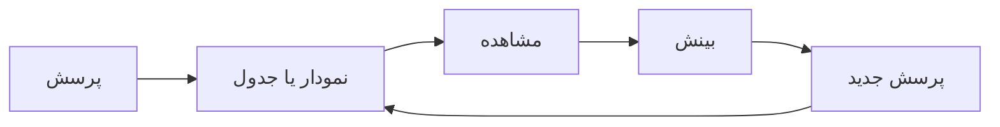

# جلسه ۹ — EDA در عمل: مطالعه موردی

## از ابزار به فرایند

در دو جلسه گذشته **ابزارهای** تحلیل اکتشافی را یاد گرفتیم ← [[۷ - تحلیل تک‌متغیره]] و [[8 - تحلیل دومتغیره و چندمتغیره]] اما EDA فقط رسم ده‌ها نمودار نیست. تحلیل اکتشافی خوب یک **فرایند هدفمند** است که با پرسش شروع می‌شود و به تصمیم ختم می‌شود.

> [!important] نکته کلیدی تحلیل‌گر تازه‌کار می‌پرسد: «چه نمودارهایی می‌توانم رسم کنم؟» تحلیل‌گر باتجربه می‌پرسد: «چه چیزی را **باید بدانم** و کدام نمودار به آن پاسخ می‌دهد؟»

---

## چرخه کامل EDA



|گام|کار|مثال|
|:-:|:-:|:-:|
|پرسش|یک پرسش مشخص و قابل پاسخ با داده|آیا الماس‌های با تراش بهتر گران‌ترند؟|
|نمودار یا جدول|انتخاب ابزار متناسب با نوع ویژگی‌ها|نمودار جعبه‌ای قیمت بر اساس کیفیت تراش|
|مشاهده|توصیف دقیق آنچه دیده می‌شود|میانه قیمت تراش «عالی» از همه کمتر است|
|بینش|تفسیر مشاهده و پیامد آن|احتمالاً یک متغیر مخدوش‌کننده (وزن) در کار است|
|پرسش جدید|پرسشی که بینش برمی‌انگیزد|آیا با ثابت نگه داشتن وزن، رابطه معکوس می‌شود؟|

> [!tip] شروع با پرسش‌های عمومی اگر پرسش مشخصی ندارید، با این پرسش‌های عمومی شروع کنید:
> 
> - هر ویژگی چه نوع **تغییراتی** (توزیعی) دارد؟
> - چه نوع **هم‌تغییری** (رابطه‌ای) میان ویژگی‌ها وجود دارد؟
> - کدام ویژگی‌ها با **متغیر هدف** مرتبط‌اند؟
> - چه چیزی در داده **عجیب** یا غیرمنتظره است؟

---

## مشاهده، بینش و فرضیه

سه مفهوم که اغلب با هم اشتباه گرفته می‌شوند:

|مفهوم|تعریف|مثال|
|:-:|:-:|:-:|
|مشاهده (Observation)|توصیف عینی آنچه در داده دیده می‌شود|میانه قیمت الماس‌های تراش عالی ۱۸۱۰ دلار و تراش متوسط ۳۲۸۲ دلار است|
|بینش (Insight)|تفسیر مشاهده که چیز جدید و قابل اقدامی می‌گوید|تراش بهتر قیمت را پایین نمی‌آورد؛ الماس‌های تراش عالی معمولاً کوچک‌ترند|
|فرضیه (Hypothesis)|ادعای قابل آزمون که از بینش ساخته می‌شود|در وزن یکسان، الماس‌های با تراش بهتر گران‌ترند|

### ویژگی‌های یک بینش خوب

|ویژگی|پرسش آزمون|بینش ضعیف|بینش خوب|
|:-:|:-:|:-:|:-:|
|مشخص|آیا عدد و مقایسه دارد؟|قیمت با وزن رابطه دارد|همبستگی وزن و قیمت ۰.۹۲ است و رابطه لگاریتمی تقریباً خطی است|
|غیربدیهی|آیا چیزی می‌گوید که از پیش نمی‌دانستیم؟|الماس‌های بزرگ‌تر گران‌ترند|تعداد الماس‌های ۰.۹۹ قیراطی تقریباً صفر است، اما الماس‌های ۱.۰۱ قیراطی بسیار زیادند|
|مستند|آیا نمودار یا جدولی پشت آن است؟|به نظر می‌رسد داده مشکل دارد|بیست الماس دست‌کم یک بُعد صفر دارند|
|قابل اقدام|آیا به تصمیمی منجر می‌شود؟|ابعاد الماس با وزن رابطه دارند|ابعاد طول، عرض و ارتفاع با وزن همبستگی بیشتر از ۰.۹۵ دارند؛ نگه داشتن همه آن‌ها اطلاعات تکراری است|

> [!warning] بینش، نتیجه قطعی نیست تحلیل اکتشافی **فرضیه می‌سازد**، نه اینکه آن را اثبات کند. بینش‌ها را با واژه‌هایی مانند «به نظر می‌رسد» یا «احتمالاً» بیان کنید و در صورت نیاز با تحلیل تأییدی (آزمون آماری یا مدل) بسنجید. همچنین به یاد داشته باشید که **همبستگی علیت نیست**.

---

## مطالعه موردی: قیمت الماس

### معرفی داده و درک کسب‌وکار

مجموعه‌داده **Diamonds** شامل مشخصات و قیمت حدود ۵۴ هزار الماس است و در کتابخانه seaborn در دسترس است.

|ویژگی|معنا|نوع ویژگی|
|:-:|:-:|:-:|
|ویژگی carat|وزن الماس (قیراط)|نسبتی، پیوسته|
|ویژگی cut|کیفیت تراش: Fair، Good، Very Good، Premium، Ideal|ترتیبی|
|ویژگی color|رنگ: از J (بدترین) تا D (بهترین)|ترتیبی|
|ویژگی clarity|شفافیت: از I1 (بدترین) تا IF (بهترین)|ترتیبی|
|ویژگی depth|درصد عمق کل|نسبتی، پیوسته|
|ویژگی table|عرض سطح بالایی نسبت به پهن‌ترین نقطه|نسبتی، پیوسته|
|ویژگی‌های x، y و z|طول، عرض و ارتفاع (میلی‌متر)|نسبتی، پیوسته|
|ویژگی price|قیمت (دلار آمریکا)|نسبتی، پیوسته — **متغیر هدف**|

> [!example] درک کسب‌وکار ← [[2 - فرایند CRISP-DM و محیط کار]] فرض کنید یک فروشگاه اینترنتی جواهرات می‌خواهد برای الماس‌هایی که از تأمین‌کنندگان می‌خرد، **قیمت منصفانه** پیشنهاد دهد. هدف داده‌کاوی: ساخت مدل رگرسیون برای پیش‌بینی قیمت از روی مشخصات الماس. پیش از مدل‌سازی، EDA کمک می‌کند بفهمیم قیمت به چه عواملی وابسته است و داده چه مشکلاتی دارد.

### پرسش‌های راهنما

1. داده چه کیفیتی دارد؟
2. توزیع قیمت چگونه است؟
3. مهم‌ترین عامل قیمت چیست و رابطه آن چه شکلی دارد؟
4. کیفیت تراش، رنگ و شفافیت چه اثری بر قیمت دارند؟
5. آیا الگوی غیرمنتظره‌ای در داده وجود دارد؟

### پرسش ۱ — کیفیت داده

|مشاهده|جزئیات|
|:-:|:-:|
|داده گمشده|هیچ خانه خالی وجود ندارد|
|سطر تکراری|۱۴۶ سطر کاملاً تکراری|
|ابعاد صفر|۲۰ الماس دست‌کم یک بُعد صفر دارند (۸ در طول، ۷ در عرض، ۲۰ در ارتفاع)|
|ابعاد غیرممکن|یک الماس ۲ قیراطی با عرض ۵۸.۹ میلی‌متر و یک الماس ۰.۵۱ قیراطی با ارتفاع ۳۱.۸ میلی‌متر|

> [!tip] بینش ۱ الماسی با وزن مثبت نمی‌تواند بُعد صفر داشته باشد؛ پس ابعاد صفر **گمشده پنهان** هستند ← [[۶ - کیفیت داده]] مقادیر ۵۸.۹ و ۳۱.۸ میلی‌متر برای الماس‌های کوچک فیزیکی ناممکن‌اند و به احتمال زیاد **خطای ورود داده** (جابه‌جایی ممیز) هستند. **تصمیم:** این مقادیر در پیش‌پردازش به مقدار گمشده تبدیل و سپس جایگذاری یا حذف شوند.

### پرسش ۲ — توزیع قیمت

|آماره|مقدار|
|:-:|:-:|
|میانگین قیمت|3933|
|میانه قیمت|2401|
|کمینه و بیشینه|326 و 18823|
|چولگی قیمت|1.62|
|چولگی لگاریتم قیمت|0.12|

> [!tip] بینش ۲ قیمت **چولگی شدید به راست** دارد (میانگین ۶۴ درصد بیشتر از میانه است). پس از تبدیل لگاریتمی، توزیع تقریباً متقارن می‌شود. **تصمیم:** در مدل رگرسیون، **لگاریتم قیمت** به عنوان متغیر هدف بررسی شود ← [[۱۲ - تبدیل و یکپارچه‌سازی داده]]

### پرسش ۳ — مهم‌ترین عامل قیمت

|ویژگی|همبستگی پیرسون با قیمت|
|:-:|:-:|
|وزن (carat)|0.92|
|طول (x)|0.88|
|عرض (y)|0.87|
|ارتفاع (z)|0.86|
|عرض سطح (table)|0.13|
|درصد عمق (depth)|0.01-|

> [!tip] بینش ۳ **وزن** قوی‌ترین عامل قیمت است. نمودار پراکندگی وزن و قیمت منحنی (رو به بالا) است، اما نمودار لگاریتم وزن و لگاریتم قیمت تقریباً **خطی** است (همبستگی ۰.۹۷). یعنی قیمت با یک **رابطه توانی** به وزن وابسته است: $$ \log(\text{price}) \approx a + b , \log(\text{carat}) $$ **تصمیم:** در مدل رگرسیون از لگاریتم وزن و لگاریتم قیمت استفاده شود.

> [!tip] بینش ۴ طول، عرض و ارتفاع با وزن همبستگی **بیشتر از ۰.۹۵** دارند؛ یعنی تقریباً همان اطلاعات وزن را تکرار می‌کنند. **تصمیم:** در مدل‌های خطی فقط وزن نگه داشته شود یا از روش‌های انتخاب ویژگی و منظم‌سازی استفاده شود ← [[۱۳ - مهندسی و انتخاب ویژگی]] و [[19 - منظم‌سازی در رگرسیون]]

### پرسش ۴ — اثر کیفیت تراش، رنگ و شفافیت

اولین نگاه به میانه قیمت بر اساس کیفیت تراش، نتیجه‌ای **عجیب** نشان می‌دهد:

|کیفیت تراش|تعداد|میانه قیمت|میانه وزن|
|:-:|:-:|:-:|:-:|
|تراش Ideal (بهترین)|21551|1810|0.54|
|تراش Premium|13791|3185|0.86|
|تراش Very Good|12082|2648|0.71|
|تراش Good|4906|3051|0.82|
|تراش Fair (بدترین)|1610|3282|1.00|

الماس‌های با **بهترین** تراش، **ارزان‌ترین** هستند! همین الگو برای رنگ و شفافیت نیز دیده می‌شود:

|ویژگی|بهترین سطح: میانه قیمت|بدترین سطح: میانه قیمت|
|:-:|:-:|:-:|
|رنگ (D در برابر J)|1838|4234|
|شفافیت (IF در برابر I1)|1080|3344|

> [!question] چرا کیفیت بهتر، قیمت کمتر؟ ستون «میانه وزن» پاسخ را می‌دهد: الماس‌های با کیفیت پایین‌تر به‌طور معمول **بزرگ‌ترند**. میانه وزن تراش Fair یک قیراط و تراش Ideal فقط ۰.۵۴ قیراط است. وزن یک **متغیر مخدوش‌کننده** است؛ همان الگوی پارادوکس سیمپسون ← [[8 - تحلیل دومتغیره و چندمتغیره]]

پرسش جدید: اگر وزن را **ثابت** نگه داریم چه می‌شود؟ الماس‌ها را بر اساس وزن گروه‌بندی و میانه قیمت را در هر گروه مقایسه می‌کنیم:

|بازه وزن (قیراط)|تراش Ideal|تراش Premium|تراش Very Good|تراش Good|تراش Fair|
|:-:|:-:|:-:|:-:|:-:|:-:|
|بازه ۱ تا ۱.۵|6460|5646|5839|5232|4544|
|بازه ۱.۵ تا ۲|11536|11034|11068|9791|8621|
|بازه ۲ تا ۵|15990|15248|15680|14962|12617|

> [!tip] بینش ۵ در الماس‌های بزرگ‌تر از یک قیراط، با **وزن تقریباً یکسان**، تراش بهتر قیمت بالاتری دارد؛ رابطه‌ای که در نگاه اول معکوس دیده می‌شد. در الماس‌های کوچک‌تر از یک قیراط الگو روشن نیست و به بررسی بیشتر نیاز دارد. **تصمیم:** اثر کیفیت تراش، رنگ و شفافیت را نباید به‌تنهایی سنجید. مدل باید هم‌زمان وزن و ویژگی‌های کیفی را در نظر بگیرد (رگرسیون چندگانه) ← [[17 - رگرسیون خطی چندگانه و ارزیابی]] **فرضیه:** در وزن یکسان، هر سطح بهبود در تراش، رنگ یا شفافیت قیمت را افزایش می‌دهد.

### پرسش ۵ — الگوی غیرمنتظره

هیستوگرام وزن با بازه‌های بسیار ریز، **قله‌های تیزی** روی اعداد گرد نشان می‌دهد:

|وزن (قیراط)|تعداد الماس|
|:-:|:-:|
|وزن 0.98|31|
|وزن 0.99|23|
|وزن 1.00|1558|
|وزن 1.01|2242|

> [!tip] بینش ۶ تقریباً هیچ الماسی درست **زیر** یک قیراط وجود ندارد، اما تعداد زیادی درست **روی یا بالای** آن هست. همین الگو در ۰.۳، ۰.۵، ۰.۷، ۱.۵ و ۲ قیراط نیز دیده می‌شود. توضیح احتمالی: تراش‌دهندگان ترجیح می‌دهند الماس را کمی سنگین‌تر از یک عدد گرد نگه دارند، چون خریداران برای «یک قیراط» قیمت بیشتری می‌پردازند (آستانه روانی). **تصمیم:** ویژگی دودویی «وزن بیشتر یا مساوی یک قیراط» می‌تواند یک **ویژگی مهندسی‌شده** مفید باشد. همچنین قیمت در مرز این آستانه‌ها ممکن است جهش داشته باشد ← [[۱۳ - مهندسی و انتخاب ویژگی]]

---

## تدوین گزارش EDA

### ساختار پیشنهادی گزارش

|بخش|محتوا|
|:-:|:-:|
|خلاصه مدیریتی|سه تا پنج بینش کلیدی در یک بند؛ برای خواننده‌ای که فقط این بخش را می‌خواند|
|معرفی داده و هدف|منبع داده، تعداد سطر و ستون، هدف کسب‌وکار و هدف داده‌کاوی|
|کیفیت داده|داده گمشده، تکراری، پرت و ناسازگار؛ با سنجه‌های کمّی|
|تحلیل تک‌متغیره|توزیع ویژگی‌های مهم، به‌ویژه متغیر هدف|
|تحلیل دومتغیره و چندمتغیره|رابطه ویژگی‌ها با هدف و با یکدیگر|
|بینش‌ها و فرضیه‌ها|هر بینش همراه با شواهد (نمودار یا جدول)|
|پیامدها برای پیش‌پردازش و مدل‌سازی|فهرست تصمیم‌هایی که از EDA به دست آمد|
|محدودیت‌ها|آنچه داده نمی‌تواند پاسخ دهد|

> [!warning] گزارش EDA، دفترچه یادداشت نیست گزارش نباید شامل **همه** نمودارهایی باشد که رسم کرده‌اید. فقط نمودارهایی را بیاورید که از یک بینش پشتیبانی می‌کنند. بقیه را در پیوست یا دفترچه جداگانه نگه دارید.

### داستان‌گویی با داده (Data Storytelling)

یافته‌ها تنها زمانی اثر دارند که مخاطب آن‌ها را **بفهمد** و **به خاطر بسپارد**. داستان‌گویی با داده یعنی ترکیب سه عنصر:

|عنصر|نقش|
|:-:|:-:|
|داده|شواهد قابل اعتماد|
|روایت|ساختار منطقی که داده را به پیام تبدیل می‌کند|
|تصویر|نموداری که پیام را سریع و روشن منتقل می‌کند|

ساختار سه‌پرده‌ای برای هر بینش:

|پرده|پرسش|مثال الماس|
|:-:|:-:|:-:|
|زمینه|وضعیت چیست؟|انتظار داریم الماس با تراش بهتر گران‌تر باشد|
|گره|چه چیز غیرمنتظره‌ای پیدا کردیم؟|الماس‌های تراش Ideal کمترین میانه قیمت را دارند|
|گره‌گشایی|توضیح و پیامد چیست؟|این الماس‌ها کوچک‌ترند؛ در وزن یکسان، تراش بهتر گران‌تر است|

> [!tip] عنوان نمودار، پیام نمودار است به جای عنوان توصیفی، از **عنوان پیام‌دار** استفاده کنید:
> 
> - عنوان توصیفی: «میانه قیمت بر اساس کیفیت تراش»
> - عنوان پیام‌دار: «در وزن یکسان، تراش بهتر قیمت بالاتری دارد»
> 
> مخاطب باید بتواند پیام را فقط از عنوان بفهمد، و نمودار شاهد آن باشد.

> [!note] اصول دیگر داستان‌گویی
> 
> - مخاطب را بشناسید: مدیر به پیامد و تصمیم علاقه دارد، تحلیل‌گر به روش و جزئیات.
> - با مهم‌ترین یافته شروع کنید، نه با ترتیب کارهایی که انجام دادید.
> - با رنگ یا حاشیه‌نویسی، چشم مخاطب را به نکته اصلی نمودار هدایت کنید.
> - هر نمودار فقط یک پیام داشته باشد.

---

## ارتباط یافته‌های EDA با پیش‌پردازش و مدل‌سازی

هدف نهایی EDA در یک پروژه داده‌کاوی، **تصمیم‌سازی** برای گام‌های بعدی است:

|یافته EDA|تصمیم پیش‌پردازش یا مدل‌سازی|جلسه مرتبط|
|:-:|:-:|:-:|
|مقادیر گمشده یا گمشده پنهان|جایگذاری یا حذف|[[۱۰ - مدیریت داده گمشده]]|
|داده پرت یا مقادیر ناممکن|اصلاح، حذف یا سقف‌گذاری|[[11- داده پرت، نویز و داده تکراری]]|
|سطرهای تکراری|حذف|[[11- داده پرت، نویز و داده تکراری]]|
|چولگی شدید|تبدیل لگاریتمی یا Box-Cox|[[۱۲ - تبدیل و یکپارچه‌سازی داده]]|
|مقیاس‌های بسیار متفاوت|مقیاس‌بندی|[[۱۲ - تبدیل و یکپارچه‌سازی داده]]|
|ویژگی‌های کیفی|کدگذاری|[[۱۲ - تبدیل و یکپارچه‌سازی داده]]|
|آستانه‌ها و الگوهای خاص|ساخت ویژگی جدید|[[۱۳ - مهندسی و انتخاب ویژگی]]|
|ویژگی‌های بسیار همبسته|انتخاب ویژگی یا کاهش ابعاد|[[۱۴- کاهش ابعاد]]|
|رابطه غیرخطی با هدف|تبدیل ویژگی یا مدل غیرخطی|[[18 - بیش‌برازش و اعتبارسنجی متقابل]]|
|کلاس‌های نامتوازن در هدف|نمونه‌برداری مجدد یا معیار ارزیابی مناسب|[[25 - ارزیابی مدل‌های طبقه‌بندی]]|
|متغیر مخدوش‌کننده|لحاظ کردن هم‌زمان ویژگی‌ها در مدل|[[17 - رگرسیون خطی چندگانه و ارزیابی]]|

> [!warning] نشت داده در EDA تصمیم‌هایی مانند انتخاب ویژگی بر اساس همبستگی با هدف، اگر روی **کل داده** (شامل داده آزمون) گرفته شوند، ممکن است برآورد عملکرد مدل را خوش‌بینانه کنند. در پروژه‌های جدی، بهتر است پیش از EDA عمیق، بخشی از داده را برای آزمون نهایی کنار بگذارید ← [[۱۴- کاهش ابعاد]]

---

## پیاده‌سازی در پایتون

### بارگذاری و کیفیت داده

```python
import numpy as np
import pandas as pd
import matplotlib.pyplot as plt
import seaborn as sns

sns.set_theme(style="whitegrid")
df = sns.load_dataset("diamonds")

df.shape                                   # (53940, 10)
df.isnull().sum().sum()                    # 0
df.duplicated().sum()                      # 146

dims = ["x", "y", "z"]
(df[dims] == 0).sum()                      # x: 8, y: 7, z: 20
(df[dims] == 0).any(axis=1).sum()          # 20 diamonds
df.nlargest(2, "y")[["carat", "x", "y", "z"]]   # y = 58.9 for a 2-carat diamond
```

### توزیع قیمت

```python
fig, axes = plt.subplots(1, 2, figsize=(13, 4))
sns.histplot(df["price"], bins=60, ax=axes[0])
axes[0].set(title=f"Price is right-skewed (skew = {df['price'].skew():.2f})",
            xlabel="Price (USD)")
sns.histplot(np.log10(df["price"]), bins=60, ax=axes[1])
axes[1].set(title=f"Log price is nearly symmetric (skew = {np.log(df['price']).skew():.2f})",
            xlabel="log10(Price)")
plt.show()
```

### وزن و قیمت

```python
num_cols = ["carat", "depth", "table", "x", "y", "z", "price"]
df[num_cols].corr()["price"].sort_values(ascending=False).round(2)

fig, axes = plt.subplots(1, 2, figsize=(13, 5))
sns.scatterplot(data=df, x="carat", y="price", alpha=0.1, s=5, ax=axes[0])
axes[0].set_title("Price vs carat: curved relationship")
sns.scatterplot(x=np.log10(df["carat"]), y=np.log10(df["price"]),
                alpha=0.1, s=5, ax=axes[1])
axes[1].set(title="Log-log: nearly linear (r = 0.97)",
            xlabel="log10(Carat)", ylabel="log10(Price)")
plt.show()
```

### متغیر مخدوش‌کننده: کیفیت تراش و وزن

```python
# First look: better cut -> lower median price?!
summary = df.groupby("cut", observed=True).agg(
    n=("price", "size"),
    median_price=("price", "median"),
    median_carat=("carat", "median"),
)
print(summary)

# Hold carat (roughly) constant
df["carat_bin"] = pd.cut(df["carat"], bins=[0, 0.5, 1, 1.5, 2, 6])
pivot = df.pivot_table(index="carat_bin", columns="cut", values="price",
                       aggfunc="median", observed=True)
print(pivot.round(0))

# Visual: price vs carat, colored by cut, for diamonds >= 1 carat
big = df[df["carat"].between(1, 2)]
sns.lmplot(data=big, x="carat", y="price", hue="cut", scatter=False,
           height=5, aspect=1.4)
plt.title("At the same carat, better cut means a higher price")
plt.show()
```

### الگوی آستانه‌های روانی

```python
fig, ax = plt.subplots(figsize=(12, 4))
sns.histplot(df.loc[df["carat"] <= 2.2, "carat"], binwidth=0.01, ax=ax)
for t in [0.3, 0.5, 0.7, 1.0, 1.5, 2.0]:
    ax.axvline(t, color="red", linestyle="--", linewidth=0.8)
ax.set(title="Carat values pile up just at or above round numbers",
       xlabel="Carat")
plt.show()

df["carat"].round(2).value_counts().loc[[0.98, 0.99, 1.00, 1.01]]
# 0.98: 31, 0.99: 23, 1.00: 1558, 1.01: 2242
```

### خلاصه تصمیم‌ها در قالب داده

```python
decisions = pd.DataFrame([
    ["Zero / impossible x, y, z", "Set to NaN, then impute",       "Session 10-11"],
    ["146 duplicate rows",        "Drop duplicates",               "Session 11"],
    ["Price right-skewed",        "Model log(price)",              "Session 12"],
    ["Power law carat-price",     "Use log(carat)",                "Session 12"],
    ["x, y, z ~ carat (r>0.95)",  "Keep carat only / regularize",  "Session 13, 19"],
    ["Cut/color/clarity confounded by carat", "Multiple regression", "Session 17"],
    ["Carat thresholds",          "Feature: carat >= 1",           "Session 13"],
], columns=["finding", "decision", "where"])
print(decisions.to_string(index=False))
```

---

## تمرین عملی کلاس

> [!example] تمرین عملی (۳۵ دقیقه) — EDA کامل و ۵ بینش کلیدی مجموعه‌داده **mpg** (مصرف سوخت خودروها) را بارگذاری کنید:
> 
> ```python
> import seaborn as sns
> df = sns.load_dataset("mpg")
> ```
> 
> متغیر هدف: `mpg` (مسافت پیموده‌شده با یک گالن سوخت).
> 
> 1. **درک کسب‌وکار:** در یک جمله بنویسید چه کسی و چرا ممکن است بخواهد مصرف سوخت را پیش‌بینی کند.
> 2. **کیفیت داده:** مقادیر گمشده، تکراری و مقادیر مشکوک را بررسی کنید.
> 3. **تک‌متغیره:** توزیع `mpg` و دو ویژگی دیگر را رسم و تفسیر کنید.
> 4. **دومتغیره:** رابطه `mpg` با `weight`، `horsepower`، `cylinders` و `origin` را بررسی کنید.
> 5. **چندمتغیره:** آیا رابطه `mpg` با `model_year` پس از در نظر گرفتن `weight` همچنان برقرار است؟
> 6. **پنج بینش کلیدی** بنویسید؛ هر بینش با یک نمودار یا جدول پشتیبان و یک تصمیم پیش‌پردازش یا مدل‌سازی.
> 7. یکی از بینش‌ها را با **ساختار سه‌پرده‌ای** (زمینه، گره، گره‌گشایی) و یک **عنوان پیام‌دار** برای کلاس ارائه دهید.

> [!question]- راهنمای تمرین
> 
> - ستون `horsepower` شش مقدار گمشده دارد.
> - رابطه `mpg` با `weight` و `horsepower` منفی و **منحنی** است؛ لگاریتم یا معکوس را امتحان کنید.
> - ستون `cylinders` عددی است اما فقط چند مقدار دارد (۳، ۴، ۵، ۶ و ۸)؛ بررسی کنید که آیا بهتر است کیفی در نظر گرفته شود.
> - ستون `origin` (usa، europe، japan) با وزن خودرو رابطه دارد؛ مراقب متغیر مخدوش‌کننده باشید.
> - ستون `name` شامل نام سازنده است و می‌توان از آن ویژگی جدید ساخت.

---

## تکلیف ۲ — گزارش EDA

> [!todo] تکلیف ۲ — گزارش تحلیل اکتشافی داده روی مجموعه‌داده‌ای که در **تکلیف ۱** بررسی کردید ← [[۶ - کیفیت داده]]، یک گزارش EDA کامل تهیه کنید:
> 
> 1. **خلاصه مدیریتی:** سه تا پنج بینش کلیدی در یک بند.
> 2. **پرسش‌ها:** دست‌کم پنج پرسش که EDA شما را هدایت کرده است.
> 3. **تحلیل تک‌متغیره:** توزیع متغیر هدف و ویژگی‌های مهم، همراه با تفسیر شکل، چولگی و داده پرت.
> 4. **تحلیل دومتغیره:** رابطه همه ویژگی‌های مهم با متغیر هدف (با نمودار و آماره مناسب نوع ویژگی) و نقشه حرارتی همبستگی.
> 5. **تحلیل چندمتغیره:** دست‌کم یک رابطه که در زیرگروه‌ها بررسی شده باشد.
> 6. **بینش‌ها:** دست‌کم پنج بینش؛ هر کدام با شواهد، عنوان پیام‌دار و یک تصمیم پیش‌پردازش یا مدل‌سازی.
> 7. **جدول تصمیم‌ها:** فهرست تصمیم‌های پیش‌پردازش و مدل‌سازی که از EDA به دست آمد.
> 8. **محدودیت‌ها:** آنچه این داده نمی‌تواند به آن پاسخ دهد.
> 
> **قالب تحویل:** یک فایل Jupyter Notebook که با «Restart & Run All» بدون خطا اجرا شود، همراه با توضیحات متنی برای هر نمودار.

> [!note] معیارهای ارزیابی تکلیف ۲
> 
> |معیار|سهم|
> |:-:|:-:|
> |کیفیت و عمق پرسش‌ها|۱۵ درصد|
> |درستی و تناسب نمودارها و آماره‌ها|۲۵ درصد|
> |کیفیت بینش‌ها (مشخص، غیربدیهی، مستند، قابل اقدام)|۳۰ درصد|
> |ارتباط بینش‌ها با تصمیم‌های پیش‌پردازش و مدل‌سازی|۱۵ درصد|
> |ساختار گزارش، داستان‌گویی و طراحی نمودارها|۱۵ درصد|

---

## پرسش‌های مرور

> [!question]- ۱. پنج گام چرخه EDA را نام ببرید. پرسش، نمودار یا جدول، مشاهده، بینش و پرسش جدید. این چرخه تکرار می‌شود تا داده به‌خوبی شناخته شود.

> [!question]- ۲. تفاوت «مشاهده» و «بینش» چیست؟ یک مثال بزنید. مشاهده توصیف عینی داده است؛ مثلاً «میانه قیمت الماس‌های تراش Ideal از همه کمتر است». بینش تفسیر آن و پیامدش است؛ مثلاً «این الماس‌ها کوچک‌ترند و وزن متغیر مخدوش‌کننده است، پس اثر تراش باید با ثابت نگه داشتن وزن سنجیده شود».

> [!question]- ۳. در داده الماس، چرا نمی‌توان از میانه قیمت در هر سطح تراش نتیجه گرفت که تراش بهتر قیمت را کاهش می‌دهد؟ چون **وزن** متغیر مخدوش‌کننده است: الماس‌های تراش Ideal به‌طور معمول کوچک‌ترند و وزن قوی‌ترین عامل قیمت است. وقتی وزن تقریباً ثابت نگه داشته شود (دست‌کم برای الماس‌های بزرگ‌تر از یک قیراط)، تراش بهتر قیمت بالاتری دارد.

> [!question]- ۴. «عنوان پیام‌دار» برای نمودار چیست و چه مزیتی دارد؟ عنوانی که **نتیجه** نمودار را بیان می‌کند، نه فقط موضوع آن را؛ مثلاً «در وزن یکسان، تراش بهتر قیمت بالاتری دارد» به جای «قیمت بر اساس تراش». مزیت آن این است که مخاطب پیام اصلی را بدون تفسیر نمودار دریافت می‌کند.

> [!question]- ۵. سه تصمیم پیش‌پردازش نام ببرید که مستقیماً از یافته‌های EDA داده الماس به دست می‌آید. تبدیل ابعاد صفر و ناممکن به مقدار گمشده، استفاده از لگاریتم قیمت و لگاریتم وزن به دلیل چولگی و رابطه توانی، و حذف یا منظم‌سازی ابعاد طول، عرض و ارتفاع به دلیل همبستگی بسیار بالا با وزن.

> [!question]- ۶. چرا گزارش EDA نباید همه نمودارهای رسم‌شده را شامل شود؟ چون هدف گزارش انتقال **بینش** است، نه نمایش حجم کار. نمودارهای بی‌ربط توجه مخاطب را پراکنده می‌کنند. فقط نمودارهایی که از یک بینش پشتیبانی می‌کنند در متن اصلی بیایند و بقیه در پیوست.

---

## نکات کلیدی

> [!summary] خلاصه جلسه
> 
> - تحلیل اکتشافی یک **چرخه هدفمند** است: پرسش، نمودار، مشاهده، بینش و پرسش جدید.
> - **مشاهده** توصیف داده است، **بینش** تفسیر قابل اقدام آن و **فرضیه** ادعای قابل آزمونی که از بینش ساخته می‌شود.
> - بینش خوب **مشخص**، **غیربدیهی**، **مستند** و **قابل اقدام** است.
> - مطالعه موردی الماس نشان داد که یک الگوی ظاهراً عجیب (تراش بهتر، قیمت کمتر) با یک **متغیر مخدوش‌کننده** (وزن) توضیح داده می‌شود.
> - گزارش EDA با **خلاصه مدیریتی** شروع می‌شود و فقط نمودارهای پشتیبان بینش‌ها را شامل می‌شود. **داستان‌گویی با داده** یعنی ترکیب داده، روایت و تصویر؛ با **عنوان‌های پیام‌دار**.
> - خروجی نهایی EDA، **جدول تصمیم‌ها** برای پیش‌پردازش و مدل‌سازی است.

> [!todo] آمادگی برای جلسه بعد
> 
> 1. تکلیف ۲ را آغاز کنید.
> 2. فهرست ویژگی‌هایی از داده پروژه خود را که مقدار گمشده (آشکار یا پنهان) دارند، همراه با درصد گمشدگی تهیه کنید.
> 3. برای هر کدام حدس بزنید چرا گمشده‌اند. جلسه بعد با این دانش، سازوکارهای گمشدگی و روش‌های جایگذاری را بررسی می‌کنیم ← [[۱۰ - مدیریت داده گمشده]]