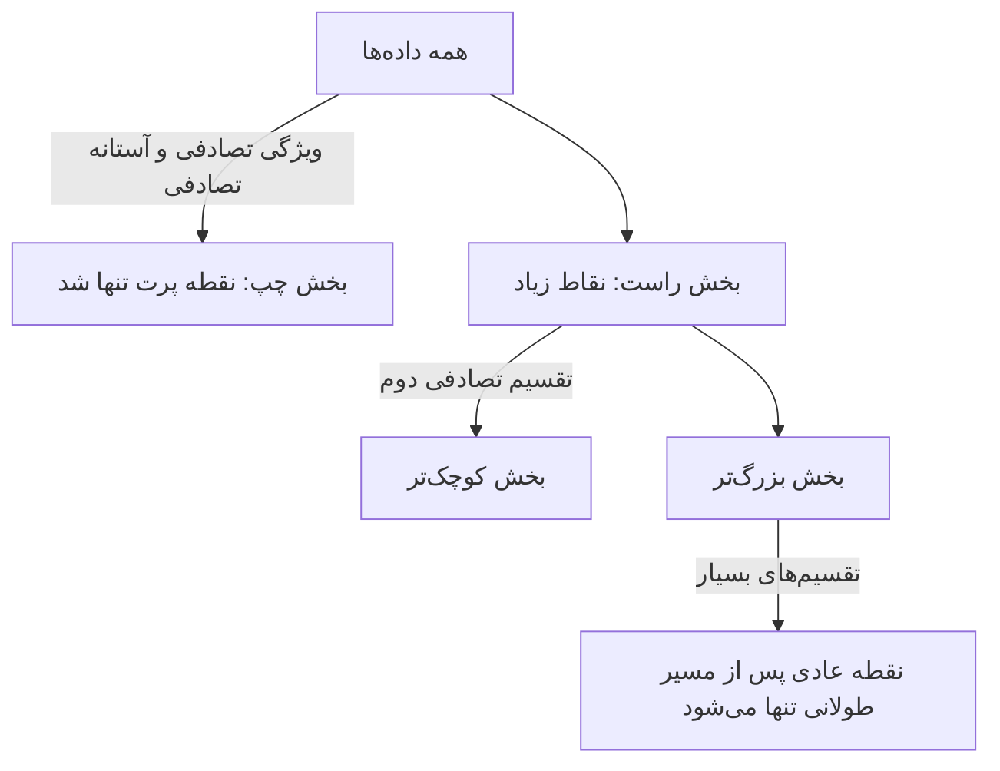
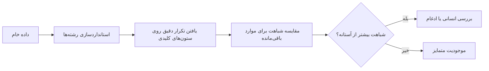

# جلسه ۱۱ — داده پرت، نویز و داده تکراری

## چرا این موضوع مهم است؟

در جلسه کیفیت داده، داده پرت، نویز، داده تکراری و ناسازگاری را به‌عنوان مشکلات رایج داده **شناختیم** ← [[۶ - کیفیت داده]] در تحلیل تک‌متغیره نیز نمودار جعبه‌ای و چولگی را دیدیم ← [[۷ - تحلیل تک‌متغیره]] در جلسه قبل خانه‌های خالی را پر کردیم ← [[۱۰ - مدیریت داده گمشده]] اکنون به سراغ خانه‌هایی می‌رویم که **پر هستند اما مشکوک‌اند**.

|مشکل|پرسش اصلی|اقدام رایج|
|:-:|:-:|:-:|
|داده پرت (Outlier)|آیا این مقدار خطاست یا رویداد واقعی اما نادر؟|بررسی، سپس حذف، سقف‌گذاری، تبدیل یا نگه‌داری|
|نویز (Noise)|چقدر از تغییرات، خطای تصادفی اندازه‌گیری است؟|هموارسازی|
|داده تکراری (Duplicate)|آیا یک موجودیت چند بار ثبت شده است؟|یکسان‌سازی و حذف|
|ناسازگاری (Inconsistency)|آیا یک مفهوم به چند شکل ثبت شده است؟|استانداردسازی|

> [!important] چرا داده پرت خطرناک است؟
> 
> - **آماره‌های حساس** مانند میانگین، انحراف معیار و همبستگی پیرسون با یک نقطه جابه‌جا می‌شوند ← [[8 - تحلیل دومتغیره و چندمتغیره]]
> - مدل‌هایی که خطای مربعی را کمینه می‌کنند (رگرسیون خطی) به سمت داده پرت **کشیده می‌شوند** ← [[16 - مبانی یادگیری نظارت‌شده و رگرسیون خطی ساده]]
> - روش‌های فاصله‌محور (k-NN، k-Means) و مقیاس‌بندی Min-Max به داده پرت حساس‌اند.
> - **اما** گاهی داده پرت همان چیزی است که دنبالش هستیم: تقلب، نفوذ، خرابی دستگاه.

---

## تعریف داده پرت و انواع آن

> [!note] تعریف داده پرت شیئی است که **به‌طور چشمگیری** با بیشتر داده‌ها تفاوت دارد؛ آن‌قدر که این گمان پیش می‌آید که توسط سازوکار متفاوتی تولید شده است (تعریف هاوکینز).

داده پرت با **نویز** یکی نیست: نویز خطای تصادفی است که روی همه داده‌ها اثر می‌گذارد و معمولاً کوچک است؛ داده پرت یک مقدار غیرعادی است که ممکن است خطا یا اطلاعات ارزشمند باشد.

### انواع داده پرت

|نوع|تعریف|مثال|
|:-:|:-:|:-:|
|پرت سراسری (Global / Point)|مقداری که نسبت به **کل** داده غیرعادی است|درآمد ماهانه ۵ میلیارد تومان در داده کارمندان|
|پرت زمینه‌ای (Contextual / Conditional)|مقداری که فقط در یک **زمینه** خاص غیرعادی است|دمای ۳۰ درجه در دی‌ماه تهران (در تیرماه عادی است)|
|پرت جمعی (Collective)|مجموعه‌ای از اشیا که **با هم** غیرعادی‌اند، هرچند تک‌تک عادی باشند|صدها درخواست ورود ناموفق پیاپی از یک آدرس IP در یک دقیقه|

- در پرت زمینه‌ای، ویژگی‌ها به دو دسته تقسیم می‌شوند: **ویژگی‌های زمینه** (زمان، مکان) و **ویژگی‌های رفتاری** (دما، مبلغ خرید).
- پرت جمعی معمولاً در داده‌های **ترتیبی**، سری زمانی، شبکه و گراف رخ می‌دهد.

### منشأ داده پرت

|منشأ|مثال|اقدام مناسب|
|:-:|:-:|:-:|
|خطای ورود داده|سن ۲۵۰ سال، قد ۱۷ متر (به جای ۱.۷)|اصلاح یا تبدیل به گمشده|
|خطای اندازه‌گیری|حسگر خراب|حذف یا تبدیل به گمشده|
|خطای پردازش|ادغام نادرست جدول‌ها، تبدیل اشتباه واحد|رفع خطای پردازش|
|رویداد واقعی اما نادر|خرید عمده یک شرکت، بیمار با بیماری نادر|نگه‌داری؛ شاید مدل‌سازی جداگانه|
|جامعه متفاوت|یک کودک در داده بزرگسالان|تصمیم بر اساس هدف تحلیل|

> [!warning] پیش از حذف، بپرسید «چرا؟» هیچ روش آماری نمی‌گوید یک مقدار **خطاست**؛ فقط می‌گوید **غیرعادی** است. تصمیم نهایی به دانش حوزه وابسته است. همیشه تعداد و دلیل حذف داده‌ها را مستند کنید.

---

## روش‌های آماری تشخیص داده پرت

برای همه روش‌های این بخش از یک داده نمونه استفاده می‌کنیم: فروش روزانه یک فروشگاه در ده روز (میلیون تومان):

|روز|1|2|3|4|5|6|7|8|9|10|
|:-:|:-:|:-:|:-:|:-:|:-:|:-:|:-:|:-:|:-:|:-:|
|فروش|52|55|56|58|60|61|63|65|68|120|

### قاعده IQR (قاعده توکی)

دامنه میان‌چارکی فاصله چارک اول و سوم است ← [[4 - آمار توصیفی]]

$$ IQR = Q_3 - Q_1 $$

داده‌ای پرت است که بیرون از **حصارهای** زیر باشد:

$$ \text{lower fence} = Q_1 - 1.5 \times IQR, \qquad \text{upper fence} = Q_3 + 1.5 \times IQR $$

- ضریب ۱.۵ (پرت «ملایم») قراردادی است؛ ضریب ۳ برای پرت «شدید» استفاده می‌شود.
- این همان قاعده‌ای است که سبیل‌های نمودار جعبه‌ای را رسم می‌کند.
- برای توزیع نرمال، حدود ۰.۷ درصد داده‌ها بیرون از حصارهای ۱.۵ می‌افتند.

> [!example] مثال حل‌شده — قاعده IQR با روش درون‌یابی خطی (پیش‌فرض pandas و numpy) برای ده مقدار مرتب‌شده:
> 
> - چارک اول در موقعیت ۲.۲۵ (شمارش از صفر): بین ۵۶ و ۵۸، یعنی **۵۶.۵**
> - چارک سوم در موقعیت ۶.۷۵: بین ۶۳ و ۶۵، یعنی **۶۴.۵** $$ IQR = 64.5 - 56.5 = 8 $$ $$ \text{lower} = 56.5 - 1.5 \times 8 = 44.5, \qquad \text{upper} = 64.5 + 1.5 \times 8 = 76.5 $$ فروش روز دهم (۱۲۰) از حصار بالا (۷۶.۵) بیشتر است و **پرت** شناخته می‌شود. بقیه مقادیر بین دو حصارند.

### امتیاز Z

امتیاز Z فاصله هر مقدار از میانگین را بر حسب انحراف معیار می‌سنجد:

$$ z_i = \frac{x_i - \bar{x}}{s} $$

قاعده رایج: اگر قدر مطلق امتیاز Z از **۳** بیشتر باشد، داده پرت است (برای توزیع نرمال، فقط حدود ۰.۳ درصد داده‌ها چنین‌اند).

> [!example] مثال حل‌شده — شکست امتیاز Z برای همان ده مقدار: میانگین **۶۵.۸** و انحراف معیار جامعه (با تقسیم بر n) حدود **۱۸.۶۳** است. $$ z_{10} = \frac{120 - 65.8}{18.63} \approx 2.91 $$ امتیاز Z روز دهم **کمتر از ۳** است و پرت شناخته **نمی‌شود**!
> 
> علت: خود داده پرت میانگین را از حدود ۵۹.۸ به ۶۵.۸ کشانده و انحراف معیار را از حدود ۴.۸ به ۱۸.۶ رسانده است. این پدیده **پوشاندن** (Masking) نام دارد: داده پرت معیار تشخیص خودش را خراب می‌کند.

> [!warning] محدودیت‌های امتیاز Z
> 
> - **حساس به داده پرت:** میانگین و انحراف معیار خودشان مقاوم نیستند.
> - **پوشاندن:** اگر به داده بالا مقدار ۱۲۵ نیز اضافه شود، امتیاز Z دو مقدار پرت به حدود ۱.۹۸ و ۲.۱۹ می‌رسد؛ دو پرت یکدیگر را پنهان می‌کنند.
> - **نمونه کوچک:** در n داده، قدر مطلق امتیاز Z (با انحراف معیار جامعه) هرگز از جذر n منهای یک بیشتر نمی‌شود. برای ده داده، بیشینه ممکن حدود **۳** است، پس با آستانه ۳ هیچ‌گاه پرتی یافت نمی‌شود.
> - **فرض نرمال‌بودن:** برای داده چوله، آستانه ۳ معنای احتمالی ندارد.

### امتیاز Z اصلاح‌شده (MAD)

راه‌حل: جایگزینی میانگین با **میانه** و انحراف معیار با **میانه انحرافات مطلق** (Median Absolute Deviation):

$$ MAD = \text{median}\left(\left| x_i - \text{median}(x) \right|\right) $$

$$ M_i = \frac{0.6745 , (x_i - \text{median}(x))}{MAD} $$

- ضریب ۰.۶۷۴۵ باعث می‌شود که برای داده نرمال، مقیاس این امتیاز با امتیاز Z معمولی قابل مقایسه باشد (چون برای توزیع نرمال، MAD تقریباً ۰.۶۷۴۵ برابر انحراف معیار است).
- آستانه پیشنهادی ایگلویچ و هوگلین: قدر مطلق امتیاز اصلاح‌شده بیشتر از **۳.۵**.

> [!example] مثال حل‌شده — امتیاز Z اصلاح‌شده میانه ده مقدار **۶۰.۵** است. انحرافات مطلق از میانه:
> 
> |فروش|52|55|56|58|60|61|63|65|68|120|
> |:-:|:-:|:-:|:-:|:-:|:-:|:-:|:-:|:-:|:-:|:-:|
> |انحراف مطلق|8.5|5.5|4.5|2.5|0.5|0.5|2.5|4.5|7.5|59.5|
> 
> میانه این انحرافات (میانگین ۴.۵ و ۴.۵) برابر **۴.۵** است: $$ M_{10} = \frac{0.6745 \times (120 - 60.5)}{4.5} \approx 8.92 $$ امتیاز اصلاح‌شده روز دهم حدود **۸.۹۲** و بسیار بیشتر از ۳.۵ است؛ پرت به‌روشنی شناخته می‌شود. بقیه امتیازها بین ۱.۲۷- و ۱.۱۲ هستند. حتی با افزودن مقدار ۱۲۵، امتیاز اصلاح‌شده دو پرت حدود ۷.۹۶ و ۸.۶۳ است؛ **پوشاندن رخ نمی‌دهد**.

### مقایسه روش‌های آماری

|روش|مرکز|مقیاس|مقاوم در برابر پرت؟|فرض توزیع|
|:-:|:-:|:-:|:-:|:-:|
|قاعده IQR|چارک‌ها|دامنه میان‌چارکی|بله|ندارد (اما برای داده بسیار چوله، پرت زیاد اعلام می‌کند)|
|امتیاز Z|میانگین|انحراف معیار|خیر|تقریباً نرمال|
|امتیاز Z اصلاح‌شده|میانه|میانه انحرافات مطلق|بله|تقریباً متقارن|

> [!example] مثال — تعداد پرت‌ها در داده واقعی
> 
> |ویژگی|چولگی|قاعده IQR|امتیاز Z (بیش از ۳)|امتیاز Z اصلاح‌شده (بیش از ۳.۵)|
> |:-:|:-:|:-:|:-:|:-:|
> |مبلغ صورت‌حساب در tips (244 سطر)|1.13|9|4|6|
> |انعام در tips (244 سطر)|1.47|9|3|3|
> |کرایه در Titanic (891 سطر)|4.79|116|20|160|
> 
> در کرایه Titanic که بسیار **چوله به راست** است، قاعده IQR ۱۱۶ مسافر و امتیاز Z اصلاح‌شده ۱۶۰ مسافر را پرت اعلام می‌کند؛ این‌ها اغلب مسافران کلاس اول‌اند، نه خطا! پس از تبدیل لگاریتمی، چولگی به حدود ۰.۳۹ و تعداد پرت‌های IQR به ۳۱ کاهش می‌یابد.

> [!tip] روش‌های تک‌متغیره برای داده چوله برای ویژگی‌های چوله (درآمد، قیمت، کرایه) ابتدا **تبدیل لگاریتمی** اعمال کنید، سپس روش‌های آماری را به کار ببرید. در غیر این صورت دم طبیعی توزیع به‌عنوان «پرت» برچسب می‌خورد ← [[۱۲ - تبدیل و یکپارچه‌سازی داده]]

---

## روش‌های مبتنی بر مدل

روش‌های تک‌متغیره هر ویژگی را جداگانه بررسی می‌کنند. اما ممکن است یک شیء در هر ویژگی جداگانه عادی باشد و **ترکیب** مقادیرش غیرعادی باشد؛ مثلاً قد ۱۸۰ سانتی‌متر و وزن ۴۵ کیلوگرم. برای داده چندمتغیره از روش‌های مبتنی بر مدل استفاده می‌کنیم.

### جنگل جداسازی (Isolation Forest)

ایده: داده پرت **کمیاب و متفاوت** است، پس با تعداد کمی تقسیم تصادفی **جدا** می‌شود.

1. یک ویژگی تصادفی و یک مقدار تقسیم تصادفی (بین کمینه و بیشینه آن ویژگی) انتخاب کن.
2. داده را به دو بخش تقسیم کن و این کار را بازگشتی ادامه بده تا هر نقطه تنها شود.
3. این کار را با تعداد زیادی درخت تصادفی (پیش‌فرض ۱۰۰ درخت) تکرار کن.
4. **میانگین طول مسیر** هر نقطه از ریشه تا برگ را حساب کن: مسیر کوتاه یعنی پرت.

$$ s(x, n) = 2^{-\frac{E[h(x)]}{c(n)}} $$

در این فرمول، h طول مسیر نقطه و c میانگین طول مسیر در یک درخت جست‌وجوی دودویی با n نقطه است (برای نرمال‌سازی). امتیاز نزدیک ۱ یعنی پرت و امتیاز بسیار کمتر از ۰.۵ یعنی عادی.



### عامل پرت محلی (Local Outlier Factor)

ایده: **چگالی محلی** هر نقطه را با چگالی محلی همسایه‌هایش مقایسه کن ← [[۵ - معیارهای شباهت و فاصله]]

- اگر چگالی نقطه تقریباً برابر چگالی همسایه‌ها باشد، مقدار LOF نزدیک ۱ و نقطه عادی است.
- اگر چگالی نقطه بسیار کمتر از همسایه‌ها باشد، مقدار LOF بسیار بزرگ‌تر از ۱ و نقطه پرت است.

$$ LOF_k(x) = \frac{1}{|N_k(x)|} \sum_{o \in N_k(x)} \frac{\text{lrd}_k(o)}{\text{lrd}_k(x)} $$

که در آن lrd چگالی دسترس‌پذیری محلی (عکس میانگین فاصله دسترس‌پذیری تا k همسایه) است.

> [!tip] مزیت اصلی LOF روش LOF **محلی** است: نقطه‌ای که کمی دورتر از یک خوشه بسیار **متراکم** قرار دارد پرت شناخته می‌شود، در حالی که نقاط پراکنده یک خوشه **کم‌تراکم** عادی شمرده می‌شوند. روش‌های سراسری (مانند امتیاز Z یا فاصله از مرکز) این تفاوت را نمی‌بینند.

> [!example] مثال — پرت سراسری و پرت محلی داده مصنوعی: یک خوشه متراکم (۲۰۰ نقطه، انحراف معیار ۰.۳ حول مبدأ)، یک خوشه کم‌تراکم (۱۰۰ نقطه، انحراف معیار ۱.۵ حول نقطه ۶ و ۶)، پنج پرت سراسری دور از همه و یک **پرت محلی** در نقطه (۱، ۱) کنار خوشه متراکم. هر دو روش با `contamination=0.02` (هفت نقطه) اجرا شده‌اند:
> 
> |روش|پرت‌های سراسری یافته‌شده|پرت محلی یافته شد؟|رتبه پرت محلی در امتیازها|
> |:-:|:-:|:-:|:-:|
> |جنگل جداسازی|5 از 5|خیر|9|
> |عامل پرت محلی (20 همسایه)|5 از 5|بله|6|
> 
> نقطه (۱، ۱) فقط حدود ۱.۴ واحد با مبدأ فاصله دارد؛ از دید سراسری نزدیک است، اما نسبت به تراکم بسیار زیاد خوشه کنارش غیرعادی است.

|روش|ایده|پارامترهای مهم|نقطه قوت|نقطه ضعف|
|:-:|:-:|:-:|:-:|:-:|
|جنگل جداسازی|جداسازی سریع با تقسیم تصادفی|تعداد درخت، نسبت آلودگی (contamination)|سریع، مناسب داده بزرگ و پربعد، بی‌نیاز به مقیاس‌بندی|ضعیف در پرت‌های محلی|
|عامل پرت محلی|مقایسه چگالی با همسایه‌ها|تعداد همسایه (n_neighbors)، نسبت آلودگی|یافتن پرت محلی در چگالی‌های متفاوت|کند برای داده بزرگ، نیازمند مقیاس‌بندی|

> [!note] پارامتر نسبت آلودگی (contamination) این پارامتر فقط **آستانه** برچسب‌گذاری را تعیین می‌کند: چه کسری از داده پرت اعلام شود. امتیاز پرت بودن (`score_samples` یا `negative_outlier_factor_`) به آن وابسته نیست. اگر نسبت واقعی را نمی‌دانید، امتیازها را مرتب کنید و موارد بالای فهرست را دستی بررسی کنید. روش‌های تشخیص ناهنجاری در جلسه پایانی دوباره مرور می‌شوند ← [[30 - جمع‌بندی و ارائه پروژه‌ها]]

---

## برخورد با داده پرت

|راهبرد|روش|چه زمانی؟|اثر|
|:-:|:-:|:-:|:-:|
|حذف|حذف سطر|خطای قطعی، تعداد اندک|کاهش داده؛ خطر حذف اطلاعات ارزشمند|
|تبدیل به گمشده|جایگزینی با مقدار گمشده و سپس جایگذاری|خطای قطعی در یک ویژگی، بقیه سطر سالم|حفظ سایر ویژگی‌های سطر|
|سقف‌گذاری (Capping)|جایگزینی مقادیر بیرون از حصار با خود حصار|مقادیر واقعی اما بسیار بزرگ|حفظ ترتیب، کاهش اثر|
|وینزوری‌سازی (Winsorizing)|جایگزینی مقادیر بیرون از صدک‌های مثلاً ۱ و ۹۹ با همان صدک‌ها|همان|مانند سقف‌گذاری با مرز صدکی|
|تبدیل|لگاریتم، جذر، Box-Cox|توزیع چوله|فشرده‌سازی دم بلند|
|نگه‌داری با مدل مقاوم|میانه، رگرسیون Huber، درخت تصمیم|پرت واقعی و مهم|بدون تغییر داده|
|مدل‌سازی جداگانه|ویژگی نشانگر «پرت است» یا مدل مجزا|پرت نشان‌دهنده زیرگروه خاص|حفظ کامل اطلاعات|

> [!example] مثال حل‌شده — اثر راهبردها بر داده فروش
> 
> |راهبرد|داده روز دهم|میانگین|میانه|
> |:-:|:-:|:-:|:-:|
> |داده اصلی|120|65.80|60.5|
> |حذف روز دهم|حذف‌شده|59.78|60.0|
> |سقف‌گذاری با حصار IQR|76.5|61.45|60.5|
> |تبدیل لگاریتمی|4.787|(در مقیاس لگاریتمی)|(در مقیاس لگاریتمی)|
> 
> - میانه در همه حالت‌ها تقریباً ثابت است؛ نمونه‌ای از **مقاوم بودن** میانه.
> - پس از تبدیل لگاریتم طبیعی، حصار بالای IQR در مقیاس لگاریتمی حدود ۴.۳۷ است و مقدار ۴.۷۹ هنوز پرت است؛ در این داده، تبدیل لگاریتمی به‌تنهایی کافی نیست، چون ۱۲۰ تقریباً دو برابر بقیه است.

> [!warning] سقف‌گذاری فقط با آماره‌های داده آموزش حصارها یا صدک‌های سقف‌گذاری باید **روی داده آموزش** محاسبه و سپس روی داده آزمون اعمال شوند؛ همان قاعده‌ای که برای جایگذاری دیدیم. همچنین **هرگز** داده‌های آزمون را به دلیل پرت بودن حذف نکنید؛ داده واقعی آینده نیز پرت خواهد داشت.

---

## هموارسازی نویز با روش Binning

نویز خطای تصادفی است و نمی‌توان آن را برای هر داده جداگانه «تشخیص» داد. اما می‌توان با **هموارسازی** (Smoothing) اثر آن را کاهش داد. روش دسته‌بندی (Binning) یک روش هموارسازی **محلی** است: هر مقدار با توجه به همسایه‌هایش در داده مرتب‌شده اصلاح می‌شود.

مراحل:

1. داده را **مرتب** کن.
2. داده مرتب‌شده را به چند دسته (Bin) تقسیم کن؛ هم‌فراوانی (Equal-frequency) یا هم‌عرض (Equal-width).
3. مقادیر هر دسته را با یکی از روش‌های زیر هموار کن:

|روش هموارسازی|قاعده|
|:-:|:-:|
|هموارسازی با میانگین دسته (Bin Means)|هر مقدار با میانگین دسته‌اش جایگزین می‌شود|
|هموارسازی با میانه دسته (Bin Medians)|هر مقدار با میانه دسته‌اش جایگزین می‌شود|
|هموارسازی با مرزهای دسته (Bin Boundaries)|کمینه و بیشینه دسته مرز هستند؛ هر مقدار با **نزدیک‌ترین** مرز جایگزین می‌شود|

> [!example] مثال حل‌شده — قیمت‌ها (مثال کلاسیک هان و کمبر) قیمت مرتب‌شده یک کالا (دلار): ۴، ۸، ۱۵، ۲۱، ۲۱، ۲۴، ۲۵، ۲۸، ۳۴
> 
> **تقسیم هم‌فراوانی به سه دسته** (هر دسته سه مقدار):
> 
> |دسته|مقادیر|هموارسازی با میانگین|هموارسازی با میانه|هموارسازی با مرزها|
> |:-:|:-:|:-:|:-:|:-:|
> |دسته ۱|4، 8، 15|9، 9، 9|8، 8، 8|4، 4، 15|
> |دسته ۲|21، 21، 24|22، 22، 22|21، 21، 21|21، 21، 24|
> |دسته ۳|25، 28، 34|29، 29، 29|28، 28، 28|25، 25، 34|
> 
> محاسبه میانگین دسته اول: $$ \frac{4 + 8 + 15}{3} = 9 $$ در هموارسازی با مرزها، مقدار ۸ در دسته اول به ۴ نزدیک‌تر است (فاصله ۴) تا به ۱۵ (فاصله ۷)، پس به ۴ تبدیل می‌شود. مقدار ۲۸ در دسته سوم به ۲۵ نزدیک‌تر است (فاصله ۳ در برابر ۶).
> 
> **تقسیم هم‌عرض به سه دسته:** دامنه ۴ تا ۳۴ است، پس عرض هر دسته ۱۰ است. با بازه‌های بسته از راست (پیش‌فرض تابع `pd.cut`):
> 
> |دسته|بازه|مقادیر|میانگین دسته|
> |:-:|:-:|:-:|:-:|
> |دسته ۱|4 تا 14|4، 8|6|
> |دسته ۲|14 تا 24|15، 21، 21، 24|20.25|
> |دسته ۳|24 تا 34|25، 28، 34|29|

> [!tip] سایر روش‌های هموارسازی
> 
> - **رگرسیون:** برازش یک تابع (مثلاً خط) به داده و جایگزینی مقادیر با پیش‌بینی آن ← [[16 - مبانی یادگیری نظارت‌شده و رگرسیون خطی ساده]]
> - **میانگین متحرک** (Rolling Mean) برای سری‌های زمانی.
> - **خوشه‌بندی:** مقادیری که در هیچ خوشه‌ای جا نمی‌گیرند، کاندید پرت‌اند ← [[28 - خوشه‌بندی چگالی‌محور و مبتنی بر مدل]]
> 
> دسته‌بندی برای **گسسته‌سازی** ویژگی‌ها نیز استفاده می‌شود که در جلسه بعد بررسی می‌کنیم ← [[۱۲ - تبدیل و یکپارچه‌سازی داده]]

---

## شناسایی و حذف داده تکراری

### تکرار دقیق (Exact Duplicates)

دو سطر در **همه** ستون‌ها (یا در ستون‌های کلیدی) یکسان‌اند.

|تابع pandas|کاربرد|
|:-:|:-:|
|تابع `duplicated()`|علامت‌گذاری سطرهای تکراری (به‌جز اولین رخداد)|
|تابع `duplicated(keep=False)`|علامت‌گذاری **همه** نسخه‌های تکراری|
|تابع `duplicated(subset=[...])`|تکرار بر اساس ستون‌های کلیدی|
|تابع `drop_duplicates()`|حذف تکرارها|

> [!example] مثال — تکرار در Titanic تابع `duplicated` در داده Titanic **۱۰۷** سطر تکراری می‌یابد (۱۶۰ سطر در گروه‌های تکراری). اما این داده **شناسه مسافر** و نام ندارد! این سطرها احتمالاً مسافران **متفاوتی** هستند که ویژگی‌های یکسانی دارند (مثلاً مردان کلاس سوم با کرایه یکسان و سن گمشده).
> 
> درس: تکرار را باید بر اساس **شناسه موجودیت** تعریف کرد، نه یکسانی تصادفی ویژگی‌ها. حذف این ۱۰۷ سطر توزیع داده را تغییر می‌دهد.

### تکرار تقریبی (Near Duplicates)

یک موجودیت با تفاوت‌های جزئی چند بار ثبت شده است: املای متفاوت، قالب متفاوت شماره تلفن، فاصله اضافه، حروف بزرگ و کوچک. معمولاً هنگام **یکپارچه‌سازی** چند منبع رخ می‌دهد.



- **مرحله استانداردسازی:** حذف فاصله‌های اضافه، یکسان‌سازی حروف، حذف نویسه‌های غیرعددی از تلفن، یکسان‌سازی «ی» و «ک» عربی و فارسی.
- **مرحله مقایسه شباهت:** معیارهای شباهت رشته‌ای مانند فاصله ویرایشی (Levenshtein)، ضریب جاکارد روی n-gram ها یا نسبت شباهت `SequenceMatcher` ← [[۵ - معیارهای شباهت و فاصله]]
- **مرحله بلوک‌بندی (Blocking):** مقایسه همه جفت‌ها برای n سطر به حدود n به توان ۲ مقایسه نیاز دارد؛ با بلوک‌بندی (مثلاً فقط مقایسه رکوردهای یک شهر یا یک کد پستی) هزینه کاهش می‌یابد.

> [!example] مثال حل‌شده — مشتریان تکراری
> 
> |شناسه|نام|تلفن|شهر|جنسیت|
> |:-:|:-:|:-:|:-:|:-:|
> |1|Ali Rezaei|0912-123-4567|Tehran|M|
> |2|ali rezaei|09121234567|tehran|Male|
> |3|Maryam Ahmadi|09351112233|Karaj|F|
> |4|Maryam Ahmadi|09351112233|Karaj|F|
> |5|Sara Karimi|09199876543|TEHRAN|female|
> |6|Reza Mohammadi|09124445566|Tehran|m|
> |7|Sara Karimy|0919 987 6543|Tehran|F|
> 
> - **پیش از استانداردسازی:** با کنار گذاشتن ستون شناسه فقط **یک** تکرار دقیق (سطر ۴) یافت می‌شود.
> - **پس از استانداردسازی** (حروف کوچک، حذف فاصله و نویسه‌های غیرعددی تلفن، یکسان‌سازی شهر و جنسیت): **دو** تکرار دقیق (سطرهای ۲ و ۴).
> - **بر اساس تلفن:** **سه** تکرار (سطرهای ۲، ۴ و ۷). نسبت شباهت نام «sara karimi» و «sara karimy» حدود **۰.۹۱** است (در برابر ۰.۴ برای «sara karimi» و «reza mohammadi»)، که تأیید می‌کند سطر ۷ همان مشتری ۵ است.
> 
> نتیجه: ۷ رکورد در واقع **۴ مشتری** هستند (شناسه‌های ۱، ۳، ۵ و ۶).

### رفع ناسازگاری‌ها

|نوع ناسازگاری|روش رفع|
|:-:|:-:|
|کدگذاری متفاوت (M، Male، m)|نگاشت به مجموعه مقادیر استاندارد با دیکشنری یا `str`|
|حروف بزرگ و کوچک و فاصله|توابع `str.strip()` و `str.lower()` یا `str.title()`|
|نویسه‌های عربی و فارسی|جایگزینی «ي» با «ی» و «ك» با «ک»|
|ارقام فارسی و لاتین|تبدیل همه به ارقام لاتین پیش از تبدیل به عدد|
|واحد متفاوت|تبدیل به یک واحد با قاعده‌های دامنه (مثلاً قد کمتر از ۳ یعنی متر)|
|قالب تاریخ متفاوت|تابع `pd.to_datetime` با قالب مشخص|
|ناسازگاری میان ستون‌ها|قواعد اعتبارسنجی (مثلاً سن با تاریخ تولد هم‌خوان باشد)|

> [!important] ترتیب درست ابتدا **ناسازگاری‌ها** را رفع کنید، سپس **تکرارها** را بیابید. در مثال بالا، پیش از استانداردسازی فقط یکی از سه تکرار پیدا شد.

---

## پیاده‌سازی در پایتون

```python
import numpy as np
import pandas as pd
import matplotlib
matplotlib.use("Agg")
import matplotlib.pyplot as plt
import seaborn as sns
from scipy import stats

sns.set_theme(style="whitegrid")
titanic = sns.load_dataset("titanic")
tips = sns.load_dataset("tips")
sales = pd.Series([52, 55, 56, 58, 60, 61, 63, 65, 68, 120])
```

### قاعده IQR، امتیاز Z و امتیاز Z اصلاح‌شده

```python
def iqr_outliers(s: pd.Series, k: float = 1.5) -> pd.Series:
    q1, q3 = s.quantile([0.25, 0.75])
    iqr = q3 - q1
    return (s < q1 - k * iqr) | (s > q3 + k * iqr)

def z_outliers(s: pd.Series, th: float = 3.0) -> pd.Series:
    z = (s - s.mean()) / s.std(ddof=0)
    return z.abs() > th

def modified_z_outliers(s: pd.Series, th: float = 3.5) -> pd.Series:
    med = s.median()
    mad = (s - med).abs().median()
    return (0.6745 * (s - med) / mad).abs() > th

q1, q3 = sales.quantile([0.25, 0.75])
print(q1, q3, q3 - q1)                         # 56.5 64.5 8.0
print(q1 - 1.5 * (q3 - q1), q3 + 1.5 * (q3 - q1))  # 44.5 76.5

z = (sales - sales.mean()) / sales.std(ddof=0)
print(round(z.iloc[-1], 2))                    # 2.91  -> not flagged by |z| > 3
mad = stats.median_abs_deviation(sales)
print(mad, round(0.6745 * (120 - sales.median()) / mad, 2))   # 4.5 8.92

print(iqr_outliers(sales).sum(), z_outliers(sales).sum(),
      modified_z_outliers(sales).sum())        # 1 0 1
```

### مقایسه روش‌ها روی داده واقعی

```python
for name, s in [("total_bill", tips["total_bill"]),
                ("tip", tips["tip"]),
                ("fare", titanic["fare"])]:
    z = ((s - s.mean()) / s.std()).abs() > 3
    print(f"{name:10s} skew={s.skew():.2f}  IQR={iqr_outliers(s).sum():3d}  "
          f"Z={z.sum():3d}  modZ={modified_z_outliers(s).sum():3d}")
# total_bill skew=1.13  IQR=  9  Z=  4  modZ=  6
# tip        skew=1.47  IQR=  9  Z=  3  modZ=  3
# fare       skew=4.79  IQR=116  Z= 20  modZ=160

log_fare = np.log1p(titanic["fare"])
print(round(log_fare.skew(), 2), iqr_outliers(log_fare).sum())   # 0.39 31

fig, axes = plt.subplots(1, 2, figsize=(12, 4))
sns.boxplot(x=titanic["fare"], ax=axes[0])
axes[0].set(title="Fare: 116 IQR outliers", xlabel="Fare")
sns.boxplot(x=log_fare, ax=axes[1])
axes[1].set(title="log(1 + fare): 31 IQR outliers", xlabel="log(1 + fare)")
plt.tight_layout()
plt.show()
```

### جنگل جداسازی و عامل پرت محلی

```python
from sklearn.datasets import make_blobs
from sklearn.ensemble import IsolationForest
from sklearn.neighbors import LocalOutlierFactor

dense, _ = make_blobs(n_samples=200, centers=[[0, 0]], cluster_std=0.3, random_state=42)
sparse, _ = make_blobs(n_samples=100, centers=[[6, 6]], cluster_std=1.5, random_state=42)
global_out = np.array([[-5, 9], [12, -3], [12, 12], [-5, -5], [4, -5]])
local_out = np.array([[1.0, 1.0]])
X = np.vstack([dense, sparse, global_out, local_out])
kind = np.r_[np.zeros(300), np.ones(5), 2]     # 0 normal, 1 global, 2 local

iso = IsolationForest(contamination=0.02, random_state=42).fit(X)
pred_iso = iso.predict(X)                      # -1 = outlier, 1 = inlier
lof = LocalOutlierFactor(n_neighbors=20, contamination=0.02)
pred_lof = lof.fit_predict(X)

for name, pred in [("IsolationForest", pred_iso), ("LOF", pred_lof)]:
    print(name, "flagged:", (pred == -1).sum(),
          "global found:", (pred[kind == 1] == -1).sum(),
          "local found:", (pred[kind == 2] == -1).sum())
# IsolationForest flagged: 7 global found: 5 local found: 0
# LOF flagged: 7 global found: 5 local found: 1

# Rank of the local outlier (1 = most anomalous)
iso_score = iso.score_samples(X)               # lower = more anomalous
lof_score = -lof.negative_outlier_factor_      # higher = more anomalous
print((iso_score < iso_score[-1]).sum() + 1, (lof_score > lof_score[-1]).sum() + 1)  # 9 6

fig, axes = plt.subplots(1, 2, figsize=(12, 5))
for ax, pred, title in [(axes[0], pred_iso, "Isolation Forest"),
                        (axes[1], pred_lof, "Local Outlier Factor")]:
    ax.scatter(X[:, 0], X[:, 1], c=np.where(pred == -1, "red", "steelblue"), s=15)
    ax.scatter(*local_out.T, facecolors="none", edgecolors="black", s=150, label="Local outlier")
    ax.set(title=title, xlabel="x1", ylabel="x2")
    ax.legend()
plt.tight_layout()
plt.show()
```

### برخورد با داده پرت: حذف، سقف‌گذاری و تبدیل

```python
lo, hi = q1 - 1.5 * (q3 - q1), q3 + 1.5 * (q3 - q1)

print(round(sales.mean(), 2), sales.median())                  # 65.8 60.5
removed = sales[~iqr_outliers(sales)]
print(round(removed.mean(), 2), removed.median())              # 59.78 60.0
capped = sales.clip(lower=lo, upper=hi)
print(capped.iloc[-1], round(capped.mean(), 2), capped.median())   # 76.5 61.45 60.5

# Winsorizing at percentiles (fit on training data in practice)
p01, p99 = titanic["fare"].quantile([0.01, 0.99])
fare_w = titanic["fare"].clip(p01, p99)
print(round(p99, 2), round(titanic["fare"].max(), 2), round(fare_w.max(), 2))   # 249.01 512.33 249.01

# Convert impossible values to NaN, then impute (see session 10)
ages = pd.Series([25, 31, 250, 42, -3])
ages = ages.where(ages.between(0, 110))
print(ages.tolist())                           # [25.0, 31.0, nan, 42.0, nan]
```

### هموارسازی با Binning

```python
prices = pd.Series([4, 8, 15, 21, 21, 24, 25, 28, 34])

bins_eq_freq = pd.qcut(prices, q=3, labels=False)      # equal-frequency
by_mean = prices.groupby(bins_eq_freq).transform("mean")
by_median = prices.groupby(bins_eq_freq).transform("median")

def to_boundary(g: pd.Series) -> pd.Series:
    lo, hi = g.min(), g.max()
    return g.apply(lambda v: lo if v - lo <= hi - v else hi)

by_boundary = prices.groupby(bins_eq_freq, group_keys=False).apply(to_boundary)
print(by_mean.tolist())      # [9.0, 9.0, 9.0, 22.0, 22.0, 22.0, 29.0, 29.0, 29.0]
print(by_median.tolist())    # [8.0, 8.0, 8.0, 21.0, 21.0, 21.0, 28.0, 28.0, 28.0]
print(by_boundary.tolist())  # [4, 4, 15, 21, 21, 24, 25, 25, 34]

bins_eq_width = pd.cut(prices, bins=3, labels=False)   # equal-width
print(prices.groupby(bins_eq_width).transform("mean").tolist())
# [6.0, 6.0, 20.25, 20.25, 20.25, 20.25, 29.0, 29.0, 29.0]
```

### داده تکراری و ناسازگاری

```python
from difflib import SequenceMatcher

print(titanic.duplicated().sum(), titanic.duplicated(keep=False).sum())   # 107 160

customers = pd.DataFrame({
    "cust_id": [1, 2, 3, 4, 5, 6, 7],
    "name":  ["Ali Rezaei", "ali rezaei ", "Maryam Ahmadi", "Maryam Ahmadi",
              "Sara Karimi", "Reza Mohammadi", "Sara Karimy"],
    "phone": ["0912-123-4567", "09121234567", "09351112233", "09351112233",
              "09199876543", "09124445566", "0919 987 6543"],
    "city":  ["Tehran", "tehran", "Karaj", "Karaj", "TEHRAN", "Tehran ", "Tehran"],
    "gender": ["M", "Male", "F", "F", "female", "m", "F"],
})
print(customers.drop(columns="cust_id").duplicated().sum())   # 1

clean = customers.copy()
clean["name"] = clean["name"].str.strip().str.lower()
clean["city"] = clean["city"].str.strip().str.title()
clean["phone"] = clean["phone"].str.replace(r"\D", "", regex=True)
clean["gender"] = clean["gender"].str.upper().str[0]
print(clean.drop(columns="cust_id").duplicated().sum())       # 2
print(clean.duplicated(subset=["phone"]).sum())                # 3

print(round(SequenceMatcher(None, "sara karimi", "sara karimy").ratio(), 3))     # 0.909
print(round(SequenceMatcher(None, "sara karimi", "reza mohammadi").ratio(), 3))  # 0.4

deduped = clean.drop_duplicates(subset=["phone"], keep="first")
print(deduped["cust_id"].tolist())                             # [1, 3, 5, 6]

# Persian text normalization: Arabic Yeh/Kaf -> Persian Yeh/Keheh
def normalize_fa(s: pd.Series) -> pd.Series:
    return (s.str.replace("ي", "ی", regex=False)    # Arabic Yeh -> Persian Yeh
             .str.replace("ك", "ک", regex=False)    # Arabic Kaf -> Keheh
             .str.strip())

cities = pd.Series(["كرج", "کرج "])  # same word, two encodings
print(cities.nunique(), normalize_fa(cities).nunique())        # 2 1
```

---

## تمرین عملی کلاس

> [!example] تمرین عملی (۲۵ دقیقه) مجموعه‌داده الماس را بارگذاری کنید:
> 
> ```python
> import numpy as np, pandas as pd, seaborn as sns
> from sklearn.ensemble import IsolationForest
> diamonds = sns.load_dataset("diamonds")
> ```
> 
> 1. تعداد سطرهای تکراری دقیق را بیابید. آیا این داده شناسه دارد؟ آیا حذف آن‌ها منطقی است؟
> 2. تعداد الماس‌هایی که دست‌کم یکی از ابعاد `x`، `y` یا `z` آن‌ها صفر است را بشمارید. این‌ها پرت‌اند یا خطا؟ چه اقدامی مناسب است؟
> 3. برای ستون قیمت، تعداد پرت‌ها را با قاعده IQR روی **قیمت** و روی **لگاریتم قیمت** محاسبه کنید. چرا این دو عدد این‌قدر متفاوت‌اند؟
> 4. بیشینه ستون `y` (عرض) و `z` (عمق) را ببینید. مقادیر بزرگ‌تر از ۲۰ میلی‌متر چند تا هستند؟ وزن آن‌ها چقدر است و چه نتیجه‌ای می‌گیرید؟
> 5. روی ستون‌های `carat`، `depth`، `table` و `price` (پس از حذف ابعاد صفر)، `IsolationForest(contamination=0.01, random_state=42)` را اجرا کنید. چند الماس پرت اعلام می‌شوند؟ میانه وزن و قیمت آن‌ها را با کل داده مقایسه کنید.
> 6. ستون قیمت را با صدک‌های ۱ و ۹۹ وینزوری کنید و میانگین قیمت را پیش و پس از آن مقایسه کنید.

> [!question]- پاسخ‌های کلیدی تمرین
> 
> 1. تعداد **۱۴۶** سطر تکراری دقیق وجود دارد. داده شناسه ندارد، پس ممکن است الماس‌های متفاوت با مشخصات یکسان باشند؛ با این حال احتمال یکسان بودن همه ده ویژگی (از جمله قیمت و ابعاد با دقت صدم میلی‌متر) برای دو الماس متفاوت کم است. حذف یا نگه‌داشتن آن‌ها (فقط حدود ۰.۳ درصد داده) اثر ناچیزی دارد؛ تصمیم را مستند کنید.
> 2. تعداد **۲۰** الماس دست‌کم یک بعد صفر دارند. بعد صفر برای یک الماس **ناممکن** است، پس خطای ثبت است. باید به مقدار گمشده تبدیل و سپس جایگذاری (یا حذف) شوند.
> 3. قاعده IQR روی قیمت **۳۵۴۰** پرت می‌یابد، اما روی لگاریتم قیمت **هیچ** پرتی نمی‌یابد. قیمت بسیار چوله به راست است و دم طبیعی آن به‌عنوان پرت برچسب می‌خورد؛ پس از تبدیل لگاریتمی، توزیع تقریباً متقارن است.
> 4. بیشینه `y` برابر **۵۸.۹** و بیشینه `z` برابر **۳۱.۸** میلی‌متر است. فقط **۳** الماس عرض یا عمق بیشتر از ۲۰ دارند و وزن آن‌ها بین ۰.۵۱ و ۲ قیراط است. چنین ابعادی برای این وزن‌ها ناممکن است؛ به احتمال زیاد **خطای ورود داده** (مثلاً جابه‌جایی ممیز) هستند.
> 5. تعداد **۵۴۰** الماس پرت اعلام می‌شوند (یک درصد از ۵۳۹۲۰ الماس). میانه وزن آن‌ها حدود **۲.۰۲** قیراط و میانه قیمتشان حدود **۱۵۰۸۴** دلار است، در برابر ۰.۷ قیراط و ۲۴۰۱ دلار در کل داده؛ یعنی بیشتر آن‌ها الماس‌های بزرگ و گران (یا با تناسب غیرعادی عمق و سطح) هستند، نه لزوماً خطا. پرت بودن چندمتغیره به معنای خطا بودن نیست.
> 6. صدک‌های ۱ و ۹۹ قیمت ۴۲۹ و ۱۷۳۷۸ دلار هستند. میانگین قیمت از حدود **۳۹۳۳** به حدود **۳۹۲۶** دلار می‌رسد؛ تغییری اندک، چون فقط دو درصد داده تغییر کرده است.

---

## پرسش‌های مرور

> [!question]- ۱. تفاوت پرت سراسری، زمینه‌ای و جمعی را با مثال توضیح دهید. پرت **سراسری** نسبت به کل داده غیرعادی است (درآمد ۵ میلیارد تومان در داده کارمندان). پرت **زمینه‌ای** فقط در یک زمینه خاص غیرعادی است (دمای ۳۰ درجه در دی‌ماه). پرت **جمعی** مجموعه‌ای از اشیاست که با هم غیرعادی‌اند، هرچند تک‌تک عادی باشند (صدها ورود ناموفق پیاپی از یک آدرس).

> [!question]- ۲. چرا در داده فروش ده‌روزه، امتیاز Z روز دهم کمتر از ۳ شد در حالی که به‌وضوح پرت است؟ به دلیل **پوشاندن**: خود داده پرت میانگین را بالا برده و انحراف معیار را از حدود ۴.۸ به حدود ۱۸.۶ رسانده است. علاوه بر این، در ده داده بیشینه ممکن قدر مطلق امتیاز Z حدود ۳ است. امتیاز Z اصلاح‌شده که از میانه و MAD استفاده می‌کند مقاوم است و مقدار ۸.۹۲ را برای آن روز می‌دهد.

> [!question]- ۳. چرا قاعده IQR در کرایه Titanic ۱۱۶ مسافر را پرت اعلام می‌کند؟ آیا باید همه را حذف کرد؟ چون کرایه بسیار **چوله به راست** است (چولگی حدود ۴.۸) و دم طبیعی توزیع (مسافران کلاس اول) بیرون از حصار بالا قرار می‌گیرد. این‌ها خطا نیستند و حذفشان اطلاعات مهمی (کلاس بالا و بقای بیشتر) را از بین می‌برد. بهتر است ابتدا تبدیل لگاریتمی اعمال شود که تعداد پرت‌ها را به ۳۱ کاهش می‌دهد.

> [!question]- ۴. چه زمانی LOF بر Isolation Forest برتری دارد؟ وقتی داده خوشه‌هایی با **چگالی متفاوت** دارد و پرت‌ها **محلی** هستند؛ یعنی کمی دورتر از یک خوشه متراکم، اما از دید سراسری نزدیک به داده. روش LOF چگالی هر نقطه را با همسایه‌هایش مقایسه می‌کند. در مقابل، Isolation Forest برای داده بزرگ و پربعد سریع‌تر است و به مقیاس‌بندی نیاز ندارد.

> [!question]- ۵. داده‌های ۵، ۱۰، ۱۱، ۱۳، ۱۵، ۳۵، ۵۰، ۵۵، ۷۲ را با سه دسته هم‌فراوانی و روش مرزها هموار کنید. دسته‌ها: (۵، ۱۰، ۱۱)، (۱۳، ۱۵، ۳۵)، (۵۰، ۵۵، ۷۲). با روش مرزها: دسته اول ۵، ۱۱، ۱۱ (چون ۱۰ به ۱۱ نزدیک‌تر است)؛ دسته دوم ۱۳، ۱۳، ۳۵ (۱۵ به ۱۳ نزدیک‌تر است)؛ دسته سوم ۵۰، ۵۰، ۷۲ (۵۵ به ۵۰ نزدیک‌تر است). با روش میانگین: ۸.۶۷، ۲۱ و ۵۹ برای سه دسته.

> [!question]- ۶. چرا پیش از جست‌وجوی تکرارها باید ناسازگاری‌ها را رفع کرد؟ چون تابع `duplicated` فقط یکسانی **دقیق** را تشخیص می‌دهد. «Tehran» و «tehran »، یا «0912-123-4567» و «09121234567» از نظر رایانه متفاوت‌اند. در مثال مشتریان، پیش از استانداردسازی فقط یک تکرار و پس از آن (بر اساس تلفن) سه تکرار یافت شد.

---

## نکات کلیدی

> [!summary] خلاصه جلسه
> 
> - داده پرت ممکن است **خطا** یا **اطلاعات ارزشمند** باشد؛ پیش از هر اقدامی علت آن را بررسی کنید. انواع آن: سراسری، زمینه‌ای و جمعی.
> - **قاعده IQR** و **امتیاز Z اصلاح‌شده** (با میانه و MAD) مقاوم‌اند؛ **امتیاز Z** معمولی از پدیده **پوشاندن** رنج می‌برد و در نمونه کوچک کارایی ندارد.
> - برای داده **چوله**، ابتدا تبدیل لگاریتمی، سپس تشخیص پرت.
> - **جنگل جداسازی** پرت‌ها را با طول مسیر کوتاه جدا می‌کند و سریع است؛ **LOF** با مقایسه چگالی محلی، پرت‌های محلی را می‌یابد.
> - راهبردهای برخورد: حذف، تبدیل به گمشده، **سقف‌گذاری** یا **وینزوری‌سازی**، تبدیل و مدل مقاوم؛ آماره‌ها فقط از داده آموزش.
> - **نویز** با هموارسازی کاهش می‌یابد؛ روش **Binning** با میانگین، میانه یا مرزهای دسته.
> - تکرار را بر اساس **شناسه موجودیت** تعریف کنید؛ ابتدا **ناسازگاری‌ها** را رفع کنید، سپس تکرارهای دقیق و تقریبی را بیابید.

> [!todo] آمادگی برای جلسه بعد
> 
> 1. روی داده پروژه خود، پرت‌های هر ویژگی عددی را با قاعده IQR و امتیاز Z اصلاح‌شده بشمارید و برای هر مورد مهم تصمیم (حذف، سقف‌گذاری، تبدیل، نگه‌داری) را با دلیل بنویسید.
> 2. تکرارهای دقیق و تقریبی داده پروژه را بیابید.
> 3. ویژگی‌های کیفی داده پروژه را فهرست کنید و نوع هر کدام (اسمی یا ترتیبی) و تعداد دسته‌هایش را بنویسید. جلسه بعد درباره کدگذاری، مقیاس‌بندی و یکپارچه‌سازی داده صحبت می‌کنیم ← [[۱۲ - تبدیل و یکپارچه‌سازی داده]]