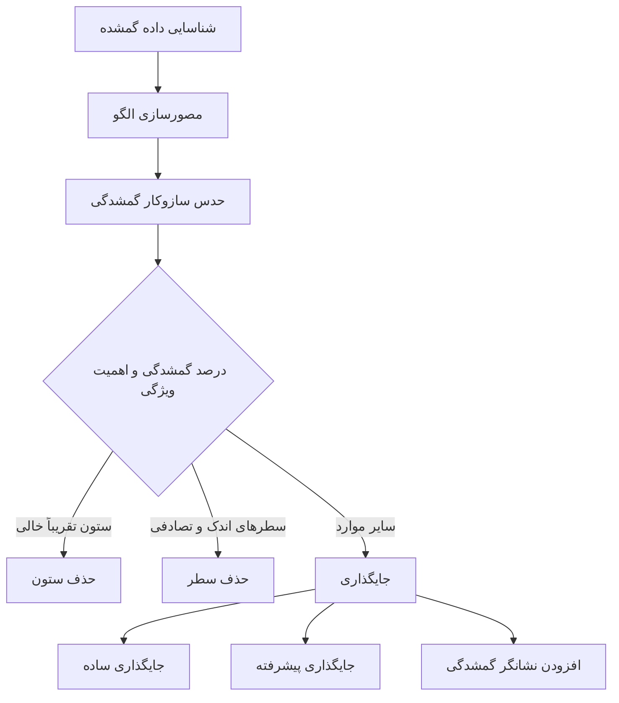
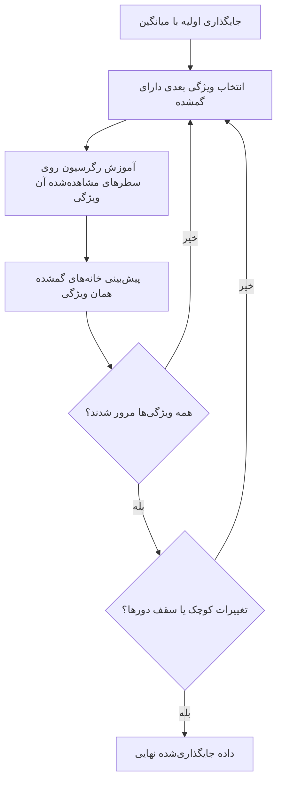

# جلسه ۱۰ — مدیریت داده گمشده

## چرا داده گمشده مهم است؟

در جلسه کیفیت داده دیدیم که **کامل‌بودن** یکی از ابعاد اصلی کیفیت است و داده گمشده رایج‌ترین مشکل داده‌های واقعی است ← [[۶ - کیفیت داده]] در تحلیل اکتشافی نیز درصد گمشدگی هر ویژگی را گزارش کردیم ← [[9 - مطالعه موردی EDA]] اکنون نوبت **تصمیم‌گیری** است: با این خانه‌های خالی چه کنیم؟

سه دلیل برای جدی گرفتن این تصمیم:

- **بیشتر الگوریتم‌ها** در scikit-learn (مانند رگرسیون خطی، SVM و k-NN) با مقدار گمشده کار نمی‌کنند و خطا می‌دهند.
- **حذف بی‌دقت** می‌تواند بخش بزرگی از داده را دور بریزد؛ در Titanic فقط ۱۸۲ سطر از ۸۹۱ سطر کامل‌اند.
- **جایگذاری بی‌دقت** می‌تواند نتیجه را **سوگیر** کند: میانگین‌ها جابه‌جا، واریانس‌ها کوچک و همبستگی‌ها ضعیف می‌شوند.

> [!important] پرسش اصلی این جلسه پیش از انتخاب روش، باید پرسید: **چرا** این مقدار گمشده است؟ پاسخ این پرسش (سازوکار گمشدگی) تعیین می‌کند کدام روش سوگیری ایجاد نمی‌کند.

نمای کلی داده گمشده در Titanic که در این جلسه بارها به آن برمی‌گردیم:

|ویژگی|تعداد گمشده|درصد گمشدگی|
|:-:|:-:|:-:|
|سن (age)|177|19.9٪|
|عرشه (deck)|688|77.2٪|
|بندر سوار شدن (embarked)|2|0.2٪|
|نام بندر (embark_town)|2|0.2٪|



---

## سازوکارهای گمشدگی

دونالد روبین (Rubin) سه سازوکار برای گمشدگی تعریف کرد. فرض کنید ویژگی Y برخی مقادیر گمشده دارد و X سایر ویژگی‌های مشاهده‌شده است.

### گمشدگی کاملاً تصادفی (MCAR)

در سازوکار MCAR (Missing Completely At Random)، احتمال گمشدن **به هیچ چیز** وابسته نیست؛ نه به مقدار خود Y و نه به سایر ویژگی‌ها.

$$ P(\text{missing} \mid X, Y) = P(\text{missing}) $$

- مثال: یک لوله آزمایش در آزمایشگاه به‌طور اتفاقی می‌شکند.
- مثال: پرسشنامه‌ای که چند برگ آن هنگام اسکن به‌طور تصادفی جا افتاده است.
- پیامد: سطرهای کامل یک **نمونه تصادفی** از کل داده‌اند؛ حذف سطر سوگیری ایجاد نمی‌کند (فقط داده کمتر می‌شود).

### گمشدگی تصادفی (MAR)

در سازوکار MAR (Missing At Random)، احتمال گمشدن به **سایر ویژگی‌های مشاهده‌شده** وابسته است، اما با دانستن آن‌ها، به مقدار خود Y وابسته نیست.

$$ P(\text{missing} \mid X, Y) = P(\text{missing} \mid X) $$

- مثال: جوان‌ترها کمتر به پرسش درآمد پاسخ می‌دهند؛ گمشدگی درآمد به **سن** (که ثبت شده) وابسته است.
- مثال در Titanic: سن مسافران کلاس سوم بسیار بیشتر از کلاس‌های دیگر گمشده است.
- پیامد: حذف سطر سوگیری ایجاد می‌کند، اما روش‌هایی که از X استفاده می‌کنند (رگرسیون، KNN، جایگذاری تکراری) می‌توانند سوگیری را برطرف کنند.

> [!warning] نام گمراه‌کننده سازوکار MAR **تصادفی نیست**! نام آن تاریخی است و معنای دقیقش این است: «پس از در نظر گرفتن ویژگی‌های مشاهده‌شده، گمشدگی تصادفی است».

### گمشدگی غیرتصادفی (MNAR)

در سازوکار MNAR (Missing Not At Random)، احتمال گمشدن به **مقدار خود Y** (یا به ویژگی ثبت‌نشده‌ای) وابسته است.

- مثال: افراد پردرآمد کمتر درآمد خود را اعلام می‌کنند.
- مثال: بیماران بدحال از ادامه یک مطالعه بالینی انصراف می‌دهند.
- مثال: حسگر دما در دماهای بسیار بالا از کار می‌افتد.
- پیامد: هیچ روش جایگذاری صرفاً آماری به‌طور کامل سوگیری را برطرف نمی‌کند؛ به **دانش حوزه**، جمع‌آوری داده بیشتر یا مدل‌سازی خود سازوکار گمشدگی نیاز است.

|سازوکار|گمشدگی به چه وابسته است؟|حذف سطر|جایگذاری با سایر ویژگی‌ها|قابل آزمون از روی داده؟|
|:-:|:-:|:-:|:-:|:-:|
|گمشدگی کاملاً تصادفی (MCAR)|هیچ چیز|بدون سوگیری|بدون سوگیری|تا حدی (رد کردن آن ممکن است)|
|گمشدگی تصادفی (MAR)|ویژگی‌های مشاهده‌شده|سوگیر|بدون سوگیری (با مدل مناسب)|تا حدی|
|گمشدگی غیرتصادفی (MNAR)|مقدار گمشده خودش|سوگیر|همچنان سوگیر|خیر؛ فقط با دانش حوزه|

> [!example] مثال حل‌شده — شبیه‌سازی سه سازوکار برای ۱۰۰۰ نفر، سن (بین ۲۰ تا ۶۰ سال) و درآمد ماهانه (وابسته به سن به‌علاوه نویز) را تولید می‌کنیم. میانگین واقعی درآمد **۲۴.۶۳** است. سپس حدود ۳۰ درصد درآمدها را با سه سازوکار حذف می‌کنیم:
> 
> - **سازوکار MCAR:** هر سطر با احتمال ۰.۳ گمشده می‌شود.
> - **سازوکار MAR:** افراد زیر ۳۵ سال با احتمال ۰.۶ و بقیه با احتمال ۰.۱.
> - **سازوکار MNAR:** افراد با درآمد بالاتر از میانه با احتمال ۰.۵ و بقیه با احتمال ۰.۱.
> 
> |سازوکار|درصد گمشده|میانگین پس از حذف سطر|میانگین پس از جایگذاری رگرسیونی با سن|
> |:-:|:-:|:-:|:-:|
> |گمشدگی کاملاً تصادفی (MCAR)|31.2٪|25.00|24.77|
> |گمشدگی تصادفی (MAR)|29.3٪|26.50|24.66|
> |گمشدگی غیرتصادفی (MNAR)|29.9٪|22.80|24.15|
> 
> - در حالت MCAR، هر دو روش به مقدار واقعی (۲۴.۶۳) نزدیک‌اند؛ اختلاف کوچک ناشی از نوسان نمونه‌گیری است.
> - در حالت MAR، حذف سطر میانگین را **بیش‌برآورد** می‌کند (چون جوان‌ترهای کم‌درآمد حذف شده‌اند)، اما جایگذاری با کمک سن سوگیری را تقریباً کامل برطرف می‌کند.
> - در حالت MNAR، حذف سطر میانگین را **کم‌برآورد** می‌کند و جایگذاری با سن فقط بخشی از سوگیری را جبران می‌کند (۲۴.۱۵ به جای ۲۴.۶۳).

> [!tip] چگونه سازوکار را حدس بزنیم؟
> 
> - یک ویژگی کمکی «گمشده است یا نه» بسازید و آن را با سایر ویژگی‌ها مقایسه کنید (مثلاً توزیع کلاس بلیت در سطرهای دارای سن و فاقد سن). اگر تفاوت معنادار بود، فرض MCAR رد می‌شود.
> - سازوکار MNAR را نمی‌توان از روی داده مشاهده‌شده اثبات یا رد کرد؛ از **متخصص حوزه** و فرایند جمع‌آوری داده بپرسید.

> [!example] مثال — آیا گمشدگی سن در Titanic کاملاً تصادفی است؟
> 
> |گروه|سهم کلاس اول|سهم کلاس دوم|سهم کلاس سوم|نرخ بقا|
> |:-:|:-:|:-:|:-:|:-:|
> |سن ثبت‌شده (714 نفر)|26.1٪|24.2٪|49.7٪|40.6٪|
> |سن گمشده (177 نفر)|16.9٪|6.2٪|76.8٪|29.4٪|
> 
> مسافرانی که سنشان گمشده است بیشتر در کلاس سوم بوده‌اند و نرخ بقای کمتری دارند. پس گمشدگی سن **کاملاً تصادفی نیست**؛ فرض MAR (وابسته به کلاس) معقول‌تر است.

---

## مصورسازی الگوی گمشدگی

پیش از هر تصمیمی، الگوی گمشدگی را **ببینید**. سه پرسش اصلی:

1. کدام ستون‌ها و با چه درصدی گمشده دارند؟
2. آیا گمشدگی در ستون‌های مختلف **هم‌زمان** رخ می‌دهد؟
3. آیا گمشدگی با مرتب‌سازی داده (مثلاً بر اساس زمان یا یک ویژگی) الگو پیدا می‌کند؟

|نمودار|کاربرد|ابزار|
|:-:|:-:|:-:|
|نمودار میله‌ای درصد گمشدگی|مقایسه ستون‌ها|تابع `isna().mean()` و pandas یا کتابخانه missingno|
|ماتریس گمشدگی|دیدن الگوی سطرها، بلوک‌های خالی|تابع `heatmap` در seaborn یا `msno.matrix`|
|نقشه حرارتی همبستگی گمشدگی|گمشدگی هم‌زمان ستون‌ها|تابع `isna().corr()` یا `msno.heatmap`|
|دندروگرام گمشدگی|خوشه‌بندی ستون‌ها بر اساس الگوی گمشدگی|تابع `msno.dendrogram`|

> [!example] مثال — همبستگی گمشدگی در Titanic ماتریس همبستگی شاخص‌های گمشدگی (صفر و یک) نشان می‌دهد:
> 
> - گمشدگی `embarked` و `embark_town` همبستگی **۱** دارد؛ این دو ستون یک اطلاعات را دو بار ذخیره کرده‌اند (داده تکراری در سطح ستون).
> - گمشدگی سن و عرشه همبستگی ضعیف مثبت (حدود ۰.۱۴) دارد؛ هر دو در کلاس سوم بیشترند.
> 
> |تعداد خانه گمشده در سطر|تعداد سطر|
> |:-:|:-:|
> |صفر|182|
> |یک|549|
> |دو|160|

> [!note] کتابخانه missingno کتابخانه missingno نمودارهای آماده و زیبایی برای گمشدگی دارد، اما باید جداگانه نصب شود (`pip install missingno`). در بخش پیاده‌سازی، هم کد missingno و هم معادل آن با seaborn آمده است.

---

## راهبردهای حذف

### حذف سطر (Listwise Deletion)

هر سطری که دست‌کم یک مقدار گمشده دارد حذف می‌شود (تحلیل موارد کامل یا Complete Case Analysis).

|مزایا|معایب|
|:-:|:-:|
|ساده و سریع|از دست رفتن داده؛ گاهی بخش بزرگی از داده|
|بدون نیاز به فرض درباره مقادیر|سوگیری در حالت MAR و MNAR|
|مناسب وقتی گمشدگی اندک و MCAR است|در زمان استقرار مدل، داده جدید گمشده را نمی‌توان «حذف» کرد|

> [!example] مثال — هزینه حذف سطر در Titanic
> 
> - حذف هر سطر دارای گمشده: **۱۸۲** سطر باقی می‌ماند (۲۰.۴ درصد داده!)، چون ستون عرشه ۷۷ درصد گمشده دارد.
> - حذف ستون عرشه و سپس حذف سطرها: **۷۱۲** سطر باقی می‌ماند.
> - حذف فقط سطرهای فاقد سن: **۷۱۴** سطر.
> 
> ترتیب تصمیم‌ها مهم است: ابتدا درباره **ستون‌ها** تصمیم بگیرید، سپس درباره سطرها.

> [!tip] حذف جفتی (Pairwise Deletion) در محاسبه آماره‌هایی مانند ماتریس همبستگی، برای هر جفت ویژگی فقط سطرهایی حذف می‌شوند که در **همان دو ویژگی** گمشده دارند. تابع `corr` در pandas به همین شکل عمل می‌کند. عیب آن: هر خانه ماتریس روی زیرمجموعه متفاوتی محاسبه شده است.

### حذف ستون

اگر بخش بزرگی از یک ستون گمشده باشد، جایگذاری آن عملاً «ساختن داده» است.

- قاعده سرانگشتی رایج: ستون‌های با بیش از ۵۰ تا ۷۰ درصد گمشدگی کاندید حذف‌اند.
- **اما** پیش از حذف بپرسید: آیا خودِ گمشدگی اطلاعات دارد؟

> [!example] مثال — ستون عرشه در Titanic ستون عرشه ۷۷.۲ درصد گمشده است، اما:
> 
> - نرخ گمشدگی آن در کلاس اول ۱۹ درصد، در کلاس دوم ۹۱ درصد و در کلاس سوم ۹۸ درصد است.
> - نرخ بقای مسافران **با عرشه ثبت‌شده** حدود ۶۷ درصد و **بدون عرشه** حدود ۳۰ درصد است.
> 
> به جای حذف کامل، می‌توان ستون عرشه را حذف و یک ویژگی دودویی «عرشه ثبت شده است» ساخت. این همان ایده **نشانگر گمشدگی** است که در ادامه می‌بینیم.

---

## جایگذاری ساده

جایگذاری (Imputation) یعنی پر کردن خانه‌های خالی با یک مقدار برآوردی.

|روش|مناسب برای|ویژگی|پارامتر در SimpleImputer|
|:-:|:-:|:-:|:-:|
|میانگین (Mean)|عددی، توزیع متقارن|حساس به داده پرت|`strategy="mean"`|
|میانه (Median)|عددی، توزیع چوله یا دارای داده پرت|مقاوم|`strategy="median"`|
|مد (Mode)|کیفی، یا عددی گسسته|پرتکرارترین مقدار|`strategy="most_frequent"`|
|مقدار ثابت|کیفی (دسته «نامعلوم») یا عددی با معنای خاص (مثلاً صفر)|ساخت دسته جدید|`strategy="constant"`|

> [!example] مثال حل‌شده — جایگذاری ساده و اثر آن بر واریانس ستون سن هشت مقدار دارد که دو تای آن گمشده است:
> 
> |مقدار|22|25|؟|30|25|؟|40|28|
> |:-:|:-:|:-:|:-:|:-:|:-:|:-:|:-:|:-:|
> 
> شش مقدار مشاهده‌شده: ۲۲، ۲۵، ۲۵، ۲۸، ۳۰ و ۴۰. $$ \bar{x} = \frac{22 + 25 + 30 + 25 + 40 + 28}{6} = \frac{170}{6} \approx 28.33 $$
> 
> - میانه: میانگین دو مقدار وسط مرتب‌شده، یعنی ۲۵ و ۲۸، برابر **۲۶.۵**
> - مد: **۲۵** (دو بار تکرار شده)
> 
> انحراف معیار نمونه شش مقدار مشاهده‌شده حدود **۶.۳۵** است. پس از جایگذاری دو خانه با میانگین، انحراف معیار هشت مقدار به حدود **۵.۳۶** کاهش می‌یابد؛ زیرا دو مقدار دقیقاً روی میانگین افزوده شده‌اند که هیچ پراکندگی ندارند: $$ s^2_{\text{new}} = s^2_{\text{obs}} \times \frac{n_{\text{obs}} - 1}{n - 1} = 40.27 \times \frac{5}{7} \approx 28.76 $$

> [!warning] عیب‌های جایگذاری با میانگین یا میانه
> 
> - **کاهش واریانس:** همه خانه‌های خالی یک مقدار می‌گیرند؛ در Titanic انحراف معیار سن از ۱۴.۵۳ به ۱۳.۰۰ می‌رسد.
> - **تضعیف همبستگی‌ها:** مقدار جایگذاری‌شده به سایر ویژگی‌ها بی‌توجه است.
> - **قله مصنوعی** در هیستوگرام روی مقدار میانگین یا میانه.
> - **سوگیری** در حالت MAR: میانگین کلی سن برای مسافر کلاس سوم (که جوان‌ترند) مقدار مناسبی نیست.

### جایگذاری گروهی

یک بهبود ساده: میانه را **در هر گروه** حساب کنید. اگر گمشدگی به گروه وابسته است (MAR)، این روش سوگیری را کم می‌کند.

> [!example] مثال — میانه سن بر اساس کلاس و جنسیت در Titanic
> 
> |کلاس|زن|مرد|
> |:-:|:-:|:-:|
> |کلاس اول|35.0|40.0|
> |کلاس دوم|28.0|30.0|
> |کلاس سوم|21.5|25.0|
> 
> به جای جایگذاری همه با میانه کلی (۲۸)، به مرد کلاس اول ۴۰ و به زن کلاس سوم ۲۱.۵ داده می‌شود. انحراف معیار پس از این جایگذاری حدود ۱۳.۳ است که کاهش کمتری نسبت به جایگذاری با میانگین (۱۳.۰۰) دارد.

> [!tip] ویژگی‌های کیفی برای ویژگی کیفی، به‌جای مد معمولاً ساختن دسته جدید «نامعلوم» (Unknown) بهتر است؛ چون اطلاعات «گمشده بودن» حفظ می‌شود و دسته پرتکرار به‌طور مصنوعی بزرگ نمی‌شود. برای ستون `embarked` با فقط دو مقدار گمشده، مد (Southampton با ۶۴۴ مسافر) کاملاً قابل قبول است.

---

## جایگذاری پیشرفته

روش‌های پیشرفته از **رابطه میان ویژگی‌ها** استفاده می‌کنند؛ بنابراین برای حالت MAR مناسب‌ترند.

### جایگذاری با k نزدیک‌ترین همسایه (KNN Imputer)

ایده: برای هر سطر دارای خانه خالی، k سطر **شبیه** را (بر اساس ویژگی‌های موجود) پیدا کن و میانگین مقدار آن‌ها را جایگزین کن ← [[۵ - معیارهای شباهت و فاصله]]

مشکل: چگونه فاصله دو سطر را حساب کنیم وقتی خودشان خانه خالی دارند؟ کلاس KNNImputer از **فاصله اقلیدسی با نادیده گرفتن گمشده‌ها** (nan_euclidean) استفاده می‌کند. فقط مختصاتی که در **هر دو** سطر موجودند جمع زده می‌شوند و نتیجه به نسبت تعداد کل مختصات (p) به تعداد مختصات موجود بزرگ‌نمایی می‌شود:

$$ d(x, y) = \sqrt{\frac{p}{p_{\text{present}}} \sum_{j \in \text{present}} (x_j - y_j)^2} $$

> [!example] مثال حل‌شده — جایگذاری KNN با دو همسایه
> 
> |فرد|قد|وزن|سن|
> |:-:|:-:|:-:|:-:|
> |فرد A|170|65|30|
> |فرد B|160|55|25|
> |فرد C|180|80|40|
> |فرد D|175|؟|35|
> |فرد E|165|60|؟|
> 
> **وزن فرد D:** نامزدها افرادی هستند که وزنشان موجود است (A، B، C و E). فاصله‌ها (تعداد کل مختصات p برابر ۳): $$ \begin{aligned} d(D, A) &= \sqrt{\tfrac{3}{2}\left(5^2 + 5^2\right)} = \sqrt{75} \approx 8.66 \ d(D, B) &= \sqrt{\tfrac{3}{2}\left(15^2 + 10^2\right)} = \sqrt{487.5} \approx 22.08 \ d(D, C) &= \sqrt{\tfrac{3}{2}\left(5^2 + 5^2\right)} = \sqrt{75} \approx 8.66 \ d(D, E) &= \sqrt{\tfrac{3}{1}\left(10^2\right)} = \sqrt{300} \approx 17.32 \end{aligned} $$ برای فاصله D و E فقط قد در هر دو موجود است (وزن D و سن E گمشده‌اند). دو همسایه نزدیک‌تر A و C هستند: $$ \hat{w}_D = \frac{65 + 80}{2} = 72.5 $$ **سن فرد E:** به همین ترتیب فاصله E از A و از B هر دو حدود ۸.۶۶ است (C با ۳۰.۶۲ و D با ۱۷.۳۲ دورترند)، پس سن E برابر میانگین ۳۰ و ۲۵، یعنی **۲۷.۵** می‌شود. خروجی کلاس KNNImputer با دو همسایه دقیقاً همین مقادیر است.

> [!warning] مقیاس‌بندی پیش از KNN در مثال بالا قد و سن واحدهای متفاوتی دارند و ویژگی با دامنه بزرگ‌تر بر فاصله غالب می‌شود. در عمل پیش از KNNImputer داده را **استاندارد** کنید ← [[۱۲ - تبدیل و یکپارچه‌سازی داده]] در تمرین این جلسه خواهیم دید که استانداردسازی خطای جایگذاری را به‌طور محسوسی کاهش می‌دهد. کلاس‌های مقیاس‌بندی در scikit-learn مقادیر گمشده را نادیده می‌گیرند و حفظ می‌کنند، پس این ترتیب ممکن است.

|پارامتر KNNImputer|معنا|پیش‌فرض|
|:-:|:-:|:-:|
|تعداد همسایه (n_neighbors)|تعداد همسایه‌ها|5|
|وزن‌دهی (weights)|میانگین ساده یا وزن‌دار با عکس فاصله|`"uniform"`|
|افزودن نشانگر (add_indicator)|افزودن ستون نشانگر گمشدگی|`False`|

### جایگذاری تکراری (Iterative Imputer)

ایده: هر ویژگی دارای گمشده را با یک **مدل رگرسیون** از روی سایر ویژگی‌ها پیش‌بینی کن، و این کار را چند دور تکرار کن تا مقادیر پایدار شوند. این روش نسخه scikit-learn ایده **MICE** (Multivariate Imputation by Chained Equations) است.



|پارامتر IterativeImputer|معنا|پیش‌فرض|
|:-:|:-:|:-:|
|مدل (estimator)|مدل رگرسیون هر ویژگی|`BayesianRidge()`|
|بیشینه دورها (max_iter)|سقف تعداد دورها|10|
|نمونه‌گیری از پسین (sample_posterior)|افزودن عدم‌قطعیت به جایگذاری|`False`|
|ترتیب جایگذاری (imputation_order)|ترتیب پردازش ستون‌ها|`"ascending"` (از کم‌گمشده به پرگمشده)|

> [!warning] وضعیت آزمایشی کلاس IterativeImputer هنوز در scikit-learn **آزمایشی** است و پیش از وارد کردن آن باید `enable_iterative_imputer` را وارد کرد (کد در بخش پیاده‌سازی).

> [!note] جایگذاری چندگانه (Multiple Imputation) یک جایگذاری واحد عدم‌قطعیت مقدار گمشده را نادیده می‌گیرد و فاصله‌های اطمینان را بیش از حد باریک می‌کند. در **جایگذاری چندگانه**، چند نسخه جایگذاری‌شده (مثلاً با `sample_posterior=True` و مقدار متفاوت `random_state`) ساخته، تحلیل روی هر کدام انجام و نتایج ترکیب می‌شوند. این روش در آمار استنباطی رایج است؛ در داده‌کاوی پیش‌بینانه، معمولاً یک جایگذاری خوب کافی است.

|روش|استفاده از سایر ویژگی‌ها|حفظ واریانس|هزینه محاسبه|مناسب برای|
|:-:|:-:|:-:|:-:|:-:|
|میانگین یا میانه|خیر|ضعیف|بسیار کم|گمشدگی اندک، خط پایه|
|میانه گروهی|فقط یک یا دو ویژگی کیفی|متوسط|کم|گمشدگی وابسته به گروه|
|جایگذاری KNN|بله|خوب|زیاد برای داده بزرگ|روابط محلی و غیرخطی|
|جایگذاری تکراری|بله|خوب|متوسط تا زیاد|روابط خطی (یا با مدل دلخواه)|

---

## افزودن ویژگی نشانگر گمشدگی

گاهی **خودِ گمشده بودن** اطلاعات دارد (به‌ویژه در حالت MNAR و MAR). در این صورت پس از جایگذاری، یک ستون دودویی می‌افزاییم که نشان می‌دهد مقدار اصلی گمشده بوده است.

$$ \text{indicator}_i = \begin{cases} 1 & \text{if } x_i \text{ is missing} \ 0 & \text{otherwise} \end{cases} $$

> [!example] مثال — نشانگر گمشدگی سن در Titanic
> 
> |گروه|تعداد|نرخ بقا|
> |:-:|:-:|:-:|
> |سن ثبت‌شده|714|40.6٪|
> |سن گمشده|177|29.4٪|
> 
> اگر فقط سن را با میانه جایگذاری کنیم، مدل نمی‌داند این ۱۷۷ نفر متفاوت‌اند. ستون نشانگر این تفاوت ۱۱ درصدی در نرخ بقا را در اختیار مدل قرار می‌دهد.

|روش|ابزار در scikit-learn|
|:-:|:-:|
|جایگذاری همراه با نشانگر|پارامتر `add_indicator=True` در SimpleImputer، KNNImputer و IterativeImputer|
|فقط ساخت نشانگر|کلاس `MissingIndicator`|
|روش دستی در pandas|عبارت `df["age"].isna().astype(int)`|

> [!tip] مدل‌هایی که گمشدگی را خودشان مدیریت می‌کنند برخی مدل‌ها مانند `HistGradientBoostingClassifier` در scikit-learn (و XGBoost و LightGBM) مقدار گمشده را مستقیماً می‌پذیرند و در هر تقسیم یاد می‌گیرند گمشده‌ها را به کدام شاخه بفرستند ← [[23 - روش‌های گروهی]] از نسخه‌های اخیر، درخت تصمیم و جنگل تصادفی scikit-learn نیز از مقدار گمشده پشتیبانی می‌کنند.

> [!important] جایگذاری فقط با داده آموزش آماره‌های جایگذاری (میانگین، میانه، همسایه‌ها، مدل‌های رگرسیون) باید **فقط روی داده آموزش** محاسبه (`fit`) و سپس روی داده آزمون **اعمال** (`transform`) شوند. محاسبه میانگین روی کل داده نوعی **نشت داده** است ← [[۱۴- کاهش ابعاد]]

### راهنمای تصمیم‌گیری

|وضعیت|پیشنهاد|
|:-:|:-:|
|گمشدگی کمتر از ۵ درصد و احتمالاً MCAR|حذف سطر یا جایگذاری ساده|
|ستون با گمشدگی بسیار زیاد|حذف ستون، شاید با نگه‌داشتن نشانگر|
|گمشدگی وابسته به سایر ویژگی‌ها (MAR)|جایگذاری KNN، تکراری یا گروهی|
|احتمال MNAR|نشانگر گمشدگی + مشورت با متخصص حوزه|
|ویژگی کیفی|دسته «نامعلوم» یا مد|
|متغیر هدف گمشده|حذف سطر (هدف را جایگذاری نکنید)|

---

## پیاده‌سازی در پایتون

```python
import numpy as np
import pandas as pd
import matplotlib
matplotlib.use("Agg")
import matplotlib.pyplot as plt
import seaborn as sns
from sklearn.impute import SimpleImputer, KNNImputer, MissingIndicator
from sklearn.experimental import enable_iterative_imputer  # noqa: F401 (required)
from sklearn.impute import IterativeImputer

sns.set_theme(style="whitegrid")
titanic = sns.load_dataset("titanic")
```

### گزارش گمشدگی

```python
def missing_report(df: pd.DataFrame) -> pd.DataFrame:
    """Count and percentage of missing values per column (only columns with NaN)."""
    rep = pd.DataFrame({"n_missing": df.isna().sum(),
                        "pct_missing": (df.isna().mean() * 100).round(1)})
    return rep[rep["n_missing"] > 0].sort_values("pct_missing", ascending=False)

print(missing_report(titanic))
# deck 688 (77.2), age 177 (19.9), embarked 2 (0.2), embark_town 2 (0.2)

print(titanic.isna().sum(axis=1).value_counts().sort_index())
# 0 missing: 182 rows, 1 missing: 549 rows, 2 missing: 160 rows
```

### مصورسازی الگوی گمشدگی با seaborn

```python
fig, axes = plt.subplots(1, 2, figsize=(13, 5))

# Missing-value matrix: one row per passenger, sorted by class
miss = titanic.sort_values("pclass").isna()
sns.heatmap(miss, cbar=False, cmap="Greys", yticklabels=False, ax=axes[0])
axes[0].set_title("Missing values (black), sorted by pclass")

# Nullity correlation between columns that have missing values
cols = titanic.columns[titanic.isna().any()]
sns.heatmap(titanic[cols].isna().corr(), annot=True, fmt=".2f",
            cmap="coolwarm", vmin=-1, vmax=1, ax=axes[1])
axes[1].set_title("Nullity correlation")
plt.tight_layout()
plt.show()
# embarked & embark_town: 1.00, age & deck: 0.14
```

### مصورسازی با missingno (اختیاری)

```python
# Optional: requires  pip install missingno
try:
    import missingno as msno
    msno.bar(titanic)          # completeness per column
    msno.matrix(titanic)       # row-level pattern
    msno.heatmap(titanic)      # nullity correlation
    msno.dendrogram(titanic)   # cluster columns by missingness
    plt.show()
except ImportError:
    print("missingno is not installed; use the seaborn heatmap above")
```

### بررسی سازوکار: مقایسه سطرهای دارای گمشده و بدون گمشده

```python
age_missing = titanic["age"].isna()
print(titanic.groupby(age_missing)["survived"].mean().round(3))
# False 0.406, True 0.294
print(pd.crosstab(age_missing, titanic["pclass"], normalize="index").round(3))
# age missing -> 76.8% in 3rd class (vs 49.7% when age is known)
print(titanic.groupby(titanic["deck"].isna())["survived"].mean().round(3))
# deck known 0.670, deck missing 0.299
```

### شبیه‌سازی سه سازوکار گمشدگی

```python
from sklearn.linear_model import LinearRegression

rng = np.random.default_rng(42)
n = 1000
age = rng.uniform(20, 60, n)
income = 5 + 0.5 * age + rng.normal(0, 4, n)
print("true mean:", income.mean().round(2))           # 24.63

masks = {
    "MCAR": rng.random(n) < 0.3,
    "MAR":  rng.random(n) < np.where(age < 35, 0.6, 0.1),
    "MNAR": rng.random(n) < np.where(income > np.median(income), 0.5, 0.1),
}
for name, m in masks.items():
    observed = income[~m]
    reg = LinearRegression().fit(age[~m].reshape(-1, 1), observed)
    imputed = income.copy()
    imputed[m] = reg.predict(age[m].reshape(-1, 1))
    print(f"{name}: missing={m.mean():.1%}  listwise mean={observed.mean():.2f}  "
          f"regression-imputed mean={imputed.mean():.2f}")
# MCAR: missing=31.2%  listwise mean=25.00  regression-imputed mean=24.77
# MAR:  missing=29.3%  listwise mean=26.50  regression-imputed mean=24.66
# MNAR: missing=29.9%  listwise mean=22.80  regression-imputed mean=24.15
```

### راهبردهای حذف

```python
print(titanic.dropna().shape)                        # (182, 15)
print(titanic.drop(columns="deck").dropna().shape)   # (712, 14)
print(titanic.dropna(subset=["age"]).shape)          # (714, 15)

# Drop columns with more than 50% missing values
keep = titanic.columns[titanic.isna().mean() <= 0.5]
print(titanic[keep].shape)                           # (891, 14)
```

### جایگذاری ساده

```python
ages = pd.Series([22, 25, np.nan, 30, 25, np.nan, 40, 28])
print(ages.mean().round(2), ages.median(), ages.mode()[0])   # 28.33 26.5 25.0
print(ages.std().round(2), ages.fillna(ages.mean()).std().round(2))  # 6.35 5.36

# pandas
t = titanic.copy()
t["age_median"] = t["age"].fillna(t["age"].median())                   # 28.0
t["age_group_median"] = t["age"].fillna(
    t.groupby(["pclass", "sex"])["age"].transform("median"))
t["embarked"] = t["embarked"].fillna(t["embarked"].mode()[0])           # 'S'
print(t["age"].std().round(2), t["age_median"].std().round(2),
      t["age_group_median"].std().round(2))                             # 14.53 13.02 13.3

# scikit-learn: numeric and categorical imputers
num_imp = SimpleImputer(strategy="median")
cat_imp = SimpleImputer(strategy="constant", fill_value="Unknown")
age_filled = num_imp.fit_transform(titanic[["age"]])
deck_filled = cat_imp.fit_transform(titanic[["deck"]].astype(object))
print(num_imp.statistics_)                          # [28.]
print(pd.Series(deck_filled.ravel()).value_counts().head(3))
# Unknown 688, C 59, B 47
```

### جایگذاری KNN روی مثال حل‌شده

```python
from sklearn.metrics.pairwise import nan_euclidean_distances

X = pd.DataFrame({"height": [170, 160, 180, 175, 165],
                  "weight": [65, 55, 80, np.nan, 60],
                  "age":    [30, 25, 40, 35, np.nan]}, index=list("ABCDE"))

print(pd.DataFrame(nan_euclidean_distances(X), index=X.index,
                   columns=X.index).round(2).loc[["D", "E"]])
#        A      B     C      D      E
# D   8.66  22.08  8.66   0.00  17.32
# E   8.66   8.66 30.62  17.32   0.00

knn = KNNImputer(n_neighbors=2)
print(pd.DataFrame(knn.fit_transform(X), index=X.index, columns=X.columns))
# D weight -> 72.5, E age -> 27.5
```

### جایگذاری تکراری و نشانگر گمشدگی

```python
cols = ["pclass", "age", "sibsp", "parch", "fare"]
it = IterativeImputer(random_state=42, max_iter=10)
age_it = it.fit_transform(titanic[cols])[:, 1]
print(round(age_it[titanic["age"].isna()].mean(), 1))   # 27.7  mean of imputed ages

# Imputation + indicator column in one step
imp = SimpleImputer(strategy="median", add_indicator=True)
out = imp.fit_transform(titanic[["age", "fare"]])
print(imp.get_feature_names_out())    # ['age' 'fare' 'missingindicator_age']
print(out[5])                         # [28.  8.4583  1.]  (passenger 6 had no age)

ind = MissingIndicator().fit_transform(titanic[["age", "fare"]])
print(ind.sum(axis=0))                # [177]  (only columns with NaN are kept)
```

### مقایسه توزیع سن پس از جایگذاری

```python
fig, ax = plt.subplots(figsize=(8, 4))
sns.kdeplot(titanic["age"].dropna(), label="Observed only", ax=ax)
sns.kdeplot(t["age_median"], label="Median imputed", ax=ax)
sns.kdeplot(pd.Series(age_it), label="Iterative imputed", ax=ax)
ax.set(title="Age distribution after imputation", xlabel="Age", ylabel="Density")
ax.legend()
plt.show()
# Median imputation creates an artificial spike at 28
```

---

## تمرین عملی کلاس

> [!example] تمرین عملی (۲۵ دقیقه) هدف: مقایسه کمّی روش‌های جایگذاری وقتی **مقدار واقعی** را می‌دانیم. مجموعه‌داده پنگوئن‌ها را بارگذاری کنید و فقط سطرهای کامل ویژگی‌های عددی را نگه دارید:
> 
> ```python
> import numpy as np, seaborn as sns
> from sklearn.impute import SimpleImputer, KNNImputer
> from sklearn.experimental import enable_iterative_imputer  # noqa: F401
> from sklearn.impute import IterativeImputer
> from sklearn.preprocessing import StandardScaler
> 
> num_cols = ["bill_length_mm", "bill_depth_mm", "flipper_length_mm", "body_mass_g"]
> full = sns.load_dataset("penguins")[num_cols].dropna().reset_index(drop=True)
> rng = np.random.default_rng(42)
> mask = rng.random(len(full)) < 0.2            # MCAR: ~20% of body mass
> X = full.copy()
> X.loc[mask, "body_mass_g"] = np.nan
> truth = full.loc[mask, "body_mass_g"].to_numpy()
> 
> def rmse(filled):
>     return np.sqrt(np.mean((filled[mask, 3] - truth) ** 2))
> ```
> 
> 1. چند سطر کامل باقی مانده و چند مقدار وزن گمشده شده است؟ انحراف معیار واقعی وزن چقدر است؟
> 2. خطای جذر میانگین مربعات (RMSE) جایگذاری با **میانگین** و **میانه** را با `SimpleImputer` محاسبه کنید.
> 3. همین کار را با `KNNImputer(n_neighbors=5)` روی داده **خام** انجام دهید.
> 4. داده را با `StandardScaler` استاندارد کنید، سپس KNNImputer را اجرا و با `inverse_transform` به مقیاس اصلی برگردانید. خطا چقدر تغییر کرد؟
> 5. تعداد همسایه‌ها را ۱، ۳، ۵، ۱۰ و ۲۰ قرار دهید (روی داده استاندارد). کدام بهتر است؟
> 6. روش `IterativeImputer(random_state=42)` را نیز امتحان کنید و انحراف معیار ستون وزن را پس از هر روش با انحراف معیار واقعی مقایسه کنید.

> [!question]- پاسخ‌های کلیدی تمرین
> 
> 1. تعداد **۳۴۲** سطر کامل باقی می‌ماند و **۷۸** مقدار وزن (حدود ۲۳ درصد) گمشده می‌شود. انحراف معیار واقعی وزن حدود **۸۰۲** گرم است.
> 2. خطای جایگذاری با میانگین حدود **۷۸۲** و با میانه حدود **۸۰۸** گرم است؛ یعنی تقریباً هم‌اندازه انحراف معیار خود ویژگی. جایگذاری ساده عملاً هیچ اطلاعاتی درباره هر پنگوئن خاص نمی‌دهد.
> 3. جایگذاری KNN روی داده خام: حدود **۳۴۰** گرم؛ کمتر از نصف خطای میانگین، چون اندازه باله و نوک با وزن رابطه قوی دارند.
> 4. با استانداردسازی، خطا به حدود **۲۸۹** گرم کاهش می‌یابد؛ چون همه ویژگی‌ها در محاسبه فاصله سهم منصفانه پیدا می‌کنند.
> 5. خطا برای یک همسایه حدود ۴۰۲، برای سه همسایه حدود ۳۰۶، برای پنج همسایه حدود ۲۸۹، برای ده همسایه حدود ۲۸۱ و برای بیست همسایه حدود ۲۷۹ است. یک همسایه بیش از حد نویزی است؛ از حدود پنج همسایه به بعد بهبود اندک است.
> 6. جایگذاری تکراری خطای حدود **۳۷۳** گرم دارد (بهتر از میانگین، کمی بدتر از KNN). انحراف معیار ستون وزن پس از جایگذاری با میانگین به حدود ۷۱۰ کاهش می‌یابد، اما پس از KNN (حدود ۷۹۰) و جایگذاری تکراری (حدود ۷۸۰) به مقدار واقعی (۸۰۲) نزدیک می‌ماند.

---

## پرسش‌های مرور

> [!question]- ۱. تفاوت سازوکارهای MCAR، MAR و MNAR را با یک مثال برای هر کدام توضیح دهید. در **MCAR** گمشدگی به هیچ چیز وابسته نیست (شکستن تصادفی لوله آزمایش). در **MAR** گمشدگی به ویژگی‌های ثبت‌شده وابسته است (جوان‌ترها کمتر درآمد را اعلام می‌کنند و سن ثبت شده است). در **MNAR** گمشدگی به مقدار گمشده خودش وابسته است (افراد پردرآمد درآمد را اعلام نمی‌کنند).

> [!question]- ۲. چرا حذف سطر در Titanic انتخاب خوبی نیست؟ چون ستون عرشه ۷۷ درصد گمشده دارد و حذف همه سطرهای دارای گمشده فقط ۱۸۲ سطر از ۸۹۱ سطر را باقی می‌گذارد. علاوه بر این، گمشدگی سن و عرشه به کلاس بلیت وابسته است (MCAR نیست)، پس داده باقی‌مانده نمونه سوگیری از مسافران (عمدتاً کلاس اول) خواهد بود.

> [!question]- ۳. جایگذاری با میانگین چه اثری بر واریانس و همبستگی دارد؟ واریانس را **کاهش** می‌دهد، چون همه خانه‌های خالی یک مقدار ثابت (بدون پراکندگی) می‌گیرند. همبستگی با سایر ویژگی‌ها را نیز **تضعیف** می‌کند، چون مقدار جایگذاری‌شده به سایر ویژگی‌ها بی‌توجه است. همچنین قله مصنوعی در توزیع ایجاد می‌کند.

> [!question]- ۴. چرا پیش از KNNImputer باید داده را مقیاس‌بندی کرد؟ چون KNNImputer همسایه‌ها را با فاصله اقلیدسی پیدا می‌کند و ویژگی‌های با دامنه بزرگ (مثلاً وزن به گرم) بر فاصله غالب می‌شوند. در تمرین، استانداردسازی خطای جایگذاری وزن پنگوئن‌ها را از حدود ۳۴۰ به حدود ۲۸۹ گرم کاهش داد.

> [!question]- ۵. در چه شرایطی افزودن نشانگر گمشدگی مفید است؟ یک مثال بزنید. وقتی خودِ گمشده بودن با متغیر هدف رابطه دارد، که معمولاً در حالت MAR یا MNAR رخ می‌دهد. مثلاً در Titanic نرخ بقای مسافران با سن گمشده حدود ۲۹ درصد و با سن ثبت‌شده حدود ۴۱ درصد است؛ یا ثبت‌نشدن عرشه نشانه کلاس پایین‌تر و بقای کمتر است.

> [!question]- ۶. یک هم‌کلاسی میانه سن را روی کل داده Titanic حساب کرده، سپس داده را به آموزش و آزمون تقسیم کرده است. اشکال کار چیست؟ این کار **نشت داده** است: اطلاعات داده آزمون (سن مسافران آزمون) در آماره جایگذاری وارد شده است. روش درست: ابتدا تقسیم، سپس `fit` جایگذار روی داده آموزش و فقط `transform` روی داده آزمون؛ بهترین راه، قرار دادن جایگذار در یک Pipeline است.

---

## نکات کلیدی

> [!summary] خلاصه جلسه
> 
> - پیش از انتخاب روش، **سازوکار گمشدگی** را حدس بزنید: MCAR (کاملاً تصادفی)، MAR (وابسته به ویژگی‌های مشاهده‌شده) یا MNAR (وابسته به مقدار گمشده).
> - الگوی گمشدگی را با **ماتریس گمشدگی** و **همبستگی گمشدگی** مصور کنید؛ با seaborn یا کتابخانه missingno.
> - **حذف سطر** فقط برای گمشدگی اندک و MCAR بی‌خطر است؛ **حذف ستون** برای ستون‌های تقریباً خالی، اما ابتدا ارزش اطلاعاتی گمشدگی را بسنجید.
> - **جایگذاری ساده** (میانگین، میانه، مد، ثابت) سریع است اما واریانس و همبستگی را کاهش می‌دهد؛ **جایگذاری گروهی** بهبود ساده‌ای است.
> - **جایگذاری KNN** و **جایگذاری تکراری** از رابطه ویژگی‌ها استفاده می‌کنند و برای MAR مناسب‌ترند؛ پیش از KNN مقیاس‌بندی کنید.
> - **نشانگر گمشدگی** اطلاعات «گمشده بودن» را برای مدل حفظ می‌کند.
> - همه جایگذارها را **فقط روی داده آموزش** برازش دهید.

> [!todo] آمادگی برای جلسه بعد
> 
> 1. برای هر ویژگی دارای گمشده در داده پروژه خود، سازوکار محتمل (MCAR، MAR یا MNAR) را با دلیل بنویسید.
> 2. یک روش جایگذاری برای هر ویژگی پیشنهاد دهید و درباره افزودن نشانگر گمشدگی تصمیم بگیرید.
> 3. نمودار جعبه‌ای ویژگی‌های عددی داده پروژه را رسم کنید و مقادیر بسیار دور از بقیه را علامت بزنید. جلسه بعد درباره داده پرت، نویز و داده تکراری صحبت می‌کنیم ← [[11- داده پرت، نویز و داده تکراری]]