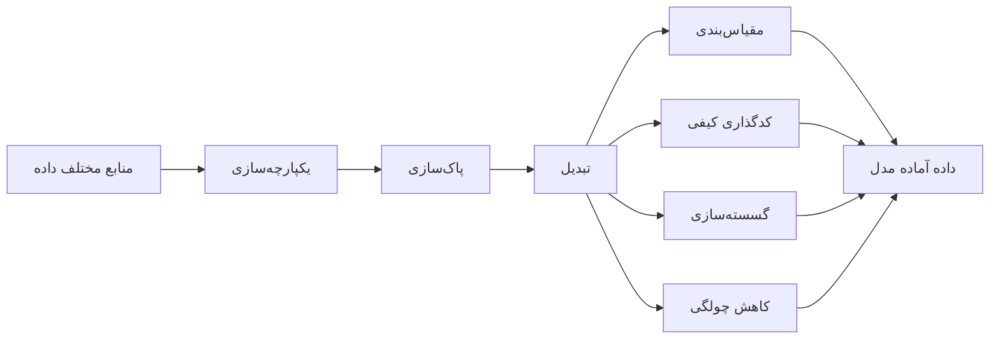

# جلسه ۱۲ — تبدیل و یکپارچه‌سازی داده

## چرا تبدیل و یکپارچه‌سازی؟

تا اینجا داده را **پاک‌سازی** کردیم: خانه‌های خالی را پر کردیم ← [[۱۰ - مدیریت داده گمشده]] و با داده پرت، نویز و تکرار برخورد کردیم ← [[11- داده پرت، نویز و داده تکراری]] اما داده پاک هنوز لزوماً **آماده مدل‌سازی** نیست:

- داده معمولاً در **چند جدول و چند منبع** پراکنده است و باید یکپارچه شود.
- ویژگی‌ها **مقیاس‌های بسیار متفاوت** دارند (سن بین ۰ و ۸۰، درآمد بین ۰ و چند میلیارد) و الگوریتم‌های فاصله‌محور را گمراه می‌کنند ← [[۵ - معیارهای شباهت و فاصله]]
- بیشتر الگوریتم‌ها فقط **عدد** می‌پذیرند و ویژگی‌های کیفی باید **کدگذاری** شوند ← [[۳ - انواع داده و ویژگی‌ها]]
- ویژگی‌های **چوله** مدل‌های خطی را تضعیف می‌کنند ← [[۷ - تحلیل تک‌متغیره]]



> [!important] قاعده طلایی این جلسه هر تبدیلی که از داده **یاد می‌گیرد** (کمینه و بیشینه، میانگین، دسته‌ها، میانگین هدف، پارامتر لاندا) باید **فقط روی داده آموزش** برازش (`fit`) شود و سپس روی داده آزمون **اعمال** (`transform`) شود. این قاعده را در جلسه ۱۴ با Pipeline خودکار می‌کنیم ← [[۱۴- کاهش ابعاد]]

---

## یکپارچه‌سازی داده از چند منبع

یکپارچه‌سازی (Data Integration) یعنی ترکیب داده‌های چند منبع (پایگاه‌داده‌ها، فایل‌ها، سامانه‌های شعب مختلف) در یک مخزن منسجم.

### دو عمل پایه: الحاق و ادغام

|عمل|تابع pandas|معادل SQL|کاربرد|
|:-:|:-:|:-:|:-:|
|الحاق عمودی (Concatenation)|تابع `pd.concat`|دستور UNION|جدول‌هایی با **ستون‌های یکسان** (مثلاً فروش شعبه‌های مختلف)|
|ادغام (Merge / Join)|تابع `pd.merge` یا `df.merge`|دستور JOIN|جدول‌هایی با **کلید مشترک** (مثلاً فروش و اطلاعات مشتری)|

انواع ادغام بر اساس اینکه کدام کلیدها حفظ شوند:

|نوع ادغام|سطرهای حفظ‌شده|کلید بدون جفت|
|:-:|:-:|:-:|
|ادغام داخلی (inner)|فقط کلیدهای مشترک|حذف می‌شود|
|ادغام چپ (left)|همه کلیدهای جدول چپ|ستون‌های راست گمشده می‌شوند|
|ادغام راست (right)|همه کلیدهای جدول راست|ستون‌های چپ گمشده می‌شوند|
|ادغام بیرونی (outer)|همه کلیدهای هر دو جدول|هر دو طرف ممکن است گمشده شوند|

### چالش‌های یکپارچه‌سازی

|چالش|نمونه|راه‌حل|
|:-:|:-:|:-:|
|شناسایی موجودیت (Entity Identification)|ستون `customer_id` در یک منبع و `cust_no` در منبع دیگر|فراداده (Metadata)، نگاشت نام ستون‌ها|
|تعارض نام (Naming Conflict)|ستون `date` در یکی تاریخ سفارش و در دیگری تاریخ ارسال است|مستندسازی معنای هر ستون|
|تعارض واحد و مقیاس|مبلغ به ریال و تومان، وزن به کیلوگرم و پوند|تبدیل به واحد واحد پیش از ادغام|
|تعارض قالب|تاریخ به شکل 2024-03-01 و 2024/03/01|استانداردسازی قالب|
|تعارض مقدار|یک مشتری در دو منبع با دو شهر متفاوت|قاعده اولویت منبع (مثلاً تازه‌ترین رکورد)|
|افزونگی (Redundancy)|ستون‌های تکراری یا مشتق‌شده|تحلیل همبستگی و کای‌دو|
|تکرار سطر|یک مشتری در هر دو منبع|یکسان‌سازی و حذف تکرار ← [[11- داده پرت، نویز و داده تکراری]]|

> [!example] مثال حل‌شده — ادغام فروش دو شعبه **شعبه A** (مبلغ به تومان):
> 
> |شناسه مشتری (customer_id)|تاریخ (date)|مبلغ به تومان|
> |:-:|:-:|:-:|
> |101|2024-03-01|250,000|
> |102|2024-03-01|120,000|
> |103|2024-03-02|90,000|
> 
> **شعبه B** (نام ستون‌ها و واحد متفاوت؛ مبلغ به **ریال**):
> 
> |شناسه مشتری (cust_no)|تاریخ (order_date)|مبلغ به ریال|
> |:-:|:-:|:-:|
> |103|2024/03/02|1,500,000|
> |104|2024/03/03|800,000|
> |105|2024/03/03|3,000,000|
> 
> **جدول مشتریان:** شناسه‌های ۱۰۱، ۱۰۲، ۱۰۳، ۱۰۴ و ۱۰۶ با شهرشان.
> 
> گام‌ها:
> 
> 1. نام ستون‌های شعبه B را به نام‌های شعبه A **نگاشت** می‌کنیم.
> 2. مبلغ ریالی را بر ۱۰ تقسیم می‌کنیم تا به تومان برسد (۱۵۰٬۰۰۰، ۸۰٬۰۰۰ و ۳۰۰٬۰۰۰).
> 3. قالب تاریخ را یکسان و دو جدول را **الحاق** می‌کنیم: ۶ سطر فروش با مجموع **۹۹۰٬۰۰۰** تومان.
> 4. جدول فروش را با جدول مشتریان **ادغام** می‌کنیم:
> 
> |نوع ادغام|تعداد سطر|توضیح|
> |:-:|:-:|:-:|
> |ادغام داخلی|5|فروش مشتری ۱۰۵ (که در جدول مشتریان نیست) حذف می‌شود|
> |ادغام چپ|6|فروش مشتری ۱۰۵ با شهر گمشده حفظ می‌شود|
> |ادغام راست|6|مشتری ۱۰۶ بدون خرید با مبلغ گمشده ظاهر می‌شود|
> |ادغام بیرونی|7|هر دو مورد بالا|
> 
> اگر واحد را تبدیل نمی‌کردیم، فروش شعبه B **ده برابر** بزرگ‌تر به نظر می‌رسید. اگر نام ستون‌ها را نگاشت نمی‌کردیم، تابع `concat` جدولی با ۶ ستون (به جای ۳) و خانه‌های خالی فراوان می‌ساخت.

> [!warning] انفجار سطرها در ادغام اگر کلید در **هر دو** جدول تکراری باشد (رابطه چند به چند)، ادغام همه ترکیب‌ها را می‌سازد و تعداد سطرها به‌طور غیرمنتظره زیاد می‌شود. پارامتر `validate="many_to_one"` در `merge` این خطا را زود آشکار می‌کند. همیشه تعداد سطرها را پیش و پس از ادغام بررسی کنید و از `indicator=True` برای دیدن منشأ هر سطر استفاده کنید.

### افزونگی و تشخیص آن

ویژگی **افزونه** (Redundant) ویژگی‌ای است که از روی ویژگی‌های دیگر قابل استخراج است. افزونگی مدل را کند، تفسیر را دشوار و در مدل‌های خطی **هم‌خطی** ایجاد می‌کند ← [[17 - رگرسیون خطی چندگانه و ارزیابی]]

|نوع ویژگی‌ها|روش تشخیص افزونگی|
|:-:|:-:|
|دو ویژگی عددی|ضریب همبستگی پیرسون (نزدیک ۱ یا ۱-)|
|دو ویژگی کیفی|آزمون کای‌دو و ضریب کرامر (نزدیک ۱) ← [[8 - تحلیل دومتغیره و چندمتغیره]]|
|ویژگی مشتق‌شده|دانش حوزه (مثلاً مبلغ کل برابر قیمت ضرب در تعداد)|

> [!example] مثال — ستون‌های افزونه در Titanic
> 
> |جفت ستون|ضریب کرامر|توضیح|
> |:-:|:-:|:-:|
> |ستون pclass و class|1.000|یک اطلاعات با دو کدگذاری (عدد و متن)|
> |ستون survived و alive|1.000|هدف به دو شکل؛ **نشت هدف** اگر alive ویژگی باشد!|
> |ستون embarked و embark_town|1.000|حرف اول بندر و نام کامل آن|
> |ستون who و adult_male|1.000|ستون adult_male دقیقاً یعنی who برابر man|
> |ستون sex و who|0.948|ستون who جنسیت را به‌علاوه کودک بودن دارد|
> 
> ستون `alone` نیز دقیقاً معادل «مجموع sibsp و parch برابر صفر» است (یک ویژگی مشتق‌شده). پیش از مدل‌سازی، از هر گروه افزونه فقط یک ستون نگه دارید.

---

## مقیاس‌بندی

مقیاس‌بندی (Feature Scaling) یعنی هم‌مقیاس کردن ویژگی‌های عددی تا هیچ ویژگی فقط به دلیل **واحد اندازه‌گیری** بر ویژگی‌های دیگر غالب نشود.

### نرمال‌سازی کمینه-بیشینه (Min-Max)

$$ x' = \frac{x - x_{\min}}{x_{\max} - x_{\min}} $$

خروجی در بازه صفر تا یک قرار می‌گیرد (برای بازه دلخواه a تا b، نتیجه را در عرض بازه ضرب و با a جمع می‌کنیم).

### استانداردسازی (Z-score)

$$ x' = \frac{x - \bar{x}}{s} $$

خروجی میانگین صفر و انحراف معیار یک دارد. کلاس `StandardScaler` از انحراف معیار **جامعه** (تقسیم بر n) استفاده می‌کند.

### مقیاس‌بندی مقاوم (Robust Scaling)

$$ x' = \frac{x - \text{median}(x)}{Q_3 - Q_1} $$

به جای میانگین و انحراف معیار از **میانه** و **دامنه میان‌چارکی** استفاده می‌کند، پس در برابر داده پرت مقاوم است.

> [!example] مثال حل‌شده — سه روش روی یک داده مقادیر: ۱۰، ۲۰، ۳۰، ۴۰، ۱۰۰ (مقدار ۱۰۰ پرت است)
> 
> - کمینه ۱۰ و بیشینه ۱۰۰ است، پس دامنه ۹۰ است.
> - میانگین ۴۰ و انحراف معیار جامعه: $$ s = \sqrt{\frac{30^2 + 20^2 + 10^2 + 0^2 + 60^2}{5}} = \sqrt{1000} \approx 31.62 $$
> - میانه ۳۰، چارک اول ۲۰ و چارک سوم ۴۰، پس دامنه میان‌چارکی ۲۰ است.
> 
> |مقدار اصلی|10|20|30|40|100|
> |:-:|:-:|:-:|:-:|:-:|:-:|
> |کمینه-بیشینه|0|0.111|0.222|0.333|1|
> |استانداردسازی|-0.949|-0.632|-0.316|0|1.897|
> |مقیاس‌بندی مقاوم|-1|-0.5|0|0.5|3.5|
> 
> برای نمونه، مقدار ۲۰: $$ \frac{20 - 10}{90} \approx 0.111, \qquad \frac{20 - 40}{31.62} \approx -0.632, \qquad \frac{20 - 30}{20} = -0.5 $$ در کمینه-بیشینه، داده پرت چهار مقدار عادی را در بازه کوچک صفر تا ۰.۳۳ **فشرده** کرده است. در مقیاس‌بندی مقاوم، فاصله مقادیر عادی حفظ شده و داده پرت به‌وضوح جدا (۳.۵) مانده است.

|روش|کلاس scikit-learn|خروجی|حساسیت به پرت|مناسب برای|
|:-:|:-:|:-:|:-:|:-:|
|کمینه-بیشینه|`MinMaxScaler`|بازه صفر تا یک|بسیار حساس|شبکه عصبی، پردازش تصویر، ویژگی‌های کران‌دار|
|استانداردسازی|`StandardScaler`|میانگین صفر، انحراف معیار یک|حساس|پیش‌فرض برای رگرسیون منظم، SVM، PCA، k-NN|
|مقیاس‌بندی مقاوم|`RobustScaler`|میانه صفر|مقاوم|داده دارای پرت|
|تقسیم بر بیشینه قدر مطلق|`MaxAbsScaler`|بازه منفی یک تا یک|حساس|داده تُنُک (Sparse)، چون صفرها را حفظ می‌کند|

> [!tip] کدام مدل‌ها به مقیاس‌بندی نیاز دارند؟
> 
> |نیاز به مقیاس‌بندی|مدل‌ها|
> |:-:|:-:|
> |ضروری|الگوریتم k-NN، الگوریتم k-Means، SVM، PCA، شبکه عصبی|
> |مهم|رگرسیون منظم‌شده (Ridge، Lasso)، رگرسیون لجستیک با منظم‌سازی، گرادیان کاهشی|
> |بی‌نیاز|درخت تصمیم، جنگل تصادفی، Gradient Boosting|
> 
> درخت‌ها فقط **ترتیب** مقادیر را برای یافتن آستانه بررسی می‌کنند و هر تبدیل یکنوا (از جمله مقیاس‌بندی) نتیجه آن‌ها را تغییر نمی‌دهد ← [[22 - درخت تصمیم]]

> [!warning] مقیاس‌بندی شکل توزیع را تغییر نمی‌دهد این سه روش **خطی** هستند: فقط داده را جابه‌جا و کشیده یا فشرده می‌کنند. چولگی، داده پرت و شکل توزیع **دست‌نخورده** می‌مانند. برای تغییر شکل توزیع، از تبدیل‌های لگاریتمی و توانی (بخش آخر این جلسه) استفاده کنید.

---

## کدگذاری متغیرهای کیفی

### کدگذاری برچسب (Label Encoding)

هر دسته یک عدد صحیح می‌گیرد (به ترتیب حروف الفبا): Karaj برابر ۰، Shiraz برابر ۱، Tehran برابر ۲.

> [!warning] کدگذاری برچسب برای ویژگی‌ها نیست کلاس `LabelEncoder` در scikit-learn برای **متغیر هدف** طراحی شده است. اگر آن را برای ویژگی اسمی به کار ببرید، مدل خطی یا k-NN گمان می‌کند Tehran «دو برابر» Shiraz است و Shiraz «بین» Karaj و Tehran قرار دارد! برای ویژگی‌ها از `OrdinalEncoder` (فقط برای ویژگی ترتیبی) یا `OneHotEncoder` استفاده کنید.

### کدگذاری یک‌داغ (One-Hot Encoding)

برای هر دسته یک ستون دودویی ساخته می‌شود:

|شهر|ستون city_Karaj|ستون city_Shiraz|ستون city_Tehran|
|:-:|:-:|:-:|:-:|
|شهر Tehran|0|0|1|
|شهر Karaj|1|0|0|
|شهر Shiraz|0|1|0|

- **مزیت:** هیچ ترتیب مصنوعی ایجاد نمی‌کند؛ مناسب ویژگی‌های **اسمی**.
- **عیب:** برای ویژگی با تعداد دسته زیاد (High Cardinality)، مثلاً کد پستی با هزاران مقدار، تعداد ستون‌ها منفجر می‌شود.
- **تله متغیر ساختگی (Dummy Variable Trap):** مجموع ستون‌های یک‌داغ همیشه یک است و در رگرسیون خطی بدون منظم‌سازی هم‌خطی کامل ایجاد می‌کند. با `drop="first"` یک ستون حذف می‌شود؛ با `drop="if_binary"` فقط برای ویژگی‌های دودویی.
- **دسته جدید در داده آزمون:** با `handle_unknown="ignore"`، دسته ناشناخته (مثلاً Tabriz) به سطری تمام‌صفر تبدیل می‌شود به جای خطا.

### کدگذاری ترتیبی (Ordinal Encoding)

برای ویژگی‌های **ترتیبی** که ترتیب معنادار دارند (اندازه S، M، L، XL یا سطح تحصیلات)، اعداد باید **ترتیب واقعی** را حفظ کنند.

> [!example] مثال — ترتیب پیش‌فرض اشتباه است برای مقادیر اندازه M، S، XL، L، M:
> 
> |روش|خروجی|
> |:-:|:-:|
> |کلاس OrdinalEncoder بدون پارامتر (ترتیب الفبایی)|1، 2، 3، 0، 1|
> |کلاس OrdinalEncoder با ترتیب S، M، L، XL|1، 0، 3، 2، 1|
> 
> در ترتیب الفبایی L کوچک‌ترین و S بزرگ‌تر از M شده است! همیشه ترتیب را با پارامتر `categories` صریحاً تعیین کنید.

### کدگذاری هدف (Target Encoding)

هر دسته با **میانگین متغیر هدف** در آن دسته جایگزین می‌شود. برای ویژگی‌های با تعداد دسته زیاد بسیار کارآمد است (فقط یک ستون می‌سازد). برای دسته‌های کم‌نمونه، میانگین دسته را به سمت میانگین کل **هموار** (Smoothing) می‌کنیم:

$$ \text{enc}(c) = \frac{n_c , \bar{y}_c + m , \bar{y}}{n_c + m} $$

که در آن n تعداد نمونه‌های دسته، میانگین اول میانگین هدف در دسته، میانگین دوم میانگین کل هدف و m وزن هموارسازی است.

> [!example] مثال حل‌شده — کدگذاری هدف با هموارسازی
> 
> |شهر|خریدها (هدف)|تعداد|میانگین دسته|
> |:-:|:-:|:-:|:-:|
> |شهر Tehran|1، 0، 1، 1|4|0.750|
> |شهر Karaj|0، 0، 1|3|0.333|
> |شهر Shiraz|1|1|1.000|
> 
> میانگین کل هدف: پنج خرید از هشت، یعنی ۰.۶۲۵. با وزن هموارسازی m برابر ۲: $$ \begin{aligned} \text{enc}(\text{Tehran}) &= \frac{4 \times 0.75 + 2 \times 0.625}{4 + 2} = \frac{4.25}{6} \approx 0.708 \ \text{enc}(\text{Karaj}) &= \frac{3 \times 0.333 + 2 \times 0.625}{3 + 2} = \frac{2.25}{5} = 0.450 \ \text{enc}(\text{Shiraz}) &= \frac{1 \times 1 + 2 \times 0.625}{1 + 2} = \frac{2.25}{3} = 0.750 \end{aligned} $$ شیراز با یک نمونه، از ۱.۰ به ۰.۷۵ کشیده شده است؛ یک خرید منفرد شواهد کافی برای «نرخ خرید ۱۰۰ درصد» نیست. کلاس `TargetEncoder(smooth=2.0)` همین سه عدد را برمی‌گرداند.

> [!warning] کدگذاری هدف و نشت داده کدگذاری هدف از **متغیر هدف** استفاده می‌کند؛ اگر روی همان داده‌ای که مدل با آن آموزش می‌بیند محاسبه شود، مقدار هدف هر سطر در ویژگی خودش «نشت» می‌کند.
> 
> **آزمایش:** ۲۰۰۰ سطر با یک ویژگی «کد پستی» با ۵۰۰ مقدار و هدف **کاملاً تصادفی** (بی‌ارتباط با کد پستی). در داده آموزش (۱۴۰۰ سطر) هر کد پستی به‌طور میانگین فقط ۳ نمونه دارد.
> 
> |روش|سطح زیر منحنی ROC آموزش|سطح زیر منحنی ROC آزمون|
> |:-:|:-:|:-:|
> |کدگذاری هدف ساده روی کل داده آموزش|0.828|0.534|
> |کلاس TargetEncoder با برازش متقاطع (Cross-fitting)|0.498|0.535|
> 
> روش ساده در آموزش عملکرد «عالی» نشان می‌دهد، در حالی که ویژگی هیچ اطلاعاتی ندارد! سطح زیر منحنی ROC را در جلسه ۲۵ می‌بینیم؛ ۰.۵ یعنی حدس تصادفی ← [[25 - ارزیابی مدل‌های طبقه‌بندی]]
> 
> **راه‌حل:** کلاس `TargetEncoder` در `fit_transform` از **برازش متقاطع** استفاده می‌کند: کد هر سطر آموزش از روی بخش‌های **دیگر** داده محاسبه می‌شود. توجه کنید که `fit(X, y).transform(X)` با `fit_transform(X, y)` **برابر نیست** و نسخه اول نشت دارد.

|روش کدگذاری|نوع ویژگی مناسب|تعداد ستون خروجی|خطر اصلی|
|:-:|:-:|:-:|:-:|
|کدگذاری برچسب|متغیر هدف|1|ترتیب مصنوعی اگر برای ویژگی استفاده شود|
|کدگذاری یک‌داغ|اسمی با تعداد دسته کم|برابر تعداد دسته‌ها|انفجار ابعاد|
|کدگذاری ترتیبی|ترتیبی|1|ترتیب اشتباه اگر صریحاً تعیین نشود|
|کدگذاری هدف|اسمی با تعداد دسته زیاد|1 (برای هدف دودویی یا رگرسیون)|نشت داده و بیش‌برازش|

> [!tip] روش‌های دیگر **کدگذاری فراوانی** (Frequency Encoding) هر دسته را با فراوانی یا نسبت آن جایگزین می‌کند؛ ساده و بدون نشت. برای دسته‌های نادر، پارامتر `min_frequency` در `OneHotEncoder` آن‌ها را در یک دسته «سایر» ادغام می‌کند.

---

## گسسته‌سازی (Discretization)

گسسته‌سازی یعنی تبدیل ویژگی عددی پیوسته به چند **بازه** (دسته). همان روش Binning جلسه قبل است، این بار برای ساخت ویژگی ← [[11- داده پرت، نویز و داده تکراری]]

دلایل استفاده:

- **تفسیرپذیری:** «کودک، جوان، میان‌سال، سالمند» برای مخاطب گویاتر از سن دقیق است.
- **مدل‌سازی رابطه غیرخطی** با مدل خطی (هر بازه ضریب جداگانه می‌گیرد).
- **کاهش اثر نویز و داده پرت.**
- الگوریتم‌هایی که فقط ویژگی کیفی می‌پذیرند (مانند برخی نسخه‌های بیز ساده و کاوش قواعد انجمنی).

|روش|قاعده|مزیت|عیب|
|:-:|:-:|:-:|:-:|
|هم‌عرض (Equal-width)|دامنه به k بازه با عرض برابر تقسیم می‌شود|ساده، تفسیرپذیر|حساس به پرت؛ بازه‌های خالی یا بسیار شلوغ|
|هم‌فراوانی (Equal-frequency)|هر بازه تقریباً تعداد برابری داده دارد|مقاوم در برابر پرت و چولگی|مرزهای نامأنوس؛ مقادیر برابر ممکن است در دو بازه نیفتند|
|مبتنی بر درخت (Tree-based)|آستانه‌ها با درخت تصمیم برای پیش‌بینی هدف انتخاب می‌شوند|بازه‌های معنادار نسبت به هدف|نیاز به هدف؛ خطر نشت اگر روی کل داده انجام شود|
|مبتنی بر دانش حوزه|مرزهای استاندارد (مثلاً شاخص توده بدنی)|معنادار و قابل مقایسه|نیاز به دانش حوزه|

عرض هر بازه در روش هم‌عرض:

$$ w = \frac{x_{\max} - x_{\min}}{k} $$

> [!example] مثال — گسسته‌سازی سن در Titanic (714 مسافر با سن ثبت‌شده) کمینه سن ۰.۴۲ و بیشینه ۸۰ است؛ پس عرض هر بازه در روش هم‌عرض با چهار بازه حدود ۱۹.۹ است.
> 
> |روش|بازه‌ها|تعداد در هر بازه|نرخ بقا در هر بازه|
> |:-:|:-:|:-:|:-:|
> |هم‌عرض|0.42–20.3، 20.3–40.2، 40.2–60.1، 60.1–80|179، 385، 128، 22|45.8٪، 39.7٪، 39.1٪، 22.7٪|
> |هم‌فراوانی|0.42–20.1، 20.1–28، 28–38، 38–80|179، 183، 175، 177|45.8٪، 36.1٪، 43.4٪، 37.3٪|
> |مبتنی بر درخت (چهار برگ)|تا 6.5، 6.5–47.5، 47.5–60.5، بیش از 60.5|47، 578، 67، 22|70.2٪، 38.1٪، 47.8٪، 22.7٪|
> 
> - روش هم‌عرض یک بازه با فقط ۲۲ نفر دارد.
> - روش هم‌فراوانی بازه‌ها را متوازن کرده اما نرخ بقا در بازه‌ها تفاوت معناداری نشان نمی‌دهد.
> - روش درختی **کودکان زیر ۶.۵ سال** را با نرخ بقای ۷۰ درصد جدا کرده است؛ همان الگویی که در نمودار ویولن جلسه ۸ دیدیم ← [[8 - تحلیل دومتغیره و چندمتغیره]]

> [!warning] اطلاعات از دست می‌رود گسسته‌سازی همه مقادیر یک بازه را یکسان می‌کند. برای مدل‌های قدرتمند (درخت‌ها، Gradient Boosting) معمولاً گسسته‌سازی دستی لازم نیست، چون خودشان آستانه‌ها را یاد می‌گیرند. همچنین گسسته‌سازی مبتنی بر درخت را فقط روی **داده آموزش** انجام دهید.

---

## تبدیل‌های کاهش چولگی

بسیاری از ویژگی‌های واقعی (قیمت، درآمد، جمعیت، کرایه) **چوله به راست** هستند. تبدیل‌های توانی دم بلند را فشرده و توزیع را متقارن‌تر می‌کنند. این کار برای مدل‌های خطی (که روابط خطی و خطای متقارن فرض می‌کنند)، روش‌های فاصله‌محور و تشخیص پرت مفید است.

### تبدیل لگاریتمی

$$ x' = \log(x) \qquad \text{or} \qquad x' = \log(1 + x) $$

- فقط برای مقادیر **مثبت** (نسخه دوم برای مقادیر نامنفی شامل صفر؛ تابع `np.log1p`).
- رابطه ضربی را جمعی می‌کند: افزایش ۱۰ درصدی در هر سطحی، یک گام ثابت در مقیاس لگاریتمی است.
- تبدیل جذر نسخه ملایم‌تری است (مناسب داده‌های شمارشی).

### تبدیل Box-Cox

خانواده‌ای از تبدیل‌های توانی با پارامتر لاندا که به‌طور خودکار (با بیشینه درست‌نمایی) انتخاب می‌شود:

$$ x^{(\lambda)} = \begin{cases} \dfrac{x^{\lambda} - 1}{\lambda} & \lambda \neq 0 \[2mm] \ln(x) & \lambda = 0 \end{cases} $$

|مقدار لاندا|تبدیل معادل (تا یک جابه‌جایی و ضریب)|
|:-:|:-:|
|1|بدون تغییر شکل|
|0.5|جذر|
|0|لگاریتم|
|-1|معکوس|

- **محدودیت:** فقط برای مقادیر **اکیداً مثبت**.

### تبدیل Yeo-Johnson

تعمیم Box-Cox برای همه اعداد (مثبت، صفر و منفی):

$$ x^{(\lambda)} = \begin{cases} \dfrac{(x + 1)^{\lambda} - 1}{\lambda} & x \ge 0, \ \lambda \neq 0 \[2mm] \ln(x + 1) & x \ge 0, \ \lambda = 0 \[2mm] -\dfrac{(1 - x)^{2 - \lambda} - 1}{2 - \lambda} & x < 0, \ \lambda \neq 2 \[2mm] -\ln(1 - x) & x < 0, \ \lambda = 2 \end{cases} $$

> [!example] مثال حل‌شده — اثر لاندا مقادیر: ۱، ۴، ۹، ۱۶، ۱۰۰ (چولگی حدود **۲.۱۴**)
> 
> |لاندا|1|4|9|16|100|چولگی|
> |:-:|:-:|:-:|:-:|:-:|:-:|:-:|
> |1|0|3|8|15|99|2.14|
> |0.5|0|2|4|6|18|1.70|
> |0|0|1.386|2.197|2.773|4.605|0.27|
> 
> برای نمونه، با لاندا برابر ۰.۵ و مقدار ۱۶: $$ \frac{16^{0.5} - 1}{0.5} = \frac{4 - 1}{0.5} = 6 $$ هرچه لاندا کوچک‌تر شود، دم راست بیشتر فشرده می‌شود. برای Yeo-Johnson با لاندا برابر ۰.۵ و مقدار منفی ۲: $$ -\frac{(1 + 2)^{1.5} - 1}{1.5} \approx -2.797 $$

> [!example] مثال — قیمت الماس
> 
> |تبدیل|چولگی قیمت|
> |:-:|:-:|
> |بدون تبدیل|1.618|
> |جذر|0.844|
> |لگاریتم|0.115|
> |تبدیل Box-Cox (لاندا حدود 0.067-)|0.026|
> |تبدیل Yeo-Johnson (لاندا حدود 0.067-)|0.026|
> 
> لاندای بهینه نزدیک صفر است، یعنی تبدیل بهینه تقریباً همان **لگاریتم** است؛ همان چیزی که در مطالعه موردی الماس انتخاب کردیم ← [[9 - مطالعه موردی EDA]]

|تبدیل|دامنه مجاز|پارامتر|کلاس scikit-learn|
|:-:|:-:|:-:|:-:|
|لگاریتم|مثبت (با log1p نامنفی)|ندارد|`FunctionTransformer(np.log1p)`|
|جذر|نامنفی|ندارد|`FunctionTransformer(np.sqrt)`|
|تبدیل Box-Cox|اکیداً مثبت|لاندا (برازش‌شده)|`PowerTransformer(method="box-cox")`|
|تبدیل Yeo-Johnson|همه اعداد|لاندا (برازش‌شده)|`PowerTransformer(method="yeo-johnson")` (پیش‌فرض)|
|تبدیل چندکی (Quantile)|همه اعداد|ندارد|`QuantileTransformer` (خروجی یکنواخت یا نرمال)|

> [!note] تبدیل متغیر هدف اگر **متغیر هدف** چوله است (مثلاً قیمت)، می‌توان مدل را روی لگاریتم آن آموزش داد و پیش‌بینی را با تابع نمایی برگرداند. کلاس `TransformedTargetRegressor` این کار را خودکار می‌کند ← [[17 - رگرسیون خطی چندگانه و ارزیابی]] کلاس `PowerTransformer` به‌طور پیش‌فرض پس از تبدیل، داده را **استاندارد** نیز می‌کند (`standardize=True`).

---

## پیاده‌سازی در پایتون

```python
import numpy as np
import pandas as pd
import matplotlib
matplotlib.use("Agg")
import matplotlib.pyplot as plt
import seaborn as sns
from scipy import stats

sns.set_theme(style="whitegrid")
titanic = sns.load_dataset("titanic")
tips = sns.load_dataset("tips")
diamonds = sns.load_dataset("diamonds")
```

### یکپارچه‌سازی: الحاق و ادغام

```python
branch_a = pd.DataFrame({"customer_id": [101, 102, 103],
                         "date": ["2024-03-01", "2024-03-01", "2024-03-02"],
                         "amount_toman": [250_000, 120_000, 90_000]})
branch_b = pd.DataFrame({"cust_no": [103, 104, 105],
                         "order_date": ["2024/03/02", "2024/03/03", "2024/03/03"],
                         "amount_rial": [1_500_000, 800_000, 3_000_000]})
customers = pd.DataFrame({"customer_id": [101, 102, 103, 104, 106],
                          "city": ["Tehran", "Karaj", "Tehran", "Shiraz", "Tabriz"]})

print(pd.concat([branch_a, branch_b]).shape)        # (6, 6)  naive concat: wrong!

# Resolve naming and unit conflicts before concatenation
b = branch_b.rename(columns={"cust_no": "customer_id", "order_date": "date"})
b["amount_toman"] = b.pop("amount_rial") / 10        # 1 toman = 10 rial
sales = pd.concat([branch_a.assign(branch="A"), b.assign(branch="B")], ignore_index=True)
sales["date"] = pd.to_datetime(sales["date"].str.replace("/", "-"))
print(sales.shape, sales["amount_toman"].sum())      # (6, 4) 990000.0

for how in ["inner", "left", "right", "outer"]:
    m = sales.merge(customers, on="customer_id", how=how,
                    indicator=True, validate="many_to_one")
    print(how, len(m), m["_merge"].value_counts().to_dict())
# inner 5, left 6 (1 left_only), right 6 (1 right_only), outer 7

merged = sales.merge(customers, on="customer_id", how="left")
print(merged.groupby("city", dropna=False)["amount_toman"].sum())
# Karaj 120000, Shiraz 80000, Tehran 490000, NaN 300000
```

### تشخیص افزونگی

```python
def cramers_v(a: pd.Series, b: pd.Series) -> float:
    table = pd.crosstab(a, b)
    chi2 = stats.chi2_contingency(table, correction=False)[0]
    return np.sqrt(chi2 / (table.to_numpy().sum() * (min(table.shape) - 1)))

for a, b in [("pclass", "class"), ("survived", "alive"), ("embarked", "embark_town"),
             ("who", "adult_male"), ("sex", "who")]:
    print(a, b, round(cramers_v(titanic[a], titanic[b]), 3))
# 1.0, 1.0, 1.0, 1.0, 0.948

print((titanic["alone"] == (titanic["sibsp"] + titanic["parch"] == 0)).all())  # True
```

### مقیاس‌بندی

```python
from sklearn.preprocessing import MinMaxScaler, StandardScaler, RobustScaler, MaxAbsScaler

x = np.array([[10], [20], [30], [40], [100]], dtype=float)
for scaler in [MinMaxScaler(), StandardScaler(), RobustScaler(), MaxAbsScaler()]:
    print(type(scaler).__name__, scaler.fit_transform(x).ravel().round(3))
# MinMaxScaler   [0.    0.111 0.222 0.333 1.   ]
# StandardScaler [-0.949 -0.632 -0.316  0.     1.897]
# RobustScaler   [-1.  -0.5  0.   0.5  3.5]
# MaxAbsScaler   [0.1 0.2 0.3 0.4 1. ]

# Fit on train only, then transform test
from sklearn.model_selection import train_test_split
X_train, X_test = train_test_split(tips[["total_bill", "size"]], test_size=0.25, random_state=42)
sc = StandardScaler().fit(X_train)
print(sc.transform(X_train).mean(axis=0).round(3))   # [-0. -0.]  i.e. zero
print(sc.transform(X_test).mean(axis=0).round(3))    # [-0.219 -0.017]  test stats differ
```

### کدگذاری متغیرهای کیفی

```python
from sklearn.preprocessing import LabelEncoder, OneHotEncoder, OrdinalEncoder, TargetEncoder

df = pd.DataFrame({"city": ["Tehran", "Karaj", "Tehran", "Shiraz",
                            "Karaj", "Tehran", "Karaj", "Tehran"],
                   "bought": [1, 0, 0, 1, 0, 1, 1, 1]})

print(LabelEncoder().fit_transform(df["city"]))      # [2 0 2 1 0 2 0 2]  (target only!)

ohe = OneHotEncoder(sparse_output=False, handle_unknown="ignore").fit(df[["city"]])
print(ohe.get_feature_names_out())                   # ['city_Karaj' 'city_Shiraz' 'city_Tehran']
print(ohe.transform(pd.DataFrame({"city": ["Tabriz"]})))   # [[0. 0. 0.]]  unseen category
print(pd.get_dummies(df["city"], prefix="city", dtype=int).head(3))   # pandas alternative

size = pd.DataFrame({"size": ["M", "S", "XL", "L", "M"]})
print(OrdinalEncoder().fit_transform(size).ravel())                          # [1. 2. 3. 0. 1.]  alphabetical!
print(OrdinalEncoder(categories=[["S", "M", "L", "XL"]]).fit_transform(size).ravel())  # [1. 0. 3. 2. 1.]

# Target encoding by hand with smoothing m = 2
m, global_mean = 2, df["bought"].mean()                                  # 0.625
st = df.groupby("city")["bought"].agg(["sum", "count"])
print(((st["sum"] + m * global_mean) / (st["count"] + m)).round(3))
# Karaj 0.45, Shiraz 0.75, Tehran 0.708
te = TargetEncoder(smooth=2.0, target_type="binary").fit(df[["city"]], df["bought"])
print(te.categories_, te.encodings_)                 # same values
```

### نشت داده در کدگذاری هدف

```python
from sklearn.linear_model import LogisticRegression
from sklearn.metrics import roc_auc_score
from sklearn.model_selection import KFold

rng = np.random.default_rng(42)
n = 2000
X = pd.DataFrame({"zip": rng.integers(0, 500, n).astype(str)})
y = rng.integers(0, 2, n)                          # target is pure noise
X_tr, X_te, y_tr, y_te = train_test_split(X, y, test_size=0.3, random_state=42)

# Naive: category means computed on the same rows the model is trained on
means = pd.Series(y_tr).groupby(X_tr["zip"].to_numpy()).mean()
tr_enc = X_tr["zip"].map(means).to_numpy().reshape(-1, 1)
te_enc = X_te["zip"].map(means).fillna(y_tr.mean()).to_numpy().reshape(-1, 1)
clf = LogisticRegression().fit(tr_enc, y_tr)
print(round(roc_auc_score(y_tr, clf.predict_proba(tr_enc)[:, 1]), 3),
      round(roc_auc_score(y_te, clf.predict_proba(te_enc)[:, 1]), 3))   # 0.828 0.534

# Correct: TargetEncoder uses cross-fitting inside fit_transform
enc = TargetEncoder(cv=KFold(n_splits=5, shuffle=True, random_state=42))
tr_cv = enc.fit_transform(X_tr, y_tr)
te_cv = enc.transform(X_te)
clf = LogisticRegression().fit(tr_cv, y_tr)
print(round(roc_auc_score(y_tr, clf.predict_proba(tr_cv)[:, 1]), 3),
      round(roc_auc_score(y_te, clf.predict_proba(te_cv)[:, 1]), 3))    # 0.498 0.535
```

### گسسته‌سازی

```python
from sklearn.preprocessing import KBinsDiscretizer
from sklearn.tree import DecisionTreeClassifier

age_df = titanic.dropna(subset=["age"])

print(pd.cut(age_df["age"], bins=4).value_counts().sort_index().tolist())   # [179, 385, 128, 22]
print(pd.qcut(age_df["age"], q=4).value_counts().sort_index().tolist())     # [179, 183, 175, 177]

kb = KBinsDiscretizer(n_bins=4, encode="ordinal", strategy="quantile",
                      quantile_method="averaged_inverted_cdf")
kb.fit(age_df[["age"]])
print(kb.bin_edges_[0])                              # [ 0.42 20.   28.   38.   80.  ]

# Tree-based binning: thresholds chosen to predict survival
tree = DecisionTreeClassifier(max_leaf_nodes=4, min_samples_leaf=20, random_state=42)
tree.fit(age_df[["age"]], age_df["survived"])
thresholds = sorted(float(t) for t in tree.tree_.threshold[tree.tree_.feature >= 0])
print(thresholds)                                    # [6.5, 47.5, 60.5]
bins = [-np.inf] + thresholds + [np.inf]
print(age_df.groupby(pd.cut(age_df["age"], bins), observed=True)["survived"]
      .agg(["mean", "count"]).round(3))
# <=6.5: 0.702 (47), 6.5-47.5: 0.381 (578), 47.5-60.5: 0.478 (67), >60.5: 0.227 (22)
```

### کاهش چولگی: لگاریتم، Box-Cox و Yeo-Johnson

```python
from sklearn.preprocessing import PowerTransformer, FunctionTransformer

price = diamonds[["price"]]
print(round(price["price"].skew(), 3), round(np.log(price["price"]).skew(), 3))   # 1.618 0.115

log_tf = FunctionTransformer(np.log1p, inverse_func=np.expm1)
bc = PowerTransformer(method="box-cox").fit(price)
yj = PowerTransformer(method="yeo-johnson").fit(price)
print(bc.lambdas_.round(3), yj.lambdas_.round(3))    # [-0.067] [-0.067]
print(round(pd.Series(bc.transform(price).ravel()).skew(), 3))   # 0.026

x = np.array([1, 4, 9, 16, 100], dtype=float)
print(stats.boxcox(x, lmbda=0.5))                    # [ 0.  2.  4.  6. 18.]
print(stats.yeojohnson(np.array([-2.0, 0.0, 3.0]), lmbda=0.5).round(3))   # [-2.797  0.  2.]

fig, axes = plt.subplots(1, 3, figsize=(15, 4))
sns.histplot(diamonds["price"], bins=50, ax=axes[0])
axes[0].set(title="Price (skew 1.62)", xlabel="Price")
sns.histplot(np.log(diamonds["price"]), bins=50, ax=axes[1])
axes[1].set(title="log(price) (skew 0.12)", xlabel="log(price)")
sns.histplot(yj.transform(price).ravel(), bins=50, ax=axes[2])
axes[2].set(title="Yeo-Johnson (skew 0.03)", xlabel="Transformed price")
plt.tight_layout()
plt.show()
```

---

## تمرین عملی کلاس

> [!example] تمرین عملی (۲۵ دقیقه) هدف: آماده‌سازی داده tips برای پیش‌بینی مبلغ انعام با سه تبدیل‌گر `PowerTransformer`، `StandardScaler` و `OneHotEncoder`.
> 
> ```python
> import pandas as pd, seaborn as sns
> from sklearn.compose import ColumnTransformer
> from sklearn.preprocessing import StandardScaler, OneHotEncoder, PowerTransformer
> from sklearn.model_selection import train_test_split
> 
> tips = sns.load_dataset("tips")
> X, y = tips.drop(columns="tip"), tips["tip"]
> X_tr, X_te, y_tr, y_te = train_test_split(X, y, test_size=0.25, random_state=42)
> 
> ct = ColumnTransformer([
>     ("power", PowerTransformer(method="yeo-johnson"), ["total_bill"]),
>     ("scale", StandardScaler(), ["size"]),
>     ("onehot", OneHotEncoder(handle_unknown="ignore"), ["sex", "smoker", "day", "time"]),
> ])
> Z_tr = ct.fit_transform(X_tr)
> Z_te = ct.transform(X_te)
> ```
> 
> 1. اندازه داده آموزش و آزمون چیست؟ چولگی `total_bill` و `size` را در داده آموزش حساب کنید.
> 2. ابعاد خروجی `Z_tr` چیست؟ با `get_feature_names_out` نام ستون‌ها را ببینید و تعداد ستون‌ها را توضیح دهید.
> 3. لاندای برازش‌شده برای `total_bill` چقدر است؟ چولگی ستون تبدیل‌شده را محاسبه کنید.
> 4. میانگین و انحراف معیار ستون‌های `power__total_bill` و `scale__size` را در داده آموزش و آزمون مقایسه کنید. چرا در داده آزمون دقیقاً صفر و یک نیستند؟
> 5. چولگی ستون `size` پس از `StandardScaler` چقدر است؟ چرا تغییر نکرد؟
> 6. پارامتر `drop="if_binary"` را به `OneHotEncoder` اضافه کنید. تعداد ستون‌ها چند می‌شود و چرا؟

> [!question]- پاسخ‌های کلیدی تمرین
> 
> 1. داده آموزش **۱۸۳** و داده آزمون **۶۱** سطر دارد. چولگی `total_bill` در داده آموزش حدود **۱.۱۰** و چولگی `size` حدود **۱.۴۷** است.
> 2. خروجی **۱۸۳ در ۱۲** است: یک ستون برای `total_bill`، یک ستون برای `size` و ده ستون یک‌داغ (جنسیت ۲، سیگاری ۲، روز ۴، وعده ۲).
> 3. لاندای برازش‌شده حدود **۰.۱۴۳-** است (نزدیک لگاریتم). چولگی پس از تبدیل حدود **۰.۰۰۶** است؛ تقریباً متقارن.
> 4. در داده آموزش میانگین هر دو ستون صفر و انحراف معیار آن‌ها حدود ۱ است (۱.۰۰۳ با تقسیم بر n منهای یک در pandas). در داده آزمون میانگین `power__total_bill` حدود **۰.۲۹۸-** و انحراف معیارش حدود **۱.۱۷** است؛ میانگین `scale__size` حدود ۰.۰۱۷- و انحراف معیارش حدود ۱.۰۶ است. دلیل: پارامترها **فقط از داده آموزش** یاد گرفته شده‌اند و داده آزمون نمونه دیگری است. این دقیقاً رفتار درست و بدون نشت است.
> 5. چولگی همچنان حدود **۱.۴۷** است؛ استانداردسازی تبدیل **خطی** است و شکل توزیع را تغییر نمی‌دهد.
> 6. تعداد ستون‌های یک‌داغ از ۱۰ به **۷** کاهش می‌یابد (کل خروجی ۹ ستون): برای سه ویژگی دودویی (جنسیت، سیگاری، وعده) فقط یک ستون نگه داشته می‌شود، اما روز (با چهار دسته) چهار ستون می‌ماند.

---

## پرسش‌های مرور

> [!question]- ۱. هنگام یکپارچه‌سازی داده دو شعبه، چه تعارض‌هایی ممکن است رخ دهد؟ برای هر کدام راه‌حلی بگویید. **تعارض نام** (شناسه مشتری با دو نام ستون متفاوت) با نگاشت نام‌ها؛ **تعارض واحد** (ریال و تومان) با تبدیل به یک واحد؛ **تعارض قالب** (قالب تاریخ) با استانداردسازی؛ **تعارض مقدار** (دو شهر برای یک مشتری) با قاعده اولویت منبع؛ **تکرار** و **افزونگی** با یکسان‌سازی و تحلیل همبستگی یا کای‌دو.

> [!question]- ۲. داده‌ای با یک مقدار بسیار پرت دارید و می‌خواهید k-NN اجرا کنید. کدام روش مقیاس‌بندی را انتخاب می‌کنید و چرا؟ مقیاس‌بندی **مقاوم** (RobustScaler)، چون از میانه و دامنه میان‌چارکی استفاده می‌کند که تحت تأثیر داده پرت نیستند. در کمینه-بیشینه، داده پرت بقیه مقادیر را در بازه کوچکی فشرده می‌کند (در مثال کلاس، چهار مقدار عادی در بازه صفر تا ۰.۳۳ قرار گرفتند).

> [!question]- ۳. چرا نباید ویژگی «شهر» را با LabelEncoder کدگذاری کرد و به رگرسیون خطی داد؟ چون LabelEncoder به دسته‌ها اعداد ۰، ۱، ۲ و ... می‌دهد و مدل خطی این اعداد را **کمیت** تفسیر می‌کند؛ گویی شهرها ترتیب و فاصله معنادار دارند. برای ویژگی اسمی باید از کدگذاری یک‌داغ (یا برای تعداد دسته زیاد، کدگذاری هدف با برازش متقاطع) استفاده کرد.

> [!question]- ۴. کدگذاری هدف چگونه باعث نشت داده می‌شود و چگونه از آن جلوگیری می‌کنیم؟ اگر میانگین هدف هر دسته روی همان سطرهایی محاسبه شود که مدل با آن‌ها آموزش می‌بیند، مقدار هدف هر سطر در ویژگی خودش وارد می‌شود؛ به‌ویژه برای دسته‌های کم‌نمونه. در آزمایش کلاس، با هدف کاملاً تصادفی، سطح زیر منحنی ROC آموزش ۰.۸۳ شد در حالی که در آزمون ۰.۵۳ بود. راه‌حل: **برازش متقاطع** (کلاس TargetEncoder با `fit_transform`)، **هموارسازی** و محاسبه فقط روی داده آموزش.

> [!question]- ۵. سه روش گسسته‌سازی را مقایسه کنید. در Titanic کدام روش الگوی کودکان را بهتر نشان داد؟ روش **هم‌عرض** بازه‌هایی با عرض برابر می‌سازد و به پرت حساس است؛ روش **هم‌فراوانی** بازه‌هایی با تعداد برابر می‌سازد؛ روش **مبتنی بر درخت** آستانه‌ها را برای پیش‌بینی هدف انتخاب می‌کند. در Titanic، روش درختی با آستانه ۶.۵ سال کودکان را با نرخ بقای حدود ۷۰ درصد جدا کرد؛ دو روش دیگر این الگو را در بازه‌های بزرگ پنهان کردند.

> [!question]- ۶. تفاوت Box-Cox و Yeo-Johnson چیست؟ اگر لاندای برازش‌شده نزدیک صفر باشد چه نتیجه‌ای می‌گیریم؟ هر دو تبدیل توانی با لاندای برازش‌شده‌اند؛ Box-Cox فقط برای مقادیر **اکیداً مثبت** و Yeo-Johnson برای **همه اعداد** (از جمله صفر و منفی) تعریف شده است. لاندای نزدیک صفر یعنی تبدیل بهینه تقریباً **لگاریتم** است؛ مانند قیمت الماس با لاندای حدود ۰.۰۶۷-.

---

## نکات کلیدی

> [!summary] خلاصه جلسه
> 
> - **یکپارچه‌سازی** با `concat` (ستون‌های یکسان) و `merge` (کلید مشترک) انجام می‌شود؛ پیش از آن تعارض نام، واحد، قالب و مقدار را حل کنید و پس از آن تعداد سطرها را بررسی کنید.
> - **افزونگی** را با همبستگی (عددی) و ضریب کرامر (کیفی) بیابید؛ از هر گروه ستون افزونه یکی را نگه دارید.
> - **مقیاس‌بندی**: کمینه-بیشینه (بازه صفر تا یک، حساس به پرت)، استانداردسازی (میانگین صفر و انحراف معیار یک) و مقاوم (میانه و دامنه میان‌چارکی). مقیاس‌بندی شکل توزیع را تغییر نمی‌دهد و درخت‌ها به آن نیاز ندارند.
> - **کدگذاری**: یک‌داغ برای اسمی، ترتیبی با ترتیب صریح برای ترتیبی، هدف (با هموارسازی و برازش متقاطع) برای تعداد دسته زیاد؛ LabelEncoder فقط برای هدف.
> - **گسسته‌سازی**: هم‌عرض، هم‌فراوانی و مبتنی بر درخت؛ تفسیرپذیری بیشتر به بهای از دست رفتن اطلاعات.
> - **کاهش چولگی**: لگاریتم، Box-Cox (فقط مثبت) و Yeo-Johnson (همه اعداد) با لاندای برازش‌شده.
> - همه تبدیل‌ها فقط روی **داده آموزش** برازش می‌شوند.

> [!todo] آمادگی برای جلسه بعد
> 
> 1. برای داده پروژه خود جدولی بسازید: هر ویژگی، نوع آن، روش مقیاس‌بندی یا کدگذاری پیشنهادی و دلیل.
> 2. چولگی ویژگی‌های عددی را حساب کنید و برای ویژگی‌های با چولگی بیشتر از ۱، تبدیل مناسب را امتحان کنید.
> 3. ستون‌های افزونه داده پروژه را بیابید.
> 4. ایده‌هایی برای ساخت ویژگی‌های جدید (نسبت‌ها، ترکیب‌ها، ویژگی‌های زمانی) از داده پروژه یادداشت کنید. جلسه بعد درباره مهندسی و انتخاب ویژگی صحبت می‌کنیم ← [[۱۳ - مهندسی و انتخاب ویژگی]]