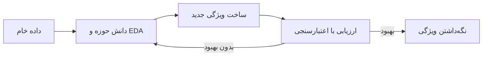

# جلسه ۱۳ — مهندسی و انتخاب ویژگی

## چرا ویژگی‌ها مهم‌اند؟

در سه جلسه گذشته داده را **تمیز** و **قابل استفاده** کردیم: مقادیر گمشده را جایگذاری کردیم ← [[۱۰ - مدیریت داده گمشده]]، داده پرت و تکراری را مدیریت کردیم ← [[11- داده پرت، نویز و داده تکراری]] و ویژگی‌ها را مقیاس‌بندی و کدگذاری کردیم ← [[۱۲ - تبدیل و یکپارچه‌سازی داده]]

اما داده تمیز لزوماً داده **مفید** نیست. دو پرسش باقی می‌ماند:

- آیا ویژگی‌های موجود، اطلاعات لازم را به شکلی که مدل بتواند از آن استفاده کند در اختیار می‌گذارند؟ ← **مهندسی ویژگی**
- آیا همه ویژگی‌ها لازم‌اند، یا برخی فقط نویز و افزونگی اضافه می‌کنند؟ ← **انتخاب ویژگی**

> [!important] نکته کلیدی در بسیاری از پروژه‌های واقعی، بیشترین بهبود عملکرد از **ویژگی‌های بهتر** به دست می‌آید، نه از الگوریتم پیچیده‌تر. یک جمله مشهور در این حوزه: «داده و ویژگی‌ها سقف عملکرد را تعیین می‌کنند و مدل‌ها فقط به آن سقف نزدیک می‌شوند.»

|مفهوم|پرسش اصلی|خروجی|
|:-:|:-:|:-:|
|مهندسی ویژگی (Feature Engineering)|چه ویژگی جدیدی از داده موجود بسازیم؟|ستون‌های بیشتر و معنادارتر|
|انتخاب ویژگی (Feature Selection)|کدام ویژگی‌ها را نگه داریم؟|زیرمجموعه‌ای از ستون‌های موجود|
|استخراج ویژگی (Feature Extraction)|چگونه ویژگی‌ها را به فضای کوچک‌تری نگاشت کنیم؟|ستون‌های جدید ترکیبی، مانند PCA ← [[۱۴- کاهش ابعاد]]|

یافته‌های EDA مهم‌ترین منبع ایده برای مهندسی ویژگی‌اند. در جلسه ۹ دیدیم که قیمت الماس در آستانه یک قیراط جهش دارد؛ این مشاهده مستقیماً به ویژگی «وزن بیشتر یا مساوی یک قیراط» تبدیل شد ← [[9 - مطالعه موردی EDA]]

---

## مهندسی ویژگی

**مهندسی ویژگی** یعنی ساخت ویژگی‌های جدید از ویژگی‌های موجود با استفاده از **دانش حوزه** و یافته‌های EDA، به‌گونه‌ای که الگوی موجود در داده برای مدل آشکارتر شود.



### ویژگی‌های ترکیبی (Combination Features)

ترکیب دو یا چند ویژگی با جمع، تفریق یا ضرب. مثال کلاسیک در داده Titanic:

$$ \text{family size} = \text{sibsp} + \text{parch} + 1 $$

که در آن sibsp تعداد خواهر، برادر و همسر و parch تعداد والدین و فرزندان همراه است.

> [!example] مثال حل‌شده — اندازه خانواده در Titanic همبستگی پیرسون اندازه خانواده با بقا فقط حدود **۰.۰۱۷** است؛ گویی این ویژگی بی‌فایده است. اما اگر آن را به سه گروه تقسیم کنیم:
> 
> |گروه خانواده|اندازه خانواده|تعداد مسافر|نرخ بقا|
> |:-:|:-:|:-:|:-:|
> |تنها|1|537|30.4٪|
> |کوچک|2 تا 4|292|57.9٪|
> |بزرگ|5 تا 11|62|16.1٪|
> 
> رابطه **غیرخطی** (به شکل U وارونه) است: خانواده‌های کوچک بیشترین نرخ بقا را داشتند. ضریب همبستگی این رابطه را نمی‌بیند ← [[8 - تحلیل دومتغیره و چندمتغیره]]، اما ویژگی گروهی جدید آن را برای مدل آشکار می‌کند.

ضرب دو ویژگی، **ویژگی تعاملی** (Interaction Feature) می‌سازد که اثر متقابل را مدل می‌کند؛ مثلاً اثر جنسیت که در کلاس‌های مختلف بلیت متفاوت بود.

### ویژگی‌های نسبتی (Ratio Features)

تقسیم یک ویژگی بر دیگری، اغلب کمیتی **معنادارتر** از هر دو ویژگی اصلی می‌سازد:

|حوزه|ویژگی‌های خام|ویژگی نسبتی|
|:-:|:-:|:-:|
|سلامت|وزن و قد|شاخص توده بدنی (وزن تقسیم بر مجذور قد)|
|مالی|بدهی و درآمد|نسبت بدهی به درآمد|
|تاکسی|مسافت و مدت سفر|سرعت متوسط|
|تاکسی|انعام و کرایه|درصد انعام|
|املاک|قیمت و متراژ|قیمت هر متر مربع|
|فروشگاه|مبلغ کل خرید و تعداد خرید|میانگین مبلغ هر خرید|

> [!example] مثال — داده تاکسی‌های نیویورک در داده `taxis` (پس از حذف سطرهای گمشده، ۶۳۴۱ سفر) ویژگی‌های جدید زیر را می‌سازیم:
> 
> - **مدت سفر** (دقیقه): اختلاف زمان پیاده شدن و سوار شدن؛ میانه **۱۰.۹۳** دقیقه.
> - **سرعت متوسط** (مایل بر ساعت): مسافت تقسیم بر مدت؛ میانه **۱۰.۰۳**.
> - **درصد انعام**: انعام تقسیم بر کرایه؛ میانه **۰.۲۱**.
> 
> بیشینه سرعت محاسبه‌شده **۲۰۲۰** مایل بر ساعت است! یک ویژگی نسبتی، خطای ثبت داده (مدت سفر بسیار کوتاه) را آشکار کرد که در ستون‌های خام دیده نمی‌شد ← [[11- داده پرت، نویز و داده تکراری]]

> [!warning] تقسیم بر صفر پیش از ساخت ویژگی نسبتی بررسی کنید که مخرج صفر یا بسیار نزدیک صفر نباشد. در غیر این صورت مقادیر بی‌نهایت یا بسیار بزرگ ساخته می‌شود.

### ویژگی‌های زمانی (Temporal Features)

یک ستون تاریخ و زمان به‌خودی‌خود برای بیشتر مدل‌ها قابل استفاده نیست، اما می‌توان از آن ویژگی‌های زیادی استخراج کرد:

|نوع ویژگی|نمونه|کاربرد|
|:-:|:-:|:-:|
|اجزای تاریخ|سال، ماه، روز، ساعت|الگوهای فصلی و روزانه|
|روز هفته|شنبه تا جمعه، آخر هفته یا نه|رفتار متفاوت روزهای کاری و تعطیل|
|رویداد خاص|تعطیلات رسمی، ماه رمضان، نوروز|اثر مناسبت‌ها بر فروش|
|فاصله زمانی|روزهای گذشته از آخرین خرید، سن حساب کاربری|تازگی رفتار (Recency) ← [[29 - ارزیابی و تفسیر خوشه‌ها]]|
|مدت|زمان پیاده شدن منهای زمان سوار شدن|مدت سفر یا جلسه|

> [!example] مثال — ساعت سفر و سرعت تاکسی میانه سرعت سفرها در ساعت ۵ صبح **۱۷.۱** مایل بر ساعت است، در حالی که در ساعت ۸ صبح **۹.۳** و در ساعت ۵ عصر **۹.۰** است. ساعت سفر (که از ستون زمان استخراج شد) اثر ترافیک را به‌خوبی نشان می‌دهد.

#### کدگذاری چرخه‌ای (Cyclical Encoding)

ساعت ۲۳ و ساعت صفر فقط یک ساعت فاصله دارند، اما اگر ساعت را عدد معمولی در نظر بگیریم فاصله آن‌ها ۲۳ است. راه‌حل: نگاشت ساعت روی یک **دایره** با دو ویژگی سینوس و کسینوس:

$$ \text{hour}_{\sin} = \sin\left(\frac{2\pi \cdot \text{hour}}{24}\right), \qquad \text{hour}_{\cos} = \cos\left(\frac{2\pi \cdot \text{hour}}{24}\right) $$

> [!example] مثال حل‌شده — فاصله ساعت‌ها روی دایره پس از کدگذاری چرخه‌ای، فاصله اقلیدسی میان ساعت ۲۳ و ساعت صفر حدود **۰.۲۶۱** و میان ساعت ۱۲ و ساعت صفر برابر **۲** (قطر دایره، بیشترین فاصله ممکن) است. اکنون ساعت‌های نزدیک به هم، واقعاً نزدیک‌اند.
> 
> همین روش برای ماه سال (تقسیم بر ۱۲) و روز هفته (تقسیم بر ۷) نیز به کار می‌رود.

### ویژگی‌های متنی ساده (Simple Text Features)

پیش از روش‌های پیشرفته پردازش متن، می‌توان از یک ستون متنی ویژگی‌های ساده ولی مفید ساخت:

- **ویژگی‌های آماری:** تعداد نویسه، تعداد واژه، تعداد علامت تعجب، نسبت حروف بزرگ
- **ویژگی‌های کلیدواژه‌ای:** وجود یک واژه خاص (مثلاً «فرودگاه» در نام منطقه)
- **کیسه واژگان (Bag of Words):** یک ستون برای هر واژه واژگان، با تعداد تکرار آن در هر سند

> [!example] مثال حل‌شده — کیسه واژگان چهار نظر کوتاه درباره یک محصول:
> 
> |شماره|متن نظر|تعداد واژه|تعداد علامت تعجب|
> |:-:|:-:|:-:|:-:|
> |۱|great phone, great battery!|4|1|
> |۲|bad screen and bad battery|5|0|
> |۳|great value|2|0|
> |۴|terrible!!! do not buy|4|3|
> 
> واژگان این چهار سند **۱۱ واژه** متمایز دارد، پس ماتریس کیسه واژگان ۴ در ۱۱ است. سطر نظر اول: واژه great دو بار و واژه‌های phone و battery هر کدام یک بار؛ بقیه صفر.

> [!example] مثال — ویژگی کلیدواژه‌ای در داده تاکسی اگر نام منطقه سوار یا پیاده شدن شامل واژه Airport باشد، سفر «فرودگاهی» است. ۳۹۵ سفر فرودگاهی وجود دارد و میانه کرایه آن‌ها **۳۶** دلار در برابر **۹** دلار برای سایر سفرهاست.

> [!tip] اصول مهندسی ویژگی خوب
> 
> - از **دانش حوزه** شروع کنید: متخصص حوزه می‌داند کدام نسبت یا ترکیب معنادار است.
> - از **یافته‌های EDA** استفاده کنید: آستانه‌ها، روابط غیرخطی، اثرهای متقابل.
> - هر ویژگی جدید را با **اعتبارسنجی** بسنجید، نه با حدس.
> - ویژگی‌ای نسازید که در زمان پیش‌بینی در دسترس نیست (نشت داده).

> [!warning] نشت داده در مهندسی ویژگی در داده تاکسی، میانگین درصد انعام برای پرداخت نقدی **صفر** و برای کارت اعتباری **۰.۲۳۸** است؛ چون انعام نقدی ثبت نمی‌شود! اگر بخواهیم روش پرداخت را پیش‌بینی کنیم، ویژگی درصد انعام پاسخ را لو می‌دهد و مدل در عمل بی‌فایده خواهد بود. همچنین ویژگی‌هایی مانند «مبلغ کل» که پس از پایان سفر محاسبه می‌شوند، برای پیش‌بینی کرایه پیش از سفر مجاز نیستند ← [[۱۴- کاهش ابعاد]]

---

## انتخاب ویژگی و دلایل آن

**انتخاب ویژگی** یعنی یافتن زیرمجموعه‌ای از ویژگی‌های موجود که برای مدل‌سازی کافی و مفید است. ویژگی‌های اضافی سه نوع‌اند:

|نوع ویژگی|تعریف|مثال|
|:-:|:-:|:-:|
|بی‌ربط (Irrelevant)|هیچ اطلاعاتی درباره هدف ندارد|شماره دانشجویی برای پیش‌بینی نمره|
|افزونه (Redundant)|اطلاعاتش در ویژگی‌های دیگر هست|شعاع، محیط و مساحت یک تومور|
|ثابت یا تقریباً ثابت|تقریباً همه مقادیرش یکسان است|ستونی که در ۹۹ درصد سطرها برابر صفر است|

### دلایل انتخاب ویژگی

- **عملکرد بهتر:** کاهش بیش‌برازش، به‌ویژه وقتی تعداد نمونه‌ها کم است ← [[18 - رگرسیون چندجمله‌ای، بیش‌برازش و اعتبارسنجی متقابل]]
- **تفسیرپذیری:** مدلی با ۵ ویژگی را راحت‌تر از مدلی با ۵۰۰ ویژگی می‌توان توضیح داد.
- **هزینه کمتر:** آموزش و پیش‌بینی سریع‌تر، و هزینه کمتر جمع‌آوری داده در آینده (مثلاً آزمایش‌های پزشکی کمتر).
- **مقابله با نفرین ابعاد.**

### نفرین ابعاد (Curse of Dimensionality)

با افزایش تعداد ویژگی‌ها (ابعاد)، فضای داده به‌صورت **نمایی** بزرگ می‌شود و داده‌ها در آن **پراکنده** می‌شوند. سه پیامد مهم:

**۱. پراکندگی داده:** اگر هر ویژگی را به ۱۰ بازه تقسیم کنیم، فضای یک‌بعدی ۱۰ خانه، فضای دوبعدی ۱۰۰ خانه و فضای ده‌بعدی ده میلیارد خانه دارد. برای پوشش این فضا، داده‌ای به همین اندازه لازم است.

**۲. همسایه‌ها دور می‌شوند:** برای اینکه یک زیرمکعب، کسر p از حجم مکعب واحد در d بعد را بپوشاند، طول ضلع آن باید برابر باشد با:

$$ \ell = p^{1/d} $$

> [!example] مثال حل‌شده — پوشش ۱۰ درصد داده برای دربرگرفتن ۱۰ درصد داده‌هایی که یکنواخت در مکعب واحد پخش شده‌اند:
> 
> |تعداد ابعاد|طول ضلع لازم|
> |:-:|:-:|
> |1|0.100|
> |2|0.316|
> |3|0.464|
> |10|0.794|
> |100|0.977|
> 
> در ۱۰۰ بعد، «همسایگی» شامل ۱۰ درصد داده، تقریباً **کل بازه** هر ویژگی را می‌پوشاند؛ پس دیگر «محلی» نیست.

**۳. فاصله‌ها بی‌معنا می‌شوند:** در ابعاد بالا، فاصله نزدیک‌ترین و دورترین نقطه تقریباً برابر می‌شود. معیار زیر این پدیده را می‌سنجد:

$$ \text{contrast} = \frac{d_{\max} - d_{\min}}{d_{\min}} $$

> [!example] مثال — شبیه‌سازی تمرکز فاصله‌ها ۵۰۰ نقطه تصادفی یکنواخت و یک نقطه پرس‌وجو در مکعب واحد:
> 
> |تعداد ابعاد|نسبت اختلاف فاصله بیشینه و کمینه به کمینه|
> |:-:|:-:|
> |2|29.39|
> |10|2.84|
> |100|0.41|
> |1000|0.11|
> 
> در ۱۰۰۰ بعد، دورترین نقطه فقط حدود ۱۱ درصد دورتر از نزدیک‌ترین نقطه است. الگوریتم‌هایی که بر فاصله تکیه دارند (k-NN و k-Means) در این شرایط آسیب می‌بینند ← [[۵ - معیارهای شباهت و فاصله]]

> [!example] مثال — اثر ویژگی‌های نویز بر k-NN روی داده سرطان سینه (۳۰ ویژگی واقعی)، دقت اعتبارسنجی متقابل الگوریتم k-NN حدود **۰.۹۶۷** است. با افزودن **۲۰۰ ویژگی نویز** تصادفی، دقت به **۰.۸۷۱** سقوط می‌کند. اگر پیش از k-NN با روش SelectKBest ده ویژگی برتر را انتخاب کنیم، دقت به **۰.۹۴۴** برمی‌گردد.

### سه خانواده روش انتخاب ویژگی

|خانواده|ایده|سرعت|وابستگی به مدل|خطر بیش‌برازش|
|:-:|:-:|:-:|:-:|:-:|
|فیلتر (Filter)|امتیازدهی هر ویژگی با یک آماره، مستقل از مدل|بسیار سریع|ندارد|کم|
|پوششی (Wrapper)|جست‌وجوی زیرمجموعه با آموزش مکرر مدل|کند|دارد|زیاد|
|تعبیه‌شده (Embedded)|انتخاب در حین آموزش مدل|متوسط|دارد|متوسط|

---

## روش‌های فیلتر

روش‌های فیلتر هر ویژگی را **جداگانه** با یک آماره امتیاز می‌دهند و ویژگی‌های با امتیاز بالا را نگه می‌دارند. این روش‌ها سریع‌اند اما **تعامل** میان ویژگی‌ها را نمی‌بینند.

### آستانه واریانس (Variance Threshold)

ساده‌ترین فیلتر: ویژگی‌هایی که واریانس آن‌ها از یک آستانه کمتر است حذف می‌شوند. این روش **بدون نظارت** است و به هدف نگاه نمی‌کند. برای یک ویژگی دودویی که با احتمال p برابر یک است:

$$ \text{Var}(X) = p,(1 - p) $$

> [!example] مثال حل‌شده — ویژگی‌های دودویی
> 
> |ستون|نسبت مقدار یک|واریانس|با آستانه ۰.۰۵|
> |:-:|:-:|:-:|:-:|
> |ستون ثابت|1.00|0|حذف|
> |ستون نادر|0.95|0.95 × 0.05 = 0.0475|حذف|
> |ستون متوازن|0.50|0.25|نگه‌داشته می‌شود|

> [!warning] واریانس به مقیاس وابسته است واریانس یک ویژگی بر حسب میلی‌متر یک میلیون برابر همان ویژگی بر حسب متر است. آستانه واریانس را فقط برای ویژگی‌های **هم‌مقیاس** (مثلاً دودویی) یا برای حذف ستون‌های **کاملاً ثابت** (آستانه صفر) به کار ببرید.

### فیلتر همبستگی

دو کاربرد متفاوت دارد:

- **همبستگی با هدف:** ویژگی‌هایی که همبستگی قوی‌تری با هدف دارند احتمالاً مفیدترند (فقط رابطه خطی را می‌بیند).
- **همبستگی میان ویژگی‌ها:** از هر جفت ویژگی با همبستگی بسیار بالا (مثلاً قدرمطلق بیشتر از ۰.۹)، یکی حذف می‌شود تا افزونگی کم شود.

> [!example] مثال — ویژگی‌های افزونه در داده سرطان سینه در داده آموزش سرطان سینه (۴۲۶ نمونه و ۳۰ ویژگی)، **۲۱ جفت** ویژگی همبستگی با قدرمطلق بیشتر از ۰.۹ دارند. با حذف یکی از هر جفت، **۱۰ ویژگی** حذف می‌شود؛ از جمله mean perimeter و mean area که تقریباً همان اطلاعات mean radius را دارند (محیط و مساحت هر دو تابعی از شعاع‌اند).

### آماره F در تحلیل واریانس (ANOVA F-test)

برای ویژگی **عددی** و هدف **کیفی**: آیا میانگین ویژگی در کلاس‌های مختلف متفاوت است؟ آماره F نسبت پراکندگی **بین گروه‌ها** به پراکندگی **درون گروه‌ها** است:

$$ F = \frac{\text{between-group variance}}{\text{within-group variance}} $$

هرچه F بزرگ‌تر، ویژگی کلاس‌ها را بهتر از هم جدا می‌کند. در scikit-learn تابع `f_classif` (برای طبقه‌بندی) و `f_regression` (برای رگرسیون، معادل همبستگی با هدف) این آماره را محاسبه می‌کنند.

### آزمون کای‌دو (Chi-Square)

برای ویژگی **کیفی** (یا شمارشی نامنفی) و هدف **کیفی**: آیا ویژگی و هدف مستقل‌اند؟ همان آزمون جلسه ۸ است ← [[8 - تحلیل دومتغیره و چندمتغیره]]

$$ \chi^2 = \sum_{i} \sum_{j} \frac{(O_{ij} - E_{ij})^2}{E_{ij}} $$

> [!example] مثال حل‌شده — کوپن تخفیف و خرید ۱۰۰ مشتری داریم. آیا داشتن کوپن تخفیف با خرید رابطه دارد؟
> 
> |کوپن|خرید کرد|خرید نکرد|جمع|
> |:-:|:-:|:-:|:-:|
> |دارد|30|10|40|
> |ندارد|20|40|60|
> |جمع|50|50|100|
> 
> فراوانی‌های مورد انتظار در صورت استقلال: $$ E_{11} = \frac{40 \times 50}{100} = 20, \quad E_{12} = 20, \quad E_{21} = \frac{60 \times 50}{100} = 30, \quad E_{22} = 30 $$ آماره کای‌دو: $$ \chi^2 = \frac{(30-20)^2}{20} + \frac{(10-20)^2}{20} + \frac{(20-30)^2}{30} + \frac{(40-30)^2}{30} = 5 + 5 + 3.33 + 3.33 \approx 16.67 $$ با یک درجه آزادی، مقدار احتمال حدود **۰.۰۰۰۰۴۵** است. ویژگی کوپن با خرید رابطه دارد و برای مدل مفید است.

> [!warning] کای‌دو در scikit-learn به مقیاس حساس است تابع `chi2` در scikit-learn هر ویژگی را «شمارش» فرض می‌کند و فقط مقادیر **نامنفی** می‌پذیرد. روی ویژگی‌های پیوسته با مقیاس متفاوت، ویژگی‌های با مقادیر بزرگ امتیاز بیشتری می‌گیرند. در داده سرطان سینه، کای‌دو بدون مقیاس‌بندی ویژگی‌های **مساحت** (با مقادیر صدها و هزارها) را برمی‌گزیند؛ پس از مقیاس‌بندی Min-Max، انتخاب‌ها به ویژگی‌های **تقعر** (concave points) نزدیک می‌شود که واقعاً مهم‌اند.

### اطلاعات متقابل (Mutual Information)

اطلاعات متقابل می‌سنجد که دانستن ویژگی X چه مقدار از **عدم قطعیت** درباره هدف Y را کم می‌کند. برخلاف همبستگی، هر نوع رابطه (خطی و غیرخطی) را تشخیص می‌دهد:

$$ I(X; Y) = \sum_{x} \sum_{y} p(x, y) \log_2 \frac{p(x, y)}{p(x), p(y)} $$

- مقدار صفر یعنی X و Y **مستقل‌اند**.
- هرچه بزرگ‌تر، وابستگی بیشتر.
- با لگاریتم مبنای ۲ واحد آن **بیت** و با لگاریتم طبیعی **نَت** است (scikit-learn از نَت استفاده می‌کند).

> [!example] مثال حل‌شده — اطلاعات متقابل کوپن و خرید از همان جدول، احتمال‌های توأم و حاشیه‌ای: احتمال داشتن کوپن ۰.۴ و نداشتن آن ۰.۶؛ احتمال خرید و عدم خرید هر کدام ۰.۵.
> 
> |کوپن|خرید|احتمال توأم|حاصل‌ضرب حاشیه‌ها|سهم در مجموع (بیت)|
> |:-:|:-:|:-:|:-:|:-:|
> |دارد|بله|0.3|0.4 × 0.5 = 0.2|0.3 × log2(1.5) ≈ 0.1755|
> |دارد|خیر|0.1|0.2|0.1 × log2(0.5) = -0.1|
> |ندارد|بله|0.2|0.6 × 0.5 = 0.3|0.2 × log2(0.667) ≈ -0.1170|
> |ندارد|خیر|0.4|0.3|0.4 × log2(1.333) ≈ 0.1660|
> 
> $$ I(X;Y) \approx 0.1755 - 0.1 - 0.1170 + 0.1660 \approx 0.1245 \text{ bits} $$ معادل آن با لگاریتم طبیعی حدود **۰.۰۸۶۳ نَت** است (همان خروجی `mutual_info_score`). چون آنتروپی هدف دودویی متوازن یک بیت است، دانستن کوپن حدود ۱۲ درصد عدم قطعیت خرید را برطرف می‌کند.

### مقایسه روش‌های فیلتر

|روش|نوع ویژگی|نوع هدف|نوع رابطه|تابع در scikit-learn|
|:-:|:-:|:-:|:-:|:-:|
|آستانه واریانس|عددی|بدون نیاز به هدف|ـ|VarianceThreshold|
|همبستگی پیرسون یا آماره F|عددی|عددی|خطی|f_regression|
|آماره F تحلیل واریانس|عددی|کیفی|تفاوت میانگین‌ها|f_classif|
|کای‌دو|کیفی یا شمارشی نامنفی|کیفی|وابستگی|chi2|
|اطلاعات متقابل|عددی یا کیفی|عددی یا کیفی|هر نوع رابطه|mutual_info_classif و mutual_info_regression|

> [!tip] انتخاب تعداد ویژگی‌ها کلاس `SelectKBest` بهترین k ویژگی و کلاس `SelectPercentile` درصد مشخصی از ویژگی‌ها را نگه می‌دارد. خود k یک **ابرپارامتر** است و باید با اعتبارسنجی متقابل انتخاب شود، نه با حدس.

---

## روش‌های پوششی (Wrapper)

روش‌های پوششی زیرمجموعه‌های مختلف ویژگی را با **آموزش و ارزیابی واقعی مدل** مقایسه می‌کنند. چون مدل را در حلقه قرار می‌دهند، تعامل ویژگی‌ها را می‌بینند؛ اما بسیار پرهزینه‌اند.

> [!note] چرا جست‌وجوی کامل ممکن نیست؟ با d ویژگی، تعداد زیرمجموعه‌های ناتهی برابر است با: $$ 2^d - 1 $$ برای ۳۰ ویژگی بیش از یک میلیارد زیرمجموعه وجود دارد. بنابراین از جست‌وجوی **حریصانه** (Greedy) استفاده می‌کنیم.

### انتخاب پیشرو (Forward Selection)

1. با مجموعه **خالی** شروع کن.
2. در هر گام، هر ویژگی باقی‌مانده را آزمایشی اضافه کن و عملکرد مدل را با اعتبارسنجی متقابل بسنج.
3. ویژگی‌ای را که بیشترین بهبود را می‌دهد برای همیشه اضافه کن.
4. تا رسیدن به تعداد مطلوب یا توقف بهبود تکرار کن.

> [!example] مثال حل‌شده — انتخاب پیشرو روی داده دیابت داده `load_diabetes` شامل ۱۰ ویژگی و هدف «پیشرفت بیماری پس از یک سال» است. مدل رگرسیون خطی با اعتبارسنجی پنج‌لایه و معیار R² (هرچه بیشتر بهتر):
> 
> |گام|سه نامزد برتر (R²)|ویژگی انتخاب‌شده|مجموعه پس از گام|
> |:-:|:-:|:-:|:-:|
> |۱|bmi (0.321)، s5 (0.293)، bp (0.175)|bmi|bmi|
> |۲|s5 (0.434)، bp (0.374)، s4 (0.357)|s5|bmi و s5|
> |۳|bp (0.453)، s3 (0.444)، s1 (0.440)|bp|bmi و s5 و bp|
> |۴|s3 (0.464)، s1 (0.461)، sex (0.460)|s3|bmi و s5 و bp و s3|
> 
> با همه ۱۰ ویژگی، مقدار R² برابر **۰.۴۷۸** است؛ با ۴ ویژگی منتخب **۰.۴۶۴**. یعنی با ۴۰ درصد ویژگی‌ها، تقریباً همه قدرت پیش‌بینی حفظ شده است.
> 
> در گام ۱، تعداد مدل‌های آموزش‌دیده ۱۰ ضرب در ۵ لایه، یعنی ۵۰ است. برای کل چهار گام، مجموع ۱۰، ۹، ۸ و ۷، یعنی ۳۴ ارزیابی و ۱۷۰ بار آموزش مدل لازم است.

### حذف پسرو (Backward Elimination)

برعکس انتخاب پیشرو: با **همه** ویژگی‌ها شروع می‌کنیم و در هر گام ویژگی‌ای را حذف می‌کنیم که حذف آن کمترین آسیب (یا بیشترین بهبود) را دارد.

> [!example] مثال — نتیجه متفاوت پیشرو و پسرو روی همان داده دیابت با هدف ۴ ویژگی:
> 
> - انتخاب پیشرو: bmi، bp، s3 و s5 (مقدار R² برابر ۰.۴۶۴)
> - حذف پسرو: bmi، bp، s1 و s5 (مقدار R² برابر ۰.۴۶۱)
> 
> روش‌های حریصانه **تضمینی** برای یافتن بهترین زیرمجموعه ندارند و ممکن است به جواب‌های متفاوت برسند. ویژگی‌های s1 تا s6 اندازه‌گیری‌های خونی همبسته‌اند و جایگزین یکدیگر می‌شوند.

### حذف بازگشتی ویژگی (RFE)

روش **حذف بازگشتی ویژگی** (Recursive Feature Elimination) سریع‌تر از حذف پسرو است، چون به جای اعتبارسنجی هر حذف، از **اهمیت درونی** مدل (ضرایب مدل خطی یا اهمیت ویژگی در درخت) استفاده می‌کند:

1. مدل را روی همه ویژگی‌های فعلی آموزش بده.
2. ویژگی با کمترین اهمیت (کوچک‌ترین قدرمطلق ضریب) را حذف کن.
3. تا رسیدن به تعداد مطلوب تکرار کن.

> [!warning] مقیاس‌بندی پیش از روش RFE با مدل خطی مقایسه قدرمطلق ضرایب فقط وقتی معنادار است که ویژگی‌ها **هم‌مقیاس** باشند. پیش از روش RFE با رگرسیون خطی یا لجستیک، داده را استاندارد کنید ← [[۱۲ - تبدیل و یکپارچه‌سازی داده]]

> [!example] مثال — روش RFE روی داده سرطان سینه با رگرسیون لجستیک روی داده استانداردشده و هدف ۵ ویژگی، این ویژگی‌ها انتخاب می‌شوند: radius error، worst radius، worst texture، worst area و worst concave points. دقت اعتبارسنجی **۰.۹۶۹** و دقت آزمون **۰.۹۵۸** است.
> 
> نسخه `RFECV` تعداد بهینه را خودش با اعتبارسنجی انتخاب می‌کند: **۲۲ ویژگی** با دقت حدود **۰.۹۸۱**. اما دقت با ۵ ویژگی هم حدود ۰.۹۶۹ است؛ اگر سادگی مهم است، مدل کوچک‌تر انتخاب معقول‌تری است.

|روش|نقطه شروع|معیار هر گام|هزینه|
|:-:|:-:|:-:|:-:|
|انتخاب پیشرو|مجموعه خالی|اعتبارسنجی متقابل|زیاد|
|حذف پسرو|همه ویژگی‌ها|اعتبارسنجی متقابل|خیلی زیاد (مدل‌های بزرگ)|
|روش RFE|همه ویژگی‌ها|ضرایب یا اهمیت مدل|کم|
|روش RFECV|همه ویژگی‌ها|ضرایب مدل و اعتبارسنجی برای انتخاب تعداد|متوسط|

---

## روش‌های تعبیه‌شده (Embedded)

در روش‌های تعبیه‌شده، انتخاب ویژگی **بخشی از آموزش مدل** است.

### رگرسیون Lasso

رگرسیون Lasso به تابع هزینه کمترین مربعات، جریمه‌ای متناسب با **مجموع قدرمطلق ضرایب** (نُرم L1) اضافه می‌کند:

$$ \min_{\beta} ; \frac{1}{2n} \sum_{i=1}^{n} \left(y_i - \hat{y}_i\right)^2 + \alpha \sum_{j=1}^{d} |\beta_j| $$

ویژگی مهم جریمه L1 این است که برخی ضرایب را **دقیقاً صفر** می‌کند؛ یعنی ویژگی متناظر از مدل حذف می‌شود. هرچه پارامتر alpha بزرگ‌تر باشد، ویژگی‌های بیشتری حذف می‌شوند. جزئیات هندسی آن را در جلسه منظم‌سازی می‌بینیم ← [[19 - منظم‌سازی در رگرسیون]]

> [!example] مثال — مسیر Lasso روی داده دیابت (استانداردشده)
> 
> |مقدار alpha|تعداد ضرایب غیرصفر|ویژگی‌های باقی‌مانده|
> |:-:|:-:|:-:|
> |0.1|9|همه به جز s3|
> |1|7|sex، bmi، bp، s1، s3، s5، s6|
> |5|5|sex، bmi، bp، s3، s5|
> |10|4|bmi، bp، s3، s5|
> |20|3|bmi، bp، s5|
> 
> با مقدار alpha برابر ۱۰، روش Lasso دقیقاً همان چهار ویژگی را برگزید که انتخاب پیشرو انتخاب کرده بود. ویژگی‌های bmi و s5 تا آخر باقی می‌مانند؛ این دو مهم‌ترین ویژگی‌های داده‌اند.

> [!note] معادل Lasso در طبقه‌بندی برای طبقه‌بندی، رگرسیون لجستیک با جریمه L1 همین نقش را دارد ← [[21 - بیز ساده و رگرسیون لجستیک]]

### اهمیت ویژگی در درخت‌ها (Tree-based Importance)

درخت تصمیم و جنگل تصادفی در هر تقسیم، ناخالصی گره را کاهش می‌دهند. **اهمیت ویژگی** مجموع کاهش ناخالصی ناشی از آن ویژگی در همه تقسیم‌ها (و در جنگل، میانگین روی همه درخت‌ها) است و جمع اهمیت‌ها برابر یک است ← [[22 - درخت تصمیم]]

> [!example] مثال — جنگل تصادفی روی داده سرطان سینه
> 
> |ویژگی|اهمیت|
> |:-:|:-:|
> |worst perimeter|0.146|
> |worst area|0.144|
> |worst concave points|0.115|
> |mean concave points|0.098|
> |worst radius|0.072|
> 
> پنج ویژگی برتر حدود **۵۷.۵ درصد** کل اهمیت را دارند. با کلاس `SelectFromModel` و آستانه «میانه اهمیت‌ها»، ۱۵ ویژگی (نیمی از ویژگی‌ها) نگه داشته می‌شوند.

> [!warning] محدودیت‌های اهمیت مبتنی بر ناخالصی
> 
> - به سود ویژگی‌های **پیوسته** و ویژگی‌های کیفی با **تعداد دسته زیاد** سوگیری دارد.
> - وقتی دو ویژگی **همبسته‌اند**، اهمیت میانشان تقسیم می‌شود و هر دو کم‌اهمیت‌تر از واقع به نظر می‌رسند.
> - روش جایگزین مقاوم‌تر، **اهمیت جایگشتی** (Permutation Importance) است ← [[23 - روش‌های گروهی]]

### جمع‌بندی سه خانواده

|معیار|فیلتر|پوششی|تعبیه‌شده|
|:-:|:-:|:-:|:-:|
|نمونه‌ها|واریانس، همبستگی، کای‌دو، اطلاعات متقابل|پیشرو، پسرو، RFE|روش Lasso، اهمیت درخت|
|تعامل ویژگی‌ها را می‌بیند؟|خیر|بله|بله (تا حدی)|
|مناسب برای|ابعاد بسیار بالا، غربال اولیه|تعداد ویژگی متوسط|بیشتر مسائل عملی|
|خطر اصلی|حذف ویژگی‌هایی که فقط در ترکیب مفیدند|بیش‌برازش روی داده اعتبارسنجی|وابستگی نتیجه به مدل و پارامتر جریمه|

> [!important] انتخاب ویژگی بخشی از آموزش است هر روش انتخاب ویژگی که به **هدف** نگاه می‌کند، باید فقط روی **داده آموزش** اجرا شود؛ و هنگام اعتبارسنجی متقابل، **داخل هر لایه** دوباره اجرا شود. انتخاب ویژگی روی کل داده پیش از تقسیم، یکی از رایج‌ترین شکل‌های **نشت داده** است. در جلسه بعد نشان می‌دهیم که این خطا روی داده کاملاً تصادفی می‌تواند دقتی بسیار بالاتر از شانس نشان دهد ← [[۱۴- کاهش ابعاد]]

---

## پیاده‌سازی در پایتون

```python
import numpy as np
import pandas as pd
import matplotlib.pyplot as plt
import seaborn as sns

sns.set_theme(style="whitegrid")
```

### مهندسی ویژگی: زمانی و نسبتی

```python
taxis = sns.load_dataset("taxis").dropna()          # 6341 trips

# Temporal features
taxis["duration_min"] = (taxis["dropoff"] - taxis["pickup"]).dt.total_seconds() / 60
taxis["hour"] = taxis["pickup"].dt.hour
taxis["day_of_week"] = taxis["pickup"].dt.dayofweek          # Monday = 0
taxis["is_weekend"] = (taxis["day_of_week"] >= 5).astype(int)

# Ratio features
taxis["speed_mph"] = taxis["distance"] / (taxis["duration_min"] / 60)
taxis["tip_pct"] = taxis["tip"] / taxis["fare"]

taxis[["duration_min", "speed_mph", "tip_pct"]].median().round(2)
# duration_min 10.93, speed_mph 10.03, tip_pct 0.21
taxis["speed_mph"].max()                                     # 2020.0 -> data error!
taxis.groupby("hour")["speed_mph"].median().loc[[5, 8, 17]].round(1)
# 5: 17.1, 8: 9.3, 17: 9.0
taxis.groupby("payment")["tip_pct"].mean().round(3)
# cash 0.000, credit card 0.238  -> cash tips are not recorded
```

### کدگذاری چرخه‌ای ساعت

```python
taxis["hour_sin"] = np.sin(2 * np.pi * taxis["hour"] / 24)
taxis["hour_cos"] = np.cos(2 * np.pi * taxis["hour"] / 24)

def hour_xy(h):
    """Map an hour (0-23) to a point on the unit circle."""
    return np.array([np.sin(2 * np.pi * h / 24), np.cos(2 * np.pi * h / 24)])

np.linalg.norm(hour_xy(23) - hour_xy(0)).round(3)    # 0.261  (neighbours)
np.linalg.norm(hour_xy(12) - hour_xy(0)).round(3)    # 2.0    (opposite)
```

### ویژگی‌های متنی ساده و کیسه واژگان

```python
from sklearn.feature_extraction.text import CountVectorizer

# Keyword feature from a text column
taxis["airport_trip"] = (taxis["pickup_zone"].str.contains("Airport")
                         | taxis["dropoff_zone"].str.contains("Airport")).astype(int)
taxis["airport_trip"].sum()                                  # 395
taxis.groupby("airport_trip")["fare"].median()               # 0: 9.0, 1: 36.0

reviews = pd.Series(["great phone, great battery!",
                     "bad screen and bad battery",
                     "great value",
                     "terrible!!! do not buy"])
text_feats = pd.DataFrame({
    "n_chars": reviews.str.len(),
    "n_words": reviews.str.split().str.len(),
    "n_exclaim": reviews.str.count("!"),
    "has_great": reviews.str.contains("great").astype(int),
})
print(text_feats)

vec = CountVectorizer()
bow = vec.fit_transform(reviews)            # sparse matrix
bow.shape                                   # (4, 11)
vec.get_feature_names_out()
# ['and' 'bad' 'battery' 'buy' 'do' 'great' 'not' 'phone' 'screen' 'terrible' 'value']
bow.toarray()[0]                            # [0 0 1 0 0 2 0 1 0 0 0]
```

### ویژگی ترکیبی: اندازه خانواده

```python
titanic = sns.load_dataset("titanic")
titanic["family_size"] = titanic["sibsp"] + titanic["parch"] + 1
titanic["family_group"] = pd.cut(titanic["family_size"], bins=[0, 1, 4, 11],
                                 labels=["alone", "small", "large"])

titanic["family_size"].corr(titanic["survived"]).round(3)     # 0.017
titanic.groupby("family_group", observed=True)["survived"].agg(["mean", "size"]).round(3)
# alone 0.304 (537), small 0.579 (292), large 0.161 (62)
```

### روش‌های فیلتر

```python
from sklearn.datasets import load_breast_cancer
from sklearn.model_selection import train_test_split
from sklearn.preprocessing import MinMaxScaler
from sklearn.feature_selection import (VarianceThreshold, SelectKBest,
                                       f_classif, chi2, mutual_info_classif)

# Variance threshold on binary columns
toy = pd.DataFrame({"const": [1] * 100,
                    "rare": [1] * 95 + [0] * 5,
                    "balanced": [0, 1] * 50})
vt = VarianceThreshold(threshold=0.05).fit(toy)
toy.var(ddof=0).round(4).to_dict()        # const 0.0, rare 0.0475, balanced 0.25
list(toy.columns[vt.get_support()])       # ['balanced']

# Breast cancer data: always select features on the TRAINING set only
X, y = load_breast_cancer(return_X_y=True, as_frame=True)
X_train, X_test, y_train, y_test = train_test_split(
    X, y, test_size=0.25, stratify=y, random_state=42)       # (426, 30) / (143, 30)

# Correlation filter: drop one feature from each highly correlated pair
corr = X_train.corr().abs()
upper = corr.where(np.triu(np.ones(corr.shape, dtype=bool), k=1))
(upper > 0.9).sum().sum()                                    # 21 pairs
to_drop = [c for c in upper.columns if (upper[c] > 0.9).any()]
len(to_drop)                                                 # 10 features

# ANOVA F-test
f_sel = SelectKBest(f_classif, k=5).fit(X_train, y_train)
list(X_train.columns[f_sel.get_support()])
# mean perimeter, mean concave points, worst radius, worst perimeter, worst concave points

# Chi-square: scale-sensitive! raw data favours large-valued "area" features
chi_raw = SelectKBest(chi2, k=5).fit(X_train, y_train)
list(X_train.columns[chi_raw.get_support()])
# mean perimeter, mean area, area error, worst perimeter, worst area
X_train_mm = MinMaxScaler().fit_transform(X_train)
chi_mm = SelectKBest(chi2, k=5).fit(X_train_mm, y_train)
list(X_train.columns[chi_mm.get_support()])
# mean concavity, mean concave points, worst perimeter, worst area, worst concave points

# Mutual information (in nats)
mi = pd.Series(mutual_info_classif(X_train, y_train, random_state=42), index=X.columns)
mi.sort_values(ascending=False).head(3).round(3)
# worst perimeter 0.474, worst radius 0.462, worst area 0.449
mi.sort_values().head(1).round(3)          # mean fractal dimension 0.002
```

### محاسبه دستی کای‌دو و اطلاعات متقابل

```python
from scipy import stats
from sklearn.metrics import mutual_info_score

table = np.array([[30, 10],     # coupon: bought / not bought
                  [20, 40]])    # no coupon
chi2_val, p_value, dof, expected = stats.chi2_contingency(table, correction=False)
print(round(chi2_val, 2), dof, p_value)    # 16.67  1  4.5e-05
print(expected)                            # [[20. 20.] [30. 30.]]

# Rebuild the 100 individual rows to use mutual_info_score
coupon = np.repeat([1, 1, 0, 0], [30, 10, 20, 40])
bought = np.repeat([1, 0, 1, 0], [30, 10, 20, 40])
mi_nats = mutual_info_score(coupon, bought)
print(round(mi_nats, 4), round(mi_nats / np.log(2), 4))   # 0.0863 nats = 0.1245 bits
```

### انتخاب k با اعتبارسنجی متقابل

```python
from sklearn.pipeline import make_pipeline
from sklearn.preprocessing import StandardScaler
from sklearn.linear_model import LogisticRegression
from sklearn.model_selection import cross_val_score, StratifiedKFold

cv = StratifiedKFold(n_splits=5, shuffle=True, random_state=42)
scores = {}
for k in [1, 2, 3, 5, 10, 15, 20, 30]:
    pipe = make_pipeline(StandardScaler(),
                         SelectKBest(f_classif, k=k),
                         LogisticRegression(max_iter=5000))
    scores[k] = cross_val_score(pipe, X_train, y_train, cv=cv).mean()

pd.Series(scores).round(3).to_dict()
# {1: 0.897, 2: 0.915, 3: 0.944, 5: 0.941, 10: 0.955, 15: 0.953, 20: 0.977, 30: 0.979}

fig, ax = plt.subplots(figsize=(7, 4))
ax.plot(list(scores), list(scores.values()), marker="o")
ax.set(title="CV accuracy vs number of selected features",
       xlabel="k (SelectKBest)", ylabel="CV accuracy")
plt.show()
```

### روش‌های پوششی: انتخاب پیشرو، حذف پسرو و RFE

```python
from sklearn.datasets import load_diabetes
from sklearn.linear_model import LinearRegression
from sklearn.model_selection import KFold
from sklearn.feature_selection import SequentialFeatureSelector, RFE, RFECV

Xd, yd = load_diabetes(return_X_y=True, as_frame=True)
kf = KFold(n_splits=5, shuffle=True, random_state=42)

for direction in ["forward", "backward"]:
    sfs = SequentialFeatureSelector(LinearRegression(), n_features_to_select=4,
                                    direction=direction, cv=kf).fit(Xd, yd)
    print(direction, list(Xd.columns[sfs.get_support()]))
# forward  ['bmi', 'bp', 's3', 's5']
# backward ['bmi', 'bp', 's1', 's5']

cross_val_score(LinearRegression(), Xd, yd, cv=kf).mean().round(3)                     # 0.478
cross_val_score(LinearRegression(), Xd[["bmi", "bp", "s3", "s5"]], yd, cv=kf).mean().round(3)  # 0.464

# RFE with logistic regression (scaling first!)
rfe_pipe = make_pipeline(StandardScaler(),
                         RFE(LogisticRegression(max_iter=5000), n_features_to_select=5))
rfe_pipe.fit(X_train, y_train)
rfe = rfe_pipe[-1]
list(X_train.columns[rfe.support_])
# radius error, worst radius, worst texture, worst area, worst concave points
cross_val_score(rfe_pipe, X_train, y_train, cv=cv).mean().round(3)   # 0.969
round(rfe_pipe.score(X_test, y_test), 3)                       # 0.958

# RFECV chooses the number of features by cross-validation
rfecv = RFECV(LogisticRegression(max_iter=5000), cv=cv, min_features_to_select=1)
rfecv.fit(StandardScaler().fit_transform(X_train), y_train)
rfecv.n_features_                                                     # 22
rfecv.cv_results_["mean_test_score"].max().round(3)                   # 0.981
```

### روش‌های تعبیه‌شده: Lasso و جنگل تصادفی

```python
from sklearn.linear_model import Lasso
from sklearn.ensemble import RandomForestClassifier
from sklearn.feature_selection import SelectFromModel

Xd_s = StandardScaler().fit_transform(Xd)
for alpha in [0.1, 1, 5, 10, 20]:
    lasso = Lasso(alpha=alpha).fit(Xd_s, yd)
    print(alpha, int((lasso.coef_ != 0).sum()), list(Xd.columns[lasso.coef_ != 0]))
# 0.1 -> 9 features ... 10 -> ['bmi', 'bp', 's3', 's5'], 20 -> ['bmi', 'bp', 's5']

rf = RandomForestClassifier(n_estimators=300, random_state=42).fit(X_train, y_train)
imp = pd.Series(rf.feature_importances_, index=X.columns).sort_values(ascending=False)
imp.head(5).round(3)
# worst perimeter 0.146, worst area 0.144, worst concave points 0.115,
# mean concave points 0.098, worst radius 0.072
imp.head(5).sum().round(3)                                   # 0.575

sfm = SelectFromModel(RandomForestClassifier(n_estimators=300, random_state=42),
                      threshold="median").fit(X_train, y_train)
sfm.get_support().sum()                                      # 15
```

### نفرین ابعاد: ویژگی‌های نویز و تمرکز فاصله‌ها

```python
from sklearn.neighbors import KNeighborsClassifier

rng = np.random.default_rng(42)
X_noise = np.hstack([X_train.to_numpy(), rng.normal(size=(len(X_train), 200))])

for name, data in [("30 real", X_train.to_numpy()), ("30 real + 200 noise", X_noise)]:
    knn = make_pipeline(StandardScaler(), KNeighborsClassifier())
    print(name, cross_val_score(knn, data, y_train, cv=cv).mean().round(3))
# 30 real 0.967 | 30 real + 200 noise 0.871

knn_sel = make_pipeline(StandardScaler(), SelectKBest(f_classif, k=10), KNeighborsClassifier())
cross_val_score(knn_sel, X_noise, y_train, cv=cv).mean().round(3)     # 0.944

# Distance concentration: (max - min) / min shrinks as dimension grows
for d in [2, 10, 100, 1000]:
    pts = rng.random((500, d))
    q = rng.random(d)
    dist = np.linalg.norm(pts - q, axis=1)
    print(d, round((dist.max() - dist.min()) / dist.min(), 2))
# 2: 29.39, 10: 2.84, 100: 0.41, 1000: 0.11
```

> [!tip] چرا SelectKBest داخل Pipeline است؟ در همه مثال‌های اعتبارسنجی بالا، انتخاب‌گر ویژگی **داخل** `make_pipeline` قرار گرفته است. به این ترتیب در هر لایه اعتبارسنجی، ویژگی‌ها فقط بر اساس داده آموزش همان لایه انتخاب می‌شوند و نشت داده رخ نمی‌دهد ← [[۱۴- کاهش ابعاد]]

---

## تمرین عملی کلاس

> [!example] تمرین عملی (۲۵ دقیقه) مجموعه‌داده شراب (۱۷۸ نمونه، ۱۳ ویژگی شیمیایی و ۳ کلاس) را بارگذاری کنید:
> 
> ```python
> from sklearn.datasets import load_wine
> from sklearn.model_selection import train_test_split
> X, y = load_wine(return_X_y=True, as_frame=True)
> X_train, X_test, y_train, y_test = train_test_split(
>     X, y, test_size=0.3, stratify=y, random_state=42)
> ```
> 
> 1. آماره F (`f_classif`) و اطلاعات متقابل (`mutual_info_classif` با `random_state=42`) را برای همه ویژگی‌ها روی داده آموزش محاسبه کنید. پنج ویژگی برتر هر روش را مقایسه کنید.
> 2. یک Pipeline شامل `StandardScaler`، `SelectKBest(f_classif, k)` و `LogisticRegression(max_iter=5000)` بسازید. دقت اعتبارسنجی پنج‌لایه طبقه‌بندی‌شده (`StratifiedKFold` با `shuffle=True` و `random_state=42`) را برای k از ۱ تا ۱۳ رسم کنید.
> 3. کمترین k که دقت آن دست‌کم ۰.۹۷ است کدام است؟
> 4. با روش RFE و همان مدل، ۵ ویژگی انتخاب کنید. ویژگی‌های انتخاب‌شده را با SelectKBest با k برابر ۵ مقایسه کنید.
> 5. دقت **داده آزمون** را برای سه مدل گزارش کنید: همه ویژگی‌ها، SelectKBest با ۵ ویژگی و RFE با ۵ ویژگی.
> 6. یک ویژگی نسبتی جدید (مثلاً نسبت flavanoids به total_phenols) بسازید و بررسی کنید که آیا امتیاز F آن از هر دو ویژگی اصلی بیشتر است.

> [!question]- پاسخ‌های کلیدی تمرین
> 
> - پنج ویژگی برتر آماره F: flavanoids (حدود ۱۸۷.۷)، proline (۱۴۹.۴)، od280/od315_of_diluted_wines (۱۲۶.۶)، alcohol (۱۰۰.۳) و color_intensity (۸۴.۰).
> - پنج ویژگی برتر اطلاعات متقابل: flavanoids (۰.۶۷۱)، color_intensity (۰.۶۰۳)، proline (۰.۵۱۵)، od280/od315_of_diluted_wines (۰.۵۱۲) و alcohol (۰.۵۰۱). همان پنج ویژگی، با ترتیب کمی متفاوت.
> - دقت اعتبارسنجی برای k از ۱ تا ۵: حدود ۰.۷۹، ۰.۸۸، ۰.۹۳۶، ۰.۹۴۴ و **۰.۹۷۶**. پس کمترین k با دقت دست‌کم ۰.۹۷ برابر **۵** است. با همه ۱۳ ویژگی دقت حدود ۰.۹۸۴ است.
> - روش RFE این پنج ویژگی را برمی‌گزیند: alcohol، flavanoids، color_intensity، hue و proline. تفاوت با SelectKBest: روش RFE به جای od280 ویژگی hue را انتخاب کرده است؛ چون od280 با flavanoids همبستگی زیادی دارد و اطلاعات تازه کمتری به مدل اضافه می‌کند. روش فیلتر این افزونگی را نمی‌بیند.
> - دقت آزمون هر سه مدل حدود **۰.۹۸۱** است (۵۳ از ۵۴ نمونه). با ۵ ویژگی به همان دقت ۱۳ ویژگی رسیده‌ایم.
> - امتیاز F نسبت flavanoids به total_phenols حدود **۱۲۱.۴** است: بیشتر از total_phenols (۵۹.۳) اما کمتر از خود flavanoids (۱۸۷.۷). هر ویژگی نسبتی لزوماً بهتر از اجزای خود نیست؛ ویژگی جدید را همیشه با داده بسنجید.

---

## پرسش‌های مرور

> [!question]- ۱. تفاوت مهندسی ویژگی، انتخاب ویژگی و استخراج ویژگی چیست؟ مهندسی ویژگی ویژگی‌های **جدید و معنادار** از داده موجود می‌سازد (مثلاً سرعت از مسافت و زمان). انتخاب ویژگی **زیرمجموعه‌ای** از ویژگی‌های موجود را نگه می‌دارد و بقیه را حذف می‌کند. استخراج ویژگی ویژگی‌های موجود را به **ویژگی‌های ترکیبی جدید** در فضایی کوچک‌تر نگاشت می‌کند (مانند PCA)؛ ویژگی‌های حاصل معمولاً تفسیر مستقیم ندارند.

> [!question]- ۲. چرا ساعت روز را با سینوس و کسینوس کدگذاری می‌کنیم؟ چون ساعت ویژگی **چرخه‌ای** است: ساعت ۲۳ و ساعت صفر فقط یک ساعت فاصله دارند، اما به‌عنوان عدد ۲۳ واحد فاصله دارند. نگاشت روی دایره با دو ویژگی سینوس و کسینوس این مجاورت را حفظ می‌کند. یک ویژگی سینوس به‌تنهایی کافی نیست، چون دو ساعت متفاوت (مثلاً ۳ و ۹) مقدار سینوس یکسان دارند.

> [!question]- ۳. نفرین ابعاد چیست و چرا الگوریتم k-NN بیش از رگرسیون لجستیک از ویژگی‌های نویز آسیب می‌بیند؟ با افزایش ابعاد، داده در فضا پراکنده می‌شود و فاصله نزدیک‌ترین و دورترین نقطه تقریباً برابر می‌شود. الگوریتم k-NN همه ویژگی‌ها را با وزن برابر در فاصله حساب می‌کند، پس ویژگی‌های نویز فاصله‌ها را مخدوش می‌کنند. رگرسیون لجستیک برای هر ویژگی ضریب جداگانه یاد می‌گیرد و می‌تواند به ویژگی‌های بی‌ربط ضریب کوچکی بدهد.

> [!question]- ۴. همبستگی یک ویژگی با هدف تقریباً صفر است. آیا باید آن را حذف کرد؟ نه لزوماً. همبستگی فقط رابطه **خطی** را می‌سنجد. ممکن است رابطه غیرخطی قوی وجود داشته باشد (مانند اندازه خانواده در Titanic با همبستگی ۰.۰۱۷ اما نرخ بقای ۳۰، ۵۸ و ۱۶ درصد در سه گروه)، یا ویژگی فقط در **ترکیب** با ویژگی دیگر مفید باشد. اطلاعات متقابل یا روش‌های پوششی و تعبیه‌شده این موارد را بهتر می‌بینند.

> [!question]- ۵. مزیت و عیب اصلی روش‌های پوششی نسبت به روش‌های فیلتر چیست؟ مزیت: عملکرد **واقعی مدل** را معیار قرار می‌دهند و تعامل و افزونگی ویژگی‌ها را می‌بینند. عیب: **هزینه محاسباتی** بالا (آموزش صدها یا هزاران مدل) و **خطر بیش‌برازش** روی داده اعتبارسنجی، چون زیرمجموعه‌های زیادی امتحان می‌شود.

> [!question]- ۶. یک دانشجو ابتدا با SelectKBest روی کل داده ۲۰ ویژگی برتر را انتخاب کرده و سپس با اعتبارسنجی متقابل دقت مدل را سنجیده است. اشکال کار چیست؟ این **نشت داده** است: انتخاب ویژگی با نگاه به برچسب‌های همه نمونه‌ها (از جمله نمونه‌هایی که بعداً در لایه‌های ارزیابی قرار می‌گیرند) انجام شده است. برآورد دقت خوش‌بینانه خواهد بود. روش درست، قرار دادن SelectKBest **داخل یک Pipeline** است تا در هر لایه فقط روی داده آموزش همان لایه اجرا شود.

---

## نکات کلیدی

> [!summary] خلاصه جلسه
> 
> - **مهندسی ویژگی** با دانش حوزه و یافته‌های EDA، ویژگی‌های ترکیبی، نسبتی، زمانی و متنی می‌سازد و اغلب بیشترین اثر را بر عملکرد دارد.
> - ویژگی‌های چرخه‌ای (ساعت، ماه، روز هفته) را با **سینوس و کسینوس** کدگذاری کنید. ویژگی‌ای نسازید که در زمان پیش‌بینی در دسترس نیست.
> - **نفرین ابعاد**: با افزایش ابعاد، داده پراکنده و فاصله‌ها کم‌معنا می‌شوند؛ ویژگی‌های بی‌ربط به‌ویژه به روش‌های مبتنی بر فاصله آسیب می‌زنند.
> - **روش‌های فیلتر** (واریانس، همبستگی، آماره F، کای‌دو، اطلاعات متقابل) سریع‌اند اما ویژگی‌ها را جداگانه می‌سنجند.
> - **روش‌های پوششی** (انتخاب پیشرو، حذف پسرو، RFE) مدل را در حلقه دارند؛ دقیق‌تر اما پرهزینه‌اند و جواب حریصانه آن‌ها یکتا نیست.
> - **روش‌های تعبیه‌شده** (Lasso با صفر کردن ضرایب، اهمیت ویژگی در درخت‌ها) انتخاب را در حین آموزش انجام می‌دهند.
> - تعداد ویژگی‌ها یک **ابرپارامتر** است؛ آن را با اعتبارسنجی متقابل و فقط روی داده آموزش انتخاب کنید.

> [!todo] آمادگی برای جلسه بعد
> 
> 1. برای داده پروژه خود دست‌کم **سه ویژگی جدید** (ترکیبی، نسبتی یا زمانی) پیشنهاد دهید و برای هر کدام دلیل حوزه‌ای بنویسید.
> 2. جفت ویژگی‌های با همبستگی بسیار بالا را در داده پروژه پیدا کنید.
> 3. مفهوم **بردار ویژه و مقدار ویژه** یک ماتریس دو در دو را از جبر خطی مرور کنید؛ در جلسه بعد پایه تحلیل مؤلفه‌های اصلی (PCA) است ← [[۱۴- کاهش ابعاد]]