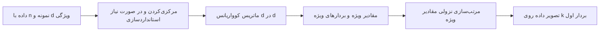

# جلسه ۱۴ — کاهش ابعاد 

## از انتخاب ویژگی تا جریان کامل پیش‌پردازش

در جلسه قبل با **انتخاب ویژگی** تعداد ویژگی‌ها را کم کردیم: برخی ستون‌ها را نگه داشتیم و بقیه را کنار گذاشتیم ← [[۱۳ - مهندسی و انتخاب ویژگی]]
راه دیگر کاهش ابعاد، ساختن تعداد کمی **ویژگی جدید** است که بیشترین اطلاعات همه ستون‌ها را در خود فشرده کنند.

این جلسه دو هدف دارد:

- **کاهش ابعاد:** تحلیل مؤلفه‌های اصلی (PCA) و روش‌های مصورسازی t-SNE و UMAP
- **جمع‌بندی بخش پیش‌پردازش:** نمونه‌برداری درست، پرهیز از **نشت داده** و بستن همه گام‌های جلسات ۱۰ تا ۱۴ در یک **Pipeline** قابل تکرار

---

## تفاوت انتخاب ویژگی و استخراج ویژگی

| معیار | انتخاب ویژگی (Feature Selection) | استخراج ویژگی (Feature Extraction) |
|:---:|:---:|:---:|
| خروجی | زیرمجموعه‌ای از ستون‌های اصلی | ستون‌های **جدید** که ترکیب ستون‌های اصلی‌اند |
| تفسیرپذیری | بالا (همان ویژگی‌های آشنا) | کم (هر مؤلفه ترکیب همه ویژگی‌هاست) |
| اطلاعات حذف‌شده | ستون‌های حذف‌شده کاملاً کنار می‌روند | سهم کوچکی از اطلاعات همه ستون‌ها حفظ می‌شود |
| نیاز به متغیر هدف | بیشتر روش‌ها بله | روش PCA خیر (بدون نظارت) |
| نمونه روش‌ها | واریانس، همبستگی، کای‌دو | روش PCA، روش t-SNE، روش UMAP |
| کاربرد اصلی | ساده‌سازی داده، کاهش هزینه جمع‌آوری | فشرده‌سازی، حذف هم‌خطی، مصورسازی |

> [!example] مثال — ابعاد بدن
> فرض کنید قد، طول دست، طول پا و وزن افراد را داریم.
> - **انتخاب ویژگی:** فقط «قد» و «وزن» را نگه می‌داریم.
> - **استخراج ویژگی:** یک ویژگی جدید «اندازه کلی بدن» می‌سازیم که ترکیب وزن‌دار هر چهار ویژگی است و بیشتر تغییرات آن‌ها را خلاصه می‌کند. روش PCA دقیقاً چنین ترکیبی را پیدا می‌کند.

---

## تحلیل مؤلفه‌های اصلی (PCA)

### شهود هندسی

روش **تحلیل مؤلفه‌های اصلی** (Principal Component Analysis) دستگاه مختصات را می‌چرخاند تا:

- **مؤلفه اول** (PC1) در جهتی باشد که داده‌ها **بیشترین واریانس** (پراکندگی) را دارند.
- **مؤلفه دوم** (PC2) بر مؤلفه اول **عمود** باشد و بیشترین واریانس باقی‌مانده را داشته باشد.
- و به همین ترتیب برای مؤلفه‌های بعدی.

اگر داده‌ها حول یک خط کشیده شده باشند (مثلاً دو ویژگی بسیار همبسته)، تقریباً همه اطلاعات در راستای آن خط است و می‌توان با **یک** مؤلفه به جای دو ویژگی کار کرد.

> [!tip] دو نگاه معادل به PCA
> - **بیشینه کردن واریانس:** جهتی که تصویر داده‌ها روی آن بیشترین پراکندگی را دارد.
> - **کمینه کردن خطای بازسازی:** خطی که مجموع مجذور فاصله عمودی نقاط تا آن کمترین است.
>
> این دو هدف به یک جواب می‌رسند.

### نمایش داده به‌صورت ماتریس

در سراسر این جلسه، داده را مانند همیشه به شکل یک **جدول** می‌بینیم: هر **سطر** یک نمونه (شیء داده) و هر **ستون** یک ویژگی است ← [[۳ - انواع داده و ویژگی‌ها]]

|  نمونه  | ویژگی ۱ | ویژگی ۲ |  …  | ویژگی d |
| :-----: | :-----: | :-----: | :-: | :-----: |
| نمونه ۱ |   x11   |   x12   |  …  |   x1d   |
| نمونه ۲ |   x21   |   x22   |  …  |   x2d   |
|    …    |    …    |    …    |  …  |    …    |
| نمونه n |   xn1   |   xn2   |  …  |   xnd   |

در ریاضیات به همین جدول **ماتریس داده** می‌گوییم و آن را با X نشان می‌دهیم؛ ماتریسی با n سطر و d ستون:

$$
\mathbf{X} =
\begin{bmatrix}
x_{11} & x_{12} & \cdots & x_{1d} \\
x_{21} & x_{22} & \cdots & x_{2d} \\
\vdots & \vdots & \ddots & \vdots \\
x_{n1} & x_{n2} & \cdots & x_{nd}
\end{bmatrix}
$$

### یادآوری ۱: واریانس، کوواریانس و ماتریس کوواریانس

**واریانس** یک ویژگی نشان می‌دهد مقادیر آن چقدر حول میانگین پخش شده‌اند ← [[4 - آمار توصیفی]]

$$
\operatorname{var}(x) = \frac{1}{n-1} \sum_{i=1}^{n} (x_i - \bar{x})^2
$$

**کوواریانس** دو ویژگی نشان می‌دهد آن دو چقدر **با هم** تغییر می‌کنند. اگر وقتی یکی بالای میانگینش است، دیگری هم معمولاً بالای میانگینش باشد، کوواریانس مثبت است ← [[8 - تحلیل دومتغیره و چندمتغیره]]

$$
\operatorname{cov}(x, y) = \frac{1}{n-1} \sum_{i=1}^{n} (x_i - \bar{x})(y_i - \bar{y})
$$

**ماتریس کوواریانس** همه این اعداد را در یک جدول مربعی d در d جمع می‌کند:

- روی **قطر اصلی**، واریانس هر ویژگی قرار دارد.
- بیرون از قطر، کوواریانس هر جفت ویژگی قرار دارد.
- ماتریس **متقارن** است، چون کوواریانس$x$ و $y$ همان کوواریانس $x$ و $y$ است.

برای دو ویژگی $x$ و $y$:

$$
\mathbf{\Sigma} =
\begin{bmatrix}
\operatorname{var}(x) & \operatorname{cov}(x, y) \\
\operatorname{cov}(y, x) & \operatorname{var}(y)
\end{bmatrix}
$$

اگر ابتدا میانگین هر ستون را از آن ستون کم کنیم (داده **مرکزی‌شده** $\mathbf{X}_c$)، کل ماتریس کوواریانس با یک ضرب ماتریسی به دست می‌آید:

$$
\mathbf{\Sigma} = \frac{1}{n-1} \mathbf{X}_c^{\top} \mathbf{X}_c
$$

> [!tip] چرا این ضرب ماتریسی همان کوواریانس‌هاست؟
> درایه سطر $j$ و ستون $k$ حاصل‌ضرب بالا، از ضرب **ستون $j$** در **ستون $k$** داده مرکزی‌شده و جمع کردن نتیجه روی همه نمونه‌ها به دست می‌آید؛ یعنی دقیقاً همان صورت کسر کوواریانس. اگر $j$ و $k$ یکی باشند، نتیجه صورت کسر واریانس است.

### یادآوری ۲: مقدار ویژه و بردار ویژه

ضرب یک ماتریس در یک بردار، معمولاً بردار را هم **می‌چرخاند** و هم **کش می‌دهد**. اما برای هر ماتریس متقارن، جهت‌های خاصی وجود دارد که ضرب ماتریس در آن‌ها فقط بردار را **کش می‌دهد** (یا کوتاه می‌کند) و جهتش را تغییر نمی‌دهد. این جهت‌ها **بردار ویژه** و ضریب کشیدگی **مقدار ویژه** نام دارند:

$$
\mathbf{\Sigma} \, \mathbf{w} = \lambda \, \mathbf{w}
$$

برای پیدا کردن آن‌ها سه گام داریم:

**گام الف — بازنویسی معادله:** جمله سمت راست را به سمت چپ می‌بریم (I ماتریس همانی است):

$$
(\mathbf{\Sigma} - \lambda \mathbf{I}) \, \mathbf{w} = \mathbf{0}
$$

**گام ب — معادله مشخصه:** این معادله فقط وقتی جواب غیرصفر دارد که دترمینان ماتریس داخل پرانتز صفر باشد. دترمینان یک ماتریس دو در دو این‌گونه محاسبه می‌شود:

$$
\det \begin{bmatrix} a & b \\ c & d \end{bmatrix} = a \, d - b \, c
$$

با حل معادله دترمینان برابر صفر، **مقادیر ویژه** به دست می‌آیند.

**گام ج — بردار ویژه:** هر مقدار ویژه را در معادله گام الف قرار می‌دهیم و دستگاه معادلات را حل می‌کنیم. چون هر مضربی از یک بردار ویژه هم بردار ویژه است، بردار را **یکه** می‌کنیم (طولش را برابر یک می‌کنیم).

> [!important] پیوند با PCA
> برای ماتریس کوواریانس:
> - **بردارهای ویژه** همان جهت‌های مؤلفه‌های اصلی‌اند و بر هم عمودند.
> - **مقدار ویژه** هر جهت، برابر واریانس داده در امتداد همان جهت است.
> - به این تجزیه ماتریس به مقادیر و بردارهای ویژه، **تجزیه طیفی** (Spectral Decomposition) می‌گویند.

### مراحل الگوریتم



مقادیر ویژه را از بزرگ به کوچک مرتب می‌کنیم:

$$
\lambda_1 \ge \lambda_2 \ge \dots \ge \lambda_d \ge 0
$$

امتیاز (مختصات جدید) هر نمونه روی مؤلفه j، حاصل‌ضرب داخلی سطر مرکزی‌شده آن نمونه در بردار ویژه j است:

$$
z_{ij} = \sum_{k=1}^{d} (x_{ik} - \bar{x}_k) \, w_{kj}
$$

همین محاسبه برای همه نمونه‌ها و $k$ مؤلفه اول، به شکل ماتریسی (ستون‌های $\mathbf{W}_k$ همان $k$ بردار ویژه اول‌اند):

$$
\mathbf{Z} = \mathbf{X}_c \, \mathbf{W}_k
$$

ماتریس $\mathbf{Z}$ نیز یک جدول است: همان $n$ سطر (نمونه‌ها)، اما فقط $k$ ستون (مؤلفه‌ها).

### واریانس توضیح‌داده‌شده (Explained Variance)

سهم مؤلفه j از کل واریانس داده:

$$
\text{EVR}_j = \frac{\lambda_j}{\sum_{i=1}^{d} \lambda_i}
$$

مجموع مقادیر ویژه برابر مجموع واریانس ویژگی‌هاست (یعنی مجموع قطر ماتریس کوواریانس)؛ پس PCA واریانس کل را **بازتوزیع** می‌کند، نه کم یا زیاد.

---

### مثال حل‌شده گام‌به‌گام: PCA روی پنج نقطه دوبعدی

داده مثال پنج نمونه و دو ویژگی دارد:

| نمونه | ویژگی x | ویژگی y |
|:---:|:---:|:---:|
| نمونه ۱ | 1 | 2 |
| نمونه ۲ | 2 | 1 |
| نمونه ۳ | 3 | 3 |
| نمونه ۴ | 4 | 5 |
| نمونه ۵ | 5 | 4 |

ابتدا کتابخانه‌هایی را که در کل این جلسه لازم داریم وارد می‌کنیم.

```python
import numpy as np
import pandas as pd
import matplotlib.pyplot as plt
import seaborn as sns
from sklearn.decomposition import PCA
from sklearn.preprocessing import StandardScaler

sns.set_theme(style="whitegrid")
```

داده مثال را به‌صورت یک جدول تعریف می‌کنیم؛ هر سطر یک نمونه و هر ستون یک ویژگی است.

```python
df = pd.DataFrame({"x": [1, 2, 3, 4, 5],
                   "y": [2, 1, 3, 5, 4]}, index=[1, 2, 3, 4, 5])
D = df.to_numpy(dtype=float)
```

#### گام ۱ — میانگین هر ویژگی

$$
\bar{x} = \frac{1 + 2 + 3 + 4 + 5}{5} = \frac{15}{5} = 3, \qquad \bar{y} = \frac{2 + 1 + 3 + 5 + 4}{5} = \frac{15}{5} = 3
$$

میانگین هر ستون را حساب می‌کنیم.

```python
means = df.mean()
print(means)                                
```

```
x    3.0
y    3.0
dtype: float64
```

#### گام ۲ — مرکزی‌کردن داده

از هر مقدار، میانگین ستون خودش را کم می‌کنیم تا مرکز داده به مبدأ مختصات منتقل شود:

|  نمونه  | ویژگی $x$ | ویژگی $y$ | مقدار $x$ منهای میانگین | مقدار $y$ منهای میانگین |
| :-----: | :-------: | :-------: | :---------------------: | :---------------------: |
| نمونه ۱ |     1     |     2     |       1 − 3 = −2        |       2 − 3 = −1        |
| نمونه ۲ |     2     |     1     |       2 − 3 = −1        |       1 − 3 = −2        |
| نمونه ۳ |     3     |     3     |        3 − 3 = 0        |        3 − 3 = 0        |
| نمونه ۴ |     4     |     5     |        4 − 3 = 1        |        5 − 3 = 2        |
| نمونه ۵ |     5     |     4     |        5 − 3 = 2        |        4 − 3 = 1        |

ماتریس داده مرکزی‌شده (هر سطر یک نمونه):

$$
\mathbf{X}_c =
\begin{bmatrix}
-2 & -1 \\
-1 & -2 \\
0 & 0 \\
1 & 2 \\
2 & 1
\end{bmatrix}
$$

میانگین هر ستون را از آن کم می‌کنیم؛ نتیجه همان دو ستون آخر جدول بالاست.

```python
Xc = df - means
print(Xc)                                   # rows: (-2,-1) (-1,-2) (0,0) (1,2) (2,1)
```

```
	x    y
1 -2.0 -1.0
2 -1.0 -2.0
3  0.0  0.0
4  1.0  2.0
5  2.0  1.0
```

#### گام ۳ — ماتریس کوواریانس

برای واریانس‌ها و کوواریانس به سه مجموع نیاز داریم. هر سطر جدول زیر برای یک نمونه محاسبه شده است:

| نمونه | مجذور x مرکزی‌شده | مجذور y مرکزی‌شده | حاصل‌ضرب$x$ و $y$ مرکزی‌شده |
|:---:|:---:|:---:|:---:|
| نمونه ۱ | (−2)² = 4 | (−1)² = 1 | (−2)(−1) = 2 |
| نمونه ۲ | (−1)² = 1 | (−2)² = 4 | (−1)(−2) = 2 |
| نمونه ۳ | 0 | 0 | 0 |
| نمونه ۴ | 1² = 1 | 2² = 4 | (1)(2) = 2 |
| نمونه ۵ | 2² = 4 | 1² = 1 | (2)(1) = 2 |
| جمع | 10 | 10 | 8 |

با تقسیم هر مجموع بر n منهای ۱ (یعنی ۴):

$$
\operatorname{var}(x) = \frac{10}{4} = 2.5, \qquad \operatorname{var}(y) = \frac{10}{4} = 2.5, \qquad \operatorname{cov}(x, y) = \frac{8}{4} = 2
$$

و ماتریس کوواریانس:

$$
\mathbf{\Sigma} = \begin{bmatrix} 2.5 & 2 \\ 2 & 2.5 \end{bmatrix}
$$

کوواریانس مثبت و بزرگ (۲) نشان می‌دهد$x$ و $y$ با هم بالا و پایین می‌روند؛ یعنی نقاط حول یک خط مورب کشیده شده‌اند.

ستون‌های جدول بالا را با کد می‌سازیم و جمع می‌زنیم.

```python
products = pd.DataFrame({"xc^2": Xc["x"] ** 2,
                         "yc^2": Xc["y"] ** 2,
                         "xc*yc": Xc["x"] * Xc["y"]})
print(products.sum())                       # 10, 10, 8
```

```
xc^2     10.0
yc^2     10.0
xc*yc     8.0
dtype: float64
```

ماتریس کوواریانس را با فرمول ماتریسی می‌سازیم و با تابع آماده `np.cov` مقایسه می‌کنیم.

```python
n = len(df)
cov_manual = Xc.to_numpy().T @ Xc.to_numpy() / (n - 1)
print(cov_manual)                           # [[2.5 2. ] [2.  2.5]]
print(np.cov(D, rowvar=False))              # same result
```

```
[[2.5 2. ]
 [2.  2.5]]
[[2.5 2. ]
 [2.  2.5]]
```

#### گام ۴ — مقادیر ویژه

ماتریس Σ منهای λ برابر ماتریس همانی را می‌نویسیم؛ یعنی λ را فقط از درایه‌های قطر کم می‌کنیم:

$$
\mathbf{\Sigma} - \lambda \mathbf{I} = \begin{bmatrix} 2.5 - \lambda & 2 \\ 2 & 2.5 - \lambda \end{bmatrix}
$$

دترمینان آن را برابر صفر قرار می‌دهیم:

$$
\det(\mathbf{\Sigma} - \lambda \mathbf{I}) = (2.5 - \lambda)(2.5 - \lambda) - (2)(2) = 0
$$

پرانتز را باز می‌کنیم:

$$
\lambda^2 - 5\lambda + 6.25 - 4 = 0 \;\Rightarrow\; \lambda^2 - 5\lambda + 2.25 = 0
$$

معادله درجه دو را با فرمول حل معادله درجه دو حل می‌کنیم:

$$
\lambda = \frac{5 \pm \sqrt{5^2 - 4 \times 2.25}}{2} = \frac{5 \pm \sqrt{16}}{2} = \frac{5 \pm 4}{2}
$$

$$
\lambda_1 = \frac{9}{2} = 4.5, \qquad \lambda_2 = \frac{1}{2} = 0.5
$$

> [!tip] دو آزمون سریع برای درستی مقادیر ویژه
> - مجموع مقادیر ویژه برابر مجموع قطر ماتریس است: ۴.۵ به‌علاوه ۰.۵ برابر ۵ و ۲.۵ به‌علاوه ۲.۵ هم برابر ۵ است.
> - حاصل‌ضرب مقادیر ویژه برابر دترمینان ماتریس است: ۴.۵ ضرب در ۰.۵ برابر ۲.۲۵ و دترمینان Σ هم ۶.۲۵ منهای ۴ یعنی ۲.۲۵ است.

#### گام ۵ — بردارهای ویژه

*  ***بردار ویژه اول** (λ برابر ۴.۵): هرگاه 
$$
\mathbf{w}_1 = \begin{bmatrix} w_{1,1} \\ w_{2,1} \end{bmatrix},
$$
آنگاه باید:
$$
( \mathbf{\Sigma} - \lambda \mathbf{I})\mathbf{w}_1 = \mathbf{0}. 
$$
مقدار ویژه را در معادله گام الف قرار می‌دهیم:

$$
\begin{bmatrix} 2.5 - 4.5 & 2 \\ 2 & 2.5 - 4.5 \end{bmatrix}
\begin{bmatrix} w_{1,1} \\ w_{2,1} \end{bmatrix}
=
\begin{bmatrix} -2 & 2 \\ 2 & -2 \end{bmatrix}
\begin{bmatrix} w_{1,1} \\ w_{2,1} \end{bmatrix}
=
\begin{bmatrix} 0 \\ 0 \end{bmatrix}.
$$

سطر اول می‌گوید:

$$
-2 w_{1,1} + 2 w_{2,1} = 0 \;\Rightarrow\; w_1 = w_2
$$

پس هر برداری به شکل (t، t) جواب است. برای یکه کردن، طول بردار را برابر یک قرار می‌دهیم:

$$
\sqrt{t^2 + t^2} = 1 \;\Rightarrow\; t = \frac{1}{\sqrt{2}} \approx 0.707
\qquad\Rightarrow\qquad
\mathbf{w}_1 = \begin{bmatrix} 0.707 \\ 0.707 \end{bmatrix}.
$$

*  ***بردار ویژه دوم** (λ برابر ۰.۵): به همین ترتیب هرگاه 
$$
\mathbf{w}_2 = \begin{bmatrix} w_{1,2} \\ w_{2,2} \end{bmatrix}
$$
آنگاه باید:
$$
( \mathbf{\Sigma} - \lambda \mathbf{I})\mathbf{w}_2 = \mathbf{0}. 
$$
$$
\begin{bmatrix} 2 & 2 \\ 2 & 2 \end{bmatrix}
\begin{bmatrix} w_{1,2} \\ w_{2,2} \end{bmatrix}
=
\begin{bmatrix} 0 \\ 0 \end{bmatrix}
\;\Rightarrow\; 2 w_{1,2} + 2 w_{2,2} = 0 \;\Rightarrow\; w_{1,2} = -w_{2,2}
\qquad\Rightarrow\qquad
\mathbf{w}_2 = \begin{bmatrix} -0.707 \\ 0.707 \end{bmatrix}.
$$

**بررسی:** ضرب $\mathbf{\Sigma}$ در بردار ویژه اول باید همان بردار ضرب در ۴.۵ باشد:

$$
\begin{bmatrix} 2.5 & 2 \\ 2 & 2.5 \end{bmatrix}
\begin{bmatrix} 0.707 \\ 0.707 \end{bmatrix}
=
\begin{bmatrix} 2.5 \times 0.707 + 2 \times 0.707 \\ 2 \times 0.707 + 2.5 \times 0.707 \end{bmatrix}
=
\begin{bmatrix} 3.182 \\ 3.182 \end{bmatrix}
= 4.5 \times \begin{bmatrix} 0.707 \\ 0.707 \end{bmatrix}
$$

همچنین دو بردار بر هم عمودند، چون حاصل‌ضرب داخلی‌شان صفر است:

$$
(0.707)(-0.707) + (0.707)(0.707) = 0
$$

**تفسیر:** مؤلفه اول در امتداد قطر (جهت ۴۵ درجه) است؛ همان جهتی که نقاط کشیده شده‌اند. مؤلفه دوم بر آن عمود است.

مقادیر و بردارهای ویژه را با NumPy حساب می‌کنیم. تابع `eigh` مقادیر را از کوچک به بزرگ مرتب می‌کند، پس مؤلفه اول در ستون آخر است.

```python
eigvals, eigvecs = np.linalg.eigh(cov_manual)
print(eigvals)                              
print(eigvecs[:, 1])                       
print(eigvecs[:, 0])                       
```

```
[0.5 4.5]
[0.70710678 0.70710678]
[-0.70710678  0.70710678]
```

درستی تعریف بردار ویژه را بررسی می‌کنیم: ضرب $\mathbf{\Sigma}$ در بردار اول باید برابر ۴.۵ برابر همان بردار باشد.

```python
w1 = eigvecs[:, 1]
print(cov_manual @ w1, 4.5 * w1)            
```

```
[3.18198052 3.18198052] [3.18198052 3.18198052]
```


#### گام ۶ — واریانس توضیح‌داده‌شده

$$
\text{EVR}_1 = \frac{4.5}{4.5 + 0.5} = \frac{4.5}{5} = 0.9, \qquad \text{EVR}_2 = \frac{0.5}{5} = 0.1
$$

مؤلفه اول **۹۰ درصد** کل واریانس را توضیح می‌دهد.

سهم هر مؤلفه را از روی مقادیر ویژه حساب می‌کنیم.

```python
print(eigvals[::-1] / eigvals.sum())        
```

```
[0.9 0.1]
```

#### گام ۷ — امتیاز نمونه‌ها روی مؤلفه‌ها

امتیاز هر نمونه روی یک مؤلفه، حاصل‌ضرب داخلی سطر مرکزی‌شده آن نمونه در بردار ویژه است. برای نمونه ۱:

$$
z_{1,1} = (-2)(0.707) + (-1)(0.707) = -1.414 - 0.707 = -2.121
$$

$$
z_{1,2} = (-2)(-0.707) + (-1)(0.707) = 1.414 - 0.707 = 0.707
$$

| نمونه | مقدار x مرکزی‌شده | مقدار y مرکزی‌شده | امتیاز مؤلفه اول | امتیاز مؤلفه دوم |
|:---:|:---:|:---:|:---:|:---:|
| نمونه ۱ | −2 | −1 | −2.121 | 0.707 |
| نمونه ۲ | −1 | −2 | −2.121 | −0.707 |
| نمونه ۳ | 0 | 0 | 0 | 0 |
| نمونه ۴ | 1 | 2 | 2.121 | 0.707 |
| نمونه ۵ | 2 | 1 | 2.121 | −0.707 |

جدول امتیازها هم یک جدول داده است: همان ۵ سطر (نمونه‌ها)، با دو ستون جدید (مؤلفه‌ها). واریانس ستون مؤلفه اول دقیقاً همان مقدار ویژه اول است:

$$
\operatorname{var}(z_1) = \frac{(-2.121)^2 + (-2.121)^2 + 0^2 + 2.121^2 + 2.121^2}{4} = \frac{4 \times 4.5}{4} = 4.5
$$

ماتریس امتیازها را با ضرب داده مرکزی‌شده در ماتریس بردارهای ویژه می‌سازیم (ستون اول $\mathbf{w}_1$ و ستون دوم $\mathbf{w}_2$).

```python
W = np.column_stack([eigvecs[:, 1], eigvecs[:, 0]])     
Z = Xc.to_numpy() @ W
print(pd.DataFrame(Z, columns=["PC1", "PC2"], index=df.index).round(3))
print(Z[:, 0].var(ddof=1))                 
```

```
	PC1    PC2
1 -2.121  0.707
2 -2.121 -0.707
3  0.000  0.000
4  2.121  0.707
5  2.121 -0.707
4.499999999999999
```

همین نتیجه را با کلاس `PCA` در scikit-learn می‌گیریم؛ این کلاس همه گام‌های ۱ تا ۷ را یک‌جا انجام می‌دهد.

```python
pca = PCA().fit(D)
print("explained variance:", pca.explained_variance_)            
print("pca.explained_variance_ratio:", pca.explained_variance_ratio_)    
print("pca.transform:")  
print( pca.transform(D).round(3))           
```

```
explained variance: [4.5 0.5]
pca.explained_variance_ratio: [0.9 0.1]
pca.transform:
[[-2.121  0.707]
 [-2.121 -0.707]
 [ 0.    -0.   ]
 [ 2.121  0.707]
 [ 2.121 -0.707]]
```


#### گام ۸ — بازسازی با یک مؤلفه

اگر فقط مؤلفه اول را نگه داریم، هر نمونه را با «میانگین به‌علاوه امتیاز ضرب در بردار ویژه» بازسازی می‌کنیم. برای نمونه ۱:

$$
\hat{\mathbf{x}}_1 = \begin{bmatrix} 3 \\ 3 \end{bmatrix} + (-2.121) \begin{bmatrix} 0.707 \\ 0.707 \end{bmatrix} = \begin{bmatrix} 3 - 1.5 \\ 3 - 1.5 \end{bmatrix} = \begin{bmatrix} 1.5 \\ 1.5 \end{bmatrix}
$$

نقطه اصلی (۱، ۲) به نقطه (۱.۵، ۱.۵) روی خط مؤلفه اول نگاشت می‌شود. فاصله این دو نقطه همان اطلاعاتی است که از دست رفته و دقیقاً برابر قدرمطلق امتیاز مؤلفه دوم است:

$$
\sqrt{(1 - 1.5)^2 + (2 - 1.5)^2} = \sqrt{0.25 + 0.25} \approx 0.707
$$

فقط مؤلفه اول را نگه می‌داریم و با `inverse_transform` نمونه‌ها را بازسازی می‌کنیم.

```python
pca1 = PCA(n_components=1).fit(D)
recon = pca1.inverse_transform(pca1.transform(D))
print(recon[0])                             
```

```
[1.5  1.5]
```

> [!note] علامت بردار ویژه دلخواه است
> اگر w بردار ویژه باشد، منفی آن نیز بردار ویژه است. بنابراین NumPy و scikit-learn ممکن است علامت مؤلفه‌ها را متفاوت گزارش کنند؛ برای تفسیر، فقط **علامت نسبی** بارهای یک مؤلفه مهم است.

### داده نمونه: مشخصات خودروها

در ادامه جلسه از مجموعه‌داده **mpg** (مشخصات ۳۹۸ خودرو، که در جلسه ۹ نیز با آن آشنا شدیم) استفاده می‌کنیم ← [[9 - مطالعه موردی EDA]]
هفت ویژگی عددی آن را بررسی می‌کنیم: مصرف سوخت (mpg)، تعداد سیلندر، حجم موتور، قدرت موتور (horsepower)، وزن، شتاب و سال ساخت. ستون قدرت موتور ۶ مقدار گمشده دارد؛ در این بخش آن ۶ خودرو را کنار می‌گذاریم و ۳۹۲ خودرو باقی می‌ماند.

> [!question] چرا این داده برای PCA مناسب است؟
> ویژگی‌های «اندازه خودرو» (وزن، حجم موتور، تعداد سیلندر، قدرت موتور) به‌شدت با هم همبسته‌اند. انتظار داریم PCA این ویژگی‌های همبسته را در یک مؤلفه خلاصه کند. همچنین واحدهای ویژگی‌ها (پوند، اینچ مکعب، ثانیه، سال) بسیار متفاوت‌اند و اثر استانداردسازی به‌خوبی دیده می‌شود.

#### کد: بارگذاری داده خودروها

داده را بارگذاری می‌کنیم، هفت ستون عددی را انتخاب می‌کنیم و خودروهایی را که قدرت موتورشان گمشده است کنار می‌گذاریم.

```python
mpg = sns.load_dataset("mpg")
cols = ["mpg", "cylinders", "displacement", "horsepower",
        "weight", "acceleration", "model_year"]
cars = mpg.dropna(subset=cols)
X_car = cars[cols]
print(X_car.shape)                         
```

```
(392, 7)
```

پنج سطر اول جدول را نگاه می‌کنیم؛ هر سطر یک خودرو و هر ستون یک ویژگی است.

```python
print(X_car.head())
```

```
mpg  cylinders  displacement  horsepower  weight  acceleration  model_year
0  18.0          8         307.0       130.0    3504          12.0          70
1  15.0          8         350.0       165.0    3693          11.5          70
2  18.0          8         318.0       150.0    3436          11.0          70
3  16.0          8         304.0       150.0    3433          12.0          70
4  17.0          8         302.0       140.0    3449          10.5          70
```

| خودرو | مصرف (mpg) | سیلندر | حجم موتور | قدرت | وزن | شتاب | سال ساخت |
|:---:|:---:|:---:|:---:|:---:|:---:|:---:|:---:|
| خودروی chevrolet chevelle malibu | 18 | 8 | 307 | 130 | 3504 | 12.0 | 70 |
| خودروی buick skylark 320 | 15 | 8 | 350 | 165 | 3693 | 11.5 | 70 |
| خودروی plymouth satellite | 18 | 8 | 318 | 150 | 3436 | 11.0 | 70 |
| خودروی amc rebel sst | 16 | 8 | 304 | 150 | 3433 | 12.0 | 70 |
| خودروی ford torino | 17 | 8 | 302 | 140 | 3449 | 10.5 | 70 |

پس ماتریس داده X در این مثال ۳۹۲ سطر و ۷ ستون دارد و ماتریس کوواریانس آن ۷ در ۷ خواهد بود.

### گام استانداردسازی و ماتریس همبستگی

پیش از PCA هر ستون را استاندارد می‌کنیم (دلیل آن در بخش «اهمیت استانداردسازی» آمده است). برای هر خانه جدول:

$$
z = \frac{x - \bar{x}}{s}
$$

> [!example] مثال حل‌شده — استانداردسازی وزن خودروی اول
> میانگین وزن ۳۹۲ خودرو حدود ۲۹۷۷.۵۸ و انحراف معیار آن (با تقسیم بر n، همان روشی که کلاس `StandardScaler` به کار می‌برد) حدود ۸۴۸.۳۲ است. وزن خودروی اول ۳۵۰۴ است:
> $$
> z = \frac{3504 - 2977.58}{848.32} = \frac{526.42}{848.32} \approx 0.621
> $$
> یعنی این خودرو حدود ۰.۶۲ انحراف معیار سنگین‌تر از خودروی میانگین است. پس از استانداردسازی همه ستون‌ها میانگین صفر و انحراف معیار یک دارند و واحدها (پوند، ثانیه، سال) دیگر اثری ندارند.

وقتی همه ستون‌ها استاندارد شده باشند، ماتریس کوواریانس همان **ماتریس همبستگی** است ← [[8 - تحلیل دومتغیره و چندمتغیره]]

| ویژگی | مصرف | سیلندر | حجم موتور | قدرت | وزن | شتاب | سال ساخت |
|:---:|:---:|:---:|:---:|:---:|:---:|:---:|:---:|
| مصرف (mpg) | 1.00 | −0.78 | −0.81 | −0.78 | −0.83 | 0.42 | 0.58 |
| سیلندر | −0.78 | 1.00 | 0.95 | 0.84 | 0.90 | −0.50 | −0.35 |
| حجم موتور | −0.81 | 0.95 | 1.00 | 0.90 | 0.93 | −0.54 | −0.37 |
| قدرت | −0.78 | 0.84 | 0.90 | 1.00 | 0.86 | −0.69 | −0.42 |
| وزن | −0.83 | 0.90 | 0.93 | 0.86 | 1.00 | −0.42 | −0.31 |
| شتاب | 0.42 | −0.50 | −0.54 | −0.69 | −0.42 | 1.00 | 0.29 |
| سال ساخت | 0.58 | −0.35 | −0.37 | −0.42 | −0.31 | 0.29 | 1.00 |

این جدول داده نیست، بلکه ماتریس کوواریانس (همبستگی) است: سطرها و ستون‌هایش هر دو ویژگی‌اند. همبستگی‌های بسیار بالا میان سیلندر، حجم موتور، قدرت و وزن (۰.۸۴ تا ۰.۹۵) نشان می‌دهد این چهار ستون تقریباً یک اطلاعات را تکرار می‌کنند؛ دقیقاً همان چیزی که PCA در یک مؤلفه خلاصه خواهد کرد.

> [!note] مجموع قطر ماتریس
> قطر ماتریس همبستگی ۷ عدد یک است، پس مجموع مقادیر ویژه آن ۷ است؛ یعنی هر ویژگی استانداردشده «یک واحد» واریانس به کل اضافه می‌کند. به همین دلیل در قاعده کایزر، مؤلفه‌ای که مقدار ویژه‌اش از ۱ بیشتر است، بیش از یک ویژگی اصلی اطلاعات دارد. (در scikit-learn مجموع مقادیر ویژه حدود ۷.۰۲ گزارش می‌شود، چون `StandardScaler` بر n و `PCA` بر n منهای ۱ تقسیم می‌کند.)

داده را استاندارد می‌کنیم و وزن خودروی اول را با محاسبه دستی بالا مقایسه می‌کنیم.

```python
X_car_s = StandardScaler().fit_transform(X_car)
print(X_car_s[0, cols.index("weight")].round(3))      # 0.621
```

ماتریس همبستگی هفت ویژگی را حساب می‌کنیم؛ همان جدول بالا.

```python
print(X_car.corr().round(2))
```

```
mpg  cylinders  displacement  horsepower  weight  acceleration  \
mpg           1.00      -0.78         -0.81       -0.78   -0.83          0.42   
cylinders    -0.78       1.00          0.95        0.84    0.90         -0.50   
displacement -0.81       0.95          1.00        0.90    0.93         -0.54   
horsepower   -0.78       0.84          0.90        1.00    0.86         -0.69   
weight       -0.83       0.90          0.93        0.86    1.00         -0.42   
acceleration  0.42      -0.50         -0.54       -0.69   -0.42          1.00   
model_year    0.58      -0.35         -0.37       -0.42   -0.31          0.29   

              model_year  
mpg                 0.58  
cylinders          -0.35  
displacement       -0.37  
horsepower         -0.42  
weight             -0.31  
acceleration        0.29  
model_year          1.00
```
### نمودار سنگریزه (Scree Plot) و انتخاب تعداد مؤلفه‌ها

نمودار سنگریزه، واریانس توضیح‌داده‌شده هر مؤلفه را به ترتیب نشان می‌دهد. قاعده‌های رایج برای انتخاب تعداد مؤلفه‌ها:

| قاعده | توضیح |
|:---:|:---:|
| واریانس تجمعی | کمترین تعداد مؤلفه که مثلاً ۹۰ یا ۹۵ درصد واریانس را حفظ کند |
| قاعده آرنج (Elbow) | نقطه‌ای که شیب نمودار سنگریزه ناگهان کم می‌شود |
| قاعده کایزر (Kaiser) | روی داده استانداردشده، مؤلفه‌هایی با مقدار ویژه بیشتر از ۱ |
| هدف تحلیل | دو یا سه مؤلفه برای مصورسازی؛ تعداد بیشتر برای فشرده‌سازی |

> [!example] مثال — داده خودروها (۷ ویژگی، استانداردشده)
> | مؤلفه | مقدار ویژه | واریانس توضیح‌داده‌شده | واریانس تجمعی |
> |:---:|:---:|:---:|:---:|
> | مؤلفه ۱ | 5.023 | 0.716 | 0.716 |
> | مؤلفه ۲ | 0.868 | 0.124 | 0.839 |
> | مؤلفه ۳ | 0.730 | 0.104 | 0.944 |
> | مؤلفه ۴ | 0.184 | 0.026 | 0.970 |
> | مؤلفه ۵ | 0.122 | 0.017 | 0.987 |
> | مؤلفه ۶ | 0.054 | 0.008 | 0.995 |
> | مؤلفه ۷ | 0.035 | 0.005 | 1.000 |
>
> سهم هر مؤلفه، مقدار ویژه آن تقسیم بر مجموع مقادیر ویژه است؛ برای مؤلفه اول:
> $$
> \text{EVR}_1 = \frac{5.023}{5.023 + 0.868 + 0.730 + 0.184 + 0.122 + 0.054 + 0.035} = \frac{5.023}{7.016} \approx 0.716
> $$
> واریانس تجمعی تا مؤلفه سوم:
> $$
> 0.716 + 0.124 + 0.104 = 0.944
> $$
>
> - مؤلفه اول به‌تنهایی حدود **۷۲ درصد** واریانس هفت ویژگی را توضیح می‌دهد.
> - برای حفظ ۹۰ درصد واریانس **۳ مؤلفه** و برای ۹۵ درصد **۴ مؤلفه** لازم است.
> - فقط مقدار ویژه مؤلفه اول بیشتر از ۱ است؛ پس قاعده کایزر **۱ مؤلفه** را پیشنهاد می‌کند.
> - نمودار سنگریزه پس از مؤلفه اول افت شدیدی دارد و پس از مؤلفه سوم دوباره افت می‌کند.
>
> قاعده‌های مختلف پاسخ‌های مختلفی می‌دهند؛ انتخاب نهایی به **هدف تحلیل** بستگی دارد.

#### کد مثال: نمودار سنگریزه داده خودروها

روش PCA را با همه مؤلفه‌ها اجرا می‌کنیم و مقدار ویژه و سهم واریانس هر مؤلفه را می‌خوانیم.

```python
pca_c = PCA().fit(X_car_s)
evr = pca_c.explained_variance_ratio_
print(pca_c.explained_variance_.round(3))  
print(evr.round(3))                        
```

```
[5.023 0.868 0.73  0.184 0.122 0.054 0.035]
[0.716 0.124 0.104 0.026 0.017 0.008 0.005]
```

واریانس تجمعی را حساب می‌کنیم و می‌پرسیم برای رسیدن به ۹۰ و ۹۵ درصد چند مؤلفه لازم است.

```python
cum = np.cumsum(evr)
print(int(np.argmax(cum >= 0.90) + 1))      
print(int(np.argmax(cum >= 0.95) + 1))      
```

```
3
4
```

قاعده کایزر را بررسی می‌کنیم: چند مؤلفه مقدار ویژه بیشتر از ۱ دارند؟

```python
print((pca_c.explained_variance_ > 1).sum())   
```

راه کوتاه‌تر: اگر به پارامتر `n_components` عددی بین صفر و یک بدهیم، PCA خودش کمترین تعداد مؤلفه برای آن سهم واریانس را انتخاب می‌کند.

```python
print(PCA(n_components=0.90).fit(X_car_s).n_components_)  
```

در پایان نمودار سنگریزه را رسم می‌کنیم: میله‌ها سهم هر مؤلفه و خط پله‌ای سهم تجمعی را نشان می‌دهند.

```python
fig, ax = plt.subplots(figsize=(8, 4))
comps = np.arange(1, len(evr) + 1)
ax.bar(comps, evr, alpha=0.7, label="Individual")
ax.step(comps, cum, where="mid", color="red", label="Cumulative")
ax.axhline(0.90, color="gray", linestyle="--", linewidth=0.8)
ax.set(title="Scree plot - car data (standardized)",
       xlabel="Principal component", ylabel="Explained variance ratio")
ax.legend()
plt.show()
```

![[Pasted image 20261016164140.png|940]]
### اهمیت استانداردسازی پیش از PCA

روش PCA به دنبال بیشترین **واریانس** است؛ پس ویژگی‌ای که مقیاس بزرگ‌تری دارد بر نتیجه مسلط می‌شود.

> [!warning] مثال — داده خودروها بدون استانداردسازی
> واریانس وزن خودرو حدود **۷۲۱۴۸۵** و واریانس ویژگی بعدی (حجم موتور) حدود **۱۰۹۵۰** است؛ واریانس شتاب فقط حدود **۷.۶** است. بدون استانداردسازی، مؤلفه اول **۹۹.۷۵ درصد** واریانس را «توضیح می‌دهد» و بار وزن در آن **۰.۹۹۳** است؛ یعنی مؤلفه اول تقریباً همان ستون وزن است و PCA هیچ ساختار واقعی را پیدا نکرده است.
>
> **قاعده:** وقتی ویژگی‌ها واحدهای متفاوت دارند، پیش از PCA آن‌ها را **استاندارد** کنید (معادل PCA روی ماتریس همبستگی) ← [[۱۲ - تبدیل و یکپارچه‌سازی داده]]

#### کد مثال: PCA بدون استانداردسازی

واریانس هر ستون خام را می‌بینیم تا تفاوت عظیم مقیاس‌ها آشکار شود.

```python
print(X_car.var().round(1))
```

```
mpg                 60.9
cylinders            2.9
displacement     10950.4
horsepower        1481.6
weight          721484.7
acceleration         7.6
model_year          13.6
dtype: float64
```
روش PCA را روی داده **خام** اجرا می‌کنیم و سهم مؤلفه اول را می‌خوانیم.

```python
pca_raw = PCA().fit(X_car)
print(pca_raw.explained_variance_ratio_[0].round(4))   # 0.9975
```

بار ستون وزن در مؤلفه اول را می‌خوانیم؛ تقریباً یک است، یعنی مؤلفه اول همان وزن است.

```python
print(pca_raw.components_[0][cols.index("weight")].round(3))   # 0.993 (sign may flip)
```

### بارهای مؤلفه (Loadings) و تفسیر

هر مؤلفه یک ترکیب خطی از ویژگی‌هاست. ضرایب این ترکیب را **بار** (Loading) می‌گویند. بارهای بزرگ (قدرمطلق) نشان می‌دهند مؤلفه بیشتر از کدام ویژگی‌ها ساخته شده است.

> [!example] مثال — تفسیر مؤلفه‌های داده خودروها
> | ویژگی | بار مؤلفه اول | بار مؤلفه دوم | بار مؤلفه سوم |
> |:---:|:---:|:---:|:---:|
> | مصرف سوخت (mpg) | 0.398- | 0.207 | 0.257- |
> | تعداد سیلندر | 0.416 | 0.199 | 0.139 |
> | حجم موتور | 0.429 | 0.180 | 0.100 |
> | قدرت موتور | 0.423 | 0.085 | 0.170- |
> | وزن | 0.414 | 0.225 | 0.276 |
> | شتاب | 0.285- | 0.007- | 0.893 |
> | سال ساخت | 0.230- | 0.910 | 0.037- |
>
> - **مؤلفه اول — «اندازه و قدرت خودرو»:** بارهای مثبت تقریباً هم‌اندازه برای سیلندر، حجم موتور، قدرت و وزن، و بار منفی برای مسافت با یک گالن (mpg). خودروهای بزرگ و پرمصرف امتیاز بالا و خودروهای کوچک و کم‌مصرف امتیاز پایین دارند.
> - **مؤلفه دوم — «سال ساخت»:** تقریباً فقط از سال ساخت ساخته شده است.
> - **مؤلفه سوم — «شتاب»:** عمدتاً از زمان شتاب‌گیری ساخته شده است.

> [!example] مثال — خودروها روی مؤلفه اول
> - بیشترین امتیاز مؤلفه اول (حدود ۵.۲) مربوط به خودروی buick electra 225 custom با وزن ۴۹۵۱ پوند و مصرف ۱۲ مایل در گالن است.
> - کمترین امتیاز (حدود ۴.۱-) مربوط به خودروی vw pickup با وزن ۲۱۳۰ پوند و مصرف ۴۴ مایل در گالن است.
> - میانگین امتیاز مؤلفه اول برای خودروهای آمریکایی حدود **۱.۰۲**، اروپایی حدود **۱.۵۲-** و ژاپنی حدود **۱.۸۷-** است: خودروهای آمریکایی آن دوره به‌طور معمول بزرگ‌تر و پرمصرف‌تر بودند. این را بدون هیچ مدلی، فقط با رنگ‌بندی نمودار دو مؤلفه اول بر اساس کشور سازنده می‌بینیم.

> [!example] مثال حل‌شده — امتیاز خودروی اول روی مؤلفه اول
> امتیاز یک خودرو، حاصل‌ضرب داخلی سطر **استانداردشده** آن خودرو در بارهای مؤلفه است. جدول زیر برای خودروی اول (chevrolet chevelle malibu) محاسبه شده است:
>
> | ویژگی | مقدار خام | مقدار استانداردشده | بار مؤلفه اول | حاصل‌ضرب |
> |:---:|:---:|:---:|:---:|:---:|
> | مصرف (mpg) | 18 | −0.699 | −0.398 | 0.278 |
> | سیلندر | 8 | 1.484 | 0.416 | 0.617 |
> | حجم موتور | 307 | 1.077 | 0.429 | 0.462 |
> | قدرت | 130 | 0.664 | 0.423 | 0.281 |
> | وزن | 3504 | 0.621 | 0.414 | 0.257 |
> | شتاب | 12.0 | −1.285 | −0.285 | 0.366 |
> | سال ساخت | 70 | −1.625 | −0.230 | 0.374 |
>
> $$
> z_{1} = 0.278 + 0.617 + 0.462 + 0.281 + 0.257 + 0.366 + 0.374  = 2.635
> $$
>
> همه حاصل‌ضرب‌ها مثبت‌اند: این خودرو سیلندر، حجم و وزن بیشتر از میانگین دارد (مقدار استانداردشده مثبت در بار مثبت) و مصرف بهتر و شتاب سریع‌تری از میانگین ندارد (مقدار استانداردشده منفی در بار منفی). پس امتیاز بالای ۲.۶ یعنی یک خودروی «بزرگ و پرقدرت».

#### کد مثال: بارها و امتیازهای خودروها

بارهای سه مؤلفه اول را در یک جدول قرار می‌دهیم؛ هر سطر یک ویژگی و هر ستون یک مؤلفه است.

```python
loadings = pd.DataFrame(pca_c.components_[:3].T, index=cols,
                        columns=["PC1", "PC2", "PC3"])
print(loadings.round(3))
# PC1: cylinders, displacement, horsepower, weight (+) and mpg (-)
# PC2: model_year 0.910   PC3: acceleration 0.893
```

```
				PC1    PC2    PC3
mpg          -0.398  0.207 -0.257
cylinders     0.416  0.199  0.139
displacement  0.429  0.180  0.100
horsepower    0.423  0.085 -0.170
weight        0.414  0.225  0.276
acceleration -0.285 -0.007  0.893
model_year   -0.230  0.910 -0.037
```
امتیاز هر خودرو روی مؤلفه‌ها را حساب می‌کنیم و دو مؤلفه اول را به جدول خودروها اضافه می‌کنیم.

```python
scores = pca_c.transform(X_car_s)
cars = cars.assign(PC1=scores[:, 0], PC2=scores[:, 1])
print(scores[0, 0].round(3))                # 2.635  
```

بزرگ‌ترین و کوچک‌ترین خودرو از نگاه مؤلفه اول را پیدا می‌کنیم.

```python
print(cars.loc[cars["PC1"].idxmax(), "name"])   # 'buick electra 225 custom'
print(cars.loc[cars["PC1"].idxmin(), "name"])   # 'vw pickup'
```

میانگین امتیاز دو مؤلفه اول را به تفکیک کشور سازنده حساب می‌کنیم.

```python
print(cars.groupby("origin")[["PC1", "PC2"]].mean().round(2))
```

```
		PC1   PC2
origin            
europe -1.52 -0.46
japan  -1.87 -0.03
usa     1.02  0.14
```

نمودار پراکندگی دو مؤلفه اول را رسم می‌کنیم؛ رنگ‌ها فقط برای **دیدن** کشور سازنده‌اند و در محاسبه PCA نقشی ندارند.

```python
fig, ax = plt.subplots(figsize=(7, 5))
sns.scatterplot(data=cars, x="PC1", y="PC2", hue="origin", alpha=0.7, ax=ax)
ax.set(title="Cars projected on the first two PCs",
       xlabel=f"PC1: size and power ({evr[0]:.0%})",
       ylabel=f"PC2: model year ({evr[1]:.0%})")
plt.show()
```

![[Pasted image 20261016164435.png|805]]
### مزایا و محدودیت‌های PCA

| مزایا | محدودیت‌ها |
|:---:|:---:|
| حذف هم‌خطی: مؤلفه‌ها ناهمبسته‌اند | فقط ساختار **خطی** را می‌بیند |
| فشرده‌سازی و کاهش نویز | مؤلفه‌ها تفسیر مستقیم ندارند |
| مصورسازی داده چندبعدی در دو بعد | به مقیاس و داده پرت حساس است |
| بدون نیاز به برچسب | بیشترین واریانس لزوماً مهم‌ترین اطلاعات نیست |

> [!warning] واریانس زیاد یعنی اطلاعات مهم؟
> روش PCA **بدون نظارت** است و به هیچ متغیر هدفی نگاه نمی‌کند. ممکن است جهتی با واریانس کم، دقیقاً همان جهتی باشد که گروه‌های مهم داده را از هم جدا می‌کند.
>
> **مثال مصنوعی:** دو گروه ۲۰۰ تایی می‌سازیم که در محور افقی پراکندگی زیادی دارند (انحراف معیار ۵) و فقط در محور عمودی از هم جدا هستند (میانگین ۱- و ۱+ با انحراف معیار ۰.۵).
> - مؤلفه اول (تقریباً محور افقی) **۹۴.۷ درصد** واریانس را توضیح می‌دهد، اما میانگین دو گروه روی آن تقریباً یکسان است (فاصله استانداردشده دو میانگین حدود **۰.۰۵**).
> - مؤلفه دوم فقط **۵.۳ درصد** واریانس دارد، اما دو گروه روی آن کاملاً جدا هستند (فاصله استانداردشده حدود **۳.۹۶**).
>
> اگر فقط مؤلفه اول را نگه داریم، تفاوت دو گروه از دست می‌رود. پس تعداد مؤلفه‌ها را فقط بر اساس درصد واریانس انتخاب نکنید؛ در جلسات آینده خواهیم دید که می‌توان آن را با ارزیابی مدل نیز تنظیم کرد ← [[18 - بیش‌برازش و اعتبارسنجی متقابل]]

![[pca_variance_vs_separation.png]]


---

## روش‌های t-SNE و UMAP برای مصورسازی

روش PCA خطی است و ساختارهای خمیده و پیچیده را در دو بعد به‌خوبی نشان نمی‌دهد. روش‌های **غیرخطی** زیر برای **مصورسازی** داده‌های پربعد طراحی شده‌اند.

### روش t-SNE

روش **t-SNE** (t-distributed Stochastic Neighbor Embedding) تلاش می‌کند نقاطی که در فضای اصلی **همسایه** هستند، در فضای دوبعدی نیز همسایه بمانند. ایده کلی:

1. در فضای اصلی، برای هر جفت نقطه یک «احتمال همسایگی» بر اساس فاصله‌شان (با توزیع گاوسی) محاسبه می‌شود ← [[۵ - معیارهای شباهت و فاصله]]
2. در فضای دوبعدی، احتمال همسایگی مشابهی با توزیع t (با دنباله سنگین‌تر) تعریف می‌شود.
3. مختصات دوبعدی طوری تنظیم می‌شوند که دو توزیع تا حد ممکن شبیه شوند.

پارامتر اصلی آن **perplexity** است (معمولاً بین ۵ و ۵۰) که تقریباً تعداد همسایه‌های مؤثر هر نقطه را تعیین می‌کند.

> [!example] مثال — داده ارقام دست‌نویس
> داده `load_digits` شامل ۱۷۹۷ تصویر ۸ در ۸ (یعنی ۶۴ ویژگی) از ارقام صفر تا نه است.
> - دو مؤلفه اول PCA فقط حدود **۲۸.۵ درصد** واریانس را توضیح می‌دهند و ارقام در نمودار دوبعدی هم‌پوشانی زیادی دارند.
> - روش t-SNE ده گروه تقریباً جدا برای ده رقم نشان می‌دهد. رنگ‌بندی نقاط بر اساس رقم فقط برای **دیدن** نتیجه است؛ خود t-SNE از برچسب‌ها استفاده نمی‌کند.
>
> سنجه **اعتمادپذیری** (Trustworthiness) نشان می‌دهد همسایه‌های هر نقطه در نمایش دوبعدی تا چه حد همسایه‌های واقعی آن در فضای ۶۴ بعدی هستند (عدد ۱ یعنی کاملاً حفظ‌شده). با ۱۰ همسایه، این سنجه برای PCA حدود **۰.۸۳۰** و برای t-SNE حدود **۰.۹۹۳** است.

#### کد مثال: PCA و t-SNE روی ارقام دست‌نویس

داده ارقام را بارگذاری می‌کنیم؛ هر سطر یک تصویر با ۶۴ پیکسل است.

```python
from sklearn.datasets import load_digits
from sklearn.manifold import TSNE, trustworthiness

X_dig, y_dig = load_digits(return_X_y=True)
print(X_dig.shape)                                    
```

```
(1797, 64)
```

نمایش دوبعدی با PCA را می‌سازیم و سهم واریانس دو مؤلفه را می‌خوانیم.

```python
pca2 = PCA(n_components=2).fit(X_dig)
emb_pca = pca2.transform(X_dig)
print(pca2.explained_variance_ratio_.sum().round(3))    # 0.285
```

نمایش دوبعدی با t-SNE را می‌سازیم؛ این گام ممکن است از چند ثانیه تا حدود یک دقیقه طول بکشد.

```python
emb_tsne = TSNE(n_components=2, perplexity=30, random_state=42).fit_transform(X_dig)
```

دو نمایش را کنار هم رسم می‌کنیم؛ رنگ هر نقطه رقم واقعی آن است و فقط برای نمایش استفاده می‌شود.

```python
fig, axes = plt.subplots(1, 2, figsize=(13, 5))
for ax, emb, title in [(axes[0], emb_pca, "PCA (linear)"),
                       (axes[1], emb_tsne, "t-SNE (non-linear)")]:
    sc = ax.scatter(emb[:, 0], emb[:, 1], c=y_dig, cmap="tab10", s=5)
    ax.set_title(f"Digits: {title}")
fig.colorbar(sc, ax=axes, label="Digit")
plt.show()
```

![[Pasted image 20261016200355.png]]

روش UMAP اختیاری است و به نصب کتابخانه `umap-learn` نیاز دارد؛ اگر نصب نباشد، این بلوک فقط پیامی چاپ می‌کند.

```python
try:
    import umap
    emb_umap = umap.UMAP(n_components=2, random_state=42).fit_transform(X_dig)
except ImportError:
    print("umap-learn is not installed; skipping UMAP")
```

> [!warning] هشدارهای t-SNE
> - فقط برای **مصورسازی** است، نه پیش‌پردازش: متد `transform` برای داده جدید ندارد.
> - **اندازه خوشه‌ها** و **فاصله میان خوشه‌ها** در نمودار t-SNE معنای قابل اعتمادی ندارند.
> - نتیجه به perplexity و مقدار تصادفی اولیه وابسته است؛ پارامتر `random_state` را ثابت کنید.
> - روی داده بزرگ کند است؛ معمولاً ابتدا با PCA ابعاد را به حدود ۵۰ کاهش می‌دهند.

### روش UMAP

روش **UMAP** (Uniform Manifold Approximation and Projection) هدفی مشابه t-SNE دارد، اما معمولاً **سریع‌تر** است، ساختار **کلی** داده (فاصله خوشه‌ها) را بهتر حفظ می‌کند و متد `transform` برای داده جدید دارد. این روش در کتابخانه جداگانه `umap-learn` است و باید نصب شود.

|      معیار      |         روش PCA         | روش t-SNE |       روش UMAP        |
| :-------------: | :---------------------: | :-------: | :-------------------: |
|       نوع       |           خطی           |  غیرخطی   |        غیرخطی         |
|    هدف اصلی     | فشرده‌سازی و پیش‌پردازش | مصورسازی  | مصورسازی و پیش‌پردازش |
|   حفظ ساختار    |         سراسری          |   محلی    | محلی و تا حدی سراسری  |
|      سرعت       |       بسیار سریع        |    کند    |         سریع          |
| تبدیل داده جدید |          دارد           |   ندارد   |         دارد          |
|  تفسیر محورها   |    با بارها ممکن است    |  بی‌معنا  |        بی‌معنا        |
|                 |                         |           |                       |


---

## تمرین عملی کلاس

> [!example] تمرین عملی
> مجموعه‌داده پنگوئن‌ها (۳۴۴ نمونه، با مقادیر گمشده) را بارگذاری کنید. ستون species فعلاً فقط برای **تقسیم طبقه‌بندی‌شده** و **رنگ‌بندی نمودارها** استفاده می‌شود.
> 
```python
import seaborn as sns
from sklearn.model_selection import train_test_split
penguins = sns.load_dataset("penguins")
X = penguins.drop(columns="species")
y = penguins["species"]
X_train, X_test, y_train, y_test = train_test_split(
    X, y, test_size=0.25, stratify=y, random_state=42)
```

> [!example] تمرین عملی
> 1. تعداد مقادیر گمشده هر ستون را گزارش کنید. نسبت گونه‌ها را در کل داده، آموزش و آزمون مقایسه کنید. چرا تقسیم داده باید **پیش از** جایگذاری انجام شود؟
> 2. روی چهار ستون عددی، یک Pipeline شامل جایگذاری میانه، استانداردسازی و PCA بسازید و فقط روی داده آموزش `fit` کنید. میانه‌های یادگرفته‌شده، واریانس توضیح‌داده‌شده و تجمعی را گزارش و نمودار سنگریزه را رسم کنید.
> 3. بارهای دو مؤلفه اول را تفسیر کنید و برای هر مؤلفه یک نام پیشنهاد دهید.
> 4. داده آموزش و آزمون را با همان Pipeline تبدیل کنید و نمودار پراکندگی دو مؤلفه اول را با رنگ‌بندی گونه رسم کنید. میانگین امتیاز هر گونه روی دو مؤلفه اول را در آموزش و آزمون مقایسه کنید.
> 5. یک ColumnTransformer بسازید: ستون‌های عددی (جایگذاری میانه و استانداردسازی) و ستون‌های island و sex (جایگذاری مد و کدگذاری One-Hot). ابعاد خروجی آموزش و آزمون و نام ستون‌های خروجی را گزارش کنید.
> 6. گام `PCA(n_components=0.95)` را به انتهای Pipeline تمرین ۵ اضافه کنید. چند مؤلفه نگه داشته می‌شود؟
> 7. شیء Pipeline تمرین ۵ را با joblib ذخیره و دوباره بارگذاری کنید و نشان دهید روی داده آزمون همان خروجی را می‌دهد.

> [!question]- پاسخ‌های کلیدی تمرین
> - مقادیر گمشده: هر یک از چهار ستون عددی ۲ مقدار و ستون sex ۱۱ مقدار. داده آموزش ۲۵۸ و داده آزمون ۸۶ نمونه دارد. نسبت گونه‌ها در هر سه بخش یکسان است: Adelie حدود ۰.۴۴۲، Gentoo حدود ۰.۳۶۰ و Chinstrap حدود ۰.۱۹۸. اگر جایگذاری پیش از تقسیم انجام شود، میانه از داده آزمون هم یاد گرفته می‌شود (نشت داده).
> - میانه‌های یادگرفته‌شده از آموزش: طول نوک ۴۴.۷، عمق نوک ۱۷.۳، طول باله ۱۹۷ و وزن ۴۰۶۲.۵.
> - واریانس توضیح‌داده‌شده حدود ۰.۶۹۰، ۰.۱۹۶، ۰.۰۸۵ و ۰.۰۲۹؛ تجمعی ۰.۶۹۰، ۰.۸۸۶ و ۰.۹۷۱. فقط مقدار ویژه مؤلفه اول (حدود ۲.۷۶۹) از ۱ بیشتر است.
> - مؤلفه اول با بارهای مثبت طول باله (۰.۵۷۶)، وزن (۰.۵۴۷) و طول نوک (۰.۴۵۷) و بار منفی عمق نوک (۰.۳۹۹-) محور **اندازه بدن** است. مؤلفه دوم عمدتاً از عمق نوک (۰.۷۹۵) و طول نوک (۰.۶۰۳) ساخته شده و محور **اندازه نوک** است.
> - میانگین امتیاز گونه‌ها روی مؤلفه اول در آموزش: Adelie حدود ۱.۴۶-، Chinstrap حدود ۰.۳۵- و Gentoo حدود ۱.۹۹؛ در آزمون به ترتیب حدود ۱.۵۱-، ۰.۵۴- و ۱.۸۹. روی مؤلفه دوم، Chinstrap بیشترین امتیاز را دارد (حدود ۱.۰۶ در آموزش و ۰.۶۹ در آزمون). مؤلفه اول Gentoo را جدا می‌کند و مؤلفه دوم به جدا شدن Chinstrap از Adelie کمک می‌کند.
> - خروجی ColumnTransformer: ۲۵۸ در ۹ برای آموزش و ۸۶ در ۹ برای آزمون (۴ ستون عددی، ۳ ستون island و ۲ ستون sex). مقدار جایگذاری‌شده برای sex برابر Male است.
> - با PCA نود و پنج درصدی، **۵ مؤلفه** از ۹ ستون نگه داشته می‌شود (واریانس تجمعی حدود ۰.۹۵۴).

## پرسش‌های مرور

> [!question]- ۱. تفاوت اصلی PCA با انتخاب ویژگی چیست؟ هر کدام چه زمانی مناسب‌تر است؟
> انتخاب ویژگی زیرمجموعه‌ای از **ستون‌های اصلی** را نگه می‌دارد و تفسیرپذیر است؛ روش PCA ستون‌های **جدیدی** می‌سازد که ترکیب خطی همه ستون‌هاست. وقتی تفسیر یا کاهش هزینه جمع‌آوری داده مهم است، انتخاب ویژگی مناسب‌تر است؛ وقتی ویژگی‌های زیادی بسیار همبسته‌اند، یا هدف فشرده‌سازی و مصورسازی است، روش PCA مناسب‌تر است.

> [!question]- ۲. ماتریس کوواریانس دو ویژگی قطری است: واریانس ویژگی اول ۴، واریانس ویژگی دوم ۱ و کوواریانس آن‌ها صفر. مؤلفه‌های اصلی و واریانس توضیح‌داده‌شده را بیابید.
> ماتریس قطری است، پس ویژگی‌ها ناهمبسته‌اند و بردارهای ویژه همان محورهای اصلی‌اند. مقادیر ویژه ۴ و ۱ هستند؛ مؤلفه اول همان ویژگی اول با سهم ۴ تقسیم بر ۵ یعنی **۸۰ درصد** و مؤلفه دوم همان ویژگی دوم با **۲۰ درصد** است. در این حالت PCA فقط ویژگی‌ها را بر اساس واریانس مرتب می‌کند.

> [!question]- ۳. چرا پیش از PCA معمولاً داده را استاندارد می‌کنیم؟
> چون PCA جهت‌های با بیشترین **واریانس** را پیدا می‌کند و واریانس به واحد اندازه‌گیری وابسته است. بدون استانداردسازی، ویژگی‌ای با مقیاس بزرگ (مثل وزن خودرو با واریانس حدود ۷۲۱ هزار) مؤلفه اول را به‌تنهایی می‌سازد (۹۹.۷۵ درصد واریانس) و ساختار واقعی داده دیده نمی‌شود.

> [!question]- ۴. در داده خودروها، قاعده کایزر یک مؤلفه و قاعده ۹۰ درصد واریانس سه مؤلفه پیشنهاد می‌کند. کدام را انتخاب می‌کنید؟
> به هدف بستگی دارد. اگر هدف خلاصه کردن «اندازه و قدرت خودرو» در یک عدد است، یک مؤلفه کافی است. اگر می‌خواهیم اطلاعات سال ساخت و شتاب هم حفظ شود (مؤلفه‌های دوم و سوم)، سه مؤلفه مناسب‌تر است. هیچ قاعده‌ای به‌تنهایی پاسخ قطعی نیست.

> [!question]- ۵. چرا نمی‌توان از t-SNE به‌عنوان گام پیش‌پردازش در Pipeline استفاده کرد؟ از فاصله دو خوشه در نمودار t-SNE چه می‌توان گفت؟
> روش t-SNE نگاشتی برای داده **جدید** یاد نمی‌گیرد (متد `transform` ندارد)، پس نمی‌توان داده آزمون یا داده‌های آینده را با همان نگاشت تبدیل کرد. همچنین فاصله میان خوشه‌ها و اندازه آن‌ها در نمودار t-SNE قابل اعتماد نیست؛ این روش فقط **همسایگی‌های محلی** را حفظ می‌کند.

---

## نکات کلیدی

> [!summary] خلاصه جلسه
> - **انتخاب ویژگی** ستون‌های اصلی را نگه می‌دارد؛ **استخراج ویژگی** ستون‌های ترکیبی جدید می‌سازد.
> - روش **PCA** با مقادیر و بردارهای ویژه ماتریس کوواریانس، جهت‌های بیشترین واریانس را پیدا می‌کند؛ سهم هر مؤلفه برابر مقدار ویژه آن تقسیم بر مجموع مقادیر ویژه است.
> - تعداد مؤلفه‌ها را با **واریانس تجمعی**، **نمودار سنگریزه** و **قاعده کایزر** و با توجه به هدف تحلیل انتخاب کنید. پیش از PCA داده را **استاندارد** کنید.
> - روش PCA بدون نظارت است: بیشترین واریانس لزوماً مهم‌ترین اطلاعات نیست.
> - روش‌های **t-SNE** و **UMAP** برای مصورسازی غیرخطی‌اند؛ فاصله خوشه‌ها در t-SNE معنادار نیست.


