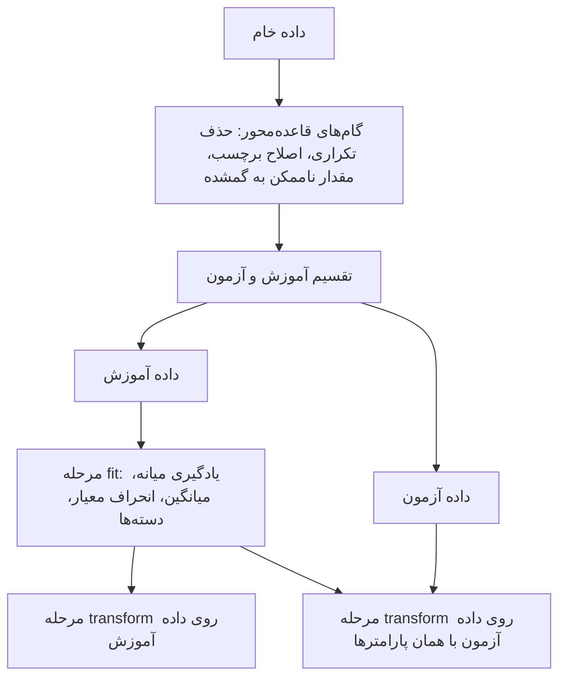
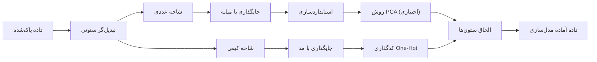

# جلسه ۱۵ — طراحی آزمایش و Pipeline

## چرا ترتیب گام‌ها مهم است

در جلسات ۱۰ تا ۱۴ ابزارهای پیش‌پردازش را یکی‌یکی دیدیم: جایگذاری داده گمشده، مدیریت داده پرت، مقیاس‌بندی، کدگذاری، مهندسی ویژگی و کاهش ابعاد ← [[۱۴- کاهش ابعاد]]
در یک پروژه واقعی این ابزارها جدا از هم به کار نمی‌روند؛ پشت سر هم و به ترتیب مشخصی اجرا می‌شوند.

فرض کنید با داده دانشجویان امسال، جریانی برای آماده‌سازی داده می‌سازیم تا در جلسات آینده روی آن مدل پیش‌بینی نمره بسازیم. ترم بعد، داده دانشجویان **جدید** می‌رسد. این داده باید **دقیقاً به همان شکل** آماده شود: با همان میانه برای پر کردن خانه‌های گمشده، همان میانگین و انحراف معیار برای استانداردسازی و همان دسته‌ها برای کدگذاری. اگر برای هر داده جدید این مقادیر را از نو حساب کنیم، یک دانشجو در دو زمان مختلف دو نمایش متفاوت می‌گیرد.

این جلسه به سه پرسش پاسخ می‌دهد:

- داده **آزمون** چیست و چگونه آن را جدا کنیم؟
- کدام گام‌های پیش‌پردازش از داده **چیزی یاد می‌گیرند** و این مقادیر را از کجا باید بگیرند؟
- چگونه همه گام‌ها را در یک **Pipeline** ببندیم تا روی هر داده جدیدی یکسان اجرا شوند؟

---

## مفاهیم اصلی

### داده آموزش و داده آزمون

پیش از هر کاری، داده را به دو بخش تقسیم می‌کنیم:

- **داده آموزش** (Train): پیش‌پردازش (و از جلسه ۱۶، مدل) فقط از این بخش یاد می‌گیرد.
- **داده آزمون** (Test): کنار گذاشته می‌شود و نقش داده‌های **آینده** را بازی می‌کند که هنوز ندیده‌ایم.

معمولاً ۲۰ تا ۳۰ درصد داده برای آزمون کنار گذاشته می‌شود. جزئیات بیشتر و نقش داده اعتبارسنجی در [[16 - مبانی یادگیری نظارت‌شده و رگرسیون خطی ساده]] آمده است.

### روش‌های تقسیم داده

| روش | چگونه | چه زمانی |
|:---:|:---:|:---:|
| تقسیم تصادفی ساده | هر نمونه با احتمال برابر به آزمون می‌رود | حالت پیش‌فرض |
| تقسیم طبقه‌بندی‌شده (Stratified) | از هر گروه (معمولاً هر دسته متغیر هدف) به نسبت اندازه‌اش نمونه برداشته می‌شود | گروه‌های نامتوازن یا داده کوچک |
| تقسیم زمانی | داده آزمون **بعد از** داده آموزش است | داده سری زمانی ← [[۳ - انواع داده و ویژگی‌ها]] |
| تقسیم گروهی | همه سطرهای یک فرد (بیمار، مشتری) در یک طرف تقسیم قرار می‌گیرند | چند سطر برای هر فرد |

> [!tip] چرا تقسیم طبقه‌بندی‌شده در گروه‌های نامتوازن لازم است؟
> اگر فقط ۲ درصد تراکنش‌ها متقلبانه باشند، تقسیم تصادفی ساده ممکن است تعداد بسیار کمی (حتی صفر) تراکنش متقلبانه در داده آزمون بگذارد و ارزیابی روی آن گروه ممکن نباشد ← [[25 - ارزیابی مدل‌های طبقه‌بندی]]

### دو نوع گام پیش‌پردازش

گام‌های پیش‌پردازش دو نوع‌اند و تفاوت آن‌ها، محور اصلی این جلسه است:

| نوع گام | تعریف | مثال | زمان اجرا |
|:---:|:---:|:---:|:---:|
| گام قاعده‌محور | با یک **قاعده ثابت** روی هر سطر جداگانه عمل می‌کند و از داده چیزی یاد نمی‌گیرد | حذف سطر تکراری، اصلاح cs به CS، تبدیل حضور ۹۲۰ درصد به گمشده | پیش از تقسیم مجاز است |
| گام یادگیرنده | یک یا چند **پارامتر** را از داده حساب می‌کند | جایگذاری با میانه، استانداردسازی، کدگذاری One-Hot، انتخاب ویژگی، PCA | پارامترها فقط از داده آموزش |

| گام یادگیرنده | پارامتری که یاد می‌گیرد |
|:---:|:---:|
| جایگذاری با میانه یا میانگین | میانه یا میانگین هر ستون |
| جایگذاری با مد | پرتکرارترین دسته |
| استانداردسازی | میانگین و انحراف معیار هر ستون |
| کدگذاری One-Hot | فهرست دسته‌های هر ستون |
| روش PCA | بردارهای ویژه (جهت مؤلفه‌ها) |
| انتخاب ویژگی بر اساس هدف | فهرست ویژگی‌های منتخب |

> [!warning] قاعده‌ای که به داده وابسته است، قاعده ثابت نیست
> «حذف مقادیری که بیش از سه انحراف معیار از میانگین فاصله دارند» شبیه یک قاعده است، اما میانگین و انحراف معیار را از داده **یاد می‌گیرد**؛ پس یک گام یادگیرنده است. در مقابل، «حضور باید بین ۰ و ۱۰۰ درصد باشد» یک قاعده ثابت است ← [[11- داده پرت، نویز و داده تکراری]]

### معنای fit و transform

هر گام یادگیرنده دو کار جدا انجام می‌دهد:

| مرحله | کار | روی کدام داده |
|:---:|:---:|:---:|
| مرحله fit | **یادگیری** پارامترها | فقط داده آموزش |
| مرحله transform | **اعمال** پارامترهای یادگرفته‌شده | داده آموزش، آزمون و هر داده جدید |

مثلاً در استانداردسازی، مرحله fit میانگین و انحراف معیار داده آموزش را حساب می‌کند و مرحله transform هر مقدار، چه از آموزش و چه از آزمون، را با **همان دو عدد** تبدیل می‌کند:

$$
z = \frac{x - \bar{x}_{\text{train}}}{s_{\text{train}}}
$$

> [!important] قاعده طلایی
> هر گام یادگیرنده فقط روی داده **آموزش** `fit` می‌شود و روی همه داده‌ها فقط `transform` می‌شود. گام‌های قاعده‌محور را می‌توان پیش از تقسیم انجام داد.



---

## مثال حل‌شده: هشت دانشجو

داده خام ۸ دانشجو را با یک ستون کیفی (رشته) و دو ستون عددی (ساعت مطالعه در هفته و درصد حضور) در نظر بگیرید. داده خام ۹ سطر دارد (هر سطر یک دانشجو و هر ستون یک ویژگی):

|  دانشجو   | رشته  | ساعت مطالعه | درصد حضور |
| :-------: | :---: | :---------: | :-------: |
| دانشجو S1 |  CS   |     10      |    90     |
| دانشجو S2 | Math  |      5      |    70     |
| دانشجو S2 | Math  |      5      |    70     |
| دانشجو S3 |  cs   |      8      |    80     |
| دانشجو S4 | Stats |     ---     |    75     |
| دانشجو S5 |  CS   |      3      |    920    |
| دانشجو S6 |  ---  |     11      |    100    |
| دانشجو S7 | Math  |      6      |    60     |
| دانشجو S8 | Stats |     11      |    75     |

#### گام ۱ — گام‌های قاعده‌محور

سه مشکل با قاعده ثابت و پیش از تقسیم رفع می‌شوند:

| مشکل | قاعده | نتیجه |
|:---:|:---:|:---:|
| سطر S2 دو بار آمده است | حذف سطر تکراری | ۸ دانشجو |
| رشته S3 به‌صورت cs ثبت شده است | تبدیل cs به CS | سه دسته CS، Math و Stats |
| حضور S5 برابر ۹۲۰ درصد است | حضور باید بین ۰ و ۱۰۰ باشد؛ در غیر این صورت گمشده | حضور S5 گمشده می‌شود |

پس از این گام، سه خانه گمشده داریم: ساعت مطالعه S4، حضور S5 و رشته S6. این خانه‌ها **هنوز پر نمی‌شوند**، چون پر کردن آن‌ها به میانه یا مد نیاز دارد که از داده یاد گرفته می‌شود.

|  دانشجو   | رشته  | ساعت مطالعه | درصد حضور |
| :-------: | :---: | :---------: | :-------: |
| دانشجو S1 |  CS   |     10      |    90     |
| دانشجو S2 | Math  |      5      |    70     |
| دانشجو S3 |  CS   |      8      |    80     |
| دانشجو S4 | Stats |     ---     |    75     |
| دانشجو S5 |  CS   |      3      |    ---    |
| دانشجو S6 |  ---  |     11      |    100    |
| دانشجو S7 | Math  |      6      |    60     |
| دانشجو S8 | Stats |     11      |    75     |
#### گام ۲ — تقسیم آموزش و آزمون

دو دانشجو (۲۵ درصد) به‌تصادف برای آزمون کنار گذاشته می‌شوند: **S4 و S7**. شش دانشجوی دیگر داده آموزش‌اند:

|  دانشجو   | رشته  | ساعت مطالعه | درصد حضور |
| :-------: | :---: | :---------: | :-------: |
| دانشجو S1 |  CS   |     10      |    90     |
| دانشجو S2 | Math  |      5      |    70     |
| دانشجو S3 |  CS   |      8      |    80     |
| دانشجو S5 |  CS   |      3      |    ---    |
| دانشجو S6 |  ---  |     11      |    100    |
| دانشجو S8 | Stats |     11      |    75     |

#### گام ۳ — مرحله fit: یادگیری پارامترها از داده آموزش

**ساعت مطالعه — میانه.** شش مقدار آموزش به ترتیب: ۳، ۵، ۸، ۱۰، ۱۱ و ۱۱. تعداد زوج است، پس میانه میانگین دو مقدار وسط است:

$$
\text{median} = \frac{8 + 10}{2} = 9
$$

**ساعت مطالعه — میانگین:**

$$
\bar{x} = \frac{10 + 5 + 8 + 3 + 11 + 11}{6} = \frac{48}{6} = 8
$$

**ساعت مطالعه — انحراف معیار.** یادآوری: کلاس StandardScaler انحراف معیار را با تقسیم بر n (نه n−1) حساب می‌کند.

| دانشجو | ساعت مطالعه | انحراف از میانگین | مجذور انحراف |
|:---:|:---:|:---:|:---:|
| دانشجو S1 | 10 | 2 | 4 |
| دانشجو S2 | 5 | −3 | 9 |
| دانشجو S3 | 8 | 0 | 0 |
| دانشجو S5 | 3 | −5 | 25 |
| دانشجو S6 | 11 | 3 | 9 |
| دانشجو S8 | 11 | 3 | 9 |
| جمع | 48 | 0 | 56 |

$$
s = \sqrt{\frac{56}{6}} = \sqrt{9.333} \approx 3.055
$$

**درصد حضور — میانه.** حضور S5 گمشده است؛ پنج مقدار معلوم به ترتیب: ۷۰، ۷۵، ۸۰، ۹۰ و ۱۰۰. میانه مقدار وسط یعنی **۸۰** است و حضور S5 با ۸۰ پر می‌شود.

**درصد حضور — میانگین و انحراف معیار** (پس از جایگذاری؛ ترتیب گام‌ها در Pipeline ابتدا جایگذاری و سپس استانداردسازی است):

$$
\bar{x} = \frac{90 + 70 + 80 + 80 + 100 + 75}{6} = \frac{495}{6} = 82.5
$$

| دانشجو | درصد حضور | انحراف از میانگین | مجذور انحراف |
|:---:|:---:|:---:|:---:|
| دانشجو S1 | 90 | 7.5 | 56.25 |
| دانشجو S2 | 70 | −12.5 | 156.25 |
| دانشجو S3 | 80 | −2.5 | 6.25 |
| دانشجو S5 | 80 (جایگذاری‌شده) | −2.5 | 6.25 |
| دانشجو S6 | 100 | 17.5 | 306.25 |
| دانشجو S8 | 75 | −7.5 | 56.25 |
| جمع | 495 | 0 | 587.5 |

$$
s = \sqrt{\frac{587.5}{6}} = \sqrt{97.917} \approx 9.895
$$

**رشته — مد و دسته‌ها.** در پنج رشته معلوم آموزش، CS سه بار، Math یک بار و Stats یک بار آمده است؛ پس مد **CS** است و رشته S6 با CS پر می‌شود. دسته‌هایی که کدگذار One-Hot یاد می‌گیرد: CS، Math و Stats (سه ستون).

| پارامتر یادگرفته‌شده از داده آموزش | مقدار |
|:---:|:---:|
| میانه ساعت مطالعه | 9 |
| میانگین و انحراف معیار ساعت مطالعه | 8 و 3.055 |
| میانه درصد حضور | 80 |
| میانگین و انحراف معیار درصد حضور | 82.5 و 9.895 |
| مد رشته | CS |
| دسته‌های رشته | CS، Math، Stats |

#### گام ۴ — مرحله transform: تبدیل دانشجوی آزمون S4

دانشجوی S4 در داده آزمون: رشته Stats، ساعت مطالعه گمشده و حضور ۷۵ درصد. همه تبدیل‌ها با پارامترهای **داده آموزش** انجام می‌شوند:

**ساعت مطالعه:** با میانه آموزش (۹) پر و سپس استاندارد می‌شود:

$$
z = \frac{9 - 8}{3.055} \approx 0.327
$$

**درصد حضور:**

$$
z = \frac{75 - 82.5}{9.895} \approx -0.758
$$

**رشته:** مقدار Stats در سه ستون One-Hot به‌صورت ۰، ۰ و ۱ نوشته می‌شود.

|  دانشجو   | مطالعه استانداردشده | حضور استانداردشده | ستون major_CS | ستون major_Math | ستون major_Stats |
| :-------: | :-----------------: | :---------------: | :-----------: | :-------------: | :--------------: |
| دانشجو S4 |        0.327        |      −0.758       |       0       |        0        |        1         |

ساعت مطالعه جایگذاری‌شده S4 کمی بالاتر از میانگین آموزش قرار می‌گیرد، چون میانه (۹) از میانگین (۸) بزرگ‌تر است. حضور او حدود ۰.۸ انحراف معیار کمتر از میانگین آموزش است.

#### گام ۵ — نمای نهایی داده آموزش و آزمون پس از تبدیل

همه سطرها با **همان پارامترهای گام ۳** تبدیل می‌شوند. خانه‌های گمشده پر شده‌اند: حضور S5 با میانه ۸۰، رشته S6 با مد CS و ساعت مطالعه S4 با میانه ۹.

**داده آموزش** (۶ دانشجو):

| دانشجو | مطالعه استانداردشده | حضور استانداردشده | ستون major_CS | ستون major_Math | ستون major_Stats |
|:---:|:---:|:---:|:---:|:---:|:---:|
| دانشجو S1 | 0.655 | 0.758 | 1 | 0 | 0 |
| دانشجو S2 | −0.982 | −1.263 | 0 | 1 | 0 |
| دانشجو S3 | 0.000 | −0.253 | 1 | 0 | 0 |
| دانشجو S5 | −1.637 | −0.253 | 1 | 0 | 0 |
| دانشجو S6 | 0.982 | 1.769 | 1 | 0 | 0 |
| دانشجو S8 | 0.982 | −0.758 | 0 | 0 | 1 |

**داده آزمون** (۲ دانشجو):

| دانشجو | مطالعه استانداردشده | حضور استانداردشده | ستون major_CS | ستون major_Math | ستون major_Stats |
|:---:|:---:|:---:|:---:|:---:|:---:|
| دانشجو S4 | 0.327 | −0.758 | 0 | 0 | 1 |
| دانشجو S7 | −0.655 | −2.274 | 0 | 1 | 0 |

هر دو جدول **۵ ستون** و **هیچ خانه گمشده‌ای** ندارند. حضور ۶۰ درصدی S7 کمتر از همه دانشجویان آموزش است، پس امتیاز استاندارد آن (−2.274) از کوچک‌ترین امتیاز آموزش (−1.263) هم کمتر می‌شود.

> [!note] بررسی
> مجموع ستون «انحراف از میانگین» در هر دو جدول صفر است؛ پس میانگین‌ها درست حساب شده‌اند و میانگین ستون‌های استانداردشده در داده آموزش دقیقاً صفر می‌شود. در داده آزمون این میانگین لزوماً صفر نیست، و این **خطا نیست**: داده آزمون با پارامترهای داده آموزش تبدیل شده است.

---

## طراحی Pipeline

دو ابزار scikit-learn کل این جریان را در یک شیء واحد می‌بندند:

- کلاس **Pipeline** چند گام را به ترتیب **زنجیر** می‌کند. با `fit`، هر گام روی داده آموزش یاد می‌گیرد و خروجی‌اش را به گام بعد می‌دهد؛ با `transform`، هر گام فقط پارامترهای یادگرفته‌شده را اعمال می‌کند.
- کلاس **ColumnTransformer** برای هر گروه از ستون‌ها یک **شاخه** جداگانه تعریف می‌کند و خروجی شاخه‌ها را کنار هم می‌گذارد؛ چون ستون‌های عددی و کیفی پیش‌پردازش متفاوتی لازم دارند.



> [!tip] ترتیب گام‌ها در هر شاخه
> - **جایگذاری پیش از استانداردسازی:** استانداردسازی با خانه گمشده کار نمی‌کند.
> - **استانداردسازی پیش از PCA:** روش PCA به مقیاس ستون‌ها حساس است ← [[۱۴- کاهش ابعاد]]
> - **روش PCA فقط در شاخه عددی:** ستون‌های One-Hot صفر و یک‌اند، واریانس کمتری از ستون‌های استانداردشده دارند و مجموع ستون‌های هر ویژگی همیشه ۱ است؛ ترکیب خطی آن‌ها با ستون‌های عددی هم معنای روشنی ندارد.

> [!tip] مزایای Pipeline
> - **یک شیء، یک دستور:** کل پیش‌پردازش با یک `fit` روی داده آموزش یاد گرفته می‌شود.
> - **اعمال یکسان روی داده‌های آینده:** همان شیء، داده دانشجویان ترم بعد را دقیقاً مانند داده آموزش پردازش می‌کند ← [[2 - فرایند CRISP-DM و محیط کار]]
> - **جلوگیری از خطای دستی:** نمی‌توان به‌اشتباه یک گام را روی داده آزمون `fit` کرد.
> - **آماده برای مدل‌سازی:** از جلسه ۱۶، یک مدل به انتهای همین Pipeline اضافه می‌شود.

> [!warning] دسته‌های جدید در داده آینده
> اگر در داده جدید دسته‌ای ظاهر شود که در داده آموزش نبوده (مثلاً رشته Physics)، کدگذار One-Hot به‌طور پیش‌فرض خطا می‌دهد. با پارامتر `handle_unknown="ignore"` همه ستون‌های آن ویژگی برای چنین سطری صفر می‌شوند.

---

## پیاده‌سازی در scikit-learn

کد زیر همان مثال هشت دانشجو را از داده خام تا خروجی نهایی اجرا می‌کند. هدف **خواندن و فهمیدن** کد است، نه حفظ کردن آن؛ هر بخش کد با یکی از گام‌های مثال حل‌شده متناظر است.

```python
import numpy as np
import pandas as pd
from sklearn.model_selection import train_test_split
from sklearn.pipeline import Pipeline
from sklearn.compose import ColumnTransformer
from sklearn.impute import SimpleImputer
from sklearn.preprocessing import StandardScaler, OneHotEncoder

# 1. Raw data (S2 is duplicated, "cs" is a label typo, 920 is impossible)
raw = pd.DataFrame({
    "student":     ["S1", "S2", "S2", "S3", "S4", "S5", "S6", "S7", "S8"],
    "major":       ["CS", "Math", "Math", "cs", "Stats", "CS", np.nan, "Math", "Stats"],
    "study_hours": [10, 5, 5, 8, np.nan, 3, 11, 6, 11],
    "attendance":  [90, 70, 70, 80, 75, 920, 100, 60, 75],
})

# 2. Rule-based cleaning (allowed before the split)
df = raw.drop_duplicates().set_index("student")
df["major"] = df["major"].replace({"cs": "CS"})
df.loc[~df["attendance"].between(0, 100), "attendance"] = np.nan

# 3. Split BEFORE anything is learned
X_train, X_test = train_test_split(df, test_size=0.25, random_state=76)

# 4. One branch per column type
num_pipe = Pipeline([("impute", SimpleImputer(strategy="median")),
                     ("scale", StandardScaler())])
cat_pipe = Pipeline([("impute", SimpleImputer(strategy="most_frequent")),
                     ("onehot", OneHotEncoder(handle_unknown="ignore", sparse_output=False))])
preprocess = ColumnTransformer([("num", num_pipe, ["study_hours", "attendance"]),
                                ("cat", cat_pipe, ["major"])])

# 5. fit on train only, transform both
Z_train = preprocess.fit_transform(X_train)
Z_test = preprocess.transform(X_test)

print(X_train.index.tolist(), X_test.index.tolist())
print(preprocess.get_feature_names_out())
print(Z_test.round(3))
```

```
['S5', 'S8', 'S6', 'S3', 'S1', 'S2'] ['S7', 'S4']
['num__study_hours' 'num__attendance' 'cat__major_CS' 'cat__major_Math'
 'cat__major_Stats']
[[-0.655 -2.274  0.     1.     0.   ]
 [ 0.327 -0.758  0.     0.     1.   ]]
```

| بخش کد | گام متناظر در مثال حل‌شده |
|:---:|:---:|
| بخش ۲: drop_duplicates، replace و between | گام ۱ — گام‌های قاعده‌محور |
| بخش ۳: train_test_split | گام ۲ — تقسیم (S4 و S7 در آزمون) |
| بخش ۵: fit_transform روی X_train | گام ۳ — یادگیری میانه، میانگین، انحراف معیار و مد |
| بخش ۵: transform روی X_test | گام ۴ — تبدیل S4 |

سطر دوم خروجی آخر همان بردار دانشجوی S4 است که با دست حساب کردیم: 0.327، −0.758، 0، 0 و 1.

پارامترهای یادگرفته‌شده را هم می‌توان از خود شیء خواند و با جدول گام ۳ مقایسه کرد:

```python
num_part = preprocess.named_transformers_["num"]
print(num_part["impute"].statistics_)    # medians
print(num_part["scale"].mean_)           # means
print(num_part["scale"].scale_.round(3)) # standard deviations
print(preprocess.named_transformers_["cat"]["impute"].statistics_)   # mode
```

```
[ 9. 80.]
[ 8.  82.5]
[3.055 9.895]
['CS']
```

> [!note] کارگاه عملی
> ابزارهای بیشتر (گام سفارشی با FunctionTransformer، افزودن PCA به شاخه عددی، تغییر پارامترها با set_params و خروجی DataFrame با set_output) روی داده ۳۰ دانشجو در دفترچه «۱۵ - کارگاه Pipeline» تمرین می‌شوند. این دفترچه برای تمرین است و نحوه نوشتن این کدها در امتحان پرسیده نمی‌شود.

---

## خطاهای رایج

| خطا | چرا نادرست است | روش درست |
|:---:|:---:|:---:|
| فراخوانی fit_transform روی داده آزمون | پارامترها دوباره از داده آزمون حساب می‌شوند و آزمون با معیاری متفاوت از آموزش تبدیل می‌شود | فقط transform روی داده آزمون |
| جایگذاری یا استانداردسازی کل داده پیش از تقسیم | پارامترها باید فقط از داده آموزش به دست آیند | ابتدا تقسیم، سپس fit روی آموزش |
| حذف پرت‌ها با قاعده «سه انحراف معیار» پیش از تقسیم | این قاعده میانگین و انحراف معیار را از داده یاد می‌گیرد | آن را یک گام یادگیرنده بدانید |
| اجرای PCA روی ستون‌های One-Hot | مقیاس ناهمسان و وابستگی خطی ستون‌های صفر و یک | روش PCA فقط در شاخه عددی |
| استانداردسازی پیش از جایگذاری | استانداردسازی با خانه گمشده کار نمی‌کند | ابتدا جایگذاری، سپس استانداردسازی |
| ستون عددی ذخیره‌شده به‌صورت متن | ستون در شاخه عددی خطا می‌دهد یا کیفی فرض می‌شود | تبدیل نوع در پاک‌سازی، با pd.to_numeric |

---

##  سؤال‌

> [!question]- ۱. برای هر گام بگویید پیش از تقسیم مجاز است یا نه: (الف) حذف سطرهای تکراری (ب) پر کردن گمشده‌ها با میانه (ج) تبدیل سن منفی به گمشده (د) استانداردسازی (هـ) حذف مقادیر دورتر از سه انحراف معیار
> (الف) مجاز؛ قاعده ثابت. (ب) مجاز نیست؛ میانه یاد گرفته می‌شود. (ج) مجاز؛ قاعده ثابت. (د) مجاز نیست؛ میانگین و انحراف معیار یاد گرفته می‌شوند. (هـ) مجاز نیست؛ میانگین و انحراف معیار از داده یاد گرفته می‌شوند.

> [!question]- ۲. داده‌ای با ۱۰۰۰ نمونه داریم که ۲۰ نمونه آن (۲ درصد) از گروه کمیاب است. با ۲۰ درصد داده برای آزمون، تقسیم طبقه‌بندی‌شده چند نمونه از گروه کمیاب در آزمون قرار می‌دهد؟ چرا تقسیم تصادفی ساده خطرناک است؟
> داده آزمون ۲۰۰ نمونه دارد و تقسیم طبقه‌بندی‌شده سهم ۲ درصد را حفظ می‌کند: ۲۰۰ ضرب در ۰.۰۲ یعنی **۴ نمونه**. با تقسیم تصادفی ساده، این تعداد تصادفی است و ممکن است بسیار کم یا صفر باشد.

> [!question]- ۳. چرا پس از استانداردسازی، میانگین ستون‌ها در داده آموزش صفر است ولی در داده آزمون صفر نیست؟
> چون میانگین و انحراف معیار فقط از داده آموزش حساب شده‌اند. داده آزمون با همین پارامترها تبدیل می‌شود و توزیع آن کمی با داده آموزش فرق دارد.

> [!question]- ۴. ستون «ساعت کار» در داده آموزش مقادیر ۲، ۴، ۴، ۶ و ۹ را دارد. میانه، میانگین و انحراف معیار (با تقسیم بر n) را حساب کنید و مقدار ۷ در داده آزمون را استاندارد کنید.
> میانه مقدار وسط یعنی **۴** است. میانگین ۲۵ تقسیم بر ۵ یعنی **۵** است. انحراف‌ها از میانگین −3، −1، −1، 1 و 4 و مجذورهای آن‌ها ۹، ۱، ۱، ۱ و ۱۶ است با جمع ۲۸:
> $$
> s = \sqrt{\frac{28}{5}} = \sqrt{5.6} \approx 2.366
> $$
> $$
> z = \frac{7 - 5}{2.366} \approx 0.845
> $$

> [!question]- ۵. با پارامترهای یادگرفته‌شده در مثال هشت دانشجو، دانشجوی جدیدی با رشته Physics، ساعت مطالعه گمشده و حضور ۹۰ درصد را تبدیل کنید (فرض کنید handle_unknown برابر ignore است).
> ساعت مطالعه با میانه آموزش (۹) پر می‌شود:
> $$
> z = \frac{9 - 8}{3.055} \approx 0.327
> $$
> $$
> z = \frac{90 - 82.5}{9.895} \approx 0.758
> $$
> رشته Physics در آموزش نبوده است، پس هر سه ستون One-Hot صفر می‌شوند. بردار نهایی: 0.327، 0.758، 0، 0 و 0.

> [!question]- ۶. یک تبدیل‌گر ستونی سه ستون عددی را به شاخه «جایگذاری و استانداردسازی» و یک ستون کیفی را به شاخه «جایگذاری و One-Hot» می‌دهد. ستون کیفی در داده آموزش ۴ دسته دارد. خروجی برای ۵۰ سطر آموزش چه ابعادی دارد؟
> شاخه عددی ۳ ستون و شاخه کیفی ۴ ستون می‌سازد؛ خروجی **۵۰ در ۷** است.

> [!question]- ۷. ایراد این کد چیست؟
> ```python
> Z_train = preprocess.fit_transform(X_train)
> Z_test = preprocess.fit_transform(X_test)
> ```
> خط دوم دوباره `fit` می‌کند و میانه، میانگین، انحراف معیار و دسته‌ها را از داده آزمون حساب می‌کند. داده آزمون باید با پارامترهای داده آموزش تبدیل شود؛ خط درست `Z_test = preprocess.transform(X_test)` است.

> [!question]- ۸. کلاس SimpleImputer با strategy برابر most_frequent در مرحله fit چه چیزی یاد می‌گیرد؟ در مثال هشت دانشجو مقدار آن چیست؟
> پرتکرارترین مقدار (مد) هر ستون را در داده آموزش یاد می‌گیرد. در مثال هشت دانشجو، مد رشته **CS** است (سه بار از پنج رشته معلوم آموزش).

---
## نکات کلیدی

> [!summary] خلاصه جلسه
> - داده **آزمون** نماینده داده‌های آینده است و پیش از هر یادگیری جدا می‌شود؛ روش تقسیم (تصادفی، طبقه‌بندی‌شده، زمانی، گروهی) به ساختار داده بستگی دارد.
> - گام‌های پیش‌پردازش دو نوع‌اند: **قاعده‌محور** (پیش از تقسیم مجاز) و **یادگیرنده** (پارامترها فقط از داده آموزش).
> - مرحله **fit** پارامترها را یاد می‌گیرد و مرحله **transform** آن‌ها را اعمال می‌کند؛ داده آزمون فقط transform می‌شود.
> - کلاس **Pipeline** گام‌ها را زنجیر می‌کند و کلاس **ColumnTransformer** برای ستون‌های عددی و کیفی شاخه جداگانه می‌سازد.
> - در هر شاخه ترتیب مهم است: جایگذاری، سپس استانداردسازی، سپس PCA؛ روش PCA فقط در شاخه عددی.

---
## تکلیف ۳ — Pipeline پیش‌پردازش

> [!todo] تکلیف ۳ — پیش‌پردازش داده پروژه با Pipeline مستند
> روی مجموعه‌داده پروژه خود (همان داده تکلیف‌های ۱ و ۲ ← [[9 - مطالعه موردی EDA]]) یک جریان پیش‌پردازش کامل و قابل تکرار بسازید:
> 1. **تعریف مسئله:** متغیر هدف و نوع مسئله (رگرسیون یا طبقه‌بندی) را مشخص کنید. ستون‌هایی را که در زمان پیش‌بینی در دسترس نیستند (خطر نشت هدف) شناسایی و حذف کنید.
> 2. **پاک‌سازی قاعده‌محور پیش از تقسیم:** حذف سطرهای تکراری، تبدیل مقادیر ناممکن و گمشده پنهان به مقدار گمشده و اصلاح ناسازگاری‌ها ← [[11- داده پرت، نویز و داده تکراری]]
> 3. **تقسیم داده:** تقسیم آموزش و آزمون با `random_state` ثابت؛ طبقه‌بندی‌شده برای مسئله طبقه‌بندی، یا تقسیم زمانی اگر داده زمانی است. دلیل انتخاب خود را بنویسید.
> 4. **مهندسی ویژگی:** دست‌کم دو ویژگی جدید با دلیل حوزه‌ای، پیاده‌شده با `FunctionTransformer` ← [[۱۳ - مهندسی و انتخاب ویژگی]]
> 5. **ساخت Pipeline پیش‌پردازش:** یک `ColumnTransformer` شامل جایگذاری (با دلیل انتخاب راهبرد ← [[۱۰ - مدیریت داده گمشده]])، مدیریت داده پرت یا تبدیل چولگی، مقیاس‌بندی و کدگذاری متغیرهای کیفی ← [[۱۲ - تبدیل و یکپارچه‌سازی داده]]
> 6. **کاهش ابعاد یا انتخاب ویژگی:** دست‌کم یک روش فیلتر یا PCA داخل Pipeline؛ با نمودار سنگریزه یا جدول امتیازها، تعداد ویژگی یا مؤلفه انتخابی را توجیه کنید.
> 7. **خروجی Pipeline:** Pipeline را فقط روی داده آموزش `fit` و هر دو بخش را `transform` کنید. ابعاد پیش و پس از پیش‌پردازش، نام ستون‌های خروجی (`get_feature_names_out`)، نبود مقدار گمشده و آمار ستون‌ها در آموزش و آزمون را گزارش کنید. ساخت مدل در **تکلیف ۴** انجام می‌شود.
> 8. **مستندسازی:** یک جدول تصمیم‌ها (مشکل، تصمیم، دلیل، جلسه مرتبط) و نمودار یا متن ساختار Pipeline.
>
> **قالب تحویل:** یک Jupyter Notebook که با «Restart & Run All» بدون خطا اجرا شود.
