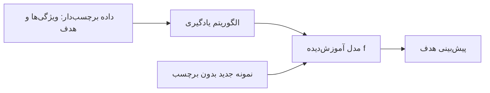
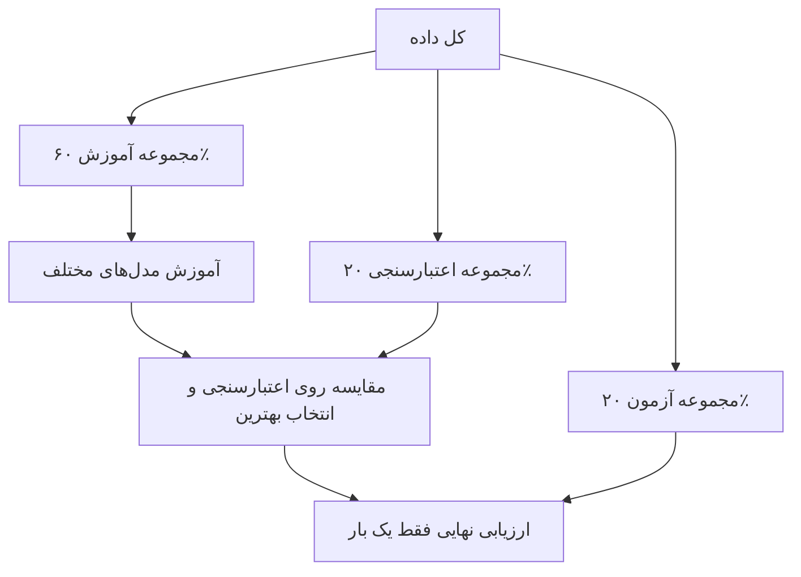

# جلسه ۱۶ — مبانی یادگیری نظارت‌شده و رگرسیون خطی ساده

## از آماده‌سازی داده به ساختن مدل

اکنون به مرحله **مدل‌سازی** (Modeling) رسیده‌ایم. پرسش‌های این بخش از درس از جنس «پیش‌بینی» هستند:

- قیمت این خانه با این متراژ و موقعیت چقدر است؟
- فروش ماه آینده این فروشگاه چقدر خواهد بود؟
- این مشتری در ماه آینده اشتراک خود را لغو می‌کند یا نه؟
- این ایمیل هرزنامه است یا نه؟

در جلسه ۸ دیدیم که ساعت مطالعه و نمره همبستگی **۰.۹۵۹** دارند. همبستگی فقط می‌گوید رابطه خطی قوی است؛ اما نمی‌گوید «اگر دانشجویی ۶ ساعت مطالعه کند، چه نمره‌ای انتظار داریم؟». برای پاسخ به این پرسش به یک **مدل** نیاز داریم: یک تابع که از ورودی، خروجی را پیش‌بینی می‌کند.

> [!important] نکته کلیدی همه کارهایی که در جلسات ۱۰ تا ۱۴ انجام دادیم (جایگذاری، مقیاس‌بندی، کدگذاری، انتخاب ویژگی) برای این بود که داده آماده **یادگیری** شود. از این جلسه به بعد، خروجی آن Pipeline به ورودی مدل تبدیل می‌شود.

---

## مفهوم یادگیری نظارت‌شده

### تعریف

در **یادگیری نظارت‌شده** (Supervised Learning) مجموعه‌ای از نمونه‌ها داریم که برای هر کدام هم **ویژگی‌های ورودی** و هم **پاسخ درست** (برچسب یا هدف) معلوم است. هدف یافتن تابعی است که از روی ورودی، خروجی را پیش‌بینی کند:

$$ \hat{y} = f(\mathbf{x}) $$

- بردار x ویژگی‌های ورودی (Features، متغیرهای مستقل یا پیش‌بین‌ها) است.
- مقدار y متغیر **هدف** (Target، برچسب یا متغیر وابسته) است.
- مقدار y-کلاه (ŷ) **پیش‌بینی** مدل است.

واژه «نظارت» از اینجا می‌آید که پاسخ‌های درست مانند یک **معلم** در هنگام آموزش، خطای مدل را به آن نشان می‌دهند.



|   اصطلاح   |                 معادل انگلیسی                  |    مثال در داده ساعت مطالعه و نمره    |
| :--------: | :--------------------------------------------: | :---------------------------: |
|   نمونه    |        Sample / Instance / Observation         |            یک دانشجو            |
|   ویژگی    |   Feature / Predictor / Independent variable   |          ساعت مطالعه          |
|    هدف     | Target / Label / Response / Dependent variable |             نمره              |
|    مدل     |               Model / Hypothesis               | تابع پیش‌بینی نمره از ساعت مطالعه |
|  پارامتر   |                   Parameter                    |     شیب و عرض از مبدأ خط      |


> [!note] پارامتر در برابر ابرپارامتر **پارامترها** را الگوریتم از داده **یاد می‌گیرد** (مانند شیب خط). **ابرپارامترها** را ما **پیش از آموزش** تعیین می‌کنیم (مانند نرخ یادگیری، درجه چندجمله‌ای یا تعداد همسایه‌ها). انتخاب ابرپارامترها با داده اعتبارسنجی انجام می‌شود ← [[18 - بیش‌برازش و اعتبارسنجی متقابل]]

### یادگیری نظارت‌شده در برابر بدون نظارت

|    جنبه     |       یادگیری نظارت‌شده       |          یادگیری بدون نظارت           |
| :---------: | :---------------------------: | :-----------------------------------: |
|    داده     |       ویژگی‌ها و برچسب        |             فقط ویژگی‌ها              |
|     هدف     | پیش‌بینی برچسب نمونه‌های جدید |           کشف ساختار پنهان            |
| نمونه وظایف |      رگرسیون، طبقه‌بندی       |  خوشه‌بندی، کاهش ابعاد، قواعد انجمنی  |
|   ارزیابی   | مقایسه پیش‌بینی با پاسخ واقعی | دشوارتر؛ معیارهای درونی یا قضاوت خبره |
|  جلسات درس  |        جلسات ۱۶ تا ۲۵         |    جلسه ۱۴ (PCA) و جلسات ۲۶ تا ۲۹     |

### تفاوت رگرسیون و طبقه‌بندی

بر اساس **نوع متغیر هدف**، یادگیری نظارت‌شده دو شاخه اصلی دارد:

|جنبه|رگرسیون (Regression)|طبقه‌بندی (Classification)|
|:-:|:-:|:-:|
|نوع هدف|عددی پیوسته|کیفی (دسته‌ای)|
|خروجی مدل|یک عدد حقیقی|یک کلاس یا احتمال هر کلاس|
|نمونه پرسش|قیمت خانه چقدر است؟|این تراکنش تقلب است یا نه؟|
|نمونه الگوریتم|رگرسیون خطی، درخت رگرسیون، SVR|رگرسیون لجستیک، k-NN، درخت تصمیم|
|معیار ارزیابی|MAE، RMSE، ضریب تعیین|دقت، صحت، بازیابی، F1|
|جلسات درس|جلسات ۱۶ تا ۱۹|جلسات ۲۰ تا ۲۵|

> [!warning] نام «رگرسیون لجستیک» گمراه‌کننده است رگرسیون لجستیک با وجود نامش یک الگوریتم **طبقه‌بندی** است ← [[21 - بیز ساده و رگرسیون لجستیک]]. ملاک تشخیص، نوع **متغیر هدف** است، نه نام الگوریتم.

> [!tip] موارد مرزی
> 
> - هدفی مانند «تعداد فرزندان» (۰، ۱، ۲، ...) عددی گسسته است و معمولاً با رگرسیون مدل می‌شود.
> - هدفی مانند «امتیاز رضایت ۱ تا ۵» ترتیبی است؛ می‌توان آن را هم رگرسیون و هم طبقه‌بندی دید.
> - گاهی یک هدف عددی را عمداً گسسته می‌کنیم (مثلاً قیمت به «ارزان، متوسط، گران») تا مسئله طبقه‌بندی شود ← [[۱۲ - تبدیل و یکپارچه‌سازی داده]]

---

## تقسیم داده: آموزش، اعتبارسنجی، آزمون

### چرا داده را تقسیم می‌کنیم؟

هدف مدل، پیش‌بینی خوب روی داده **جدید و دیده‌نشده** است، نه به خاطر سپردن داده آموزش. اگر مدل را روی همان داده‌ای ارزیابی کنیم که با آن آموزش دیده، برآوردی **خوش‌بینانه** از عملکرد به دست می‌آید؛ مانند دانشجویی که سؤال‌های امتحان را از قبل دیده باشد.

به توانایی مدل در عملکرد خوب روی داده جدید **تعمیم‌پذیری** (Generalization) می‌گویند.

|بخش|نقش|نسبت رایج|
|:-:|:-:|:-:|
|مجموعه آموزش (Training set)|یادگیری پارامترهای مدل|۶۰ تا ۸۰ درصد|
|مجموعه اعتبارسنجی (Validation set)|انتخاب مدل و تنظیم ابرپارامترها|۱۰ تا ۲۰ درصد|
|مجموعه آزمون (Test set)|برآورد نهایی و بی‌طرفانه عملکرد|۱۰ تا ۲۰ درصد|



> [!important] قانون طلایی مجموعه آزمون مجموعه آزمون را **فقط یک بار و در پایان کار** استفاده کنید. اگر بر اساس نتیجه آزمون مدل را تغییر دهید، آزمون عملاً به بخشی از فرایند آموزش تبدیل شده و برآورد شما دیگر بی‌طرفانه نیست.

> [!example] مثال حل‌شده — تقسیم سه‌گانه فرض کنید **۱۰۰۰** نمونه داریم. با دو بار فراخوانی `train_test_split`:
> 
> 1. ابتدا ۲۰ درصد داده (۲۰۰ نمونه) به‌عنوان آزمون کنار گذاشته می‌شود و ۸۰۰ نمونه باقی می‌ماند.
> 2. سپس ۲۵ درصد از ۸۰۰ نمونه باقی‌مانده (۲۰۰ نمونه) به‌عنوان اعتبارسنجی جدا می‌شود.
> 
> |بخش|تعداد|نسبت از کل|
> |:-:|:-:|:-:|
> |آموزش|600|60٪|
> |اعتبارسنجی|200|20٪|
> |آزمون|200|20٪|
> 
> چرا ۲۵ درصد در گام دوم؟ چون ۲۵ درصد از ۸۰ درصد باقی‌مانده برابر ۲۰ درصد کل است.

### نکات عملی تقسیم داده

|موقعیت|روش مناسب تقسیم|
|:-:|:-:|
|داده مستقل و هم‌توزیع|تقسیم تصادفی با `random_state` ثابت|
|طبقه‌بندی با کلاس‌های نامتوازن|تقسیم طبقه‌بندی‌شده با پارامتر `stratify=y` ← [[۱۵ - طراحی آزمایش و Pipeline]]|
|داده سری زمانی|تقسیم زمانی: گذشته برای آموزش، آینده برای آزمون|
|چند نمونه از یک فرد یا گروه|تقسیم گروهی (GroupShuffleSplit) تا یک فرد در هر دو طرف نباشد|
|داده کم|اعتبارسنجی متقابل به جای یک مجموعه اعتبارسنجی ثابت ← [[18 - بیش‌برازش و اعتبارسنجی متقابل]]|

> [!warning] نشت داده هنگام تقسیم همان‌طور که در جلسه ۱۵ دیدیم، **ابتدا تقسیم، سپس پیش‌پردازش**. میانگین جایگذاری، پارامترهای مقیاس‌بندی و ویژگی‌های انتخاب‌شده باید فقط از داده آموزش به دست آیند. ساده‌ترین راه، قرار دادن همه این مراحل در یک Pipeline است.

---

## رگرسیون خطی ساده

### مدل

در **رگرسیون خطی ساده** (Simple Linear Regression) فقط **یک** ویژگی ورودی داریم و فرض می‌کنیم هدف تقریباً تابعی خطی از آن است:

$$ \hat{y} = \beta_0 + \beta_1 x $$

- پارامتر بتا-صفر **عرض از مبدأ** (Intercept): مقدار پیش‌بینی وقتی x برابر صفر است.
- پارامتر بتا-یک **شیب** (Slope): تغییر پیش‌بینی به ازای یک واحد افزایش x.

مدل واقعی داده‌ها را با یک جمله **خطا** (Error) می‌نویسیم که بخش توضیح‌داده‌نشده را در بر می‌گیرد:

$$ y_i = \beta_0 + \beta_1 x_i + \varepsilon_i $$

### باقیمانده و تابع هزینه

برای هر نمونه، اختلاف مقدار واقعی و پیش‌بینی را **باقیمانده** (Residual) می‌نامیم:

$$ e_i = y_i - \hat{y}_i $$

از میان بی‌شمار خطی که می‌توان رسم کرد، کدام «بهترین» است؟ به یک **تابع هزینه** (Cost / Loss Function) نیاز داریم که بدی هر خط را با یک عدد بسنجد. رایج‌ترین انتخاب، **مجموع مربعات باقیمانده‌ها** (SSE) یا میانگین آن (MSE) است:

$$ J(\beta_0, \beta_1) = \frac{1}{n} \sum_{i=1}^{n} \left( y_i - \beta_0 - \beta_1 x_i \right)^2 $$

|چرا مربع خطا؟|توضیح|
|:-:|:-:|
|حذف علامت|خطای مثبت و منفی یکدیگر را خنثی نمی‌کنند|
|جریمه بیشتر خطای بزرگ|خطای ۴ واحدی ۱۶ برابر خطای ۱ واحدی جریمه می‌شود|
|مشتق‌پذیری|کمینه‌سازی با مشتق‌گیری ساده است و جواب بسته دارد|
|پیوند با آمار|اگر خطاها نرمال باشند، کمترین مربعات همان برآورد درست‌نمایی بیشینه است|

> [!warning] حساسیت به داده پرت چون خطا به توان دو می‌رسد، یک داده پرت با خطای بزرگ می‌تواند خط را به سمت خود بکشد. اگر داده پرت دارید، ابتدا آن را بررسی کنید ← [[11- داده پرت، نویز و داده تکراری]] یا از تابع هزینه مقاوم‌تری مانند قدرمطلق خطا (MAE) یا هزینه هوبر (Huber) استفاده کنید.

### روش کمترین مربعات (OLS)

در روش **کمترین مربعات معمولی** (Ordinary Least Squares) پارامترهایی را می‌یابیم که تابع هزینه را کمینه کنند. با مشتق‌گیری از تابع هزینه نسبت به دو پارامتر و برابر صفر قرار دادن آن‌ها (**معادلات نرمال**)، جواب بسته زیر به دست می‌آید:

$$ \hat{\beta}_1 = \frac{\sum_{i=1}^{n} (x_i - \bar{x})(y_i - \bar{y})}{\sum_{i=1}^{n} (x_i - \bar{x})^2} = \frac{\text{cov}(x, y)}{\text{var}(x)} $$

$$ \hat{\beta}_0 = \bar{y} - \hat{\beta}_1 \bar{x} $$

> [!note] پیوند با ضریب همبستگی صورت کسر شیب، همان صورت کسر ضریب پیرسون است ← [[8 - تحلیل دومتغیره و چندمتغیره]]. در واقع: $$ \hat{\beta}_1 = r \cdot \frac{s_y}{s_x} $$ پس علامت شیب همیشه با علامت همبستگی یکی است. همچنین از فرمول عرض از مبدأ نتیجه می‌شود که خط رگرسیون همیشه از نقطه میانگین‌ها می‌گذرد.

> [!example] مثال حل‌شده — پیش‌بینی نمره از ساعت مطالعه همان داده جلسه ۸ را در نظر بگیرید:
> 
> |دانشجو|ساعت مطالعه x |نمره y|انحراف x از میانگین|انحراف y از میانگین|حاصل‌ضرب انحراف‌ها|مجذور انحراف x|
> |:-:|:-:|:-:|:-:|:-:|:-:|:-:|
> |۱|2|10|-4|-3.833|15.333|16|
> |۲|4|12|-2|-1.833|3.667|4|
> |۳|5|11|-1|-2.833|2.833|1|
> |۴|7|15|1|1.167|1.167|1|
> |۵|8|17|2|3.167|6.333|4|
> |۶|10|18|4|4.167|16.667|16|
> |مجموع|36|83|0|0|46|42|
> 
> **گام ۱ — میانگین‌ها:** میانگین ساعت مطالعه ۶ و میانگین نمره ۸۳ تقسیم بر ۶، یعنی حدود ۱۳.۸۳۳ است.
> 
> **گام ۲ — شیب:** $$ \hat{\beta}_1 = \frac{46}{42} \approx 1.095 $$ **گام ۳ — عرض از مبدأ:** $$ \hat{\beta}_0 = 13.833 - 1.095 \times 6 \approx 7.262 $$ **مدل نهایی:** $$ \widehat{\text{score}} = 7.262 + 1.095 \times \text{hours} $$ **گام ۴ — پیش‌بینی و باقیمانده‌ها:**
> 
> |دانشجو|ساعت مطالعه|نمره واقعی|نمره پیش‌بینی|باقیمانده|
> |:-:|:-:|:-:|:-:|:-:|
> |۱|2|10|9.452|0.548|
> |۲|4|12|11.643|0.357|
> |۳|5|11|12.738|-1.738|
> |۴|7|15|14.929|0.071|
> |۵|8|17|16.024|0.976|
> |۶|10|18|18.214|-0.214|
> 
> مجموع باقیمانده‌ها صفر است (ویژگی همیشگی کمترین مربعات با عرض از مبدأ). مجموع مربعات باقیمانده‌ها حدود **۴.۴۵۲** و MSE حدود **۰.۷۴۲** است.
> 
> **گام ۵ — ضریب تعیین:** مجموع مربعات کل (پراکندگی نمره حول میانگین) حدود ۵۴.۸۳۳ است: $$ R^2 = 1 - \frac{4.452}{54.833} \approx 0.919 $$ این عدد دقیقاً مجذور ضریب همبستگی جلسه ۸ است (۰.۹۵۹ به توان دو). یعنی حدود ۹۲ درصد تغییرات نمره با ساعت مطالعه توضیح داده می‌شود.
> 
> **گام ۶ — پیش‌بینی برای دانشجوی جدید:** برای ۶ ساعت مطالعه، پیش‌بینی برابر میانگین نمره (حدود ۱۳.۸۳) است؛ چون خط از نقطه میانگین‌ها می‌گذرد. برای ۱۲ ساعت، پیش‌بینی حدود **۲۰.۴** است.

> [!warning] برون‌یابی (Extrapolation) در مثال بالا، پیش‌بینی برای ۱۲ ساعت مطالعه بیرون از بازه داده آموزش (۲ تا ۱۰ ساعت) است. اگر نمره از ۲۰ باشد، پیش‌بینی ۲۰.۴ اصلاً ممکن نیست! مدل خطی فقط در **محدوده داده‌های آموزش** قابل اعتماد است و نمی‌داند رابطه بیرون از این محدوده چگونه است.

### ضریب تعیین (R²)

ضریب تعیین نشان می‌دهد مدل چه کسری از **پراکندگی هدف** را توضیح می‌دهد:

$$ R^2 = 1 - \frac{SS_{res}}{SS_{tot}} = 1 - \frac{\sum (y_i - \hat{y}_i)^2}{\sum (y_i - \bar{y})^2} $$

|مقدار ضریب تعیین|تفسیر|
|:-:|:-:|
|برابر ۱|پیش‌بینی کامل؛ همه نقاط روی خط|
|برابر ۰|مدل بهتر از پیش‌بینی ثابت «میانگین» نیست|
|منفی (روی داده آزمون)|مدل از پیش‌بینی ثابت میانگین هم بدتر است|

معیارهای ارزیابی رگرسیون را در جلسه بعد کامل بررسی می‌کنیم ← [[17 - رگرسیون خطی چندگانه و ارزیابی]]

> [!note] اطلاعات عمومی: گرادیان کاهشی (Gradient Descent)
> رگرسیون خطی جواب بسته دارد (روش کمترین مربعات)، اما بسیاری از مدل‌ها مانند رگرسیون لجستیک و شبکه‌های عصبی چنین جوابی ندارند. در این مدل‌ها پارامترها با **گرادیان کاهشی** پیدا می‌شوند: از یک مقدار اولیه شروع می‌کنیم و در هر گام پارامترها را کمی در خلاف جهت گرادیان تابع هزینه (جهت بیشترین کاهش هزینه) جابه‌جا می‌کنیم تا هزینه به کمینه برسد. اندازه هر گام را **نرخ یادگیری** تعیین می‌کند که یک ابرپارامتر است: نرخ خیلی کوچک همگرایی را کند می‌کند و نرخ خیلی بزرگ ممکن است باعث واگرایی شود. این روش به مقیاس ویژگی‌ها حساس است، به همین دلیل معمولاً پیش از آن ویژگی‌ها استاندارد می‌شوند. جزئیات و پیاده‌سازی این روش در این درس لازم نیست.

---

## تفسیر ضرایب مدل

### شیب

> [!important] تفسیر شیب به ازای **یک واحد** افزایش در ویژگی x، مقدار **پیش‌بینی‌شده** هدف به اندازه شیب تغییر می‌کند.

در مثال ساعت مطالعه: هر ساعت مطالعه بیشتر با حدود **۱.۱ نمره** بالاتر همراه است.

### عرض از مبدأ

مقدار پیش‌بینی وقتی x برابر صفر است. در مثال ما: دانشجویی که اصلاً مطالعه نکند، نمره حدود ۷.۳ می‌گیرد. اما:

> [!warning] عرض از مبدأ همیشه معنادار نیست در مثال ساعت مطالعه، صفر ساعت بیرون از بازه داده (۲ تا ۱۰ ساعت) است؛ پس نمره ۷.۳ یک **برون‌یابی** است و باید با احتیاط تفسیر شود. اگر ویژگی را **مرکزی** کنیم (میانگین را از آن کم کنیم)، عرض از مبدأ برابر نمره پیش‌بینی‌شده برای دانشجویی با **ساعت مطالعه میانگین** (۶ ساعت)، یعنی حدود ۱۳.۸ می‌شود که تفسیرپذیر است.

### وابستگی ضریب به واحد اندازه‌گیری

> [!example] مثال — تغییر واحد در داده ساعت مطالعه مدل نمره (از ۲۰) بر حسب ساعت مطالعه، شیب حدود **۱.۰۹۵** دارد: هر ساعت مطالعه بیشتر با حدود ۱.۱ نمره بالاتر همراه است.
> 
> |واحد مطالعه|مقیاس نمره|شیب|
> |:-:|:-:|:-:|
> |ساعت|از ۲۰|1.095|
> |دقیقه|از ۲۰|0.0183|
> |ساعت|از ۱۰۰|5.476|
> 
> پیش‌بینی‌ها و ضریب تعیین در هر سه حالت **یکسان** است؛ فقط عدد ضریب تغییر می‌کند. پس **بزرگی ضریب** به‌تنهایی نشان‌دهنده اهمیت ویژگی نیست. برای مقایسه اهمیت ویژگی‌ها در مدل چندگانه باید آن‌ها را استاندارد کرد ← [[17 - رگرسیون خطی چندگانه و ارزیابی]]

### هشدارهای تفسیری

|خطای رایج|توضیح درست|
|:-:|:-:|
|«افزایش x **باعث** افزایش y می‌شود»|ضریب فقط **ارتباط** را نشان می‌دهد، نه علیت ← [[8 - تحلیل دومتغیره و چندمتغیره]]|
|«ضریب بزرگ‌تر یعنی ویژگی مهم‌تر»|ضریب به واحد وابسته است|
|«مدل برای هر مقدار x معتبر است»|فقط در بازه داده آموزش|
|«ضریب تعیین بالا یعنی مدل درست است»|باید باقیمانده‌ها را هم بررسی کرد ← [[17 - رگرسیون خطی چندگانه و ارزیابی]]|

---

## پیاده‌سازی در پایتون

```python
import matplotlib
matplotlib.use("Agg")
import numpy as np
import pandas as pd
import matplotlib.pyplot as plt
import seaborn as sns
from sklearn.model_selection import train_test_split
from sklearn.linear_model import LinearRegression
from sklearn.dummy import DummyRegressor
from sklearn.preprocessing import StandardScaler
from sklearn.metrics import root_mean_squared_error, mean_absolute_error, mean_squared_error, r2_score

sns.set_theme(style="whitegrid")
```

### داده ساعت مطالعه و نمره

همان مثال حل‌شده بخش کمترین مربعات را با `LinearRegression` اجرا می‌کنیم تا اعداد محاسبه دستی را بازتولید کنیم.

```python
study = pd.DataFrame({"hours": [2, 4, 5, 7, 8, 10],
                      "score": [10, 12, 11, 15, 17, 18]})
X_s = study[["hours"]]                     # 2-D feature matrix
y_s = study["score"]

reg = LinearRegression().fit(X_s, y_s)
print(reg.coef_.round(3), round(reg.intercept_, 3))   # [1.095] 7.262

y_s_hat = reg.predict(X_s)
print((y_s - y_s_hat).round(3).tolist())   # [0.548, 0.357, -1.738, 0.071, 0.976, -0.214]
print(round(mean_squared_error(y_s, y_s_hat) * len(y_s), 3))   # 4.452  (SSE)
print(round(r2_score(y_s, y_s_hat), 3))    # 0.919
print(reg.predict(pd.DataFrame({"hours": [12]})).round(1))     # [20.4]  (extrapolation!)
```

### داده تاکسی‌های نیویورک: پاک‌سازی و تقسیم داده

داده taxis در seaborn شامل **۶۴۳۳ سفر واقعی** تاکسی در شهر نیویورک در **مارس ۲۰۱۹** است. برای هر سفر، مسافت (مایل) و کرایه (دلار، بدون انعام و عوارض) ثبت شده است. سفرهای با مسافت صفر را به‌عنوان ثبت نادرست حذف می‌کنیم؛ این یک گام **قاعده‌محور** است، پس پیش از تقسیم مجاز است. دو ستون مسافت و کرایه مقدار گمشده ندارند و تنها ویژگی ما عددی است، پس در این مثال به پیش‌پردازش یادگیرنده‌ای مانند جایگذاری یا کدگذاری نیازی نیست.

```python
import numpy as np
import pandas as pd
import matplotlib.pyplot as plt
import seaborn as sns
from sklearn.model_selection import train_test_split
from sklearn.linear_model import LinearRegression
from sklearn.dummy import DummyRegressor
from sklearn.metrics import r2_score, root_mean_squared_error

taxis = sns.load_dataset("taxis")
trips = taxis[taxis["distance"] > 0]       # rule-based cleaning: zero-distance trips
print(len(taxis), len(trips))              # 6433 6382

X = trips[["distance"]]                    # 2-D: (n_samples, n_features)
y = trips["fare"]

X_train, X_test, y_train, y_test = train_test_split(
    X, y, test_size=0.2, random_state=42)
print(len(X_train), len(X_test))           # 5105 1277
```

> [!warning] شکل ماتریس ویژگی‌ها در scikit-learn ماتریس ویژگی‌ها باید **دوبعدی** باشد. به همین دلیل از دو کروشه استفاده کردیم: عبارت `trips[["distance"]]` یک DataFrame با یک ستون است، در حالی که با یک کروشه یک Series یک‌بعدی به دست می‌آید و `fit` خطا می‌دهد.

### برازش مدل با scikit-learn

```python
model = LinearRegression().fit(X_train, y_train)
slope = model.coef_[0]
intercept = model.intercept_
print(f"slope = {slope:.2f}, intercept = {intercept:.2f}")   # slope = 2.81, intercept = 4.49

# Prediction for a new 5-mile trip
new = pd.DataFrame({"distance": [5]})
print(f"{model.predict(new)[0]:.2f}")      # 18.53
```

هر مایل مسافت بیشتر، کرایه را به‌طور متوسط حدود **۲.۸ دلار** افزایش می‌دهد.

> [!tip] مدل هم یک گام یادگیرنده است
> متد `fit` مدل، مانند `fit` در پیش‌پردازش، پارامترها (اینجا شیب و عرض از مبدأ) را فقط از داده **آموزش** یاد می‌گیرد و متد `predict`، مانند `transform`، همان پارامترها را روی داده آزمون یا داده جدید اعمال می‌کند. اگر داده به پیش‌پردازش یادگیرنده نیاز داشته باشد، مدل به **انتهای همان Pipeline** اضافه می‌شود (مثلاً `make_pipeline(preprocess, LinearRegression())`) و کل زنجیره با یک `fit` روی داده آموزش یاد گرفته می‌شود ← [[۱۵ - طراحی آزمایش و Pipeline]]

### ارزیابی روی داده آزمون

```python
y_pred = model.predict(X_test)
print(f"R2   = {r2_score(y_test, y_pred):.3f}")                  # R2   = 0.924
print(f"RMSE = {root_mean_squared_error(y_test, y_pred):.2f}")   # RMSE = 2.88

# Baseline: always predict the training mean
baseline = DummyRegressor(strategy="mean").fit(X_train, y_train)
y_base = baseline.predict(X_test)
print(f"Baseline RMSE = {root_mean_squared_error(y_test, y_base):.2f}")   # Baseline RMSE = 10.43
```

> [!note] تفسیر نتایج مدل حدود **۹۲ درصد** پراکندگی کرایه در داده آزمون را توضیح می‌دهد و خطای معمول پیش‌بینی (RMSE) حدود **۲.۹ دلار** است؛ کمتر از یک‌سوم خطای مدل پایه «همیشه میانگین» (حدود ۱۰.۴ دلار).

### رسم خط رگرسیون

سفرهای فرودگاه JFK با کرایه ثابت ۵۲ دلار را با رنگ جداگانه نشان می‌دهیم.

```python
flat = y_test == 52                          # JFK airport flat fare
fig, ax = plt.subplots(figsize=(7, 5))
ax.scatter(X_test[~flat], y_test[~flat], alpha=0.4, s=15, label="Test trips")
ax.scatter(X_test[flat], y_test[flat], color="orange", s=25, label="$52 airport flat fare")
grid = pd.DataFrame({"distance": np.linspace(0, 37, 100)})
ax.plot(grid, model.predict(grid), color="red", linewidth=2, label="Fitted line")
ax.set(xlabel="Trip distance (miles)", ylabel="Fare (USD)",
       title="NYC taxi fare vs. distance (test set)")
ax.legend()
plt.show()
```

![[taxi_fare_regression.png]]

### تفسیر ضرایب: تغییر واحد و مرکزی‌سازی

روی همان داده ساعت مطالعه، جدول مثال «تغییر واحد» و عرض از مبدأ مدل مرکزی‌شده را بازتولید می‌کنیم.

```python
print(LinearRegression().fit(X_s, y_s).coef_.round(3))        # [1.095]   per hour
print(LinearRegression().fit(X_s * 60, y_s).coef_.round(4))   # [0.0183]  per minute
print(LinearRegression().fit(X_s, y_s * 5).coef_.round(3))    # [5.476]   score out of 100

centered = StandardScaler(with_std=False).fit_transform(X_s)   # subtract the mean only
m_c = LinearRegression().fit(centered, y_s)
print(m_c.coef_.round(3), round(m_c.intercept_, 3))   # [1.095] 13.833  score at mean study hours
```

میانگینی که در مرکزی‌سازی کم می‌کنیم از داده یاد گرفته می‌شود؛ پس وقتی داده آموزش و آزمون داریم، مرکزی‌سازی یک گام یادگیرنده است: میانگین فقط از داده آموزش حساب می‌شود و همان عدد از داده آزمون هم کم می‌شود.

---

## تمرین عملی کلاس

> [!example] تمرین عملی (۲۵ دقیقه) مجموعه‌داده tips را بارگذاری کنید. می‌خواهیم مبلغ انعام را از مبلغ صورت‌حساب پیش‌بینی کنیم:
> 
> ```python
> import seaborn as sns
> tips = sns.load_dataset("tips")
> X = tips[["total_bill"]]
> y = tips["tip"]
> ```
> 
> 1. داده را با `train_test_split` و پارامترهای `test_size=0.2` و `random_state=42` تقسیم کنید. هر بخش چند نمونه دارد؟
> 2. شیب و عرض از مبدأ را **فقط با numpy** و فرمول کمترین مربعات روی داده آموزش محاسبه کنید.
> 3. همین مدل را با `LinearRegression` آموزش دهید و ضرایب را با گام ۲ مقایسه کنید.
> 4. ضریب تعیین آموزش و آزمون و RMSE آزمون را حساب کنید و با RMSE مدل پایه «همیشه میانگین آموزش» مقایسه کنید.
> 5. شیب و عرض از مبدأ را در یک جمله برای یک صاحب رستوران تفسیر کنید. آیا عرض از مبدأ معنای عملی دارد؟

> [!question]- پاسخ‌های کلیدی تمرین
> 
> - داده ۲۴۴ نمونه دارد: **۱۹۵** نمونه آموزش و **۴۹** نمونه آزمون.
> - شیب حدود **۰.۱۰۷** و عرض از مبدأ حدود **۰.۹۲۵** است؛ numpy و `LinearRegression` دقیقاً یک جواب می‌دهند.
> - ضریب تعیین آموزش حدود **۰.۴۳۱** و ضریب تعیین آزمون حدود **۰.۵۴۵** است. RMSE آزمون حدود **۰.۷۵** دلار در برابر حدود **۱.۲۰** دلار برای مدل پایه است.
> - تفسیر: «به ازای هر یک دلار افزایش صورت‌حساب، انعام به‌طور میانگین حدود ۱۰.۷ سنت بیشتر است.» عرض از مبدأ (انعام حدود ۰.۹۳ دلار برای صورت‌حساب صفر) معنای عملی ندارد، چون کمترین صورت‌حساب در داده آموزش حدود ۵.۷۵ دلار است.

---

## پرسش‌های مرور

> [!question]- ۱. پیش‌بینی «تعداد روزهای بستری بیمار» و «بستری شدن یا نشدن بیمار» هر کدام چه نوع مسئله‌ای است؟ اولی **رگرسیون** است چون هدف عددی است (هرچند گسسته). دومی **طبقه‌بندی دودویی** است چون هدف دو دسته دارد.

> [!question]- ۳. برای داده‌های (۱، ۲)، (۲، ۴)، (۳، ۵) شیب و عرض از مبدأ کمترین مربعات را حساب کنید. میانگین x برابر ۲ و میانگین y برابر ۱۱ تقسیم بر ۳، یعنی حدود ۳.۶۶۷ است. انحراف‌های x برابر ۱-، ۰ و ۱ و انحراف‌های y حدود ۱.۶۶۷-، ۰.۳۳۳ و ۱.۳۳۳ هستند. مجموع حاصل‌ضرب‌ها ۳ و مجموع مجذور انحراف x برابر ۲ است. پس شیب **۱.۵** و عرض از مبدأ برابر ۳.۶۶۷ منهای ۳، یعنی حدود **۰.۶۶۷** است.

---

## نکات کلیدی

> [!summary] خلاصه جلسه
> 
> - در **یادگیری نظارت‌شده** از نمونه‌های برچسب‌دار تابعی یاد می‌گیریم که هدف را از ویژگی‌ها پیش‌بینی کند. اگر هدف عددی باشد **رگرسیون** و اگر کیفی باشد **طبقه‌بندی** داریم.
> - داده به سه بخش **آموزش** (یادگیری پارامترها)، **اعتبارسنجی** (انتخاب مدل و ابرپارامترها) و **آزمون** (ارزیابی نهایی، فقط یک بار) تقسیم می‌شود.
> - **رگرسیون خطی ساده** خطی با شیب و عرض از مبدأ برازش می‌دهد که **مجموع مربعات باقیمانده‌ها** را کمینه کند. جواب بسته: شیب برابر کوواریانس تقسیم بر واریانس x، و خط از نقطه میانگین‌ها می‌گذرد.
> - در رگرسیون ساده، ضریب تعیین برابر **مجذور ضریب همبستگی** است.
> - **شیب** یعنی تغییر پیش‌بینی به ازای یک واحد افزایش ویژگی؛ ضریب به واحد وابسته است، علیت را نشان نمی‌دهد و فقط در بازه داده آموزش معتبر است.

> [!todo] آمادگی برای جلسه بعد
> 
> 1. در داده پروژه خود متغیر هدف را مشخص کنید و تعیین کنید مسئله رگرسیون است یا طبقه‌بندی.
> 2. اگر هدف عددی است، ویژگی عددی‌ای را که بیشترین همبستگی را با هدف دارد پیدا کنید و یک رگرسیون خطی ساده روی آن برازش دهید.
> 3. ضرایب مدل را در یک جمله به زبان مسئله تفسیر کنید.
> 4. جبر ماتریسی پایه (ضرب ماتریس، ترانهاده و معکوس) را مرور کنید؛ جلسه بعد رگرسیون را با **چند ویژگی** و به فرم ماتریسی می‌نویسیم ← [[17 - رگرسیون خطی چندگانه و ارزیابی]]

---

## نمونه گزارش علمی یک تحلیل رگرسیون: کرایه تاکسی‌های نیویورک

تحلیل رگرسیون با اجرای کد تمام نمی‌شود؛ نتیجه باید طوری **گزارش** شود که خواننده بداند چه داده‌ای، با چه روشی و با چه دقتی تحلیل شده و نتیجه را چگونه تفسیر کند. گزارش‌های علمی معمولاً این بخش‌ها را دارند:

| بخش گزارش | چه چیزی نوشته می‌شود |
|:---:|:---:|
| پرسش | متغیر هدف، ویژگی و هدف تحلیل |
| داده | منبع، تعداد نمونه، پاک‌سازی انجام‌شده |
| روش | نوع مدل، نحوه تقسیم داده، مدل پایه برای مقایسه |
| نتایج | ضرایب با **واحد** و تفسیر، معیارها روی داده **آزمون** در کنار مدل پایه، نمودار |
| بررسی باقیمانده‌ها | الگوهای غیرعادی در خطاها |
| محدودیت‌ها | بازه اعتبار مدل، عدم نتیجه‌گیری علّی، نکات خاص داده |
| نتیجه‌گیری | پاسخ کوتاه به پرسش در یک یا دو جمله |

در ادامه، متن گزارش تحلیل داده تاکسی‌های نیویورک را می‌نویسیم که در بخش «پیاده‌سازی در پایتون» انجام دادیم. همه اعداد گزارش از خروجی همان کدها هستند؛ اینجا فقط نمودار باقیمانده‌ها را اضافه می‌کنیم.

#### کد نمودار باقیمانده‌ها

```python
residuals = y_test - y_pred
fig, ax = plt.subplots(figsize=(7, 4))
ax.scatter(y_pred[~flat], residuals[~flat], alpha=0.4, s=15, label="Test trips")
ax.scatter(y_pred[flat], residuals[flat], color="orange", s=25, label="$52 airport flat fare")
ax.axhline(0, color="red", linewidth=1.5)
ax.set(xlabel="Predicted fare (USD)", ylabel="Residual (USD)",
       title="Residuals vs. predicted fare (test set)")
ax.legend()
plt.show()

print((trips["fare"] == 52).sum())                 # 126  airport flat-fare trips
```

![[taxi_fare_regression.png]]

![[taxi_fare_residuals.png]]

### متن گزارش

> [!example] گزارش — پیش‌بینی کرایه تاکسی نیویورک از مسافت سفر
> **پرسش.** هدف این تحلیل، برآورد افزایش کرایه تاکسی به ازای هر مایل مسافت و سنجش توان مسافت در پیش‌بینی کرایه است.
>
> **داده.** داده شامل ۶۴۳۳ سفر تاکسی در شهر نیویورک در مارس ۲۰۱۹ است. متغیر هدف، کرایه (دلار، بدون انعام و عوارض) و ویژگی، مسافت سفر (مایل) است. ۵۱ سفر با مسافت صفر به‌عنوان ثبت نادرست حذف شدند و ۶۳۸۲ سفر باقی ماند.
>
> **روش.** داده به‌صورت تصادفی به ۸۰ درصد آموزش (۵۱۰۵ سفر) و ۲۰ درصد آزمون (۱۲۷۷ سفر) تقسیم شد. یک مدل رگرسیون خطی ساده با روش کمترین مربعات روی داده آموزش برازش داده شد و روی داده آزمون ارزیابی شد. برای مقایسه، از مدل پایه‌ای استفاده شد که برای همه سفرها میانگین کرایه آموزش را پیش‌بینی می‌کند.
>
> **نتایج.** معادله برازش‌شده چنین است:
> $$
> \widehat{\text{fare}} = 4.49 + 2.81 \times \text{distance}
> $$
>
> | ضریب | مقدار | واحد | تفسیر |
> |:---:|:---:|:---:|:---:|
> | شیب | 2.81 | دلار به ازای هر مایل | هر مایل مسافت بیشتر، به‌طور میانگین حدود ۲.۸ دلار به کرایه اضافه می‌کند |
> | عرض از مبدأ | 4.49 | دلار | بخش ثابت کرایه که به مسافت وابسته نیست |
>
> | معیار | مدل رگرسیون | مدل پایه |
> |:---:|:---:|:---:|
> | ضریب تعیین (آزمون) | 0.924 | 0 |
> | ریشه میانگین مربعات خطا (آزمون، دلار) | 2.88 | 10.43 |
> 
>
> مدل **۹۲ درصد** پراکندگی کرایه در داده آزمون را توضیح می‌دهد؛ ضریب تعیین آموزش (۰.۹۰۲) نزدیک به آن است. خطای معمول پیش‌بینی حدود **۲.۹ دلار** است، در حالی که این خطا برای مدل پایه حدود **۱۰.۴ دلار** است (نمودار اول).
>
> **تفسیر.** در این مثال، برخلاف بسیاری از مدل‌ها، هر دو ضریب معنای عملی دارند. تعرفه رسمی تاکسی‌های نیویورک در سال ۲۰۱۹ شامل ۲.۵ دلار ورودی و ۲.۵ دلار برای هر مایل، به‌علاوه هزینه زمان در ترافیک کند بود. شیب برآوردشده (۲.۸۱) کمی بیشتر از نرخ هر مایل است و عرض از مبدأ (۴.۴۹) بیشتر از ورودی؛ یک توضیح محتمل، هزینه زمان در ترافیک است که در مدل جداگانه دیده نشده و بخشی از آن در دو ضریب جذب شده است.
>
> **بررسی باقیمانده‌ها.** حدود ۸۸ درصد سفرهای آزمون خطایی کمتر از ۳ دلار دارند (نمودار دوم). دو الگو دیده می‌شود: (۱) پراکندگی خطا برای کرایه‌های بزرگ‌تر بیشتر است؛ (۲) سفرهای فرودگاه JFK با **کرایه ثابت ۵۲ دلار** (۱۲۶ سفر، حدود ۲ درصد داده) از رابطه خطی پیروی نمی‌کنند و یک نوار مورب در نمودار باقیمانده‌ها می‌سازند.
>
> **محدودیت‌ها.** 
> (۱) مدل فقط مسافت را در نظر می‌گیرد و اثر زمان سفر، ترافیک و ساعت روز را نمی‌بیند. 
> (۲) سفرهای با کرایه ثابت با این مدل خطی به‌درستی توصیف نمی‌شوند.
>  (۳) داده فقط مربوط به یک ماه از یک شهر است و نتایج برای سال‌ها یا شهرهای دیگر، که تعرفه متفاوتی دارند، معتبر نیست.
>   (۴) بیشتر سفرها کوتاه‌اند (میانه ۱.۷ مایل)؛ پیش‌بینی برای سفرهای بسیار طولانی، که داده کمی از آن‌ها داریم، دقت کمتری دارد.
>
> **نتیجه‌گیری.** مسافت به‌تنهایی پیش‌بینی‌کننده بسیار خوبی برای کرایه تاکسی است: هر مایل حدود ۲.۸ دلار به کرایه اضافه می‌کند و خطای معمول پیش‌بینی حدود ۳ دلار است. برای بهبود مدل، افزودن مدت سفر و جدا کردن سفرهای کرایه‌ثابت پیشنهاد می‌شود.

> [!tip] چک‌لیست گزارش رگرسیون
> - هر عدد **واحد** دارد و ضرایب در یک جمله به زبان مسئله تفسیر شده‌اند (مثلاً «۲.۸ دلار به ازای هر مایل»، نه «شیب ۲.۸۱»).
> - معیارها روی داده **آزمون** گزارش شده‌اند، نه فقط آموزش.
> - یک **مدل پایه** برای مقایسه آمده است؛ «خطای ۲.۸۸» به‌تنهایی معنایی ندارد.
> - اعداد با دقت معقول گرد شده‌اند (۰.۹۲۴، نه ۰.۹۲۳۸۱۷۴).
> - نمودار باقیمانده‌ها بررسی و الگوهای غیرعادی گزارش شده‌اند.
> - از ادعای **علیت** و پیش‌بینی بیرون از بازه داده پرهیز شده است.
> - به جای چسباندن خروجی خام کد، نتایج در جدول و جمله آمده‌اند.
