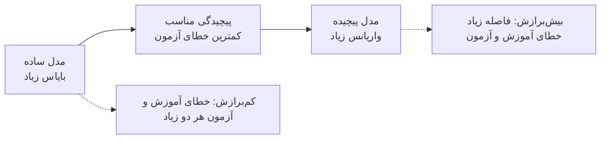
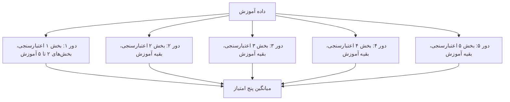
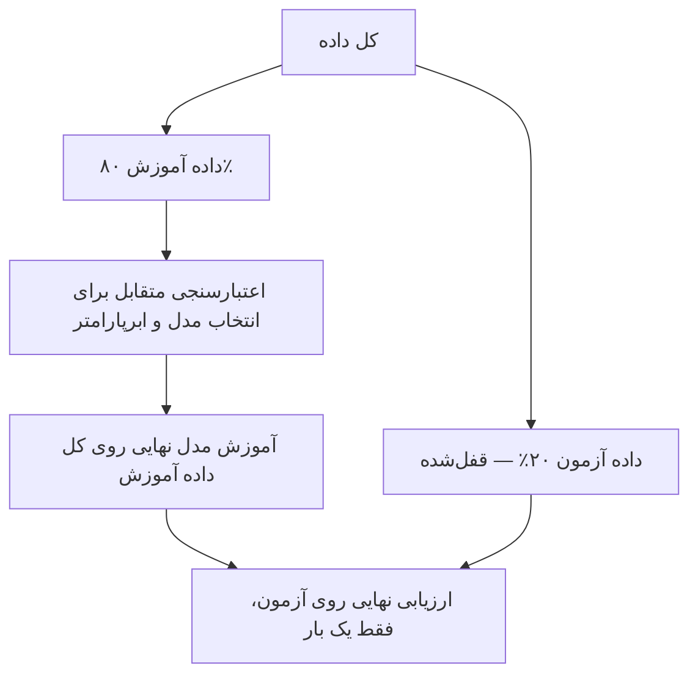

### جلسه ۱۸ — بیش‌برازش و اعتبارسنجی متقابل

## وقتی مدل «زیادی» خوب است

در جلسه قبل دیدیم که اگر رابطه ویژگی و هدف **منحنی** باشد، نمودار باقیمانده‌ها الگوی منحنی نشان می‌دهد و مدل خطی کافی نیست ← [[17 - رگرسیون خطی چندگانه و ارزیابی]]. راه‌حل طبیعی، انعطاف‌پذیرتر کردن مدل است؛ مثلاً افزودن توان‌های دوم و سوم ویژگی.

اما انعطاف بیشتر یک خطر پنهان دارد. پرسش پایانی جلسه قبل را به یاد بیاورید: اگر توان‌های یک ویژگی را تا درجه ده یا پانزده اضافه کنیم چه می‌شود؟

- خطای **آموزش** همیشه کمتر (یا مساوی) می‌شود.
- خطای **داده جدید** ابتدا کم و سپس **زیاد** می‌شود.

در این جلسه می‌آموزیم:

1. چگونه با **رگرسیون چندجمله‌ای** رابطه‌های منحنی را مدل کنیم.
2. **بیش‌برازش** و **کم‌برازش** چیست و چگونه تشخیص داده می‌شوند.
3. **مصالحه بایاس-واریانس** چه توضیحی برای این پدیده می‌دهد.
4. چگونه با **منحنی یادگیری** و **منحنی اعتبارسنجی** مدل را عیب‌یابی کنیم.
5. چگونه با **اعتبارسنجی متقابل** برآوردی قابل اعتماد از خطای تعمیم به دست آوریم و ابرپارامتر را انتخاب کنیم.

> [!important] نکته کلیدی هدف داده‌کاوی پیش‌بینی خوب روی داده **جدید** است، نه حفظ کردن داده آموزش. خطای آموزش همیشه برآوردی **خوش‌بینانه** از عملکرد واقعی است ← [[16 - مبانی یادگیری نظارت‌شده و رگرسیون خطی ساده]]

---

## رگرسیون چندجمله‌ای

### ایده

**رگرسیون چندجمله‌ای** (Polynomial Regression) توان‌های یک ویژگی را به‌عنوان ویژگی‌های جدید می‌سازد و سپس یک رگرسیون خطی **معمولی** روی آن‌ها برازش می‌دهد:

$$ \hat{y} = \beta_0 + \beta_1 x + \beta_2 x^2 + \cdots + \beta_d x^d $$

پارامتر d **درجه** چندجمله‌ای است و یک **ابرپارامتر** محسوب می‌شود.

> [!note] چرا هنوز «خطی» است؟ مدل نسبت به **x** غیرخطی است، اما نسبت به **ضرایب** خطی است. اگر ویژگی‌های جدید را z1 برابر x، z2 برابر مجذور x و ... بنامیم، مدل دقیقاً یک رگرسیون خطی چندگانه روی این ویژگی‌هاست. پس همه ابزارهای جلسه قبل (معادله نرمال، معیارهای ارزیابی، تحلیل باقیمانده) بدون تغییر قابل استفاده‌اند. این همان ایده **مهندسی ویژگی** است ← [[۱۳ - مهندسی و انتخاب ویژگی]]

### ساخت ویژگی‌های چندجمله‌ای

کلاس `PolynomialFeatures` در scikit-learn این ویژگی‌ها را می‌سازد:

|ورودی|درجه|ویژگی‌های خروجی (بدون ستون یک‌ها)|
|:-:|:-:|:-:|
|یک ویژگی x برابر ۲|3|2، 4، 8|
|دو ویژگی a و b|2|a، b، مجذور a، حاصل‌ضرب a و b، مجذور b|
|ده ویژگی|3|285 ویژگی|

با p ویژگی و درجه d، تعداد ویژگی‌ها (بدون ستون یک‌ها) برابر است با:

$$ \binom{p + d}{d} - 1 $$

> [!warning] انفجار ترکیبیاتی با ده ویژگی و درجه ۳، تعداد ویژگی‌ها از ۱۰ به **۲۸۵** می‌رسد. جمله‌هایی مانند حاصل‌ضرب a و b **جمله‌های تعاملی** (Interaction) هستند و اثر متقابل دو ویژگی را مدل می‌کنند ← [[8 - تحلیل دومتغیره و چندمتغیره]]. اما تعداد زیاد ویژگی نسبت به تعداد نمونه، دقیقاً دستور پخت **بیش‌برازش** و **نفرین ابعاد** است ← [[۱۳ - مهندسی و انتخاب ویژگی]]

> [!tip] مقیاس‌بندی پس از ساخت توان‌ها اگر x در بازه ۰ تا ۲۰۰ باشد، توان پنجم آن به حدود ۱۰ به توان ۱۱ می‌رسد. این اختلاف مقیاس، محاسبات عددی را ناپایدار می‌کند. در Pipeline ابتدا `PolynomialFeatures` و سپس `StandardScaler` قرار دهید.

> [!example] مثال حل‌شده — خط، سهمی و چندجمله‌ای درجه ۴ پنج نقطه داریم:
> 
> |نقطه|۱|۲|۳|۴|۵|
> |:-:|:-:|:-:|:-:|:-:|:-:|
> |مقدار x|0|1|2|3|4|
> |مقدار y|1|2|5|9|17|
> 
> **برازش خطی (درجه ۱):** با فرمول جلسه ۱۶، شیب ۳.۹ و عرض از مبدأ ۱- به دست می‌آید. باقیمانده‌ها ۲، ۰.۹-، ۱.۸-، ۱.۷- و ۲.۴ هستند: الگوی مثبت، منفی، مثبت نشانه کلاسیک **منحنی بودن** رابطه است. مجموع مربعات باقیمانده‌ها **۱۶.۷** است.
> 
> # **برازش درجه ۲:** ماتریس طراحی ستون‌های ۱، x و مجذور x دارد. معادلات نرمال: $$ \begin{bmatrix} 5 & 10 & 30 \ 10 & 30 & 100 \ 30 & 100 & 354 \end{bmatrix} \begin{bmatrix} \beta_0 \ \beta_1 \ \beta_2 \end{bmatrix}
> 
> \begin{bmatrix} 34 \ 107 \ 375 \end{bmatrix} $$ جواب این دستگاه (تأییدشده با numpy): $$ \hat{y} \approx 1.143 - 0.386 , x + 1.071 , x^2 $$ مجموع مربعات باقیمانده‌ها به **۰.۶۲۹** کاهش می‌یابد.
> 
> **برازش درجه ۴:** یک چندجمله‌ای درجه ۴ پنج ضریب دارد و می‌تواند از **هر** پنج نقطه دقیقاً عبور کند؛ مجموع مربعات باقیمانده‌ها **صفر** است!
> 
> |درجه|مجموع مربعات باقیمانده آموزش|پیش‌بینی برای x برابر ۵|
> |:-:|:-:|:-:|
> |1|16.7|18.5|
> |2|0.629|26.0|
> |4|0|36.0|
> 
> کدام مدل بهتر است؟ خطای آموزش صفر مدل درجه ۴ نمی‌تواند ملاک باشد؛ این مدل علاوه بر الگو، **نویز** را هم حفظ کرده است. پیش‌بینی‌های این سه مدل بیرون از داده بسیار متفاوت‌اند و فقط **داده جدید** می‌تواند داوری کند.

---

## بیش‌برازش و کم‌برازش

### تعاریف

|مفهوم|تعریف|خطای آموزش|خطای آزمون|تشبیه|
|:-:|:-:|:-:|:-:|:-:|
|کم‌برازش (Underfitting)|مدل برای الگوی واقعی بیش از حد ساده است|زیاد|زیاد|دانشجویی که درس را نخوانده|
|برازش مناسب (Good fit)|مدل الگو را گرفته و نویز را نادیده گرفته|کم|کم و نزدیک به خطای آموزش|دانشجویی که مفهوم را فهمیده|
|بیش‌برازش (Overfitting)|مدل علاوه بر الگو، نویز داده آموزش را حفظ کرده|بسیار کم|زیاد|دانشجویی که جواب سؤال‌های نمونه را حفظ کرده|

> [!example] مثال — داده سینوسی با نویز پانزده نقطه آموزش از تابع سینوسی (یک دوره کامل در بازه صفر تا یک) با نویز نرمال (انحراف معیار ۰.۳) تولید کردیم. برای سنجش واقعی، **۵۰۰** نقطه آزمون مستقل از همان توزیع ساختیم. واریانس نویز ۰.۰۹ است؛ پس هیچ مدلی نمی‌تواند به‌طور متوسط MSE آزمونی کمتر از حدود ۰.۰۹ داشته باشد.
> 
> |درجه چندجمله‌ای|MSE آموزش|MSE آزمون|تشخیص|
> |:-:|:-:|:-:|:-:|
> |1|0.178|0.276|کم‌برازش|
> |3|0.032|0.100|برازش مناسب|
> |9|0.028|0.399|بیش‌برازش|
> |15|0.027|0.565|بیش‌برازش شدید|
> 
> - با افزایش درجه، خطای آموزش پیوسته **کاهش** می‌یابد.
> - خطای آزمون در درجه ۳ کمینه است و سپس **افزایش** می‌یابد.
> - در درجه ۳، خطای آزمون (۰.۱۰۰) به حد نویز (۰.۰۹) نزدیک است.
> - مدل درجه ۱۵ خطای آموزش کمتری از مدل درجه ۳ دارد، اما خطای آزمون آن بیش از **پنج برابر** است.



### نشانه‌ها و راه‌حل‌ها

|مشکل|نشانه|راه‌حل‌ها|
|:-:|:-:|:-:|
|کم‌برازش|خطای آموزش زیاد؛ الگو در باقیمانده‌ها|مدل پیچیده‌تر، ویژگی‌های بیشتر یا بهتر، کاهش منظم‌سازی|
|بیش‌برازش|خطای آموزش بسیار کمتر از خطای اعتبارسنجی|داده بیشتر، مدل ساده‌تر، انتخاب ویژگی، **منظم‌سازی** ← [[19 - منظم‌سازی در رگرسیون]]، توقف زودهنگام|

> [!warning] عوامل افزایش خطر بیش‌برازش
> 
> - تعداد **ویژگی‌ها** یا پارامترها نسبت به تعداد **نمونه‌ها** زیاد است.
> - داده **نویز** زیادی دارد.
> - مدل بسیار انعطاف‌پذیر است (چندجمله‌ای درجه بالا، درخت تصمیم عمیق ← [[22 - درخت تصمیم]]، k-NN با k برابر ۱ ← [[20 -  مبانی طبقه‌بندی و k-NN]]).
> - ابرپارامترها بارها و بارها روی **همان** مجموعه اعتبارسنجی تنظیم شده‌اند (بیش‌برازش روی اعتبارسنجی).

---

## مصالحه بایاس-واریانس

### تجزیه خطای پیش‌بینی

فرض کنید داده از رابطه واقعی f به همراه نویز با واریانس سیگما-دو تولید می‌شود. اگر بارها و بارها مجموعه آموزش جدیدی بگیریم و مدل را دوباره آموزش دهیم، خطای مورد انتظار در یک نقطه x به سه جزء تجزیه می‌شود:

$$ \mathbb{E}\left[ (y - \hat{f}(x))^2 \right] = \underbrace{\left( \mathbb{E}[\hat{f}(x)] - f(x) \right)^2}_{\text{Bias}^2} + \underbrace{\mathbb{E}\left[ \left( \hat{f}(x) - \mathbb{E}[\hat{f}(x)] \right)^2 \right]}_{\text{Variance}} + \underbrace{\sigma^2}_{\text{Noise}} $$

|جزء|معنا|منشأ|با افزایش پیچیدگی|
|:-:|:-:|:-:|:-:|
|بایاس به توان دو|فاصله **میانگین** پیش‌بینی‌ها از مقدار واقعی|فرض‌های ساده‌کننده مدل|کاهش|
|واریانس|میزان **نوسان** پیش‌بینی‌ها با تغییر مجموعه آموزش|حساسیت مدل به داده خاص آموزش|افزایش|
|نویز (خطای کاهش‌ناپذیر)|تصادفی بودن ذاتی داده|اندازه‌گیری، عوامل نامشاهده|ثابت|

> [!tip] تشبیه تیراندازی
> 
> - **بایاس زیاد، واریانس کم:** همه تیرها کنار هم، اما دور از مرکز هدف (مدل خطی برای داده منحنی).
> - **بایاس کم، واریانس زیاد:** تیرها به‌طور میانگین حول مرکز، اما بسیار پراکنده (چندجمله‌ای درجه بالا).
> - **هدف:** تیرها هم نزدیک مرکز و هم کنار هم؛ اما معمولاً کاهش یکی به قیمت افزایش دیگری است. این همان **مصالحه** (Trade-off) است.

> [!example] مثال — شبیه‌سازی بایاس و واریانس **۲۰۰** مجموعه آموزش مستقل، هر کدام با **۲۵** نقطه از همان تابع سینوسی با نویز (واریانس نویز ۰.۰۹) تولید کردیم. روی هر مجموعه مدل چندجمله‌ای برازش دادیم و پیش‌بینی‌ها را روی ۵۰ نقطه ثابت میان ۰.۰۵ و ۰.۹۵ مقایسه کردیم:
> 
> |درجه|بایاس به توان دو|واریانس|نویز|خطای مورد انتظار|
> |:-:|:-:|:-:|:-:|:-:|
> |1|0.1526|0.0252|0.09|0.268|
> |3|0.0032|0.0183|0.09|0.112|
> |5|0.0002|0.0453|0.09|0.136|
> |7|0.0016|0.2694|0.09|0.361|
> |8|0.0161|1.1379|0.09|1.244|
> 
> - مدل خطی **بایاس** زیادی دارد: هیچ خطی نمی‌تواند موج سینوسی را دنبال کند، هر چقدر هم داده داشته باشیم.
> - از درجه ۳ به بعد بایاس تقریباً صفر است، اما **واریانس** به‌سرعت رشد می‌کند.
> - کمترین خطای کل در **درجه ۳** است.
> 
> (در درجه‌های بسیار بالا، چند برازش ناپایدار در لبه‌های بازه، میانگین پیش‌بینی‌ها را هم کمی جابه‌جا می‌کنند؛ به همین دلیل بایاس درجه ۸ دوباره کمی بیشتر شده است.)

### عوامل مؤثر بر بایاس و واریانس

|عامل|اثر بر بایاس|اثر بر واریانس|
|:-:|:-:|:-:|
|افزایش پیچیدگی مدل|کاهش|افزایش|
|افزایش داده آموزش|تقریباً بی‌اثر|کاهش|
|افزایش ویژگی‌های مفید|کاهش|افزایش جزئی|
|منظم‌سازی قوی‌تر|افزایش|کاهش|
|میانگین‌گیری از چند مدل (Bagging)|تقریباً بی‌اثر|کاهش ← [[23 - روش‌های گروهی]]|

---

## منحنی یادگیری و منحنی اعتبارسنجی

### منحنی اعتبارسنجی (Validation Curve)

خطای آموزش و خطای اعتبارسنجی را بر حسب **یک ابرپارامتر** (مانند درجه چندجمله‌ای) رسم می‌کند.

- ناحیه‌ای که هر دو خطا زیادند: **کم‌برازش**
- ناحیه‌ای که خطای آموزش کم اما خطای اعتبارسنجی زیاد است: **بیش‌برازش**
- بهترین مقدار ابرپارامتر: کمینه خطای **اعتبارسنجی**

> [!example] مثال — مصرف سوخت بر حسب قدرت موتور در داده mpg، مصرف سوخت (مایل بر گالن) را از قدرت موتور (horsepower) پیش‌بینی می‌کنیم. با ۳۱۳ نمونه آموزش و اعتبارسنجی متقابل ۵ بخشی:
> 
> |درجه|MSE آموزش|MSE اعتبارسنجی|
> |:-:|:-:|:-:|
> |1|24.43|24.93|
> |2|19.16|19.61|
> |3|19.08|19.72|
> |5|18.55|19.57|
> |10|18.27|20.08|
> 
> پرش بزرگ از درجه ۱ به ۲ نشان می‌دهد رابطه **منحنی** است. پس از درجه ۲، خطای آموزش آرام کاهش می‌یابد اما خطای اعتبارسنجی تقریباً ثابت می‌ماند و در درجه ۱۰ کمی بیشتر می‌شود. اختلاف درجه ۲ و ۵ (۱۹.۶۱ در برابر ۱۹.۵۷) بسیار کمتر از انحراف معیار میان بخش‌ها (حدود ۴.۶) است؛ پس طبق اصل **صرفه‌جویی** (Occam's Razor) مدل ساده‌تر درجه ۲ را انتخاب می‌کنیم.

### منحنی یادگیری (Learning Curve)

خطای آموزش و اعتبارسنجی را بر حسب **اندازه مجموعه آموزش** رسم می‌کند و به این پرسش پاسخ می‌دهد: «آیا جمع‌آوری داده بیشتر کمک می‌کند؟»

|الگوی منحنی یادگیری|تشخیص|آیا داده بیشتر کمک می‌کند؟|
|:-:|:-:|:-:|
|دو منحنی زود به هم می‌رسند و هر دو در سطح **بالا** ثابت می‌شوند|کم‌برازش (بایاس زیاد)|خیر؛ مدل پیچیده‌تر یا ویژگی بهتر لازم است|
|فاصله **زیاد** میان دو منحنی که با افزایش داده کم می‌شود|بیش‌برازش (واریانس زیاد)|بله|
|دو منحنی در سطح پایین به هم نزدیک‌اند|برازش مناسب|فایده کم|

> [!example] مثال — منحنی یادگیری در داده mpg
> 
> |اندازه آموزش|درجه ۱: آموزش|درجه ۱: اعتبارسنجی|درجه ۲: آموزش|درجه ۲: اعتبارسنجی|
> |:-:|:-:|:-:|:-:|:-:|
> |25|22.33|26.70|16.45|24.76|
> |81|24.63|25.01|20.87|20.19|
> |137|23.45|24.97|18.94|19.67|
> |250|24.41|24.92|19.16|19.61|
> 
> - در **درجه ۱**، دو منحنی از حدود ۸۰ نمونه به بعد در سطح حدود ۲۵ ثابت شده‌اند؛ داده بیشتر کمکی نمی‌کند (بایاس).
> - در **درجه ۲**، سطح نهایی پایین‌تر (حدود ۱۹.۶) است.
> - برای **درجه ۱۰** با فقط ۲۵ نمونه آموزش، MSE اعتبارسنجی به میلیاردها می‌رسد (چندجمله‌ای در لبه‌ها منفجر می‌شود)؛ با ۲۵۰ نمونه به حدود ۲۰.۱ کاهش می‌یابد. مدل پیچیده به **داده زیاد** نیاز دارد.

---

## اعتبارسنجی متقابل

### مشکل یک تقسیم ثابت

با یک تقسیم آموزش و اعتبارسنجی:

- برآورد خطا به **شانس** تقسیم وابسته است (بخش‌های مختلف خطاهای بسیار متفاوت می‌دهند).
- بخشی از داده هرگز برای آموزش استفاده نمی‌شود؛ در داده کم این اتلاف گران است.

### اعتبارسنجی متقابل k بخشی (k-Fold Cross-Validation)

1. داده آموزش را به k بخش (Fold) تقریباً هم‌اندازه تقسیم کن.
2. برای هر بخش: مدل را روی k-1 بخش دیگر آموزش بده و روی همین بخش ارزیابی کن.
3. میانگین (و انحراف معیار) k امتیاز را گزارش کن.

$$ \text{CV}_{(k)} = \frac{1}{k} \sum_{i=1}^{k} \text{MSE}_i $$



هر نمونه دقیقاً **یک بار** در اعتبارسنجی و k-1 بار در آموزش حضور دارد.

> [!example] مثال حل‌شده — میانگین و انحراف معیار امتیازها برای مدل درجه ۲ در داده mpg، پنج بخش MSE زیر را دادند:
> 
> |بخش|۱|۲|۳|۴|۵|
> |:-:|:-:|:-:|:-:|:-:|:-:|
> |خطای MSE|18.79|12.92|23.43|17.07|25.83|
> 
> $$ \text{CV}_{(5)} = \frac{18.79 + 12.92 + 23.43 + 17.07 + 25.83}{5} = \frac{98.04}{5} \approx 19.61 $$ انحراف معیار پنج امتیاز حدود **۴.۵۸** است. یعنی اگر فقط یک تقسیم ثابت داشتیم، بسته به شانس ممکن بود خطا را ۱۲.۹ یا ۲۵.۸ گزارش کنیم! اعتبارسنجی متقابل برآوردی **پایدارتر** می‌دهد.
> 
> برای مقایسه، امتیازهای مدل درجه ۱ روی **همان** بخش‌ها برابر ۲۵.۵۸، ۱۸.۶۵، ۲۳.۸۴، ۲۴.۵۶ و ۳۲.۰۰ است. مدل درجه ۲ در **هر پنج** بخش خطای کمتری دارد؛ پس برتری آن قابل اعتماد است، با وجود اینکه اختلاف میانگین‌ها (حدود ۵.۳) از انحراف معیار بخش‌ها چندان بزرگ‌تر نیست.

### اعتبارسنجی Leave-One-Out

حالت خاصی از k بخشی که در آن k برابر تعداد نمونه‌هاست: هر بار **یک** نمونه کنار گذاشته می‌شود.

|روش|تعداد آموزش مدل|بایاس برآورد|واریانس برآورد|کاربرد|
|:-:|:-:|:-:|:-:|:-:|
|تقسیم ثابت (Hold-out)|1|زیاد (داده آموزش کمتر)|زیاد (وابسته به یک تقسیم)|داده بسیار بزرگ|
|روش ۵ یا ۱۰ بخشی|5 یا 10|کم|متوسط|**انتخاب پیش‌فرض**|
|روش Leave-One-Out|n|بسیار کم|می‌تواند زیاد باشد|داده بسیار کم|

> [!example] مثال — مقایسه ۵ بخشی و Leave-One-Out روی ۳۱۳ نمونه آموزش mpg، روش Leave-One-Out مدل را **۳۱۳ بار** آموزش می‌دهد:
> 
> |درجه|میانگین MSE در ۵ بخشی|میانگین MSE در Leave-One-Out|
> |:-:|:-:|:-:|
> |1|24.93|24.85|
> |2|19.61|19.52|
> 
> هر دو روش به نتیجه یکسان می‌رسند، اما ۵ بخشی حدود ۶۰ برابر ارزان‌تر است.

### گونه‌های دیگر اعتبارسنجی متقابل

|روش|کلاس در scikit-learn|کاربرد|
|:-:|:-:|:-:|
|روش طبقه‌بندی‌شده (Stratified k-Fold)|کلاس `StratifiedKFold`|طبقه‌بندی؛ حفظ نسبت کلاس‌ها در هر بخش ← [[25 - ارزیابی مدل‌های طبقه‌بندی]]|
|روش تکرارشونده (Repeated k-Fold)|کلاس `RepeatedKFold`|کاهش واریانس برآورد با چند بار تقسیم تصادفی|
|روش گروهی (Group k-Fold)|کلاس `GroupKFold`|چند نمونه از یک بیمار یا مشتری در یک بخش بمانند|
|روش سری زمانی|کلاس `TimeSeriesSplit`|آموزش فقط روی گذشته و ارزیابی روی آینده|

> [!warning] بر زدن داده کلاس `KFold` به‌طور پیش‌فرض داده را **بر نمی‌زند** (shuffle=False). اگر داده مرتب شده باشد (مثلاً بر اساس سال یا هدف)، بخش‌ها نماینده کل داده نیستند. برای داده‌های غیرزمانی از `shuffle=True` و `random_state=42` استفاده کنید. برای داده زمانی **هرگز** بر نزنید.

### چرا مجموعه آزمون دست‌نخورده می‌ماند؟

اعتبارسنجی متقابل جایگزین مجموعه **اعتبارسنجی** است، نه مجموعه **آزمون**.



> [!important] چرخه درست ارزیابی
> 
> 1. داده آزمون را **پیش از هر کاری** جدا و قفل کنید.
> 2. روی داده آموزش با اعتبارسنجی متقابل مدل‌ها و ابرپارامترها را مقایسه کنید.
> 3. بهترین پیکربندی را روی **کل داده آموزش** دوباره آموزش دهید.
> 4. فقط **یک بار** روی داده آزمون ارزیابی و گزارش کنید.
> 
> وقتی امتیاز اعتبارسنجی متقابل را برای **انتخاب** بهترین مدل از میان ده‌ها گزینه استفاده می‌کنیم، خود آن امتیاز کمی خوش‌بینانه می‌شود (بهترین از میان چند برآورد نویزدار). به همین دلیل یک برآورد مستقل نهایی روی داده آزمون لازم است.

> [!warning] پیش‌پردازش داخل حلقه اعتبارسنجی اگر پیش از اعتبارسنجی متقابل، مقیاس‌بندی یا انتخاب ویژگی را روی **کل** داده آموزش انجام دهید، در هر دور اطلاعات بخش اعتبارسنجی به آموزش نشت می‌کند ← [[۱۴- کاهش ابعاد]]. همیشه کل Pipeline (پیش‌پردازش و مدل) را به `cross_val_score` بدهید تا پیش‌پردازش در هر دور فقط روی بخش‌های آموزش برازش شود.

---

## پیاده‌سازی در پایتون

```python
import matplotlib
matplotlib.use("Agg")
import numpy as np
import pandas as pd
import matplotlib.pyplot as plt
import seaborn as sns
from sklearn.preprocessing import PolynomialFeatures, StandardScaler
from sklearn.linear_model import LinearRegression
from sklearn.pipeline import make_pipeline
from sklearn.metrics import mean_squared_error, r2_score
from sklearn.model_selection import (train_test_split, KFold, LeaveOneOut,
                                     cross_val_score, cross_validate,
                                     learning_curve, validation_curve)

sns.set_theme(style="whitegrid")

def poly_model(degree):
    """Polynomial regression pipeline: powers -> scaling -> OLS."""
    return make_pipeline(PolynomialFeatures(degree, include_bias=False),
                         StandardScaler(), LinearRegression())
```

### مثال دستی: ویژگی‌های چندجمله‌ای و برازش درجه ۱، ۲ و ۴

```python
print(PolynomialFeatures(3, include_bias=False).fit_transform([[2]]))   # [[2. 4. 8.]]
pf = PolynomialFeatures(2, include_bias=False).fit(np.zeros((1, 2)))
print(pf.get_feature_names_out(["a", "b"]))       # ['a' 'b' 'a^2' 'a b' 'b^2']
print(PolynomialFeatures(3, include_bias=False).fit(np.zeros((1, 10))).n_output_features_)  # 285

x = np.array([0, 1, 2, 3, 4], dtype=float)
y = np.array([1, 2, 5, 9, 17], dtype=float)
for d in [1, 2, 4]:
    coef = np.polyfit(x, y, d)
    sse = ((y - np.polyval(coef, x)) ** 2).sum()
    print(d, round(sse, 3), round(np.polyval(coef, 5), 1))
# 1 16.7 18.5
# 2 0.629 26.0
# 4 0.0 36.0
```

### بیش‌برازش روی داده سینوسی

```python
def true_f(x):
    return np.sin(2 * np.pi * x)

rng = np.random.default_rng(42)
x_train = rng.uniform(0, 1, 15)
y_train = true_f(x_train) + rng.normal(0, 0.3, 15)
x_test = rng.uniform(0, 1, 500)
y_test = true_f(x_test) + rng.normal(0, 0.3, 500)
X_train, X_test = x_train.reshape(-1, 1), x_test.reshape(-1, 1)

grid = np.linspace(0, 1, 300).reshape(-1, 1)
fig, axes = plt.subplots(1, 4, figsize=(18, 4), sharey=True)
for ax, d in zip(axes, [1, 3, 9, 15]):
    m = poly_model(d).fit(X_train, y_train)
    tr = mean_squared_error(y_train, m.predict(X_train))
    te = mean_squared_error(y_test, m.predict(X_test))
    print(d, round(tr, 3), round(te, 3))
    ax.scatter(x_train, y_train, color="black", zorder=3, label="Train")
    ax.plot(grid, true_f(grid), "g--", label="True function")
    ax.plot(grid, m.predict(grid), "r", label="Model")
    ax.set(ylim=(-2, 2), title=f"Degree {d}: train {tr:.3f}, test {te:.3f}")
axes[0].legend()
plt.show()
# 1 0.178 0.276
# 3 0.032 0.1
# 9 0.028 0.399
# 15 0.027 0.565
```

### شبیه‌سازی بایاس و واریانس

```python
x_grid = np.linspace(0.05, 0.95, 50)
f_grid = true_f(x_grid)

for d in [1, 3, 5, 7, 8]:
    rng = np.random.default_rng(42)
    preds = []
    for _ in range(200):                                  # 200 independent training sets
        xs = rng.uniform(0, 1, 25)
        ys = true_f(xs) + rng.normal(0, 0.3, 25)
        preds.append(poly_model(d).fit(xs.reshape(-1, 1), ys).predict(x_grid.reshape(-1, 1)))
    preds = np.array(preds)
    bias2 = ((preds.mean(axis=0) - f_grid) ** 2).mean()
    var = preds.var(axis=0).mean()
    print(d, round(bias2, 4), round(var, 4))
# 1 0.1526 0.0252
# 3 0.0032 0.0183
# 5 0.0002 0.0453
# 7 0.0016 0.2694
# 8 0.0161 1.1379
```

### داده mpg: تقسیم و اعتبارسنجی متقابل

```python
mpg = sns.load_dataset("mpg").dropna(subset=["horsepower"])
X = mpg[["horsepower"]]
y = mpg["mpg"]
X_train, X_test, y_train, y_test = train_test_split(X, y, test_size=0.2, random_state=42)
print(len(X_train), len(X_test))                     # 313 79  (test set is now locked)

kf = KFold(n_splits=5, shuffle=True, random_state=42)
for d in [1, 2]:
    scores = -cross_val_score(poly_model(d), X_train, y_train,
                              cv=kf, scoring="neg_mean_squared_error")
    print(d, scores.round(2), round(scores.mean(), 2), round(scores.std(), 2))
# 1 [25.58 18.65 23.84 24.56 32.  ] 24.93 4.27
# 2 [18.79 12.92 23.43 17.07 25.83] 19.61 4.58

# R^2 is the default score for regressors
r2_scores = cross_val_score(poly_model(2), X_train, y_train, cv=kf)
print(r2_scores.round(3), round(r2_scores.mean(), 3))
# [0.592 0.79  0.587 0.745 0.692] 0.681

# Leave-One-Out: 313 model fits
loo = -cross_val_score(poly_model(2), X_train, y_train,
                       cv=LeaveOneOut(), scoring="neg_mean_squared_error")
print(len(loo), round(loo.mean(), 2))                # 313 19.52
```

> [!note] چرا علامت منفی؟ در scikit-learn همه امتیازها طوری تعریف شده‌اند که **بزرگ‌تر بهتر** باشد. به همین دلیل خطاها به‌صورت منفی برگردانده می‌شوند (`neg_mean_squared_error`) و ما با یک علامت منفی آن‌ها را مثبت می‌کنیم.

### چند معیار هم‌زمان با cross_validate

```python
cv_res = cross_validate(poly_model(2), X_train, y_train, cv=kf,
                        scoring=["neg_mean_squared_error", "r2"],
                        return_train_score=True)
print(round(-cv_res["train_neg_mean_squared_error"].mean(), 2),
      round(-cv_res["test_neg_mean_squared_error"].mean(), 2))   # 19.16 19.61
```

### منحنی اعتبارسنجی

```python
degrees = np.arange(1, 11)
train_sc, val_sc = validation_curve(
    poly_model(1), X_train, y_train,
    param_name="polynomialfeatures__degree", param_range=degrees,
    cv=kf, scoring="neg_mean_squared_error")
train_mse, val_mse = -train_sc.mean(axis=1), -val_sc.mean(axis=1)
print(train_mse.round(2))  # [24.43 19.16 19.08 19.04 18.55 18.39 18.33 18.31 18.27 18.27]
print(val_mse.round(2))    # [24.93 19.61 19.72 19.88 19.57 19.52 19.69 19.62 19.67 20.08]

fig, ax = plt.subplots(figsize=(7, 4))
ax.plot(degrees, train_mse, "o-", label="Training")
ax.plot(degrees, val_mse, "s-", label="Validation (5-fold CV)")
ax.fill_between(degrees, val_mse - val_sc.std(axis=1), val_mse + val_sc.std(axis=1), alpha=0.2)
ax.set(xlabel="Polynomial degree", ylabel="MSE", title="Validation curve (mpg ~ horsepower)")
ax.legend()
plt.show()
```

### منحنی یادگیری

```python
fig, axes = plt.subplots(1, 2, figsize=(13, 4), sharey=True)
for ax, d in zip(axes, [1, 2]):
    sizes, tr, va = learning_curve(
        poly_model(d), X_train, y_train, train_sizes=np.linspace(0.1, 1.0, 5),
        cv=kf, scoring="neg_mean_squared_error", shuffle=True, random_state=42)
    print(d, sizes, (-tr.mean(axis=1)).round(2), (-va.mean(axis=1)).round(2))
    ax.plot(sizes, -tr.mean(axis=1), "o-", label="Training")
    ax.plot(sizes, -va.mean(axis=1), "s-", label="Validation")
    ax.set(xlabel="Training set size", ylabel="MSE", title=f"Learning curve, degree {d}")
    ax.legend()
plt.show()
# 1 [ 25  81 137 193 250] [22.33 24.63 23.45 24.55 24.41] [26.7  25.01 24.97 25.01 24.92]
# 2 [ 25  81 137 193 250] [16.45 20.87 18.94 19.6  19.16] [24.76 20.19 19.67 19.66 19.61]
```

### ارزیابی نهایی روی داده آزمون

```python
final = poly_model(2).fit(X_train, y_train)          # refit on the full training set
y_pred = final.predict(X_test)                       # the test set is used only once
print(round(mean_squared_error(y_test, y_pred), 2))  # 18.42
print(round(np.sqrt(mean_squared_error(y_test, y_pred)), 2))   # 4.29 mpg
print(round(r2_score(y_test, y_pred), 3))            # 0.639
```

> [!note] تفسیر خطای آزمون (۱۸.۴۲) نزدیک برآورد اعتبارسنجی متقابل (۱۹.۶۱) است؛ نشانه اینکه فرایند انتخاب مدل سالم بوده است. خطای معمول پیش‌بینی حدود **۴.۳ مایل بر گالن** است.

---

## تمرین عملی کلاس

> [!example] تمرین عملی (۲۵ دقیقه) در داده mpg این بار مصرف سوخت را از **وزن خودرو** پیش‌بینی کنید:
> 
> ```python
> import seaborn as sns
> mpg = sns.load_dataset("mpg")
> X = mpg[["weight"]]
> y = mpg["mpg"]
> ```
> 
> 1. سطرهایی را که horsepower آن‌ها گمشده است حذف کنید (تا داده با مثال جلسه یکسان باشد) و داده را با `test_size=0.2` و `random_state=42` تقسیم کنید. داده آزمون را کنار بگذارید.
> 2. برای درجه‌های ۱ تا ۱۰، با تابع `poly_model` و `cross_val_score` (پنج بخشی با `shuffle=True` و `random_state=42`) میانگین و انحراف معیار MSE اعتبارسنجی را حساب کنید.
> 3. برای همان درجه‌ها MSE آموزش (روی کل داده آموزش) را هم حساب کنید و هر دو را در یک نمودار رسم کنید. کدام درجه کمترین خطای اعتبارسنجی را دارد؟
> 4. برای درجه‌های ۱ و ۲، اعتبارسنجی Leave-One-Out را اجرا کنید و با نتیجه ۵ بخشی مقایسه کنید.
> 5. مدل منتخب را روی کل داده آموزش برازش دهید و MSE، RMSE و ضریب تعیین آزمون را گزارش کنید.
> 6. (اختیاری) برای درجه‌های ۱ تا ۱۰، MSE **آزمون** را هم حساب کنید. اگر درجه را بر اساس داده آزمون انتخاب می‌کردیم، چه اشکالی داشت؟

> [!question]- پاسخ‌های کلیدی تمرین
> 
> - پس از حذف سطرهای گمشده، ۳۹۲ نمونه داریم: ۳۱۳ آموزش و ۷۹ آزمون.
> - میانگین MSE اعتبارسنجی: درجه ۱ حدود **۱۹.۳۴**، درجه ۲ حدود **۱۷.۹۰** (کمینه)، درجه ۳ حدود ۱۸.۰۳ و درجه‌های ۴ تا ۱۰ بین ۱۸.۲ و ۱۸.۵. انحراف معیار میان بخش‌ها حدود ۴.۵ است.
> - خطای آموزش از حدود ۱۹.۰۵ (درجه ۱) به حدود ۱۷.۲۵ (درجه ۱۰) کاهش می‌یابد، اما خطای اعتبارسنجی پس از درجه ۲ دیگر بهتر نمی‌شود. درجه **۲** انتخاب می‌شود.
> - روش Leave-One-Out: درجه ۱ حدود **۱۹.۲۷** و درجه ۲ حدود **۱۷.۸۶**؛ همان نتیجه ۵ بخشی.
> - مدل درجه ۲ روی آزمون: MSE حدود **۱۶.۶۹**، RMSE حدود **۴.۰۹** و ضریب تعیین حدود **۰.۶۷۳**. وزن خودرو پیش‌بین کمی بهتر از قدرت موتور است.
> - انتخاب بر اساس آزمون: در این داده هم درجه ۲ (یا ۳ که تقریباً یکسان است) بهترین خطای آزمون را دارد، اما اگر درجه را بر اساس آزمون انتخاب کنیم، عدد گزارش‌شده دیگر برآورد **بی‌طرفانه** خطای تعمیم نیست؛ آزمون به بخشی از فرایند آموزش تبدیل شده است.

---

## پرسش‌های مرور

> [!question]- ۱. چرا رگرسیون چندجمله‌ای با وجود منحنی بودن، یک مدل «خطی» محسوب می‌شود؟ چون مدل نسبت به **ضرایب** خطی است. توان‌های x ویژگی‌های جدیدی هستند و مدل روی این ویژگی‌ها یک رگرسیون خطی چندگانه معمولی است که با همان OLS حل می‌شود.

> [!question]- ۲. خطای آموزش مدلی ۲ و خطای اعتبارسنجی آن ۲۵ است. مشکل چیست و سه راه‌حل پیشنهاد دهید. فاصله زیاد میان خطای آموزش و اعتبارسنجی نشانه **بیش‌برازش** (واریانس زیاد) است. راه‌حل‌ها: جمع‌آوری **داده بیشتر**، **ساده‌تر کردن** مدل (درجه کمتر، ویژگی کمتر) و **منظم‌سازی** (Ridge یا Lasso).

> [!question]- ۳. در منحنی یادگیری یک مدل، خطای آموزش و اعتبارسنجی هر دو در سطح بالایی به هم رسیده‌اند. آیا جمع‌آوری داده بیشتر کمک می‌کند؟ خیر. این الگوی **کم‌برازش** (بایاس زیاد) است؛ مدل حتی روی داده آموزش هم نمی‌تواند الگو را بگیرد. باید مدل را پیچیده‌تر کرد یا ویژگی‌های بهتری ساخت.

> [!question]- ۴. اعتبارسنجی ۱۰ بخشی روی داده‌ای با ۱۰۰۰ نمونه چند بار مدل را آموزش می‌دهد و هر بار با چند نمونه؟ روش Leave-One-Out چطور؟ روش ۱۰ بخشی **۱۰ بار** آموزش می‌دهد، هر بار با **۹۰۰** نمونه (و ارزیابی روی ۱۰۰ نمونه). روش Leave-One-Out **۱۰۰۰ بار** آموزش می‌دهد، هر بار با **۹۹۹** نمونه.

> [!question]- ۵. دانشجویی ابتدا کل داده را استانداردسازی کرده، سپس `cross_val_score` را روی یک `LinearRegression` اجرا کرده است. چه اشکالی دارد؟ میانگین و انحراف معیار استانداردسازی از **کل** داده (از جمله بخش اعتبارسنجی هر دور) محاسبه شده است؛ این **نشت داده** است و برآورد را خوش‌بینانه می‌کند. باید `StandardScaler` و مدل را در یک **Pipeline** قرار داد و کل Pipeline را به `cross_val_score` داد.

> [!question]- ۶. برای پیش‌بینی فروش ماه آینده یک فروشگاه از داده‌های ماهانه پنج سال گذشته، آیا اعتبارسنجی متقابل k بخشی با بر زدن داده مناسب است؟ خیر. در داده **زمانی** بر زدن باعث می‌شود مدل با داده‌های آینده آموزش ببیند و گذشته را پیش‌بینی کند؛ این نشت اطلاعات از آینده است. باید از `TimeSeriesSplit` استفاده کرد که همیشه روی گذشته آموزش و روی آینده ارزیابی می‌کند.

---

## نکات کلیدی

> [!summary] خلاصه جلسه
> 
> - **رگرسیون چندجمله‌ای** توان‌های ویژگی‌ها را می‌سازد و یک رگرسیون خطی معمولی روی آن‌ها برازش می‌دهد. درجه چندجمله‌ای یک **ابرپارامتر** است. پس از ساخت توان‌ها، مقیاس‌بندی کنید.
> - **کم‌برازش**: خطای آموزش و آزمون هر دو زیاد. **بیش‌برازش**: خطای آموزش کم اما خطای آزمون زیاد؛ مدل نویز را حفظ کرده است.
> - خطای مورد انتظار برابر **بایاس به توان دو + واریانس + نویز** است. افزایش پیچیدگی بایاس را کم و واریانس را زیاد می‌کند؛ بهترین مدل در نقطه تعادل است.
> - **منحنی اعتبارسنجی** (خطا بر حسب ابرپارامتر) برای انتخاب پیچیدگی و **منحنی یادگیری** (خطا بر حسب اندازه داده) برای تشخیص اینکه آیا داده بیشتر کمک می‌کند به کار می‌روند.
> - **اعتبارسنجی متقابل k بخشی** (معمولاً ۵ یا ۱۰ بخش) برآوردی پایدارتر از یک تقسیم ثابت می‌دهد؛ **Leave-One-Out** حالت خاص آن برای داده کم است. پیش‌پردازش باید داخل Pipeline و حلقه اعتبارسنجی باشد.
> - مجموعه **آزمون** پیش از هر کاری جدا می‌شود و فقط **یک بار** در پایان برای گزارش نهایی استفاده می‌شود.

> [!todo] آمادگی برای جلسه بعد
> 
> 1. برای مسئله رگرسیون پروژه خود، مدل خطی جلسه قبل را با اعتبارسنجی متقابل ۵ بخشی ارزیابی کنید و میانگین و انحراف معیار امتیازها را گزارش کنید.
> 2. برای یکی از ویژگی‌های عددی مهم، منحنی اعتبارسنجی درجه چندجمله‌ای را رسم کنید.
> 3. منحنی یادگیری بهترین مدل خود را رسم کنید: آیا داده بیشتر کمک می‌کند؟
> 4. به این پرسش فکر کنید: به جای پایین آوردن درجه، آیا می‌توان مدل درجه بالا را نگه داشت اما ضرایب آن را «کوچک» نگه داشت؟ این ایده **منظم‌سازی** است ← [[19 - منظم‌سازی در رگرسیون]]