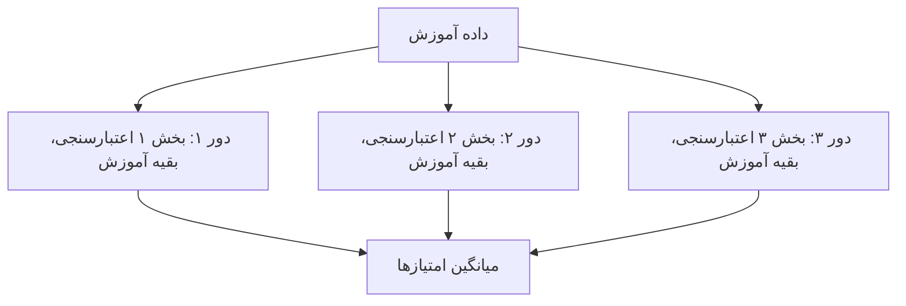
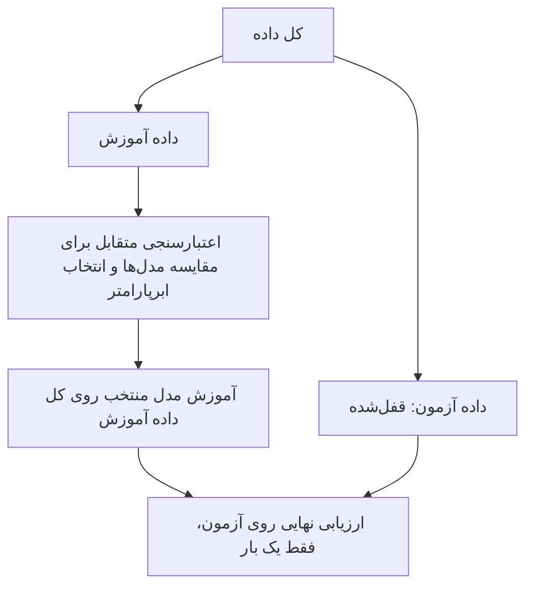

# جلسه ۱۸ — بیش‌برازش و اعتبارسنجی متقابل

## وقتی مدل «زیادی» خوب است

در جلسه قبل دیدیم که الگوی منحنی در نمودار باقیمانده‌ها نشانه آن است که رابطه ویژگی و هدف خطی نیست ← [[17 - رگرسیون خطی چندگانه و ارزیابی]]. یک راه‌حل را هم دیدیم: تبدیل لگاریتمی و مدل توانی، که در داده خودروها ضریب تعیین آزمون مصرف سوخت را از ۰.۵۶۶ به ۰.۶۱۹ رساند. راه‌حل کلی‌تر، انعطاف‌پذیرتر کردن مدل است؛ مثلاً افزودن توان‌های دوم و سوم یک ویژگی.

اما انعطاف بیشتر خطری پنهان دارد. فرض کنید دانشجویی برای امتحان، جواب سؤال‌های نمونه را کلمه‌به‌کلمه حفظ کند. در سؤال‌های نمونه نمره کامل می‌گیرد، اما سر جلسه امتحان که سؤال‌ها کمی فرق دارند، شکست می‌خورد. مدلی که بیش از حد انعطاف دارد هم همین کار را می‌کند: داده آموزش را **حفظ** می‌کند، نه اینکه الگو را **بفهمد**.

این جلسه به سه پرسش پاسخ می‌دهد:

- چرا مدل پیچیده‌تر روی داده آموزش همیشه بهتر است، ولی روی داده جدید نه؟
- چگونه بدون دست زدن به داده آزمون، خطای مدل روی داده جدید را **قابل اعتماد** برآورد کنیم؟
- چگونه میان چند مدل یا چند مقدار ابرپارامتر (مثلاً درجه چندجمله‌ای) **انتخاب** کنیم؟

---

## مفاهیم اصلی

### رگرسیون چندجمله‌ای

**رگرسیون چندجمله‌ای** (Polynomial Regression) توان‌های یک ویژگی را به‌عنوان ویژگی‌های جدید می‌سازد و سپس یک رگرسیون خطی **معمولی** روی آن‌ها برازش می‌دهد:

$$
\hat{y} = \beta_0 + \beta_1 x + \beta_2 x^2 + \cdots + \beta_d x^d
$$

عدد d **درجه** چندجمله‌ای است. درجه را الگوریتم از داده یاد نمی‌گیرد، بلکه ما پیش از آموزش تعیین می‌کنیم؛ پس یک **ابرپارامتر** است ← [[16 - مبانی یادگیری نظارت‌شده و رگرسیون خطی ساده]]

> [!note] چرا هنوز «خطی» است؟
> مدل نسبت به x منحنی است، اما نسبت به **ضرایب** خطی است. اگر توان‌های x را ویژگی‌های جدید بدانیم، مدل دقیقاً همان رگرسیون خطی چندگانه جلسه قبل است و با همان کمترین مربعات حل می‌شود. این همان ایده **مهندسی ویژگی** است ← [[۱۳ - مهندسی و انتخاب ویژگی]]

ساخت توان‌ها یک گام **قاعده‌محور** است (چیزی از داده یاد نمی‌گیرد)، اما با p ویژگی و درجه d، تعداد ویژگی‌ها (بدون ستون یک‌ها) به‌سرعت زیاد می‌شود:

$$
\binom{p + d}{d} - 1
$$

| تعداد ویژگی اولیه | درجه | تعداد ویژگی‌های ساخته‌شده |
|:---:|:---:|:---:|
| ۱ | ۳ | ۳ (توان‌های اول تا سوم) |
| ۲ | ۲ | ۵ (دو ویژگی، دو مجذور و یک حاصل‌ضرب) |
| ۱۰ | ۳ | ۲۸۵ |

> [!warning] انفجار تعداد ویژگی‌ها
> حاصل‌ضرب دو ویژگی **جمله تعاملی** (Interaction) نام دارد و اثر متقابل آن‌ها را مدل می‌کند. اما ویژگی زیاد نسبت به تعداد نمونه، دستور پخت **بیش‌برازش** است. توان‌های بالای یک عدد هم مقیاس‌های بسیار متفاوتی دارند (اگر x تا ۲۰۰ برسد، توان پنجم آن حدود ۱۰ به توان ۱۱ است)؛ پس پس از ساخت توان‌ها، **استانداردسازی** لازم است. استانداردسازی گام یادگیرنده است و جای آن داخل Pipeline است ← [[۱۵ - طراحی آزمایش و Pipeline]]

### بیش‌برازش و کم‌برازش

| مفهوم | تعریف | خطای آموزش | خطای داده جدید | تشبیه |
|:---:|:---:|:---:|:---:|:---:|
| کم‌برازش (Underfitting) | مدل برای الگوی واقعی بیش از حد ساده است | زیاد | زیاد | دانشجویی که درس را نخوانده |
| برازش مناسب (Good fit) | مدل الگو را گرفته و نویز را نادیده گرفته | کم | کم و نزدیک به خطای آموزش | دانشجویی که مفهوم را فهمیده |
| بیش‌برازش (Overfitting) | مدل علاوه بر الگو، نویز داده آموزش را حفظ کرده | بسیار کم | زیاد | دانشجویی که جواب سؤال‌های نمونه را حفظ کرده |

> [!example] مثال — داده موجی با نویز
> پانزده نقطه آموزش از یک تابع موجی (سینوسی) به همراه نویز تصادفی با انحراف معیار ۰.۳ ساختیم و ۵۰۰ نقطه **جدید** از همان منبع را برای سنجش کنار گذاشتیم. چون انحراف معیار نویز ۰.۳ است، هیچ مدلی نمی‌تواند به‌طور متوسط RMSE کمتر از حدود ۰.۳ روی داده جدید داشته باشد.
>
> | درجه چندجمله‌ای | RMSE آموزش | RMSE داده جدید | تشخیص |
> |:---:|:---:|:---:|:---:|
> | ۱ | 0.421 | 0.525 | کم‌برازش |
> | ۳ | 0.179 | 0.316 | برازش مناسب |
> | ۹ | 0.168 | 0.632 | بیش‌برازش |
>
> - با افزایش درجه، خطای آموزش همیشه **کم** می‌شود.
> - خطای داده جدید در درجه ۳ کمینه و نزدیک حد نویز (۰.۳) است، سپس **زیاد** می‌شود.
> - مدل درجه ۹ خطای آموزش کمتری از درجه ۳ دارد، اما خطای آن روی داده جدید تقریباً **دو برابر** است.

| مشکل | نشانه | راه‌حل‌ها |
|:---:|:---:|:---:|
| کم‌برازش | خطای آموزش زیاد؛ الگو در باقیمانده‌ها | مدل پیچیده‌تر، ویژگی‌های بیشتر یا بهتر |
| بیش‌برازش | خطای آموزش بسیار کمتر از خطای اعتبارسنجی | داده بیشتر، مدل ساده‌تر، انتخاب ویژگی، منظم‌سازی ← [[19 - منظم‌سازی در رگرسیون]] |

> [!warning] عوامل افزایش خطر بیش‌برازش
> - تعداد ویژگی‌ها یا پارامترها نسبت به تعداد نمونه‌ها زیاد است.
> - داده نویز زیادی دارد.
> - مدل بسیار انعطاف‌پذیر است: چندجمله‌ای درجه بالا، درخت تصمیم عمیق ← [[22 - درخت تصمیم]]، یا الگوریتم k-NN با یک همسایه ← [[20 -  مبانی طبقه‌بندی و k-NN]]
> - ابرپارامترها بارها روی **همان** داده اعتبارسنجی تنظیم شده‌اند؛ مدل کم‌کم آن داده را هم «حفظ» می‌کند.

### مصالحه بایاس-واریانس

فرض کنید بارها و بارها یک مجموعه آموزش **تازه** از همان منبع بگیریم و هر بار مدل را از نو آموزش دهیم. خطای مورد انتظار در یک نقطه x به سه جزء تقسیم می‌شود (برای این تجزیه از MSE استفاده می‌کنیم، چون فقط مجذور خطا این‌طور جمع‌پذیر است):

$$
\mathbb{E}\left[ (y - \hat{f}(x))^2 \right] = \underbrace{\left( \mathbb{E}[\hat{f}(x)] - f(x) \right)^2}_{\text{Bias}^2} + \underbrace{\mathbb{E}\left[ \left( \hat{f}(x) - \mathbb{E}[\hat{f}(x)] \right)^2 \right]}_{\text{Variance}} + \underbrace{\sigma^2}_{\text{Noise}}
$$

| جزء | معنا | منشأ | با افزایش پیچیدگی |
|:---:|:---:|:---:|:---:|
| بایاس به توان دو | فاصله **میانگین** پیش‌بینی‌ها از مقدار واقعی | فرض‌های ساده‌کننده مدل | کاهش |
| واریانس | میزان **نوسان** پیش‌بینی‌ها با عوض شدن مجموعه آموزش | حساسیت مدل به نمونه خاص آموزش | افزایش |
| نویز (خطای کاهش‌ناپذیر) | تصادفی بودن ذاتی داده | خطای اندازه‌گیری، عوامل نامشاهده | ثابت |

> [!tip] تشبیه تیراندازی
> - **بایاس زیاد، واریانس کم:** تیرها کنار هم، اما دور از مرکز هدف (مدل خطی برای داده موجی).
> - **بایاس کم، واریانس زیاد:** تیرها به‌طور میانگین حول مرکز، اما بسیار پراکنده (چندجمله‌ای درجه بالا).
> - معمولاً کاهش یکی به قیمت افزایش دیگری است؛ این همان **مصالحه** (Trade-off) است.

> [!example] مثال — شبیه‌سازی بایاس و واریانس
> ۲۰۰ مجموعه آموزش مستقل، هر کدام با ۲۵ نقطه از همان تابع موجی با نویز (واریانس نویز ۰.۰۹) ساختیم و روی هر کدام مدل چندجمله‌ای برازش دادیم:
>
> | درجه | بایاس به توان دو | واریانس | نویز | خطای مورد انتظار (MSE) |
> |:---:|:---:|:---:|:---:|:---:|
> | ۱ | 0.1526 | 0.0252 | 0.09 | 0.268 |
> | ۳ | 0.0032 | 0.0183 | 0.09 | 0.112 |
> | ۵ | 0.0002 | 0.0453 | 0.09 | 0.136 |
> | ۷ | 0.0016 | 0.2694 | 0.09 | 0.361 |
> | ۹ | 0.0178 | 0.9446 | 0.09 | 1.052 |
>
> مدل خطی بایاس زیادی دارد: هیچ خطی نمی‌تواند موج را دنبال کند، هر قدر هم داده داشته باشیم. از درجه ۳ به بعد بایاس تقریباً صفر است، اما واریانس به‌سرعت رشد می‌کند. کمترین خطای کل در **درجه ۳** است.

| عامل | اثر بر بایاس | اثر بر واریانس |
|:---:|:---:|:---:|
| افزایش پیچیدگی مدل | کاهش | افزایش |
| افزایش داده آموزش | تقریباً بی‌اثر | کاهش |
| منظم‌سازی قوی‌تر | افزایش | کاهش |
| میانگین‌گیری از چند مدل | تقریباً بی‌اثر | کاهش ← [[23 - روش‌های گروهی]] |

### اعتبارسنجی متقابل

در جلسه ۱۶ داده را به آموزش، اعتبارسنجی و آزمون تقسیم کردیم. یک مجموعه اعتبارسنجی **ثابت** دو مشکل دارد:

- برآورد خطا به **شانس** تقسیم وابسته است؛ یک تقسیم دیگر ممکن است عدد بسیار متفاوتی بدهد.
- بخشی از داده هرگز در آموزش استفاده نمی‌شود؛ در داده کم این اتلاف گران است.

**اعتبارسنجی متقابل k بخشی** (k-Fold Cross-Validation) هر دو مشکل را حل می‌کند:

1. داده آموزش را به k بخش (Fold) تقریباً هم‌اندازه تقسیم کن.
2. برای هر بخش: مدل را روی k−1 بخش دیگر آموزش بده و روی همین بخش ارزیابی کن.
3. میانگین (و انحراف معیار) k امتیاز را گزارش کن.

اگر امتیاز بخش i را با RMSE بسنجیم:

$$
\text{CV}_{(k)} = \frac{1}{k} \sum_{i=1}^{k} \text{RMSE}_i
$$



هر نمونه دقیقاً **یک بار** در اعتبارسنجی و k−1 بار در آموزش حضور دارد. حالت خاصی که k برابر تعداد نمونه‌هاست، **Leave-One-Out** نام دارد: هر بار فقط یک نمونه کنار گذاشته می‌شود.

| روش | تعداد آموزش مدل | داده آموزش در هر دور | پایداری برآورد | کاربرد |
|:---:|:---:|:---:|:---:|:---:|
| تقسیم ثابت (Hold-out) | ۱ | کمتر | کم (وابسته به یک تقسیم) | داده بسیار بزرگ |
| روش ۵ یا ۱۰ بخشی | ۵ یا ۱۰ | زیاد | خوب | **انتخاب پیش‌فرض** |
| روش Leave-One-Out | n | تقریباً همه داده | امتیازهای تک‌نمونه‌ای پرنوسان‌اند | داده بسیار کم |

| ساختار داده | گونه مناسب | کلاس در scikit-learn |
|:---:|:---:|:---:|
| نمونه‌های مستقل | تقسیم k بخشی با بر زدن | کلاس `KFold` با `shuffle=True` |
| طبقه‌بندی با کلاس‌های نامتوازن | حفظ نسبت کلاس‌ها در هر بخش ← [[25 - ارزیابی مدل‌های طبقه‌بندی]] | کلاس `StratifiedKFold` |
| چند سطر برای هر بیمار یا مشتری | همه سطرهای یک فرد در یک بخش | کلاس `GroupKFold` |
| داده زمانی | آموزش فقط روی گذشته، ارزیابی روی آینده | کلاس `TimeSeriesSplit` |

> [!warning] بر زدن داده
> کلاس `KFold` به‌طور پیش‌فرض داده را **بر نمی‌زند**. اگر داده مرتب باشد (مثلاً بر اساس سال یا قیمت)، هر بخش فقط یک تکه از داده را نمایندگی می‌کند. برای داده غیرزمانی `shuffle=True` بگذارید؛ برای داده زمانی **هرگز** بر نزنید.

> [!important] قاعده طلایی
> اعتبارسنجی متقابل جایگزین مجموعه **اعتبارسنجی** است، نه مجموعه **آزمون**. داده آزمون پیش از هر کاری جدا و قفل می‌شود؛ مقایسه مدل‌ها و انتخاب ابرپارامتر فقط با اعتبارسنجی متقابل روی داده آموزش انجام می‌شود؛ مدل منتخب روی **کل** داده آموزش دوباره آموزش می‌بیند و فقط **یک بار** روی داده آزمون ارزیابی می‌شود.



> [!note] چرا امتیاز اعتبارسنجی بهترین مدل کمی خوش‌بینانه است؟
> وقتی از میان ده‌ها گزینه، گزینه‌ای را برمی‌گزینیم که کمترین خطای اعتبارسنجی را دارد، بخشی از برتری آن ممکن است شانسی باشد. به همین دلیل یک برآورد مستقل نهایی روی داده آزمون لازم است.

### منحنی اعتبارسنجی و منحنی یادگیری

**منحنی اعتبارسنجی** (Validation Curve) خطای آموزش و خطای اعتبارسنجی متقابل را بر حسب **یک ابرپارامتر** (مثلاً درجه) رسم می‌کند. جدول داده موجی در بالا در واقع یک منحنی اعتبارسنجی بود:

- ناحیه‌ای که هر دو خطا زیادند: کم‌برازش.
- ناحیه‌ای که خطای آموزش کم ولی خطای اعتبارسنجی زیاد است: بیش‌برازش.
- بهترین مقدار: کمینه خطای اعتبارسنجی؛ اگر چند مقدار تقریباً هم‌ارزند، **ساده‌ترین** را برگزینید (اصل صرفه‌جویی).

**منحنی یادگیری** (Learning Curve) همین دو خطا را بر حسب **اندازه داده آموزش** رسم می‌کند و به این پرسش پاسخ می‌دهد: «آیا جمع‌آوری داده بیشتر کمک می‌کند؟»

| الگوی منحنی یادگیری | تشخیص | آیا داده بیشتر کمک می‌کند؟ |
|:---:|:---:|:---:|
| دو منحنی زود به هم می‌رسند و در سطح **بالا** ثابت می‌شوند | کم‌برازش (بایاس زیاد) | خیر؛ مدل پیچیده‌تر یا ویژگی بهتر لازم است |
| فاصله **زیاد** میان دو منحنی که با افزایش داده کم می‌شود | بیش‌برازش (واریانس زیاد) | بله |
| دو منحنی در سطح پایین به هم نزدیک‌اند | برازش مناسب | فایده کم |

> [!example] مثال — منحنی یادگیری در داده موجی
> | اندازه آموزش | درجه ۱: آموزش | درجه ۱: داده جدید | درجه ۹: آموزش | درجه ۹: داده جدید |
> |:---:|:---:|:---:|:---:|:---:|
> | ۱۵ | 0.501 | 0.537 | 0.127 | 0.898 |
> | ۳۰ | 0.474 | 0.541 | 0.220 | 0.323 |
> | ۱۰۰ | 0.559 | 0.528 | 0.294 | 0.313 |
> | ۱۰۰۰ | 0.539 | 0.526 | 0.305 | 0.299 |
>
> در **درجه ۱** دو خطا از همان ابتدا نزدیک هم و در سطح حدود ۰.۵۳ ثابت‌اند؛ داده بیشتر کمکی نمی‌کند (بایاس). در **درجه ۹** با ۱۵ نمونه فاصله بسیار زیاد است، اما با افزایش داده هر دو خطا به حد نویز (۰.۳) می‌رسند. مدل پیچیده به داده **زیاد** نیاز دارد.

---

## مثال حل‌شده: اعتبارسنجی متقابل سه بخشی

یک فروشگاه زنجیره‌ای می‌خواهد فروش ماهانه هر شعبه را از روی بودجه تبلیغات آن پیش‌بینی کند. دو مدل را مقایسه می‌کنیم:

- **مدل پایه:** همیشه میانگین فروش داده آموزش را پیش‌بینی می‌کند.
- **مدل خطی:** رگرسیون خطی ساده فروش بر حسب بودجه.

داده شش شعبه (هر سطر یک شعبه، هر ستون یک ویژگی) و شماره بخشی که هر شعبه از پیش به آن اختصاص یافته است:

| شعبه | بودجه تبلیغات (میلیون تومان) | فروش (میلیون تومان) | بخش |
|:---:|:---:|:---:|:---:|
| ۱ | 1 | 6 | ۱ |
| ۲ | 2 | 10 | ۲ |
| ۳ | 3 | 16 | ۳ |
| ۴ | 4 | 20 | ۱ |
| ۵ | 5 | 24 | ۲ |
| ۶ | 6 | 26 | ۳ |

یادآوری فرمول‌های رگرسیون خطی ساده (جلسه ۱۶) و RMSE (جلسه ۱۷):

$$
\hat{\beta}_1 = \frac{\sum (x_i - \bar{x})(y_i - \bar{y})}{\sum (x_i - \bar{x})^2}, \qquad \hat{\beta}_0 = \bar{y} - \hat{\beta}_1 \bar{x}, \qquad \text{RMSE} = \sqrt{\frac{1}{n} \sum (y_i - \hat{y}_i)^2}
$$

#### گام ۱ — دور اول: بخش ۱ (شعبه‌های ۱ و ۴) اعتبارسنجی

مدل‌ها روی شعبه‌های ۲، ۳، ۵ و ۶ آموزش می‌بینند. میانگین بودجه ۴ و میانگین فروش ۱۹ است:

$$
\bar{x} = \frac{2 + 3 + 5 + 6}{4} = 4, \qquad \bar{y} = \frac{10 + 16 + 24 + 26}{4} = 19
$$

| شعبه | بودجه | فروش | انحراف بودجه | انحراف فروش | حاصل‌ضرب انحراف‌ها | مجذور انحراف بودجه |
|:---:|:---:|:---:|:---:|:---:|:---:|:---:|
| ۲ | 2 | 10 | −2 | −9 | 18 | 4 |
| ۳ | 3 | 16 | −1 | −3 | 3 | 1 |
| ۵ | 5 | 24 | 1 | 5 | 5 | 1 |
| ۶ | 6 | 26 | 2 | 7 | 14 | 4 |
| جمع | 16 | 76 | 0 | 0 | 40 | 10 |

$$
\hat{\beta}_1 = \frac{40}{10} = 4, \qquad \hat{\beta}_0 = 19 - 4 \times 4 = 3
$$

مدل خطی این دور: فروش برابر ۳ به‌علاوه ۴ برابر بودجه. اکنون دو شعبه اعتبارسنجی را پیش‌بینی می‌کنیم:

| شعبه | بودجه | فروش واقعی | پیش‌بینی پایه | خطای پایه | پیش‌بینی خطی | خطای خطی |
|:---:|:---:|:---:|:---:|:---:|:---:|:---:|
| ۱ | 1 | 6 | 19 | −13 | 7 | −1 |
| ۴ | 4 | 20 | 19 | 1 | 19 | 1 |

$$
\text{RMSE}_{\text{base}} = \sqrt{\frac{169 + 1}{2}} = \sqrt{85} \approx 9.220, \qquad \text{RMSE}_{\text{linear}} = \sqrt{\frac{1 + 1}{2}} = 1
$$

#### گام ۲ — دور دوم: بخش ۲ (شعبه‌های ۲ و ۵) اعتبارسنجی

آموزش روی شعبه‌های ۱، ۳، ۴ و ۶:

$$
\bar{x} = \frac{1 + 3 + 4 + 6}{4} = 3.5, \qquad \bar{y} = \frac{6 + 16 + 20 + 26}{4} = 17
$$

| شعبه | بودجه | فروش | انحراف بودجه | انحراف فروش | حاصل‌ضرب انحراف‌ها | مجذور انحراف بودجه |
|:---:|:---:|:---:|:---:|:---:|:---:|:---:|
| ۱ | 1 | 6 | −2.5 | −11 | 27.5 | 6.25 |
| ۳ | 3 | 16 | −0.5 | −1 | 0.5 | 0.25 |
| ۴ | 4 | 20 | 0.5 | 3 | 1.5 | 0.25 |
| ۶ | 6 | 26 | 2.5 | 9 | 22.5 | 6.25 |
| جمع | 14 | 68 | 0 | 0 | 52 | 13 |

$$
\hat{\beta}_1 = \frac{52}{13} = 4, \qquad \hat{\beta}_0 = 17 - 4 \times 3.5 = 3
$$

| شعبه | بودجه | فروش واقعی | پیش‌بینی پایه | خطای پایه | پیش‌بینی خطی | خطای خطی |
|:---:|:---:|:---:|:---:|:---:|:---:|:---:|
| ۲ | 2 | 10 | 17 | −7 | 11 | −1 |
| ۵ | 5 | 24 | 17 | 7 | 23 | 1 |

$$
\text{RMSE}_{\text{base}} = \sqrt{\frac{49 + 49}{2}} = 7, \qquad \text{RMSE}_{\text{linear}} = \sqrt{\frac{1 + 1}{2}} = 1
$$

#### گام ۳ — دور سوم: بخش ۳ (شعبه‌های ۳ و ۶) اعتبارسنجی

آموزش روی شعبه‌های ۱، ۲، ۴ و ۵:

$$
\bar{x} = \frac{1 + 2 + 4 + 5}{4} = 3, \qquad \bar{y} = \frac{6 + 10 + 20 + 24}{4} = 15
$$

| شعبه | بودجه | فروش | انحراف بودجه | انحراف فروش | حاصل‌ضرب انحراف‌ها | مجذور انحراف بودجه |
|:---:|:---:|:---:|:---:|:---:|:---:|:---:|
| ۱ | 1 | 6 | −2 | −9 | 18 | 4 |
| ۲ | 2 | 10 | −1 | −5 | 5 | 1 |
| ۴ | 4 | 20 | 1 | 5 | 5 | 1 |
| ۵ | 5 | 24 | 2 | 9 | 18 | 4 |
| جمع | 12 | 60 | 0 | 0 | 46 | 10 |

$$
\hat{\beta}_1 = \frac{46}{10} = 4.6, \qquad \hat{\beta}_0 = 15 - 4.6 \times 3 = 1.2
$$

| شعبه | بودجه | فروش واقعی | پیش‌بینی پایه | خطای پایه | پیش‌بینی خطی | خطای خطی |
|:---:|:---:|:---:|:---:|:---:|:---:|:---:|
| ۳ | 3 | 16 | 15 | 1 | 15 | 1 |
| ۶ | 6 | 26 | 15 | 11 | 28.8 | −2.8 |

$$
\text{RMSE}_{\text{base}} = \sqrt{\frac{1 + 121}{2}} = \sqrt{61} \approx 7.810, \qquad \text{RMSE}_{\text{linear}} = \sqrt{\frac{1 + 7.84}{2}} = \sqrt{4.42} \approx 2.102
$$

#### گام ۴ — میانگین امتیازها و مقایسه

| دور | RMSE مدل پایه | RMSE مدل خطی |
|:---:|:---:|:---:|
| ۱ | 9.220 | 1.000 |
| ۲ | 7.000 | 1.000 |
| ۳ | 7.810 | 2.102 |
| میانگین | 8.010 | 1.367 |

$$
\text{CV}_{\text{base}} = \frac{9.220 + 7 + 7.810}{3} \approx 8.010, \qquad \text{CV}_{\text{linear}} = \frac{1 + 1 + 2.102}{3} \approx 1.367
$$

مدل خطی در **هر سه** دور خطای بسیار کمتری دارد؛ پس برتری آن به شانس یک تقسیم خاص وابسته نیست. خطای معمول پیش‌بینی آن روی شعبه‌ای که در آموزش نبوده، حدود **۱.۴ میلیون تومان** برآورد می‌شود.

#### گام ۵ — آموزش مدل نهایی روی هر شش شعبه

اعتبارسنجی متقابل فقط برای **انتخاب** مدل بود؛ مدل نهایی روی همه داده آموزش برازش می‌شود. میانگین بودجه ۳.۵ و میانگین فروش ۱۷ است:

| شعبه | بودجه | فروش | انحراف بودجه | انحراف فروش | حاصل‌ضرب انحراف‌ها | مجذور انحراف بودجه |
|:---:|:---:|:---:|:---:|:---:|:---:|:---:|
| ۱ | 1 | 6 | −2.5 | −11 | 27.5 | 6.25 |
| ۲ | 2 | 10 | −1.5 | −7 | 10.5 | 2.25 |
| ۳ | 3 | 16 | −0.5 | −1 | 0.5 | 0.25 |
| ۴ | 4 | 20 | 0.5 | 3 | 1.5 | 0.25 |
| ۵ | 5 | 24 | 1.5 | 7 | 10.5 | 2.25 |
| ۶ | 6 | 26 | 2.5 | 9 | 22.5 | 6.25 |
| جمع | 21 | 102 | 0 | 0 | 73 | 17.5 |

$$
\hat{\beta}_1 = \frac{73}{17.5} \approx 4.171, \qquad \hat{\beta}_0 = 17 - 4.171 \times 3.5 = 2.4
$$

هر یک میلیون تومان تبلیغات بیشتر با حدود **۴.۲ میلیون تومان** فروش بیشتر همراه است.

> [!note] بررسی
> - هر شعبه دقیقاً یک بار پیش‌بینی شده است (شش پیش‌بینی، هر کدام توسط مدلی که آن شعبه را ندیده بود).
> - مجموع ستون «انحراف» در همه جدول‌ها صفر است؛ پس میانگین‌ها درست حساب شده‌اند.
> - بزرگ‌ترین خطا (−2.8) مربوط به شعبه ۶ است: در دور سوم، بودجه ۶ بیرون از بازه آموزش (۱ تا ۵) بود و مدل باید **برون‌یابی** می‌کرد؛ فروش هم در بودجه‌های بالا کندتر رشد می‌کند. اعتبارسنجی متقابل این ضعف را آشکار کرد، در حالی که خطای آموزش آن را پنهان می‌کرد.

---

## ابزار اعتبارسنجی متقابل در scikit-learn

تابع `cross_val_score` کل حلقه مثال حل‌شده را در یک دستور اجرا می‌کند: برای هر بخش، یک نسخه **تازه** از مدل می‌سازد، آن را روی بقیه بخش‌ها `fit` می‌کند، روی همان بخش امتیاز می‌دهد و آرایه‌ای از k امتیاز برمی‌گرداند.

| ورودی | نقش | نمونه |
|:---:|:---:|:---:|
| مدل یا Pipeline | آنچه در هر دور آموزش می‌بیند | یک Pipeline شامل توان‌ها، استانداردسازی و رگرسیون خطی |
| داده آموزش | فقط داده آموزش، نه آزمون | ماتریس X_train و بردار y_train |
| پارامتر cv | نحوه ساخت بخش‌ها | عدد ۵، یا `KFold(5, shuffle=True, random_state=42)` |
| پارامتر scoring | معیار امتیاز | `neg_root_mean_squared_error` یا `r2` |

> [!note] چرا امتیاز منفی است؟
> در scikit-learn همه امتیازها طوری تعریف شده‌اند که **بزرگ‌تر بهتر** باشد. خطاها با علامت منفی برگردانده می‌شوند (پیشوند `neg_`) و ما با یک علامت منفی آن‌ها را مثبت می‌کنیم.

تابع `validation_curve` همین کار را برای چند مقدار یک ابرپارامتر تکرار می‌کند و خطای آموزش و اعتبارسنجی هر بخش را برمی‌گرداند؛ یعنی داده‌های منحنی اعتبارسنجی را آماده می‌کند.


> [!tip] چرا کل Pipeline را به cross_val_score می‌دهیم؟
> - استانداردسازی گام یادگیرنده است ← [[۱۵ - طراحی آزمایش و Pipeline]]. داخل حلقه، در هر دور فقط روی بخش‌های **آموزش** آن دور `fit` می‌شود و بخش اعتبارسنجی واقعاً «دیده‌نشده» می‌ماند.
> - تغییر ابرپارامتر با نام «گام__پارامتر» انجام می‌شود؛ مثلاً `polynomialfeatures__degree`.

> [!warning] پیش‌پردازش بیرون از حلقه
> اگر پیش از اعتبارسنجی متقابل، استانداردسازی یا انتخاب ویژگی را روی **کل** داده آموزش انجام دهید، در هر دور اطلاعات بخش اعتبارسنجی به آموزش نشت می‌کند و امتیاز خوش‌بینانه می‌شود.

---

## پیاده‌سازی

هدف این بخش **خواندن و فهمیدن** کد است، نه حفظ کردن آن. کد زیر همان مثال شش شعبه را اجرا می‌کند. برای اینکه بخش‌ها دقیقاً همان بخش‌های مثال حل‌شده باشند، شماره بخش هر شعبه را با `PredefinedSplit` از پیش تعیین کرده‌ایم؛ در کار واقعی معمولاً `KFold` با بر زدن تصادفی استفاده می‌شود.

```python
import numpy as np
import pandas as pd
from sklearn.model_selection import PredefinedSplit, cross_val_score
from sklearn.linear_model import LinearRegression
from sklearn.dummy import DummyRegressor

# 1. Toy data: one row per shop, fold number assigned in advance
shops = pd.DataFrame({
    "ad_budget": [1, 2, 3, 4, 5, 6],
    "sales":     [6, 10, 16, 20, 24, 26],
    "fold":      [0, 1, 2, 0, 1, 2],
})
X = shops[["ad_budget"]]
y = shops["sales"]

# 2. The three folds of the worked example
cv = PredefinedSplit(test_fold=shops["fold"])

# 3. Cross-validated RMSE of each model (sklearn returns negative scores)
models = {"Mean (baseline)": DummyRegressor(strategy="mean"),
          "Linear":          LinearRegression()}
for name, model in models.items():
    rmse = -cross_val_score(model, X, y, cv=cv, scoring="neg_root_mean_squared_error")
    print(f"{name:16s} folds={np.round(rmse, 3)}  mean={rmse.mean():.3f}")

# 4. Final model: refit on all rows
final = LinearRegression().fit(X, y)
print(f"slope={final.coef_[0]:.3f}  intercept={final.intercept_:.3f}")
```

```
Mean (baseline)  folds=[9.22 7.   7.81]  mean=8.010
Linear           folds=[1.    1.    2.102]  mean=1.367
slope=4.171  intercept=2.400
```

| بخش کد | گام متناظر در مثال حل‌شده |
|:---:|:---:|
| بخش ۱: ستون fold | جدول داده و شماره بخش هر شعبه |
| بخش ۲: کلاس PredefinedSplit | تعیین سه دور اعتبارسنجی |
| بخش ۳: تابع cross_val_score | گام‌های ۱ تا ۴ — آموزش در هر دور، RMSE هر بخش و میانگین |
| بخش ۴: برازش روی همه سطرها | گام ۵ — مدل نهایی |

امتیازهای هر بخش (۹.۲۲، ۷ و ۷.۸۱ برای مدل پایه؛ ۱، ۱ و ۲.۱۰۲ برای مدل خطی) و ضرایب نهایی (۴.۱۷۱ و ۲.۴) همان اعدادی است که با دست حساب کردیم.

### کاربرد روی داده واقعی: انتخاب درجه چندجمله‌ای

داده خودروها (mpg) شامل ۳۹۲ خودرو (پس از حذف سطرهای بدون قدرت موتور) است. مصرف سوخت (مایل بر گالن) را از قدرت موتور پیش‌بینی می‌کنیم:

| خودرو | قدرت موتور (horsepower) | مصرف سوخت (mpg) |
|:---:|:---:|:---:|
| شورلت شوله مالیبو | 130 | 18 |
| بیوک اسکای‌لارک ۳۲۰ | 165 | 15 |
| پلیموث ستلایت | 150 | 18 |

```python
import numpy as np
import matplotlib.pyplot as plt
import seaborn as sns
from sklearn.model_selection import train_test_split, KFold, validation_curve
from sklearn.preprocessing import PolynomialFeatures, StandardScaler
from sklearn.linear_model import LinearRegression
from sklearn.pipeline import make_pipeline
from sklearn.dummy import DummyRegressor
from sklearn.metrics import root_mean_squared_error, r2_score

# 1. Data: fuel economy (mpg) from engine horsepower
mpg = sns.load_dataset("mpg").dropna(subset=["horsepower"])
X, y = mpg[["horsepower"]], mpg["mpg"]
X_train, X_test, y_train, y_test = train_test_split(X, y, test_size=0.2, random_state=42)
print(f"train={len(X_train)}  test={len(X_test)}")

# 2. Pipeline: powers -> scaling -> linear regression
model = make_pipeline(PolynomialFeatures(include_bias=False), StandardScaler(), LinearRegression())

# 3. Validation curve: 5-fold CV RMSE for degrees 1..8 (training data only)
degrees = np.arange(1, 9)
kf = KFold(n_splits=5, shuffle=True, random_state=42)
train_sc, val_sc = validation_curve(model, X_train, y_train,
                                    param_name="polynomialfeatures__degree", param_range=degrees,
                                    cv=kf, scoring="neg_root_mean_squared_error")
for d, tr, va in zip(degrees, -train_sc.mean(axis=1), -val_sc):
    print(f"degree={d}  train={tr:.3f}  val={va.mean():.3f} (sd {va.std():.3f})")

# 4. Refit the chosen degree on the whole training set; use the test set once
model.set_params(polynomialfeatures__degree=2).fit(X_train, y_train)
baseline = DummyRegressor().fit(X_train, y_train)
print(f"test R2={r2_score(y_test, model.predict(X_test)):.3f}  "
      f"RMSE={root_mean_squared_error(y_test, model.predict(X_test)):.3f}  "
      f"baseline RMSE={root_mean_squared_error(y_test, baseline.predict(X_test)):.3f}")

# 5. Plot the validation curve
fig, ax = plt.subplots(figsize=(7, 4))
ax.plot(degrees, -train_sc.mean(axis=1), "o-", label="Training")
ax.plot(degrees, -val_sc.mean(axis=1), "s-", label="Validation (5-fold CV)")
ax.set(xlabel="Polynomial degree", ylabel="RMSE (mpg)", title="Validation curve: mpg ~ horsepower")
ax.legend()
plt.show()
```

```
train=313  test=79
degree=1  train=4.941  val=4.974 (sd 0.427)
degree=2  train=4.375  val=4.397 (sd 0.526)
degree=3  train=4.366  val=4.409 (sd 0.529)
degree=4  train=4.362  val=4.428 (sd 0.527)
degree=5  train=4.304  val=4.388 (sd 0.563)
degree=6  train=4.286  val=4.379 (sd 0.592)
degree=7  train=4.279  val=4.399 (sd 0.587)
degree=8  train=4.277  val=4.391 (sd 0.588)
test R2=0.639  RMSE=4.291  baseline RMSE=7.185
```

![[mpg_validation_curve.png]]

> [!note] تفسیر
> - پرش بزرگ از درجه ۱ به ۲ (از ۴.۹۷ به ۴.۴۰) نشان می‌دهد رابطه **منحنی** است.
> - پس از درجه ۲، خطای آموزش آرام کم می‌شود اما خطای اعتبارسنجی تقریباً ثابت می‌ماند. کمترین خطای اعتبارسنجی در درجه ۶ است (۴.۳۷۹)، اما اختلاف آن با درجه ۲ (۰.۰۱۸) بسیار کمتر از **خطای استاندارد** میانگین پنج بخش است (انحراف معیار تقسیم بر جذر ۵، یعنی حدود ۰.۲۳). پس طبق اصل صرفه‌جویی، مدل ساده‌تر **درجه ۲** را انتخاب می‌کنیم. این ایده در جلسه بعد با نام «قاعده یک خطای استاندارد» دقیق‌تر می‌شود ← [[19 - منظم‌سازی در رگرسیون]]
> - روی داده آزمون، مدل درجه ۲ حدود ۶۴ درصد پراکندگی مصرف سوخت را توضیح می‌دهد و RMSE آن (حدود ۴.۳ مایل بر گالن) بسیار کمتر از مدل پایه (حدود ۷.۲) و نزدیک برآورد اعتبارسنجی متقابل (۴.۴) است؛ نشانه اینکه فرایند انتخاب مدل سالم بوده است. روی همان تقسیم داده، ضریب تعیین آزمون مدل خطی جلسه قبل ۰.۵۶۶ و مدل توانی ۰.۶۱۹ بود ← [[17 - رگرسیون خطی چندگانه و ارزیابی]]
> - انحراف معیار امتیازها (sd) با تقسیم بر n حساب شده است.

> [!note] کارگاه عملی
> ابزارهای بیشتر در دفترچه «۱۸ - کارگاه بیش‌برازش و اعتبارسنجی متقابل» تمرین می‌شوند: رسم بیش‌برازش و شبیه‌سازی بایاس-واریانس روی داده موجی، منحنی یادگیری با `learning_curve`، مقایسه پنج بخشی و Leave-One-Out، چند معیار هم‌زمان با `cross_validate` و گونه‌های `KFold`، `RepeatedKFold` و `TimeSeriesSplit`. تمرین عملی کلاس (مصرف سوخت بر حسب وزن خودرو) و پاسخ‌های آن هم در همین دفترچه است. نحوه نوشتن این کدها در امتحان پرسیده نمی‌شود.

---

## خطاهای رایج

| خطا | چرا نادرست است | روش درست |
|:---:|:---:|:---:|
| انتخاب مدل با خطای آموزش | خطای آموزش با پیچیدگی همیشه کم می‌شود و بیش‌برازش را پنهان می‌کند | مقایسه با خطای اعتبارسنجی متقابل |
| انتخاب درجه یا ابرپارامتر با داده آزمون | آزمون به بخشی از آموزش تبدیل می‌شود و برآورد نهایی دیگر بی‌طرفانه نیست | انتخاب با اعتبارسنجی متقابل؛ آزمون فقط یک بار در پایان |
| استانداردسازی کل داده آموزش پیش از cross_val_score | پارامترهای استانداردسازی بخش اعتبارسنجی را هم دیده‌اند (نشت داده) | کل Pipeline را به cross_val_score بدهید |
| بر زدن داده زمانی در اعتبارسنجی متقابل | مدل با آینده آموزش می‌بیند و گذشته را پیش‌بینی می‌کند | کلاس TimeSeriesSplit |
| فراموش کردن علامت منفی امتیاز | خطای منفی معنا ندارد و «بیشینه» و «کمینه» جابه‌جا می‌شوند | ضرب امتیازهای neg_ در منفی یک |
| انتخاب پیچیده‌ترین مدل برای اختلاف بسیار کوچک | اختلاف در حد نوسان بخش‌هاست و مدل پیچیده ناپایدارتر است | مقایسه اختلاف با خطای استاندارد؛ ترجیح مدل ساده‌تر |

---

## نمونه سؤال‌های امتحانی

### سؤال‌های مفهومی

> [!question]- ۱. چرا رگرسیون چندجمله‌ای با وجود منحنی بودن، یک مدل «خطی» محسوب می‌شود؟
> چون مدل نسبت به **ضرایب** خطی است. توان‌های x ویژگی‌های جدیدی هستند و مدل روی آن‌ها یک رگرسیون خطی چندگانه معمولی است که با همان کمترین مربعات حل می‌شود.

> [!question]- ۲. خطای آموزش مدلی ۱.۵ و خطای اعتبارسنجی متقابل آن ۶ است. مشکل چیست و سه راه‌حل پیشنهاد دهید.
> فاصله زیاد دو خطا نشانه **بیش‌برازش** (واریانس زیاد) است. راه‌حل‌ها: جمع‌آوری **داده بیشتر**، **ساده‌تر کردن** مدل (درجه یا ویژگی کمتر) و **منظم‌سازی**.

> [!question]- ۳. در منحنی یادگیری یک مدل، خطای آموزش و اعتبارسنجی هر دو در سطح بالایی به هم رسیده‌اند. آیا جمع‌آوری داده بیشتر کمک می‌کند؟
> خیر. این الگوی **کم‌برازش** (بایاس زیاد) است؛ مدل حتی روی داده آموزش هم الگو را نمی‌گیرد. باید مدل را پیچیده‌تر کرد یا ویژگی بهتری ساخت.

> [!question]- ۴. برای پیش‌بینی فروش ماه آینده از داده ماهانه پنج سال گذشته، آیا اعتبارسنجی متقابل k بخشی با بر زدن داده مناسب است؟
> خیر. بر زدن باعث می‌شود مدل با ماه‌های آینده آموزش ببیند و گذشته را پیش‌بینی کند؛ این نشت اطلاعات از آینده است. باید از `TimeSeriesSplit` استفاده کرد که همیشه روی گذشته آموزش و روی آینده ارزیابی می‌کند.

### سؤال‌های محاسباتی

> [!question]- ۵. سه مدل با اعتبارسنجی متقابل ۵ بخشی ارزیابی شده‌اند. RMSE بخش‌های مدل الف ۴، ۵، ۳، ۶ و ۲ است. میانگین و انحراف معیار (با تقسیم بر n) را حساب کنید. اگر میانگین مدل ب ۳.۸ باشد، آیا برتری ب قطعی است؟
> $$
> \text{CV} = \frac{4 + 5 + 3 + 6 + 2}{5} = 4
> $$
> انحراف‌ها از میانگین ۰، ۱، −1، ۲ و −2 و مجذورهای آن‌ها ۰، ۱، ۱، ۴ و ۴ با جمع ۱۰ است:
> $$
> s = \sqrt{\frac{10}{5}} = \sqrt{2} \approx 1.414
> $$
> خطای استاندارد میانگین حدود ۱.۴۱۴ تقسیم بر جذر ۵، یعنی حدود ۰.۶۳ است. اختلاف ۰.۲ بسیار کمتر از آن است؛ برتری ب **قطعی نیست**.

> [!question]- ۶. داده‌ای با ۱۲۰۰ نمونه داریم. اعتبارسنجی ۱۰ بخشی و Leave-One-Out هر کدام چند بار مدل را آموزش می‌دهند و هر بار با چند نمونه؟
> روش ۱۰ بخشی **۱۰ بار**، هر بار با **۱۰۸۰** نمونه (ارزیابی روی ۱۲۰ نمونه). روش Leave-One-Out **۱۲۰۰ بار**، هر بار با **۱۱۹۹** نمونه.

> [!question]- ۷. با سه ویژگی و درجه ۲، تابع PolynomialFeatures (بدون ستون یک‌ها) چند ویژگی می‌سازد؟ آن‌ها را نام ببرید.
> $$
> \binom{3 + 2}{2} - 1 = 10 - 1 = 9
> $$
> سه ویژگی اصلی a، b و c؛ سه مجذور؛ و سه حاصل‌ضرب ab، ac و bc.

> [!question]- ۸. برای سه نمونه با هدف‌های ۲، ۴ و ۹، اعتبارسنجی Leave-One-Out مدل پایه «میانگین» را اجرا کنید و MSE را به دست آورید.
> با کنار گذاشتن ۲، پیش‌بینی میانگین ۴ و ۹ یعنی ۶.۵ و خطا −4.5 است. با کنار گذاشتن ۴، پیش‌بینی ۵.۵ و خطا −1.5 است. با کنار گذاشتن ۹، پیش‌بینی ۳ و خطا ۶ است.
> $$
> \text{MSE} = \frac{20.25 + 2.25 + 36}{3} = \frac{58.5}{3} = 19.5
> $$

> [!question]- ۹. برای یک مدل، بایاس به توان دو ۰.۰۴، واریانس ۰.۰۵ و واریانس نویز ۰.۰۹ است. خطای مورد انتظار چقدر است؟ اگر با داده بیشتر واریانس نصف شود، چه تغییری می‌کند؟
> $$
> 0.04 + 0.05 + 0.09 = 0.18
> $$
> با نصف شدن واریانس:
> $$
> 0.04 + 0.025 + 0.09 = 0.155
> $$
> نویز با هیچ مدلی کم نمی‌شود.

### سؤال‌های خواندن کد

> [!question]- ۱۰. خروجی این کد چه شکلی دارد و چرا همه اعداد منفی‌اند؟
> ```python
> scores = cross_val_score(model, X_train, y_train, cv=10,
>                          scoring="neg_root_mean_squared_error")
> print(scores.shape)
> ```
> شکل خروجی **(10,)** است: یک امتیاز برای هر بخش. اعداد منفی‌اند چون scikit-learn خطاها را با علامت منفی برمی‌گرداند تا «بزرگ‌تر بهتر» باشد؛ برای RMSE باید در منفی یک ضرب کرد.

> [!question]- ۱۱. ایراد این کد چیست؟
> ```python
> X_scaled = StandardScaler().fit_transform(X_train)
> scores = cross_val_score(LinearRegression(), X_scaled, y_train, cv=5)
> ```
> میانگین و انحراف معیار استانداردسازی از **کل** داده آموزش، از جمله بخش اعتبارسنجی هر دور، حساب شده است؛ این نشت داده است. باید `make_pipeline(StandardScaler(), LinearRegression())` را به `cross_val_score` داد.

> [!question]- ۱۲. داده بر اساس سال ساخت خودرو مرتب شده است. چرا کد زیر برآورد نامناسبی می‌دهد؟
> ```python
> cv = KFold(n_splits=5)
> ```
> کلاس `KFold` به‌طور پیش‌فرض بر نمی‌زند؛ هر بخش فقط خودروهای چند سال پشت سر هم را دارد و مدل همیشه روی سال‌هایی ارزیابی می‌شود که در آموزش نبوده‌اند. برای این داده غیرزمانی باید `KFold(n_splits=5, shuffle=True, random_state=42)` نوشت.

> [!important] در امتحان چه انتظاری داریم؟
> - **نوشتن کد از حفظ پرسیده نمی‌شود.** نام کلاس‌ها و پارامترها را حفظ نکنید.
> - **سؤال‌های مفهومی:** تشخیص کم‌برازش و بیش‌برازش از روی خطاها یا منحنی‌ها، نقش بایاس و واریانس، انتخاب گونه مناسب اعتبارسنجی متقابل.
> - **سؤال‌های محاسباتی:** اجرای دستی اعتبارسنجی متقابل روی چند نمونه (مانند مثال حل‌شده)، میانگین و انحراف معیار امتیاز بخش‌ها، شمارش ویژگی‌های چندجمله‌ای و تعداد آموزش‌ها.
> - **سؤال‌های خواندن کد:** پیش‌بینی شکل یا علامت خروجی، یافتن نشت داده یا بر نزدن داده در یک قطعه کد کوتاه.

---

## نکات کلیدی

> [!summary] خلاصه جلسه
> - **رگرسیون چندجمله‌ای** توان‌های ویژگی‌ها را می‌سازد و یک رگرسیون خطی معمولی روی آن‌ها برازش می‌دهد؛ درجه یک **ابرپارامتر** است و پس از ساخت توان‌ها استانداردسازی (داخل Pipeline) لازم است.
> - **کم‌برازش**: خطای آموزش و اعتبارسنجی هر دو زیاد. **بیش‌برازش**: خطای آموزش کم اما خطای اعتبارسنجی زیاد؛ مدل نویز را حفظ کرده است.
> - خطای مورد انتظار برابر **بایاس به توان دو + واریانس + نویز** است؛ افزایش پیچیدگی بایاس را کم و واریانس را زیاد می‌کند.
> - **اعتبارسنجی متقابل k بخشی** هر نمونه را یک بار در اعتبارسنجی قرار می‌دهد و برآوردی پایدارتر از یک تقسیم ثابت می‌دهد؛ **Leave-One-Out** حالت خاص آن است. پیش‌پردازش باید داخل Pipeline و حلقه اعتبارسنجی باشد.
> - **منحنی اعتبارسنجی** (خطا بر حسب ابرپارامتر) برای انتخاب پیچیدگی و **منحنی یادگیری** (خطا بر حسب اندازه داده) برای تصمیم درباره جمع‌آوری داده بیشتر به کار می‌روند؛ میان مدل‌های تقریباً هم‌ارز، ساده‌ترین را برگزینید.
> - داده **آزمون** پیش از هر کاری جدا می‌شود و فقط **یک بار** در پایان برای گزارش نهایی استفاده می‌شود.

> [!todo] آمادگی برای جلسه بعد
> 1. برای مسئله رگرسیون پروژه خود، مدل خطی جلسه قبل را با اعتبارسنجی متقابل ۵ بخشی ارزیابی کنید و میانگین و انحراف معیار RMSE را در کنار مدل پایه گزارش کنید.
> 2. برای یکی از ویژگی‌های عددی مهم، منحنی اعتبارسنجی درجه چندجمله‌ای را رسم کنید.
> 3. به این پرسش فکر کنید: به جای پایین آوردن درجه، آیا می‌توان مدل درجه بالا را نگه داشت اما ضرایب آن را «کوچک» نگه داشت؟ این ایده **منظم‌سازی** است ← [[19 - منظم‌سازی در رگرسیون]]
