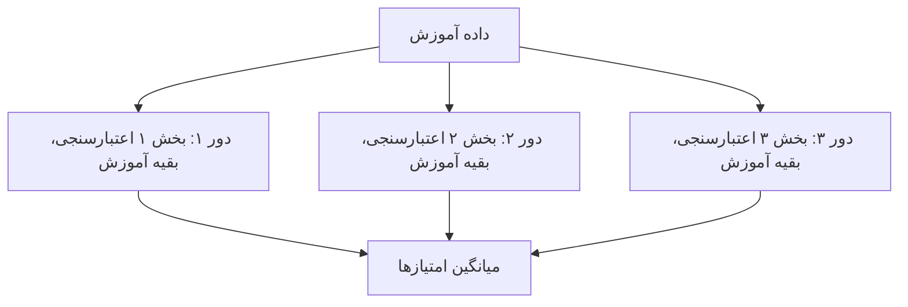
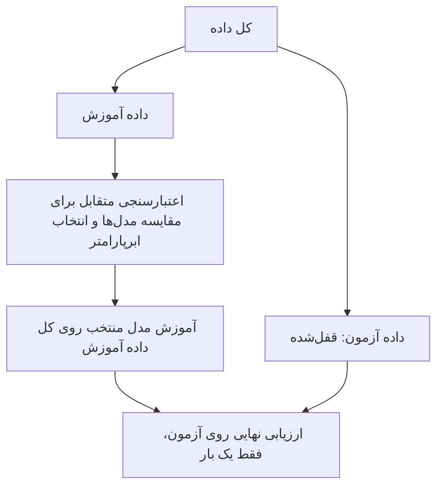

# جلسه ۱۸ — رگرسیون چندجمله‌ای، بیش‌برازش و اعتبارسنجی متقابل

## وقتی مدل «زیادی» خوب است

در جلسه قبل دیدیم که الگوی منحنی در نمودار باقیمانده‌ها یعنی رابطه خطی نیست، و با مدل توانی ضریب تعیین آزمون مصرف سوخت خودروها را از ۰.۵۶۶ به ۰.۶۱۹ رساندیم ← [رگرسیون چندگانه، هم‌خطی، رگرسیون غیرخطی و ارزیابی](https://claude.ai/cowork/17%20-%20%D8%B1%DA%AF%D8%B1%D8%B3%DB%8C%D9%88%D9%86%20%DA%86%D9%86%D8%AF%DA%AF%D8%A7%D9%86%D9%87%D8%8C%20%D9%87%D9%85%E2%80%8C%D8%AE%D8%B7%DB%8C%D8%8C%20%D8%B1%DA%AF%D8%B1%D8%B3%DB%8C%D9%88%D9%86%20%D8%BA%DB%8C%D8%B1%D8%AE%D8%B7%DB%8C%20%D9%88%20%D8%A7%D8%B1%D8%B2%DB%8C%D8%A7%D8%A8%DB%8C.md). راه کلی‌تر، انعطاف‌پذیرتر کردن مدل است؛ مثلاً افزودن توان‌های دوم و سوم ویژگی. اما مدل بیش از حد انعطاف‌پذیر، مثل دانشجویی که جواب سؤال‌های نمونه را حفظ کرده، داده آموزش را **حفظ** می‌کند و روی داده جدید شکست می‌خورد.

این جلسه به سه پرسش پاسخ می‌دهد:

- چرا مدل پیچیده‌تر روی داده آموزش همیشه بهتر است، ولی روی داده جدید نه؟
- چرا یک تقسیم آموزش و آزمون برای انتخاب مدل کافی نیست؟
- چگونه با **اعتبارسنجی متقابل** میان چند مدل یا چند مقدار ابرپارامتر انتخاب کنیم؟

---

## رگرسیون چندجمله‌ای

**رگرسیون چندجمله‌ای** (Polynomial Regression) توان‌های یک ویژگی (و با چند ویژگی، حاصل‌ضرب‌های آن‌ها) را به‌عنوان ویژگی‌های جدید می‌سازد و روی آن‌ها یک رگرسیون خطی **معمولی** برازش می‌دهد:

$$ \hat{y} = \beta_0 + \beta_1 x + \beta_2 x^2 + \cdots + \beta_d x^d $$

درجه d را ما پیش از آموزش تعیین می‌کنیم؛ پس یک **ابرپارامتر** است ← [مبانی یادگیری نظارت‌شده و رگرسیون خطی ساده](https://claude.ai/cowork/16%20-%20%D9%85%D8%A8%D8%A7%D9%86%DB%8C%20%DB%8C%D8%A7%D8%AF%DA%AF%DB%8C%D8%B1%DB%8C%20%D9%86%D8%B8%D8%A7%D8%B1%D8%AA%E2%80%8C%D8%B4%D8%AF%D9%87%20%D9%88%20%D8%B1%DA%AF%D8%B1%D8%B3%DB%8C%D9%88%D9%86%20%D8%AE%D8%B7%DB%8C%20%D8%B3%D8%A7%D8%AF%D9%87.md). مدل نسبت به x منحنی، ولی نسبت به **ضرایب** خطی است و با همان کمترین مربعات حل می‌شود. با p ویژگی و درجه d، تعداد ویژگی‌های ساخته‌شده (بدون ستون یک‌ها) برابر است با:

$$ \binom{p + d}{d} - 1 $$

### مثال حل‌شده: ساخت ستون‌های چندجمله‌ای

داده کوچکی با دو ویژگی x1 و x2 و هدف y داریم:

|سطر|x1|x2|y|
|:-:|:-:|:-:|:-:|
|۱|1|2|5|
|۲|2|0|4|
|۳|3|1|8|
|۴|4|3|15|

می‌خواهیم ویژگی‌های چندجمله‌ای **درجه ۲** را بسازیم. با دو ویژگی، چندجمله‌ای درجه ۲ همه جمله‌هایی را دارد که مجموع توان‌هایشان حداکثر ۲ است:

$$ \hat{y} = \beta_0 + \beta_1 x_1 + \beta_2 x_2 + \beta_3 x_1^2 + \beta_4 x_1 x_2 + \beta_5 x_2^2 $$

#### گام ۱ — ساخت دستی ستون‌ها

برای هر سطر، دو ستون اصلی را نگه می‌داریم و سه ستون تازه حساب می‌کنیم: مربع x1، حاصل‌ضرب x1 در x2 و مربع x2. ستون y **تغییری نمی‌کند**؛ تبدیل فقط روی ویژگی‌هاست.

|سطر|x1|x2|مربع x1|x1 ضرب در x2|مربع x2|y|
|:-:|:-:|:-:|:-:|:-:|:-:|:-:|
|۱|1|2|1|2|4|5|
|۲|2|0|4|0|0|4|
|۳|3|1|9|3|1|8|
|۴|4|3|16|12|9|15|

برای نمونه، در سطر ۴:

$$ x_1^2 = 4^2 = 16, \qquad x_1 x_2 = 4 \times 3 = 12, \qquad x_2^2 = 3^2 = 9 $$

از دو ویژگی به **پنج** ویژگی رسیدیم و رگرسیون خطی معمولی حالا روی این پنج ستون برازش داده می‌شود. فرمول تعداد ویژگی‌ها هم همین را می‌دهد:

$$ \binom{2 + 2}{2} - 1 = 6 - 1 = 5 $$

#### گام ۲ — همان تبدیل با کد

کلاس `PolynomialFeatures` همین ستون‌ها را می‌سازد؛ `include_bias=False` ستون یک‌ها را حذف می‌کند، چون `LinearRegression` خودش عرض از مبدأ را برآورد می‌کند:

```python
import pandas as pd
from sklearn.preprocessing import PolynomialFeatures

# 1. The small data set: two features and a target
data = pd.DataFrame({"x1": [1, 2, 3, 4], "x2": [2, 0, 1, 3], "y": [5, 4, 8, 15]})
X, y = data[["x1", "x2"]], data["y"]      # only the features are transformed; y stays as it is

# 2. Degree-2 polynomial features (no column of ones)
poly = PolynomialFeatures(degree=2, include_bias=False)
X_poly = pd.DataFrame(poly.fit_transform(X), columns=poly.get_feature_names_out())
print(X_poly)

# 3. Ten features, degree 3: how many columns are made?
ten = PolynomialFeatures(degree=3, include_bias=False).fit([[0] * 10])
print(f"10 features, degree 3 -> {ten.n_output_features_} features")
```

```
    x1   x2  x1^2  x1 x2  x2^2
0  1.0  2.0   1.0    2.0   4.0
1  2.0  0.0   4.0    0.0   0.0
2  3.0  1.0   9.0    3.0   1.0
3  4.0  3.0  16.0   12.0   9.0
10 features, degree 3 -> 285 features
```

> [!note] بررسی خروجی کد با جدول دستی یکی است؛ نام ستون‌ها (`x1^2`، `x1 x2`، `x2^2`) را `get_feature_names_out` می‌سازد. توجه کنید که این داده فقط چهار سطر دارد، اما مدل درجه ۲ شش ضریب (با عرض از مبدأ) دارد؛ چنین مدلی می‌تواند از **همه** نقاط آموزش بگذرد، بدون اینکه چیزی یاد گرفته باشد. این همان بیش‌برازش است که در ادامه جلسه می‌بینیم.

حاصل‌ضرب دو ویژگی (مثل `x1 x2`) **جمله تعاملی** است ← [مهندسی و انتخاب ویژگی](https://claude.ai/Part%203_Data%20Preprocessing/%DB%B1%DB%B3%20-%20%D9%85%D9%87%D9%86%D8%AF%D8%B3%DB%8C%20%D9%88%20%D8%A7%D9%86%D8%AA%D8%AE%D8%A7%D8%A8%20%D9%88%DB%8C%DA%98%DA%AF%DB%8C.md). با ده ویژگی و درجه ۳، تعداد ویژگی‌ها از ۱۰ به **۲۸۵** می‌رسد؛ ویژگی زیاد نسبت به نمونه، دستور پخت بیش‌برازش است.

> [!tip] ترتیب گام‌ها در Pipeline ساخت توان‌ها گام **قاعده‌محور** است، اما توان‌های بالا مقیاس‌های بسیار متفاوتی دارند؛ پس بعد از آن `StandardScaler` (گام **یادگیرنده**) و سپس مدل می‌آید و هر سه در یک Pipeline قرار می‌گیرند ← [طراحی آزمایش و Pipeline](https://claude.ai/Part%203_Data%20Preprocessing/%DB%B1%DB%B5%20-%20%D8%B7%D8%B1%D8%A7%D8%AD%DB%8C%20%D8%A2%D8%B2%D9%85%D8%A7%DB%8C%D8%B4%20%D9%88%20Pipeline.md)

---

## روش Hold-out: خطای آموزش کم، خطای آزمون زیاد

در **روش Hold-out** داده یک بار به دو بخش تقسیم می‌شود: مدل روی بخش **آموزش** یاد می‌گیرد و روی بخش کنار گذاشته‌شده (**آزمون** یا **اعتبارسنجی**) سنجیده می‌شود. همین تقسیم را در جلسات ۱۵ و ۱۶ با `train_test_split` انجام دادیم. اکنون می‌بینیم چرا خطای آموزش به‌تنهایی گمراه‌کننده است.

> [!example] مثال — داده موجی با نویز سی نقطه از یک تابع سینوسی به همراه نویز (انحراف معیار ۰.۳) می‌سازیم؛ ۲۰ نقطه برای آموزش و ۱۰ نقطه برای آزمون. سپس چندجمله‌ای درجه ۱، ۳ و ۱۲ را برازش می‌دهیم.

```python
import numpy as np
import matplotlib.pyplot as plt
from sklearn.model_selection import train_test_split
from sklearn.preprocessing import PolynomialFeatures, StandardScaler
from sklearn.linear_model import LinearRegression
from sklearn.pipeline import make_pipeline
from sklearn.metrics import root_mean_squared_error

# 1. Synthetic data: a sine wave plus noise (sd = 0.3)
rng = np.random.default_rng(3)
x = rng.uniform(0, 1, 30).reshape(-1, 1)
y = np.sin(2 * np.pi * x.ravel()) + rng.normal(0, 0.3, 30)

# 2. Hold-out split: 20 points for training, 10 for testing
x_train, x_test, y_train, y_test = train_test_split(x, y, test_size=1/3, random_state=42)

# 3. Fit polynomials of degree 1, 3 and 12 and compare train vs test RMSE
grid = np.linspace(0, 1, 300).reshape(-1, 1)
fig, axes = plt.subplots(1, 3, figsize=(15, 4), sharey=True)
for ax, d in zip(axes, [1, 3, 12]):
    model = make_pipeline(PolynomialFeatures(d, include_bias=False), StandardScaler(), LinearRegression())
    model.fit(x_train, y_train)
    rmse_train = root_mean_squared_error(y_train, model.predict(x_train))
    rmse_test = root_mean_squared_error(y_test, model.predict(x_test))
    print(f"degree={d:2d}  train RMSE={rmse_train:.3f}  test RMSE={rmse_test:.3f}")
    ax.scatter(x_train, y_train, color="black", label="Train")
    ax.scatter(x_test, y_test, color="orange", marker="s", label="Test")
    ax.plot(grid, model.predict(grid), color="red", label="Model")
    ax.set(ylim=(-2, 2), title=f"Degree {d}: train {rmse_train:.2f}, test {rmse_test:.2f}")
axes[0].legend()
plt.show()
```

```
degree= 1  train RMSE=0.566  test RMSE=0.675
degree= 3  train RMSE=0.285  test RMSE=0.370
degree=12  train RMSE=0.230  test RMSE=2.097
```

[sine holdout fits](https://claude.ai/img/sine_holdout_fits.png)

|درجه|RMSE آموزش|RMSE آزمون|تشخیص|
|:-:|:-:|:-:|:-:|
|۱|0.566|0.675|کم‌برازش: هر دو خطا زیاد|
|۳|0.285|0.370|برازش مناسب: هر دو کم و نزدیک حد نویز (۰.۳)|
|۱۲|0.230|2.097|بیش‌برازش: آموزش کمترین، آزمون حدود ۹ برابر آموزش|

مدل درجه ۱۲ از نزدیک همه نقاط آموزش می‌گذرد، اما بین و کنار آن‌ها نوسان شدید دارد (نمودار سوم). خطای آموزش با افزایش درجه **همیشه** کم می‌شود؛ فقط داده‌ای که مدل ندیده، بیش‌برازش را آشکار می‌کند.

|مشکل|نشانه|راه‌حل‌ها|
|:-:|:-:|:-:|
|کم‌برازش (Underfitting)|خطای آموزش و آزمون هر دو زیاد|مدل پیچیده‌تر، ویژگی بهتر|
|بیش‌برازش (Overfitting)|خطای آموزش بسیار کمتر از خطای آزمون|داده بیشتر، مدل ساده‌تر، انتخاب ویژگی، منظم‌سازی ← [منظم‌سازی در رگرسیون](https://claude.ai/cowork/19%20-%20%D9%85%D9%86%D8%B8%D9%85%E2%80%8C%D8%B3%D8%A7%D8%B2%DB%8C%20%D8%AF%D8%B1%20%D8%B1%DA%AF%D8%B1%D8%B3%DB%8C%D9%88%D9%86.md)|

> [!warning] چه چیزی خطر بیش‌برازش را زیاد می‌کند؟ تعداد زیاد ویژگی یا پارامتر نسبت به نمونه، نویز زیاد، و مدل‌های بسیار انعطاف‌پذیر: چندجمله‌ای درجه بالا، درخت تصمیم عمیق ← [درخت تصمیم](https://claude.ai/Part%205_Classification/22%20-%20%D8%AF%D8%B1%D8%AE%D8%AA%20%D8%AA%D8%B5%D9%85%DB%8C%D9%85.md) و الگوریتم k-NN با یک همسایه ← [مبانی طبقه‌بندی و k-NN](https://claude.ai/Part%205_Classification/20%20-%20%20%D9%85%D8%A8%D8%A7%D9%86%DB%8C%20%D8%B7%D8%A8%D9%82%D9%87%E2%80%8C%D8%A8%D9%86%D8%AF%DB%8C%20%D9%88%20k-NN.md)

---

## مشکل Hold-out: یک تقسیم، یک شانس

برای **انتخاب** درجه نمی‌توان از داده آزمون استفاده کرد؛ آزمون باید تا آخر دست‌نخورده بماند ← [مبانی یادگیری نظارت‌شده و رگرسیون خطی ساده](https://claude.ai/cowork/16%20-%20%D9%85%D8%A8%D8%A7%D9%86%DB%8C%20%DB%8C%D8%A7%D8%AF%DA%AF%DB%8C%D8%B1%DB%8C%20%D9%86%D8%B8%D8%A7%D8%B1%D8%AA%E2%80%8C%D8%B4%D8%AF%D9%87%20%D9%88%20%D8%B1%DA%AF%D8%B1%D8%B3%DB%8C%D9%88%D9%86%20%D8%AE%D8%B7%DB%8C%20%D8%B3%D8%A7%D8%AF%D9%87.md). راه ساده این است که داده آموزش را یک بار دیگر به «آموزش» و «اعتبارسنجی» تقسیم کنیم. اما نتیجه چقدر به این تقسیم وابسته است؟

داده خودروها (mpg) را از جلسه قبل می‌شناسیم: ۳۹۲ خودرو (پس از حذف سطرهای بدون قدرت موتور) و هدف مصرف سوخت بر حسب مایل بر گالن. ابتدا ۲۰ درصد را به‌عنوان آزمون قفل می‌کنیم، سپس داده آموزش را **هشت بار** با بذرهای مختلف به آموزش و اعتبارسنجی تقسیم می‌کنیم و برای درجه‌های ۱ تا ۸ خطای اعتبارسنجی را می‌سنجیم.

```python
import numpy as np
import seaborn as sns
from sklearn.model_selection import train_test_split
from sklearn.preprocessing import PolynomialFeatures, StandardScaler
from sklearn.linear_model import LinearRegression
from sklearn.pipeline import make_pipeline
from sklearn.metrics import root_mean_squared_error

# 1. Data: fuel economy (mpg) from engine horsepower; the test set is locked first
mpg = sns.load_dataset("mpg").dropna(subset=["horsepower"])
X, y = mpg[["horsepower"]], mpg["mpg"]
X_train, X_test, y_train, y_test = train_test_split(X, y, test_size=0.2, random_state=42)

# 2. Eight different hold-out validation splits of the SAME training data
for seed in range(8):
    X_fit, X_val, y_fit, y_val = train_test_split(X_train, y_train, test_size=0.25, random_state=seed)
    rmse = []
    for d in range(1, 9):
        model = make_pipeline(PolynomialFeatures(d, include_bias=False), StandardScaler(), LinearRegression())
        rmse.append(root_mean_squared_error(y_val, model.fit(X_fit, y_fit).predict(X_val)))
    print(f"split={seed}  degree-2 RMSE={rmse[1]:.3f}  best degree={np.argmin(rmse) + 1}")
```

```
split=0  degree-2 RMSE=3.700  best degree=7
split=1  degree-2 RMSE=3.806  best degree=2
split=2  degree-2 RMSE=4.876  best degree=6
split=3  degree-2 RMSE=4.444  best degree=2
split=4  degree-2 RMSE=4.103  best degree=8
split=5  degree-2 RMSE=4.542  best degree=8
split=6  degree-2 RMSE=4.322  best degree=8
split=7  degree-2 RMSE=4.094  best degree=3
```

- خطای اعتبارسنجی **همان مدل** (درجه ۲) بسته به تقسیم از ۳.۷۰ تا ۴.۸۸ تغییر می‌کند.
- «بهترین درجه» در تقسیم‌های مختلف ۲، ۳، ۶، ۷ یا ۸ است!
- در هر تقسیم، ۲۵ درصد داده آموزش هرگز در آموزش استفاده نمی‌شود.

یک تقسیم ثابت برآوردی **پرنوسان** می‌دهد و انتخاب مدل با آن تا حد زیادی به شانس بستگی دارد. راه‌حل: به جای یک تقسیم، از **همه** تقسیم‌ها میانگین بگیریم.

---

## اعتبارسنجی متقابل k بخشی

در **اعتبارسنجی متقابل k بخشی** (k-Fold Cross-Validation):

1. داده آموزش را به k بخش (Fold) تقریباً هم‌اندازه تقسیم کن.
2. برای هر بخش: مدل را روی k−1 بخش دیگر آموزش بده و روی همین بخش ارزیابی کن.
3. میانگین (و انحراف معیار) k امتیاز را گزارش کن.

$$ \text{CV}_{(k)} = \frac{1}{k} \sum_{i=1}^{k} \text{RMSE}_i $$



هر نمونه دقیقاً **یک بار** در اعتبارسنجی و k−1 بار در آموزش است؛ پس هیچ داده‌ای هدر نمی‌رود و برآورد به یک تقسیم خاص وابسته نیست.

### مثال حل‌شده: اعتبارسنجی متقابل سه بخشی

یک فروشگاه زنجیره‌ای می‌خواهد فروش هر شعبه را از بودجه تبلیغات آن پیش‌بینی کند. دو مدل را مقایسه می‌کنیم: **مدل پایه** (همیشه میانگین فروش آموزش) و **رگرسیون خطی ساده**. داده شش شعبه و بخش هر کدام:

|شعبه|بودجه تبلیغات (میلیون تومان)|فروش (میلیون تومان)|بخش|
|:-:|:-:|:-:|:-:|
|۱|1|6|۱|
|۲|2|10|۲|
|۳|3|16|۳|
|۴|4|20|۱|
|۵|5|24|۲|
|۶|6|26|۳|

یادآوری فرمول‌های رگرسیون خطی ساده و RMSE:

$$ \hat{\beta}_1 = \frac{\sum (x_i - \bar{x})(y_i - \bar{y})}{\sum (x_i - \bar{x})^2}, \qquad \hat{\beta}_0 = \bar{y} - \hat{\beta}_1 \bar{x}, \qquad \text{RMSE} = \sqrt{\frac{1}{n} \sum (y_i - \hat{y}_i)^2} $$

#### گام ۱ — دور اول: شعبه‌های ۱ و ۴ اعتبارسنجی

آموزش روی شعبه‌های ۲، ۳، ۵ و ۶؛ میانگین بودجه ۴ و میانگین فروش ۱۹:

|شعبه|بودجه|فروش|انحراف بودجه|انحراف فروش|حاصل‌ضرب انحراف‌ها|مجذور انحراف بودجه|
|:-:|:-:|:-:|:-:|:-:|:-:|:-:|
|۲|2|10|−2|−9|18|4|
|۳|3|16|−1|−3|3|1|
|۵|5|24|1|5|5|1|
|۶|6|26|2|7|14|4|
|جمع|16|76|0|0|40|10|

$$ \hat{\beta}_1 = \frac{40}{10} = 4, \qquad \hat{\beta}_0 = 19 - 4 \times 4 = 3 $$

|شعبه|بودجه|فروش واقعی|پیش‌بینی پایه|خطای پایه|پیش‌بینی خطی|خطای خطی|
|:-:|:-:|:-:|:-:|:-:|:-:|:-:|
|۱|1|6|19|−13|7|−1|
|۴|4|20|19|1|19|1|

$$ \text{RMSE}_{\text{base}} = \sqrt{\frac{169 + 1}{2}} = \sqrt{85} \approx 9.220, \qquad \text{RMSE}_{\text{linear}} = \sqrt{\frac{1 + 1}{2}} = 1 $$

#### گام ۲ — دور دوم: شعبه‌های ۲ و ۵ اعتبارسنجی

آموزش روی شعبه‌های ۱، ۳، ۴ و ۶؛ میانگین بودجه ۳.۵ و میانگین فروش ۱۷:

|شعبه|بودجه|فروش|انحراف بودجه|انحراف فروش|حاصل‌ضرب انحراف‌ها|مجذور انحراف بودجه|
|:-:|:-:|:-:|:-:|:-:|:-:|:-:|
|۱|1|6|−2.5|−11|27.5|6.25|
|۳|3|16|−0.5|−1|0.5|0.25|
|۴|4|20|0.5|3|1.5|0.25|
|۶|6|26|2.5|9|22.5|6.25|
|جمع|14|68|0|0|52|13|

$$ \hat{\beta}_1 = \frac{52}{13} = 4, \qquad \hat{\beta}_0 = 17 - 4 \times 3.5 = 3 $$

|شعبه|بودجه|فروش واقعی|پیش‌بینی پایه|خطای پایه|پیش‌بینی خطی|خطای خطی|
|:-:|:-:|:-:|:-:|:-:|:-:|:-:|
|۲|2|10|17|−7|11|−1|
|۵|5|24|17|7|23|1|

$$ \text{RMSE}_{\text{base}} = \sqrt{\frac{49 + 49}{2}} = 7, \qquad \text{RMSE}_{\text{linear}} = \sqrt{\frac{1 + 1}{2}} = 1 $$

#### گام ۳ — دور سوم: شعبه‌های ۳ و ۶ اعتبارسنجی

آموزش روی شعبه‌های ۱، ۲، ۴ و ۵؛ میانگین بودجه ۳ و میانگین فروش ۱۵:

|شعبه|بودجه|فروش|انحراف بودجه|انحراف فروش|حاصل‌ضرب انحراف‌ها|مجذور انحراف بودجه|
|:-:|:-:|:-:|:-:|:-:|:-:|:-:|
|۱|1|6|−2|−9|18|4|
|۲|2|10|−1|−5|5|1|
|۴|4|20|1|5|5|1|
|۵|5|24|2|9|18|4|
|جمع|12|60|0|0|46|10|

$$ \hat{\beta}_1 = \frac{46}{10} = 4.6, \qquad \hat{\beta}_0 = 15 - 4.6 \times 3 = 1.2 $$

|شعبه|بودجه|فروش واقعی|پیش‌بینی پایه|خطای پایه|پیش‌بینی خطی|خطای خطی|
|:-:|:-:|:-:|:-:|:-:|:-:|:-:|
|۳|3|16|15|1|15|1|
|۶|6|26|15|11|28.8|−2.8|

$$ \text{RMSE}_{\text{base}} = \sqrt{\frac{1 + 121}{2}} = \sqrt{61} \approx 7.810, \qquad \text{RMSE}_{\text{linear}} = \sqrt{\frac{1 + 7.84}{2}} = \sqrt{4.42} \approx 2.102 $$

#### گام ۴ — میانگین امتیازها و مدل نهایی

|دور|RMSE مدل پایه|RMSE مدل خطی|
|:-:|:-:|:-:|
|۱|9.220|1.000|
|۲|7.000|1.000|
|۳|7.810|2.102|
|میانگین|8.010|1.367|

مدل خطی در **هر سه** دور بهتر است و خطای معمول آن روی شعبه دیده‌نشده حدود **۱.۴ میلیون تومان** برآورد می‌شود. اعتبارسنجی متقابل فقط برای **انتخاب** بود؛ مدل نهایی روی هر شش شعبه برازش می‌شود. با میانگین بودجه ۳.۵، میانگین فروش ۱۷، مجموع حاصل‌ضرب انحراف‌ها ۷۳ و مجموع مجذور انحراف بودجه ۱۷.۵:

$$ \hat{\beta}_1 = \frac{73}{17.5} \approx 4.171, \qquad \hat{\beta}_0 = 17 - 4.171 \times 3.5 = 2.4 $$

> [!note] بررسی
> 
> - هر شعبه دقیقاً یک بار، با مدلی که آن را ندیده بود، پیش‌بینی شد.
> - مجموع ستون‌های «انحراف» در همه جدول‌ها صفر است؛ پس میانگین‌ها درست‌اند.
> - بزرگ‌ترین خطا (−2.8) مربوط به شعبه ۶ است: در دور سوم بودجه ۶ بیرون از بازه آموزش (۱ تا ۵) بود و مدل باید **برون‌یابی** می‌کرد.

### مثال داده خودروها: پنج بخشی و Leave-One-Out

به داده خودروها برمی‌گردیم که با آن مشکل Hold-out را دیدیم. به جای هشت تقسیم پرنوسان، داده آموزش (۳۱۳ خودرو) را به **پنج بخش** تقسیم می‌کنیم و درجه ۱ و ۲ را مقایسه می‌کنیم. تابع `cross_val_score` همان حلقه مثال حل‌شده را اجرا می‌کند: در هر دور یک نسخه **تازه** از مدل را روی چهار بخش دیگر `fit` می‌کند و RMSE را روی بخش کنار گذاشته حساب می‌کند. کلاس `KFold` تعیین می‌کند هر خودرو در کدام بخش باشد؛ با `shuffle=True` داده پیش از تقسیم بر زده می‌شود.

حالت خاصی که k برابر تعداد نمونه‌هاست، **Leave-One-Out** نام دارد: هر بار فقط یک نمونه کنار گذاشته می‌شود. در Leave-One-Out هر بخش یک نمونه دارد و RMSE یک نمونه همان قدرمطلق خطاست؛ پس مجذور خطاها را میانگین می‌گیریم و سپس جذر. کد زیر ادامه کد بخش «مشکل Hold-out» است و از همان داده آموزش استفاده می‌کند:

```python
from sklearn.model_selection import KFold, LeaveOneOut, cross_val_score

# Continues the hold-out code: same X_train and y_train; the test set stays locked
# 1. Five shuffled folds of the training set; both degrees are scored on the SAME folds
kf = KFold(n_splits=5, shuffle=True, random_state=42)
for d in [1, 2]:
    model = make_pipeline(PolynomialFeatures(d, include_bias=False), StandardScaler(), LinearRegression())
    rmse = -cross_val_score(model, X_train, y_train, cv=kf, scoring="neg_root_mean_squared_error")
    print(f"degree={d}  folds={np.round(rmse, 2)}  mean={rmse.mean():.3f}  sd={rmse.std():.3f}")
```

```
degree=1  folds=[5.06 4.32 4.88 4.96 5.66]  mean=4.974  sd=0.427
degree=2  folds=[4.33 3.6  4.84 4.13 5.08]  mean=4.397  sd=0.526
```

```python
# 2. Leave-One-Out: one fit per training row; average the squared errors, then take the root
for d in [1, 2]:
    model = make_pipeline(PolynomialFeatures(d, include_bias=False), StandardScaler(), LinearRegression())
    mse = -cross_val_score(model, X_train, y_train, cv=LeaveOneOut(), scoring="neg_mean_squared_error")
    print(f"degree={d}  LOO fits={len(mse)}  LOO RMSE={np.sqrt(mse.mean()):.3f}")
```

```
degree=1  LOO fits=313  LOO RMSE=4.985
degree=2  LOO fits=313  LOO RMSE=4.418
```

> [!note] چرا امتیاز منفی است؟ در scikit-learn همه امتیازها طوری تعریف شده‌اند که **بزرگ‌تر بهتر** باشد؛ پس خطاها با پیشوند `neg_` و علامت منفی برمی‌گردند و ما آن‌ها را در منفی یک ضرب می‌کنیم.

- درجه ۲ در **هر پنج** بخش خطای کمتری از درجه ۱ دارد؛ چون هر دو مدل روی **همان** بخش‌ها سنجیده شده‌اند، این برتری قابل اعتماد است.
- انحراف معیار امتیازها (حدود ۰.۵) همان نوسانی است که در هشت تقسیم Hold-out دیدیم؛ اکنون به‌جای اتکا به یک عدد، میانگین پنج عدد را داریم.
- روش Leave-One-Out با ۳۱۳ بار آموزش همان نتیجه پنج بخشی را می‌دهد (۴.۴۲ در برابر ۴.۴۰)، اما حدود ۶۰ برابر پرهزینه‌تر است.

|روش|تعداد آموزش مدل|پایداری برآورد|کاربرد|
|:-:|:-:|:-:|:-:|
|روش Hold-out|۱|کم؛ وابسته به یک تقسیم|داده بسیار بزرگ|
|روش ۵ یا ۱۰ بخشی|۵ یا ۱۰|خوب|**انتخاب پیش‌فرض**|
|روش Leave-One-Out|n|خوب ولی بسیار پرهزینه|داده بسیار کم|

|                                                                                                                                ساختار داده                                                                                                                                 |             گونه مناسب             |      کلاس در scikit-learn      |
| :------------------------------------------------------------------------------------------------------------------------------------------------------------------------------------------------------------------------------------------------------------------------: | :--------------------------------: | :----------------------------: |
|                                                                                                                              نمونه‌های مستقل                                                                                                                               |       تقسیم k بخشی با بر زدن       | کلاس `KFold` با `shuffle=True` |
| طبقه‌بندی با کلاس‌های نامتوازن ← [ارزیابی مدل‌های طبقه‌بندی](https://claude.ai/Part%205_Classification/25%20-%20%D8%A7%D8%B1%D8%B2%DB%8C%D8%A7%D8%A8%DB%8C%20%D9%85%D8%AF%D9%84%E2%80%8C%D9%87%D8%A7%DB%8C%20%D8%B7%D8%A8%D9%82%D9%87%E2%80%8C%D8%A8%D9%86%D8%AF%DB%8C.md) |     حفظ نسبت کلاس‌ها در هر بخش     |     کلاس `StratifiedKFold`     |
|                                                                                                                                 داده زمانی                                                                                                                                 | آموزش روی گذشته، ارزیابی روی آینده |     کلاس `TimeSeriesSplit`     |

> [!warning] بر زدن داده کلاس `KFold` به‌طور پیش‌فرض داده را **بر نمی‌زند**. اگر داده مرتب باشد (مثلاً بر اساس سال)، هر بخش فقط یک تکه از داده است. برای داده غیرزمانی `shuffle=True` بگذارید؛ برای داده زمانی **هرگز** بر نزنید.

---

## منحنی یادگیری و منحنی اعتبارسنجی

### منحنی یادگیری

**منحنی یادگیری** (Learning Curve) خطای آموزش و اعتبارسنجی را بر حسب **اندازه داده آموزش** رسم می‌کند و می‌گوید «آیا داده بیشتر کمک می‌کند؟»:

|الگوی منحنی|تشخیص|داده بیشتر کمک می‌کند؟|
|:-:|:-:|:-:|
|دو منحنی زود به هم می‌رسند، در سطح **بالا**|کم‌برازش|خیر؛ مدل یا ویژگی بهتر لازم است|
|فاصله **زیاد** میان دو منحنی که با داده بیشتر کم می‌شود|بیش‌برازش|بله|
|دو منحنی نزدیک هم، در سطح پایین|برازش مناسب|فایده کم|

تابع `learning_curve` برای هر اندازه آموزش، اعتبارسنجی متقابل را اجرا می‌کند. روی ۵۰۰ نقطه از همان داده موجی:

```python
import numpy as np
import matplotlib.pyplot as plt
from sklearn.model_selection import KFold, learning_curve
from sklearn.preprocessing import PolynomialFeatures, StandardScaler
from sklearn.linear_model import LinearRegression
from sklearn.pipeline import make_pipeline

# 1. A larger sample from the same noisy sine wave
rng = np.random.default_rng(0)
x = rng.uniform(0, 1, 500).reshape(-1, 1)
y = np.sin(2 * np.pi * x.ravel()) + rng.normal(0, 0.3, 500)

# 2. Learning curves of degree 1 and degree 9 with 5-fold CV
kf = KFold(n_splits=5, shuffle=True, random_state=42)
fig, axes = plt.subplots(1, 2, figsize=(13, 4), sharey=True)
for ax, d in zip(axes, [1, 9]):
    model = make_pipeline(PolynomialFeatures(d, include_bias=False), StandardScaler(), LinearRegression())
    sizes, train_sc, val_sc = learning_curve(model, x, y, train_sizes=[15, 30, 100, 400],
                                             cv=kf, scoring="neg_root_mean_squared_error")
    train_rmse, val_rmse = -train_sc.mean(axis=1), -val_sc.mean(axis=1)
    print(f"degree={d}  sizes={sizes}  train={np.round(train_rmse, 3)}  val={np.round(val_rmse, 3)}")
    ax.plot(sizes, train_rmse, "o-", label="Training")
    ax.plot(sizes, val_rmse, "s-", label="Validation")
    ax.set(xscale="log", xlabel="Training set size (log scale)", ylabel="RMSE",
           title=f"Learning curve, degree {d}")
    ax.set_xticks(sizes, labels=sizes)
    ax.minorticks_off()
    ax.legend()
plt.show()
```

```
degree=1  sizes=[ 15  30 100 400]  train=[0.506 0.566 0.561 0.527]  val=[0.586 0.551 0.535 0.528]
degree=9  sizes=[ 15  30 100 400]  train=[0.174 0.261 0.263 0.277]  val=[2.109 0.316 0.289 0.285]
```

[sine learning curve](https://claude.ai/img/sine_learning_curve.png)

در **درجه ۱** دو منحنی از ابتدا در سطح حدود ۰.۵۳ به هم چسبیده‌اند؛ داده بیشتر کمکی نمی‌کند (کم‌برازش). در **درجه ۹** با ۱۵ نمونه خطای اعتبارسنجی ۲.۱۱ و فاصله بسیار زیاد است، اما با ۴۰۰ نمونه هر دو خطا به حد نویز (۰.۳) می‌رسند. مدل پیچیده به داده **زیاد** نیاز دارد.

### منحنی اعتبارسنجی و ارزیابی نهایی

**منحنی اعتبارسنجی** (Validation Curve) خطای آموزش و خطای اعتبارسنجی متقابل را بر حسب **یک ابرپارامتر** رسم می‌کند. تابع `validation_curve` این کار را انجام می‌دهد؛ نام ابرپارامتر داخل Pipeline به شکل «گام__پارامتر» نوشته می‌شود. کد زیر کل چرخه را روی داده mpg اجرا می‌کند: قفل کردن آزمون، انتخاب درجه با اعتبارسنجی متقابل، آموزش دوباره روی کل داده آموزش و **یک بار** ارزیابی روی آزمون.

```python
import numpy as np
import matplotlib.pyplot as plt
import seaborn as sns
from sklearn.model_selection import train_test_split, KFold, validation_curve
from sklearn.preprocessing import PolynomialFeatures, StandardScaler
from sklearn.linear_model import LinearRegression
from sklearn.pipeline import make_pipeline
from sklearn.dummy import DummyRegressor
from sklearn.metrics import root_mean_squared_error, r2_score

# 1. Data: fuel economy (mpg) from engine horsepower
mpg = sns.load_dataset("mpg").dropna(subset=["horsepower"])
X, y = mpg[["horsepower"]], mpg["mpg"]
X_train, X_test, y_train, y_test = train_test_split(X, y, test_size=0.2, random_state=42)
print(f"train={len(X_train)}  test={len(X_test)}")

# 2. Pipeline: powers -> scaling -> linear regression
model = make_pipeline(PolynomialFeatures(include_bias=False), StandardScaler(), LinearRegression())

# 3. Validation curve: 5-fold CV RMSE for degrees 1..8 (training data only)
degrees = np.arange(1, 9)
kf = KFold(n_splits=5, shuffle=True, random_state=42)
train_sc, val_sc = validation_curve(model, X_train, y_train,
                                    param_name="polynomialfeatures__degree", param_range=degrees,
                                    cv=kf, scoring="neg_root_mean_squared_error")
for d, tr, va in zip(degrees, -train_sc.mean(axis=1), -val_sc):
    print(f"degree={d}  train={tr:.3f}  val={va.mean():.3f} (sd {va.std():.3f})")

# 4. Refit the chosen degree on the whole training set; use the test set once
model.set_params(polynomialfeatures__degree=2).fit(X_train, y_train)
baseline = DummyRegressor().fit(X_train, y_train)
print(f"test R2={r2_score(y_test, model.predict(X_test)):.3f}  "
      f"RMSE={root_mean_squared_error(y_test, model.predict(X_test)):.3f}  "
      f"baseline RMSE={root_mean_squared_error(y_test, baseline.predict(X_test)):.3f}")

# 5. Plot the validation curve
fig, ax = plt.subplots(figsize=(7, 4))
ax.plot(degrees, -train_sc.mean(axis=1), "o-", label="Training")
ax.plot(degrees, -val_sc.mean(axis=1), "s-", label="Validation (5-fold CV)")
ax.set(xlabel="Polynomial degree", ylabel="RMSE (mpg)", title="Validation curve: mpg ~ horsepower")
ax.legend()
plt.show()
```

```
train=313  test=79
degree=1  train=4.941  val=4.974 (sd 0.427)
degree=2  train=4.375  val=4.397 (sd 0.526)
degree=3  train=4.366  val=4.409 (sd 0.529)
degree=4  train=4.362  val=4.428 (sd 0.527)
degree=5  train=4.304  val=4.388 (sd 0.563)
degree=6  train=4.286  val=4.379 (sd 0.592)
degree=7  train=4.279  val=4.399 (sd 0.587)
degree=8  train=4.277  val=4.391 (sd 0.588)
test R2=0.639  RMSE=4.291  baseline RMSE=7.185
```

[mpg validation curve](https://claude.ai/img/mpg_validation_curve.png)

- پرش بزرگ از درجه ۱ به ۲ (۴.۹۷ به ۴.۴۰) نشان می‌دهد رابطه **منحنی** است. پس از آن خطای آموزش آرام کم می‌شود ولی خطای اعتبارسنجی تقریباً ثابت می‌ماند.
- کمترین خطای اعتبارسنجی در درجه ۶ است (۴.۳۷۹)، اما اختلاف آن با درجه ۲ (۰.۰۱۸) بسیار کمتر از **خطای استاندارد** میانگین پنج بخش است (۰.۵۲۶ تقسیم بر جذر ۵، حدود ۰.۲۴). پس مدل ساده‌تر **درجه ۲** را انتخاب می‌کنیم (اصل صرفه‌جویی؛ «قاعده یک خطای استاندارد» ← [منظم‌سازی در رگرسیون](https://claude.ai/cowork/19%20-%20%D9%85%D9%86%D8%B8%D9%85%E2%80%8C%D8%B3%D8%A7%D8%B2%DB%8C%20%D8%AF%D8%B1%20%D8%B1%DA%AF%D8%B1%D8%B3%DB%8C%D9%88%D9%86.md)).
- روی آزمون، RMSE مدل درجه ۲ (۴.۲۹) بسیار کمتر از مدل پایه (۷.۱۹) و نزدیک برآورد اعتبارسنجی متقابل (۴.۴۰) است. ضریب تعیین آزمون ۰.۶۳۹ است؛ روی همان تقسیم، مدل خطی جلسه قبل ۰.۵۶۶ و مدل توانی ۰.۶۱۹ داشتند ← [رگرسیون چندگانه، هم‌خطی، رگرسیون غیرخطی و ارزیابی](https://claude.ai/cowork/17%20-%20%D8%B1%DA%AF%D8%B1%D8%B3%DB%8C%D9%88%D9%86%20%DA%86%D9%86%D8%AF%DA%AF%D8%A7%D9%86%D9%87%D8%8C%20%D9%87%D9%85%E2%80%8C%D8%AE%D8%B7%DB%8C%D8%8C%20%D8%B1%DA%AF%D8%B1%D8%B3%DB%8C%D9%88%D9%86%20%D8%BA%DB%8C%D8%B1%D8%AE%D8%B7%DB%8C%20%D9%88%20%D8%A7%D8%B1%D8%B2%DB%8C%D8%A7%D8%A8%DB%8C.md)

> [!important] قاعده طلایی اعتبارسنجی متقابل جایگزین مجموعه **اعتبارسنجی** است، نه **آزمون**. آزمون پیش از هر کاری قفل می‌شود؛ مقایسه مدل‌ها و انتخاب ابرپارامتر فقط با اعتبارسنجی متقابل روی داده آموزش انجام می‌شود؛ مدل منتخب روی **کل** داده آموزش دوباره آموزش می‌بیند و فقط **یک بار** روی آزمون ارزیابی می‌شود.



> [!warning] پیش‌پردازش داخل حلقه در همه کدهای این جلسه کل Pipeline (توان‌ها، استانداردسازی و مدل) به `cross_val_score` یا `validation_curve` داده شد؛ پس استانداردسازی در هر دور فقط روی بخش‌های آموزش همان دور `fit` می‌شود. اگر پیش از اعتبارسنجی متقابل کل داده آموزش را استاندارد کنید، اطلاعات بخش اعتبارسنجی نشت می‌کند و امتیاز خوش‌بینانه می‌شود.

> [!note] کارگاه عملی دفترچه «۱۸ - کارگاه رگرسیون چندجمله‌ای، بیش‌برازش و اعتبارسنجی متقابل» چند معیار هم‌زمان با `cross_validate`، گونه‌های `KFold`، `RepeatedKFold`، `GroupKFold` و `TimeSeriesSplit` و تمرین عملی کلاس (مصرف سوخت بر حسب وزن خودرو) را با پاسخ دارد. نحوه نوشتن این کدها در امتحان پرسیده نمی‌شود.

---

## خطاهای رایج

|خطا|چرا نادرست است|روش درست|
|:-:|:-:|:-:|
|انتخاب مدل با خطای آموزش|خطای آموزش با پیچیدگی همیشه کم می‌شود و بیش‌برازش را پنهان می‌کند|مقایسه با خطای اعتبارسنجی متقابل|
|انتخاب درجه یا ابرپارامتر با داده آزمون|آزمون به بخشی از آموزش تبدیل می‌شود و برآورد نهایی دیگر بی‌طرفانه نیست|انتخاب با اعتبارسنجی متقابل؛ آزمون فقط یک بار در پایان|
|تکیه بر یک تقسیم Hold-out کوچک|نتیجه و حتی بهترین مدل با عوض شدن تقسیم تغییر می‌کند|اعتبارسنجی متقابل k بخشی|
|استانداردسازی کل داده آموزش پیش از cross_val_score|پارامترهای استانداردسازی بخش اعتبارسنجی را هم دیده‌اند (نشت داده)|کل Pipeline را به cross_val_score بدهید|
|بر زدن داده زمانی|مدل با آینده آموزش می‌بیند و گذشته را پیش‌بینی می‌کند|کلاس TimeSeriesSplit|
|انتخاب پیچیده‌ترین مدل برای اختلاف بسیار کوچک|اختلاف در حد نوسان بخش‌هاست|مقایسه اختلاف با خطای استاندارد؛ ترجیح مدل ساده‌تر|

---

## نمونه سؤال‌های امتحانی

### سؤال‌های مفهومی

> [!question]- ۱. چرا رگرسیون چندجمله‌ای با وجود منحنی بودن، یک مدل «خطی» محسوب می‌شود؟ چون مدل نسبت به **ضرایب** خطی است. توان‌های x ویژگی‌های جدیدی هستند و مدل روی آن‌ها یک رگرسیون خطی چندگانه معمولی است که با همان کمترین مربعات حل می‌شود.

> [!question]- ۲. خطای آموزش مدلی ۱.۵ و خطای اعتبارسنجی متقابل آن ۶ است. مشکل چیست و سه راه‌حل پیشنهاد دهید. فاصله زیاد دو خطا نشانه **بیش‌برازش** است. راه‌حل‌ها: **داده بیشتر**، **ساده‌تر کردن** مدل (درجه یا ویژگی کمتر) و **منظم‌سازی**.

> [!question]- ۳. در منحنی یادگیری یک مدل، خطای آموزش و اعتبارسنجی هر دو در سطح بالایی به هم رسیده‌اند. آیا داده بیشتر کمک می‌کند؟ خیر. این الگوی **کم‌برازش** است؛ باید مدل را پیچیده‌تر کرد یا ویژگی بهتری ساخت.

> [!question]- ۴. دانشجویی با یک تقسیم Hold-out درجه ۷ را بهترین یافته است. چرا این نتیجه قابل اعتماد نیست؟ خطای یک مجموعه اعتبارسنجی کوچک به **شانس تقسیم** وابسته است؛ در مثال mpg، بهترین درجه در هشت تقسیم مختلف بین ۲ و ۸ عوض شد. باید با اعتبارسنجی متقابل k بخشی میانگین چند برآورد را مقایسه کرد.


### سؤال‌های محاسباتی

> [!question]- ۶. معیار RMSE پنج بخش مدل الف ۴، ۵، ۳، ۶ و ۲ است. میانگین و انحراف معیار (با تقسیم بر n) را حساب کنید. اگر میانگین مدل ب ۳.۸ باشد، آیا برتری ب قطعی است؟ $$ \text{CV} = \frac{4 + 5 + 3 + 6 + 2}{5} = 4 $$ انحراف‌ها از میانگین ۰، ۱، −1، ۲ و −2 و مجذورهای آن‌ها ۰، ۱، ۱، ۴ و ۴ با جمع ۱۰ است: $$ s = \sqrt{\frac{10}{5}} = \sqrt{2} \approx 1.414 $$ خطای استاندارد میانگین حدود ۱.۴۱۴ تقسیم بر جذر ۵، یعنی حدود ۰.۶۳ است. اختلاف ۰.۲ بسیار کمتر از آن است؛ برتری ب **قطعی نیست**.

> [!question]- ۷. داده‌ای با ۱۲۰۰ نمونه داریم. اعتبارسنجی ۱۰ بخشی و Leave-One-Out هر کدام چند بار مدل را آموزش می‌دهند و هر بار با چند نمونه؟ روش ۱۰ بخشی **۱۰ بار**، هر بار با **۱۰۸۰** نمونه (ارزیابی روی ۱۲۰ نمونه). روش Leave-One-Out **۱۲۰۰ بار**، هر بار با **۱۱۹۹** نمونه.

> [!question]- ۸. با سه ویژگی و درجه ۲، تابع PolynomialFeatures (بدون ستون یک‌ها) چند ویژگی می‌سازد؟ $$ \binom{3 + 2}{2} - 1 = 10 - 1 = 9 $$ سه ویژگی اصلی a، b و c؛ سه مجذور؛ و سه حاصل‌ضرب ab، ac و bc.

> [!question]- ۹. برای سه نمونه با هدف‌های ۲، ۴ و ۹، اعتبارسنجی Leave-One-Out مدل پایه «میانگین» را اجرا کنید و MSE را به دست آورید. با کنار گذاشتن ۲، پیش‌بینی میانگین ۴ و ۹ یعنی ۶.۵ و خطا −4.5 است. با کنار گذاشتن ۴، پیش‌بینی ۵.۵ و خطا −1.5 است. با کنار گذاشتن ۹، پیش‌بینی ۳ و خطا ۶ است. $$ \text{MSE} = \frac{20.25 + 2.25 + 36}{3} = \frac{58.5}{3} = 19.5 $$

### سؤال‌های خواندن کد

> [!question]- ۱۰. خروجی این کد چه شکلی دارد و چرا همه اعداد منفی‌اند؟
> 
> ```python
> scores = cross_val_score(model, X_train, y_train, cv=10,
>                          scoring="neg_root_mean_squared_error")
> print(scores.shape)
> ```
> 
> شکل خروجی **(10,)** است: یک امتیاز برای هر بخش. اعداد منفی‌اند چون scikit-learn خطاها را با علامت منفی برمی‌گرداند تا «بزرگ‌تر بهتر» باشد.

> [!question]- ۱۱. ایراد این کد چیست؟
> 
> ```python
> X_scaled = StandardScaler().fit_transform(X_train)
> scores = cross_val_score(LinearRegression(), X_scaled, y_train, cv=5)
> ```
> 
> میانگین و انحراف معیار استانداردسازی از **کل** داده آموزش، از جمله بخش اعتبارسنجی هر دور، حساب شده است؛ این نشت داده است. باید `make_pipeline(StandardScaler(), LinearRegression())` را به `cross_val_score` داد.

> [!question]- ۱۲. داده بر اساس سال ساخت خودرو مرتب شده است. چرا کد زیر برآورد نامناسبی می‌دهد؟
> 
> ```python
> cv = KFold(n_splits=5)
> ```
> 
> کلاس `KFold` به‌طور پیش‌فرض بر نمی‌زند؛ هر بخش فقط خودروهای چند سال پشت سر هم را دارد. برای این داده غیرزمانی باید `KFold(n_splits=5, shuffle=True, random_state=42)` نوشت.

---

## نکات کلیدی

> [!summary] خلاصه جلسه
> 
> - **رگرسیون چندجمله‌ای** توان‌های ویژگی‌ها را می‌سازد و یک رگرسیون خطی معمولی روی آن‌ها برازش می‌دهد؛ درجه یک **ابرپارامتر** است و توان‌ها، استانداردسازی و مدل در یک Pipeline قرار می‌گیرند.
> - در **روش Hold-out** خطای آموزش با پیچیدگی همیشه کم می‌شود؛ **بیش‌برازش** یعنی خطای آموزش کم و خطای آزمون زیاد، **کم‌برازش** یعنی هر دو زیاد.
> - یک تقسیم Hold-out برای **انتخاب** مدل پرنوسان است. **اعتبارسنجی متقابل k بخشی** از همه تقسیم‌ها میانگین می‌گیرد؛ **Leave-One-Out** حالت خاص آن است.
> - **منحنی یادگیری** می‌گوید داده بیشتر کمک می‌کند یا نه؛ **منحنی اعتبارسنجی** برای انتخاب ابرپارامتر است و میان گزینه‌های تقریباً هم‌ارز، ساده‌ترین برگزیده می‌شود.
> - داده **آزمون** پیش از هر کاری قفل می‌شود و فقط **یک بار** در پایان استفاده می‌شود.