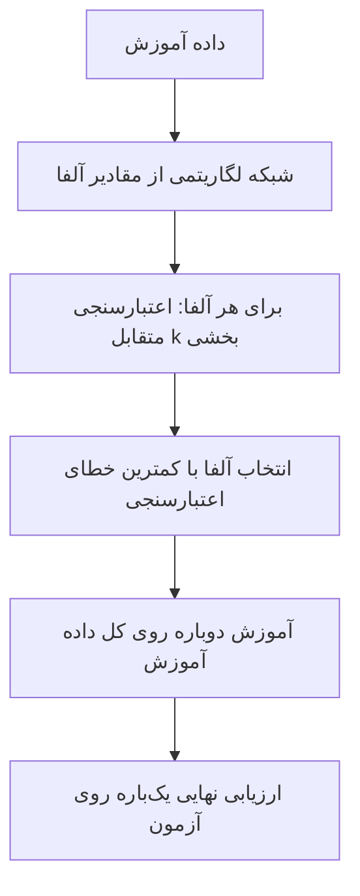
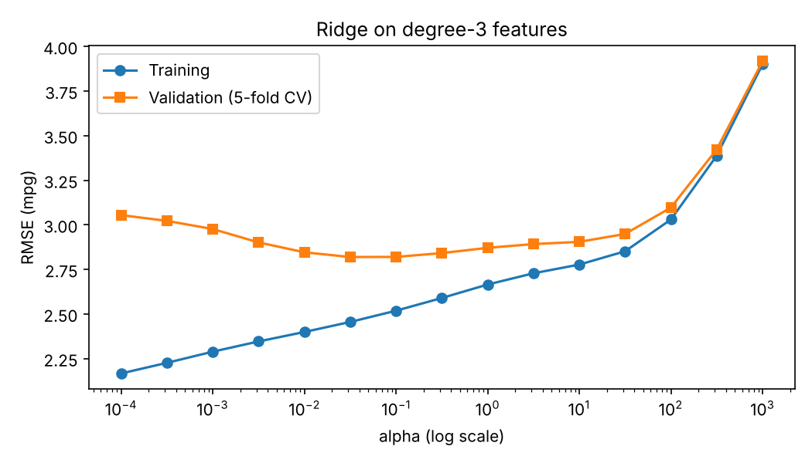

# جلسه ۱۹ — منظم‌سازی در رگرسیون

## چرا منظم‌سازی؟

در جلسه قبل دیدیم که چندجمله‌ای درجه بالا داده آموزش را حفظ می‌کند و روی داده جدید شکست می‌خورد، و برای جلوگیری از آن **درجه** را با اعتبارسنجی متقابل پایین آوردیم ← [رگرسیون چندجمله‌ای، بیش‌برازش و اعتبارسنجی متقابل](18%20-%20%D8%B1%DA%AF%D8%B1%D8%B3%DB%8C%D9%88%D9%86%20%DA%86%D9%86%D8%AF%D8%AC%D9%85%D9%84%D9%87%E2%80%8C%D8%A7%DB%8C%D8%8C%20%D8%A8%DB%8C%D8%B4%E2%80%8C%D8%A8%D8%B1%D8%A7%D8%B2%D8%B4%20%D9%88%20%D8%A7%D8%B9%D8%AA%D8%A8%D8%A7%D8%B1%D8%B3%D9%86%D8%AC%DB%8C%20%D9%85%D8%AA%D9%82%D8%A7%D8%A8%D9%84.md). کم کردن درجه یا حذف ویژگی کاری **گسسته** است: یک ویژگی یا کامل در مدل هست یا کامل حذف می‌شود.

**منظم‌سازی** (Regularization) راه نرم‌تری است: همه ویژگی‌ها می‌مانند، اما ضرایب **کوچک** نگه داشته می‌شوند و با یک «پیچ تنظیم» پیوسته، پیچیدگی مدل کم یا زیاد می‌شود. این جلسه به سه پرسش پاسخ می‌دهد:

- چگونه با افزودن یک جریمه به تابع هزینه، ضرایب را کوچک نگه داریم (Ridge، Lasso و Elastic Net)؟
- چرا Lasso ضرایب را **دقیقاً صفر** می‌کند ولی Ridge نه؟
- شدت جریمه را چگونه با اعتبارسنجی متقابل انتخاب کنیم؟

---

## ایده منظم‌سازی

### ضرایب بزرگ، نشانه بیش‌برازش

داده خودروها (mpg) را از جلسه‌های قبل می‌شناسیم. این بار مصرف سوخت را از **شش** ویژگی عددی پیش‌بینی می‌کنیم: تعداد سیلندر، حجم موتور، قدرت موتور، وزن، شتاب و سال ساخت. با ویژگی‌های چندجمله‌ای درجه ۳، تعداد ویژگی‌ها از ۶ به ۸۳ می‌رسد.

```python
import numpy as np
import seaborn as sns
from sklearn.model_selection import train_test_split, KFold, cross_val_score
from sklearn.preprocessing import PolynomialFeatures, StandardScaler
from sklearn.linear_model import LinearRegression
from sklearn.pipeline import make_pipeline
from sklearn.metrics import root_mean_squared_error

# 1. Data: fuel economy from six numeric car features; the test set is locked
mpg = sns.load_dataset("mpg").dropna(subset=["horsepower"])
features = ["cylinders", "displacement", "horsepower", "weight", "acceleration", "model_year"]
X_train, X_test, y_train, y_test = train_test_split(mpg[features], mpg["mpg"],
                                                    test_size=0.2, random_state=42)

# 2. Ordinary least squares on degree-1 and degree-3 polynomial features
kf = KFold(n_splits=5, shuffle=True, random_state=42)
for d in [1, 3]:
    model = make_pipeline(PolynomialFeatures(d, include_bias=False), StandardScaler(), LinearRegression())
    cv_rmse = -cross_val_score(model, X_train, y_train, cv=kf, scoring="neg_root_mean_squared_error")
    model.fit(X_train, y_train)
    coef = model[-1].coef_
    print(f"degree={d}  features={len(coef)}  train RMSE={root_mean_squared_error(y_train, model.predict(X_train)):.3f}  "
          f"CV RMSE={cv_rmse.mean():.3f}  largest |coef|={np.abs(coef).max():.1f}")
```

```
degree=1  features=6  train RMSE=3.456  CV RMSE=3.492  largest |coef|=5.5
degree=3  features=83  train RMSE=2.131  CV RMSE=4.198  largest |coef|=1699.8
```

مدل درجه ۳ خطای آموزش کمتری دارد (۲.۱۳ در برابر ۳.۴۶) اما خطای اعتبارسنجی متقابل آن بدتر است (۴.۲۰ در برابر ۳.۴۹): **بیش‌برازش**. نشانه دیگر، اندازه ضرایب است: بزرگ‌ترین ضریب (روی ویژگی‌های استانداردشده) از ۵.۵ به حدود **۱۷۰۰** رسیده است. مدل بیش‌برازش‌شده ضرایب بسیار بزرگ با علامت‌های مخالف دارد که اثر یکدیگر را خنثی می‌کنند تا منحنی از نزدیک نقاط آموزش بگذرد؛ چنین مدلی به تغییر کوچک ورودی بسیار حساس است. ایده منظم‌سازی: ضرایب بزرگ را **جریمه** کن.

### تابع هزینه جریمه‌دار

$$
J(\beta) = \underbrace{\text{SSE}(\beta)}_{\text{fit to data}} + \lambda \cdot \underbrace{\text{Penalty}(\beta)}_{\text{model complexity}}
$$

جمله اول می‌گوید «با داده سازگار باش» و جمله دوم «ساده بمان». ضریب لاندا (در scikit-learn با نام `alpha`) تعادل این دو را تعیین می‌کند:

| مقدار لاندا | رفتار مدل | خطر |
|:---:|:---:|:---:|
| صفر | همان رگرسیون خطی معمولی | بیش‌برازش |
| مناسب | تعادل بایاس و واریانس | — |
| بسیار بزرگ | همه ضرایب نزدیک صفر؛ پیش‌بینی تقریباً همان میانگین هدف | کم‌برازش |

منظم‌سازی کمی **بایاس** اضافه می‌کند تا **واریانس** به‌شدت کم شود؛ یعنی مدل کمی از بهترین برازش روی داده آموزش دور می‌شود، اما حساسیتش به نویز داده آموزش بسیار کم می‌شود. عرض از مبدأ جریمه نمی‌شود (scikit-learn آن را خودکار معاف می‌کند).

> [!warning] استانداردسازی پیش از منظم‌سازی الزامی است
> جریمه روی **اندازه ضرایب** است و اندازه ضریب به **واحد** ویژگی بستگی دارد: ضریب وزن بر حسب پوند بسیار کوچک‌تر از ضریب تعداد سیلندر است و جریمه به‌طور ناعادلانه بیشتر روی سیلندر می‌افتد. پس همیشه پیش از Ridge، Lasso و Elastic Net ویژگی‌ها را استاندارد کنید ← [تبدیل و یکپارچه‌سازی داده](../Part%203_Data%20Preprocessing/%DB%B1%DB%B2%20-%20%D8%AA%D8%A8%D8%AF%DB%8C%D9%84%20%D9%88%20%DB%8C%DA%A9%D9%BE%D8%A7%D8%B1%DA%86%D9%87%E2%80%8C%D8%B3%D8%A7%D8%B2%DB%8C%20%D8%AF%D8%A7%D8%AF%D9%87.md). استانداردسازی گام **یادگیرنده** است و در Pipeline قرار می‌گیرد ← [طراحی آزمایش و Pipeline](../Part%203_Data%20Preprocessing/%DB%B1%DB%B5%20-%20%D8%B7%D8%B1%D8%A7%D8%AD%DB%8C%20%D8%A2%D8%B2%D9%85%D8%A7%DB%8C%D8%B4%20%D9%88%20Pipeline.md)

---

## رگرسیون Ridge (L2)

رگرسیون Ridge مجموع **مجذور** ضرایب را جریمه می‌کند:

$$
J_{\text{Ridge}}(\beta) = \sum_{i=1}^{n} (y_i - \hat{y}_i)^2 + \lambda \sum_{j=1}^{p} \beta_j^2
$$

جواب بسته آن (با ویژگی‌های مرکزی‌شده) همان معادله نرمال جلسه ۱۷ است که لاندا به قطر اصلی آن اضافه شده ← [رگرسیون چندگانه، هم‌خطی، رگرسیون غیرخطی و ارزیابی](17%20-%20%D8%B1%DA%AF%D8%B1%D8%B3%DB%8C%D9%88%D9%86%20%DA%86%D9%86%D8%AF%DA%AF%D8%A7%D9%86%D9%87%D8%8C%20%D9%87%D9%85%E2%80%8C%D8%AE%D8%B7%DB%8C%D8%8C%20%D8%B1%DA%AF%D8%B1%D8%B3%DB%8C%D9%88%D9%86%20%D8%BA%DB%8C%D8%B1%D8%AE%D8%B7%DB%8C%20%D9%88%20%D8%A7%D8%B1%D8%B2%DB%8C%D8%A7%D8%A8%DB%8C.md):

$$
\hat{\beta}_{\text{Ridge}} = \left(X^\top X + \lambda I\right)^{-1} X^\top y
$$

با یک ویژگی مرکزی‌شده، اگر Sxy مجموع حاصل‌ضرب انحراف‌ها و Sxx مجموع مجذور انحراف‌های x باشد:

$$
\hat{\beta}_{\text{OLS}} = \frac{S_{xy}}{S_{xx}}
\qquad
\hat{\beta}_{\text{Ridge}} = \frac{S_{xy}}{S_{xx} + \lambda}
$$

لاندا فقط به **مخرج** اضافه می‌شود؛ شیب کوچک‌تر می‌شود ولی هرگز دقیقاً صفر نمی‌شود.

> [!tip] چرا Ridge هم‌خطی را درمان می‌کند؟
> وقتی ویژگی‌ها هم‌خطی‌اند، ماتریس حاصل‌ضرب ترانهاده X در X تقریباً **منفرد** است و ضرایب ناپایدار می‌شوند. افزودن لاندا به قطر اصلی، ماتریس را همیشه وارون‌پذیر و ضرایب را پایدار می‌کند. در جلسه ۱۷ دیدیم حجم موتور و تعداد سیلندر در داده mpg هم‌خطی شدید دارند.

### مثال حل‌شده: Ridge با یک ویژگی

پنج نقطه (هر سطر یک نمونه):

| نقطه | مقدار x | مقدار y | انحراف x | انحراف y | حاصل‌ضرب انحراف‌ها | مجذور انحراف x |
|:---:|:---:|:---:|:---:|:---:|:---:|:---:|
| ۱ | 1 | 2 | −2 | −2 | 4 | 4 |
| ۲ | 2 | 4 | −1 | 0 | 0 | 1 |
| ۳ | 3 | 5 | 0 | 1 | 0 | 0 |
| ۴ | 4 | 4 | 1 | 0 | 0 | 1 |
| ۵ | 5 | 5 | 2 | 1 | 2 | 4 |
| جمع | 15 | 20 | 0 | 0 | 6 | 10 |

#### گام ۱ — شیب OLS و Ridge

میانگین x برابر ۳ و میانگین y برابر ۴ است؛ Sxy برابر ۶ و Sxx برابر ۱۰:

$$
\hat{\beta}_{\text{OLS}} = \frac{6}{10} = 0.6, \qquad
\hat{\beta}_{\lambda=1} = \frac{6}{11} \approx 0.545, \qquad
\hat{\beta}_{\lambda=10} = \frac{6}{20} = 0.3, \qquad
\hat{\beta}_{\lambda=100} = \frac{6}{110} \approx 0.055
$$

#### گام ۲ — عرض از مبدأ

عرض از مبدأ جریمه نمی‌شود و از رابطه میانگین‌ها به دست می‌آید:

$$
\hat{\beta}_0^{\text{OLS}} = 4 - 0.6 \times 3 = 2.2, \qquad \hat{\beta}_0^{\lambda=10} = 4 - 0.3 \times 3 = 3.1
$$

#### گام ۳ — هزینه کل با لاندای ۱۰

| مدل | شیب | عرض از مبدأ | مجموع مجذور خطا | جریمه | هزینه کل Ridge |
|:---:|:---:|:---:|:---:|:---:|:---:|
| خط OLS | 0.6 | 2.2 | 2.4 | 10 × 0.36 = 3.6 | 6.0 |
| خط Ridge | 0.3 | 3.1 | 3.3 | 10 × 0.09 = 0.9 | 4.2 |

> [!note] بررسی
> خط Ridge خطای آموزش **بیشتری** دارد (۳.۳ در برابر ۲.۴) اما هزینه کل جریمه‌دار آن کمتر است؛ پس واقعاً کمینه تابع هزینه Ridge است. Ridge عمداً کمی از برازش داده آموزش می‌گذرد تا شیب کوچک‌تر و پایدارتری بگیرد.

کلاس `Ridge` همین اعداد را می‌دهد:

```python
import numpy as np
from sklearn.linear_model import LinearRegression, Ridge

# 1. The five points of the worked example (one feature)
x = np.array([[1], [2], [3], [4], [5]])
y = np.array([2, 4, 5, 4, 5])

# 2. OLS and Ridge with increasing penalty
print(f"OLS slope={LinearRegression().fit(x, y).coef_[0]:.3f}")
for lam in [1, 10, 100]:
    ridge = Ridge(alpha=lam).fit(x, y)
    print(f"Ridge alpha={lam:<4d} slope={ridge.coef_[0]:.3f} intercept={ridge.intercept_:.2f}")
```

```
OLS            slope=0.600
Ridge alpha=1    slope=0.545  intercept=2.36
Ridge alpha=10   slope=0.300  intercept=3.10
Ridge alpha=100  slope=0.055  intercept=3.84
```

---

## رگرسیون Lasso (L1)

رگرسیون Lasso مجموع **قدرمطلق** ضرایب را جریمه می‌کند. در scikit-learn:

$$
J_{\text{Lasso}}(\beta) = \frac{1}{2n} \sum_{i=1}^{n} (y_i - \hat{y}_i)^2 + \alpha \sum_{j=1}^{p} |\beta_j|
$$

قدرمطلق در صفر مشتق‌پذیر نیست؛ پس Lasso جواب بسته ندارد و با **کاهش مختصاتی** (Coordinate Descent) حل می‌شود. ویژگی مهم آن: بسیاری از ضرایب را **دقیقاً صفر** می‌کند و مدل **تُنُک** (Sparse) می‌سازد؛ یعنی هم‌زمان انتخاب ویژگی انجام می‌دهد ← [مهندسی و انتخاب ویژگی](../Part%203_Data%20Preprocessing/%DB%B1%DB%B3%20-%20%D9%85%D9%87%D9%86%D8%AF%D8%B3%DB%8C%20%D9%88%20%D8%A7%D9%86%D8%AA%D8%AE%D8%A7%D8%A8%20%D9%88%DB%8C%DA%98%DA%AF%DB%8C.md)

با یک ویژگی مرکزی‌شده، جواب Lasso **آستانه‌گذاری نرم** (Soft Thresholding) است:

$$
\hat{\beta}_{\text{Lasso}} = \frac{\operatorname{sign}(S_{xy}) \cdot \max\left(\frac{|S_{xy}|}{n} - \alpha,\; 0\right)}{S_{xx} / n}
$$

روش Lasso مقدار **ثابت** آلفا را از قدرت رابطه کم می‌کند و اگر نتیجه منفی شود، ضریب صفر می‌شود؛ Ridge ضریب را **به نسبتی** کوچک می‌کند.

### مثال حل‌شده: Lasso با همان پنج نقطه

با n برابر ۵، مقدار Sxy تقسیم بر n برابر ۱.۲ و Sxx تقسیم بر n برابر ۲ است:

$$
\hat{\beta}_{\alpha} = \frac{\max(1.2 - \alpha,\; 0)}{2}
$$

| مقدار آلفا | محاسبه | شیب Lasso |
|:---:|:---:|:---:|
| 0.1 | (1.2 − 0.1) / 2 | 0.55 |
| 0.5 | (1.2 − 0.5) / 2 | 0.35 |
| 1.0 | (1.2 − 1.0) / 2 | 0.10 |
| 1.2 یا بیشتر | منفی، پس صفر | **0** |

از آلفای ۱.۲ به بعد شیب **دقیقاً صفر** است و ویژگی از مدل خارج می‌شود؛ در Ridge حتی با لاندای ۱۰۰ شیب ۰.۰۵۵ بود.

```python
import numpy as np
from sklearn.linear_model import Lasso

# 1. Same five points
x = np.array([[1], [2], [3], [4], [5]])
y = np.array([2, 4, 5, 4, 5])

# 2. Lasso slope for increasing alpha: it hits exactly zero
for a in [0.1, 0.5, 1.0, 1.2, 2.0]:
    print(f"Lasso alpha={a:<4}  slope={Lasso(alpha=a).fit(x, y).coef_[0]:.3f}")
```

```
Lasso alpha=0.1   slope=0.550
Lasso alpha=0.5   slope=0.350
Lasso alpha=1.0   slope=0.100
Lasso alpha=1.2   slope=0.000
Lasso alpha=2.0   slope=0.000
```

> [!warning] انتخاب ناپایدار Lasso
> اگر دو ویژگی تقریباً یکسان باشند، Lasso یکی را تقریباً دلخواه نگه می‌دارد و با تغییر کوچک داده ممکن است دیگری را انتخاب کند. از صفر شدن ضریب یک ویژگی نتیجه نگیرید که آن ویژگی «بی‌اهمیت» است.

---

## رگرسیون Elastic Net

رگرسیون Elastic Net هر دو جریمه را ترکیب می‌کند. در scikit-learn با `alpha` (شدت کل) و `l1_ratio` (سهم L1، که آن را r می‌نامیم):

$$
J_{\text{EN}}(\beta) = \frac{1}{2n} \sum_{i=1}^{n} (y_i - \hat{y}_i)^2 + \alpha \, r \sum_{j} |\beta_j| + \frac{\alpha (1 - r)}{2} \sum_{j} \beta_j^2
$$

| مقدار l1_ratio | معادل |
|:---:|:---:|
| برابر ۱ | رگرسیون Lasso |
| برابر ۰ | رگرسیون Ridge (با مقیاس متفاوت آلفا) |
| بین ۰ و ۱ | تُنُک بودن Lasso و پایداری Ridge |

روش Elastic Net برای **گروه‌هایی از ویژگی‌های همبسته** مناسب است (کل گروه با هم انتخاب یا حذف می‌شود) و وقتی نمی‌دانید Ridge بهتر است یا Lasso، با جست‌وجوی l1_ratio هر دو را پوشش می‌دهد.

> [!note] مقیاس alpha در کلاس‌ها یکسان نیست
> کلاس `Ridge` مجموع مجذور خطا را بدون تقسیم بر n جریمه می‌کند، اما `Lasso` و `ElasticNet` خطا را بر دو برابر n تقسیم می‌کنند. پس alpha یکسان در Ridge و Lasso شدت جریمه یکسانی ندارد.


---

## انتخاب ضریب منظم‌سازی با اعتبارسنجی متقابل

آلفا یک **ابرپارامتر** است و مانند درجه چندجمله‌ای در جلسه قبل، با **اعتبارسنجی متقابل** روی داده آموزش انتخاب می‌شود، نه با یک تقسیم Hold-out و نه با داده آزمون ← [رگرسیون چندجمله‌ای، بیش‌برازش و اعتبارسنجی متقابل](18%20-%20%D8%B1%DA%AF%D8%B1%D8%B3%DB%8C%D9%88%D9%86%20%DA%86%D9%86%D8%AF%D8%AC%D9%85%D9%84%D9%87%E2%80%8C%D8%A7%DB%8C%D8%8C%20%D8%A8%DB%8C%D8%B4%E2%80%8C%D8%A8%D8%B1%D8%A7%D8%B2%D8%B4%20%D9%88%20%D8%A7%D8%B9%D8%AA%D8%A8%D8%A7%D8%B1%D8%B3%D9%86%D8%AC%DB%8C%20%D9%85%D8%AA%D9%82%D8%A7%D8%A8%D9%84.md). چون اثر آلفا ضربی است، مقادیر را روی شبکه **لگاریتمی** (مثلاً با `np.logspace`) می‌آزماییم.



### منحنی اعتبارسنجی آلفا

همان مدل بیش‌برازش‌شده درجه ۳ را با Ridge و مقادیر مختلف آلفا می‌سنجیم:

```python
import numpy as np
import matplotlib.pyplot as plt
import seaborn as sns
from sklearn.model_selection import train_test_split, KFold, validation_curve
from sklearn.preprocessing import PolynomialFeatures, StandardScaler
from sklearn.linear_model import Ridge
from sklearn.pipeline import make_pipeline

# 1. Same data, split and folds as before
mpg = sns.load_dataset("mpg").dropna(subset=["horsepower"])
features = ["cylinders", "displacement", "horsepower", "weight", "acceleration", "model_year"]
X_train, X_test, y_train, y_test = train_test_split(mpg[features], mpg["mpg"],
                                                    test_size=0.2, random_state=42)
kf = KFold(n_splits=5, shuffle=True, random_state=42)

# 2. Degree-3 features + Ridge; validation curve over a log grid of alpha
model = make_pipeline(PolynomialFeatures(3, include_bias=False), StandardScaler(), Ridge())
alphas = np.logspace(-4, 3, 15)
train_sc, val_sc = validation_curve(model, X_train, y_train, param_name="ridge__alpha",
                                    param_range=alphas, cv=kf, scoring="neg_root_mean_squared_error")
train_rmse, val_rmse = -train_sc.mean(axis=1), -val_sc.mean(axis=1)
for a, tr, va in zip(alphas, train_rmse, val_rmse):
    print(f"alpha={a:9.4f}  train={tr:.3f}  val={va:.3f}")

fig, ax = plt.subplots(figsize=(7, 4))
ax.semilogx(alphas, train_rmse, "o-", label="Training")
ax.semilogx(alphas, val_rmse, "s-", label="Validation (5-fold CV)")
ax.set(xlabel="alpha (log scale)", ylabel="RMSE (mpg)", title="Ridge on degree-3 features")
ax.legend()
plt.show()
```

```
alpha=   0.0001  train=2.166  val=3.054
alpha=   0.0003  train=2.226  val=3.022
alpha=   0.0010  train=2.288  val=2.976
alpha=   0.0032  train=2.346  val=2.901
alpha=   0.0100  train=2.399  val=2.846
alpha=   0.0316  train=2.455  val=2.819
alpha=   0.1000  train=2.518  val=2.820
alpha=   0.3162  train=2.589  val=2.841
alpha=   1.0000  train=2.665  val=2.871
alpha=   3.1623  train=2.728  val=2.892
alpha=  10.0000  train=2.777  val=2.904
alpha=  31.6228  train=2.851  val=2.949
alpha= 100.0000  train=3.029  val=3.096
alpha= 316.2278  train=3.387  val=3.423
alpha=1000.0000  train=3.901  val=3.917
```



این منحنی اعتبارسنجی **آینه** منحنی جلسه قبل است: آلفای کوچک یعنی مدل پیچیده (خطای آموزش کم، فاصله زیاد: بیش‌برازش) و آلفای بزرگ یعنی مدل ساده (هر دو خطا زیاد: کم‌برازش). کمترین خطای اعتبارسنجی حدود ۲.۸۲ در آلفای ۰.۰۳ تا ۰.۱ است؛ بسیار بهتر از ۴.۲۰ مدل درجه ۳ بدون جریمه.

### کلاس‌های RidgeCV، LassoCV و ElasticNetCV

این کلاس‌ها جست‌وجوی آلفا را درون خود انجام می‌دهند و بهترین مقدار را در ویژگی `alpha_` نگه می‌دارند:

| کلاس | کار | نکته |
|:---:|:---:|:---:|
| کلاس RidgeCV | آزمودن فهرست آلفاها | بدون پارامتر cv از Leave-One-Out کارآمد استفاده می‌کند |
| کلاس LassoCV | ساخت خودکار مسیر آلفاها و انتخاب با k-Fold | آلفاها را خودش می‌سازد |
| کلاس ElasticNetCV | جست‌وجوی هم‌زمان آلفا و l1_ratio | فهرست l1_ratio را خودتان بدهید |

کد زیر مدل‌ها را با RMSE اعتبارسنجی متقابل مقایسه می‌کند و مدل منتخب را فقط یک بار روی آزمون می‌سنجد:

```python
import numpy as np
import seaborn as sns
from sklearn.model_selection import train_test_split, KFold, cross_val_score
from sklearn.preprocessing import PolynomialFeatures, StandardScaler
from sklearn.linear_model import LinearRegression, RidgeCV, LassoCV, ElasticNetCV
from sklearn.pipeline import make_pipeline
from sklearn.dummy import DummyRegressor
from sklearn.metrics import root_mean_squared_error, r2_score

# 1. Same data, split and folds
mpg = sns.load_dataset("mpg").dropna(subset=["horsepower"])
features = ["cylinders", "displacement", "horsepower", "weight", "acceleration", "model_year"]
X_train, X_test, y_train, y_test = train_test_split(mpg[features], mpg["mpg"],
                                                    test_size=0.2, random_state=42)
kf = KFold(n_splits=5, shuffle=True, random_state=42)

# 2. Candidate models; *CV classes choose alpha by internal cross-validation
def poly(d, reg):
    return make_pipeline(PolynomialFeatures(d, include_bias=False), StandardScaler(), reg)

models = {
    "Linear, degree 1": poly(1, LinearRegression()),
    "Linear, degree 3": poly(3, LinearRegression()),
    "RidgeCV, degree 3": poly(3, RidgeCV(alphas=np.logspace(-4, 3, 50))),
    "LassoCV, degree 3": poly(3, LassoCV(cv=kf, max_iter=50000, random_state=42)),
    "ElasticNetCV, degree 3": poly(3, ElasticNetCV(l1_ratio=[0.1, 0.5, 0.9, 1.0], cv=kf,
                                                   max_iter=50000, random_state=42)),
}

# 3. Compare with 5-fold CV RMSE on the training data
for name, model in models.items():
    cv_rmse = -cross_val_score(model, X_train, y_train, cv=kf, scoring="neg_root_mean_squared_error")
    print(f"{name:24s} CV RMSE={cv_rmse.mean():.3f} (sd {cv_rmse.std():.3f})")

# 4. Fit the regularized models on the whole training set and inspect them
for name in ["RidgeCV, degree 3", "LassoCV, degree 3", "ElasticNetCV, degree 3"]:
    reg = models[name].fit(X_train, y_train)[-1]
    ratio = f"  l1_ratio={reg.l1_ratio_}" if hasattr(reg, "l1_ratio_") else ""
    print(f"{name:24s} alpha={reg.alpha_:.4f}{ratio}  nonzero={np.sum(reg.coef_ != 0)}/{len(reg.coef_)}")

# 5. The chosen model (RidgeCV, degree 3) on the locked test set, once
final = models["RidgeCV, degree 3"]
baseline = DummyRegressor().fit(X_train, y_train)
print(f"test R2={r2_score(y_test, final.predict(X_test)):.3f}  "
      f"RMSE={root_mean_squared_error(y_test, final.predict(X_test)):.3f}  "
      f"baseline RMSE={root_mean_squared_error(y_test, baseline.predict(X_test)):.3f}")
```

```
Linear, degree 1         CV RMSE=3.492 (sd 0.398)
Linear, degree 3         CV RMSE=4.198 (sd 1.140)
RidgeCV, degree 3        CV RMSE=2.882 (sd 0.214)
LassoCV, degree 3        CV RMSE=2.891 (sd 0.283)
ElasticNetCV, degree 3   CV RMSE=2.894 (sd 0.282)
RidgeCV, degree 3        alpha=0.0518  nonzero=83/83
LassoCV, degree 3        alpha=0.0066  nonzero=22/83
ElasticNetCV, degree 3   alpha=0.0066  l1_ratio=1.0  nonzero=22/83
test R2=0.869  RMSE=2.583  baseline RMSE=7.185
```

| مدل | تعداد ویژگی | RMSE اعتبارسنجی | ضرایب غیرصفر |
|:---:|:---:|:---:|:---:|
| خطی درجه ۱ | 6 | 3.492 | 6 |
| خطی درجه ۳ | 83 | 4.198 | 83 |
| مدل RidgeCV درجه ۳ | 83 | 2.882 | 83 |
| مدل LassoCV درجه ۳ | 83 | 2.891 | 22 |
| مدل ElasticNetCV درجه ۳ | 83 | 2.894 | 22 |

- منظم‌سازی مدل درجه ۳ را **نجات داد**: خطای اعتبارسنجی از ۴.۲۰ به ۲.۸۸ رسید و نوسان میان بخش‌ها (انحراف معیار) از ۱.۱۴ به ۰.۲۱ کم شد.
- مدل Lasso با فقط **۲۲** ویژگی از ۸۳ تقریباً همان دقت Ridge را دارد؛ مدلی ساده‌تر و قابل تفسیرتر.
- برای Elastic Net، بهترین l1_ratio برابر ۱ شد؛ یعنی همان Lasso خالص.
- روی آزمون، مدل RidgeCV درجه ۳ ضریب تعیین ۰.۸۶۹ و RMSE حدود ۲.۵۸ دارد، در برابر RMSE مدل پایه ۷.۱۸.

> [!warning] قاعده یک خطای استاندارد
> وقتی چند آلفا خطای اعتبارسنجی تقریباً یکسانی دارند، **ساده‌ترین مدل** (بزرگ‌ترین آلفا) را انتخاب کنید که خطایش حداکثر یک خطای استاندارد از بهترین خطا بیشتر است. خطای استاندارد همان انحراف معیار امتیاز بخش‌ها تقسیم بر جذر k است؛ ایده‌ای که در جلسه قبل برای انتخاب درجه دیدیم.

---

## معرفی رگرسیون با k-NN و درخت

تا اینجا همه مدل‌ها **پارامتری و خطی** بودند: شکل تابع از قبل ثابت است و فقط ضرایب یاد گرفته می‌شوند. دو خانواده دیگر شکل تابع را از خود داده یاد می‌گیرند؛ هر دو را در بخش طبقه‌بندی به‌تفصیل می‌بینیم.

**رگرسیون k-نزدیک‌ترین همسایه** برای نقطه جدید، k نقطه آموزش نزدیک‌تر را پیدا می‌کند و **میانگین** هدف آن‌ها را پیش‌بینی می‌کند:

$$
\hat{y}(x) = \frac{1}{k} \sum_{i \in N_k(x)} y_i
$$

عدد k نقش منظم‌سازی را دارد: k کوچک یعنی مدل پرنوسان (واریانس بالا) و k بزرگ یعنی مدل هموار (بایاس بالا). چون بر پایه **فاصله** است، مقیاس‌بندی الزامی است ← [معیارهای شباهت و فاصله](../Part%201_Data%20Understanding/%DB%B5%20-%20%D9%85%D8%B9%DB%8C%D8%A7%D8%B1%D9%87%D8%A7%DB%8C%20%D8%B4%D8%A8%D8%A7%D9%87%D8%AA%20%D9%88%20%D9%81%D8%A7%D8%B5%D9%84%D9%87.md) و ← [مبانی طبقه‌بندی و k-NN](../Part%205_Classification/20%20-%20%20%D9%85%D8%A8%D8%A7%D9%86%DB%8C%20%D8%B7%D8%A8%D9%82%D9%87%E2%80%8C%D8%A8%D9%86%D8%AF%DB%8C%20%D9%88%20k-NN.md)

**درخت رگرسیون** فضای ویژگی‌ها را با پرسش‌های پی‌درپی (مثلاً «آیا وزن کمتر از ۲۸۰۰ پوند است؟») به ناحیه‌های مستطیلی تقسیم می‌کند و در هر برگ **میانگین** هدف نمونه‌های آموزش آن ناحیه را پیش‌بینی می‌کند. عمق درخت پارامتر کنترل پیچیدگی است و به مقیاس‌بندی نیازی ندارد ← [درخت تصمیم](../Part%205_Classification/22%20-%20%D8%AF%D8%B1%D8%AE%D8%AA%20%D8%AA%D8%B5%D9%85%DB%8C%D9%85.md)

### مثال حل‌شده: رگرسیون k-NN

با همان پنج نقطه، y را برای x برابر ۲.۶ پیش‌بینی می‌کنیم:

| نقطه | مقدار x | مقدار y | فاصله تا ۲.۶ | رتبه |
|:---:|:---:|:---:|:---:|:---:|
| ۱ | 1 | 2 | 1.6 | ۴ |
| ۲ | 2 | 4 | 0.6 | ۲ |
| ۳ | 3 | 5 | 0.4 | ۱ |
| ۴ | 4 | 4 | 1.4 | ۳ |
| ۵ | 5 | 5 | 2.4 | ۵ |

$$
k = 1: \; \hat{y} = 5, \qquad k = 2: \; \hat{y} = \frac{5 + 4}{2} = 4.5, \qquad k = 3: \; \hat{y} = \frac{5 + 4 + 4}{3} \approx 4.333
$$

کد زیر همین مثال را اجرا می‌کند، سپس k و عمق درخت را روی داده mpg با `GridSearchCV` (جست‌وجوی ابرپارامتر با اعتبارسنجی متقابل) تنظیم می‌کند:

```python
import numpy as np
import seaborn as sns
from sklearn.model_selection import train_test_split, KFold, GridSearchCV
from sklearn.preprocessing import StandardScaler
from sklearn.neighbors import KNeighborsRegressor
from sklearn.tree import DecisionTreeRegressor
from sklearn.pipeline import make_pipeline

# 1. The worked example: predict y at x = 2.6 from the five points
x = np.array([[1], [2], [3], [4], [5]])
y = np.array([2, 4, 5, 4, 5])
for k in [1, 2, 3]:
    pred = KNeighborsRegressor(n_neighbors=k).fit(x, y).predict([[2.6]])[0]
    print(f"k={k}  prediction={pred:.3f}")

# 2. Same mpg data, split and folds
mpg = sns.load_dataset("mpg").dropna(subset=["horsepower"])
features = ["cylinders", "displacement", "horsepower", "weight", "acceleration", "model_year"]
X_train, X_test, y_train, y_test = train_test_split(mpg[features], mpg["mpg"],
                                                    test_size=0.2, random_state=42)
kf = KFold(n_splits=5, shuffle=True, random_state=42)

# 3. Tune k (k-NN needs scaling) and tree depth (no scaling needed) with 5-fold CV
searches = {
    "k-NN": GridSearchCV(make_pipeline(StandardScaler(), KNeighborsRegressor()),
                         {"kneighborsregressor__n_neighbors": range(1, 31)},
                         cv=kf, scoring="neg_root_mean_squared_error"),
    "Tree": GridSearchCV(DecisionTreeRegressor(random_state=42), {"max_depth": range(1, 11)},
                         cv=kf, scoring="neg_root_mean_squared_error"),
}
for name, gs in searches.items():
    gs.fit(X_train, y_train)
    print(f"{name:5s} best={gs.best_params_}  CV RMSE={-gs.best_score_:.3f}")
```

```
k=1  prediction=5.000
k=2  prediction=4.500
k=3  prediction=4.333
k-NN  best={'kneighborsregressor__n_neighbors': 11}  CV RMSE=3.101
Tree  best={'max_depth': 4}  CV RMSE=3.456
```

| ویژگی | رگرسیون خطی منظم‌شده | رگرسیون k-NN | درخت رگرسیون |
|:---:|:---:|:---:|:---:|
| شکل تابع | خطی یا چندجمله‌ای | محلی و انعطاف‌پذیر | پله‌ای |
| پارامتر پیچیدگی | آلفا | تعداد همسایه k | عمق درخت |
| نیاز به مقیاس‌بندی | بله | بله | خیر |
| تفسیرپذیری | ضرایب | ضعیف | قواعد اگر-آنگاه |
| برون‌یابی بیرون از بازه داده | بله (ادامه منحنی) | خیر | خیر |
| خطای RMSE اعتبارسنجی روی mpg | 2.88 | 3.10 (یازده همسایه) | 3.46 (عمق ۴) |

روی mpg، Ridge درجه ۳ بهترین است؛ اما هیچ مدلی همیشه بهترین نیست («ناهار مجانی وجود ندارد»). در داده‌هایی با رابطه‌های غیرخطی پیچیده و اثرات متقابل قوی، درخت‌ها و روش‌های گروهی معمولاً برنده‌اند ← [روش‌های گروهی](../Part%205_Classification/23%20-%20%D8%B1%D9%88%D8%B4%E2%80%8C%D9%87%D8%A7%DB%8C%20%DA%AF%D8%B1%D9%88%D9%87%DB%8C.md)

> [!note] کارگاه عملی
> دفترچه «۱۹ - کارگاه منظم‌سازی در رگرسیون» پیاده‌سازی قاعده یک خطای استاندارد و تمرین عملی کلاس (مقایسه مدل‌های خطی، چندجمله‌ای و منظم‌شده روی داده مسکن کالیفرنیا) را با پاسخ دارد. نحوه نوشتن این کدها در امتحان پرسیده نمی‌شود.

---

## خطاهای رایج

| خطا | چرا نادرست است | روش درست |
|:---:|:---:|:---:|
| منظم‌سازی بدون استانداردسازی | جریمه به واحد ویژگی‌ها وابسته می‌شود | استانداردسازی داخل Pipeline پیش از مدل |
| استانداردسازی کل داده پیش از RidgeCV یا cross_val_score | پارامترهای استانداردسازی بخش اعتبارسنجی را دیده‌اند | کل Pipeline را به اعتبارسنجی متقابل بدهید |
| انتخاب آلفا با داده آزمون | آزمون در انتخاب مدل نقش می‌گیرد و برآورد نهایی خوش‌بینانه می‌شود | انتخاب با اعتبارسنجی متقابل روی داده آموزش |
| شبکه خطی برای آلفا (مثلاً ۱، ۲، ۳، …) | اثر آلفا ضربی است؛ مقادیر کوچک اصلاً آزموده نمی‌شوند | شبکه لگاریتمی با np.logspace |
| مقایسه مستقیم alpha در Ridge و Lasso | دو کلاس تابع هزینه را با مقیاس متفاوت تعریف می‌کنند | آلفای هر مدل را جداگانه با اعتبارسنجی انتخاب کنید |
| نتیجه‌گیری «بی‌اهمیت» از ضریب صفر Lasso | از میان ویژگی‌های همبسته، انتخاب Lasso تقریباً دلخواه است | بررسی همبستگی‌ها؛ در صورت نیاز Elastic Net |

---

## نمونه سؤال‌های امتحانی

### سؤال‌های مفهومی

> [!question]- ۱. چرا منظم‌سازی خطای آموزش را زیاد می‌کند اما ممکن است خطای آزمون را کم کند؟
> جریمه مدل را از بهترین برازش روی داده آموزش دور می‌کند (افزایش بایاس)، اما ضرایب کوچک‌تر حساسیت مدل به نویز را کم می‌کنند (کاهش واریانس). اگر کاهش واریانس بیشتر باشد، خطای آزمون کمتر می‌شود.

> [!question]- ۲. چرا Lasso می‌تواند ضرایب را دقیقاً صفر کند اما Ridge نه؟
> از دید هندسی، ناحیه مجاز L1 لوزی با گوشه‌هایی روی محورهاست و بیضی‌های تراز خطا معمولاً ابتدا به گوشه می‌خورند؛ دایره L2 گوشه ندارد. از دید جبری، Lasso مقدار **ثابتی** از قدرت رابطه کم می‌کند و رابطه ضعیف‌تر از آستانه صفر می‌شود، اما Ridge ضریب را **به نسبتی** کوچک می‌کند که هرگز به صفر نمی‌رسد.

> [!question]- ۳. داده‌ای با ۵۰۰ ویژگی ژنی دارید که گروه‌هایی از آن‌ها به‌شدت همبسته‌اند و انتظار دارید فقط چند گروه مهم باشند. کدام روش مناسب‌تر است؟
> روش **Elastic Net**: بخش L1 ژن‌های بی‌اهمیت را حذف می‌کند و بخش L2 باعث می‌شود ژن‌های همبسته یک گروه با هم انتخاب شوند، به جای اینکه Lasso خالص یکی را دلخواه برگزیند.

> [!question]- ۴. در منحنی اعتبارسنجی Ridge، با آلفای بسیار بزرگ خطای آموزش و اعتبارسنجی هر دو زیاد و نزدیک هم‌اند. این چه وضعیتی است؟
> **کم‌برازش**: جریمه آن‌قدر قوی است که همه ضرایب نزدیک صفرند و مدل تقریباً همان میانگین هدف را پیش‌بینی می‌کند.

### سؤال‌های محاسباتی

> [!question]- ۵. با یک ویژگی مرکزی‌شده که Sxx برابر ۲۰ و Sxy برابر ۸ است، شیب OLS و شیب Ridge با لاندای ۲۰ چقدر است؟
> $$
> \hat{\beta}_{\text{OLS}} = \frac{8}{20} = 0.4, \qquad \hat{\beta}_{\text{Ridge}} = \frac{8}{20 + 20} = 0.2
> $$
> لاندا به مخرج اضافه شده و شیب نصف شده است.

> [!question]- ۶. با ۱۰ نمونه، یک ویژگی مرکزی‌شده با Sxy برابر ۱۲ و Sxx برابر ۴۰ داریم. شیب Lasso را برای آلفای ۰.۵ و ۱.۵ حساب کنید.
> مقدار Sxy تقسیم بر n برابر ۱.۲ و Sxx تقسیم بر n برابر ۴ است.
> $$
> \hat{\beta}_{0.5} = \frac{\max(1.2 - 0.5,\; 0)}{4} = \frac{0.7}{4} = 0.175, \qquad \hat{\beta}_{1.5} = \frac{\max(1.2 - 1.5,\; 0)}{4} = 0
> $$

> [!question]- ۷. برای یک مدل Ridge با لاندای ۵، ضرایب ۲ و −1 و مجموع مجذور خطا ۱۲ است. هزینه کل چقدر است؟ عرض از مبدأ ۳ است؛ آیا در جریمه می‌آید؟
> عرض از مبدأ جریمه نمی‌شود.
> $$
> J = 12 + 5 \times \left(2^2 + (-1)^2\right) = 12 + 25 = 37
> $$

> [!question]- ۸. با چهار نقطه (x, y) برابر (۱، ۱۰)، (۲، ۱۲)، (۴، ۲۰) و (۷، ۳۰)، رگرسیون k-NN با k برابر ۲ برای x برابر ۳ چه پیش‌بینی می‌کند؟
> فاصله‌ها تا ۳ به ترتیب ۲، ۱، ۱ و ۴ است. دو همسایه نزدیک‌تر x برابر ۲ و ۴ هستند:
> $$
> \hat{y} = \frac{12 + 20}{2} = 16
> $$

### سؤال‌های خواندن کد

> [!question]- ۹. ایراد این کد چیست؟
> ```python
> model = Lasso(alpha=0.1).fit(X_train, y_train)
> ```
> ویژگی‌ها استاندارد نشده‌اند؛ جریمه به واحد ویژگی‌ها وابسته می‌شود. باید `make_pipeline(StandardScaler(), Lasso(alpha=0.1))` نوشت.

> [!question]- ۱۰. پس از اجرای کد زیر، `ridge_cv[-1].alpha_` چه چیزی را نشان می‌دهد و از کدام داده انتخاب شده است؟
> ```python
> ridge_cv = make_pipeline(StandardScaler(), RidgeCV(alphas=np.logspace(-3, 3, 50)))
> ridge_cv.fit(X_train, y_train)
> ```
> بهترین آلفا از میان ۵۰ مقدار لگاریتمی بین ۰.۰۰۱ و ۱۰۰۰ است که با اعتبارسنجی متقابل (به‌طور پیش‌فرض Leave-One-Out کارآمد) **فقط روی داده آموزش** انتخاب شده است.

> [!question]- ۱۱. خروجی `np.sum(lasso.coef_ == 0)` برابر ۶۱ و `len(lasso.coef_)` برابر ۸۳ است. یعنی چه؟
> مدل Lasso ضریب ۶۱ ویژگی را دقیقاً صفر کرده و فقط **۲۲** ویژگی را نگه داشته است؛ یعنی انتخاب ویژگی انجام داده است.

---

## نکات کلیدی

> [!summary] خلاصه جلسه
> - **منظم‌سازی** یعنی افزودن جریمه پیچیدگی به تابع هزینه؛ آلفا (لاندا) میان برازش داده و سادگی مدل تعادل برقرار می‌کند و بایاس را کمی زیاد و واریانس را بسیار کم می‌کند.
> - رگرسیون **Ridge** مجموع مجذور ضرایب را جریمه می‌کند، جواب بسته دارد، ضرایب را به نسبت کوچک می‌کند و هم‌خطی را درمان می‌کند؛ اما ضرایب را صفر نمی‌کند.
> - رگرسیون **Lasso** مجموع قدرمطلق ضرایب را جریمه می‌کند و با آستانه‌گذاری نرم بسیاری از ضرایب را **دقیقاً صفر** می‌کند (انتخاب ویژگی)؛ دلیل هندسی آن گوشه‌های لوزی L1 است. روش **Elastic Net** ترکیب هر دوست.
> - پیش از منظم‌سازی ویژگی‌ها را **استاندارد** کنید، داخل Pipeline.
> - آلفا را با **اعتبارسنجی متقابل** روی شبکه لگاریتمی انتخاب کنید (RidgeCV، LassoCV، ElasticNetCV)؛ روی mpg، Ridge مدل درجه ۳ را از RMSE اعتبارسنجی ۴.۲۰ به ۲.۸۸ رساند.
> - رگرسیون **k-NN** و **درخت** شکل تابع را از داده یاد می‌گیرند؛ k و عمق درخت پیچیدگی را کنترل می‌کنند.
