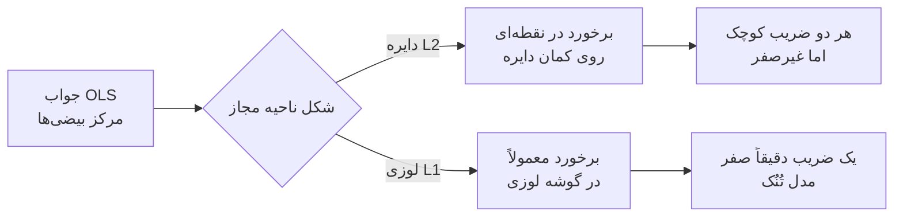
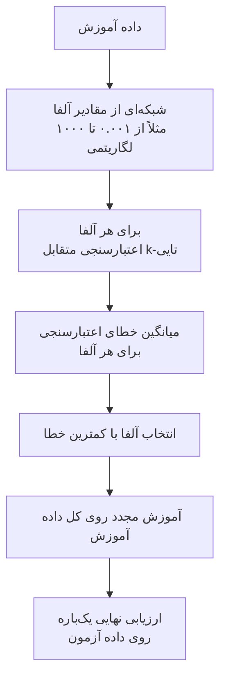

# جلسه ۱۹ — منظم‌سازی در رگرسیون

## چرا منظم‌سازی؟

در جلسه قبل دیدیم که مدل‌های **پیچیده** (مثلاً رگرسیون چندجمله‌ای با درجه بالا) داده آموزش را حفظ می‌کنند و روی داده جدید شکست می‌خورند ← [[18 - بیش‌برازش و اعتبارسنجی متقابل]] تا اینجا تنها ابزار ما برای کنترل پیچیدگی، **کم کردن تعداد ویژگی‌ها** یا **کاهش درجه** مدل بود. این کار گسسته و خشن است: یک ویژگی یا کامل در مدل هست یا کامل حذف می‌شود.

منظم‌سازی (Regularization) راه نرم‌تری پیشنهاد می‌کند:

- همه ویژگی‌ها در مدل می‌مانند، اما ضرایب آن‌ها **کوچک** نگه داشته می‌شوند.
- با یک «پیچ تنظیم» پیوسته (ضریب منظم‌سازی) می‌توان پیچیدگی مدل را کم یا زیاد کرد.
- برخی روش‌ها (Lasso) ضرایب کم‌اهمیت را **دقیقاً صفر** می‌کنند و در عمل انتخاب ویژگی انجام می‌دهند ← [[۱۳ - مهندسی و انتخاب ویژگی]]
- منظم‌سازی مشکل **هم‌خطی چندگانه** را نیز کاهش می‌دهد؛ مشکلی که ضرایب را ناپایدار و بزرگ می‌کرد ← [[17 - رگرسیون خطی چندگانه و ارزیابی]]

> [!important] نکته کلیدی منظم‌سازی کمی **بایاس** به مدل اضافه می‌کند تا **واریانس** آن به‌شدت کاهش یابد. اگر کاهش واریانس بیشتر از افزایش بایاس باشد، خطای آزمون کمتر می‌شود. این همان مصالحه بایاس-واریانس جلسه قبل است.

---

## ایده منظم‌سازی و جریمه پیچیدگی

### تابع هزینه جریمه‌دار

در رگرسیون خطی معمولی (OLS) ضرایب را طوری انتخاب می‌کردیم که مجموع مجذور خطاها (SSE) کمینه شود ← [[16 - مبانی یادگیری نظارت‌شده و رگرسیون خطی ساده]]

$$ J_{\text{OLS}}(\beta) = \sum_{i=1}^{n} \left(y_i - \beta_0 - \sum_{j=1}^{p} \beta_j x_{ij}\right)^2 $$

در منظم‌سازی یک **جمله جریمه** به تابع هزینه اضافه می‌کنیم که ضرایب بزرگ را تنبیه می‌کند:

$$ J(\beta) = \underbrace{\text{SSE}(\beta)}_{\text{fit to data}} + \lambda \cdot \underbrace{\text{Penalty}(\beta)}_{\text{model complexity}} $$

- جمله اول می‌گوید: «با داده سازگار باش».
- جمله دوم می‌گوید: «ساده بمان».
- پارامتر لاندا (در scikit-learn با نام `alpha`) تعادل این دو را تعیین می‌کند.

|مقدار لاندا|رفتار مدل|خطر|
|:-:|:-:|:-:|
|صفر|همان رگرسیون خطی معمولی|بیش‌برازش در داده با ویژگی زیاد|
|کوچک|ضرایب کمی کوچک می‌شوند|—|
|مناسب|تعادل بایاس و واریانس|—|
|بسیار بزرگ|همه ضرایب به سمت صفر میل می‌کنند و مدل تقریباً همان میانگین هدف است|کم‌برازش|

> [!note] عرض از مبدأ جریمه نمی‌شود جمله جریمه فقط روی ضرایب ویژگی‌ها اعمال می‌شود، نه روی عرض از مبدأ. جریمه کردن عرض از مبدأ یعنی مدل را مجبور کنیم پیش‌بینی‌ها را به سمت صفر بکشد که بی‌معناست. در scikit-learn عرض از مبدأ به‌طور خودکار از جریمه معاف است.

### چرا ضرایب بزرگ نشانه پیچیدگی‌اند؟

مدلی که بیش‌برازش کرده معمولاً ضرایب **بسیار بزرگ با علامت‌های متناوب** دارد: یک ضریب مثبت بزرگ و ضریب دیگری منفی بزرگ که اثر هم را خنثی می‌کنند تا منحنی از دقیقاً همه نقاط آموزش عبور کند. چنین مدلی به تغییر کوچک در ورودی حساس است. کوچک نگه داشتن ضرایب یعنی **هموار** نگه داشتن تابع پیش‌بینی.

> [!warning] مقیاس‌بندی پیش از منظم‌سازی الزامی است جریمه روی **اندازه ضرایب** اعمال می‌شود و اندازه ضریب به **واحد ویژگی** بستگی دارد. اگر درآمد به ریال و سن به سال باشد، ضریب درآمد ذاتاً بسیار کوچک و ضریب سن بزرگ است و جریمه به‌طور ناعادلانه بیشتر روی سن اعمال می‌شود. همیشه پیش از Ridge، Lasso و Elastic Net ویژگی‌ها را **استاندارد** کنید ← [[۱۲ - تبدیل و یکپارچه‌سازی داده]] برای جلوگیری از نشت داده، مقیاس‌بندی را داخل `Pipeline` قرار دهید ← [[۱۴- کاهش ابعاد]]

---

## رگرسیون Ridge (L2)

### تعریف

رگرسیون Ridge مجموع **مجذور** ضرایب (نرم L2) را جریمه می‌کند:

$$ J_{\text{Ridge}}(\beta) = \sum_{i=1}^{n} (y_i - \hat{y}_i)^2 + \lambda \sum_{j=1}^{p} \beta_j^2 $$

برخلاف Lasso، Ridge جواب **بسته** (Closed-form) دارد. در فرم ماتریسی (با ویژگی‌های مرکزی‌شده):

$$ \hat{\beta}_{\text{Ridge}} = \left(X^\top X + \lambda I\right)^{-1} X^\top y $$

این فرمول را با معادله نرمال جلسه ۱۷ مقایسه کنید: تنها تفاوت، اضافه شدن لاندا به قطر اصلی ماتریس است.

> [!tip] چرا Ridge هم‌خطی را درمان می‌کند؟ وقتی ویژگی‌ها هم‌خطی‌اند، ماتریس حاصل‌ضرب ترانهاده X در X تقریباً **منفرد** (Singular) است و وارون آن بسیار ناپایدار. اضافه کردن یک عدد مثبت به قطر اصلی، همه مقادیر ویژه را دست‌کم به اندازه لاندا بزرگ می‌کند و ماتریس همیشه **وارون‌پذیر** و پایدار می‌شود.

### حالت یک ویژگی

برای یک ویژگی مرکزی‌شده، فرمول بالا بسیار ساده می‌شود. اگر Sxy مجموع حاصل‌ضرب انحراف‌ها و Sxx مجموع مجذور انحراف‌های x باشد:

$$ \hat{\beta}_{\text{OLS}} = \frac{S_{xy}}{S_{xx}} \qquad \hat{\beta}_{\text{Ridge}} = \frac{S_{xy}}{S_{xx} + \lambda} $$

لاندا فقط به **مخرج** اضافه می‌شود؛ پس شیب همیشه کوچک‌تر می‌شود اما هرگز دقیقاً صفر نمی‌شود.

> [!example] مثال حل‌شده — Ridge با یک ویژگی پنج نقطه داریم:
> 
> |نقطه|۱|۲|۳|۴|۵|
> |:-:|:-:|:-:|:-:|:-:|:-:|
> |مقدار x|1|2|3|4|5|
> |مقدار y|2|4|5|4|5|
> 
> میانگین x برابر ۳ و میانگین y برابر ۴ است. انحراف‌های x برابر ۲-، ۱-، ۰، ۱، ۲ و انحراف‌های y برابر ۲-، ۰، ۱، ۰، ۱ هستند: $$ S_{xx} = 4 + 1 + 0 + 1 + 4 = 10, \qquad S_{xy} = 4 + 0 + 0 + 0 + 2 = 6 $$ شیب OLS و Ridge با چند مقدار لاندا: $$ \hat{\beta}_{\text{OLS}} = \frac{6}{10} = 0.6, \qquad \hat{\beta}_{\lambda=1} = \frac{6}{11} \approx 0.545, \qquad \hat{\beta}_{\lambda=10} = \frac{6}{20} = 0.3, \qquad \hat{\beta}_{\lambda=100} = \frac{6}{110} \approx 0.055 $$ عرض از مبدأ از رابطه میانگین‌ها به دست می‌آید (جریمه نمی‌شود): برای OLS برابر ۲.۲ و برای Ridge با لاندای ۱۰ برابر ۳.۱.
> 
> |مدل|شیب|عرض از مبدأ|مجموع مجذور خطا|جریمه (لاندا ۱۰)|هزینه کل Ridge|
> |:-:|:-:|:-:|:-:|:-:|:-:|
> |خط OLS|0.6|2.2|2.4|10 × 0.36 = 3.6|6.0|
> |خط Ridge|0.3|3.1|3.3|10 × 0.09 = 0.9|4.2|
> 
> خط Ridge خطای آموزش **بیشتری** دارد (۳.۳ در برابر ۲.۴)، اما هزینه کل جریمه‌دار آن کمتر است. Ridge عمداً کمی از برازش داده آموزش می‌گذرد تا شیب کوچک‌تر و پایدارتری داشته باشد.

---

## رگرسیون Lasso (L1)

### تعریف

رگرسیون Lasso (Least Absolute Shrinkage and Selection Operator) مجموع **قدرمطلق** ضرایب (نرم L1) را جریمه می‌کند. در scikit-learn تابع هزینه به این شکل نوشته می‌شود:

$$ J_{\text{Lasso}}(\beta) = \frac{1}{2n} \sum_{i=1}^{n} (y_i - \hat{y}_i)^2 + \alpha \sum_{j=1}^{p} |\beta_j| $$

- قدرمطلق در صفر **مشتق‌پذیر نیست**، پس جواب بسته ندارد و با روش **کاهش مختصاتی** (Coordinate Descent) حل می‌شود.
- ویژگی مهم: Lasso بسیاری از ضرایب را **دقیقاً صفر** می‌کند؛ یعنی مدل **تُنُک** (Sparse) می‌سازد و هم‌زمان انتخاب ویژگی انجام می‌دهد.

### آستانه‌گذاری نرم (Soft Thresholding)

برای یک ویژگی مرکزی‌شده (با همان نمادهای بخش قبل و n تعداد نمونه) جواب Lasso به شکل زیر است:

$$ \hat{\beta}_{\text{Lasso}} = \frac{\operatorname{sign}(S_{xy}) \cdot \max\left(\frac{|S_{xy}|}{n} - \alpha,; 0\right)}{S_{xx} / n} $$

یعنی Lasso ابتدا مقدار ثابت آلفا را از «قدرت رابطه» **کم می‌کند** و اگر نتیجه منفی شد، ضریب را صفر می‌کند. این برخلاف Ridge است که ضریب را **به نسبتی** کوچک می‌کند.

> [!example] مثال حل‌شده — Lasso با همان پنج نقطه با n برابر ۵: مقدار Sxy تقسیم بر n برابر ۱.۲ و Sxx تقسیم بر n برابر ۲ است: $$ \hat{\beta}_{\alpha} = \frac{\max(1.2 - \alpha,; 0)}{2} $$
> 
> |مقدار آلفا|محاسبه|شیب Lasso|
> |:-:|:-:|:-:|
> |0.1|(1.2 − 0.1) / 2|0.55|
> |0.5|(1.2 − 0.5) / 2|0.35|
> |1.0|(1.2 − 1.0) / 2|0.10|
> |1.2 یا بیشتر|منفی، پس صفر|**0**|
> 
> وقتی آلفا از ۱.۲ بیشتر شود، شیب **دقیقاً صفر** می‌شود و ویژگی از مدل خارج می‌شود. در Ridge حتی با لاندای ۱۰۰ شیب ۰.۰۵۵ بود و صفر نمی‌شد. خروجی `Lasso(alpha=a)` در scikit-learn دقیقاً همین اعداد را می‌دهد.

### تفسیر هندسی Ridge و Lasso

منظم‌سازی را می‌توان به شکل **مسئله مقید** نیز نوشت: کمینه کردن SSE به شرطی که اندازه ضرایب از بودجه‌ای مثل t بیشتر نشود:

$$ \min_{\beta} ; \text{SSE}(\beta) \quad \text{subject to} \quad \sum_j \beta_j^2 \le t ;; (\text{Ridge}) \quad \text{or} \quad \sum_j |\beta_j| \le t ;; (\text{Lasso}) $$

در فضای دو ضریب:

- **ناحیه مجاز Ridge** یک **دایره** است (ناحیه مجاز L2).
- **ناحیه مجاز Lasso** یک **لوزی** است با گوشه‌هایی روی محورها (ناحیه مجاز L1).
- منحنی‌های تراز SSE **بیضی‌هایی** به مرکز جواب OLS هستند.
- جواب منظم‌شده، اولین نقطه‌ای است که بیضی‌ها در حال بزرگ شدن به ناحیه مجاز **برخورد** می‌کنند.



> [!important] چرا Lasso صفر می‌کند و Ridge نه؟ گوشه‌های لوزی L1 دقیقاً روی محورها قرار دارند؛ جایی که یکی از ضرایب صفر است. بیضی‌ها به احتمال زیاد ابتدا به یک **گوشه** برخورد می‌کنند. دایره L2 گوشه ندارد، پس نقطه برخورد تقریباً هیچ‌گاه دقیقاً روی محور نیست. در ابعاد بالاتر، لوزی L1 گوشه‌ها و لبه‌های بسیار بیشتری دارد و تُنُک بودن جواب شدیدتر می‌شود.

### مقایسه Ridge و Lasso

|جنبه|رگرسیون Ridge|رگرسیون Lasso|
|:-:|:-:|:-:|
|جریمه|مجموع مجذور ضرایب (L2)|مجموع قدرمطلق ضرایب (L1)|
|اثر بر ضرایب|کوچک کردن نسبی، هیچ‌گاه دقیقاً صفر|کم کردن ثابت، بسیاری دقیقاً صفر|
|انتخاب ویژگی|ندارد|دارد (مدل تُنُک)|
|جواب بسته|دارد|ندارد (کاهش مختصاتی)|
|ویژگی‌های همبسته|وزن را میان آن‌ها **تقسیم** می‌کند|معمولاً **یکی** را انتخاب و بقیه را صفر می‌کند (ناپایدار)|
|مناسب برای|ویژگی‌های زیاد که همگی اثر کوچکی دارند|تعداد کمی ویژگی واقعاً مهم در میان ویژگی‌های زیاد|
|تفسیر بیزی|توزیع پیشین گاوسی روی ضرایب|توزیع پیشین لاپلاس روی ضرایب|

> [!warning] انتخاب ناپایدار Lasso اگر دو ویژگی تقریباً یکسان باشند (مثلاً قد به سانتی‌متر و قد به اینچ با کمی نویز)، Lasso یکی را به‌طور تقریباً دلخواه نگه می‌دارد و دیگری را صفر می‌کند. با تغییر کوچک داده، ممکن است ویژگی دیگر انتخاب شود. پس از صفر شدن ضریب یک ویژگی در Lasso نتیجه نگیرید که آن ویژگی «بی‌اهمیت» است.

---

## رگرسیون Elastic Net

رگرسیون Elastic Net هر دو جریمه را ترکیب می‌کند. در scikit-learn با دو پارامتر `alpha` (شدت کل جریمه) و `l1_ratio` (سهم L1 که آن را با r نشان می‌دهیم):

$$ J_{\text{EN}}(\beta) = \frac{1}{2n} \sum_{i=1}^{n} (y_i - \hat{y}_i)^2 + \alpha , r \sum_{j} |\beta_j| + \frac{\alpha (1 - r)}{2} \sum_{j} \beta_j^2 $$

|مقدار l1_ratio|معادل|
|:-:|:-:|
|برابر ۱|رگرسیون Lasso|
|برابر ۰|رگرسیون Ridge (با مقیاس‌گذاری متفاوت آلفا)|
|بین ۰ و ۱|ترکیب: تُنُک بودن Lasso و پایداری Ridge|

> [!tip] چه زمانی Elastic Net؟
> 
> - وقتی **گروه‌هایی از ویژگی‌های همبسته** دارید و می‌خواهید کل گروه با هم انتخاب یا حذف شود (اثر گروهی).
> - وقتی تعداد ویژگی‌ها از تعداد نمونه‌ها بیشتر است: Lasso خالص حداکثر به تعداد نمونه‌ها ویژگی انتخاب می‌کند، اما Elastic Net این محدودیت را ندارد.
> - در عمل، اگر نمی‌دانید Ridge بهتر است یا Lasso، Elastic Net با جست‌وجوی l1_ratio هر دو را پوشش می‌دهد.

> [!note] نام‌گذاری پارامترها در scikit-learn
> 
> |مدل|نام شدت جریمه|نکته|
> |:-:|:-:|:-:|
> |کلاس Ridge|alpha|جریمه بدون ضریب یک‌دوم و بدون تقسیم بر n|
> |کلاس Lasso|alpha|خطا تقسیم بر دو برابر n|
> |کلاس ElasticNet|alpha و l1_ratio|خطا تقسیم بر دو برابر n|
> 
> بنابراین مقدار alpha یکسان در Ridge و Lasso شدت جریمه **یکسانی** ندارد و نباید مستقیماً مقایسه شود.

---

## انتخاب ضریب منظم‌سازی با اعتبارسنجی متقابل

ضریب منظم‌سازی یک **ابرپارامتر** (Hyperparameter) است: از داده آموزش یاد گرفته نمی‌شود، بلکه باید با **اعتبارسنجی متقابل** انتخاب شود ← [[18 - بیش‌برازش و اعتبارسنجی متقابل]]



> [!tip] شبکه لگاریتمی اثر آلفا **ضربی** است: تفاوت ۰.۰۱ و ۰.۱ به اندازه تفاوت ۱۰ و ۱۰۰ مهم است. پس مقادیر را روی مقیاس لگاریتمی انتخاب کنید (مثلاً با `np.logspace(-3, 3, 50)`).

### کلاس‌های RidgeCV، LassoCV و ElasticNetCV

|کلاس|کار|نکته|
|:-:|:-:|:-:|
|کلاس RidgeCV|آزمودن فهرست آلفاها و انتخاب بهترین|بدون پارامتر cv از روش سریع **Leave-One-Out** کارآمد استفاده می‌کند|
|کلاس LassoCV|ساخت خودکار مسیر آلفاها و انتخاب بهترین با k-Fold|آلفاها را خودش از بزرگ‌ترین مقدار مفید می‌سازد|
|کلاس ElasticNetCV|جست‌وجوی هم‌زمان آلفا و l1_ratio|فهرست l1_ratio را خودتان بدهید|

بهترین آلفا پس از برازش در ویژگی `alpha_` ذخیره می‌شود.

### مسیر ضرایب (Coefficient Path)

**مسیر ضرایب** نمودار مقدار هر ضریب بر حسب آلفاست (معمولاً با محور افقی لگاریتمی). این نمودار نشان می‌دهد:

- در Ridge همه ضرایب **به‌تدریج و هم‌زمان** به سمت صفر میل می‌کنند.
- در Lasso ضرایب **یکی‌یکی** صفر می‌شوند؛ ترتیب ورود ویژگی‌ها به مدل (از آلفای بزرگ به کوچک) یک رتبه‌بندی اهمیت ویژگی‌ها به دست می‌دهد.

> [!example] مثال — مسیر ضرایب روی داده دیابت داده دیابت (load_diabetes) شامل ۴۴۲ بیمار، ۱۰ ویژگی و هدف عددی «پیشرفت بیماری پس از یک سال» است. با ۷۵ درصد داده آموزش و ویژگی‌های استانداردشده:
> 
> **مسیر Ridge** (مجموع قدرمطلق ضرایب و چهار ضریب منتخب):
> 
> |مقدار آلفا|مجموع قدرمطلق ضرایب|ضریب bmi|ضریب s1|ضریب s2|ضریب s5|
> |:-:|:-:|:-:|:-:|:-:|:-:|
> |0.1|175.4|25.1|−42.9|23.5|32.9|
> |1|151.9|25.2|−34.3|16.8|29.6|
> |10|109.1|25.1|−13.1|0.5|21.2|
> |100|89.1|21.0|−3.3|−3.9|15.4|
> |1000|39.4|8.6|0.7|0.1|7.0|
> 
> ویژگی‌های s1 و s2 (کلسترول کل و LDL) به‌شدت همبسته‌اند. در OLS ضرایب بزرگ با علامت مخالف دارند (حدود ۴۴- و ۲۵+) که اثر هم را خنثی می‌کنند؛ نشانه کلاسیک هم‌خطی. Ridge با آلفای ۱۰ هر دو را کوچک کرده است، در حالی که ضریب bmi تقریباً دست‌نخورده می‌ماند.
> 
> **مسیر Lasso** — ترتیب ورود ویژگی‌ها به مدل وقتی آلفا از مقدار بزرگ کاهش می‌یابد:
> 
> |ترتیب ورود|ویژگی|آلفای ورود (تقریبی)|
> |:-:|:-:|:-:|
> |۱|bmi (شاخص توده بدنی)|44.4|
> |۲|s5 (تری‌گلیسرید)|37.3|
> |۳|bp (فشار خون)|23.8|
> |۴|s3 (HDL)|18.0|
> |۵|sex|6.4|
> 
> شاخص توده بدنی و s5 قوی‌ترین پیش‌بینی‌کننده‌ها هستند و پیش از بقیه وارد مدل می‌شوند.

> [!example] نتیجه اعتبارسنجی متقابل روی داده دیابت با اعتبارسنجی ۵-تایی روی داده آموزش:
> 
> |مدل|ضریب منظم‌سازی|میانگین R² اعتبارسنجی|R² آزمون|ضرایب صفر|
> |:-:|:-:|:-:|:-:|:-:|
> |رگرسیون خطی|—|0.461|0.485|0|
> |مدل Ridge|آلفا ۱۰|0.461|0.488|0|
> |مدل Lasso|آلفا ۱|0.459|0.496|1|
> |مدل RidgeCV|آلفای انتخابی ≈ 1.53|—|0.486|0|
> |مدل LassoCV|آلفای انتخابی ≈ 0.114|—|0.487|1 (ویژگی s3)|
> 
> با فقط ۱۰ ویژگی و ۳۳۱ نمونه آموزش، رگرسیون خطی ساده بیش‌برازش چندانی ندارد و منظم‌سازی بهبود کمی می‌دهد. اثر واقعی منظم‌سازی وقتی دیده می‌شود که تعداد ویژگی‌ها زیاد باشد (بخش تمرین: ویژگی‌های چندجمله‌ای).

> [!warning] قاعده یک خطای استاندارد گاهی چند آلفا خطای اعتبارسنجی تقریباً یکسانی دارند. یک قاعده رایج این است که **ساده‌ترین مدل** (بزرگ‌ترین آلفا) را انتخاب کنید که خطایش حداکثر یک خطای استاندارد از بهترین خطا بیشتر است. این قاعده مدل ساده‌تر و پایدارتری می‌دهد.

---

## معرفی رگرسیون با درخت و k-NN

تا اینجا همه مدل‌ها **پارامتری و خطی** بودند: شکل تابع از قبل (خط یا ابرصفحه) ثابت است و فقط ضرایب یاد گرفته می‌شوند. دو خانواده مهم دیگر شکل تابع را از خود داده یاد می‌گیرند. هر دو را در بخش طبقه‌بندی به‌تفصیل خواهیم دید؛ اینجا نسخه رگرسیونی آن‌ها را معرفی می‌کنیم.

### رگرسیون k-نزدیک‌ترین همسایه (k-NN Regression)

برای پیش‌بینی یک نقطه جدید، k نقطه آموزش **نزدیک‌تر** به آن پیدا می‌شوند و **میانگین** مقدار هدف آن‌ها به عنوان پیش‌بینی گزارش می‌شود:

$$ \hat{y}(x) = \frac{1}{k} \sum_{i \in N_k(x)} y_i $$

- پارامتر k نقش منظم‌سازی را دارد: k کوچک یعنی مدل پیچیده و پرنوسان (واریانس بالا) و k بزرگ یعنی مدل هموار (بایاس بالا).
- چون بر پایه **فاصله** است، مقیاس‌بندی الزامی است ← [[۵ - معیارهای شباهت و فاصله]]
- جزئیات کامل در جلسه بعد ← [[20 -  مبانی طبقه‌بندی و k-NN]]

> [!example] مثال حل‌شده — رگرسیون k-NN قیمت (میلیون تومان در متر) چهار آپارتمان بر حسب فاصله تا مترو (کیلومتر):
> 
> |آپارتمان|الف|ب|ج|د|
> |:-:|:-:|:-:|:-:|:-:|
> |فاصله تا مترو|0.2|0.5|1.5|3.0|
> |قیمت|90|80|60|40|
> 
> برای آپارتمان جدیدی با فاصله ۰.۸ کیلومتر، فاصله‌ها تا چهار آپارتمان به ترتیب ۰.۶، ۰.۳، ۰.۷ و ۲.۲ است.
> 
> - با k برابر ۱: نزدیک‌ترین آپارتمان «ب» است، پس پیش‌بینی **۸۰**.
> - با k برابر ۲: آپارتمان‌های «ب» و «الف»، پس پیش‌بینی (۸۰ + ۹۰) / ۲ = **۸۵**.
> - با k برابر ۳: آپارتمان‌های «ب»، «الف» و «ج»، پس پیش‌بینی (۸۰ + ۹۰ + ۶۰) / ۳ ≈ **۷۶.۷**.

### رگرسیون با درخت تصمیم (Regression Tree)

درخت رگرسیون فضای ویژگی‌ها را با پرسش‌های پی‌درپی (مثلاً «آیا bmi کمتر از ۰.۰۱ است؟») به **ناحیه‌های مستطیلی** تقسیم می‌کند و در هر ناحیه (برگ) **میانگین** هدف نمونه‌های آموزش آن ناحیه را پیش‌بینی می‌کند.

- تابع پیش‌بینی **پله‌ای** است، نه هموار.
- عمق درخت پارامتر کنترل پیچیدگی است: درخت عمیق داده آموزش را حفظ می‌کند.
- به مقیاس‌بندی نیاز ندارد.
- جزئیات کامل ← [[22 - درخت تصمیم]]

|ویژگی|رگرسیون خطی منظم‌شده|رگرسیون k-NN|درخت رگرسیون|
|:-:|:-:|:-:|:-:|
|شکل تابع|خطی (یا چندجمله‌ای)|محلی و انعطاف‌پذیر|پله‌ای|
|پارامتر پیچیدگی|آلفا|تعداد همسایه k|عمق درخت|
|نیاز به مقیاس‌بندی|بله|بله|خیر|
|تفسیرپذیری|ضرایب|ضعیف|قواعد اگر-آنگاه|
|برون‌یابی خارج از بازه داده|بله (ادامه خط)|خیر (میانگین همسایه‌ها)|خیر (مقدار ثابت برگ)|
|سرعت پیش‌بینی|بسیار سریع|کند برای داده بزرگ|سریع|

> [!note] هیچ مدلی همیشه بهترین نیست روی داده دیابت، رگرسیون خطی (R² اعتبارسنجی ۰.۴۶۱) از k-NN با k برابر ۱۵ (۰.۳۹۴) و درخت با عمق ۳ (۰.۱۹۹) بهتر است؛ چون رابطه‌ها تقریباً خطی‌اند و داده کم است. در داده‌هایی با رابطه‌های غیرخطی و اثرات متقابل قوی، معمولاً ترتیب برعکس می‌شود. این همان قضیه «ناهار مجانی وجود ندارد» (No Free Lunch) است.

---

## پیاده‌سازی در پایتون

```python
import numpy as np
import pandas as pd
import matplotlib
matplotlib.use("Agg")
import matplotlib.pyplot as plt
from sklearn.datasets import load_diabetes
from sklearn.model_selection import train_test_split, KFold, cross_val_score, GridSearchCV
from sklearn.pipeline import make_pipeline
from sklearn.preprocessing import StandardScaler, PolynomialFeatures
from sklearn.linear_model import (LinearRegression, Ridge, Lasso, ElasticNet,
                                  RidgeCV, LassoCV, ElasticNetCV, lasso_path)
from sklearn.neighbors import KNeighborsRegressor
from sklearn.tree import DecisionTreeRegressor
from sklearn.metrics import r2_score, mean_squared_error

X, y = load_diabetes(return_X_y=True, as_frame=True)
X_train, X_test, y_train, y_test = train_test_split(X, y, test_size=0.25, random_state=42)
cv = KFold(n_splits=5, shuffle=True, random_state=42)
print(X.shape)        # (442, 10)
```

### بررسی مثال حل‌شده با scikit-learn

```python
x = np.array([1, 2, 3, 4, 5], dtype=float).reshape(-1, 1)
t = np.array([2, 4, 5, 4, 5], dtype=float)

for lam in [1, 10, 100]:
    m = Ridge(alpha=lam).fit(x, t)
    print("Ridge", lam, m.coef_.round(3), round(m.intercept_, 2))
# Ridge 1 [0.545] 2.36
# Ridge 10 [0.3] 3.1
# Ridge 100 [0.055] 3.84

for a in [0.1, 0.5, 1.0, 1.2]:
    print("Lasso", a, Lasso(alpha=a).fit(x, t).coef_.round(3))
# Lasso 0.1 [0.55]   Lasso 0.5 [0.35]   Lasso 1.0 [0.1]   Lasso 1.2 [0.]
```

### مقایسه رگرسیون خطی، Ridge، Lasso و Elastic Net

```python
models = {
    "Linear":     make_pipeline(StandardScaler(), LinearRegression()),
    "Ridge":      make_pipeline(StandardScaler(), Ridge(alpha=10)),
    "Lasso":      make_pipeline(StandardScaler(), Lasso(alpha=1)),
    "ElasticNet": make_pipeline(StandardScaler(), ElasticNet(alpha=1, l1_ratio=0.5)),
}
for name, m in models.items():
    cv_r2 = cross_val_score(m, X_train, y_train, cv=cv, scoring="r2").mean()
    m.fit(X_train, y_train)
    test_r2 = r2_score(y_test, m.predict(X_test))
    n_zero = np.sum(m[-1].coef_ == 0)
    print(f"{name:10s} cv_r2={cv_r2:.3f} test_r2={test_r2:.3f} zeros={n_zero}")
# Linear     cv_r2=0.461 test_r2=0.485 zeros=0
# Ridge      cv_r2=0.461 test_r2=0.488 zeros=0
# Lasso      cv_r2=0.459 test_r2=0.496 zeros=1
# ElasticNet cv_r2=0.437 test_r2=0.483 zeros=0

coefs = pd.DataFrame({n: m[-1].coef_ for n, m in models.items()}, index=X.columns)
print(coefs.round(1).loc[["bmi", "s1", "s2", "s5"]])
#      Linear  Ridge  Lasso  ElasticNet
# bmi    25.1   25.1   25.7        18.6
# s1    -44.1  -13.1   -8.4        -1.7
# s2     24.5    0.5   -0.0        -2.8
# s5     33.4   21.2   21.1        13.7
```

### انتخاب آلفا با RidgeCV، LassoCV و ElasticNetCV

```python
alphas = np.logspace(-3, 3, 50)

ridge_cv = make_pipeline(StandardScaler(), RidgeCV(alphas=alphas, cv=cv)).fit(X_train, y_train)
print(round(ridge_cv[-1].alpha_, 2), round(ridge_cv.score(X_test, y_test), 3))   # 1.53 0.486

lasso_cv = make_pipeline(StandardScaler(), LassoCV(cv=cv, random_state=42)).fit(X_train, y_train)
lasso = lasso_cv[-1]
print(round(lasso.alpha_, 3), round(lasso_cv.score(X_test, y_test), 3))          # 0.114 0.487
print(list(X.columns[lasso.coef_ == 0]))                                          # ['s3']

enet_cv = make_pipeline(StandardScaler(),
                        ElasticNetCV(l1_ratio=[0.1, 0.5, 0.9, 1.0], cv=cv, random_state=42))
enet_cv.fit(X_train, y_train)
print(enet_cv[-1].l1_ratio_, round(enet_cv[-1].alpha_, 3))                       # 1.0 0.114  (pure Lasso wins)

# Validation error as a function of alpha (LassoCV stores the CV curve)
mse_mean = lasso.mse_path_.mean(axis=1)
fig, ax = plt.subplots(figsize=(7, 4))
ax.semilogx(lasso.alphas_, mse_mean, marker=".")
ax.axvline(lasso.alpha_, color="red", linestyle="--", label="best alpha")
ax.set(title="LassoCV: mean CV error vs alpha", xlabel="alpha (log scale)", ylabel="Mean CV MSE")
ax.legend()
plt.show()
```

### رسم مسیر ضرایب Ridge و Lasso

```python
Xs = StandardScaler().fit_transform(X_train)
grid = np.logspace(-2, 4, 100)

ridge_coefs = np.array([Ridge(alpha=a).fit(Xs, y_train).coef_ for a in grid])
lasso_alphas, lasso_coefs, _ = lasso_path(Xs, y_train - y_train.mean(), alphas=200)

fig, axes = plt.subplots(1, 2, figsize=(13, 4.5))
axes[0].semilogx(grid, ridge_coefs)
axes[0].set(title="Ridge coefficient path", xlabel="alpha (log scale)", ylabel="Coefficient")
for j, name in enumerate(X.columns):
    axes[1].semilogx(lasso_alphas, lasso_coefs[j], label=name)
axes[1].set(title="Lasso coefficient path", xlabel="alpha (log scale)", ylabel="Coefficient")
axes[1].legend(ncol=2, fontsize=8)
plt.tight_layout()
plt.show()

# Order in which features enter the Lasso model (largest alpha first)
entry = {name: lasso_alphas[np.nonzero(lasso_coefs[j])[0][0]]
         for j, name in enumerate(X.columns)}
print(pd.Series(entry).sort_values(ascending=False).round(1).head(5))
# bmi 44.4, s5 37.3, bp 23.8, s3 18.0, sex 6.4
```

### رگرسیون k-NN و درخت رگرسیون

```python
knn = make_pipeline(StandardScaler(), KNeighborsRegressor(n_neighbors=15))
tree = DecisionTreeRegressor(max_depth=3, random_state=42)
for name, m in [("kNN k=15", knn), ("Tree depth=3", tree)]:
    print(name, round(cross_val_score(m, X_train, y_train, cv=cv, scoring="r2").mean(), 3))
# kNN k=15 0.394
# Tree depth=3 0.199

# Tune k for k-NN and depth for the tree
gs_knn = GridSearchCV(make_pipeline(StandardScaler(), KNeighborsRegressor()),
                      {"kneighborsregressor__n_neighbors": range(1, 41)}, cv=cv, scoring="r2")
gs_knn.fit(X_train, y_train)
print(gs_knn.best_params_, round(gs_knn.best_score_, 3))      # k=16  0.401

gs_tree = GridSearchCV(DecisionTreeRegressor(random_state=42),
                       {"max_depth": range(1, 11)}, cv=cv, scoring="r2")
gs_tree.fit(X_train, y_train)
print(gs_tree.best_params_, round(gs_tree.best_score_, 3))    # depth=2  0.265

# Toy example from the notes: price vs distance to metro
dist = np.array([[0.2], [0.5], [1.5], [3.0]])
price = np.array([90, 80, 60, 40])
for k in [1, 2, 3]:
    print(k, KNeighborsRegressor(n_neighbors=k).fit(dist, price).predict([[0.8]]).round(1))
# 1 [80.]   2 [85.]   3 [76.7]
```

---

## تمرین عملی کلاس

> [!example] تمرین عملی (۲۵ دقیقه) از همان داده دیابت و همان تقسیم آموزش و آزمون (۲۵ درصد آزمون با random_state برابر ۴۲) و اعتبارسنجی ۵-تایی استفاده کنید.
> 
> 1. با `PolynomialFeatures(degree=2, include_bias=False)` ویژگی‌های درجه دوم بسازید. چند ویژگی ساخته می‌شود؟ برای درجه ۳ چطور؟
> 2. این مدل‌ها را داخل `Pipeline` (چندجمله‌ای، سپس `StandardScaler`، سپس مدل) بسازید: رگرسیون خطی روی ویژگی‌های اصلی، رگرسیون خطی درجه ۲، RidgeCV درجه ۲، LassoCV درجه ۲، رگرسیون خطی درجه ۳ و RidgeCV درجه ۳.
> 3. برای هر مدل R² آموزش، میانگین R² اعتبارسنجی متقابل، R² آزمون و RMSE آزمون را در یک جدول گزارش کنید.
> 4. کدام مدل بیش‌برازش شدید دارد؟ چرا؟ (تعداد ویژگی‌ها را با تعداد نمونه‌های آموزش مقایسه کنید.)
> 5. مدل LassoCV درجه ۲ از ۶۵ ویژگی چند ویژگی را نگه داشته است؟ کدام آلفا را انتخاب کرده‌اند RidgeCV و LassoCV؟
> 6. بهترین مدل را بر اساس **اعتبارسنجی متقابل** انتخاب کنید (نه داده آزمون!) و آن را با رگرسیون k-NN و درخت مقایسه کنید.

> [!question]- پاسخ‌های کلیدی تمرین
> 
> - ویژگی‌های درجه ۲: **۶۵** ویژگی (۱۰ خطی، ۱۰ مجذور و ۴۵ حاصل‌ضرب دوتایی). درجه ۳: **۲۸۵** ویژگی؛ بیشتر از ۳۳۱ نمونه آموزش نیست، اما بسیار نزدیک به آن است.
> - جدول نتایج:
> 
> |مدل|R² آموزش|R² اعتبارسنجی|R² آزمون|RMSE آزمون|
> |:-:|:-:|:-:|:-:|:-:|
> |خطی (۱۰ ویژگی)|0.519|0.461|0.485|53.4|
> |خطی درجه ۲|0.605|0.298|0.424|56.4|
> |مدل RidgeCV درجه ۲|0.555|0.420|0.503|52.4|
> |مدل LassoCV درجه ۲|0.524|0.442|0.533|50.8|
> |خطی درجه ۳|0.909|بسیار منفی (حدود ۴۸۵۹-)|−38.5|467.5|
> |مدل RidgeCV درجه ۳|0.558|0.405|0.434|56.0|
> |مدل k-NN با k برابر ۱۵|0.491|0.394|0.457|54.8|
> |درخت با عمق ۳|0.510|0.199|0.365|59.3|
> 
> - **خطی درجه ۳** فاجعه است: R² آموزش ۰.۹۰۹ اما R² آزمون ۳۸.۵-؛ یعنی از پیش‌بینی ثابت «میانگین» بسیار بدتر است. با ۲۸۵ ضریب و فقط ۳۳۱ نمونه، مدل نویز را حفظ کرده است. RidgeCV با آلفای حدود ۵۶۹ همین مدل را به R² آزمون ۰.۴۳۴ برمی‌گرداند.
> - در درجه ۲، OLS بیش‌برازش دارد (اعتبارسنجی ۰.۲۹۸) و منظم‌سازی آن را نجات می‌دهد. آلفای RidgeCV حدود **۱۰۴.۸** و آلفای LassoCV حدود **۳.۲۴** است و Lasso فقط **۱۳** ویژگی از ۶۵ ویژگی را نگه داشته است.
> - بر اساس اعتبارسنجی متقابل، بهترین مدل همچنان **رگرسیون خطی ساده** است (۰.۴۶۱) و پس از آن LassoCV درجه ۲ (۰.۴۴۲). جالب است که LassoCV درجه ۲ روی داده آزمون بهتر عمل کرده (۰.۵۳۳)، اما انتخاب مدل باید بر اساس اعتبارسنجی باشد؛ تفاوت‌ها در حد نوسان تقسیم داده‌اند.

---

## پرسش‌های مرور

> [!question]- ۱. چرا منظم‌سازی خطای آموزش را افزایش می‌دهد اما ممکن است خطای آزمون را کاهش دهد؟ جریمه، مدل را از بهترین برازش ممکن روی داده آموزش دور می‌کند (افزایش بایاس)، اما ضرایب کوچک‌تر حساسیت مدل به نویز و نمونه خاص آموزش را کم می‌کنند (کاهش واریانس). اگر کاهش واریانس بیشتر از افزایش بایاس باشد، خطای آزمون کمتر می‌شود.

> [!question]- ۲. با یک ویژگی مرکزی‌شده که Sxx برابر ۲۰ و Sxy برابر ۸ است، شیب OLS و شیب Ridge با لاندای ۲۰ چقدر است؟ شیب OLS برابر ۸ تقسیم بر ۲۰ یعنی **۰.۴** و شیب Ridge برابر ۸ تقسیم بر ۴۰ یعنی **۰.۲** است. لاندا به مخرج اضافه می‌شود و شیب نصف شده است.

> [!question]- ۳. چرا Lasso می‌تواند ضرایب را دقیقاً صفر کند اما Ridge نه؟ از دید هندسی، ناحیه مجاز L1 یک لوزی با گوشه‌هایی روی محورهاست و بیضی‌های تراز خطا معمولاً ابتدا به یک گوشه (جایی که برخی ضرایب صفرند) برخورد می‌کنند. ناحیه L2 دایره است و گوشه ندارد. از دید جبری، Lasso مقدار **ثابتی** از قدرت رابطه کم می‌کند (آستانه‌گذاری نرم) و اگر رابطه ضعیف‌تر از آستانه باشد ضریب صفر می‌شود، اما Ridge ضریب را **به نسبتی** کوچک می‌کند که هرگز به صفر نمی‌رسد.

> [!question]- ۴. اگر ویژگی‌ها را پیش از Ridge استاندارد نکنیم، چه اتفاقی می‌افتد؟ جریمه روی اندازه ضرایب است و اندازه ضرایب به واحد ویژگی‌ها بستگی دارد. ویژگی با مقیاس کوچک (مثلاً متر به جای میلی‌متر) به ضریب بزرگ‌تری نیاز دارد و بیشتر جریمه می‌شود. نتیجه مدل به انتخاب **واحد اندازه‌گیری** وابسته می‌شود که بی‌معناست.

> [!question]- ۵. داده‌ای با ۵۰۰ ویژگی ژنی دارید که گروه‌هایی از ژن‌ها به‌شدت همبسته‌اند و انتظار دارید فقط تعداد کمی گروه مهم باشند. کدام روش مناسب‌تر است؟ روش **Elastic Net**. بخش L1 مدل تُنُک می‌سازد و ژن‌های بی‌اهمیت را حذف می‌کند و بخش L2 باعث می‌شود ژن‌های همبسته یک گروه با هم انتخاب شوند (اثر گروهی)، به جای اینکه Lasso خالص یکی را به‌طور دلخواه انتخاب کند.

> [!question]- ۶. چرا نباید آلفا را بر اساس خطای داده آزمون انتخاب کرد؟ چون در این صورت داده آزمون در **انتخاب مدل** نقش داشته و دیگر برآورد بی‌طرفی از عملکرد روی داده جدید نمی‌دهد (نشت اطلاعات از داده آزمون). آلفا باید با اعتبارسنجی متقابل روی داده آموزش انتخاب شود و داده آزمون فقط یک بار، در پایان، استفاده شود.

---

## نکات کلیدی

> [!summary] خلاصه جلسه
> 
> - **منظم‌سازی** یعنی افزودن جمله جریمه پیچیدگی به تابع هزینه؛ ضریب لاندا (آلفا در scikit-learn) میان برازش داده و سادگی مدل تعادل برقرار می‌کند.
> - رگرسیون **Ridge** مجموع مجذور ضرایب را جریمه می‌کند، جواب بسته دارد، ضرایب را به نسبت کوچک می‌کند و هم‌خطی را درمان می‌کند؛ اما ضرایب را صفر نمی‌کند.
> - رگرسیون **Lasso** مجموع قدرمطلق ضرایب را جریمه می‌کند و با آستانه‌گذاری نرم بسیاری از ضرایب را **دقیقاً صفر** می‌کند (انتخاب ویژگی). دلیل هندسی آن، گوشه‌های لوزی L1 است.
> - روش **Elastic Net** ترکیب L1 و L2 است و برای ویژگی‌های همبسته گروهی مناسب است.
> - پیش از منظم‌سازی ویژگی‌ها را **استاندارد** کنید و این کار را داخل Pipeline انجام دهید.
> - ضریب منظم‌سازی را با **اعتبارسنجی متقابل** روی شبکه لگاریتمی انتخاب کنید (RidgeCV، LassoCV، ElasticNetCV). **مسیر ضرایب** رفتار مدل را با تغییر آلفا نشان می‌دهد.
> - رگرسیون **k-NN** و **درخت رگرسیون** مدل‌های ناپارامتری‌اند که شکل تابع را از داده یاد می‌گیرند؛ پارامتر k و عمق درخت نقش کنترل پیچیدگی را دارند.

> [!todo] آمادگی برای جلسه بعد
> 
> 1. اگر هدف پروژه شما عددی است، Ridge و Lasso را با اعتبارسنجی متقابل روی آن اجرا و با رگرسیون خطی ساده مقایسه کنید.
> 2. مفاهیم فاصله اقلیدسی و منهتن را مرور کنید ← [[۵ - معیارهای شباهت و فاصله]]
> 3. جلسه بعد وارد **طبقه‌بندی** می‌شویم: پیش‌بینی برچسب کیفی به جای عدد. فکر کنید هدف پروژه شما را چگونه می‌توان به یک مسئله طبقه‌بندی تبدیل کرد ← [[20 -  مبانی طبقه‌بندی و k-NN]]