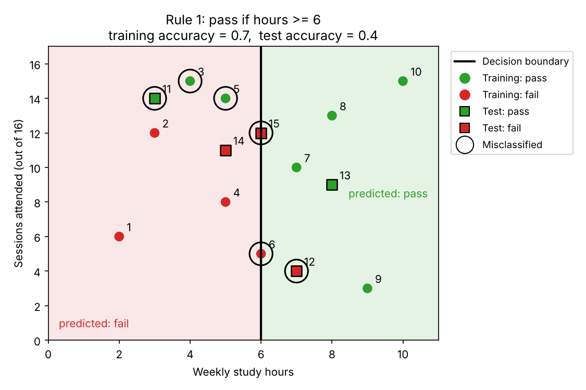
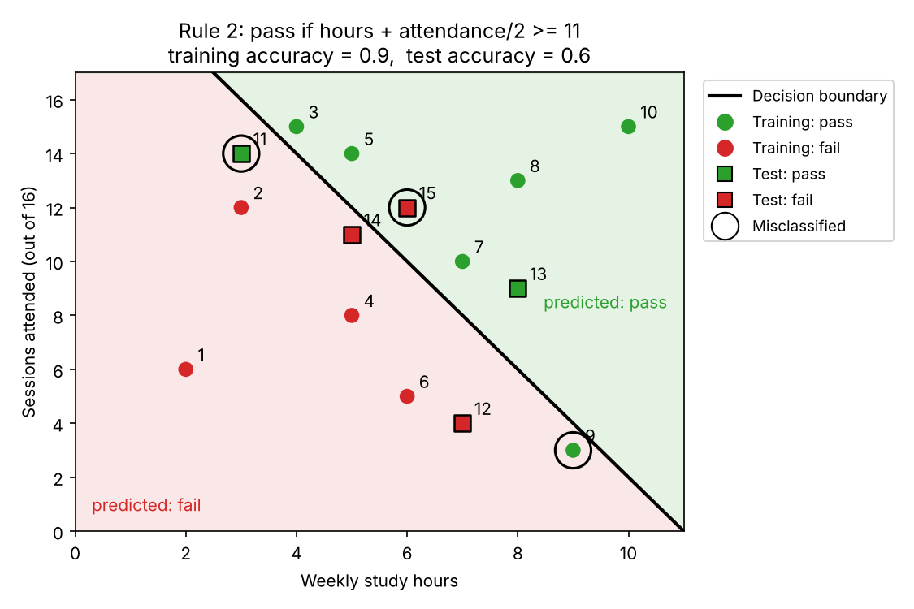
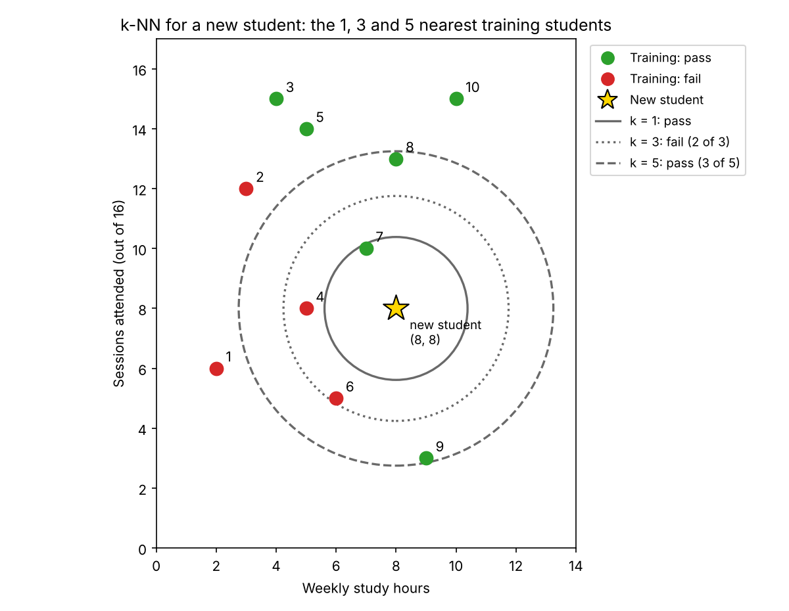
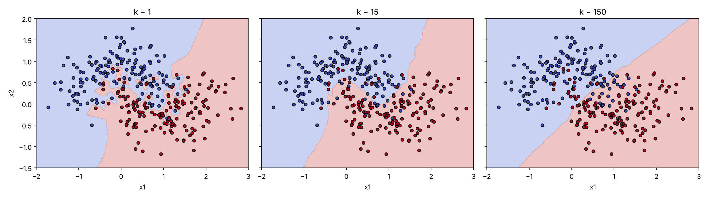
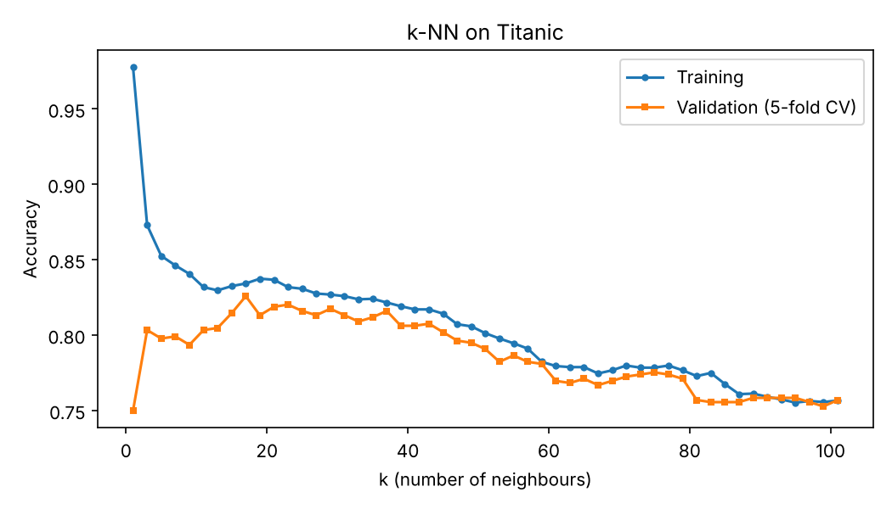

# جلسه ۲۰ — مبانی طبقه‌بندی و k-NN

## از رگرسیون به طبقه‌بندی

در چهار جلسه گذشته هدف ما پیش‌بینی یک **عدد** بود ← [مبانی یادگیری نظارت‌شده و رگرسیون خطی ساده](../Part%204_Regression/16%20-%20%D9%85%D8%A8%D8%A7%D9%86%DB%8C%20%DB%8C%D8%A7%D8%AF%DA%AF%DB%8C%D8%B1%DB%8C%20%D9%86%D8%B8%D8%A7%D8%B1%D8%AA%E2%80%8C%D8%B4%D8%AF%D9%87%20%D9%88%20%D8%B1%DA%AF%D8%B1%D8%B3%DB%8C%D9%88%D9%86%20%D8%AE%D8%B7%DB%8C%20%D8%B3%D8%A7%D8%AF%D9%87.md). اما بسیاری از پرسش‌های داده‌کاوی درباره **برچسب** هستند: این ایمیل هرزنامه است یا نه؟ این مشتری اشتراکش را لغو می‌کند؟ این مسافر تایتانیک زنده می‌ماند؟

در **طبقه‌بندی** (Classification) متغیر هدف **کیفی** است و مدل هر نمونه را به یکی از **کلاس‌های** از پیش تعریف‌شده نسبت می‌دهد. همه ابزارهایی که تا اینجا ساختیم (تقسیم داده، Pipeline، بیش‌برازش و اعتبارسنجی متقابل) در طبقه‌بندی هم به همان شکل به کار می‌روند ← [رگرسیون چندجمله‌ای، بیش‌برازش و اعتبارسنجی متقابل](../Part%204_Regression/18%20-%20%D8%B1%DA%AF%D8%B1%D8%B3%DB%8C%D9%88%D9%86%20%DA%86%D9%86%D8%AF%D8%AC%D9%85%D9%84%D9%87%E2%80%8C%D8%A7%DB%8C%D8%8C%20%D8%A8%DB%8C%D8%B4%E2%80%8C%D8%A8%D8%B1%D8%A7%D8%B2%D8%B4%20%D9%88%20%D8%A7%D8%B9%D8%AA%D8%A8%D8%A7%D8%B1%D8%B3%D9%86%D8%AC%DB%8C%20%D9%85%D8%AA%D9%82%D8%A7%D8%A8%D9%84.md)

این جلسه به سه پرسش پاسخ می‌دهد:

- مسئله طبقه‌بندی و **مرز تصمیم** چیست؟
- ساده‌ترین طبقه‌بند، یعنی **k-نزدیک‌ترین همسایه**، چگونه کار می‌کند و k را چگونه انتخاب کنیم؟
- چرا **مقیاس‌بندی** برای k-NN حیاتی است و این روش کجا ضعیف عمل می‌کند؟

---

## مسئله طبقه‌بندی

یک استاد می‌خواهد از روی **ساعت مطالعه هفتگی** و **تعداد جلسات حضور** (از ۱۶ جلسه) پیش‌بینی کند هر دانشجو درس را **قبول** می‌شود یا **مردود**. اطلاعات پانزده دانشجوی ترم قبل را دارد. ده نفر اول را برای **ساختن** طبقه‌بند به کار می‌برد (**داده آموزش**) و پنج نفر آخر را کنار می‌گذارد تا ببیند طبقه‌بند روی دانشجویی که هنگام ساختنش دیده نشده چقدر درست کار می‌کند (**داده آزمون**) ← [مبانی یادگیری نظارت‌شده و رگرسیون خطی ساده](../Part%204_Regression/16%20-%20%D9%85%D8%A8%D8%A7%D9%86%DB%8C%20%DB%8C%D8%A7%D8%AF%DA%AF%DB%8C%D8%B1%DB%8C%20%D9%86%D8%B8%D8%A7%D8%B1%D8%AA%E2%80%8C%D8%B4%D8%AF%D9%87%20%D9%88%20%D8%B1%DA%AF%D8%B1%D8%B3%DB%8C%D9%88%D9%86%20%D8%AE%D8%B7%DB%8C%20%D8%B3%D8%A7%D8%AF%D9%87.md):

| دانشجو | ساعت مطالعه | جلسات حضور | نتیجه | مجموعه |
|:---:|:---:|:---:|:---:|:---:|
| ۱ | 2 | 6 | مردود | آموزش |
| ۲ | 3 | 12 | مردود | آموزش |
| ۳ | 4 | 15 | قبول | آموزش |
| ۴ | 5 | 8 | مردود | آموزش |
| ۵ | 5 | 14 | قبول | آموزش |
| ۶ | 6 | 5 | مردود | آموزش |
| ۷ | 7 | 10 | قبول | آموزش |
| ۸ | 8 | 13 | قبول | آموزش |
| ۹ | 9 | 3 | قبول | آموزش |
| ۱۰ | 10 | 15 | قبول | آموزش |
| ۱۱ | 3 | 14 | قبول | آزمون |
| ۱۲ | 7 | 4 | مردود | آزمون |
| ۱۳ | 8 | 9 | قبول | آزمون |
| ۱۴ | 5 | 11 | مردود | آزمون |
| ۱۵ | 6 | 12 | مردود | آزمون |

- **ویژگی‌ها** (X): ساعت مطالعه و جلسات حضور؛ هر سطر یک دانشجو.
- **برچسب** (y): نتیجه، که کیفی است و فقط دو مقدار دارد؛ هر مقدار یک **کلاس** است. کلاسی که به دنبال آن هستیم (اینجا «قبول») کلاس **مثبت** نام دارد.
- **طبقه‌بند**: قاعده یا مدلی که برای دانشجوی تازه، با دانستن دو ویژگی، کلاس را پیش‌بینی می‌کند.

|            نوع مسئله            | تعداد کلاس |                               مثال                                |
| :-----------------------------: | :--------: | :---------------------------------------------------------------: |
|    طبقه‌بندی دودویی (Binary)    |     ۲      |                  قبول یا مردود، هرزنامه یا عادی                   |
| طبقه‌بندی چندکلاسه (Multiclass) | بیشتر از ۲ | پیش‌بینی نمره در سه سطح «الف»، «ب» و «ج»؛ هر نمونه دقیقاً یک کلاس |

بیشتر طبقه‌بندها **احتمال** هر کلاس را برآورد می‌کنند و کلاسی را برمی‌گزینند که بیشترین احتمال را دارد. مثلاً اگر مدلی برای دانشجویی با ۵ ساعت مطالعه و ۱۴ جلسه حضور احتمال قبولی را ۰.۷ و احتمال مردودی را ۰.۳ برآورد کند، پیش‌بینی «قبول» است:

$$
\hat{y} = \arg\max_{k} \; P(y = C_k \mid x)
$$

برای سنجیدن طبقه‌بند، فعلاً از **صحت** (Accuracy) استفاده می‌کنیم: نسبت پیش‌بینی‌های درست به کل پیش‌بینی‌ها. صحت هر مدل را همیشه با **مدل پایه** «همیشه کلاس اکثریت» مقایسه می‌کنیم. واژه «دقت» را برای معیار دیگری (Precision) نگه می‌داریم؛ آن معیار و دیگر معیارهای ارزیابی، و دلیل ناکافی بودن صحت در داده نامتوازن، را در جلسه ۲۵ می‌بینیم ← [ارزیابی مدل‌های طبقه‌بندی](25%20-%20%D8%A7%D8%B1%D8%B2%DB%8C%D8%A7%D8%A8%DB%8C%20%D9%85%D8%AF%D9%84%E2%80%8C%D9%87%D8%A7%DB%8C%20%D8%B7%D8%A8%D9%82%D9%87%E2%80%8C%D8%A8%D9%86%D8%AF%DB%8C.md).

### مثال حل‌شده: دو طبقه‌بند دستی

پیش از هر الگوریتمی، با نگاه به ده دانشجوی **آموزش** دو قاعده ساده می‌سازیم و بعد آن‌ها را روی پنج دانشجوی **آزمون** می‌سنجیم:

- **قاعده ۱** (یک ویژگی): اگر ساعت مطالعه دست‌کم ۶ باشد، «قبول».
- **قاعده ۲** (دو ویژگی): اگر ساعت مطالعه به‌علاوه نصف جلسات حضور دست‌کم ۱۱ باشد، «قبول».

#### گام ۱ — مدل پایه

در داده آموزش شش دانشجو قبول و چهار دانشجو مردود شده‌اند. مدل پایه همیشه کلاس اکثریت آموزش یعنی «قبول» را پیش‌بینی می‌کند و روی داده آموزش شش پیش‌بینی آن درست است:

$$
\text{Accuracy}_{\text{baseline}} = \frac{6}{10} = 0.6
$$

#### گام ۲ — پیش‌بینی دو قاعده روی داده آموزش

| دانشجو | ساعت مطالعه | جلسات حضور | نتیجه | قاعده ۱ | ساعت + نصف حضور | قاعده ۲ |
|:---:|:---:|:---:|:---:|:---:|:---:|:---:|
| ۱ | 2 | 6 | مردود | مردود ✓ | 5 | مردود ✓ |
| ۲ | 3 | 12 | مردود | مردود ✓ | 9 | مردود ✓ |
| ۳ | 4 | 15 | قبول | مردود ✗ | 11.5 | قبول ✓ |
| ۴ | 5 | 8 | مردود | مردود ✓ | 9 | مردود ✓ |
| ۵ | 5 | 14 | قبول | مردود ✗ | 12 | قبول ✓ |
| ۶ | 6 | 5 | مردود | قبول ✗ | 8.5 | مردود ✓ |
| ۷ | 7 | 10 | قبول | قبول ✓ | 12 | قبول ✓ |
| ۸ | 8 | 13 | قبول | قبول ✓ | 14.5 | قبول ✓ |
| ۹ | 9 | 3 | قبول | قبول ✓ | 10.5 | مردود ✗ |
| ۱۰ | 10 | 15 | قبول | قبول ✓ | 17.5 | قبول ✓ |
| جمع درست | | | | 7 | | 9 |

#### گام ۳ — صحت آموزش

$$
\text{Accuracy}_{1} = \frac{7}{10} = 0.7, \qquad \text{Accuracy}_{2} = \frac{9}{10} = 0.9
$$

قاعده ۱ دانشجویان پرحضور اما کم‌مطالعه (۳ و ۵) را مردود و دانشجوی ۶ را قبول اعلام می‌کند. قاعده ۲ با استفاده از **هر دو** ویژگی فقط دانشجوی ۹ را اشتباه می‌گیرد که با حضور بسیار کم قبول شده است. این اعداد **صحت آموزش** هستند: قاعده‌ها را با دیدن همین ده نفر ساختیم.

#### گام ۴ — صحت آزمون

حالا همان قاعده‌ها را، **بدون هیچ تغییری**، روی پنج دانشجوی آزمون اجرا می‌کنیم:

| دانشجو | ساعت مطالعه | جلسات حضور | نتیجه | قاعده ۱ | ساعت + نصف حضور | قاعده ۲ | مدل پایه |
|:---:|:---:|:---:|:---:|:---:|:---:|:---:|:---:|
| ۱۱ | 3 | 14 | قبول | مردود ✗ | 10 | مردود ✗ | قبول ✓ |
| ۱۲ | 7 | 4 | مردود | قبول ✗ | 9 | مردود ✓ | قبول ✗ |
| ۱۳ | 8 | 9 | قبول | قبول ✓ | 12.5 | قبول ✓ | قبول ✓ |
| ۱۴ | 5 | 11 | مردود | مردود ✓ | 10.5 | مردود ✓ | قبول ✗ |
| ۱۵ | 6 | 12 | مردود | قبول ✗ | 12 | قبول ✗ | قبول ✗ |
| جمع درست | | | | 2 | | 3 | 2 |

$$
\text{Accuracy}_{1} = \frac{2}{5} = 0.4, \qquad \text{Accuracy}_{2} = \frac{3}{5} = 0.6, \qquad \text{Accuracy}_{\text{baseline}} = \frac{2}{5} = 0.4
$$

| طبقه‌بند | صحت آموزش | صحت آزمون |
|:---:|:---:|:---:|
| مدل پایه | 0.6 | 0.4 |
| قاعده ۱ | 0.7 | 0.4 |
| قاعده ۲ | 0.9 | 0.6 |

صحت هر سه طبقه‌بند روی دانشجویان تازه **کمتر** از صحت آموزش است؛ صحت ۰.۹ قاعده ۲ روی دانشجوی تازه به ۰.۶ رسید و قاعده ۱ روی داده آزمون از مدل پایه بهتر نیست. مرزی که با دیدن داده آموزش ساخته شده، روی همان داده **خوش‌بینانه** به نظر می‌رسد. با پنج دانشجو عدد آزمون هم نوسان زیادی دارد (هر دانشجو ۲۰ درصد صحت است)؛ اما ترتیب کلی همان است: قاعده ۲ بهترین است.

> [!note] بررسی
> مدل پایه از داده آموزش **یاد می‌گیرد** (کلاس اکثریت را)، اما دو قاعده دستی‌اند؛ با این حال هر سه با دیدن داده آموزش ساخته شده‌اند و هیچ‌کدام دانشجویان آزمون را ندیده‌اند. همین است که صحت آزمون را به برآوردی منصفانه از عملکرد روی دانشجوی تازه تبدیل می‌کند.

> [!important] سه صحت؛ هر کدام برای یک کار
> | صحت | روی چه داده‌ای | به چه کار می‌آید |
> |:---:|:---:|:---:|
> | صحت آموزش | داده‌ای که مدل با آن ساخته شده | تشخیص بیش‌برازش؛ هرگز برای گزارش عملکرد |
> | صحت اعتبارسنجی | بخشی کنارگذاشته از آموزش یا اعتبارسنجی متقابل | انتخاب مدل و ابرپارامتر (مانند k در ادامه) |
> | صحت آزمون | داده قفل‌شده؛ فقط یک بار در پایان | برآورد عملکرد روی داده جدید |
>
> در این جلسه هر عدد صحت را با یکی از این سه برچسب گزارش می‌کنیم ← [رگرسیون چندجمله‌ای، بیش‌برازش و اعتبارسنجی متقابل](../Part%204_Regression/18%20-%20%D8%B1%DA%AF%D8%B1%D8%B3%DB%8C%D9%88%D9%86%20%DA%86%D9%86%D8%AF%D8%AC%D9%85%D9%84%D9%87%E2%80%8C%D8%A7%DB%8C%D8%8C%20%D8%A8%DB%8C%D8%B4%E2%80%8C%D8%A8%D8%B1%D8%A7%D8%B2%D8%B4%20%D9%88%20%D8%A7%D8%B9%D8%AA%D8%A8%D8%A7%D8%B1%D8%B3%D9%86%D8%AC%DB%8C%20%D9%85%D8%AA%D9%82%D8%A7%D8%A8%D9%84.md)

### مرز تصمیم

هر طبقه‌بند صفحه ویژگی‌ها را به **ناحیه‌هایی** تقسیم می‌کند که در هر کدام یک کلاس پیش‌بینی می‌شود؛ مرز میان ناحیه‌ها **مرز تصمیم** (Decision Boundary) است. در دو نمودار زیر، ناحیه سبز «قبول» و ناحیه قرمز «مردود» هر قاعده است. دانشجویان آموزش با دایره و دانشجویان آزمون با مربع نشان داده شده‌اند (رنگ، نتیجه واقعی را نشان می‌دهد) و هر پیش‌بینی اشتباه با یک حلقه مشخص شده است.

مرز قاعده ۱ خط عمودی «ساعت مطالعه برابر ۶» است؛ این قاعده جلسات حضور را نادیده می‌گیرد و از آموزش سه دانشجو (۳، ۵ و ۶) و از آزمون سه دانشجو (۱۱، ۱۲ و ۱۵) را اشتباه طبقه‌بندی می‌کند:



مرز قاعده ۲ خط مورب «ساعت مطالعه به‌علاوه نصف حضور برابر ۱۱» است. چون از هر دو ویژگی استفاده می‌کند، در آموزش فقط دانشجوی ۹ را اشتباه می‌گیرد؛ اما از پنج دانشجوی آزمون، دو نفر (۱۱ و ۱۵) در ناحیه نادرست افتاده‌اند. این مرز با دیدن ده دانشجوی آموزش کشیده شده و دانشجوی تازه لزوماً از آن پیروی نمی‌کند:



یادگیری طبقه‌بند یعنی پیدا کردن مرزی که روی داده **جدید** کمترین خطا را بدهد.

| نوع مرز | مدل‌های نمونه | ویژگی |
|:---:|:---:|:---:|
| خطی (مانند قاعده ۲) | رگرسیون لجستیک، SVM خطی | ساده و کم‌حساس به داده آموزش؛ ممکن است کم‌برازش کند |
| محوری و پله‌ای (مانند قاعده ۱) | درخت تصمیم | خطوط موازی محورها |
| غیرخطی و نامنظم | الگوریتم k-NN، SVM با هسته RBF | انعطاف‌پذیر؛ ممکن است بیش‌برازش کند |

مرزهای نامنظم k-NN را در بخش «انتخاب k» می‌بینیم.

---

## الگوریتم k-NN

### از شهود به الگوریتم

دو قاعده دستی را **ما** با نگاه به نمودار ساختیم و هر کدام فقط یک مرز ثابت است. استاد می‌تواند راه دیگری هم برود: برای دانشجوی تازه فرمولی نسازد و فقط بپرسد «دانشجویان **شبیه** او در ترم قبل چه نتیجه‌ای گرفتند؟». این همان ایده‌ای است که در زندگی روزمره هم به کار می‌بریم: برای حدس قیمت یک خانه، به قیمت خانه‌های مشابه در همان محله نگاه می‌کنیم.

برای اینکه این ایده به یک الگوریتم تبدیل شود، باید به سه پرسش پاسخ دهیم:

1. **«شبیه» یعنی چه؟** هر دانشجو یک نقطه در صفحه ویژگی‌هاست؛ دو دانشجو هرچه **فاصله** کمتری داشته باشند شبیه‌ترند. معمولاً فاصله اقلیدسی را به کار می‌بریم ← [معیارهای شباهت و فاصله](../Part%201_Data%20Understanding/%DB%B5%20-%20%D9%85%D8%B9%DB%8C%D8%A7%D8%B1%D9%87%D8%A7%DB%8C%20%D8%B4%D8%A8%D8%A7%D9%87%D8%AA%20%D9%88%20%D9%81%D8%A7%D8%B5%D9%84%D9%87.md).
2. **به چند دانشجوی شبیه نگاه کنیم؟** ساده‌ترین انتخاب، فقط **نزدیک‌ترین** دانشجوست. اما یک دانشجو ممکن است استثنا باشد (مانند دانشجوی ۹ که با ۳ جلسه حضور قبول شد)؛ پس بهتر است به **k** دانشجوی نزدیک نگاه کنیم.
3. **نظر این k نفر را چگونه ترکیب کنیم؟** با **رأی‌گیری**: کلاسی که میان آن‌ها بیشتر تکرار شده، پیش‌بینی ماست.

پاسخ این سه پرسش، کنار هم، الگوریتم **k-نزدیک‌ترین همسایه** (k-Nearest Neighbors) است.

> [!important] الگوریتم k-NN
> برای طبقه‌بندی نقطه جدید q:
>
> 1. فاصله q را تا **همه** نقاط آموزش حساب کن.
> 2. تعداد k نقطه با کمترین فاصله (**همسایه‌ها**) را انتخاب کن.
> 3. کلاسی را که میان این k همسایه **بیشترین رأی** را دارد، به q نسبت بده.

برخلاف دو قاعده دستی، اینجا هیچ مرزی از پیش تعیین نمی‌شود؛ خود داده آموزش، برای هر نقطه تازه، پیش‌بینی را می‌سازد.

### مثال حل‌شده: k-NN برای یک دانشجوی تازه

دانشجوی تازه‌ای با **۸ ساعت مطالعه** و **۸ جلسه حضور** داریم و می‌خواهیم با k-NN، فقط با کمک ده دانشجوی آموزش، نتیجه‌اش را پیش‌بینی کنیم. (دو ویژگی اینجا بازه نزدیکی دارند؛ اهمیت هم‌مقیاس کردن ویژگی‌ها را در بخش «نقش مقیاس‌بندی» می‌بینیم.)

#### گام ۱ — فاصله تا همه دانشجویان آموزش

| دانشجو | ساعت مطالعه | جلسات حضور | نتیجه | فاصله اقلیدسی تا (۸، ۸) | رتبه |
|:---:|:---:|:---:|:---:|:---:|:---:|
| ۷ | 7 | 10 | قبول | √5 ≈ 2.236 | ۱ |
| ۴ | 5 | 8 | مردود | √9 = 3.000 | ۲ |
| ۶ | 6 | 5 | مردود | √13 ≈ 3.606 | ۳ |
| ۸ | 8 | 13 | قبول | √25 = 5.000 | ۴ |
| ۹ | 9 | 3 | قبول | √26 ≈ 5.099 | ۵ |
| ۱ | 2 | 6 | مردود | √40 ≈ 6.325 | ۶ |
| ۲ | 3 | 12 | مردود | √41 ≈ 6.403 | ۷ |
| ۵ | 5 | 14 | قبول | √45 ≈ 6.708 | ۸ |
| ۱۰ | 10 | 15 | قبول | √53 ≈ 7.280 | ۹ |
| ۳ | 4 | 15 | قبول | √65 ≈ 8.062 | ۱۰ |

جدول بر اساس فاصله مرتب شده است. برای نمونه، فاصله دانشجوی ۶ تا دانشجوی تازه:

$$
d = \sqrt{(6 - 8)^2 + (5 - 8)^2} = \sqrt{4 + 9} = \sqrt{13} \approx 3.606
$$

#### گام ۲ — رأی ساده برای چند k

| مقدار k | همسایه‌ها | رأی‌ها | پیش‌بینی | احتمال قبولی |
|:---:|:---:|:---:|:---:|:---:|
| ۱ | دانشجوی ۷ | یک رأی قبول | **قبول** | 1.000 |
| ۳ | دانشجویان ۷، ۴ و ۶ | یک رأی قبول، دو رأی مردود | **مردود** | 0.333 |
| ۵ | دانشجویان ۷، ۴، ۶، ۸ و ۹ | سه رأی قبول، دو رأی مردود | **قبول** | 0.600 |

در نمودار زیر، دایره‌ها از دانشجوی تازه (ستاره) تا همسایه اول، سوم و پنجم کشیده شده‌اند؛ هر دایره k همسایه را در بر می‌گیرد:



احتمال هر کلاس همان نسبت همسایه‌های آن کلاس است (N مجموعه k همسایه و I تابع نشانگر):

$$
\hat{P}(y = c \mid q) = \frac{1}{k} \sum_{i \in N_k(q)} I(y_i = c)
$$

#### گام ۳ — رأی وزن‌دار با k برابر ۳

در رأی ساده، همسایه سوم (با فاصله ۳.۶۰۶) همان اثری را دارد که همسایه اول (با فاصله ۲.۲۳۶). منطقی‌تر است همسایه نزدیک‌تر اثر بیشتری داشته باشد. در **رأی وزن‌دار** (`weights="distance"`) وزن هر همسایه عکس فاصله آن است:

$$
w_i = \frac{1}{d(q, x_i)}
$$

وزن‌ها: دانشجوی ۷ (قبول) برابر ۱ تقسیم بر ۲.۲۳۶ یعنی حدود ۰.۴۴۷، دانشجوی ۴ (مردود) حدود ۰.۳۳۳ و دانشجوی ۶ (مردود) حدود ۰.۲۷۷:

$$
\text{score}(\text{قبول}) = 0.447, \qquad \text{score}(\text{مردود}) = 0.333 + 0.277 = 0.611, \qquad P(\text{قبول}) = \frac{0.447}{1.058} \approx 0.423
$$

پیش‌بینی همچنان **مردود** است، اما احتمال قبولی از ۰.۳۳۳ به ۰.۴۲۳ رسید، چون نزدیک‌ترین همسایه قبول شده است. اگر q دقیقاً روی یک یا چند نقطه آموزش بیفتد (فاصله صفر)، این وزن تعریف نمی‌شود؛ scikit-learn در این حالت فقط همان نقاط هم‌مکان را در رأی‌گیری به حساب می‌آورد.

> [!note] بررسی
> پیش‌بینی با تغییر k **عوض می‌شود** (قبول، مردود، قبول)؛ پس انتخاب k بخش مهمی از ساخت مدل است و آن را در بخش «انتخاب k» با اعتبارسنجی متقابل انجام می‌دهیم، نه با داده آزمون. در مسئله دودویی k را **فرد** بگیرید تا رأی مساوی پیش نیاید. قاعده ۱ و قاعده ۲ هر دو این دانشجو را «قبول» پیش‌بینی می‌کنند (ساعت مطالعه ۸ و مجموع ۸ + ۴ = ۱۲)؛ k-NN با k برابر ۳ به دو همسایه مردود نزدیک او توجه می‌کند.

کلاس `KNeighborsClassifier` همین اعداد را می‌دهد:

```python
import pandas as pd
from sklearn.neighbors import KNeighborsClassifier

# 1. The ten training students and a new student (8 study hours, 8 sessions)
train = pd.DataFrame({"hours":      [2, 3, 4, 5, 5, 6, 7, 8, 9, 10],
                      "attendance": [6, 12, 15, 8, 14, 5, 10, 13, 3, 15],
                      "result": ["fail", "fail", "pass", "fail", "pass",
                                 "fail", "pass", "pass", "pass", "pass"]})
X, y = train[["hours", "attendance"]], train["result"]
new = pd.DataFrame({"hours": [8], "attendance": [8]})

# 2. Simple majority vote for k = 1, 3, 5 (classes are sorted: fail, pass)
for k in [1, 3, 5]:
    knn = KNeighborsClassifier(n_neighbors=k).fit(X, y)
    print(f"k={k}  prediction={knn.predict(new)[0]}  P(pass)={knn.predict_proba(new)[0, 1]:.3f}")

# 3. Distance-weighted vote with k = 3
knn_w = KNeighborsClassifier(n_neighbors=3, weights="distance").fit(X, y)
print(f"weighted k=3  prediction={knn_w.predict(new)[0]}  P(pass)={knn_w.predict_proba(new)[0, 1]:.3f}")

# 4. Distances and numbers of the 5 nearest students (index 0 = student 1)
dist, idx = knn.kneighbors(new, n_neighbors=5)
print(f"neighbours={idx[0] + 1}  distances={dist[0].round(3)}")
```

```
k=1  prediction=pass  P(pass)=1.000
k=3  prediction=fail  P(pass)=0.333
k=5  prediction=pass  P(pass)=0.600
weighted k=3  prediction=fail  P(pass)=0.423
neighbours=[7 4 6 8 9]  distances=[2.236 3.    3.606 5.    5.099]
```

### بیش از دو کلاس

رأی‌گیری k-NN بدون هیچ تغییری برای مسئله **چندکلاسه** هم کار می‌کند: کلاسی که بیشترین رأی را میان k همسایه دارد برنده است و `predict_proba` برای هر کلاس یک ستون دارد. داده **گل زنبق** (Iris) ۱۵۰ گل از سه گونه ستوسا (setosa)، ورسیکالر (versicolor) و ویرجینیکا (virginica) دارد، از هر گونه ۵۰ گل. با دو ویژگی **طول و عرض گلبرگ** (هر دو بر حسب سانتی‌متر و با بازه نزدیک)، گونه گلی تازه با طول گلبرگ ۵ و عرض ۱.۴ را با k برابر ۵ پیش‌بینی می‌کنیم:

```python
import pandas as pd
from sklearn.datasets import load_iris
from sklearn.neighbors import KNeighborsClassifier

# 1. Iris: 150 flowers, three species; two features (petal length and width, in cm)
iris = load_iris(as_frame=True)
X = iris.data[["petal length (cm)", "petal width (cm)"]]
y = iris.target_names[iris.target]            # species names instead of 0, 1, 2
print(pd.Series(y).value_counts().to_dict())

# 2. A new flower near the border of versicolor and virginica
new = pd.DataFrame({"petal length (cm)": [5.0], "petal width (cm)": [1.4]})
knn = KNeighborsClassifier(n_neighbors=5).fit(X, y)
print(f"classes={knn.classes_.tolist()}")
print(f"prediction={knn.predict(new)[0]}  probabilities={knn.predict_proba(new)[0].round(2).tolist()}")

# 3. The 5 nearest flowers: their features, species and distance
dist, idx = knn.kneighbors(new)
neighbours = X.iloc[idx[0]].assign(species=y[idx[0]], distance=dist[0].round(3))
print(neighbours)
```

```
{'setosa': 50, 'versicolor': 50, 'virginica': 50}
classes=['setosa', 'versicolor', 'virginica']
prediction=versicolor  probabilities=[0.0, 0.6, 0.4]
     petal length (cm)  petal width (cm)     species  distance
119                5.0               1.5   virginica     0.100
133                5.1               1.5   virginica     0.141
52                 4.9               1.5  versicolor     0.141
72                 4.9               1.5  versicolor     0.141
76                 4.8               1.4  versicolor     0.200
```

از پنج همسایه، سه همسایه ورسیکالر و دو همسایه ویرجینیکا هستند و هیچ ستوسایی میان آن‌ها نیست؛ پس پیش‌بینی **ورسیکالر** با احتمال ۰.۶ است و احتمال ستوسا صفر است. دو نکته:

- نزدیک‌ترین همسایه (فاصله ۰.۱) ویرجینیکاست؛ یعنی 1-NN گونه **ویرجینیکا** را پیش‌بینی می‌کرد. باز هم پیش‌بینی به k وابسته است.
- این گل در مرز دو گونه ورسیکالر و ویرجینیکا قرار دارد و احتمال ۰.۶ همین تردید را نشان می‌دهد؛ ستوسا گلبرگ بسیار کوچک‌تری دارد و از این گل دور است.

در مسئله چندکلاسه، فرد بودن k رأی مساوی را از بین نمی‌برد (مثلاً با k برابر ۵ ممکن است رأی‌ها ۲، ۲ و ۱ باشد)؛ در این حالت scikit-learn کلاسی را برمی‌گزیند که در فهرست کلاس‌ها زودتر آمده است. بررسی کامل‌تر داده زنبق (مرز تصمیم و انتخاب k) تمرین کارگاه همین جلسه است.

---

## نقش مقیاس‌بندی

الگوریتم k-NN کاملاً بر پایه **فاصله** است؛ ویژگی با دامنه عددی بزرگ‌تر فاصله را کنترل می‌کند و بقیه ویژگی‌ها عملاً نادیده گرفته می‌شوند.

### مثال حل‌شده: تغییر واحد ساعت مطالعه

به مثال دانشجویان برمی‌گردیم. داده و دانشجوی تازه همان قبلی‌اند؛ فقط زمان مطالعه را به جای ساعت بر حسب **دقیقه** در هفته می‌نویسیم (دانشجوی تازه: ۴۸۰ دقیقه و ۸ جلسه). روشن است که تغییر واحد نباید نتیجه یک دانشجو را عوض کند؛ ببینیم k-NN چه می‌کند.

#### گام ۱ — فاصله بدون مقیاس‌بندی

| دانشجو | دقیقه مطالعه | جلسات حضور | نتیجه | فاصله با ساعت (قبلی) | فاصله با دقیقه |
|:---:|:---:|:---:|:---:|:---:|:---:|
| ۷ | 420 | 10 | قبول | 2.236 (رتبه ۱) | 60.033 (رتبه ۲) |
| ۴ | 300 | 8 | مردود | 3.000 (رتبه ۲) | 180.000 (رتبه ۵) |
| ۶ | 360 | 5 | مردود | 3.606 (رتبه ۳) | 120.037 (رتبه ۴) |
| ۸ | 480 | 13 | قبول | 5.000 (رتبه ۴) | 5.000 (رتبه ۱) |
| ۹ | 540 | 3 | قبول | 5.099 (رتبه ۵) | 60.208 (رتبه ۳) |

برای نمونه، فاصله دانشجوی ۷ با واحد دقیقه:

$$
d = \sqrt{(420 - 480)^2 + (10 - 8)^2} = \sqrt{3600 + 4} \approx 60.033
$$

اختلاف دقیقه‌ها (۶۰، ۱۲۰، ...) آن‌قدر بزرگ است که اختلاف جلسات حضور (حداکثر ۱۲) تقریباً اثری ندارد. سه همسایه نزدیک حالا دانشجویان ۸، ۷ و ۹ هستند که هر سه قبول شده‌اند؛ پس پیش‌بینی 3-NN از **مردود** به **قبول** تغییر می‌کند، فقط به خاطر تغییر واحد.

#### گام ۲ — مقیاس‌بندی Min-Max

هر ویژگی را با کمینه و بیشینه **داده آموزش** به بازه صفر تا یک می‌بریم: دقیقه مطالعه از ۱۲۰ تا ۶۰۰ و جلسات حضور از ۳ تا ۱۵ ← [تبدیل و یکپارچه‌سازی داده](../Part%203_Data%20Preprocessing/%DB%B1%DB%B2%20-%20%D8%AA%D8%A8%D8%AF%DB%8C%D9%84%20%D9%88%20%DB%8C%DA%A9%D9%BE%D8%A7%D8%B1%DA%86%D9%87%E2%80%8C%D8%B3%D8%A7%D8%B2%DB%8C%20%D8%AF%D8%A7%D8%AF%D9%87.md). دانشجوی تازه:

$$
\left( \frac{480 - 120}{600 - 120}, \; \frac{8 - 3}{15 - 3} \right) = (0.750, \; 0.417)
$$

و دانشجوی ۷ به (۰.۶۲۵، ۰.۵۸۳) می‌رود، پس فاصله او:

$$
d = \sqrt{(0.625 - 0.750)^2 + (0.583 - 0.417)^2} \approx 0.208
$$

| دانشجو | نتیجه | فاصله پس از Min-Max | رتبه |
|:---:|:---:|:---:|:---:|
| ۷ | قبول | 0.208 | ۱ |
| ۶ | مردود | 0.354 | ۲ |
| ۴ | مردود | 0.375 | ۳ |
| ۸ | قبول | 0.417 | ۴ |

سه همسایه نزدیک دوباره دانشجویان ۷، ۶ و ۴ هستند و پیش‌بینی 3-NN دوباره **مردود** است.

> [!note] بررسی
> پس از Min-Max، نوشتن زمان مطالعه به ساعت یا دقیقه **همان** اعداد صفر تا یک را می‌دهد؛ یعنی مقیاس‌بندی، پیش‌بینی را از واحد اندازه‌گیری مستقل می‌کند. کمینه و بیشینه فقط از داده آموزش یاد گرفته می‌شوند و روی دانشجوی تازه (و داده آزمون) فقط **اعمال** می‌شوند. روش مقیاس‌بندی هم خودش یک انتخاب است: اگر در همین مثال به جای Min-Max از استانداردسازی استفاده کنیم، همسایه سوم دانشجوی ۸ می‌شود و پیش‌بینی 3-NN «قبول» است.

```python
import pandas as pd
from sklearn.preprocessing import MinMaxScaler
from sklearn.neighbors import KNeighborsClassifier

# 1. The ten training students, with study time in minutes per week instead of hours
train = pd.DataFrame({"minutes":    [120, 180, 240, 300, 300, 360, 420, 480, 540, 600],
                      "attendance": [6, 12, 15, 8, 14, 5, 10, 13, 3, 15],
                      "result": ["fail", "fail", "pass", "fail", "pass",
                                 "fail", "pass", "pass", "pass", "pass"]})
X, y = train[["minutes", "attendance"]], train["result"]
new = pd.DataFrame({"minutes": [480], "attendance": [8]})    # the same new student (8 hours)

# 2. Without scaling: minutes dominate the distance
knn = KNeighborsClassifier(n_neighbors=3).fit(X, y)
dist, idx = knn.kneighbors(new)
print(f"raw:    neighbours={idx[0] + 1}  distances={dist[0].round(3)}  prediction={knn.predict(new)[0]}")

# 3. Min-Max scaling learned from the training students only
scaler = MinMaxScaler().fit(X)
knn_s = KNeighborsClassifier(n_neighbors=3).fit(scaler.transform(X), y)
dist, idx = knn_s.kneighbors(scaler.transform(new))
print(f"scaled: neighbours={idx[0] + 1}  distances={dist[0].round(3)}  prediction={knn_s.predict(scaler.transform(new))[0]}")
```

```
raw:    neighbours=[8 7 9]  distances=[ 5.    60.033 60.208]  prediction=pass
scaled: neighbours=[7 6 4]  distances=[0.208 0.354 0.375]  prediction=fail
```

### داده واقعی: تایتانیک

داده تایتانیک (۸۹۱ مسافر) را از جلسات پیش‌پردازش می‌شناسیم. در جلسات ۲۰ تا ۲۵ همین داده را با تنظیمات **یکسان** به کار می‌بریم تا مدل‌ها قابل مقایسه باشند:

- هدف: `survived` (زنده ماندن، کلاس مثبت ۱).
- ویژگی‌های عددی: سن، کرایه، تعداد همسر و خواهر و برادر، تعداد والدین و فرزندان، کلاس سفر؛ ویژگی‌های کیفی: جنسیت و بندر سوار شدن.
- تقسیم **طبقه‌بندی‌شده** با ۲۰ درصد آزمون و `random_state=42` ← [طراحی آزمایش و Pipeline](../Part%203_Data%20Preprocessing/%DB%B1%DB%B5%20-%20%D8%B7%D8%B1%D8%A7%D8%AD%DB%8C%20%D8%A2%D8%B2%D9%85%D8%A7%DB%8C%D8%B4%20%D9%88%20Pipeline.md)
- پیش‌پردازش داخل Pipeline: جایگذاری میانه و استانداردسازی برای ستون‌های عددی، جایگذاری مد و One-Hot برای ستون‌های کیفی. همه این گام‌ها **یادگیرنده**‌اند و فقط روی داده آموزش `fit` می‌شوند.
- اعتبارسنجی متقابل **طبقه‌بندی‌شده** پنج بخشی (`StratifiedKFold`) تا نسبت زنده‌ماندگان در هر بخش حفظ شود.

```python
import seaborn as sns
from sklearn.model_selection import train_test_split, StratifiedKFold, cross_val_score
from sklearn.compose import ColumnTransformer
from sklearn.pipeline import make_pipeline
from sklearn.impute import SimpleImputer
from sklearn.preprocessing import StandardScaler, OneHotEncoder
from sklearn.neighbors import KNeighborsClassifier
from sklearn.dummy import DummyClassifier

# 1. Titanic: predict survival; the test set is locked (stratified split)
titanic = sns.load_dataset("titanic")
num = ["age", "fare", "sibsp", "parch", "pclass"]
cat = ["sex", "embarked"]
X_train, X_test, y_train, y_test = train_test_split(titanic[num + cat], titanic["survived"],
                                                    test_size=0.2, stratify=titanic["survived"],
                                                    random_state=42)
print(f"train={len(X_train)}  test={len(X_test)}  survival rate={y_train.mean():.3f}")

# 2. Preprocessing with or without standardization of the numeric columns
def preprocess(scale):
    num_steps = [SimpleImputer(strategy="median")] + ([StandardScaler()] if scale else [])
    return ColumnTransformer([
        ("num", make_pipeline(*num_steps), num),
        ("cat", make_pipeline(SimpleImputer(strategy="most_frequent"),
                              OneHotEncoder(handle_unknown="ignore")), cat)])

# 3. Stratified 5-fold CV accuracy: baseline, k-NN without and with scaling
cv = StratifiedKFold(n_splits=5, shuffle=True, random_state=42)
models = {"Baseline (majority class)": DummyClassifier(strategy="most_frequent"),
          "5-NN, no scaling": make_pipeline(preprocess(False), KNeighborsClassifier(5)),
          "5-NN, standardized": make_pipeline(preprocess(True), KNeighborsClassifier(5))}
for name, model in models.items():
    acc = cross_val_score(model, X_train, y_train, cv=cv, scoring="accuracy")
    print(f"{name:26s} CV accuracy={acc.mean():.3f}")
```

```
train=712  test=179  survival rate=0.383
Baseline (majority class)  CV accuracy=0.617
5-NN, no scaling           CV accuracy=0.706
5-NN, standardized         CV accuracy=0.798
```

مدل پایه صحت اعتبارسنجی ۰.۶۱۷ دارد (نسبت جان‌باختگان). بدون مقیاس‌بندی، کرایه (تا ۵۱۲ پوند) بر فاصله مسلط است و صحت اعتبارسنجی فقط ۰.۷۰۶ است؛ با استانداردسازی به ۰.۷۹۸ می‌رسد: حدود **۹ واحد درصد** بهبود فقط با یک گام پیش‌پردازش.

### معیار فاصله

ویژگی‌های کیفی ابتدا One-Hot می‌شوند ← [تبدیل و یکپارچه‌سازی داده](../Part%203_Data%20Preprocessing/%DB%B1%DB%B2%20-%20%D8%AA%D8%A8%D8%AF%DB%8C%D9%84%20%D9%88%20%DB%8C%DA%A9%D9%BE%D8%A7%D8%B1%DA%86%D9%87%E2%80%8C%D8%B3%D8%A7%D8%B2%DB%8C%20%D8%AF%D8%A7%D8%AF%D9%87.md). معیار فاصله را متناسب با داده انتخاب کنید: اقلیدسی (پیش‌فرض، `p=2`) برای ویژگی‌های عددی هم‌مقیاس، منهتن (`p=1`) با حساسیت کمتر به اختلاف بزرگ در یک ویژگی، کسینوسی برای متن و همینگ برای ویژگی‌های دودویی. معیار فاصله هم مانند k یک ابرپارامتر است و با اعتبارسنجی متقابل انتخاب می‌شود:

```python
import pandas as pd
import seaborn as sns
from sklearn.model_selection import train_test_split, StratifiedKFold, cross_val_score
from sklearn.compose import ColumnTransformer
from sklearn.pipeline import make_pipeline
from sklearn.impute import SimpleImputer
from sklearn.preprocessing import StandardScaler, OneHotEncoder
from sklearn.neighbors import KNeighborsClassifier

# 1. Same Titanic data, split and preprocessing (with standardization)
titanic = sns.load_dataset("titanic")
num = ["age", "fare", "sibsp", "parch", "pclass"]
cat = ["sex", "embarked"]
X_train, X_test, y_train, y_test = train_test_split(titanic[num + cat], titanic["survived"],
                                                    test_size=0.2, stratify=titanic["survived"],
                                                    random_state=42)
preprocess = ColumnTransformer([
    ("num", make_pipeline(SimpleImputer(strategy="median"), StandardScaler()), num),
    ("cat", make_pipeline(SimpleImputer(strategy="most_frequent"),
                          OneHotEncoder(handle_unknown="ignore")), cat)])

# 2. Manhattan (p=1) vs Euclidean (p=2) distance for a few k, stratified 5-fold CV accuracy
cv = StratifiedKFold(n_splits=5, shuffle=True, random_state=42)
rows = []
for k in [5, 17, 31]:
    for p, name in [(1, "Manhattan"), (2, "Euclidean")]:
        model = make_pipeline(preprocess, KNeighborsClassifier(n_neighbors=k, p=p))
        rows.append({"k": k, "distance": name,
                     "CV accuracy": cross_val_score(model, X_train, y_train, cv=cv).mean()})
print(pd.DataFrame(rows).pivot(index="k", columns="distance", values="CV accuracy").round(3))
```

```
distance  Euclidean  Manhattan
k                             
5             0.798      0.810
17            0.826      0.820
31            0.813      0.805
```

تفاوت دو معیار روی تایتانیک حداکثر ۱.۲ واحد درصد است و برنده با k عوض می‌شود: با ۵ همسایه منهتن و با ۱۷ و ۳۱ همسایه اقلیدسی کمی بهتر است. در این داده انتخاب k مهم‌تر از معیار فاصله است.

---

## انتخاب k

| مقدار k | مرز تصمیم | پیچیدگی مرز | حساسیت به داده آموزش | خطر |
|:---:|:---:|:---:|:---:|:---:|
| برابر ۱ | بسیار نامنظم، جزیره‌های کوچک دور نقاط پرت | کم | زیاد | بیش‌برازش؛ صحت آموزش تقریباً ۱۰۰ درصد |
| متوسط | هموارتر | متوسط | متوسط | — |
| بسیار بزرگ (نزدیک n) | تقریباً ثابت: همیشه کلاس اکثریت | زیاد | کم | کم‌برازش |

پیچیدگی k-NN با افزایش k **کم** می‌شود؛ برعکس درجه چندجمله‌ای. کد زیر مرز تصمیم را روی یک داده شبیه‌سازی‌شده دوبعدی (دو نیم‌ماه درهم با نویز) برای سه مقدار k رسم می‌کند و صحت آموزش را کنار صحت اعتبارسنجی متقابل پنج بخشی می‌گذارد؛ داده آزمونی در کار نیست، چون این مقایسه برای **انتخاب** k است:

```python
import numpy as np
import matplotlib.pyplot as plt
from sklearn.datasets import make_moons
from sklearn.model_selection import StratifiedKFold, cross_val_score
from sklearn.neighbors import KNeighborsClassifier

# 1. Two interleaving half-moons with noise (a simulated two-class problem)
X, y = make_moons(n_samples=300, noise=0.3, random_state=42)

# 2. A grid covering the plane, to colour each region by its predicted class
xx, yy = np.meshgrid(np.linspace(-2, 3, 300), np.linspace(-1.5, 2, 300))
grid = np.c_[xx.ravel(), yy.ravel()]

# 3. For each k: training accuracy and stratified 5-fold CV accuracy, then the boundary
cv = StratifiedKFold(n_splits=5, shuffle=True, random_state=42)
fig, axes = plt.subplots(1, 3, figsize=(15, 4.2), sharey=True)
for ax, k in zip(axes, [1, 15, 150]):
    knn = KNeighborsClassifier(n_neighbors=k)
    cv_acc = cross_val_score(knn, X, y, cv=cv).mean()
    knn.fit(X, y)
    print(f"k={k:3d}  training accuracy={knn.score(X, y):.3f}  CV accuracy={cv_acc:.3f}")
    ax.contourf(xx, yy, knn.predict(grid).reshape(xx.shape), alpha=0.3, cmap="coolwarm")
    ax.scatter(X[:, 0], X[:, 1], c=y, cmap="coolwarm", edgecolor="k", s=20)
    ax.set(title=f"k = {k}", xlabel="x1")
axes[0].set_ylabel("x2")
plt.show()
```

```
k=  1  training accuracy=1.000  CV accuracy=0.863
k= 15  training accuracy=0.903  CV accuracy=0.890
k=150  training accuracy=0.837  CV accuracy=0.807
```



با k برابر ۱ صحت آموزش ۱۰۰ درصد است (هر نقطه نزدیک‌ترین همسایه خودش است) و مرز دور نقاط پرت جزیره می‌سازد؛ صحت اعتبارسنجی فقط ۰.۸۶۳ است. با k برابر ۱۵ مرز هموار و صحت اعتبارسنجی بهترین است (۰.۸۹۰). با k برابر ۱۵۰ (نیمی از داده) مرز تقریباً خط راست است و هر دو صحت افت می‌کنند (کم‌برازش).

روی تایتانیک، k و نوع رأی را با **جست‌وجوی شبکه‌ای** (`GridSearchCV`) و اعتبارسنجی متقابل انتخاب می‌کنیم. این کلاس همه ترکیب‌ها را می‌آزماید، بهترین را برمی‌گزیند و آن را روی کل داده آموزش دوباره آموزش می‌دهد:

```python
import numpy as np
import matplotlib.pyplot as plt
import seaborn as sns
from sklearn.model_selection import train_test_split, StratifiedKFold, GridSearchCV
from sklearn.compose import ColumnTransformer
from sklearn.pipeline import make_pipeline
from sklearn.impute import SimpleImputer
from sklearn.preprocessing import StandardScaler, OneHotEncoder
from sklearn.neighbors import KNeighborsClassifier

# 1. Same Titanic data, split and preprocessing as before
titanic = sns.load_dataset("titanic")
num = ["age", "fare", "sibsp", "parch", "pclass"]
cat = ["sex", "embarked"]
X_train, X_test, y_train, y_test = train_test_split(titanic[num + cat], titanic["survived"],
                                                    test_size=0.2, stratify=titanic["survived"],
                                                    random_state=42)
preprocess = ColumnTransformer([
    ("num", make_pipeline(SimpleImputer(strategy="median"), StandardScaler()), num),
    ("cat", make_pipeline(SimpleImputer(strategy="most_frequent"),
                          OneHotEncoder(handle_unknown="ignore")), cat)])
model = make_pipeline(preprocess, KNeighborsClassifier())

# 2. Grid search over k (odd values) and the voting rule, with stratified 5-fold CV
cv = StratifiedKFold(n_splits=5, shuffle=True, random_state=42)
grid = {"kneighborsclassifier__n_neighbors": range(1, 102, 2),
        "kneighborsclassifier__weights": ["uniform", "distance"]}
gs = GridSearchCV(model, grid, cv=cv, scoring="accuracy", return_train_score=True)
gs.fit(X_train, y_train)
print(f"best={ {k.split('__')[1]: v for k, v in gs.best_params_.items()} }  CV accuracy={gs.best_score_:.3f}")

# 3. Validation curve for the uniform vote
res = gs.cv_results_
mask = np.array(res["param_kneighborsclassifier__weights"]) == "uniform"
ks = np.array(res["param_kneighborsclassifier__n_neighbors"])[mask].astype(int)
fig, ax = plt.subplots(figsize=(7, 4))
ax.plot(ks, res["mean_train_score"][mask], "o-", ms=3, label="Training")
ax.plot(ks, res["mean_test_score"][mask], "s-", ms=3, label="Validation (5-fold CV)")
ax.set(xlabel="k (number of neighbours)", ylabel="Accuracy", title="k-NN on Titanic")
ax.legend()
plt.show()

# 4. The best model is refitted on the whole training set; test set used once
print(f"test accuracy={gs.score(X_test, y_test):.3f}")
```

```
best={'n_neighbors': 17, 'weights': 'uniform'}  CV accuracy=0.826
test accuracy=0.810
```



با k برابر ۱ صحت آموزش ۰.۹۸ ولی صحت اعتبارسنجی فقط ۰.۷۵ است (بیش‌برازش). بهترین مقدار k برابر **۱۷** با صحت اعتبارسنجی ۰.۸۲۶ است و پس از آن هر دو منحنی به‌تدریج پایین می‌آیند (کم‌برازش). صحت آزمون مدل منتخب ۰.۸۱۰ است، در برابر ۰.۶۱۷ مدل پایه.

> [!important] قاعده
> صحت آموزش k-NN با k کوچک هیچ اطلاعاتی درباره عملکرد واقعی نمی‌دهد. k را **فقط** با اعتبارسنجی متقابل انتخاب کنید؛ مقدار اولیه حدود جذر n پیشنهاد خوبی برای شروع جست‌وجوست.

---

## یادگیری تنبل و نفرین ابعاد

الگوریتم k-NN در آموزش **هیچ کاری** جز ذخیره داده نمی‌کند و همه محاسبات را به زمان پیش‌بینی موکول می‌کند؛ به آن **یادگیری تنبل** (Lazy Learning) می‌گویند.

| جنبه | یادگیری تنبل (k-NN) | یادگیری مشتاق (رگرسیون لجستیک، درخت) |
|:---:|:---:|:---:|
| آموزش | فقط ذخیره داده؛ تقریباً آنی | ساخت مدل؛ ممکن است زمان‌بر باشد |
| پیش‌بینی | کند: فاصله تا همه نقاط، از مرتبه n ضرب در p برای هر نقطه | سریع: اعمال یک فرمول یا پیمایش درخت |
| حافظه | نگهداری **کل** داده آموزش | فقط پارامترهای مدل |
| افزودن داده جدید | فوری | نیاز به آموزش مجدد |

ساختارهایی مانند **KD-Tree** و **Ball-Tree** جست‌وجوی همسایه را در ابعاد کم سریع می‌کنند (`algorithm="auto"` خودکار انتخاب می‌کند).

در ابعاد بالا فاصله‌ها **معنای خود را از دست می‌دهند**: فاصله نزدیک‌ترین و دورترین نقطه تقریباً برابر می‌شود (**نفرین ابعاد** ← [مهندسی و انتخاب ویژگی](../Part%203_Data%20Preprocessing/%DB%B1%DB%B3%20-%20%D9%85%D9%87%D9%86%D8%AF%D8%B3%DB%8C%20%D9%88%20%D8%A7%D9%86%D8%AA%D8%AE%D8%A7%D8%A8%20%D9%88%DB%8C%DA%98%DA%AF%DB%8C.md)). کد زیر ۵۰۰ نقطه تصادفی در مکعب واحد می‌سازد و نسبت دورترین به نزدیک‌ترین فاصله از نقطه اول را حساب می‌کند:

```python
import numpy as np
from sklearn.metrics import pairwise_distances

# Ratio of farthest to nearest distance from one point to 499 random points in a unit cube
rng = np.random.default_rng(42)
for p in [2, 10, 100, 1000]:
    X = rng.uniform(size=(500, p))
    d = pairwise_distances(X[:1], X[1:])[0]
    print(f"dimensions={p:4d}  farthest/nearest={d.max() / d.min():.2f}")
```

```
dimensions=   2  farthest/nearest=46.78
dimensions=  10  farthest/nearest=3.20
dimensions= 100  farthest/nearest=1.41
dimensions=1000  farthest/nearest=1.10
```

در ۱۰۰۰ بعد، دورترین نقطه فقط ۱۰ درصد دورتر از نزدیک‌ترین است. پس پیش از k-NN در داده با ابعاد بالا، **انتخاب ویژگی** یا **کاهش ابعاد** لازم است ← [کاهش ابعاد](../Part%203_Data%20Preprocessing/%DB%B1%DB%B4-%20%DA%A9%D8%A7%D9%87%D8%B4%20%D8%A7%D8%A8%D8%B9%D8%A7%D8%AF.md)

| مزایا | معایب |
|:---:|:---:|
| بسیار ساده و قابل فهم | پیش‌بینی کند برای داده بزرگ |
| بدون فرض درباره شکل توزیع (ناپارامتری) | نگهداری کل داده آموزش |
| مرز تصمیم انعطاف‌پذیر و ذاتاً چندکلاسه | حساس به مقیاس و ویژگی‌های بی‌ربط |
| قابل استفاده برای رگرسیون ← [منظم‌سازی در رگرسیون](../Part%204_Regression/19%20-%20%D9%85%D9%86%D8%B8%D9%85%E2%80%8C%D8%B3%D8%A7%D8%B2%DB%8C%20%D8%AF%D8%B1%20%D8%B1%DA%AF%D8%B1%D8%B3%DB%8C%D9%88%D9%86.md) | ضعیف در ابعاد بالا؛ بدون مدل قابل تفسیر |

> [!note] کارگاه عملی
> دفترچه «۲۰ - کارگاه مبانی طبقه‌بندی و k-NN» توضیح یک پیش‌بینی با نزدیک‌ترین مسافران آموزش (`kneighbors`) و تمرین عملی کلاس (طبقه‌بندی گل زنبق با k-NN و رسم مرز تصمیم) را با پاسخ دارد. نحوه نوشتن این کدها در امتحان پرسیده نمی‌شود.

---

## خطاهای رایج

| خطا | چرا نادرست است | روش درست |
|:---:|:---:|:---:|
| اجرای k-NN بدون مقیاس‌بندی | ویژگی با دامنه بزرگ‌تر فاصله را کنترل می‌کند | استانداردسازی داخل Pipeline |
| انتخاب k با صحت آموزش | با k برابر ۱ صحت آموزش تقریباً ۱۰۰ درصد است | انتخاب k با اعتبارسنجی متقابل |
| گزارش صحت بدون مدل پایه | صحت ۷۰ درصد وقتی کلاس اکثریت ۶۲ درصد است چندان خوب نیست | مقایسه با DummyClassifier |
| تقسیم ساده در داده نامتوازن | نسبت کلاس‌ها در آموزش، آزمون و بخش‌ها به هم می‌خورد | تقسیم و اعتبارسنجی طبقه‌بندی‌شده |
| مقدار k زوج در مسئله دودویی | رأی مساوی پیش می‌آید | مقدار k فرد یا رأی وزن‌دار |
| ورود صدها ویژگی بی‌ربط به k-NN | نفرین ابعاد؛ فاصله‌ها بی‌معنا می‌شوند | انتخاب ویژگی یا کاهش ابعاد |

---

## نمونه سؤال‌های امتحانی

### سؤال‌های مفهومی

> [!question]- ۱. تفاوت طبقه‌بندی دودویی، چندکلاسه و چندبرچسبی چیست؟ برای هر کدام مثالی بزنید.
> در دودویی دو کلاس داریم (زنده ماندن یا نماندن). در چندکلاسه بیش از دو کلاس داریم و هر نمونه دقیقاً یک کلاس دارد (گونه گل). در چندبرچسبی هر نمونه می‌تواند هم‌زمان چند برچسب داشته باشد (فیلمی هم «کمدی» و هم «عاشقانه»).

> [!question]- ۲. چرا k-NN با k برابر ۱ روی داده آموزش تقریباً صحت ۱۰۰ درصد دارد؟ این عدد چه چیزی را نشان می‌دهد؟
> چون هر نقطه آموزش نزدیک‌ترین همسایه خودش است (با فاصله صفر). این عدد فقط نشان می‌دهد مدل داده آموزش را **حفظ** کرده و درباره تعمیم اطلاعاتی نمی‌دهد. استثنا، نقاط تکراری با برچسب متفاوت است.

> [!question]- ۳. چرا مقیاس‌بندی برای k-NN حیاتی اما برای درخت تصمیم بی‌اهمیت است؟
> الگوریتم k-NN بر پایه فاصله است و ویژگی با دامنه بزرگ‌تر فاصله را کنترل می‌کند. درخت تصمیم هر ویژگی را **جداگانه** با یک آستانه مقایسه می‌کند؛ تغییر مقیاس فقط مقدار آستانه را عوض می‌کند.

> [!question]- ۴. چرا k-NN «یادگیرنده تنبل» نامیده می‌شود؟ یک مزیت و یک عیب آن را بگویید.
> چون در آموزش مدلی نمی‌سازد و فقط داده را ذخیره می‌کند. مزیت: افزودن داده جدید فوری است. عیب: پیش‌بینی برای داده بزرگ کند است و کل داده باید در حافظه بماند.

> [!question]- ۵. داده‌ای با ۵۰۰ ویژگی دارید که فقط ۱۰ ویژگی آن مرتبط است. آیا k-NN مناسب است؟
> به‌تنهایی خیر. ۴۹۰ ویژگی بی‌ربط در فاصله سهم دارند و نویز آن‌ها فاصله‌ها را بی‌معنا می‌کند (نفرین ابعاد). پیش از k-NN باید **انتخاب ویژگی** یا **کاهش ابعاد** انجام داد.

> [!question]- ۶. قاعده‌ای روی داده‌ای که با نگاه به آن طراحی شده صحت ۰.۹۵ دارد. آیا می‌توان گفت این قاعده برای دانشجویان ترم بعد هم ۹۵ درصد درست است؟
> خیر. این **صحت آموزش** است و خوش‌بینانه است، چون قاعده با دیدن همین داده ساخته شده و ممکن است جزئیات تصادفی آن را دنبال کند. برای برآورد عملکرد روی دانشجوی تازه باید قاعده را روی داده‌ای سنجید که در ساختنش نقشی نداشته (داده آزمون)؛ در مثال دانشجویان، صحت ۰.۹ آموزش قاعده ۲ روی آزمون ۰.۶ شد.

### سؤال‌های محاسباتی

> [!question]- ۷. در مثال دانشجویان، دانشجوی تازه‌ای ۸ ساعت مطالعه و ۳ جلسه حضور دارد. پیش‌بینی 1-NN و 3-NN با ده دانشجوی آموزش چیست؟
> سه فاصله کوچک‌تر تا (۸، ۳): دانشجوی ۹ برابر ۱ (قبول)، دانشجوی ۶ برابر جذر ۸ یعنی حدود ۲.۸۲۸ (مردود) و دانشجوی ۴ برابر جذر ۳۴ یعنی حدود ۵.۸۳۱ (مردود). پیش‌بینی 1-NN **قبول** است، چون فقط به دانشجوی ۹ تکیه می‌کند که خودش یک استثناست. پیش‌بینی 3-NN با دو رأی مردود در برابر یک رأی قبول، **مردود** است.

> [!question]- ۸. در همان سؤال با k برابر ۳، رأی وزن‌دار چه پیش‌بینی می‌کند؟
> وزن‌ها: دانشجوی ۹ (قبول) برابر ۱، دانشجوی ۶ (مردود) برابر ۱ تقسیم بر ۲.۸۲۸ یعنی حدود ۰.۳۵۴ و دانشجوی ۴ (مردود) برابر ۱ تقسیم بر ۵.۸۳۱ یعنی حدود ۰.۱۷۱.
> $$
> \text{score}(\text{قبول}) = 1, \qquad \text{score}(\text{مردود}) = 0.354 + 0.171 = 0.525, \qquad P(\text{قبول}) = \frac{1}{1.525} \approx 0.656
> $$
> پیش‌بینی **قبول** است: همسایه بسیار نزدیک، دو همسایه دورتر را خنثی کرد. این مثال نشان می‌دهد رأی وزن‌دار در برابر یک نقطه استثنایی نزدیک حساس‌تر است.

> [!question]- ۹. داده‌ای ۱۰۰۰ نمونه دارد که ۹۰۰ تای آن کلاس منفی است. مدلی صحت ۸۸ درصد دارد. آیا مدل خوبی است؟
> خیر. مدل پایه «همیشه منفی» صحت ۹۰۰ تقسیم بر ۱۰۰۰، یعنی **۹۰ درصد** دارد؛ این مدل حتی از مدل پایه بدتر است.

> [!question]- ۱۰. در مثال دانشجویان، صحت آموزش قاعده «اگر جلسات حضور دست‌کم ۱۰ باشد، قبول» روی ده دانشجوی آموزش چقدر است؟ آیا از مدل پایه بهتر است؟
> قاعده دانشجویان ۲، ۳، ۵، ۷، ۸ و ۱۰ را قبول و بقیه را مردود اعلام می‌کند. دو اشتباه دارد: دانشجوی ۲ (۱۲ جلسه حضور، مردود) و دانشجوی ۹ (۳ جلسه حضور، قبول).
> $$
> \text{Accuracy} = \frac{8}{10} = 0.8
> $$
> از صحت آموزش مدل پایه (۰.۶) بهتر است، اما از قاعده دوویژگی‌ای (۰.۹) بدتر.

### سؤال‌های خواندن کد

> [!question]- ۱۱. ایراد این کد چیست؟
> ```python
> model = KNeighborsClassifier(n_neighbors=5).fit(X_train, y_train)
> ```
> اگر ستون‌ها مقیاس‌های متفاوت دارند (مثلاً سن و کرایه)، ویژگی با دامنه بزرگ‌تر فاصله را کنترل می‌کند. باید `make_pipeline(StandardScaler(), KNeighborsClassifier(n_neighbors=5))` نوشت.

> [!question]- ۱۲. خروجی `knn.predict_proba(q)` برای یک مدل با k برابر ۵ و دو کلاس چه مقادیری می‌تواند داشته باشد؟
> هر احتمال نسبت همسایه‌های آن کلاس است؛ پس فقط مقادیر ۰، ۰.۲، ۰.۴، ۰.۶، ۰.۸ و ۱ ممکن است (با رأی ساده) و مجموع دو احتمال ۱ است.

> [!question]- ۱۳. در `GridSearchCV` با شبکه زیر و `cv=5`، مدل چند بار آموزش می‌بیند؟
> ```python
> grid = {"kneighborsclassifier__n_neighbors": range(1, 102, 2),
>         "kneighborsclassifier__weights": ["uniform", "distance"]}
> ```
> تعداد مقادیر k برابر ۵۱ و دو نوع رأی، یعنی ۱۰۲ ترکیب؛ هر ترکیب ۵ بار، یعنی **۵۱۰** بار، و یک بار دیگر برای آموزش بهترین مدل روی کل داده آموزش.

---

## نکات کلیدی

> [!summary] خلاصه جلسه
> - در **طبقه‌بندی** متغیر هدف کیفی است؛ مسئله **دودویی** یا **چندکلاسه** است و طبقه‌بند فضای ویژگی را با **مرز تصمیم** تقسیم می‌کند. **صحت** را همیشه با مدل پایه مقایسه کنید و همیشه بگویید صحت **آموزش**، **اعتبارسنجی** یا **آزمون** است: در مثال دانشجویان صحت قاعده دوویژگی‌ای روی آموزش ۰.۹ و روی دانشجویان آزمون ۰.۶ بود.
> - ایده **k-NN**: نمونه‌های شبیه (نزدیک در فضای ویژگی‌ها) کلاس مشابه دارند؛ الگوریتم: فاصله تا همه نقاط آموزش، انتخاب k نزدیک‌ترین و رأی اکثریت؛ با **رأی وزن‌دار** همسایه‌های نزدیک‌تر اثر بیشتری دارند.
> - مقدار **k** پیچیدگی را کنترل می‌کند: k کوچک بیش‌برازش و k بزرگ کم‌برازش. روی تایتانیک بهترین k برابر ۱۷ با صحت آزمون ۰.۸۱۰ (در برابر ۰.۶۱۷ مدل پایه) بود.
> - **مقیاس‌بندی** برای k-NN حیاتی است؛ روی تایتانیک صحت اعتبارسنجی را از ۰.۷۰۶ به ۰.۷۹۸ رساند.
> - الگوریتم k-NN **یادگیرنده تنبل** است و در **ابعاد بالا** به دلیل تمرکز فاصله‌ها ضعیف عمل می‌کند.
