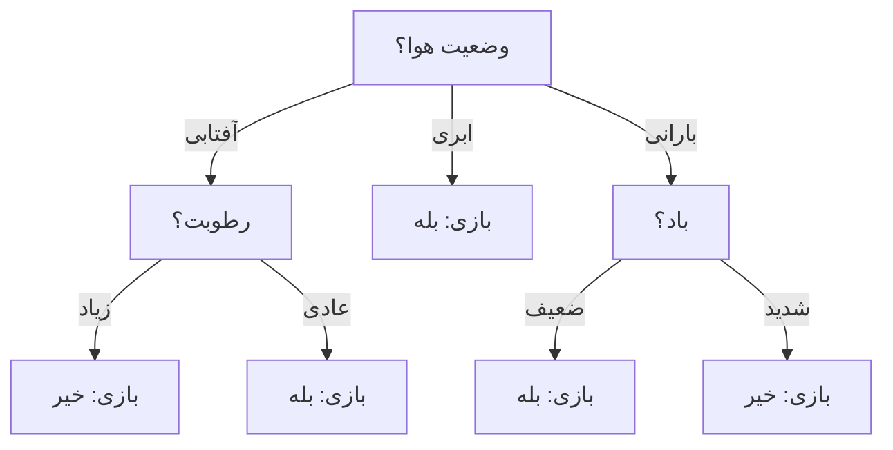
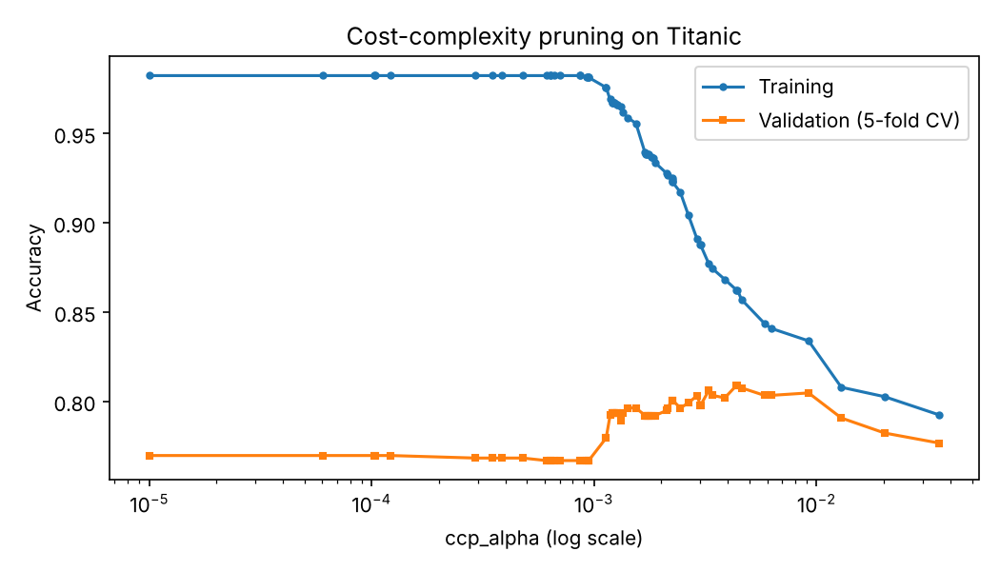
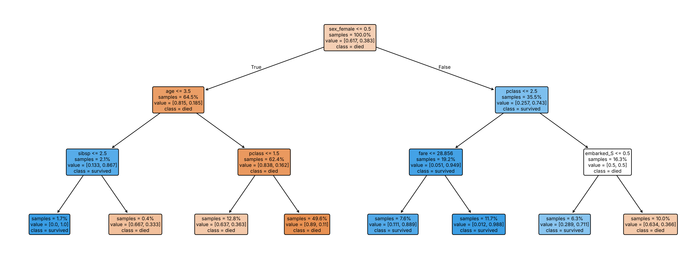

# جلسه ۲۲ — درخت تصمیم

## چرا درخت تصمیم؟

تا اینجا سه طبقه‌بند دیدیم ← [مبانی طبقه‌بندی و k-NN](20%20-%20%20%D9%85%D8%A8%D8%A7%D9%86%DB%8C%20%D8%B7%D8%A8%D9%82%D9%87%E2%80%8C%D8%A8%D9%86%D8%AF%DB%8C%20%D9%88%20k-NN.md) و [بیز ساده و رگرسیون لجستیک](21%20-%20%D8%A8%DB%8C%D8%B2%20%D8%B3%D8%A7%D8%AF%D9%87%20%D9%88%20%D8%B1%DA%AF%D8%B1%D8%B3%DB%8C%D9%88%D9%86%20%D9%84%D8%AC%D8%B3%D8%AA%DB%8C%DA%A9.md): k-NN مدل صریحی نمی‌سازد، بیز ساده استقلال شرطی فرض می‌کند و رگرسیون لجستیک مرز **خطی** می‌سازد و به مقیاس‌بندی نیاز دارد. **درخت تصمیم** (Decision Tree) داده را با یک سری پرسش ساده «اگر … آنگاه …» به‌طور بازگشتی به زیرگروه‌های **خالص‌تر** تقسیم می‌کند.

| ویژگی | درخت تصمیم | رگرسیون لجستیک | الگوریتم k-NN |
|:---:|:---:|:---:|:---:|
| شکل مرز تصمیم | پله‌ای، موازی محورها | خطی | غیرخطی و نامنظم |
| نیاز به مقیاس‌بندی | ندارد | دارد | به‌شدت دارد |
| تفسیرپذیری | بسیار بالا (قواعد خوانا) | متوسط (ضرایب) | کم |
| حساسیت به تغییر داده | زیاد (ناپایدار) | کم | متوسط |
| خطر بیش‌برازش | بسیار زیاد بدون هرس | کم | با k کوچک زیاد |

درخت به‌تنهایی معمولاً دقیق‌ترین مدل نیست، اما **پایه** قوی‌ترین روش‌های داده جدولی (جنگل تصادفی و Gradient Boosting) است ← [روش‌های گروهی](23%20-%20%D8%B1%D9%88%D8%B4%E2%80%8C%D9%87%D8%A7%DB%8C%20%DA%AF%D8%B1%D9%88%D9%87%DB%8C.md). این جلسه به سه پرسش پاسخ می‌دهد:

- درخت چگونه بهترین پرسش را در هر گره انتخاب می‌کند (آنتروپی، بهره اطلاعاتی، جینی)؟
- چگونه با **هرس** جلوی بیش‌برازش درخت را بگیریم؟
- قواعد درخت را چگونه بخوانیم و درخت رگرسیون چه تفاوتی دارد؟

---

## ساختار و ساخت درخت

| نوع گره | نقش | مثال |
|:---:|:---:|:---:|
| گره ریشه (Root) | اولین پرسش، روی کل داده | وضعیت هوا چیست؟ |
| گره داخلی (Internal) | یک آزمون روی یک ویژگی | رطوبت زیاد است؟ |
| برگ (Leaf) | پیش‌بینی: کلاس اکثریت (یا میانگین در رگرسیون) | بازی می‌کنیم |

هر مسیر ریشه تا برگ یک **قاعده** است و **عمق** طول طولانی‌ترین مسیر است. ساخت درخت **بازگشتی و حریصانه** است: در هر گره، برای هر ویژگی و هر نقطه برش، بهبود خلوص حساب می‌شود، بهترین تقسیم انتخاب می‌شود و کار برای هر فرزند تکرار می‌شود تا گره خالص شود یا شرط توقف برقرار شود. الگوریتم به عقب برنمی‌گردد؛ پس سریع است ولی درخت بهینه سراسری را تضمین نمی‌کند.

| ویژگی | الگوریتم ID3 | الگوریتم C4.5 | الگوریتم CART |
|:---:|:---:|:---:|:---:|
| معیار تقسیم | بهره اطلاعاتی | نسبت بهره | شاخص جینی (یا MSE در رگرسیون) |
| نوع تقسیم | چندشاخه‌ای | چندشاخه‌ای | همیشه دودویی |
| ویژگی عددی | ندارد | با آستانه | با آستانه |
| هرس | ندارد | هرس پسین مبتنی بر خطا | هرس هزینه-پیچیدگی |
| رگرسیون | ندارد | ندارد | دارد |

کلاس‌های `DecisionTreeClassifier` و `DecisionTreeRegressor` نسخه‌ای از **CART** هستند: تقسیم دودویی، معیار پیش‌فرض جینی و هرس با `ccp_alpha`. ویژگی‌های کیفی باید پیش از آموزش کدگذاری شوند ← [تبدیل و یکپارچه‌سازی داده](../Part%203_Data%20Preprocessing/%DB%B1%DB%B2%20-%20%D8%AA%D8%A8%D8%AF%DB%8C%D9%84%20%D9%88%20%DB%8C%DA%A9%D9%BE%D8%A7%D8%B1%DA%86%D9%87%E2%80%8C%D8%B3%D8%A7%D8%B2%DB%8C%20%D8%AF%D8%A7%D8%AF%D9%87.md)

---

## معیارهای تقسیم

برای گره‌ای با نسبت کلاس‌های p، سه معیار ناخالصی داریم. **آنتروپی** عدم قطعیت را می‌سنجد:

$$
H(S) = -\sum_{k=1}^{K} p_k \log_2 p_k
$$

**بهره اطلاعاتی** کاهش آنتروپی پس از تقسیم بر اساس ویژگی A است (آنتروپی هر فرزند با سهمش وزن می‌گیرد):

$$
IG(S, A) = H(S) - \sum_{v} \frac{|S_v|}{|S|} \, H(S_v)
$$

بهره اطلاعاتی به ویژگی‌های پرمقدار سوگیری دارد (ستونی مانند «شناسه» بیشترین بهره را می‌گیرد). **نسبت بهره** آن را بر آنتروپی خود ویژگی (**اطلاعات تقسیم**) تقسیم می‌کند:

$$
\text{SplitInfo}(S, A) = -\sum_{v} \frac{|S_v|}{|S|} \log_2 \frac{|S_v|}{|S|}, \qquad GR(S, A) = \frac{IG(S, A)}{\text{SplitInfo}(S, A)}
$$

**شاخص جینی** احتمال اشتباه در حدس تصادفی برچسب بر اساس توزیع کلاس‌های گره است:

$$
\text{Gini}(S) = 1 - \sum_{k=1}^{K} p_k^2
$$

| معیار | گره خالص | دو کلاس مساوی | کاربرد |
|:---:|:---:|:---:|:---:|
| آنتروپی | 0 | 1 | الگوریتم‌های ID3 و C4.5 |
| شاخص جینی | 0 | 0.5 | الگوریتم CART، پیش‌فرض scikit-learn |
| خطای طبقه‌بندی | 0 | 0.5 | برای هرس، نه رشد (حساسیت کم) |

جینی و آنتروپی منحنی‌های بسیار شبیهی دارند و معمولاً درخت‌های تقریباً یکسانی می‌سازند.

### مثال حل‌شده: داده بازی تنیس

داده کلاسیک «بازی تنیس» کوینلان، ۱۴ روز با چهار ویژگی کیفی:

| روز | وضعیت هوا | دما | رطوبت | باد | بازی |
|:---:|:---:|:---:|:---:|:---:|:---:|
| ۱ | آفتابی | گرم | زیاد | ضعیف | خیر |
| ۲ | آفتابی | گرم | زیاد | شدید | خیر |
| ۳ | ابری | گرم | زیاد | ضعیف | بله |
| ۴ | بارانی | معتدل | زیاد | ضعیف | بله |
| ۵ | بارانی | خنک | عادی | ضعیف | بله |
| ۶ | بارانی | خنک | عادی | شدید | خیر |
| ۷ | ابری | خنک | عادی | شدید | بله |
| ۸ | آفتابی | معتدل | زیاد | ضعیف | خیر |
| ۹ | آفتابی | خنک | عادی | ضعیف | بله |
| ۱۰ | بارانی | معتدل | عادی | ضعیف | بله |
| ۱۱ | آفتابی | معتدل | عادی | شدید | بله |
| ۱۲ | ابری | معتدل | زیاد | شدید | بله |
| ۱۳ | ابری | گرم | عادی | ضعیف | بله |
| ۱۴ | بارانی | معتدل | زیاد | شدید | خیر |

#### گام ۱ — ناخالصی ریشه

نه روز «بله» و پنج روز «خیر»:

$$
H(S) = -\frac{9}{14}\log_2\frac{9}{14} - \frac{5}{14}\log_2\frac{5}{14} \approx 0.410 + 0.530 = 0.940, \qquad \text{Gini}(S) = 1 - \left(\frac{9}{14}\right)^2 - \left(\frac{5}{14}\right)^2 \approx 0.459
$$

#### گام ۲ — بهره اطلاعاتی وضعیت هوا

| مقدار | تعداد | بله | خیر | آنتروپی |
|:---:|:---:|:---:|:---:|:---:|
| آفتابی | 5 | 2 | 3 | 0.971 |
| ابری | 4 | 4 | 0 | 0 |
| بارانی | 5 | 3 | 2 | 0.971 |
| جمع | 14 | 9 | 5 | — |

$$
\frac{5}{14}(0.971) + \frac{4}{14}(0) + \frac{5}{14}(0.971) \approx 0.694, \qquad IG = 0.940 - 0.694 \approx 0.247
$$

#### گام ۳ — مقایسه هر چهار ویژگی

| ویژگی | بهره اطلاعاتی | اطلاعات تقسیم | نسبت بهره | کاهش جینی |
|:---:|:---:|:---:|:---:|:---:|
| وضعیت هوا | **0.247** | 1.577 | **0.156** | **0.116** |
| رطوبت | 0.152 | 1.000 | 0.152 | 0.092 |
| باد | 0.048 | 0.985 | 0.049 | 0.031 |
| دما | 0.029 | 1.557 | 0.019 | 0.019 |

هر سه معیار **وضعیت هوا** را برای ریشه انتخاب می‌کنند؛ اما نسبت بهره فاصله آن با رطوبت (دو مقدار) را بسیار کم کرده است.

#### گام ۴ — سطح دوم

شاخه **ابری** خالص است و برگ «بله» می‌شود. در شاخه **آفتابی** رطوبت (بهره ۰.۹۷۱) و در شاخه **بارانی** باد (بهره ۰.۹۷۱) فرزندان را کاملاً خالص می‌کنند. درخت نهایی ۵ برگ و عمق ۲ دارد و دما هرگز استفاده نمی‌شود:



> [!note] بررسی
> بهره هر ویژگی هرگز از آنتروپی گره (۰.۹۴۰) بیشتر نیست و در گام ۴ دقیقاً برابر آنتروپی شاخه (۰.۹۷۱) است، چون فرزندان کاملاً خالص شده‌اند.

کد زیر جدول گام ۳ را با `pandas` و تابع `entropy` از scipy حساب می‌کند:

```python
import numpy as np
import pandas as pd
from scipy.stats import entropy

# 1. Play Tennis: 14 days, four categorical features
tennis = pd.DataFrame({
    "outlook":  ["sunny", "sunny", "overcast", "rain", "rain", "rain", "overcast",
                 "sunny", "sunny", "rain", "sunny", "overcast", "overcast", "rain"],
    "temp":     ["hot", "hot", "hot", "mild", "cool", "cool", "cool",
                 "mild", "cool", "mild", "mild", "mild", "hot", "mild"],
    "humidity": ["high", "high", "high", "high", "normal", "normal", "normal",
                 "high", "normal", "normal", "normal", "high", "normal", "high"],
    "wind":     ["weak", "strong", "weak", "weak", "weak", "strong", "strong",
                 "weak", "weak", "weak", "strong", "strong", "weak", "strong"],
    "play":     ["no", "no", "yes", "yes", "yes", "no", "yes", "no", "yes", "yes", "yes", "yes", "yes", "no"]})

def H(labels):                      # entropy in bits of a set of labels
    return entropy(labels.value_counts(), base=2)

def gini(labels):
    p = labels.value_counts(normalize=True)
    return 1 - (p ** 2).sum()

# 2. Root impurity, then information gain, gain ratio and Gini decrease of every feature
print(f"root entropy={H(tennis['play']):.3f}  root Gini={gini(tennis['play']):.3f}")
rows = []
for f in ["outlook", "temp", "humidity", "wind"]:
    w = tennis[f].value_counts(normalize=True)                 # share of each value
    groups = tennis.groupby(f)["play"]
    h_after = sum(w[v] * H(g) for v, g in groups)
    g_after = sum(w[v] * gini(g) for v, g in groups)
    ig = H(tennis["play"]) - h_after
    rows.append({"feature": f, "IG": ig, "SplitInfo": entropy(w, base=2),
                 "GainRatio": ig / entropy(w, base=2), "GiniDecrease": gini(tennis["play"]) - g_after})
print(pd.DataFrame(rows).set_index("feature").round(3))
```

```
root entropy=0.940  root Gini=0.459
             IG  SplitInfo  GainRatio  GiniDecrease
feature                                            
outlook   0.247      1.577      0.156         0.116
temp      0.029      1.557      0.019         0.019
humidity  0.152      1.000      0.152         0.092
wind      0.048      0.985      0.049         0.031
```

> [!warning] ستون‌های شناسه‌مانند
> ستون «شماره روز» (۱ تا ۱۴) هر روز را به یک گره خالص می‌برد و بهره اطلاعاتی آن **۰.۹۴۰** (بیشینه ممکن) است. نسبت بهره آن را به ۰.۲۴۷ کم می‌کند، اما این هنوز از نسبت بهره وضعیت هوا بیشتر است! ستون‌های شناسه را در پیش‌پردازش حذف کنید ← [مهندسی و انتخاب ویژگی](../Part%203_Data%20Preprocessing/%DB%B1%DB%B3%20-%20%D9%85%D9%87%D9%86%D8%AF%D8%B3%DB%8C%20%D9%88%20%D8%A7%D9%86%D8%AA%D8%AE%D8%A7%D8%A8%20%D9%88%DB%8C%DA%98%DA%AF%DB%8C.md)

### تقسیم دودویی و ویژگی‌های عددی در CART

الگوریتم CART با One-Hot فقط تقسیم‌های «یک مقدار در برابر بقیه» را بررسی می‌کند؛ مثلاً ریشه آن «ابری یا غیرابری» است. به همین دلیل درخت scikit-learn روی همین داده عمق ۴ و ۷ برگ دارد، نه عمق ۲ و ۵ برگ:

```python
import pandas as pd
from sklearn.preprocessing import OneHotEncoder
from sklearn.tree import DecisionTreeClassifier, export_text

# 1. Same Play Tennis data
tennis = pd.DataFrame({
    "outlook":  ["sunny", "sunny", "overcast", "rain", "rain", "rain", "overcast",
                 "sunny", "sunny", "rain", "sunny", "overcast", "overcast", "rain"],
    "temp":     ["hot", "hot", "hot", "mild", "cool", "cool", "cool",
                 "mild", "cool", "mild", "mild", "mild", "hot", "mild"],
    "humidity": ["high", "high", "high", "high", "normal", "normal", "normal",
                 "high", "normal", "normal", "normal", "high", "normal", "high"],
    "wind":     ["weak", "strong", "weak", "weak", "weak", "strong", "strong",
                 "weak", "weak", "weak", "strong", "strong", "weak", "strong"],
    "play":     ["no", "no", "yes", "yes", "yes", "no", "yes", "no", "yes", "yes", "yes", "yes", "yes", "no"]})

# 2. scikit-learn needs numbers: one-hot encoding gives binary "value vs rest" splits (CART)
enc = OneHotEncoder(sparse_output=False).fit(tennis.drop(columns="play"))
X = enc.transform(tennis.drop(columns="play"))
tree = DecisionTreeClassifier(criterion="entropy", random_state=42).fit(X, tennis["play"])
print(f"depth={tree.get_depth()}  leaves={tree.get_n_leaves()}")
print(export_text(tree, feature_names=list(enc.get_feature_names_out())))
```

```
depth=4  leaves=7
|--- outlook_overcast <= 0.50
|   |--- humidity_normal <= 0.50
|   |   |--- outlook_rain <= 0.50
|   |   |   |--- class: no
|   |   |--- outlook_rain >  0.50
|   |   |   |--- wind_strong <= 0.50
|   |   |   |   |--- class: yes
|   |   |   |--- wind_strong >  0.50
|   |   |   |   |--- class: no
|   |--- humidity_normal >  0.50
|   |   |--- wind_strong <= 0.50
|   |   |   |--- class: yes
|   |   |--- wind_strong >  0.50
|   |   |   |--- outlook_sunny <= 0.50
|   |   |   |   |--- class: no
|   |   |   |--- outlook_sunny >  0.50
|   |   |   |   |--- class: yes
|--- outlook_overcast >  0.50
|   |--- class: yes
```

برای ویژگی عددی، مقادیر یکتا مرتب و **نقاط میانی** آن‌ها به‌عنوان آستانه آزموده می‌شوند. چون تقسیم فقط به **ترتیب** مقادیر بستگی دارد، هر تبدیل یکنوا (مانند استانداردسازی یا لگاریتم) درخت را تغییر نمی‌دهد: درخت به مقیاس‌بندی نیازی ندارد.

---

## هرس درخت

درختی که تا خالص شدن همه برگ‌ها رشد کند، داده آموزش را **حفظ** می‌کند ← [بیش‌برازش و اعتبارسنجی متقابل](../Part%204_Regression/18%20-%20%D8%A8%DB%8C%D8%B4%E2%80%8C%D8%A8%D8%B1%D8%A7%D8%B2%D8%B4%20%D9%88%20%D8%A7%D8%B9%D8%AA%D8%A8%D8%A7%D8%B1%D8%B3%D9%86%D8%AC%DB%8C%20%D9%85%D8%AA%D9%82%D8%A7%D8%A8%D9%84.md). روی تایتانیک (با تنظیمات استاندارد جلسه ۲۰؛ فقط استانداردسازی حذف شده چون درخت به آن نیازی ندارد):

```python
import pandas as pd
import seaborn as sns
from sklearn.model_selection import train_test_split, StratifiedKFold, cross_val_score
from sklearn.compose import ColumnTransformer
from sklearn.pipeline import make_pipeline
from sklearn.impute import SimpleImputer
from sklearn.preprocessing import OneHotEncoder
from sklearn.tree import DecisionTreeClassifier

# 1. Titanic with the standard split; trees need no scaling
titanic = sns.load_dataset("titanic")
num = ["age", "fare", "sibsp", "parch", "pclass"]
cat = ["sex", "embarked"]
X_train, X_test, y_train, y_test = train_test_split(titanic[num + cat], titanic["survived"],
                                                    test_size=0.2, stratify=titanic["survived"],
                                                    random_state=42)
preprocess = ColumnTransformer([
    ("num", SimpleImputer(strategy="median"), num),
    ("cat", make_pipeline(SimpleImputer(strategy="most_frequent"),
                          OneHotEncoder(handle_unknown="ignore")), cat)])

# 2. Full tree vs pre-pruned trees
cv = StratifiedKFold(n_splits=5, shuffle=True, random_state=42)
settings = {"full tree": {}, "max_depth=1": {"max_depth": 1}, "max_depth=3": {"max_depth": 3},
            "max_depth=5": {"max_depth": 5}, "min_samples_leaf=20": {"min_samples_leaf": 20}}
rows = []
for name, params in settings.items():
    model = make_pipeline(preprocess, DecisionTreeClassifier(random_state=42, **params))
    cv_acc = cross_val_score(model, X_train, y_train, cv=cv).mean()
    model.fit(X_train, y_train)
    rows.append({"model": name, "depth": model[-1].get_depth(), "leaves": model[-1].get_n_leaves(),
                 "train_acc": model.score(X_train, y_train), "cv_acc": cv_acc})
print(pd.DataFrame(rows).set_index("model").round(3))
```

```
                     depth  leaves  train_acc  cv_acc
model                                                
full tree               23     152      0.983   0.770
max_depth=1              1       2      0.789   0.789
max_depth=3              3       8      0.833   0.806
max_depth=5              5      23      0.865   0.805
min_samples_leaf=20      9      25      0.837   0.773
```

درخت کامل **۱۵۲ برگ** و عمق ۲۳ دارد؛ دقت آموزش ۰.۹۸۳ اما دقت اعتبارسنجی فقط ۰.۷۷۰ است. حتی درختی با یک پرسش («زن است؟») دقت اعتبارسنجی ۰.۷۸۹ دارد و درخت با عمق ۳ (۸ برگ) به ۰.۸۰۶ می‌رسد.

### هرس پیشین (Pre-pruning)

رشد درخت را زودتر متوقف می‌کنیم:

| ابرپارامتر | معنا | اثر افزایش آن |
|:---:|:---:|:---:|
| پارامتر max_depth | حداکثر عمق | درخت پیچیده‌تر |
| پارامتر min_samples_split | حداقل نمونه برای تقسیم یک گره | درخت ساده‌تر |
| پارامتر min_samples_leaf | حداقل نمونه در هر برگ | درخت ساده‌تر و هموارتر |
| پارامتر max_leaf_nodes | حداکثر تعداد برگ | درخت پیچیده‌تر |
| پارامتر min_impurity_decrease | حداقل کاهش ناخالصی برای پذیرش تقسیم | درخت ساده‌تر |

> [!warning] مشکل افق
> گاهی یک تقسیم به‌تنهایی بهبود کمی دارد اما راه را برای تقسیم‌های بسیار مفید بعدی باز می‌کند (مانند مسئله XOR). هرس پیشین چنین تقسیمی را رد می‌کند؛ هرس پسین این مشکل را ندارد.

### هرس پسین و هرس هزینه-پیچیدگی

ابتدا درخت را کامل رشد می‌دهیم و سپس زیردرخت‌هایی را که سودشان کمتر از هزینه پیچیدگی‌شان است، با برگ جایگزین می‌کنیم. در CART برای هر زیردرخت T با خطای R و |T| برگ:

$$
R_\alpha(T) = R(T) + \alpha \, |T|
$$

با افزایش آلفا هر برگ اضافه «گران‌تر» می‌شود. برای هر گره داخلی t، **آلفای مؤثر** مقداری است که در آن جایگزینی زیردرخت با یک برگ به‌صرفه می‌شود:

$$
\alpha_{\text{eff}}(t) = \frac{R(t) - R(T_t)}{|T_t| - 1}
$$

> [!example] مثال — آلفای مؤثر
> گره t اگر برگ شود ناخالصی وزن‌دار ۰.۰۴ دارد و زیردرخت آن ۴ برگ با مجموع ناخالصی وزن‌دار ۰.۰۱ دارد:
> $$
> \alpha_{\text{eff}} = \frac{0.04 - 0.01}{4 - 1} = 0.01
> $$
> با آلفای ۰.۰۱ یا بیشتر، سه برگ اضافه ارزش ندارند و زیردرخت به یک برگ تبدیل می‌شود. گره با کوچک‌ترین آلفای مؤثر (ضعیف‌ترین پیوند) اول هرس می‌شود.

تابع `cost_complexity_pruning_path` همه آلفاهای بحرانی را برمی‌گرداند و آلفا را با اعتبارسنجی متقابل انتخاب می‌کنیم:

```python
import numpy as np
import matplotlib.pyplot as plt
import seaborn as sns
from sklearn.model_selection import train_test_split, StratifiedKFold, GridSearchCV
from sklearn.compose import ColumnTransformer
from sklearn.pipeline import make_pipeline
from sklearn.impute import SimpleImputer
from sklearn.preprocessing import OneHotEncoder
from sklearn.tree import DecisionTreeClassifier

# 1. Same data, split and preprocessing
titanic = sns.load_dataset("titanic")
num = ["age", "fare", "sibsp", "parch", "pclass"]
cat = ["sex", "embarked"]
X_train, X_test, y_train, y_test = train_test_split(titanic[num + cat], titanic["survived"],
                                                    test_size=0.2, stratify=titanic["survived"],
                                                    random_state=42)
preprocess = ColumnTransformer([
    ("num", SimpleImputer(strategy="median"), num),
    ("cat", make_pipeline(SimpleImputer(strategy="most_frequent"),
                          OneHotEncoder(handle_unknown="ignore")), cat)])

# 2. Critical alphas of the cost-complexity pruning path of the full tree
Xt = preprocess.fit_transform(X_train)
path = DecisionTreeClassifier(random_state=42).cost_complexity_pruning_path(Xt, y_train)
alphas = path.ccp_alphas[:-1]                 # the last alpha prunes the tree to a single leaf
print(f"number of critical alphas={len(alphas)}")

# 3. Choose ccp_alpha by stratified 5-fold CV (preprocessing refitted inside each fold)
cv = StratifiedKFold(n_splits=5, shuffle=True, random_state=42)
gs = GridSearchCV(make_pipeline(preprocess, DecisionTreeClassifier(random_state=42)),
                  {"decisiontreeclassifier__ccp_alpha": alphas}, cv=cv, return_train_score=True)
gs.fit(X_train, y_train)
best = gs.best_estimator_[-1]
print(f"best alpha={gs.best_params_['decisiontreeclassifier__ccp_alpha']:.4f}  CV accuracy={gs.best_score_:.3f}  "
      f"depth={best.get_depth()}  leaves={best.get_n_leaves()}")
print(f"test accuracy={gs.score(X_test, y_test):.3f}")

fig, ax = plt.subplots(figsize=(7, 4))
ax.semilogx(alphas + 1e-5, gs.cv_results_["mean_train_score"], "o-", ms=3, label="Training")
ax.semilogx(alphas + 1e-5, gs.cv_results_["mean_test_score"], "s-", ms=3, label="Validation (5-fold CV)")
ax.set(xlabel="ccp_alpha (log scale)", ylabel="Accuracy", title="Cost-complexity pruning on Titanic")
ax.legend()
plt.show()
```

```
number of critical alphas=65
best alpha=0.0044  CV accuracy=0.809  depth=5  leaves=12
test accuracy=0.754
```



با آلفای کوچک، درخت کامل است (دقت آموزش ۰.۹۸، اعتبارسنجی ۰.۷۷). با افزایش آلفا دقت آموزش پیوسته کم می‌شود ولی دقت اعتبارسنجی تا آلفای حدود ۰.۰۰۴ بالا می‌رود: درختی با **۱۲ برگ** و دقت اعتبارسنجی ۰.۸۰۹. دقت آزمون آن ۰.۷۵۴ است؛ کمتر از برآورد اعتبارسنجی، که نشان می‌دهد درخت **ناپایدار** است و با ۱۷۹ نمونه آزمون، نوسان چند درصدی عادی است. این ناپایداری انگیزه اصلی روش‌های گروهی در جلسه بعد است.

| مقایسه | هرس پیشین | هرس پسین |
|:---:|:---:|:---:|
| زمان اعمال | حین رشد | پس از رشد کامل |
| هزینه محاسبه | کم | بیشتر |
| مشکل افق | دارد | ندارد |
| ابرپارامتر در scikit-learn | عمق، حداقل نمونه برگ و … | پارامتر ccp_alpha |

---

## تفسیرپذیری و استخراج قواعد

بزرگ‌ترین مزیت درخت، **شفافیت** آن است. درخت عمق ۳ تایتانیک را به‌صورت متن و تصویر می‌خوانیم:

```python
import pandas as pd
import matplotlib.pyplot as plt
import seaborn as sns
from sklearn.model_selection import train_test_split
from sklearn.compose import ColumnTransformer
from sklearn.pipeline import make_pipeline
from sklearn.impute import SimpleImputer
from sklearn.preprocessing import OneHotEncoder
from sklearn.tree import DecisionTreeClassifier, plot_tree, export_text

# 1. Same data and split; a small tree (depth 3) for reading
titanic = sns.load_dataset("titanic")
num = ["age", "fare", "sibsp", "parch", "pclass"]
cat = ["sex", "embarked"]
X_train, X_test, y_train, y_test = train_test_split(titanic[num + cat], titanic["survived"],
                                                    test_size=0.2, stratify=titanic["survived"],
                                                    random_state=42)
preprocess = ColumnTransformer([
    ("num", SimpleImputer(strategy="median"), num),
    ("cat", make_pipeline(SimpleImputer(strategy="most_frequent"),
                          OneHotEncoder(handle_unknown="ignore")), cat)],
    verbose_feature_names_out=False)
model = make_pipeline(preprocess, DecisionTreeClassifier(max_depth=3, random_state=42)).fit(X_train, y_train)
names = list(model[0].get_feature_names_out())
tree = model[-1]

# 2. Rules as text, and the tree as a picture
print(export_text(tree, feature_names=names))
fig, ax = plt.subplots(figsize=(16, 6))
plot_tree(tree, feature_names=names, class_names=["died", "survived"], filled=True,
          impurity=False, proportion=True, rounded=True, fontsize=8, ax=ax)
plt.show()

# 3. Impurity-based feature importance
print(pd.Series(tree.feature_importances_, index=names).sort_values(ascending=False).head(4).round(3))
```

```
|--- sex_female <= 0.50
|   |--- age <= 3.50
|   |   |--- sibsp <= 2.50
|   |   |   |--- class: 1
|   |   |--- sibsp >  2.50
|   |   |   |--- class: 0
|   |--- age >  3.50
|   |   |--- pclass <= 1.50
|   |   |   |--- class: 0
|   |   |--- pclass >  1.50
|   |   |   |--- class: 0
|--- sex_female >  0.50
|   |--- pclass <= 2.50
|   |   |--- fare <= 28.86
|   |   |   |--- class: 1
|   |   |--- fare >  28.86
|   |   |   |--- class: 1
|   |--- pclass >  2.50
|   |   |--- embarked_S <= 0.50
|   |   |   |--- class: 1
|   |   |--- embarked_S >  0.50
|   |   |   |--- class: 0

sex_female    0.635
pclass        0.216
age           0.090
embarked_S    0.041
dtype: float64
```



در هر گره، `samples` سهم مسافران و `value` نسبت جان‌باختگان و زنده‌ماندگان است. چند قاعده:

1. اگر **مرد** و بالای ۳.۵ سال باشد ← جان‌باخته (۸۹ درصد در کلاس دوم و سوم).
2. اگر **پسربچه** (حداکثر ۳.۵ سال) با حداکثر دو خواهر و برادر باشد ← زنده.
3. اگر **زن** در کلاس اول یا دوم باشد ← زنده (۸۹ تا ۹۹ درصد).
4. اگر **زن** در کلاس سوم باشد، نتیجه به بندر سوار شدن بستگی دارد؛ تقریباً نیمی زنده ماندند.

گاهی دو فرزند یک گره کلاس یکسانی پیش‌بینی می‌کنند (مثلاً مردان کلاس اول و بقیه مردان)؛ تقسیم انجام شده چون **خلوص** را بهتر کرده است (۰.۳۶ در برابر ۰.۱۱ زنده‌مانده)، هرچند کلاس اکثریت تغییر نکرده است.

**اهمیت ویژگی** در درخت، مجموع کاهش ناخالصی وزن‌دار در گره‌هایی است که از آن ویژگی استفاده کرده‌اند (نرمال‌شده به جمع یک). اینجا جنسیت حدود ۰.۶۴ و کلاس سفر حدود ۰.۲۲ از کل اهمیت را دارند.

> [!warning] محدودیت‌های تفسیر درخت
> - **ناپایداری:** تغییر کوچک داده ممکن است ریشه و کل ساختار را عوض کند.
> - **سوگیری اهمیت جینی:** ویژگی‌های عددی با مقادیر یکتای زیاد اهمیت بیشتری می‌گیرند؛ جایگزین بهتر اهمیت جایگشتی است ← [روش‌های گروهی](23%20-%20%D8%B1%D9%88%D8%B4%E2%80%8C%D9%87%D8%A7%DB%8C%20%DA%AF%D8%B1%D9%88%D9%87%DB%8C.md)
> - **ویژگی‌های همبسته:** درخت یکی را انتخاب می‌کند و دیگری اهمیت صفر می‌گیرد.
> - درخت عمیق با ده‌ها برگ عملاً دیگر خوانا نیست.

---

## درخت رگرسیون

درخت هدف **عددی** را هم پیش‌بینی می‌کند: پیش‌بینی برگ **میانگین** هدف نمونه‌های آن است و معیار تقسیم کمینه کردن مجموع مربعات خطای دو فرزند:

$$
\text{SSE}_{\text{split}} = \sum_{i \in L} (y_i - \bar{y}_L)^2 + \sum_{i \in R} (y_i - \bar{y}_R)^2
$$

### مثال حل‌شده: بهترین تقسیم یک ویژگی

| نمونه | ویژگی x | هدف y |
|:---:|:---:|:---:|
| ۱ | 1 | 5 |
| ۲ | 2 | 6 |
| ۳ | 3 | 7 |
| ۴ | 4 | 15 |
| ۵ | 5 | 16 |
| ۶ | 6 | 18 |

میانگین کل ۱۱.۱۷ و مجموع مربعات خطای کل ۱۶۶.۸۳ است. برای هر آستانه (نقطه میانی دو مقدار متوالی):

| آستانه | میانگین چپ | میانگین راست | مجموع مربعات خطا |
|:---:|:---:|:---:|:---:|
| 1.5 | 5.00 | 12.40 | 121.20 |
| 2.5 | 5.50 | 14.00 | 70.50 |
| 3.5 | 6.00 | 16.33 | **6.67** |
| 4.5 | 8.25 | 17.00 | 64.75 |
| 5.5 | 9.80 | 18.00 | 110.80 |

برای آستانه ۳.۵:

$$
\text{SSE} = \underbrace{(5-6)^2 + (6-6)^2 + (7-6)^2}_{2} + \underbrace{(15-16.33)^2 + (16-16.33)^2 + (18-16.33)^2}_{4.67} \approx 6.67
$$

بهترین تقسیم «x کوچک‌تر یا مساوی ۳.۵» است با پیش‌بینی ۶ در چپ و ۱۶.۳۳ در راست.

```python
import numpy as np
from sklearn.tree import DecisionTreeRegressor

# Six points; a depth-1 regression tree finds the split that minimizes the SSE of the two children
x = np.array([[1], [2], [3], [4], [5], [6]])
y = np.array([5, 6, 7, 15, 16, 18])
stump = DecisionTreeRegressor(max_depth=1).fit(x, y)
print(f"threshold={stump.tree_.threshold[0]}  leaf predictions={stump.tree_.value[1:, 0, 0].round(2)}")
print(f"prediction for x=10 (no extrapolation)={stump.predict([[10]])[0]:.2f}")
```

```
threshold=3.5  leaf predictions=[ 6.   16.33]
prediction for x=10 (no extrapolation)=16.33
```

خروجی درخت رگرسیون **پله‌ای** است و درخت **برون‌یابی** نمی‌کند: برای x برابر ۱۰ همان مقدار آخرین برگ (۱۶.۳۳) را می‌دهد؛ برخلاف رگرسیون خطی.

### روی داده واقعی: مصرف سوخت

با همان شش ویژگی و تقسیم جلسه ۱۹، درخت رگرسیون را با رگرسیون خطی مقایسه می‌کنیم:

```python
import pandas as pd
import seaborn as sns
from sklearn.model_selection import train_test_split, KFold, cross_val_score
from sklearn.preprocessing import StandardScaler
from sklearn.pipeline import make_pipeline
from sklearn.linear_model import LinearRegression
from sklearn.tree import DecisionTreeRegressor
from sklearn.metrics import root_mean_squared_error

# 1. mpg with the six numeric features of session 19; same split and folds
mpg = sns.load_dataset("mpg").dropna(subset=["horsepower"])
features = ["cylinders", "displacement", "horsepower", "weight", "acceleration", "model_year"]
X_train, X_test, y_train, y_test = train_test_split(mpg[features], mpg["mpg"],
                                                    test_size=0.2, random_state=42)
kf = KFold(n_splits=5, shuffle=True, random_state=42)

# 2. Linear regression vs regression trees of different complexity
models = {"Linear": make_pipeline(StandardScaler(), LinearRegression()),
          "Full tree": DecisionTreeRegressor(random_state=42),
          "Tree depth=3": DecisionTreeRegressor(max_depth=3, random_state=42),
          "Tree min_leaf=10": DecisionTreeRegressor(min_samples_leaf=10, random_state=42)}
rows = []
for name, m in models.items():
    cv = -cross_val_score(m, X_train, y_train, cv=kf, scoring="neg_root_mean_squared_error").mean()
    m.fit(X_train, y_train)
    rows.append({"model": name, "train_RMSE": root_mean_squared_error(y_train, m.predict(X_train)),
                 "CV_RMSE": cv, "test_RMSE": root_mean_squared_error(y_test, m.predict(X_test))})
print(pd.DataFrame(rows).set_index("model").round(3))
```

```
                  train_RMSE  CV_RMSE  test_RMSE
model                                           
Linear                 3.456    3.492      3.241
Full tree              0.000    3.752      3.534
Tree depth=3           3.176    3.611      3.695
Tree min_leaf=10       2.430    3.283      2.825
```

درخت کامل RMSE آموزش **صفر** دارد (هر خودرو در برگ خودش) اما اعتبارسنجی ۳.۷۵: بیش‌برازش. درخت با حداقل ۱۰ نمونه در هر برگ بهترین است (اعتبارسنجی ۳.۲۸، آزمون ۲.۸۳) و از رگرسیون خطی (۳.۴۹) بهتر است، چون رابطه مصرف سوخت با وزن و قدرت منحنی است. البته Ridge چندجمله‌ای جلسه ۱۹ (۲.۸۸) هنوز بهتر است ← [منظم‌سازی در رگرسیون](../Part%204_Regression/19%20-%20%D9%85%D9%86%D8%B8%D9%85%E2%80%8C%D8%B3%D8%A7%D8%B2%DB%8C%20%D8%AF%D8%B1%20%D8%B1%DA%AF%D8%B1%D8%B3%DB%8C%D9%88%D9%86.md)

| مزایا | معایب |
|:---:|:---:|
| قواعد قابل تفسیر برای غیرمتخصصان | ناپایداری شدید نسبت به تغییر داده |
| بدون نیاز به مقیاس‌بندی | بیش‌برازش بدون هرس |
| مدل‌سازی رابطه‌های غیرخطی و اثرهای متقابل | مرز پله‌ای و موازی محورها |
| انتخاب ویژگی خودکار | ناتوانی در برون‌یابی |
| آموزش و پیش‌بینی سریع | دقت کمتر از روش‌های گروهی |

> [!tip] مرز مورب
> اگر مرز واقعی دو کلاس یک خط مورب باشد (مثلاً x بزرگ‌تر از y)، درخت باید آن را با پله‌های زیاد تقریب بزند. ساختن ویژگی تفاضل x و y مسئله را با یک تقسیم حل می‌کند.

> [!note] کارگاه عملی
> دفترچه «۲۲ - کارگاه درخت تصمیم» تمرین عملی کلاس را با پاسخ دارد: درخت چندکلاسه برای پیش‌بینی کشور سازنده خودرو در داده mpg، رسم با `plot_tree`، هرس و مقایسه جینی و آنتروپی. نحوه نوشتن این کدها در امتحان پرسیده نمی‌شود.

---

## خطاهای رایج

| خطا | چرا نادرست است | روش درست |
|:---:|:---:|:---:|
| درخت بدون هرس | داده آموزش را حفظ می‌کند (دقت آموزش نزدیک ۱۰۰ درصد) | هرس پیشین یا ccp_alpha با اعتبارسنجی |
| نگه داشتن ستون‌های شناسه | بیشترین بهره را می‌گیرند ولی قدرت تعمیم ندارند | حذف در پیش‌پردازش |
| استانداردسازی برای درخت | بی‌اثر است و فقط پیچیدگی اضافه می‌کند | فقط جایگذاری و کدگذاری |
| قواعد یک درخت را حقیقت قطعی دانستن | درخت ناپایدار است | بررسی پایداری روی چند تقسیم |
| تفسیر اهمیت جینی بدون احتیاط | به نفع ویژگی‌های پرمقدار سوگیری دارد | اهمیت جایگشتی |
| استفاده از درخت رگرسیون برای برون‌یابی | خارج از بازه آموزش مقدار ثابت آخرین برگ را می‌دهد | مدل خطی یا ویژگی مناسب |

---

## نمونه سؤال‌های امتحانی

### سؤال‌های مفهومی

> [!question]- ۱. چرا ساخت درخت «حریصانه» است و چه پیامدی دارد؟
> در هر گره فقط بهترین تقسیم همان لحظه انتخاب می‌شود و الگوریتم به عقب برنمی‌گردد. سریع است، اما درخت بهینه سراسری را تضمین نمی‌کند و ممکن است تقسیمی را که به‌تنهایی ضعیف ولی برای ادامه مفید است از دست بدهد.

> [!question]- ۲. چرا نسبت بهره در C4.5 به جای بهره اطلاعاتی استفاده می‌شود؟
> بهره اطلاعاتی به ویژگی‌های پرمقدار (مانند شناسه) سوگیری دارد. نسبت بهره آن را بر اطلاعات تقسیم (آنتروپی خود ویژگی) تقسیم می‌کند و ویژگی‌های پرمقدار را جریمه می‌کند؛ اما سوگیری را کاملاً از بین نمی‌برد.

> [!question]- ۳. چرا درخت به مقیاس‌بندی نیاز ندارد؟
> هر تقسیم یک ویژگی را جداگانه با یک آستانه مقایسه می‌کند و فقط **ترتیب** مقادیر مهم است. هر تبدیل یکنوا فقط مقدار آستانه را عوض می‌کند و ساختار درخت ثابت می‌ماند.

> [!question]- ۴. چرا درخت رگرسیون نمی‌تواند برون‌یابی کند؟
> پیش‌بینی هر برگ میانگین نمونه‌های آموزشی آن است؛ برای ورودی بزرگ‌تر از همه داده آموزش، نمونه به آخرین برگ می‌رود و مقدار ثابت آن را می‌گیرد. خروجی درخت تابعی پله‌ای با حداکثر به تعداد برگ‌ها مقدار مختلف است.

### سؤال‌های محاسباتی

> [!question]- ۵. گره‌ای ۸ نمونه دارد: ۶ مثبت و ۲ منفی. آنتروپی و جینی آن را حساب کنید.
> $$
> H = -0.75 \log_2 0.75 - 0.25 \log_2 0.25 \approx 0.311 + 0.5 = 0.811, \qquad \text{Gini} = 1 - 0.75^2 - 0.25^2 = 0.375
> $$

> [!question]- ۶. همان گره با یک ویژگی به دو فرزند تقسیم می‌شود: فرزند چپ ۴ مثبت و ۰ منفی، فرزند راست ۲ مثبت و ۲ منفی. بهره اطلاعاتی و کاهش جینی چقدر است؟
> آنتروپی فرزند چپ صفر و فرزند راست ۱ است؛ جینی آن‌ها صفر و ۰.۵.
> $$
> IG = 0.811 - \left(\frac{4}{8} \times 0 + \frac{4}{8} \times 1\right) = 0.311, \qquad \Delta \text{Gini} = 0.375 - \left(\frac{4}{8} \times 0 + \frac{4}{8} \times 0.5\right) = 0.125
> $$

> [!question]- ۷. ویژگی A با سه مقدار، ۱۲ نمونه را به گروه‌های ۶، ۳ و ۳ تقسیم می‌کند و بهره اطلاعاتی آن ۰.۴۵ است. نسبت بهره چقدر است؟
> $$
> \text{SplitInfo} = -\frac{6}{12}\log_2\frac{6}{12} - 2 \times \frac{3}{12}\log_2\frac{3}{12} = 0.5 + 1 = 1.5, \qquad GR = \frac{0.45}{1.5} = 0.3
> $$

> [!question]- ۸. هدف چهار نمونه با x برابر ۱، ۲، ۳ و ۴ به ترتیب ۲، ۴، ۱۰ و ۱۲ است. بهترین آستانه درخت رگرسیون با عمق ۱ کدام است؟
> آستانه ۱.۵: چپ (۲) و راست (۴، ۱۰، ۱۲) با میانگین ۸.۶۷ و SSE حدود ۳۴.۶۷. آستانه ۲.۵: چپ (۲، ۴) میانگین ۳ و SSE برابر ۲، راست (۱۰، ۱۲) میانگین ۱۱ و SSE برابر ۲؛ مجموع **۴**. آستانه ۳.۵: چپ (۲، ۴، ۱۰) میانگین ۵.۳۳ و SSE حدود ۳۴.۶۷. بهترین آستانه **۲.۵** است.

### سؤال‌های خواندن کد

> [!question]- ۹. در درخت کامل تایتانیک، دقت آموزش ۰.۹۸۳ و دقت اعتبارسنجی ۰.۷۷۰ است. کدام پارامتر را تغییر می‌دهید و به کدام سمت؟
> بیش‌برازش است؛ باید درخت را ساده‌تر کرد: `max_depth` را کم، `min_samples_leaf` را زیاد یا `ccp_alpha` را بزرگ‌تر کرد (و مقدار را با اعتبارسنجی متقابل انتخاب کرد).

> [!question]- ۱۰. خروجی `tree.get_n_leaves()` برای درختی با `max_depth=3` حداکثر چند است؟
> هر تقسیم دودویی است؛ با عمق ۳ حداکثر ۲ به توان ۳، یعنی **۸** برگ.

> [!question]- ۱۱. این خط از خروجی `export_text` یعنی چه؟
> ```
> |--- sex_female <= 0.50
> ```
> ستون One-Hot «زن بودن» صفر یا یک است؛ شرط «کوچک‌تر یا مساوی ۰.۵» یعنی مسافر **زن نیست** (مرد است). شاخه دیگر (بزرگ‌تر از ۰.۵) زنان را در بر می‌گیرد.

---

## نکات کلیدی

> [!summary] خلاصه جلسه
> - درخت تصمیم داده را با پرسش‌های «اگر … آنگاه …» به‌طور **بازگشتی و حریصانه** به گره‌های خالص‌تر تقسیم می‌کند؛ هر مسیر ریشه تا برگ یک قاعده است.
> - معیارهای تقسیم: **آنتروپی و بهره اطلاعاتی** (ID3)، **نسبت بهره** (C4.5، جریمه ویژگی‌های پرمقدار) و **جینی** (CART، پیش‌فرض scikit-learn).
> - درخت بدون **هرس** بیش‌برازش می‌کند (تایتانیک: ۱۵۲ برگ، دقت اعتبارسنجی ۰.۷۷۰). هرس پیشین با عمق و حداقل نمونه برگ؛ هرس پسین با **ccp_alpha** و اعتبارسنجی متقابل.
> - درخت به **مقیاس‌بندی** نیاز ندارد، قواعد خوانا می‌دهد، اما **ناپایدار** است.
> - **درخت رگرسیون** با کمینه کردن SSE تقسیم می‌کند، خروجی پله‌ای دارد و برون‌یابی نمی‌کند.
