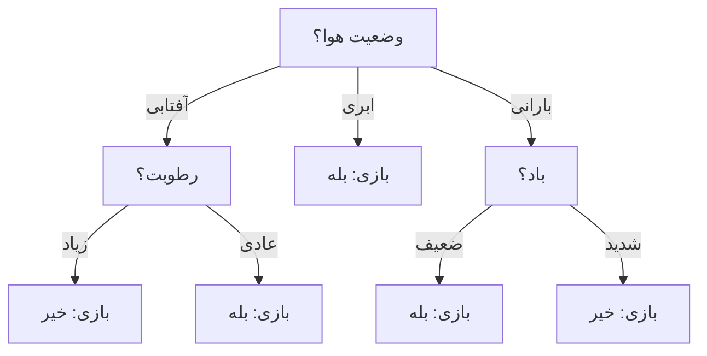

# جلسه ۲۲ — درخت تصمیم

## چرا درخت تصمیم؟

در دو جلسه گذشته سه طبقه‌بند را دیدیم ← [[20 -  مبانی طبقه‌بندی و k-NN]] و [[21 - بیز ساده و رگرسیون لجستیک]]:

- الگوریتم k-NN هیچ مدل صریحی نمی‌سازد و برای هر پیش‌بینی باید همه داده را مرور کند.
- بیز ساده فرض استقلال شرطی ویژگی‌ها را دارد.
- رگرسیون لجستیک مرز تصمیم **خطی** می‌سازد و به مقیاس‌بندی و کدگذاری دقیق ویژگی‌ها نیاز دارد.

**درخت تصمیم** (Decision Tree) رویکرد متفاوتی دارد: داده را با یک سری پرسش ساده «اگر ... آنگاه ...» به‌طور بازگشتی به زیرگروه‌های **خالص‌تر** تقسیم می‌کند. نتیجه، مدلی است که:

|ویژگی|درخت تصمیم|رگرسیون لجستیک|الگوریتم k-NN|
|:-:|:-:|:-:|:-:|
|شکل مرز تصمیم|پله‌ای، موازی محورها، غیرخطی|خطی|غیرخطی و نامنظم|
|نیاز به مقیاس‌بندی|ندارد|دارد (برای منظم‌سازی)|به‌شدت دارد|
|تفسیرپذیری|بسیار بالا (قواعد خوانا)|متوسط (ضرایب)|کم|
|سرعت پیش‌بینی|بسیار سریع|بسیار سریع|کند|
|حساسیت به تغییر داده|زیاد (ناپایدار)|کم|متوسط|
|خطر بیش‌برازش|بسیار زیاد بدون هرس|کم|با k کوچک زیاد|

> [!important] نکته کلیدی درخت تصمیم به‌تنهایی معمولاً دقیق‌ترین مدل نیست، اما **پایه** قوی‌ترین روش‌های داده‌های جدولی است: جنگل تصادفی و Gradient Boosting از ترکیب صدها درخت ساخته می‌شوند ← [[23 - روش‌های گروهی]]. درک دقیق یک درخت، کلید فهم آن روش‌هاست.

---

## ساختار درخت تصمیم

یک درخت تصمیم از سه نوع گره تشکیل شده است:

|نوع گره|نقش|مثال|
|:-:|:-:|:-:|
|گره ریشه (Root)|اولین پرسش، روی کل داده|وضعیت هوا چیست؟|
|گره داخلی (Internal Node)|یک آزمون روی یک ویژگی|رطوبت زیاد است؟|
|برگ (Leaf)|پیش‌بینی نهایی|بازی می‌کنیم|

- هر **شاخه** (Branch) یکی از نتایج آزمون است.
- مسیر ریشه تا هر برگ یک **قاعده** «اگر ... و ... آنگاه ...» است.
- **عمق** (Depth) درخت طول طولانی‌ترین مسیر ریشه تا برگ است.
- پیش‌بینی برگ در طبقه‌بندی، **کلاس اکثریت** نمونه‌های آموزشی آن برگ و در رگرسیون، **میانگین** مقدار هدف آن‌هاست.



### ساخت درخت: تقسیم بازگشتی حریصانه

تقریباً همه الگوریتم‌های درخت از یک ایده پیروی می‌کنند (Top-Down Induction):

1. همه نمونه‌های آموزشی در گره ریشه قرار می‌گیرند.
2. برای هر ویژگی (و هر نقطه برش ممکن)، میزان **بهبود خلوص** پس از تقسیم محاسبه می‌شود.
3. بهترین تقسیم انتخاب و داده به گره‌های فرزند فرستاده می‌شود.
4. همین کار برای هر فرزند **به‌طور بازگشتی** تکرار می‌شود.
5. توقف وقتی گره خالص شود، ویژگی‌ای باقی نماند یا یک شرط توقف (مانند حداکثر عمق) برقرار شود.

> [!note] چرا «حریصانه»؟ الگوریتم در هر گره فقط **بهترین تقسیم همان لحظه** را انتخاب می‌کند و به عقب برنمی‌گردد. یافتن درخت بهینه سراسری یک مسئله NP-سخت است؛ روش حریصانه سریع است اما تضمینی برای بهترین درخت ممکن ندارد.

### الگوریتم‌های ID3، C4.5 و CART

|ویژگی|الگوریتم ID3|الگوریتم C4.5|الگوریتم CART|
|:-:|:-:|:-:|:-:|
|پدیدآورنده|کوینلان (۱۹۸۶)|کوینلان (۱۹۹۳)|بریمن و همکاران (۱۹۸۴)|
|معیار تقسیم|بهره اطلاعاتی|نسبت بهره|شاخص جینی (یا MSE در رگرسیون)|
|نوع تقسیم|چندشاخه‌ای|چندشاخه‌ای|همیشه دودویی|
|ویژگی عددی|پشتیبانی نمی‌کند|با آستانه|با آستانه|
|داده گمشده|پشتیبانی نمی‌کند|پشتیبانی می‌کند|با تقسیم‌های جایگزین (Surrogate)|
|هرس|ندارد|هرس پسین مبتنی بر خطا|هرس هزینه-پیچیدگی|
|رگرسیون|ندارد|ندارد|دارد|

> [!tip] درخت در scikit-learn کلاس‌های `DecisionTreeClassifier` و `DecisionTreeRegressor` نسخه بهینه‌شده‌ای از **CART** هستند: تقسیم‌ها همیشه دودویی‌اند، معیار پیش‌فرض جینی است (آنتروپی هم قابل انتخاب است) و هرس با پارامتر `ccp_alpha` انجام می‌شود. ویژگی‌های کیفی باید پیش از آموزش **کدگذاری** شوند ← [[۱۲ - تبدیل و یکپارچه‌سازی داده]]

---

## معیارهای تقسیم

هدف هر تقسیم، ساختن گره‌هایی است که تا حد ممکن **خالص** باشند، یعنی بیشتر نمونه‌هایشان از یک کلاس باشند. برای سنجش ناخالصی (Impurity) یک گره با نسبت کلاس‌های p، سه معیار رایج داریم.

### آنتروپی (Entropy)

آنتروپی از نظریه اطلاعات شانون آمده و میزان **عدم قطعیت** را می‌سنجد:

$$ H(S) = -\sum_{k=1}^{K} p_k \log_2 p_k $$

- گره خالص (همه از یک کلاس): آنتروپی صفر
- دو کلاس با نسبت مساوی: آنتروپی یک (بیشینه برای دو کلاس)
- برای K کلاس، بیشینه آنتروپی برابر لگاریتم K در مبنای ۲ است.

### بهره اطلاعاتی (Information Gain)

بهره اطلاعاتی میزان **کاهش آنتروپی** پس از تقسیم مجموعه S بر اساس ویژگی A است. آنتروپی هر فرزند با سهم آن از نمونه‌ها وزن‌دار می‌شود:

$$ IG(S, A) = H(S) - \sum_{v \in \text{values}(A)} \frac{|S_v|}{|S|} , H(S_v) $$

الگوریتم ID3 ویژگی با **بیشترین بهره اطلاعاتی** را انتخاب می‌کند.

### نسبت بهره (Gain Ratio)

بهره اطلاعاتی به ویژگی‌هایی که مقادیر **زیادی** دارند سوگیری دارد. ویژگی‌ای مانند «شناسه مشتری» داده را به گره‌های تک‌عضوی و کاملاً خالص تقسیم می‌کند و بیشترین بهره ممکن را می‌گیرد، اما هیچ قدرت تعمیمی ندارد. الگوریتم C4.5 بهره را بر **اطلاعات تقسیم** (Split Information) تقسیم می‌کند:

$$ \text{SplitInfo}(S, A) = -\sum_{v \in \text{values}(A)} \frac{|S_v|}{|S|} \log_2 \frac{|S_v|}{|S|} $$

$$ GR(S, A) = \frac{IG(S, A)}{\text{SplitInfo}(S, A)} $$

اطلاعات تقسیم در واقع آنتروپی **خود ویژگی** است: هرچه ویژگی مقادیر بیشتر و متوازن‌تری داشته باشد، بزرگ‌تر است و نسبت بهره را بیشتر جریمه می‌کند.

### شاخص جینی (Gini Index)

شاخص جینی احتمال این است که یک نمونه تصادفی از گره، اگر برچسبش را به‌طور تصادفی بر اساس توزیع کلاس‌های همان گره حدس بزنیم، **اشتباه** طبقه‌بندی شود:

$$ \text{Gini}(S) = 1 - \sum_{k=1}^{K} p_k^2 $$

الگوریتم CART تقسیمی را انتخاب می‌کند که **میانگین وزن‌دار جینی** فرزندان را کمینه کند (یا معادل آن، کاهش جینی را بیشینه کند).

|معیار|گره خالص|دو کلاس مساوی|محاسبه|کاربرد|
|:-:|:-:|:-:|:-:|:-:|
|آنتروپی|0|1|لگاریتم، کمی کندتر|الگوریتم‌های ID3 و C4.5|
|شاخص جینی|0|0.5|فقط مربع، سریع‌تر|الگوریتم CART، پیش‌فرض sklearn|
|خطای طبقه‌بندی|0|0.5|یک منهای بیشینه نسبت|بیشتر برای هرس، نه رشد|

> [!note] جینی یا آنتروپی؟ هر دو معیار منحنی‌های بسیار شبیهی دارند و در عمل در اغلب موارد درخت‌های تقریباً یکسانی می‌سازند. آنتروپی کمی بیشتر به تقسیم‌های متوازن تمایل دارد. خطای طبقه‌بندی برای رشد درخت مناسب نیست، چون به تغییرات نسبت کلاس‌ها کمتر حساس است و ممکن است تقسیم مفیدی را «بی‌اثر» نشان دهد.

### مثال حل‌شده: داده بازی تنیس

مجموعه‌داده کلاسیک «بازی تنیس» (Play Tennis) کوینلان، ۱۴ روز با چهار ویژگی کیفی دارد:

|روز|وضعیت هوا|دما|رطوبت|باد|بازی|
|:-:|:-:|:-:|:-:|:-:|:-:|
|۱|آفتابی|گرم|زیاد|ضعیف|خیر|
|۲|آفتابی|گرم|زیاد|شدید|خیر|
|۳|ابری|گرم|زیاد|ضعیف|بله|
|۴|بارانی|معتدل|زیاد|ضعیف|بله|
|۵|بارانی|خنک|عادی|ضعیف|بله|
|۶|بارانی|خنک|عادی|شدید|خیر|
|۷|ابری|خنک|عادی|شدید|بله|
|۸|آفتابی|معتدل|زیاد|ضعیف|خیر|
|۹|آفتابی|خنک|عادی|ضعیف|بله|
|۱۰|بارانی|معتدل|عادی|ضعیف|بله|
|۱۱|آفتابی|معتدل|عادی|شدید|بله|
|۱۲|ابری|معتدل|زیاد|شدید|بله|
|۱۳|ابری|گرم|عادی|ضعیف|بله|
|۱۴|بارانی|معتدل|زیاد|شدید|خیر|

> [!example] مثال حل‌شده — آنتروپی ریشه در کل داده ۹ روز «بله» و ۵ روز «خیر» داریم: $$ H(S) = -\frac{9}{14}\log_2\frac{9}{14} - \frac{5}{14}\log_2\frac{5}{14} \approx 0.410 + 0.530 = 0.940 $$

> [!example] مثال حل‌شده — بهره اطلاعاتی ویژگی وضعیت هوا
> 
> |مقدار|تعداد|بله|خیر|آنتروپی|
> |:-:|:-:|:-:|:-:|:-:|
> |آفتابی|5|2|3|0.971|
> |ابری|4|4|0|0|
> |بارانی|5|3|2|0.971|
> 
> آنتروپی وزن‌دار پس از تقسیم: $$ \frac{5}{14}(0.971) + \frac{4}{14}(0) + \frac{5}{14}(0.971) \approx 0.694 $$ بنابراین: $$ IG(S, \text{Outlook}) = 0.940 - 0.694 \approx 0.247 $$

> [!example] مثال حل‌شده — مقایسه هر چهار ویژگی به همین ترتیب برای سایر ویژگی‌ها:
> 
> |ویژگی|آنتروپی وزن‌دار|بهره اطلاعاتی|اطلاعات تقسیم|نسبت بهره|جینی وزن‌دار|کاهش جینی|
> |:-:|:-:|:-:|:-:|:-:|:-:|:-:|
> |وضعیت هوا|0.694|**0.247**|1.577|**0.156**|0.343|**0.116**|
> |رطوبت|0.788|0.152|1.000|0.152|0.367|0.092|
> |باد|0.892|0.048|0.985|0.049|0.429|0.031|
> |دما|0.911|0.029|1.557|0.019|0.440|0.019|
> 
> جینی ریشه برابر است با: $$ \text{Gini}(S) = 1 - \left(\frac{9}{14}\right)^2 - \left(\frac{5}{14}\right)^2 \approx 0.459 $$ هر سه معیار **وضعیت هوا** را برای ریشه انتخاب می‌کنند. توجه کنید که نسبت بهره، فاصله وضعیت هوا (سه مقدار) و رطوبت (دو مقدار) را بسیار کم کرده است: از ۰.۰۹۵ به حدود ۰.۰۰۵.

> [!example] مثال حل‌شده — سطح دوم درخت شاخه **ابری** خالص است (۴ بله) و به برگ «بله» تبدیل می‌شود. برای دو شاخه دیگر، محاسبه را فقط روی نمونه‌های همان شاخه تکرار می‌کنیم (آنتروپی هر دو شاخه ۰.۹۷۱ است):
> 
> |شاخه|بهره دما|بهره رطوبت|بهره باد|انتخاب|
> |:-:|:-:|:-:|:-:|:-:|
> |آفتابی|0.571|**0.971**|0.020|رطوبت|
> |بارانی|0.020|0.020|**0.971**|باد|
> 
> در هر دو شاخه، بهترین ویژگی فرزندان را **کاملاً خالص** می‌کند (بهره برابر آنتروپی شاخه). درخت نهایی همان درخت نمودار بالای این جلسه است: ۵ برگ و عمق ۲. ویژگی **دما** هرگز استفاده نشد.

> [!warning] مشکل ویژگی شناسه‌مانند اگر ستون «شماره روز» (۱ تا ۱۴) را هم به‌عنوان ویژگی بدهیم، بهره اطلاعاتی آن برابر کل آنتروپی یعنی **۰.۹۴۰** است (هر روز یک گره خالص). نسبت بهره آن را به **۰.۲۴۷** کاهش می‌دهد (اطلاعات تقسیم آن لگاریتم ۱۴ یعنی ۳.۸۰۷ است)، اما این مقدار هنوز از نسبت بهره وضعیت هوا (۰.۱۵۶) بیشتر است! نسبت بهره سوگیری را **کم** می‌کند ولی از بین نمی‌برد. ستون‌های شناسه را همیشه در پیش‌پردازش حذف کنید ← [[۱۳ - مهندسی و انتخاب ویژگی]]

### تقسیم دودویی در CART

الگوریتم CART برای ویژگی کیفی با چند مقدار، مقادیر را به **دو گروه** تقسیم می‌کند. برای وضعیت هوا سه تقسیم دودویی ممکن است:

|تقسیم دودویی|جینی وزن‌دار|کاهش جینی|
|:-:|:-:|:-:|
|ابری در برابر بقیه|0.357|**0.102**|
|آفتابی در برابر بقیه|0.394|0.066|
|بارانی در برابر بقیه|0.457|0.002|
|رطوبت زیاد در برابر عادی|0.367|0.092|

پس ریشه درخت CART تقسیم «ابری یا غیرابری» است. در scikit-learn که ویژگی‌ها را با One-Hot کدگذاری می‌کنیم، دقیقاً همین تقسیم‌های «یک مقدار در برابر بقیه» بررسی می‌شوند؛ به همین دلیل درخت sklearn روی این داده عمق ۴ و ۷ برگ دارد، نه عمق ۲ و ۵ برگ (کد آن در بخش پیاده‌سازی آمده است).

### ویژگی‌های عددی

برای ویژگی عددی، مقادیر یکتا مرتب می‌شوند و **نقاط میانی** هر دو مقدار متوالی به‌عنوان آستانه‌های کاندیدا بررسی می‌شوند. تقسیم به شکل «ویژگی کوچک‌تر یا مساوی آستانه» است. به همین دلیل مرز تصمیم درخت از **پاره‌خط‌های موازی محورها** تشکیل شده است.

> [!tip] درخت به مقیاس حساس نیست چون تقسیم فقط به **ترتیب** مقادیر بستگی دارد، هر تبدیل یکنوا (مقیاس‌بندی، لگاریتم و ...) درخت را تغییر نمی‌دهد. بنابراین برای درخت‌ها نیازی به StandardScaler نیست و داده پرت در ویژگی‌ها هم اثر کمی دارد.

---

## هرس درخت

درختی که تا خالص شدن همه برگ‌ها رشد کند، داده آموزشی را **حفظ** می‌کند: دقت آموزش ۱۰۰ درصد، اما برگ‌هایی با یک یا دو نمونه که نویز را مدل کرده‌اند. این همان بیش‌برازش است ← [[18 - بیش‌برازش و اعتبارسنجی متقابل]]

> [!example] مثال — داده سرطان سینه روی داده `load_breast_cancer` (۵۶۹ نمونه، ۳۰ ویژگی، ۷۵ درصد آموزش):
> 
> |مدل|عمق|تعداد برگ|دقت آموزش|دقت آزمون|دقت اعتبارسنجی ۵-بخشی|
> |:-:|:-:|:-:|:-:|:-:|:-:|
> |درخت کامل|7|18|1.000|0.923|0.930|
> |عمق حداکثر ۱|1|2|0.923|0.923|0.894|
> |عمق حداکثر ۳|3|7|0.977|0.944|0.930|
> |عمق حداکثر ۵|5|15|0.995|0.937|0.932|
> |هرس هزینه-پیچیدگی|5|11|0.991|0.937|0.939|
> 
> درخت کامل دقت آموزش کامل دارد ولی روی آزمون از درخت‌های ساده‌تر بدتر است. توجه کنید که تفاوت‌ها روی ۱۴۳ نمونه آزمون کوچک‌اند (هر نمونه حدود ۰.۷ درصد).

### هرس پیشین (Pre-pruning)

رشد درخت را **زودتر** متوقف می‌کنیم. ابرپارامترهای اصلی در scikit-learn:

|ابرپارامتر|معنا|اثر افزایش آن|
|:-:|:-:|:-:|
|پارامتر max_depth|حداکثر عمق درخت|درخت پیچیده‌تر|
|پارامتر min_samples_split|حداقل نمونه برای تقسیم یک گره|درخت ساده‌تر|
|پارامتر min_samples_leaf|حداقل نمونه در هر برگ|درخت ساده‌تر و هموارتر|
|پارامتر max_leaf_nodes|حداکثر تعداد برگ|درخت پیچیده‌تر|
|پارامتر min_impurity_decrease|حداقل کاهش ناخالصی برای پذیرش تقسیم|درخت ساده‌تر|
|پارامتر max_features|تعداد ویژگی‌های بررسی‌شده در هر تقسیم|تصادفی‌تر (در جنگل تصادفی مهم است)|

> [!warning] مشکل افق در هرس پیشین گاهی یک تقسیم به‌تنهایی بهبود کمی دارد اما راه را برای تقسیم‌های بسیار مفید بعدی باز می‌کند (مانند مسئله XOR). هرس پیشین چنین تقسیمی را رد می‌کند و هرگز به تقسیم‌های خوب بعدی نمی‌رسد. هرس پسین این مشکل را ندارد.

### هرس پسین (Post-pruning) و هرس هزینه-پیچیدگی

ابتدا درخت را **کامل** رشد می‌دهیم و سپس زیردرخت‌هایی را که سودشان کمتر از هزینه پیچیدگی‌شان است، با برگ جایگزین می‌کنیم. در CART، برای هر زیردرخت T تابع هزینه-پیچیدگی (Cost-Complexity) تعریف می‌شود که در آن R خطا (یا ناخالصی وزن‌دار کل برگ‌ها)، و |T| تعداد برگ‌هاست:

$$ R_\alpha(T) = R(T) + \alpha , |T| $$

- وقتی پارامتر آلفا صفر است، درخت کامل بهترین است.
- با افزایش آلفا، هر برگ اضافه «گران‌تر» می‌شود و زیردرخت‌های کم‌فایده یکی‌یکی حذف می‌شوند.
- برای هر گره داخلی t، **آلفای مؤثر** مقداری است که در آن حذف زیردرخت آن به‌صرفه می‌شود:

$$ \alpha_{\text{eff}}(t) = \frac{R(t) - R(T_t)}{|T_t| - 1} $$

که در آن R(t) خطای گره t اگر برگ شود و R(T_t) خطای زیردرخت آن است. گره با کوچک‌ترین آلفای مؤثر (ضعیف‌ترین پیوند) اول هرس می‌شود.

> [!example] مثال حل‌شده — آلفای مؤثر فرض کنید گره t با ۱۰۰ نمونه آموزشی کل داده باشد و اگر برگ شود، ناخالصی وزن‌دار آن ۰.۰۴ باشد. زیردرخت آن ۴ برگ دارد که مجموع ناخالصی وزن‌دارشان ۰.۰۱ است: $$ \alpha_{\text{eff}} = \frac{0.04 - 0.01}{4 - 1} = 0.01 $$ یعنی اگر آلفا را ۰.۰۱ یا بیشتر بگیریم، این سه برگ اضافه «ارزش» ندارند و زیردرخت به یک برگ تبدیل می‌شود.

تابع `cost_complexity_pruning_path` همه آلفاهای بحرانی را برمی‌گرداند. برای داده سرطان سینه ۱۳ آلفا به دست می‌آید (از صفر تا ۰.۳۲۵؛ بزرگ‌ترین آلفا درخت را به یک برگ تبدیل می‌کند). با اعتبارسنجی متقابل روی مجموعه آموزش، آلفای **۰.۰۰۳۱** با دقت ۰.۹۳۹ انتخاب شد که درختی با ۱۱ برگ (به جای ۱۸) می‌سازد.

|مقایسه|هرس پیشین|هرس پسین|
|:-:|:-:|:-:|
|زمان اعمال|حین رشد|پس از رشد کامل|
|هزینه محاسبه|کم|بیشتر (رشد کامل و سپس هرس)|
|مشکل افق|دارد|ندارد|
|ابرپارامتر در sklearn|عمق، حداقل نمونه برگ و ...|پارامتر ccp_alpha|
|انتخاب ابرپارامتر|جست‌وجوی شبکه‌ای با اعتبارسنجی|مسیر هرس و اعتبارسنجی|

> [!tip] قاعده ساده‌ترین مدل وقتی چند آلفا دقت اعتبارسنجی تقریباً برابر دارند، **بزرگ‌ترین** آنها (ساده‌ترین درخت) را انتخاب کنید. این همان قاعده «یک خطای استاندارد» (One Standard Error Rule) در کتاب CART است.

---

## تفسیرپذیری و استخراج قواعد

بزرگ‌ترین مزیت درخت تصمیم، **شفافیت** آن است. هر مسیر از ریشه تا برگ یک قاعده است که می‌توان آن را به متخصص حوزه نشان داد.

> [!example] مثال — قواعد درخت بازی تنیس درخت ID3 مثال حل‌شده دقیقاً به پنج قاعده تبدیل می‌شود:
> 
> 1. اگر هوا **ابری** باشد ← بازی می‌کنیم.
> 2. اگر هوا **آفتابی** و رطوبت **زیاد** باشد ← بازی نمی‌کنیم.
> 3. اگر هوا **آفتابی** و رطوبت **عادی** باشد ← بازی می‌کنیم.
> 4. اگر هوا **بارانی** و باد **ضعیف** باشد ← بازی می‌کنیم.
> 5. اگر هوا **بارانی** و باد **شدید** باشد ← بازی نمی‌کنیم.

ابزارهای scikit-learn برای تفسیر درخت:

|ابزار|خروجی|
|:-:|:-:|
|تابع export_text|قواعد متنی با تورفتگی|
|تابع plot_tree|رسم درخت با matplotlib (رنگ بر اساس کلاس)|
|تابع export_graphviz|فایل DOT برای Graphviz|
|ویژگی feature_importances_|اهمیت ویژگی‌ها بر اساس کاهش کل ناخالصی|
|متد decision_path و apply|مسیر و شماره برگ هر نمونه|

### اهمیت ویژگی در درخت

اهمیت هر ویژگی برابر **مجموع کاهش ناخالصی وزن‌دار** در همه گره‌هایی است که از آن ویژگی استفاده کرده‌اند، نرمال‌شده به‌طوری که مجموع اهمیت‌ها یک شود. در درخت هرس‌شده سرطان سینه، ویژگی worst radius به‌تنهایی حدود **۰.۷۲** از کل اهمیت را دارد و پس از آن worst concave points با حدود ۰.۱۲ قرار دارد.

> [!warning] محدودیت‌های تفسیر درخت
> 
> - **ناپایداری:** تغییر کوچکی در داده آموزشی ممکن است ریشه و کل ساختار درخت را عوض کند. پس به «قواعد» یک درخت به‌عنوان حقیقت قطعی نگاه نکنید.
> - **اهمیت جینی سوگیری دارد:** ویژگی‌های عددی با مقادیر یکتای زیاد فرصت بیشتری برای تقسیم دارند و اهمیتشان بیش از واقع برآورد می‌شود. جایگزین بهتر، اهمیت جایگشتی است ← [[23 - روش‌های گروهی]]
> - **ویژگی‌های همبسته:** اگر دو ویژگی تقریباً یکسان باشند، درخت یکی را انتخاب می‌کند و دیگری اهمیت صفر می‌گیرد.
> - درخت عمیق با ده‌ها برگ عملاً دیگر «خوانا» نیست.

---

## درخت رگرسیون

درخت می‌تواند هدف **عددی** را هم پیش‌بینی کند. تفاوت‌ها با درخت طبقه‌بندی:

- **پیش‌بینی برگ:** میانگین مقدار هدف نمونه‌های آن برگ
- **معیار تقسیم:** کاهش واریانس، یعنی کمینه کردن مجموع مربعات خطای (SSE) دو فرزند

$$ \text{SSE}_{\text{split}} = \sum_{i \in L} (y_i - \bar{y}_L)^2 + \sum_{i \in R} (y_i - \bar{y}_R)^2 $$

در scikit-learn معیار پیش‌فرض `criterion="squared_error"` است؛ گزینه‌های `absolute_error` (مقاوم‌تر به داده پرت) و `poisson` نیز وجود دارند.

> [!example] مثال حل‌شده — بهترین تقسیم یک ویژگی شش نمونه داریم:
> 
> |ویژگی x|1|2|3|4|5|6|
> |:-:|:-:|:-:|:-:|:-:|:-:|:-:|
> |هدف y|5|6|7|15|16|18|
> 
> میانگین کل ۱۱.۱۷ و مجموع مربعات خطای کل ۱۶۶.۸۳ است. برای هر آستانه:
> 
> |آستانه|میانگین چپ|میانگین راست|مجموع مربعات خطا|
> |:-:|:-:|:-:|:-:|
> |1.5|5.00|12.40|121.20|
> |2.5|5.50|14.00|70.50|
> |3.5|6.00|16.33|**6.67**|
> |4.5|8.25|17.00|64.75|
> |5.5|9.80|18.00|110.80|
> 
> برای آستانه ۳.۵، فرزند چپ (۵، ۶، ۷) مجموع مربعات ۲ و فرزند راست (۱۵، ۱۶، ۱۸) مجموع مربعات حدود ۴.۶۷ دارد. بهترین تقسیم «x کوچک‌تر یا مساوی ۳.۵» است که مجموع مربعات را از ۱۶۶.۸۳ به ۶.۶۷ می‌رساند. پیش‌بینی برگ چپ ۶ و برگ راست حدود ۱۶.۳۳ است. همین نتیجه با `DecisionTreeRegressor(max_depth=1)` به دست می‌آید.

> [!note] پیش‌بینی پله‌ای خروجی درخت رگرسیون یک **تابع پله‌ای** است: درختی با L برگ حداکثر L مقدار مختلف پیش‌بینی می‌کند. درخت نمی‌تواند **برون‌یابی** کند؛ برای ورودی بزرگ‌تر از همه داده‌های آموزشی، همان مقدار آخرین برگ را برمی‌گرداند. این تفاوت مهمی با رگرسیون خطی است ← [[19 - منظم‌سازی در رگرسیون]]

> [!example] مثال — داده دیابت روی داده `load_diabetes` (۷۵ درصد آموزش):
> 
> |مدل|ضریب تعیین آموزش|ضریب تعیین آزمون|ریشه میانگین مربعات خطای آزمون|
> |:-:|:-:|:-:|:-:|
> |رگرسیون خطی|0.519|0.485|53.4|
> |درخت کامل|1.000|0.075-|77.1|
> |درخت با عمق ۳|0.510|0.365|59.3|
> |درخت با حداقل ۲۰ نمونه در برگ|0.542|0.428|56.2|
> 
> درخت کامل روی آزمون از پیش‌بینی ثابت میانگین هم بدتر است (ضریب تعیین منفی)! هرس آن را بسیار بهتر می‌کند، اما در این داده کوچک با رابطه تقریباً خطی، رگرسیون خطی هنوز برنده است.

---

## مزایا و معایب درخت تصمیم

|مزایا|معایب|
|:-:|:-:|
|قواعد قابل تفسیر برای غیرمتخصصان|ناپایداری شدید نسبت به تغییر داده|
|بدون نیاز به مقیاس‌بندی|بیش‌برازش بدون هرس|
|مدل‌سازی رابطه‌های غیرخطی و اثرهای متقابل|مرز تصمیم پله‌ای و موازی محورها|
|کار با ویژگی‌های عددی و کیفی|ناتوانی در برون‌یابی (رگرسیون)|
|انتخاب ویژگی خودکار|سوگیری به سمت ویژگی‌های با مقادیر زیاد|
|آموزش و پیش‌بینی سریع|دقت کمتر از روش‌های گروهی|

> [!tip] مرز مورب اگر مرز واقعی دو کلاس یک خط مورب باشد (مثلاً x بزرگ‌تر از y)، درخت باید آن را با **پله‌های زیاد** تقریب بزند. ساختن ویژگی جدید مانند تفاضل x و y این مسئله را با یک تقسیم حل می‌کند. این نمونه‌ای از ارزش مهندسی ویژگی برای درخت‌هاست.

---

## پیاده‌سازی در پایتون

```python
import matplotlib
matplotlib.use("Agg")
import numpy as np
import pandas as pd
import matplotlib.pyplot as plt
import seaborn as sns
from sklearn.datasets import load_breast_cancer, load_diabetes
from sklearn.model_selection import train_test_split, cross_val_score, GridSearchCV
from sklearn.tree import (DecisionTreeClassifier, DecisionTreeRegressor,
                          plot_tree, export_text)
from sklearn.linear_model import LinearRegression
from sklearn.metrics import root_mean_squared_error
```

### محاسبه آنتروپی، بهره اطلاعاتی، نسبت بهره و جینی

```python
tennis = pd.DataFrame({
    "outlook":  ["sunny", "sunny", "overcast", "rain", "rain", "rain", "overcast",
                 "sunny", "sunny", "rain", "sunny", "overcast", "overcast", "rain"],
    "temp":     ["hot", "hot", "hot", "mild", "cool", "cool", "cool",
                 "mild", "cool", "mild", "mild", "mild", "hot", "mild"],
    "humidity": ["high", "high", "high", "high", "normal", "normal", "normal",
                 "high", "normal", "normal", "normal", "high", "normal", "high"],
    "wind":     ["weak", "strong", "weak", "weak", "weak", "strong", "strong",
                 "weak", "weak", "weak", "strong", "strong", "weak", "strong"],
    "play":     ["no", "no", "yes", "yes", "yes", "no", "yes",
                 "no", "yes", "yes", "yes", "yes", "yes", "no"],
})

def entropy(y):
    p = y.value_counts(normalize=True).to_numpy()
    return -(p * np.log2(p)).sum()

def gini(y):
    p = y.value_counts(normalize=True).to_numpy()
    return 1 - (p ** 2).sum()

def split_scores(df, feature, target="play"):
    w = df[feature].value_counts(normalize=True)
    h_cond = sum(w[v] * entropy(df.loc[df[feature] == v, target]) for v in w.index)
    g_cond = sum(w[v] * gini(df.loc[df[feature] == v, target]) for v in w.index)
    ig = entropy(df[target]) - h_cond
    split_info = -(w * np.log2(w)).sum()
    return {"IG": ig, "SplitInfo": split_info, "GainRatio": ig / split_info,
            "GiniDecrease": gini(df[target]) - g_cond}

print(round(entropy(tennis["play"]), 3), round(gini(tennis["play"]), 3))   # 0.94 0.459
scores = pd.DataFrame({f: split_scores(tennis, f)
                       for f in ["outlook", "temp", "humidity", "wind"]}).T
print(scores.round(3))
#           IG  SplitInfo  GainRatio  GiniDecrease
# outlook  0.247  1.577      0.156       0.116
# temp     0.029  1.557      0.019       0.019
# humidity 0.152  1.000      0.152       0.092
# wind     0.048  0.985      0.049       0.031

# Second level: inside the "sunny" branch humidity gives a perfect split
sunny = tennis[tennis["outlook"] == "sunny"]
print({f: float(round(split_scores(sunny, f)["IG"], 3)) for f in ["temp", "humidity", "wind"]})
# {'temp': 0.571, 'humidity': 0.971, 'wind': 0.02}
```

### درخت sklearn روی داده کیفی (با One-Hot)

```python
X_t = pd.get_dummies(tennis.drop(columns="play"), dtype=int)
tree_t = DecisionTreeClassifier(criterion="entropy", random_state=42).fit(X_t, tennis["play"])
print(tree_t.get_depth(), tree_t.get_n_leaves())    # 4 7  (binary splits, not ID3's 2 and 5)
print(export_text(tree_t, feature_names=list(X_t.columns)))
# |--- outlook_overcast <= 0.50
# |   |--- humidity_normal <= 0.50
# ...
# |--- outlook_overcast >  0.50
# |   |--- class: yes
```

### درخت کامل و هرس پیشین روی داده سرطان سینه

```python
X, y = load_breast_cancer(return_X_y=True, as_frame=True)
X_train, X_test, y_train, y_test = train_test_split(
    X, y, test_size=0.25, stratify=y, random_state=42)

full = DecisionTreeClassifier(random_state=42).fit(X_train, y_train)
print(full.get_depth(), full.get_n_leaves())                       # 7 18
print(full.score(X_train, y_train), round(full.score(X_test, y_test), 3))   # 1.0 0.923

for d in [1, 2, 3, 4, 5, 6, None]:
    m = DecisionTreeClassifier(max_depth=d, random_state=42).fit(X_train, y_train)
    cv = cross_val_score(DecisionTreeClassifier(max_depth=d, random_state=42),
                         X_train, y_train, cv=5).mean()
    print(d, round(m.score(X_train, y_train), 3), round(m.score(X_test, y_test), 3), round(cv, 3))
# depth 3: train 0.977, test 0.944, cv 0.930

grid = GridSearchCV(DecisionTreeClassifier(random_state=42),
                    {"max_depth": [2, 3, 4, 5, 6, None],
                     "min_samples_leaf": [1, 5, 10, 20]}, cv=5).fit(X_train, y_train)
print(grid.best_params_, round(grid.best_score_, 3))   # {'max_depth': 4, 'min_samples_leaf': 5} 0.932
print(round(grid.score(X_test, y_test), 3))            # 0.93
```

### هرس هزینه-پیچیدگی

```python
path = full.cost_complexity_pruning_path(X_train, y_train)
alphas, impurities = path.ccp_alphas, path.impurities
print(len(alphas), alphas.max().round(3))       # 13 0.325

alphas = alphas[:-1]                            # last alpha prunes the tree to a single leaf
cv_scores = np.array([
    cross_val_score(DecisionTreeClassifier(ccp_alpha=a, random_state=42),
                    X_train, y_train, cv=5).mean() for a in alphas])
best_alpha = alphas[cv_scores.argmax()]
print(round(best_alpha, 4), round(cv_scores.max(), 3))   # 0.0031 0.939

pruned = DecisionTreeClassifier(ccp_alpha=best_alpha, random_state=42).fit(X_train, y_train)
print(pruned.get_depth(), pruned.get_n_leaves())         # 5 11
print(round(pruned.score(X_test, y_test), 3))            # 0.937

fig, ax = plt.subplots(figsize=(7, 4))
ax.plot(alphas, cv_scores, marker="o")
ax.set(xscale="log", xlabel="ccp_alpha", ylabel="5-fold CV accuracy",
       title="Cost-complexity pruning path")
plt.show()
```

### رسم درخت و استخراج قواعد

```python
fig, ax = plt.subplots(figsize=(16, 8))
plot_tree(pruned, feature_names=X.columns, class_names=["malignant", "benign"],
          filled=True, rounded=True, fontsize=8, ax=ax)
ax.set_title("Pruned decision tree (breast cancer)")
plt.show()

print(export_text(pruned, feature_names=list(X.columns), max_depth=2, decimals=2))
# |--- worst radius <= 16.80
# |   |--- worst concave points <= 0.14
# ...
# |--- worst radius >  16.80
# |   |--- texture error <= 0.47
# ...

importances = pd.Series(pruned.feature_importances_, index=X.columns)
print(importances.sort_values(ascending=False).head(3).round(3))
# worst radius 0.722, worst concave points 0.121, texture error 0.048
```

### درخت رگرسیون

```python
# Hand-worked example
x = np.array([1, 2, 3, 4, 5, 6]).reshape(-1, 1)
y_small = np.array([5, 6, 7, 15, 16, 18])
stump = DecisionTreeRegressor(max_depth=1).fit(x, y_small)
print(export_text(stump, feature_names=["x"]))
# |--- x <= 3.50  -> value: 6.00
# |--- x >  3.50  -> value: 16.33

# Step-shaped predictions on a noisy sine curve
rng = np.random.RandomState(42)
X_s = np.sort(5 * rng.rand(80, 1), axis=0)
y_s = np.sin(X_s).ravel() + 0.1 * rng.randn(80)
X_grid = np.linspace(-0.5, 6, 500).reshape(-1, 1)    # beyond training range on purpose

fig, ax = plt.subplots(figsize=(8, 4))
ax.scatter(X_s, y_s, s=15, color="gray", label="data")
for d in [2, 5]:
    reg = DecisionTreeRegressor(max_depth=d, random_state=42).fit(X_s, y_s)
    ax.plot(X_grid, reg.predict(X_grid), label=f"max_depth={d} ({reg.get_n_leaves()} leaves)")
ax.set(title="Regression tree: piecewise constant fit", xlabel="x", ylabel="y")
ax.legend()
plt.show()
# depth 2 -> 4 leaves (R2 train 0.883), depth 5 -> 28 leaves (R2 train 0.989)

# Diabetes: tree vs linear regression
Xd, yd = load_diabetes(return_X_y=True, as_frame=True)
Xd_tr, Xd_te, yd_tr, yd_te = train_test_split(Xd, yd, test_size=0.25, random_state=42)
models = {"linear": LinearRegression(),
          "tree_full": DecisionTreeRegressor(random_state=42),
          "tree_depth3": DecisionTreeRegressor(max_depth=3, random_state=42),
          "tree_leaf20": DecisionTreeRegressor(min_samples_leaf=20, random_state=42)}
for name, m in models.items():
    m.fit(Xd_tr, yd_tr)
    rmse = root_mean_squared_error(yd_te, m.predict(Xd_te))
    print(name, round(m.score(Xd_te, yd_te), 3), round(rmse, 1))
# linear 0.485 53.4 | tree_full -0.075 77.1 | tree_depth3 0.365 59.3 | tree_leaf20 0.428 56.2
```

---

## تمرین عملی کلاس

> [!example] تمرین عملی (۲۵ دقیقه) مجموعه‌داده پنگوئن‌ها را بارگذاری کنید:
> 
> ```python
> import seaborn as sns
> from sklearn.model_selection import train_test_split
> pg = sns.load_dataset("penguins").dropna()
> X = pg[["bill_length_mm", "bill_depth_mm", "flipper_length_mm", "body_mass_g"]]
> y = pg["species"]
> X_train, X_test, y_train, y_test = train_test_split(
>     X, y, test_size=0.3, stratify=y, random_state=42)
> ```
> 
> 1. یک `DecisionTreeClassifier(random_state=42)` کامل آموزش دهید. عمق، تعداد برگ، دقت آموزش و دقت آزمون را گزارش کنید.
> 2. درختی با `max_depth=3` بسازید و آن را با `plot_tree` رسم کنید. ریشه درخت کدام ویژگی و کدام آستانه است؟
> 3. قواعد درخت با عمق ۳ را با `export_text` چاپ کنید. آیا تقسیمی می‌بینید که هر دو فرزندش یک کلاس را پیش‌بینی می‌کنند؟ چرا درخت چنین تقسیمی را انجام داده است؟
> 4. اهمیت ویژگی‌های درخت با عمق ۳ را گزارش کنید. کدام دو ویژگی مهم‌ترند؟
> 5. با `cost_complexity_pruning_path` و اعتبارسنجی ۵-بخشی، مقدار مناسب `ccp_alpha` را انتخاب کنید. اگر چند آلفا دقت برابر دارند، ساده‌ترین درخت را برگزینید.
> 6. معیار `criterion="entropy"` را با جینی مقایسه کنید (با عمق ۳). تفاوتی در دقت آزمون هست؟

> [!question]- پاسخ‌های کلیدی تمرین
> 
> - داده پس از حذف سطرهای گمشده ۳۳۳ نمونه دارد. درخت کامل: عمق **۴**، **۹** برگ، دقت آموزش ۱.۰ و دقت آزمون **۰.۹۵**.
> - درخت با عمق ۳: **۷** برگ، دقت آموزش ۰.۹۷ و دقت آزمون **۰.۹۴**. ریشه: «flipper_length_mm کوچک‌تر یا مساوی ۲۰۷.۵».
> - بله؛ تقسیم «bill_depth_mm کوچک‌تر یا مساوی ۱۶.۶۵» در شاخه چپ، دو برگ می‌سازد که هر دو Adelie هستند. درخت با معیار **ناخالصی** رشد می‌کند، نه دقت: این تقسیم نسبت کلاس‌ها را خالص‌تر کرده، حتی اگر کلاس اکثریت تغییر نکرده باشد.
> - اهمیت‌ها: flipper_length_mm حدود **۰.۵۴**، bill_length_mm حدود **۰.۳۶**، bill_depth_mm حدود ۰.۰۶ و body_mass_g حدود ۰.۰۳.
> - آلفاهای ۰ و ۰.۰۰۴۲ هر دو دقت اعتبارسنجی **۰.۹۶۱** دارند. ساده‌ترین، آلفای **۰.۰۰۴۲** است که درختی با **۷** برگ و دقت آزمون ۰.۹۵ می‌سازد؛ یعنی دو برگ کمتر از درخت کامل با همان دقت آزمون.
> - با عمق ۳، دقت آزمون هر دو معیار **۰.۹۴** است؛ همان‌طور که انتظار داشتیم، انتخاب جینی یا آنتروپی تفاوت چندانی ایجاد نمی‌کند.

---

## پرسش‌های مرور

> [!question]- ۱. چرا بهره اطلاعاتی به ویژگی‌های با مقادیر زیاد سوگیری دارد و نسبت بهره چگونه آن را اصلاح می‌کند؟ ویژگی با مقادیر زیاد داده را به گره‌های کوچک و تقریباً خالص تقسیم می‌کند و آنتروپی وزن‌دار فرزندان نزدیک صفر می‌شود؛ پس بهره اطلاعاتی آن بالاست، حتی اگر قدرت تعمیم نداشته باشد (مانند شناسه). نسبت بهره، بهره را بر **اطلاعات تقسیم** (آنتروپی خود ویژگی) تقسیم می‌کند که برای ویژگی‌های با مقادیر زیاد و متوازن بزرگ است. این جریمه سوگیری را کاهش می‌دهد اما کاملاً حذف نمی‌کند.

> [!question]- ۲. گره‌ای ۸ نمونه از کلاس A و ۲ نمونه از کلاس B دارد. آنتروپی و جینی آن را حساب کنید. نسبت‌ها ۰.۸ و ۰.۲ هستند. آنتروپی برابر است با منفی ۰.۸ ضرب در لگاریتم ۰.۸ منهای ۰.۲ ضرب در لگاریتم ۰.۲ (مبنای ۲) که حدود **۰.۷۲۲** می‌شود. جینی برابر یک منهای ۰.۶۴ منهای ۰.۰۴ یعنی **۰.۳۲** است.

> [!question]- ۳. تفاوت هرس پیشین و پسین چیست و چرا هرس پسین معمولاً بهتر است؟ هرس پیشین رشد درخت را با شرط‌هایی مانند حداکثر عمق یا حداقل نمونه برگ متوقف می‌کند؛ هرس پسین ابتدا درخت را کامل می‌سازد و سپس زیردرخت‌های کم‌فایده را حذف می‌کند. هرس پیشین دچار **مشکل افق** است: تقسیمی که به‌تنهایی مفید نیست اما تقسیم‌های مفید بعدی را ممکن می‌کند، رد می‌شود. هرس پسین کل درخت را می‌بیند و این مشکل را ندارد، هرچند هزینه محاسباتی بیشتری دارد.

> [!question]- ۴. نقش پارامتر ccp_alpha چیست و مقدار آن را چگونه انتخاب می‌کنیم؟ این پارامتر جریمه هر برگ در تابع هزینه-پیچیدگی است. آلفای صفر درخت کامل و آلفای بزرگ درخت ساده‌تر (در نهایت یک برگ) می‌دهد. مقادیر بحرانی را با `cost_complexity_pruning_path` روی داده آموزش به دست می‌آوریم و با **اعتبارسنجی متقابل** (نه داده آزمون) بهترین را انتخاب می‌کنیم؛ در صورت برابری، بزرگ‌ترین آلفا (ساده‌ترین درخت).

> [!question]- ۵. چرا درخت تصمیم به مقیاس‌بندی ویژگی‌ها نیاز ندارد، اما رگرسیون لجستیک و k-NN نیاز دارند؟ تقسیم‌های درخت فقط به **ترتیب** مقادیر یک ویژگی بستگی دارند (آستانه روی یک ویژگی در هر بار). هر تبدیل یکنوا ترتیب را حفظ می‌کند و همان تقسیم‌ها را می‌دهد. در مقابل، k-NN فاصله را با ترکیب همه ویژگی‌ها حساب می‌کند و منظم‌سازی در رگرسیون لجستیک به مقیاس ضرایب حساس است.

> [!question]- ۶. یک درخت رگرسیون برای پیش‌بینی قیمت خانه روی خانه‌هایی با متراژ ۵۰ تا ۲۰۰ متر آموزش دیده است. پیش‌بینی آن برای خانه ۴۰۰ متری چه ویژگی‌ای دارد؟ درخت **برون‌یابی** نمی‌کند. خانه ۴۰۰ متری در همان برگی قرار می‌گیرد که بزرگ‌ترین خانه‌های آموزشی در آن هستند و پیش‌بینی برابر میانگین قیمت آن برگ خواهد بود؛ در حالی که قیمت واقعی احتمالاً بسیار بیشتر است. رگرسیون خطی در این حالت روند را ادامه می‌دهد (که البته ممکن است خودش خطرناک باشد).

---

## نکات کلیدی

> [!summary] خلاصه جلسه
> 
> - درخت تصمیم داده را با **تقسیم بازگشتی حریصانه** به گره‌های خالص‌تر تقسیم می‌کند؛ هر مسیر ریشه تا برگ یک قاعده «اگر ... آنگاه» است.
> - الگوریتم **ID3** از بهره اطلاعاتی، **C4.5** از نسبت بهره و **CART** (پایه scikit-learn) از شاخص جینی و تقسیم‌های دودویی استفاده می‌کند.
> - در داده بازی تنیس، بهره اطلاعاتی وضعیت هوا **۰.۲۴۷** و بیشترین است؛ درخت نهایی ID3 پنج برگ و عمق دو دارد.
> - بهره اطلاعاتی به ویژگی‌های با مقادیر زیاد سوگیری دارد؛ نسبت بهره آن را کاهش می‌دهد ولی حذف نمی‌کند. ستون‌های شناسه را حذف کنید.
> - درخت کامل بیش‌برازش می‌کند. **هرس پیشین** (عمق، حداقل نمونه برگ) و **هرس هزینه-پیچیدگی** (پارامتر ccp_alpha) با اعتبارسنجی متقابل آن را کنترل می‌کنند.
> - ابزارهای `export_text` و `plot_tree` قواعد درخت را نشان می‌دهند؛ اما درخت **ناپایدار** است و اهمیت جینی سوگیری دارد.
> - **درخت رگرسیون** با کمینه کردن مجموع مربعات خطا تقسیم می‌کند، پیش‌بینی پله‌ای دارد و برون‌یابی نمی‌کند.
> - درخت به مقیاس‌بندی نیاز ندارد و رابطه‌های غیرخطی و اثرهای متقابل را خودکار مدل می‌کند.

> [!todo] آمادگی برای جلسه بعد
> 
> 1. روی داده پروژه خود (اگر طبقه‌بندی است) یک درخت کامل و یک درخت هرس‌شده بسازید و دقت آموزش و اعتبارسنجی آنها را مقایسه کنید.
> 2. آزمایش ناپایداری: درخت با عمق ۳ را روی داده سرطان سینه با پنج مقدار مختلف `random_state` در `train_test_split` آموزش دهید. آیا ریشه و تقسیم‌های سطح دوم ثابت می‌مانند؟
> 3. به این پرسش فکر کنید: اگر ده درخت ناپایدار ولی نسبتاً دقیق داشته باشیم، چگونه می‌توانیم آنها را ترکیب کنیم تا مدلی پایدارتر و دقیق‌تر بسازیم؟ این موضوع جلسه بعد است ← [[23 - روش‌های گروهی]]