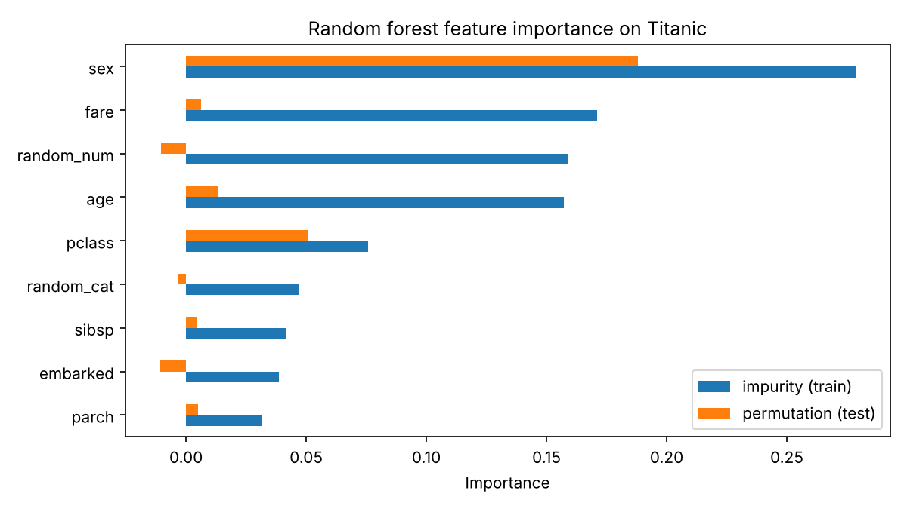

# جلسه ۲۳ — روش‌های گروهی

## چرا روش‌های گروهی؟

در جلسه قبل دیدیم درخت تصمیم خوانا و انعطاف‌پذیر است، اما **واریانس** زیادی دارد: روی تایتانیک درخت کامل ۱۵۲ برگ داشت و درخت هرس‌شده هم روی آزمون چند درصد از برآورد اعتبارسنجی پایین‌تر بود ← [درخت تصمیم](22%20-%20%D8%AF%D8%B1%D8%AE%D8%AA%20%D8%AA%D8%B5%D9%85%DB%8C%D9%85.md). ایده **یادگیری گروهی** (Ensemble Learning) ساده است: به جای اعتماد به یک مدل، **چندین مدل** بسازیم و پیش‌بینی‌هایشان را ترکیب کنیم. جنگل تصادفی و Gradient Boosting امروز قوی‌ترین مدل‌های داده جدولی‌اند.

| خانواده | ایده | مدل‌های پایه | هدف اصلی |
|:---:|:---:|:---:|:---:|
| بگینگ (Bagging) | آموزش موازی روی نمونه‌های بوت‌استرپ و میانگین‌گیری | درخت عمیق (پرواریانس) | کاهش واریانس |
| بوستینگ (Boosting) | آموزش ترتیبی؛ هر مدل خطای قبلی را جبران می‌کند | درخت کم‌عمق (پربایاس) | کاهش بایاس |
| رأی‌گیری (Voting) | ترکیب مدل‌های متفاوت روی همان داده | مدل‌های ناهمگون | بهره‌گیری از تنوع |

بگینگ **واریانس** مدل‌های پیچیده و بوستینگ **بایاس** مدل‌های ساده را کم می‌کند. این جلسه به سه پرسش پاسخ می‌دهد:

- چرا ترکیب چند مدل از هر عضو بهتر است و چه شرطی لازم دارد؟
- بگینگ، جنگل تصادفی، AdaBoost و Gradient Boosting چگونه کار می‌کنند؟
- مدل گروهی را چگونه تفسیر کنیم (اهمیت ویژگی)؟

---

## خرد جمعی و رأی اکثریت

فرض کنید n طبقه‌بند دودویی (n فرد) داریم که هر کدام با احتمال e اشتباه می‌کنند و خطاهایشان **مستقل** است. گروه با رأی اکثریت وقتی اشتباه می‌کند که دست‌کم k عضو (k برابر جزء صحیح n تقسیم بر ۲ به‌علاوه یک) اشتباه کنند؛ تعداد اشتباه‌ها از توزیع **دوجمله‌ای** پیروی می‌کند:

$$
P(\text{ensemble error}) = \sum_{i=k}^{n} \binom{n}{i} e^{i} (1-e)^{n-i}
$$

### مثال حل‌شده: سه طبقه‌بند ۷۰ درصدی

گروه درست می‌گوید اگر دست‌کم دو عضو از سه عضو درست بگویند:

$$
P(\text{correct}) = \binom{3}{3}(0.7)^3 + \binom{3}{2}(0.7)^2(0.3) = 0.343 + 0.441 = 0.784
$$

سه طبقه‌بند ۷۰ درصدی مستقل، یک گروه **۷۸.۴ درصدی** می‌سازند. تابع `binom.sf` از scipy همین را برای تعداد عضو و خطاهای مختلف حساب می‌کند:

```python
from scipy.stats import binom

# Majority vote of n independent classifiers, each wrong with probability e.
# The ensemble is wrong when at least k = n // 2 + 1 members are wrong: P(X >= k) = 1 - P(X <= k - 1)
print(f"3 classifiers, accuracy 0.7 each -> ensemble accuracy={1 - binom.sf(1, 3, 0.3):.3f}")
for n in [1, 5, 11, 25, 101]:
    k = n // 2 + 1
    errors = [binom.sf(k - 1, n, e) for e in [0.35, 0.45, 0.55]]
    print(f"n={n:3d}  ensemble error for e=0.35, 0.45, 0.55: " + "  ".join(f"{x:.3f}" for x in errors))
```

```
3 classifiers, accuracy 0.7 each -> ensemble accuracy=0.784
n=  1  ensemble error for e=0.35, 0.45, 0.55: 0.350  0.450  0.550
n=  5  ensemble error for e=0.35, 0.45, 0.55: 0.235  0.407  0.593
n= 11  ensemble error for e=0.35, 0.45, 0.55: 0.149  0.367  0.633
n= 25  ensemble error for e=0.35, 0.45, 0.55: 0.060  0.306  0.694
n=101  ensemble error for e=0.35, 0.45, 0.55: 0.001  0.156  0.844
```

با ۲۵ عضو مستقل که هر کدام ۳۵ درصد خطا دارند، خطای گروه به **۶ درصد** می‌رسد. اما اگر هر عضو **بدتر از حدس تصادفی** باشد (خطای ۰.۵۵)، گروه از هر عضو بدتر می‌شود.

> [!warning] فرض استقلال در عمل برقرار نیست
> مدل‌هایی که روی یک داده آموزش دیده‌اند خطاهای **همبسته** دارند. پس دو شرط لازم است: هر عضو **بهتر از حدس تصادفی** باشد و اعضا **متنوع** باشند. همه روش‌های این جلسه راه‌هایی برای ایجاد تنوع‌اند: نمونه‌های متفاوت (بگینگ)، ویژگی‌های متفاوت (جنگل تصادفی)، وزن‌های متفاوت (AdaBoost)، اهداف متفاوت (Gradient Boosting) یا الگوریتم‌های متفاوت (رأی‌گیری).

| نوع رأی‌گیری | روش ترکیب | نیاز |
|:---:|:---:|:---:|
| رأی سخت (Hard Voting) | کلاسی که بیشترین رأی را دارد | فقط برچسب |
| رأی نرم (Soft Voting) | میانگین احتمال‌ها، سپس بیشینه | احتمال‌های قابل اعتماد |

روی تایتانیک، رگرسیون لجستیک، 17-NN و درخت عمق ۳ (جلسات ۲۰ تا ۲۲) را با رأی‌گیری ترکیب می‌کنیم:

```python
import seaborn as sns
from sklearn.model_selection import train_test_split, StratifiedKFold, cross_val_score
from sklearn.compose import ColumnTransformer
from sklearn.pipeline import make_pipeline
from sklearn.impute import SimpleImputer
from sklearn.preprocessing import StandardScaler, OneHotEncoder
from sklearn.linear_model import LogisticRegression
from sklearn.neighbors import KNeighborsClassifier
from sklearn.tree import DecisionTreeClassifier
from sklearn.ensemble import VotingClassifier

# 1. Same data and split; scaled preprocessing (needed by logistic regression and k-NN)
titanic = sns.load_dataset("titanic")
num = ["age", "fare", "sibsp", "parch", "pclass"]
cat = ["sex", "embarked"]
X_train, X_test, y_train, y_test = train_test_split(titanic[num + cat], titanic["survived"],
                                                    test_size=0.2, stratify=titanic["survived"],
                                                    random_state=42)
preprocess = ColumnTransformer([
    ("num", make_pipeline(SimpleImputer(strategy="median"), StandardScaler()), num),
    ("cat", make_pipeline(SimpleImputer(strategy="most_frequent"),
                          OneHotEncoder(handle_unknown="ignore")), cat)])

# 2. Three different models of sessions 20-22, and hard / soft voting
members = [("logistic", LogisticRegression()), ("knn", KNeighborsClassifier(17)),
           ("tree", DecisionTreeClassifier(max_depth=3, random_state=42))]
models = dict(members)
models["hard voting"] = VotingClassifier(members, voting="hard")
models["soft voting"] = VotingClassifier(members, voting="soft")
cv = StratifiedKFold(n_splits=5, shuffle=True, random_state=42)
for name, clf in models.items():
    acc = cross_val_score(make_pipeline(preprocess, clf), X_train, y_train, cv=cv).mean()
    print(f"{name:12s} CV accuracy={acc:.3f}")
```

```
logistic     CV accuracy=0.796
knn          CV accuracy=0.826
tree         CV accuracy=0.806
hard voting  CV accuracy=0.810
soft voting  CV accuracy=0.808
```

رأی‌گیری (۰.۸۱۰) از لجستیک و درخت بهتر است، اما از **بهترین عضو** (17-NN با ۰.۸۲۶) بهتر نشد: سه مدل روی مسافران دشوار با هم اشتباه می‌کنند. همیشه گروه را با بهترین عضو مقایسه کنید.

---

## بگینگ و جنگل تصادفی

### بوت‌استرپ و بگینگ

نمونه **بوت‌استرپ** نمونه‌ای **با جایگذاری** به اندازه n از n نمونه آموزش است. احتمال اینکه یک نمونه خاص انتخاب **نشود**:

$$
\left(1 - \frac{1}{n}\right)^n \xrightarrow{n \to \infty} e^{-1} \approx 0.368
$$

```python
import numpy as np
from sklearn.utils import resample

# Share of the original rows that are NOT drawn in one bootstrap sample of size n
for n in [10, 100, 1000, 100000]:
    idx = resample(np.arange(n), replace=True, n_samples=n, random_state=42)
    print(f"n={n:6d}  theory={(1 - 1 / n) ** n:.3f}  one bootstrap sample={1 - len(np.unique(idx)) / n:.3f}")
```

```
n=    10  theory=0.349  one bootstrap sample=0.400
n=   100  theory=0.366  one bootstrap sample=0.390
n=  1000  theory=0.368  one bootstrap sample=0.385
n=100000  theory=0.368  one bootstrap sample=0.368
```

پس هر نمونه بوت‌استرپ حدود **۶۳.۲ درصد** نمونه‌های یکتا را دارد. الگوریتم **بگینگ** (Bootstrap Aggregating):

1. برای b از ۱ تا B: یک نمونه بوت‌استرپ بگیر و یک درخت **عمیق و هرس‌نشده** روی آن آموزش بده.
2. پیش‌بینی نهایی: رأی اکثریت (طبقه‌بندی) یا میانگین (رگرسیون) پیش‌بینی B درخت.

اگر B پیش‌بینی با واریانس σ² و همبستگی دوبه‌دوی ρ داشته باشیم:

$$
\text{Var}\left(\frac{1}{B}\sum_{b=1}^{B} \hat{f}_b\right) = \rho \sigma^2 + \frac{1 - \rho}{B} \sigma^2
$$

- با افزایش B جمله دوم به صفر می‌رسد: **افزودن درخت بیش‌برازش ایجاد نمی‌کند**.
- جمله اول کم نمی‌شود: **همبستگی** درخت‌ها کف واریانس را تعیین می‌کند. با σ² برابر ۱ و ۱۰۰ درخت، همبستگی ۰.۸ واریانس ۰.۸۰۲ و همبستگی ۰.۳ واریانس ۰.۳۰۷ می‌دهد.

### جنگل تصادفی

**جنگل تصادفی** (Random Forest) = بگینگ درخت‌ها + **تصادفی‌سازی ویژگی‌ها**: در هر گره هر درخت، فقط زیرمجموعه‌ای تصادفی از ویژگی‌ها (`max_features`، پیش‌فرض ریشه دوم تعداد ویژگی‌ها در طبقه‌بندی) بررسی می‌شود. اگر یک ویژگی بسیار قوی باشد (مانند جنسیت در تایتانیک)، در بگینگ ساده همه درخت‌ها آن را در ریشه به کار می‌برند و همبسته می‌شوند؛ در جنگل تصادفی درخت‌ها متنوع‌ترند. کلاس `ExtraTreesClassifier` آستانه هر تقسیم را هم تصادفی انتخاب می‌کند.

| ابرپارامتر | نقش | مقدار معمول |
|:---:|:---:|:---:|
| پارامتر n_estimators | تعداد درخت‌ها | ۱۰۰ تا ۱۰۰۰؛ تا جایی که دقت ثابت شود |
| پارامتر max_features | تعداد ویژگی در هر تقسیم | ریشه دوم یا کسری مانند ۰.۵ |
| پارامتر min_samples_leaf | پیچیدگی هر درخت | ۱ (درخت عمیق)؛ در داده نویزی بزرگ‌تر |
| پارامتر n_jobs | تعداد هسته‌های پردازنده | مقدار −1 یعنی همه هسته‌ها |

### خطای خارج از کیسه

هر نمونه آموزش در حدود ۳۶.۸ درصد درخت‌ها شرکت نداشته است؛ آن را فقط با همان درخت‌ها پیش‌بینی می‌کنیم. دقت این پیش‌بینی‌ها **دقت خارج از کیسه** (Out-of-Bag) است: برآوردی تقریباً رایگان از عملکرد روی داده جدید (`oob_score=True`).

```python
import seaborn as sns
from sklearn.model_selection import train_test_split
from sklearn.compose import ColumnTransformer
from sklearn.pipeline import make_pipeline
from sklearn.impute import SimpleImputer
from sklearn.preprocessing import OneHotEncoder
from sklearn.ensemble import RandomForestClassifier

# 1. Same data and split
titanic = sns.load_dataset("titanic")
num = ["age", "fare", "sibsp", "parch", "pclass"]
cat = ["sex", "embarked"]
X_train, X_test, y_train, y_test = train_test_split(titanic[num + cat], titanic["survived"],
                                                    test_size=0.2, stratify=titanic["survived"],
                                                    random_state=42)
preprocess = ColumnTransformer([
    ("num", SimpleImputer(strategy="median"), num),
    ("cat", make_pipeline(SimpleImputer(strategy="most_frequent"),
                          OneHotEncoder(handle_unknown="ignore")), cat)])

# 2. Out-of-bag accuracy (free estimate from the training data) vs test accuracy
for n in [10, 50, 100, 300, 1000]:
    model = make_pipeline(preprocess, RandomForestClassifier(n_estimators=n, oob_score=True,
                                                             random_state=42, n_jobs=-1))
    model.fit(X_train, y_train)
    print(f"trees={n:4d}  OOB accuracy={model[-1].oob_score_:.3f}  test accuracy={model.score(X_test, y_test):.3f}")
```

```
trees=  10  OOB accuracy=0.787  test accuracy=0.810
trees=  50  OOB accuracy=0.798  test accuracy=0.804
trees= 100  OOB accuracy=0.803  test accuracy=0.827
trees= 300  OOB accuracy=0.809  test accuracy=0.816
trees=1000  OOB accuracy=0.805  test accuracy=0.827
```

دقت OOB از حدود ۱۰۰ درخت به بعد در حدود ۰.۸۰ تا ۰.۸۱ ثابت می‌شود و با دقت آزمون (۰.۸۰ تا ۰.۸۳) هم‌خوان است. هزار درخت بیش‌برازش نمی‌کند؛ فقط زمان بیشتری می‌برد.

---

## بوستینگ

در بوستینگ مدل‌ها **به ترتیب** ساخته می‌شوند و هر مدل روی ضعف‌های مدل‌های قبلی تمرکز می‌کند. مدل پایه یک **یادگیرنده ضعیف** است؛ معمولاً **کُنده** (Decision Stump)، یعنی درختی با یک تقسیم.

### الگوریتم AdaBoost

الگوریتم AdaBoost به هر نمونه آموزش **وزن** می‌دهد (ابتدا همه برابر یک تقسیم بر n). در هر دور m، یک کُنده با وزن‌های فعلی آموزش می‌بیند، خطای وزن‌دار آن (مجموع وزن نمونه‌های اشتباه) و اعتبار آن حساب می‌شود:

$$
\varepsilon_m = \sum_{i: \, h_m(x_i) \neq y_i} w_i, \qquad \alpha_m = \frac{1}{2} \ln \frac{1 - \varepsilon_m}{\varepsilon_m}
$$

سپس وزن نمونه‌های **اشتباه** در نمایی آلفا ضرب می‌شود (افزایش) و وزن نمونه‌های **درست** در نمایی منفی آلفا (کاهش)، و وزن‌ها نرمال می‌شوند. پیش‌بینی نهایی برای کلاس‌های مثبت و منفی یک:

$$
H(x) = \text{sign}\left(\sum_{m=1}^{M} \alpha_m \, h_m(x)\right)
$$

### مثال حل‌شده: یک دور AdaBoost

ده نمونه با وزن اولیه ۰.۱ داریم و کُنده اول ۳ نمونه را اشتباه می‌کند.

#### گام ۱ — خطا و اعتبار کُنده

$$
\varepsilon_1 = 3 \times 0.1 = 0.3, \qquad \alpha_1 = \frac{1}{2}\ln\frac{0.7}{0.3} \approx 0.424
$$

#### گام ۲ — به‌روزرسانی وزن‌ها

$$
0.1 \times e^{0.424} \approx 0.1528 \;\; (\text{wrong}), \qquad 0.1 \times e^{-0.424} \approx 0.0655 \;\; (\text{correct})
$$

مجموع وزن‌ها: ۳ ضرب در ۰.۱۵۲۸ به‌علاوه ۷ ضرب در ۰.۰۶۵۵، یعنی حدود ۰.۹۱۷.

#### گام ۳ — نرمال‌سازی

| گروه نمونه | تعداد | وزن قبلی | وزن پس از ضرب | وزن نرمال‌شده | سهم کل |
|:---:|:---:|:---:|:---:|:---:|:---:|
| اشتباه | 3 | 0.100 | 0.1528 | 0.1667 | 0.50 |
| درست | 7 | 0.100 | 0.0655 | 0.0714 | 0.50 |
| جمع | 10 | 1.000 | 0.917 | 1.000 | 1.00 |

> [!note] بررسی
> مجموع وزن‌های نرمال‌شده یک است. نمونه‌های اشتباه دقیقاً **نیمی** از وزن را دارند: کُنده قبلی روی وزن‌های جدید مثل حدس تصادفی است و کُنده بعدی **مجبور** است چیز تازه‌ای یاد بگیرد. کلاس `AdaBoostClassifier` از نسخه SAMME استفاده می‌کند که برای دو کلاس اعتبار را دو برابر این فرمول می‌گیرد؛ پیش‌بینی‌ها یکسان می‌ماند.

> [!warning] حساسیت AdaBoost به نویز
> وزن نمونه‌های اشتباه نمایی زیاد می‌شود؛ نمونه‌هایی با برچسب اشتباه یا داده پرت به‌تدریج وزن عظیمی می‌گیرند و مدل روی آن‌ها بیش‌برازش می‌کند.

### الگوریتم Gradient Boosting

مدل **مجموع** درخت‌هاست و هر درخت جدید در جهت **کاهش زیان** حرکت می‌کند؛ گرادیان کاهشی در فضای **توابع** ← [مبانی یادگیری نظارت‌شده و رگرسیون خطی ساده](../Part%204_Regression/16%20-%20%D9%85%D8%A8%D8%A7%D9%86%DB%8C%20%DB%8C%D8%A7%D8%AF%DA%AF%DB%8C%D8%B1%DB%8C%20%D9%86%D8%B8%D8%A7%D8%B1%D8%AA%E2%80%8C%D8%B4%D8%AF%D9%87%20%D9%88%20%D8%B1%DA%AF%D8%B1%D8%B3%DB%8C%D9%88%D9%86%20%D8%AE%D8%B7%DB%8C%20%D8%B3%D8%A7%D8%AF%D9%87.md):

$$
F_m(x) = F_{m-1}(x) + \eta \, h_m(x), \qquad r_i = -\frac{\partial L(y_i, F(x_i))}{\partial F(x_i)}
$$

درخت جدید h روی منفی گرادیان r آموزش می‌بیند و η نرخ یادگیری است. برای زیان مربعات خطا، منفی گرادیان همان **باقیمانده** است: هر درخت جدید باقیمانده‌های مدل فعلی را پیش‌بینی می‌کند.

### مثال حل‌شده: سه گام Gradient Boosting

همان شش نقطه درخت رگرسیون جلسه قبل (x از ۱ تا ۶، y برابر ۵، ۶، ۷، ۱۵، ۱۶ و ۱۸)، نرخ یادگیری ۰.۱ و کُنده.

#### گام ۰ — مدل اولیه

مدل اولیه میانگین است: ۱۱.۱۷، با میانگین مربعات خطای ۲۷.۸۱.

#### گام ۱ — درخت اول روی باقیمانده‌ها

| نقطه | مقدار x | هدف y | پیش‌بینی فعلی | باقیمانده |
|:---:|:---:|:---:|:---:|:---:|
| ۱ | 1 | 5 | 11.17 | −6.17 |
| ۲ | 2 | 6 | 11.17 | −5.17 |
| ۳ | 3 | 7 | 11.17 | −4.17 |
| ۴ | 4 | 15 | 11.17 | 3.83 |
| ۵ | 5 | 16 | 11.17 | 4.83 |
| ۶ | 6 | 18 | 11.17 | 6.83 |
| جمع | — | — | — | 0 |

بهترین کُنده روی باقیمانده‌ها تقسیم «x حداکثر ۳.۵» است با مقدار برگ‌ها −5.17 و ۵.۱۷ (میانگین باقیمانده‌های هر گروه):

$$
F_1 = 11.17 + 0.1 \times (\pm 5.17) \;\Rightarrow\; 10.65 \;(\text{left}), \quad 11.68 \;(\text{right})
$$

#### گام ۲ — تکرار

| گام | پیش‌بینی گروه چپ | پیش‌بینی گروه راست | میانگین مربعات خطا |
|:---:|:---:|:---:|:---:|
| 0 | 11.17 | 11.17 | 27.81 |
| 1 | 10.65 | 11.68 | 22.73 |
| 2 | 10.18 | 12.15 | 18.63 |
| 3 | 9.77 | 12.57 | 15.30 |

هر گام فقط ۱۰ درصد فاصله را می‌پیماید و پیش‌بینی‌ها آرام به میانگین گروه‌ها (۶ و ۱۶.۳۳) نزدیک می‌شوند. کلاس `GradientBoostingRegressor` و متد `staged_predict` همین اعداد را می‌دهند:

```python
import numpy as np
from sklearn.ensemble import GradientBoostingRegressor

# Same six points as the regression tree of session 22; three boosting steps with stumps
x = np.array([[1], [2], [3], [4], [5], [6]])
y = np.array([5, 6, 7, 15, 16, 18])
gb = GradientBoostingRegressor(n_estimators=3, learning_rate=0.1, max_depth=1).fit(x, y)
print(f"step 0: prediction={y.mean():.2f}  MSE={((y - y.mean()) ** 2).mean():.2f}")
for m, pred in enumerate(gb.staged_predict(x), start=1):
    print(f"step {m}: left={pred[0]:.2f}  right={pred[-1]:.2f}  MSE={((y - pred) ** 2).mean():.2f}")
```

```
step 0: prediction=11.17  MSE=27.81
step 1: left=10.65  right=11.68  MSE=22.73
step 2: left=10.18  right=12.15  MSE=18.63
step 3: left=9.77  right=12.57  MSE=15.30
```

> [!tip] نرخ یادگیری و توقف زودهنگام
> نرخ یادگیری کوچک تعمیم بهتری می‌دهد اما درخت بیشتری لازم دارد. برخلاف جنگل تصادفی، در بوستینگ **درخت زیاد بیش‌برازش می‌کند**؛ پس تعداد درخت با **توقف زودهنگام** روی بخشی از داده آموزش تعیین می‌شود.

```python
import seaborn as sns
from sklearn.model_selection import train_test_split
from sklearn.compose import ColumnTransformer
from sklearn.pipeline import make_pipeline
from sklearn.impute import SimpleImputer
from sklearn.preprocessing import OneHotEncoder
from sklearn.ensemble import GradientBoostingClassifier

# 1. Same data and split
titanic = sns.load_dataset("titanic")
num = ["age", "fare", "sibsp", "parch", "pclass"]
cat = ["sex", "embarked"]
X_train, X_test, y_train, y_test = train_test_split(titanic[num + cat], titanic["survived"],
                                                    test_size=0.2, stratify=titanic["survived"],
                                                    random_state=42)
preprocess = ColumnTransformer([
    ("num", SimpleImputer(strategy="median"), num),
    ("cat", make_pipeline(SimpleImputer(strategy="most_frequent"),
                          OneHotEncoder(handle_unknown="ignore")), cat)])

# 2. Early stopping: 10% of the training data is held out internally;
#    stop when 10 extra trees bring no improvement
for lr in [0.01, 0.1, 1.0]:
    gb = GradientBoostingClassifier(n_estimators=3000, learning_rate=lr, validation_fraction=0.1,
                                    n_iter_no_change=10, random_state=42)
    model = make_pipeline(preprocess, gb).fit(X_train, y_train)
    print(f"learning_rate={lr:<5}  trees used={gb.n_estimators_:4d}  test accuracy={model.score(X_test, y_test):.3f}")
```

```
learning_rate=0.01   trees used= 581  test accuracy=0.799
learning_rate=0.1    trees used=  84  test accuracy=0.810
learning_rate=1.0    trees used=  22  test accuracy=0.793
```

با نرخ ۰.۰۱، ۵۸۱ درخت و با نرخ ۰.۱ فقط ۸۴ درخت لازم است؛ نرخ ۱ پس از ۲۲ درخت متوقف می‌شود و دقت کمتری دارد.

| جنبه | بگینگ و جنگل تصادفی | بوستینگ |
|:---:|:---:|:---:|
| ساخت مدل‌ها | موازی و مستقل | ترتیبی و وابسته |
| مدل پایه | درخت عمیق | درخت کم‌عمق |
| کاهش می‌دهد | واریانس | بایاس (و تا حدی واریانس) |
| افزایش تعداد درخت | بیش‌برازش نمی‌کند | ممکن است بیش‌برازش کند |
| حساسیت به نویز | کم | زیاد (به‌ویژه AdaBoost) |
| تنظیم ابرپارامتر | آسان | حساس‌تر |

### مقایسه روی تایتانیک

```python
import pandas as pd
import seaborn as sns
from sklearn.model_selection import train_test_split, StratifiedKFold, cross_val_score
from sklearn.compose import ColumnTransformer
from sklearn.pipeline import make_pipeline
from sklearn.impute import SimpleImputer
from sklearn.preprocessing import OneHotEncoder
from sklearn.tree import DecisionTreeClassifier
from sklearn.ensemble import (BaggingClassifier, RandomForestClassifier, ExtraTreesClassifier,
                              AdaBoostClassifier, GradientBoostingClassifier, HistGradientBoostingClassifier)

# 1. Titanic with the standard split; tree-based models need no scaling
titanic = sns.load_dataset("titanic")
num = ["age", "fare", "sibsp", "parch", "pclass"]
cat = ["sex", "embarked"]
X_train, X_test, y_train, y_test = train_test_split(titanic[num + cat], titanic["survived"],
                                                    test_size=0.2, stratify=titanic["survived"],
                                                    random_state=42)
preprocess = ColumnTransformer([
    ("num", SimpleImputer(strategy="median"), num),
    ("cat", make_pipeline(SimpleImputer(strategy="most_frequent"),
                          OneHotEncoder(handle_unknown="ignore")), cat)])

# 2. A single tree and six ensembles
models = {"Decision tree": DecisionTreeClassifier(random_state=42),
          "Bagging (200 trees)": BaggingClassifier(DecisionTreeClassifier(), n_estimators=200, random_state=42),
          "Random forest": RandomForestClassifier(n_estimators=200, random_state=42),
          "Extra trees": ExtraTreesClassifier(n_estimators=200, random_state=42),
          "AdaBoost (200 stumps)": AdaBoostClassifier(n_estimators=200, random_state=42),
          "Gradient boosting": GradientBoostingClassifier(random_state=42),
          "HistGradientBoosting": HistGradientBoostingClassifier(random_state=42)}
cv = StratifiedKFold(n_splits=5, shuffle=True, random_state=42)
rows = []
for name, clf in models.items():
    model = make_pipeline(preprocess, clf)
    scores = cross_val_score(model, X_train, y_train, cv=cv)
    rows.append({"model": name, "cv_mean": scores.mean(), "cv_sd": scores.std(),
                 "test": model.fit(X_train, y_train).score(X_test, y_test)})
print(pd.DataFrame(rows).set_index("model").round(3))
```

```
                       cv_mean  cv_sd   test
model                                       
Decision tree            0.770  0.019  0.827
Bagging (200 trees)      0.802  0.014  0.816
Random forest            0.801  0.018  0.821
Extra trees              0.789  0.006  0.804
AdaBoost (200 stumps)    0.812  0.018  0.793
Gradient boosting        0.827  0.033  0.799
HistGradientBoosting     0.813  0.030  0.827
```

- همه روش‌های گروهی از درخت تکی (اعتبارسنجی ۰.۷۷۰) بهترند؛ Gradient Boosting بهترین (۰.۸۲۷) است.
- **دقت آزمون** ترتیب را عوض می‌کند (درخت تکی ۰.۸۲۷!)؛ با ۱۷۹ مسافر آزمون، هر مسافر حدود ۰.۶ درصد دقت است و تفاوت‌ها در حد شانس‌اند. برای **انتخاب** مدل فقط به اعتبارسنجی متقابل تکیه کنید ← [رگرسیون چندجمله‌ای، بیش‌برازش و اعتبارسنجی متقابل](../Part%204_Regression/18%20-%20%D8%B1%DA%AF%D8%B1%D8%B3%DB%8C%D9%88%D9%86%20%DA%86%D9%86%D8%AF%D8%AC%D9%85%D9%84%D9%87%E2%80%8C%D8%A7%DB%8C%D8%8C%20%D8%A8%DB%8C%D8%B4%E2%80%8C%D8%A8%D8%B1%D8%A7%D8%B2%D8%B4%20%D9%88%20%D8%A7%D8%B9%D8%AA%D8%A8%D8%A7%D8%B1%D8%B3%D9%86%D8%AC%DB%8C%20%D9%85%D8%AA%D9%82%D8%A7%D8%A8%D9%84.md)
- انحراف معیار بخش‌ها (۰.۰۱ تا ۰.۰۳) نشان می‌دهد تفاوت روش‌های گروهی با هم کوچک است.

| کتابخانه | ویژگی کلیدی |
|:---:|:---:|
| کتابخانه XGBoost | منظم‌سازی وزن برگ‌ها، مدیریت داده گمشده، پردازش موازی و GPU |
| کتابخانه LightGBM | تقسیم هیستوگرامی و رشد برگ‌به‌برگ؛ بسیار سریع روی داده بزرگ |
| کتابخانه CatBoost | مدیریت بومی ویژگی‌های کیفی بدون نشت |
| کلاس HistGradientBoosting در scikit-learn | الهام‌گرفته از LightGBM؛ داده گمشده را مستقیم می‌پذیرد؛ برای پروژه‌های درس کافی است |

---

## اهمیت ویژگی

| جنبه | اهمیت ناخالصی (MDI) | اهمیت جایگشتی (Permutation) |
|:---:|:---:|:---:|
| ایده | میانگین کاهش ناخالصی هر ویژگی در همه درخت‌ها | افت امتیاز وقتی ستون ویژگی به‌تصادف جابه‌جا شود |
| داده محاسبه | آموزش | آزمون یا اعتبارسنجی |
| هزینه | رایگان (`feature_importances_`) | چند بار پیش‌بینی |
| مدل‌ها | فقط مدل‌های درختی | هر مدلی |
| سوگیری به ویژگی‌های پرمقدار | دارد | ندارد |

اهمیت جایگشتی ویژگی j (s امتیاز روی داده اصلی و امتیاز دوم پس از جایگشت ستون j در تکرار r):

$$
I_j = s - \frac{1}{R}\sum_{r=1}^{R} s_{r,j}
$$

برای دیدن تفاوت، به تایتانیک دو ستون **کاملاً تصادفی** اضافه می‌کنیم (یکی عددی و یکی کیفی با سه مقدار):

```python
import numpy as np
import pandas as pd
import matplotlib.pyplot as plt
import seaborn as sns
from sklearn.model_selection import train_test_split
from sklearn.compose import ColumnTransformer
from sklearn.pipeline import make_pipeline
from sklearn.impute import SimpleImputer
from sklearn.preprocessing import OneHotEncoder
from sklearn.ensemble import RandomForestClassifier
from sklearn.inspection import permutation_importance

# 1. Titanic plus two purely random columns (one numeric, one categorical with 3 values)
titanic = sns.load_dataset("titanic")
rng = np.random.default_rng(42)
titanic["random_num"] = rng.normal(size=len(titanic))
titanic["random_cat"] = rng.choice(["a", "b", "c"], size=len(titanic))
num = ["age", "fare", "sibsp", "parch", "pclass", "random_num"]
cat = ["sex", "embarked", "random_cat"]
X_train, X_test, y_train, y_test = train_test_split(titanic[num + cat], titanic["survived"],
                                                    test_size=0.2, stratify=titanic["survived"],
                                                    random_state=42)
preprocess = ColumnTransformer([
    ("num", SimpleImputer(strategy="median"), num),
    ("cat", make_pipeline(SimpleImputer(strategy="most_frequent"),
                          OneHotEncoder(handle_unknown="ignore")), cat)],
    verbose_feature_names_out=False)
model = make_pipeline(preprocess, RandomForestClassifier(n_estimators=200, random_state=42)).fit(X_train, y_train)
print(f"train accuracy={model.score(X_train, y_train):.3f}  test accuracy={model.score(X_test, y_test):.3f}")

# 2. Impurity importance (training data, one value per one-hot column; summed back per feature)
mdi = pd.Series(model[-1].feature_importances_, index=model[0].get_feature_names_out())
mdi = mdi.groupby(lambda c: next(f for f in num + cat if c == f or c.startswith(f + "_"))).sum()

# 3. Permutation importance on the TEST set (whole original columns are shuffled)
perm = permutation_importance(model, X_test, y_test, n_repeats=20, random_state=42)
perm = pd.Series(perm.importances_mean, index=num + cat)

table = pd.DataFrame({"impurity (train)": mdi, "permutation (test)": perm}).sort_values("impurity (train)")
print(table.sort_values("impurity (train)", ascending=False).round(3))
table.plot.barh(figsize=(8, 4.5), title="Random forest feature importance on Titanic")
plt.xlabel("Importance")
plt.show()
```

```
train accuracy=1.000  test accuracy=0.793
            impurity (train)  permutation (test)
sex                    0.278               0.188
fare                   0.171               0.006
random_num             0.159              -0.010
age                    0.157               0.013
pclass                 0.076               0.051
random_cat             0.047              -0.003
sibsp                  0.042               0.004
embarked               0.039              -0.011
parch                  0.032               0.005
```



بر اساس اهمیت ناخالصی، ستون **عددی تصادفی** سومین ویژگی مهم است، از سن و کلاس سفر هم مهم‌تر! درخت‌های عمیق (دقت آموزش ۱.۰) از آن برای حفظ نویز آموزش استفاده کرده‌اند. اهمیت جایگشتی روی آزمون آن را بی‌اثر (حتی منفی) نشان می‌دهد و **جنسیت** و **کلاس سفر** را مهم‌ترین ویژگی‌ها می‌داند.

> [!warning] اهمیت، علیت نیست
> هر دو روش می‌گویند **مدل** به چه چیزی تکیه دارد، نه اینکه در دنیای واقعی چه چیزی **علت** است ← [تحلیل دومتغیره و چندمتغیره](../Part%202_EDA/8%20-%20%D8%AA%D8%AD%D9%84%DB%8C%D9%84%20%D8%AF%D9%88%D9%85%D8%AA%D8%BA%DB%8C%D8%B1%D9%87%20%D9%88%20%DA%86%D9%86%D8%AF%D9%85%D8%AA%D8%BA%DB%8C%D8%B1%D9%87.md). وقتی دو ویژگی شدیداً همبسته‌اند، جایگشت یکی اطلاعات زیادی از بین نمی‌برد و هر دو کم‌اهمیت به نظر می‌رسند.

> [!note] کارگاه عملی
> دفترچه «۲۳ - کارگاه روش‌های گروهی» انباشتن مدل‌ها (Stacking) و تمرین عملی کلاس را با پاسخ دارد: مقایسه درخت، جنگل تصادفی و Gradient Boosting برای پیش‌بینی مصرف سوخت و تنظیم `max_features`. نحوه نوشتن این کدها در امتحان پرسیده نمی‌شود.

---

## خطاهای رایج

| خطا | چرا نادرست است | روش درست |
|:---:|:---:|:---:|
| ترکیب مدل‌های تقریباً یکسان | خطاهای همبسته یکدیگر را خنثی نمی‌کنند | ایجاد تنوع (داده، ویژگی یا الگوریتم متفاوت) |
| بگینگ با درخت کم‌عمق | بگینگ واریانس را کم می‌کند، نه بایاس | درخت عمیق در بگینگ؛ کُنده در بوستینگ |
| افزایش بی‌حد درخت در بوستینگ | بیش‌برازش می‌کند | توقف زودهنگام |
| انتخاب مدل با دقت یک مجموعه آزمون کوچک | تفاوت‌ها در حد نوسان‌اند | انتخاب با اعتبارسنجی متقابل |
| تکیه بر اهمیت ناخالصی | روی داده آموزش و به نفع ویژگی‌های پرمقدار است | اهمیت جایگشتی روی آزمون |
| تفسیر اهمیت به‌عنوان علیت | اهمیت فقط وابستگی مدل را نشان می‌دهد | تفسیر محتاطانه |

---

## نمونه سؤال‌های امتحانی

### سؤال‌های مفهومی

> [!question]- ۱. چرا جنگل تصادفی از بگینگ ساده درخت‌ها بهتر است؟
> در بگینگ ساده، اگر یک ویژگی بسیار قوی باشد، همه درخت‌ها آن را در ریشه به کار می‌برند و **همبسته** می‌شوند؛ همبستگی کف واریانس میانگین را تعیین می‌کند. جنگل تصادفی در هر گره فقط زیرمجموعه‌ای تصادفی از ویژگی‌ها را بررسی می‌کند و درخت‌ها متنوع‌تر می‌شوند.

> [!question]- ۲. چرا افزودن درخت به جنگل تصادفی بیش‌برازش نمی‌کند ولی در Gradient Boosting می‌کند؟
> در جنگل تصادفی درخت‌ها مستقل‌اند و میانگین گرفته می‌شوند؛ درخت بیشتر فقط جمله واریانس را کمتر می‌کند. در بوستینگ هر درخت جدید باقیمانده‌های مدل فعلی را برازش می‌دهد و پس از مدتی شروع به برازش **نویز** می‌کند.

> [!question]- ۳. خطای خارج از کیسه چیست و چرا «رایگان» است؟
> هر نمونه آموزش در حدود ۳۶.۸ درصد درخت‌ها شرکت نداشته است. پیش‌بینی آن نمونه فقط با همین درخت‌ها، برآوردی از عملکرد روی داده دیده‌نشده است؛ بدون نیاز به مجموعه اعتبارسنجی جداگانه یا آموزش دوباره.

> [!question]- ۴. چرا AdaBoost به داده نویزی حساس است؟
> وزن نمونه‌های اشتباه در هر دور به‌طور نمایی زیاد می‌شود. نمونه‌ای با برچسب اشتباه هرگز درست طبقه‌بندی نمی‌شود و وزنش مدام بیشتر می‌شود؛ مدل‌های بعدی روی آن تمرکز و بیش‌برازش می‌کنند.

### سؤال‌های محاسباتی

> [!question]- ۵. پنج طبقه‌بند مستقل هر کدام با دقت ۰.۸ داریم. دقت رأی اکثریت چقدر است؟
> گروه درست است اگر دست‌کم ۳ عضو درست بگویند:
> $$
> \binom{5}{5}0.8^5 + \binom{5}{4}0.8^4(0.2) + \binom{5}{3}0.8^3(0.2)^2 = 0.328 + 0.410 + 0.205 = 0.942
> $$

> [!question]- ۶. در AdaBoost، کُنده‌ای خطای وزن‌دار ۰.۲ دارد. اعتبار آن و ضریب به‌روزرسانی وزن نمونه‌های اشتباه و درست چقدر است؟
> $$
> \alpha = \frac{1}{2}\ln\frac{0.8}{0.2} = \frac{1}{2}\ln 4 \approx 0.693, \qquad e^{0.693} = 2, \qquad e^{-0.693} = 0.5
> $$
> وزن نمونه‌های اشتباه دو برابر و وزن نمونه‌های درست نصف می‌شود (پیش از نرمال‌سازی).

> [!question]- ۷. پیش‌بینی فعلی Gradient Boosting برای نمونه‌ای ۱۰ و مقدار واقعی آن ۱۶ است. درخت بعدی برای این نمونه مقدار ۵ پیش‌بینی می‌کند. با نرخ یادگیری ۰.۲ پیش‌بینی جدید چقدر است؟
> باقیمانده ۶ است و درخت آن را ۵ تقریب زده است:
> $$
> F_{\text{new}} = 10 + 0.2 \times 5 = 11
> $$

> [!question]- ۸. با واریانس σ² برابر ۴ برای هر درخت و همبستگی ۰.۵، واریانس میانگین ۱۰ درخت و بی‌نهایت درخت چقدر است؟
> $$
> 0.5 \times 4 + \frac{1 - 0.5}{10} \times 4 = 2 + 0.2 = 2.2, \qquad B \to \infty: \; 0.5 \times 4 = 2
> $$

### سؤال‌های خواندن کد

> [!question]- ۹. چرا در کد زیر `oob_score_` با تعداد درخت کم ممکن است هشدار بدهد؟
> ```python
> RandomForestClassifier(n_estimators=5, oob_score=True).fit(X_train, y_train)
> ```
> با ۵ درخت، احتمال اینکه یک نمونه در **همه** درخت‌ها حضور داشته باشد قابل توجه است (حدود ۰.۶۳۲ به توان ۵، یعنی ۱۰ درصد)؛ برای این نمونه‌ها هیچ پیش‌بینی خارج از کیسه‌ای وجود ندارد.

> [!question]- ۱۰. خروجی `gb.n_estimators_` پس از اجرای کد زیر چه چیزی را نشان می‌دهد؟
> ```python
> gb = GradientBoostingClassifier(n_estimators=3000, n_iter_no_change=10,
>                                 validation_fraction=0.1).fit(X_train, y_train)
> ```
> تعداد درخت‌هایی که واقعاً ساخته شده‌اند: آموزش وقتی متوقف شده که ۱۰ درخت پیاپی امتیاز بخش اعتبارسنجی داخلی (۱۰ درصد داده آموزش) را بهتر نکرده‌اند. این عدد معمولاً بسیار کمتر از ۳۰۰۰ است.

> [!question]- ۱۱. چرا `permutation_importance` را روی `X_test` اجرا کردیم، نه `X_train`؟
> روی داده آموزش، مدلی که نویز را حفظ کرده با جایگشت ستون‌های بی‌ربط هم افت می‌کند و آن‌ها مهم به نظر می‌رسند. روی داده آزمون فقط ویژگی‌هایی مهم‌اند که به **تعمیم** کمک می‌کنند.

---

## نکات کلیدی

> [!summary] خلاصه جلسه
> - **یادگیری گروهی** با ترکیب چند مدل متنوع و بهتر از تصادفی، خطا را کم می‌کند؛ با خطاهای همبسته سود ترکیب کم است.
> - **بگینگ** درخت‌های عمیق را روی نمونه‌های بوت‌استرپ آموزش می‌دهد و **واریانس** را کم می‌کند؛ **جنگل تصادفی** با تصادفی‌سازی ویژگی‌ها همبستگی درخت‌ها را کم می‌کند. افزودن درخت بیش‌برازش ایجاد نمی‌کند و **خطای خارج از کیسه** برآوردی رایگان می‌دهد.
> - **AdaBoost** وزن نمونه‌های اشتباه را زیاد می‌کند؛ **Gradient Boosting** هر درخت را روی منفی گرادیان زیان (در رگرسیون، باقیمانده‌ها) می‌سازد. بوستینگ **بایاس** را کم می‌کند و به توقف زودهنگام نیاز دارد.
> - روی تایتانیک همه روش‌های گروهی از درخت تکی بهتر بودند؛ تفاوت آن‌ها با هم کوچک و ترتیبشان روی آزمون کوچک ناپایدار است.
> - **اهمیت جایگشتی** روی داده آزمون از اهمیت ناخالصی قابل اعتمادتر است؛ اهمیت ناخالصی به یک ستون تصادفی اهمیت زیادی داد.
