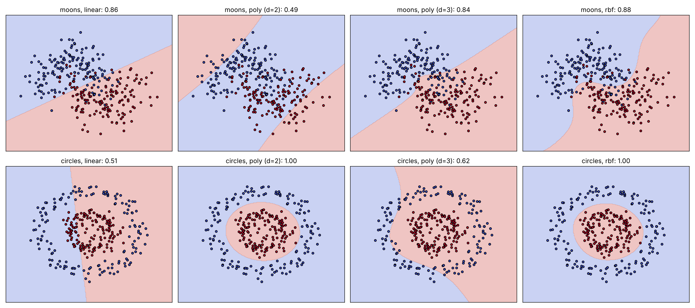
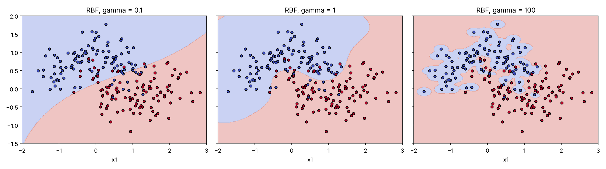

# جلسه ۲۴ — ماشین بردار پشتیبان

## چرا ماشین بردار پشتیبان؟

رگرسیون لجستیک یک مرز **خطی** می‌سازد ← [بیز ساده و رگرسیون لجستیک](21%20-%20%D8%A8%DB%8C%D8%B2%20%D8%B3%D8%A7%D8%AF%D9%87%20%D9%88%20%D8%B1%DA%AF%D8%B1%D8%B3%DB%8C%D9%88%D9%86%20%D9%84%D8%AC%D8%B3%D8%AA%DB%8C%DA%A9.md)؛ اما وقتی دو کلاس جداپذیرند، **بی‌نهایت خط** آن‌ها را بدون خطا جدا می‌کند. کدام بهتر است؟ **ماشین بردار پشتیبان** (Support Vector Machine یا SVM) پاسخ روشنی دارد: خطی که **بیشترین فاصله** را از نزدیک‌ترین نقاط دو کلاس دارد. همراه با **ترفند هسته**، SVM یکی از قدرتمندترین طبقه‌بندهای پیش از یادگیری عمیق بود.

| ویژگی | رگرسیون لجستیک | ماشین بردار پشتیبان | درخت و روش‌های گروهی |
|:---:|:---:|:---:|:---:|
| هدف بهینه‌سازی | بیشینه درست‌نمایی (Log-Loss) | بیشینه حاشیه (Hinge Loss) | کاهش ناخالصی |
| نقاط تعیین‌کننده مرز | همه نقاط | فقط بردارهای پشتیبان | همه نقاط |
| مرز غیرخطی | با ویژگی‌های دستی | با ترفند هسته | ذاتاً غیرخطی |
| خروجی احتمال | مستقیم | غیرمستقیم | مستقیم |
| نیاز به مقیاس‌بندی | بله | **حیاتی** | خیر |

این جلسه به سه پرسش پاسخ می‌دهد:

- کدام مرز خطی بهترین است (**حاشیه بیشینه**)؟
- اگر داده جداپذیر نبود چه کنیم (**حاشیه نرم** و پارامتر C)؟
- اگر مرز خطی نبود چه کنیم (**ترفند هسته** و پارامتر gamma)؟

---

## حاشیه بیشینه

در فضای d بعدی، یک **ابرصفحه** با بردار وزن w و عرض از مبدأ b تعریف می‌شود و با برچسب‌های منفی یک و مثبت یک، پیش‌بینی علامت **تابع تصمیم** است:

$$
f(\mathbf{x}) = \mathbf{w}^\top \mathbf{x} + b, \qquad \hat{y} = \text{sign}\left(f(\mathbf{x})\right), \qquad \text{dist}(\mathbf{x}) = \frac{|f(\mathbf{x})|}{\lVert\mathbf{w}\rVert}
$$

**حاشیه** فاصله ابرصفحه تا نزدیک‌ترین نقاط آموزش است؛ مرزی که از هر دو کلاس دور است، در برابر نویز مقاوم‌تر است. اگر w و b را طوری مقیاس کنیم که تابع تصمیم روی نزدیک‌ترین نقاط دقیقاً مثبت یا منفی یک باشد، پهنای کل حاشیه برابر است با:

$$
\text{margin} = \frac{2}{\lVert\mathbf{w}\rVert}
$$

بیشینه کردن حاشیه یعنی کمینه کردن نُرم w، به شرط آنکه همه نقاط در سمت درست و بیرون حاشیه باشند (**حاشیه سخت**):

$$
\min_{\mathbf{w}, b} \; \frac{1}{2}\lVert\mathbf{w}\rVert^2 \quad \text{subject to} \quad y_i\left(\mathbf{w}^\top \mathbf{x}_i + b\right) \geq 1 \quad \forall i
$$

این یک مسئله **محدب** درجه دوم با جواب یکتاست. نقاطی که روی ابرصفحه‌های حاشیه قرار دارند **بردارهای پشتیبان** (Support Vectors) هستند و مرز **فقط** به آن‌ها وابسته است.

### مثال حل‌شده: حاشیه سخت در دو بعد

| نقطه | مختصات اول | مختصات دوم | کلاس |
|:---:|:---:|:---:|:---:|
| الف | 1 | 1 | −1 |
| ب | 1 | 2 | −1 |
| ج | 2 | 1 | −1 |
| د | 3 | 4 | +1 |
| ه | 4 | 3 | +1 |
| و | 4 | 4 | +1 |

#### گام ۱ — حدس هندسی

نزدیک‌ترین نقاط دو کلاس ب و ج (مجموع مختصات ۳) و د و ه (مجموع مختصات ۷) هستند. به دلیل تقارن، بهترین مرز خط «مجموع مختصات برابر ۵» است؛ پس w به شکل (a, a) است.

#### گام ۲ — تعیین مقیاس

تابع تصمیم روی ب باید منفی یک و روی د مثبت یک باشد:

$$
\begin{aligned}
3a + b &= -1 \\
7a + b &= +1
\end{aligned}
\quad \Rightarrow \quad a = 0.5, \quad b = -2.5
$$

$$
\mathbf{w} = (0.5,\; 0.5), \qquad \lVert\mathbf{w}\rVert \approx 0.707, \qquad \text{margin} = \frac{2}{0.707} \approx 2.828
$$

#### گام ۳ — پیش‌بینی

$$
f(2, 2) = 0.5 \times 2 + 0.5 \times 2 - 2.5 = -0.5, \qquad f(2.5, 2.6) = 0.5 \times 5.1 - 2.5 = 0.05
$$

نقطه اول در کلاس منفی و نقطه دوم در کلاس مثبت است، اما بسیار نزدیک مرز.

> [!note] بررسی
> حاشیه ۲.۸۲۸ دقیقاً فاصله دو خط موازی «مجموع مختصات ۳» و «مجموع مختصات ۷» است (۴ تقسیم بر جذر ۲). تابع تصمیم روی ب، ج، د و ه دقیقاً منفی یا مثبت یک و روی الف و و بزرگ‌تر از یک (در قدرمطلق) است.

با روش ضرایب لاگرانژ، جواب به شکل ترکیب خطی بردارهای پشتیبان است (**صورت دوگان**):

$$
\mathbf{w} = \sum_{i \in SV} \alpha_i \, y_i \, \mathbf{x}_i, \qquad f(\mathbf{x}) = \sum_{i \in SV} \alpha_i \, y_i \, \mathbf{x}_i^\top \mathbf{x} + b
$$

کلاس `SVC(kernel="linear")` با C بسیار بزرگ (تقریب حاشیه سخت) همین جواب را می‌دهد:

```python
import numpy as np
from sklearn.svm import SVC

# 1. Six separable points; labels -1 (points A, B, C) and +1 (points D, E, F)
X = np.array([[1, 1], [1, 2], [2, 1], [3, 4], [4, 3], [4, 4]])
y = np.array([-1, -1, -1, 1, 1, 1])

# 2. A very large C approximates the hard margin
svm = SVC(kernel="linear", C=1e6).fit(X, y)
w, b = svm.coef_[0], svm.intercept_[0]
print(f"w={w.round(3)}  b={b:.3f}  margin={2 / np.linalg.norm(w):.3f}")

# 3. Support vectors and dual coefficients (alpha_i * y_i)
print(f"support vectors={svm.support_vectors_.tolist()}  alpha*y={svm.dual_coef_[0].round(3)}")

# 4. Decision function for every training point and two new points
print(f"f(train)={svm.decision_function(X).round(2)}")
print(f"f((2, 2))={svm.decision_function([[2, 2]])[0]:.2f}  f((2.5, 2.6))={svm.decision_function([[2.5, 2.6]])[0]:.2f}")
```

```
w=[0.5 0.5]  b=-2.500  margin=2.828
support vectors=[[2.0, 1.0], [4.0, 3.0]]  alpha*y=[-0.25  0.25]
f(train)=[-1.5 -1.  -1.   1.   1.   1.5]
f((2, 2))=-0.50  f((2.5, 2.6))=0.05
```

کتابخانه scikit-learn دو بردار پشتیبان ج و ه را با آلفای ۰.۲۵ گزارش می‌کند (`dual_coef_` حاصل‌ضرب آلفا و برچسب است):

$$
\mathbf{w} = 0.25 \times (+1) \times (4, 3) + 0.25 \times (-1) \times (2, 1) = (0.5,\; 0.5)
$$

ب و د هم روی حاشیه‌اند اما در این مسئله آلفای صفر گرفته‌اند. در صورت دوگان، داده فقط از طریق **ضرب داخلی** دو نقطه ظاهر می‌شود؛ دریچه‌ای که ترفند هسته از آن وارد می‌شود.

---

## حاشیه نرم و پارامتر C

در داده واقعی کلاس‌ها هم‌پوشانی دارند و حاشیه سخت جواب ندارد. در **حاشیه نرم** اجازه می‌دهیم نقاطی وارد حاشیه یا حتی سمت اشتباه شوند، اما برای هر کدام جریمه می‌پردازیم. همین مسئله به شکل «منظم‌سازی + زیان» نوشته می‌شود؛ مانند Ridge ← [منظم‌سازی در رگرسیون](../Part%204_Regression/19%20-%20%D9%85%D9%86%D8%B8%D9%85%E2%80%8C%D8%B3%D8%A7%D8%B2%DB%8C%20%D8%AF%D8%B1%20%D8%B1%DA%AF%D8%B1%D8%B3%DB%8C%D9%88%D9%86.md):

$$
\min_{\mathbf{w}, b} \; \frac{1}{2}\lVert\mathbf{w}\rVert^2 + C \sum_{i=1}^{n} \max\left(0,\; 1 - y_i f(\mathbf{x}_i)\right)
$$

جمله دوم **زیان لولا** (Hinge Loss) است:

| حاصل‌ضرب برچسب در تابع تصمیم | زیان لولا | وضعیت نقطه |
|:---:|:---:|:---:|
| 2 | 0 | درست و بیرون حاشیه؛ بدون جریمه |
| 1 | 0 | درست و روی حاشیه |
| 0.5 | 0.5 | درست ولی داخل حاشیه |
| 0 | 1 | روی مرز |
| −1 | 2 | اشتباه |

زیان لولا برای نقاطی که با اطمینان کافی درست‌اند **دقیقاً صفر** است؛ این نقاط در جواب نقشی ندارند و مدل **تُنُک** است. Log-Loss هرگز صفر نمی‌شود و همه نقاط در مرز اثر دارند.

| جنبه | مقدار C کوچک | مقدار C بزرگ |
|:---:|:---:|:---:|
| جریمه تخطی | کم | زیاد |
| پهنای حاشیه | پهن | باریک |
| تعداد بردار پشتیبان | زیاد | کم |
| خطر | کم‌برازش | بیش‌برازش |

---

## ترفند هسته

داده‌ای که در فضای اصلی جداپذیر خطی نیست، ممکن است پس از نگاشت به فضایی با ابعاد بیشتر جداپذیر شود؛ مثلاً دو دایره هم‌مرکز با افزودن ویژگی «مجذور فاصله از مرکز». اما نگاشت صریح به ابعاد بالا پرهزینه است. چون در صورت دوگان فقط ضرب داخلی لازم است، اگر تابع **هسته** K ضرب داخلی در فضای نگاشت‌شده φ را مستقیماً از نقاط اصلی حساب کند، هرگز φ را نمی‌سازیم:

$$
K(\mathbf{x}, \mathbf{z}) = \phi(\mathbf{x})^\top \phi(\mathbf{z}), \qquad f(\mathbf{x}) = \sum_{i \in SV} \alpha_i \, y_i \, K(\mathbf{x}_i, \mathbf{x}) + b
$$

| هسته | ابرپارامترها | کاربرد |
|:---:|:---:|:---:|
| هسته خطی (linear) | پارامتر C | داده تقریباً جداپذیر خطی، ابعاد بسیار زیاد (متن) |
| هسته چندجمله‌ای (poly) | پارامترهای degree، gamma، coef0 | روابط چندجمله‌ای و اثرهای متقابل |
| هسته RBF (گاوسی) | پارامترهای gamma و C | **پیش‌فرض**؛ مرزهای غیرخطی دلخواه |

$$
K_{\text{poly}}(\mathbf{x}, \mathbf{z}) = \left(\gamma \, \mathbf{x}^\top \mathbf{z} + r\right)^d, \qquad K_{\text{RBF}}(\mathbf{x}, \mathbf{z}) = \exp\left(-\gamma \, \lVert\mathbf{x} - \mathbf{z}\rVert^2\right)
$$

هسته RBF بین صفر و یک است و مانند یک **معیار شباهت** عمل می‌کند ← [معیارهای شباهت و فاصله](../Part%201_Data%20Understanding/%DB%B5%20-%20%D9%85%D8%B9%DB%8C%D8%A7%D8%B1%D9%87%D8%A7%DB%8C%20%D8%B4%D8%A8%D8%A7%D9%87%D8%AA%20%D9%88%20%D9%81%D8%A7%D8%B5%D9%84%D9%87.md)؛ معادل نگاشت به فضایی با **بی‌نهایت** بعد است.

> [!example] مثال — هسته چندجمله‌ای و RBF
> برای x برابر (۱، ۲) و z برابر (۳، ۱)، هسته «مربع ضرب داخلی»:
> $$
> K(\mathbf{x}, \mathbf{z}) = (1 \times 3 + 2 \times 1)^2 = 25
> $$
> این هسته معادل نگاشت سه‌بعدی زیر است:
> $$
> \phi(\mathbf{x}) = \left(x_1^2,\; \sqrt{2}\,x_1 x_2,\; x_2^2\right), \qquad \phi(\mathbf{x})^\top \phi(\mathbf{z}) = (1)(9) + (2\sqrt{2})(3\sqrt{2}) + (4)(1) = 9 + 12 + 4 = 25
> $$
> هسته با یک ضرب داخلی دوبعدی و یک توان همان نتیجه را می‌دهد. مجذور فاصله دو نقطه ۵ است و هسته RBF با گامای ۰.۱، ۰.۵ و ۲ به ترتیب ۰.۶۰۷، ۰.۰۸۲ و ۰.۰۰۰۰۵ می‌شود: با گامای بزرگ، دو نقطه «هیچ شباهتی» ندارند.

```python
import numpy as np
from sklearn.metrics.pairwise import polynomial_kernel, rbf_kernel

x = np.array([[1, 2]])
z = np.array([[3, 1]])

# 1. Polynomial kernel (x.z)^2 vs the explicit 3-D feature map phi
print(f"kernel={polynomial_kernel(x, z, degree=2, gamma=1, coef0=0)[0, 0]:.0f}")
phi = lambda v: np.array([v[0] ** 2, np.sqrt(2) * v[0] * v[1], v[1] ** 2])
print(f"phi(x).phi(z)={phi(x[0]) @ phi(z[0]):.0f}")

# 2. RBF kernel for several gamma values (squared distance = 5)
for g in [0.1, 0.5, 2]:
    print(f"gamma={g:<4}  RBF={rbf_kernel(x, z, gamma=g)[0, 0]:.5f}")
```

```
kernel=25
phi(x).phi(z)=25
gamma=0.1   RBF=0.60653
gamma=0.5   RBF=0.08208
gamma=2     RBF=0.00005
```

### مقایسه هسته‌ها روی داده غیرخطی

دو داده شبیه‌سازی‌شده: همان دو نیم‌ماه جلسه ۲۰ و دو دایره هم‌مرکز. همه مدل‌ها با استانداردسازی و ابرپارامترهای پیش‌فرض:

```python
import numpy as np
import matplotlib.pyplot as plt
from sklearn.datasets import make_moons, make_circles
from sklearn.model_selection import StratifiedKFold, cross_val_score
from sklearn.pipeline import make_pipeline
from sklearn.preprocessing import StandardScaler
from sklearn.svm import SVC

# 1. Two simulated non-linear problems (the moons are the same as in session 20)
data = {"moons": make_moons(n_samples=300, noise=0.3, random_state=42),
        "circles": make_circles(n_samples=300, noise=0.1, factor=0.4, random_state=42)}
kernels = {"linear": SVC(kernel="linear"), "poly (d=2)": SVC(kernel="poly", degree=2),
           "poly (d=3)": SVC(kernel="poly", degree=3), "rbf": SVC(kernel="rbf")}
cv = StratifiedKFold(n_splits=5, shuffle=True, random_state=42)

# 2. CV accuracy and number of support vectors of each kernel
fig, axes = plt.subplots(2, 4, figsize=(18, 8))
for row, (dname, (X, y)) in enumerate(data.items()):
    xx, yy = np.meshgrid(np.linspace(X[:, 0].min() - 0.5, X[:, 0].max() + 0.5, 250),
                         np.linspace(X[:, 1].min() - 0.5, X[:, 1].max() + 0.5, 250))
    for col, (kname, svc) in enumerate(kernels.items()):
        model = make_pipeline(StandardScaler(), svc)
        acc = cross_val_score(model, X, y, cv=cv).mean()
        model.fit(X, y)
        print(f"{dname:8s} {kname:10s} CV accuracy={acc:.3f}  support vectors={model[-1].n_support_.sum()}")
        ax = axes[row, col]
        ax.contourf(xx, yy, model.predict(np.c_[xx.ravel(), yy.ravel()]).reshape(xx.shape),
                    alpha=0.3, cmap="coolwarm")
        ax.scatter(X[:, 0], X[:, 1], c=y, cmap="coolwarm", edgecolor="k", s=15)
        ax.set(title=f"{dname}, {kname}: {acc:.2f}", xticks=[], yticks=[])
plt.show()
```

```
moons    linear     CV accuracy=0.857  support vectors=107
moons    poly (d=2) CV accuracy=0.493  support vectors=298
moons    poly (d=3) CV accuracy=0.837  support vectors=120
moons    rbf        CV accuracy=0.883  support vectors=104
circles  linear     CV accuracy=0.513  support vectors=298
circles  poly (d=2) CV accuracy=0.997  support vectors=26
circles  poly (d=3) CV accuracy=0.617  support vectors=296
circles  rbf        CV accuracy=0.997  support vectors=40
```



- روی دایره‌ها، هسته خطی در حد حدس تصادفی است (۰.۵۱) و تقریباً همه ۳۰۰ نقطه را بردار پشتیبان کرده است: نشانه روشن مدل نامناسب.
- هسته چندجمله‌ای درجه ۲ دقیقاً ویژگی «مجذور فاصله» را دارد و دایره‌ها را کامل جدا می‌کند، اما روی نیم‌ماه‌ها شکست می‌خورد (۰.۴۹)؛ درجه ۳ برعکس. **درجه** هسته چندجمله‌ای باید با شکل داده بخواند.
- هسته RBF روی هر دو داده بهترین است؛ به همین دلیل پیش‌فرض است.

---

## نقش gamma و اهمیت مقیاس‌بندی

پارامتر gamma **دامنه اثر** هر بردار پشتیبان را تعیین می‌کند: گامای کوچک یعنی اثر وسیع و مرز هموار (خطر کم‌برازش)، و گامای بزرگ یعنی اثر محدود و جزیره‌های کوچک دور نقاط (خطر بیش‌برازش). مقدار پیش‌فرض `gamma="scale"` برابر یک تقسیم بر (تعداد ویژگی‌ها ضرب در واریانس X) است. C و gamma با هم تعامل دارند و باید **با هم** روی شبکه لگاریتمی تنظیم شوند ← [رگرسیون چندجمله‌ای، بیش‌برازش و اعتبارسنجی متقابل](../Part%204_Regression/18%20-%20%D8%B1%DA%AF%D8%B1%D8%B3%DB%8C%D9%88%D9%86%20%DA%86%D9%86%D8%AF%D8%AC%D9%85%D9%84%D9%87%E2%80%8C%D8%A7%DB%8C%D8%8C%20%D8%A8%DB%8C%D8%B4%E2%80%8C%D8%A8%D8%B1%D8%A7%D8%B2%D8%B4%20%D9%88%20%D8%A7%D8%B9%D8%AA%D8%A8%D8%A7%D8%B1%D8%B3%D9%86%D8%AC%DB%8C%20%D9%85%D8%AA%D9%82%D8%A7%D8%A8%D9%84.md)

```python
import numpy as np
import matplotlib.pyplot as plt
from sklearn.datasets import make_moons
from sklearn.model_selection import train_test_split, StratifiedKFold, cross_val_score, GridSearchCV
from sklearn.pipeline import make_pipeline
from sklearn.preprocessing import StandardScaler
from sklearn.svm import SVC

# 1. Same moons; a locked test set
X, y = make_moons(n_samples=300, noise=0.3, random_state=42)
X_train, X_test, y_train, y_test = train_test_split(X, y, test_size=0.3, stratify=y, random_state=42)
cv = StratifiedKFold(n_splits=5, shuffle=True, random_state=42)

# 2. Effect of gamma (C = 1)
xx, yy = np.meshgrid(np.linspace(-2, 3, 250), np.linspace(-1.5, 2, 250))
fig, axes = plt.subplots(1, 3, figsize=(15, 4.2), sharey=True)
for ax, g in zip(axes, [0.1, 1, 100]):
    model = make_pipeline(StandardScaler(), SVC(gamma=g))
    acc = cross_val_score(model, X_train, y_train, cv=cv).mean()
    model.fit(X_train, y_train)
    print(f"gamma={g:<5} train={model.score(X_train, y_train):.3f}  CV={acc:.3f}  "
          f"support vectors={model[-1].n_support_.sum()}")
    ax.contourf(xx, yy, model.predict(np.c_[xx.ravel(), yy.ravel()]).reshape(xx.shape), alpha=0.3, cmap="coolwarm")
    ax.scatter(X_train[:, 0], X_train[:, 1], c=y_train, cmap="coolwarm", edgecolor="k", s=20)
    ax.set(title=f"RBF, gamma = {g}", xlabel="x1")
plt.show()

# 3. Tune C and gamma together on a log grid
grid = {"svc__C": np.logspace(-2, 3, 6), "svc__gamma": np.logspace(-2, 2, 5)}
gs = GridSearchCV(make_pipeline(StandardScaler(), SVC()), grid, cv=cv).fit(X_train, y_train)
print(f"best={ {k.split('__')[1]: float(v) for k, v in gs.best_params_.items()} }  "
      f"CV={gs.best_score_:.3f}  test={gs.score(X_test, y_test):.3f}")
```

```
gamma=0.1   train=0.852  CV=0.852  support vectors=83
gamma=1     train=0.900  CV=0.881  support vectors=73
gamma=100   train=0.986  CV=0.790  support vectors=206
best={'C': 100.0, 'gamma': 0.1}  CV=0.886  test=0.856
```



با گامای ۱۰۰ دقت آموزش ۰.۹۸۶ اما اعتبارسنجی ۰.۷۹۰ است و تعداد بردارهای پشتیبان به ۲۰۶ از ۲۱۰ می‌رسد: هر نقطه جزیره خودش را دارد. جست‌وجوی شبکه‌ای ترکیب C برابر ۱۰۰ و گامای ۰.۱ را برگزید.

### روی داده واقعی: تایتانیک

مدل SVM بر پایه **فاصله** (RBF) یا **ضرب داخلی** و نُرم w است؛ ویژگی با مقیاس بزرگ (کرایه تا ۵۱۲) بر فاصله‌ها غلبه می‌کند ← [تبدیل و یکپارچه‌سازی داده](../Part%203_Data%20Preprocessing/%DB%B1%DB%B2%20-%20%D8%AA%D8%A8%D8%AF%DB%8C%D9%84%20%D9%88%20%DB%8C%DA%A9%D9%BE%D8%A7%D8%B1%DA%86%D9%87%E2%80%8C%D8%B3%D8%A7%D8%B2%DB%8C%20%D8%AF%D8%A7%D8%AF%D9%87.md)

```python
import numpy as np
import seaborn as sns
from sklearn.model_selection import train_test_split, StratifiedKFold, cross_val_score, GridSearchCV
from sklearn.compose import ColumnTransformer
from sklearn.pipeline import make_pipeline
from sklearn.impute import SimpleImputer
from sklearn.preprocessing import StandardScaler, OneHotEncoder
from sklearn.svm import SVC

# 1. Titanic with the standard split
titanic = sns.load_dataset("titanic")
num = ["age", "fare", "sibsp", "parch", "pclass"]
cat = ["sex", "embarked"]
X_train, X_test, y_train, y_test = train_test_split(titanic[num + cat], titanic["survived"],
                                                    test_size=0.2, stratify=titanic["survived"],
                                                    random_state=42)
def preprocess(scale):
    num_steps = [SimpleImputer(strategy="median")] + ([StandardScaler()] if scale else [])
    return ColumnTransformer([
        ("num", make_pipeline(*num_steps), num),
        ("cat", make_pipeline(SimpleImputer(strategy="most_frequent"),
                              OneHotEncoder(handle_unknown="ignore")), cat)])

# 2. RBF SVM with and without scaling (default C and gamma)
cv = StratifiedKFold(n_splits=5, shuffle=True, random_state=42)
for scale in [False, True]:
    acc = cross_val_score(make_pipeline(preprocess(scale), SVC()), X_train, y_train, cv=cv).mean()
    print(f"scaled={scale!s:5}  CV accuracy={acc:.3f}")

# 3. Tune C and gamma; evaluate once on the test set
grid = {"svc__C": np.logspace(-1, 3, 5), "svc__gamma": np.logspace(-3, 1, 5)}
gs = GridSearchCV(make_pipeline(preprocess(True), SVC()), grid, cv=cv).fit(X_train, y_train)
print(f"best C={gs.best_params_['svc__C']:g}  gamma={gs.best_params_['svc__gamma']:g}  "
      f"CV accuracy={gs.best_score_:.3f}  test accuracy={gs.score(X_test, y_test):.3f}")
print(f"support vectors={gs.best_estimator_[-1].n_support_.sum()} of {len(X_train)} training passengers")
```

```
scaled=False  CV accuracy=0.687
scaled=True   CV accuracy=0.822
best C=10  gamma=0.1  CV accuracy=0.829  test accuracy=0.804
support vectors=297 of 712 training passengers
```

بدون مقیاس‌بندی دقت اعتبارسنجی ۰.۶۸۷ است، کمی بیشتر از مدل پایه (۰.۶۱۷)؛ با استانداردسازی ۰.۸۲۲. پس از تنظیم، دقت اعتبارسنجی ۰.۸۲۹ (هم‌تراز بهترین مدل‌های جلسات قبل) و دقت آزمون ۰.۸۰۴ است. ۲۹۷ مسافر از ۷۱۲ بردار پشتیبان‌اند؛ در داده هم‌پوشان، حاشیه نرم نقاط زیادی را درگیر می‌کند.

> [!tip] نکات عملی SVM
> - همیشه: `make_pipeline(StandardScaler(), SVC())`
> - با هسته RBF شروع کنید و C و gamma را با جست‌وجوی شبکه‌ای لگاریتمی تنظیم کنید.
> - برای چندکلاسه، `SVC` خودکار از راهبرد **یکی در برابر یکی** استفاده می‌کند.
> - برای احتمال، `SVC(probability=True)` لازم است (کندتر)؛ برای رتبه‌بندی و منحنی ROC خروجی `decision_function` کافی است ← [ارزیابی مدل‌های طبقه‌بندی](25%20-%20%D8%A7%D8%B1%D8%B2%DB%8C%D8%A7%D8%A8%DB%8C%20%D9%85%D8%AF%D9%84%E2%80%8C%D9%87%D8%A7%DB%8C%20%D8%B7%D8%A8%D9%82%D9%87%E2%80%8C%D8%A8%D9%86%D8%AF%DB%8C.md)
> - زمان آموزش هسته‌ای بین درجه ۲ و ۳ تعداد نمونه است؛ برای داده بسیار بزرگ از `LinearSVC` یا `SGDClassifier` استفاده کنید.

---

## رگرسیون بردار پشتیبان (SVR)

**رگرسیون بردار پشتیبان** یک **لوله** به پهنای اپسیلون دور تابع پیش‌بینی در نظر می‌گیرد: خطاهای داخل لوله جریمه ندارند و فقط نقاط بیرون آن جریمه خطی می‌شوند:

$$
L_\varepsilon(y, f(\mathbf{x})) = \max\left(0,\; |y - f(\mathbf{x})| - \varepsilon\right), \qquad \min_{\mathbf{w}, b} \; \frac{1}{2}\lVert\mathbf{w}\rVert^2 + C \sum_{i=1}^{n} L_\varepsilon\left(y_i, f(\mathbf{x}_i)\right)
$$

بردارهای پشتیبان نقاط روی مرز لوله یا بیرون آن‌اند؛ اپسیلون بزرگ‌تر یعنی لوله پهن‌تر و مدل ساده‌تر. اپسیلون و C در **واحد هدف** تعبیر می‌شوند؛ پس باید با مقیاس هدف تنظیم شوند. روی مصرف سوخت با شش ویژگی جلسه ۱۹:

```python
import numpy as np
import seaborn as sns
from sklearn.model_selection import train_test_split, KFold, cross_val_score, GridSearchCV
from sklearn.pipeline import make_pipeline
from sklearn.preprocessing import StandardScaler
from sklearn.svm import SVR
from sklearn.metrics import root_mean_squared_error

# 1. mpg with the six numeric features of session 19; same split and folds
mpg = sns.load_dataset("mpg").dropna(subset=["horsepower"])
features = ["cylinders", "displacement", "horsepower", "weight", "acceleration", "model_year"]
X_train, X_test, y_train, y_test = train_test_split(mpg[features], mpg["mpg"], test_size=0.2, random_state=42)
kf = KFold(n_splits=5, shuffle=True, random_state=42)
print(f"target sd={y_train.std():.2f} mpg")

# 2. Default SVR (epsilon = 0.1, C = 1) vs a tuned SVR
default = make_pipeline(StandardScaler(), SVR())
print(f"default SVR  CV RMSE={-cross_val_score(default, X_train, y_train, cv=kf, scoring='neg_root_mean_squared_error').mean():.3f}")
grid = {"svr__C": [1, 10, 100], "svr__epsilon": [0.1, 0.5, 1, 2], "svr__gamma": [0.03, 0.1, 0.3]}
gs = GridSearchCV(make_pipeline(StandardScaler(), SVR()), grid, cv=kf,
                  scoring="neg_root_mean_squared_error").fit(X_train, y_train)
best = gs.best_estimator_
print(f"best={ {k.split('__')[1]: v for k, v in gs.best_params_.items()} }  CV RMSE={-gs.best_score_:.3f}")
print(f"test RMSE={root_mean_squared_error(y_test, best.predict(X_test)):.3f}  "
      f"support vectors={len(best[-1].support_)} of {len(X_train)}")
```

```
target sd=7.96 mpg
default SVR  CV RMSE=3.272
best={'C': 100, 'epsilon': 0.1, 'gamma': 0.1}  CV RMSE=2.766
test RMSE=2.295  support vectors=299 of 313
```

مدل SVR پیش‌فرض RMSE اعتبارسنجی ۳.۲۷ دارد و پس از تنظیم به **۲.۷۷** می‌رسد؛ RMSE آزمون ۲.۳۰، بهترین نتیجه روی این داده تا اینجا (Ridge درجه ۳: ۲.۵۸؛ جنگل تصادفی: ۲.۳۹ در کارگاه جلسه ۲۳). با اپسیلون ۰.۱ (بسیار کوچک‌تر از انحراف معیار هدف، ۷.۹۶)، تقریباً همه نقاط بیرون لوله‌اند و بردار پشتیبان‌اند.

| مزایا | معایب |
|:---:|:---:|
| مبنای نظری محکم و جواب یکتا (بهینه‌سازی محدب) | کند برای داده بسیار بزرگ (هسته غیرخطی) |
| مؤثر در ابعاد بالا | حساسیت شدید به مقیاس‌بندی و ابرپارامترها |
| مرزهای غیرخطی با ترفند هسته | خروجی احتمال مستقیم ندارد |
| مدل تُنُک (فقط بردارهای پشتیبان) | تفسیرپذیری کم برای هسته‌های غیرخطی |

> [!note] کارگاه عملی
> دفترچه «۲۴ - کارگاه ماشین بردار پشتیبان» اثر C بر حاشیه و بردارهای پشتیبان، نگاشت صریح در برابر ترفند هسته، و تمرین عملی کلاس (مقایسه هسته‌ها روی داده غیرخطی) را با پاسخ دارد. نحوه نوشتن این کدها در امتحان پرسیده نمی‌شود.

---

## خطاهای رایج

| خطا | چرا نادرست است | روش درست |
|:---:|:---:|:---:|
| اجرای SVM بدون مقیاس‌بندی | ویژگی با مقیاس بزرگ بر فاصله و حاشیه غلبه می‌کند | استانداردسازی داخل Pipeline |
| تنظیم C و gamma جداگانه | با هم تعامل دارند | جست‌وجوی شبکه‌ای هم‌زمان و لگاریتمی |
| گامای بسیار بزرگ | هر نقطه جزیره خودش را دارد (بیش‌برازش) | انتخاب gamma با اعتبارسنجی متقابل |
| استفاده از هسته چندجمله‌ای با درجه دلخواه | درجه نامناسب شکل داده را نمی‌گیرد | آزمودن چند درجه یا شروع با RBF |
| خواندن `predict` به‌عنوان احتمال | SVM احتمال مستقیم نمی‌دهد | خروجی decision_function یا probability=True |
| اپسیلون و C پیش‌فرض در SVR | در واحد هدف تعبیر می‌شوند و ممکن است نامناسب باشند | تنظیم با مقیاس هدف |

---

## نمونه سؤال‌های امتحانی

### سؤال‌های مفهومی

> [!question]- ۱. چرا مرز با حاشیه بیشینه بهتر از هر مرز جداکننده دیگری است؟
> مرزی که از نزدیک‌ترین نقاط دو کلاس دورتر است، با جابه‌جایی کوچک نقاط یا نویز تغییر نمی‌کند و نقاط جدید را با احتمال بیشتری درست طبقه‌بندی می‌کند؛ یعنی بهتر تعمیم می‌یابد. همچنین جواب مسئله محدب و یکتاست.

> [!question]- ۲. چرا مرز SVM فقط به بردارهای پشتیبان وابسته است؟
> زیان لولا برای نقاطی که درست و بیرون حاشیه‌اند صفر است و ضریب آلفای آن‌ها در صورت دوگان صفر می‌شود. حذف یا جابه‌جایی این نقاط (بدون ورود به حاشیه) مرز را تغییر نمی‌دهد.

> [!question]- ۳. ترفند هسته چه مشکلی را حل می‌کند؟
> برای مرز غیرخطی باید داده را به فضایی با ابعاد بالا (حتی بی‌نهایت) نگاشت داد که ساختن صریح آن پرهزینه یا ناممکن است. چون SVM فقط به ضرب داخلی نقاط نیاز دارد، هسته این ضرب داخلی را مستقیماً از نقاط اصلی حساب می‌کند.

> [!question]- ۴. دقت آموزش یک SVM با هسته RBF برابر ۱.۰ و دقت اعتبارسنجی ۰.۷۸ است و تقریباً همه نقاط بردار پشتیبان‌اند. چه پیشنهادی دارید؟
> بیش‌برازش است، احتمالاً به دلیل گامای (و شاید C) بیش از حد بزرگ. باید gamma و C را کوچک‌تر کرد و هر دو را هم‌زمان با جست‌وجوی شبکه‌ای و اعتبارسنجی متقابل انتخاب کرد.

### سؤال‌های محاسباتی

> [!question]- ۵. برای مرز با w برابر (۲، ۱−) و b برابر ۱، کلاس و فاصله نقطه (۱، ۴) از مرز را حساب کنید. پهنای حاشیه چقدر است؟
> $$
> f = 2 \times 1 - 1 \times 4 + 1 = -1, \qquad \text{dist} = \frac{|-1|}{\sqrt{2^2 + 1^2}} = \frac{1}{\sqrt{5}} \approx 0.447, \qquad \text{margin} = \frac{2}{\sqrt{5}} \approx 0.894
> $$
> نقطه در کلاس **منفی** و دقیقاً روی ابرصفحه حاشیه است.

> [!question]- ۶. برچسب سه نقطه ۱، ۱ و ۱− و تابع تصمیم آن‌ها ۲، ۰.۴ و ۰.۵ است. زیان لولای هر نقطه را حساب کنید.
> $$
> \max(0, 1 - 2) = 0, \qquad \max(0, 1 - 0.4) = 0.6, \qquad \max(0, 1 - (-1)(0.5)) = 1.5
> $$
> نقطه اول درست و بیرون حاشیه، دومی درست اما داخل حاشیه و سومی اشتباه است.

> [!question]- ۷. هسته چندجمله‌ای (ضرب داخلی به‌علاوه یک) به توان دو را برای x برابر (۱، ۰) و z برابر (۲، ۳) حساب کنید.
> $$
> K = (1 \times 2 + 0 \times 3 + 1)^2 = 3^2 = 9
> $$

> [!question]- ۸. هسته RBF با گامای ۰.۵ برای دو نقطه به فاصله ۲ چقدر است؟
> $$
> K = e^{-0.5 \times 2^2} = e^{-2} \approx 0.135
> $$

### سؤال‌های خواندن کد

> [!question]- ۹. پس از اجرای کد زیر، `svm.n_support_` چه چیزی را نشان می‌دهد؟
> ```python
> svm = make_pipeline(StandardScaler(), SVC()).fit(X_train, y_train)[-1]
> ```
> تعداد بردارهای پشتیبان **هر کلاس**؛ جمع آن‌ها کل بردارهای پشتیبان است. تعداد بسیار زیاد (نزدیک کل داده) نشانه هم‌پوشانی شدید کلاس‌ها یا مدل نامناسب است.

> [!question]- ۱۰. چرا این شبکه برای جست‌وجوی C مناسب نیست؟
> ```python
> {"svc__C": [1, 2, 3, 4, 5]}
> ```
> اثر C ضربی است؛ این شبکه فقط یک بازه باریک را می‌آزماید و مقادیر بسیار کوچک یا بزرگ را نمی‌بیند. باید شبکه لگاریتمی مانند `np.logspace(-2, 3, 6)` به کار برد.

> [!question]- ۱۱. خروجی `svm.decision_function(X_test)` چه نوع عددی است و چگونه به کلاس تبدیل می‌شود؟
> مقدار تابع تصمیم، یعنی فاصله علامت‌دار (مقیاس‌شده) از مرز؛ احتمال نیست. علامت مثبت یعنی کلاس مثبت و قدرمطلق بزرگ یعنی اطمینان بیشتر. برای منحنی ROC می‌توان مستقیماً از آن استفاده کرد.

---

## نکات کلیدی

> [!summary] خلاصه جلسه
> - ماشین بردار پشتیبان مرزی با **حاشیه بیشینه** می‌سازد؛ پهنای حاشیه دو تقسیم بر نُرم w است و مرز فقط به **بردارهای پشتیبان** وابسته است.
> - **حاشیه نرم** با زیان لولا و پارامتر C تخطی را جریمه می‌کند: C کوچک حاشیه پهن (کم‌برازش) و C بزرگ حاشیه باریک (بیش‌برازش).
> - **ترفند هسته** ضرب داخلی در فضای نگاشت‌شده را مستقیم حساب می‌کند؛ هسته RBF پیش‌فرض و قوی‌ترین است، و درجه هسته چندجمله‌ای باید با شکل داده بخواند.
> - پارامتر **gamma** دامنه اثر هر بردار پشتیبان است؛ C و gamma با هم و روی شبکه لگاریتمی تنظیم می‌شوند.
> - **مقیاس‌بندی** حیاتی است: روی تایتانیک دقت اعتبارسنجی را از ۰.۶۸۷ به ۰.۸۲۲ رساند.
> - **SVR** با لوله اپسیلون رگرسیون می‌کند؛ روی مصرف سوخت پس از تنظیم بهترین RMSE آزمون (۲.۳۰) را داشت.
