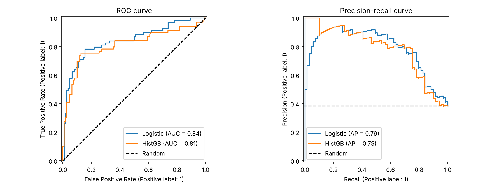
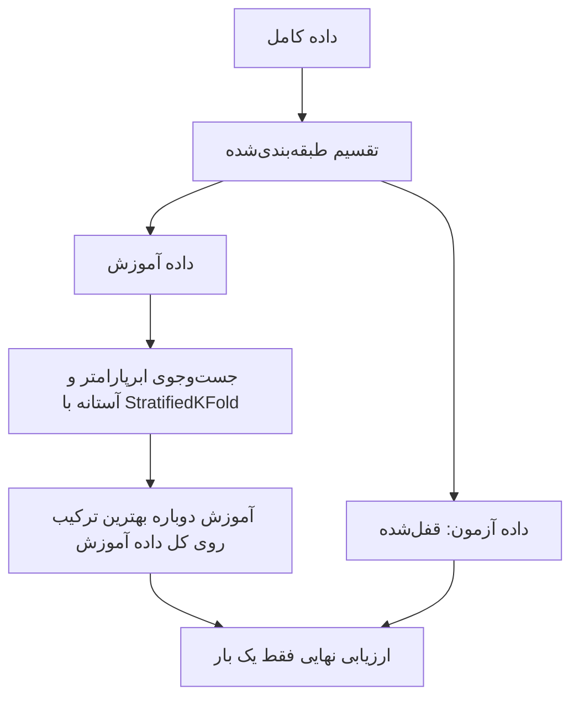

# جلسه ۲۵ — ارزیابی مدل‌های طبقه‌بندی

## چرا «دقت ۹۵ درصد» کافی نیست؟

در جلسات ۲۰ تا ۲۴ مدل‌ها را بیشتر با یک عدد، یعنی **درصد پیش‌بینی درست**، مقایسه کردیم. فرض کنید در یک شرکت مخابراتی فقط ۵ درصد مشتریان قراردادشان را لغو می‌کنند (ریزش یا Churn). مدلی که **همیشه** بگوید «این مشتری نمی‌رود» ۹۵ درصد درست است، اما حتی یک مشتری در حال ریزش را پیدا نمی‌کند.

معیار ارزیابی باید از **هدف کسب‌وکار** بیاید، نه از عادت؛ در مرحله «درک کسب‌وکار» ← [فرایند CRISP-DM و محیط کار](../Part%200_Introduction/2%20-%20%D9%81%D8%B1%D8%A7%DB%8C%D9%86%D8%AF%20CRISP-DM%20%D9%88%20%D9%85%D8%AD%DB%8C%D8%B7%20%DA%A9%D8%A7%D8%B1.md) باید روشن شود کدام خطا گران‌تر است. این جلسه به سه پرسش پاسخ می‌دهد:

- مدل **چه نوع** خطاهایی می‌کند و آن‌ها را با چه معیارهایی بسنجیم؟
- اگر مدل احتمال بدهد، **آستانه** تصمیم را کجا بگذاریم؟
- با **داده نامتوازن** و **تنظیم ابرپارامترها** چگونه بدون نشت داده کار کنیم؟

---

## ماتریس درهم‌ریختگی

در طبقه‌بندی دودویی یک کلاس را **مثبت** می‌نامیم؛ معمولاً کلاس کمیاب‌تر یا کلاسی که به دنبال آن هستیم (بیمار، تقلب، ریزش، زنده ماندن). هر پیش‌بینی در یکی از چهار خانه می‌افتد:

| کلاس واقعی | پیش‌بینی منفی | پیش‌بینی مثبت |
|:---:|:---:|:---:|
| واقعاً منفی | منفی درست (TN) | مثبت کاذب (FP)؛ خطای نوع اول، «هشدار اشتباه» |
| واقعاً مثبت | منفی کاذب (FN)؛ خطای نوع دوم، «از دست دادن مورد» | مثبت درست (TP) |

کلمه دوم (مثبت یا منفی) **پیش‌بینی مدل** است و کلمه اول (درست یا کاذب) می‌گوید آیا این پیش‌بینی درست بوده است. تابع `confusion_matrix` سطرها را کلاس **واقعی** و ستون‌ها را کلاس **پیش‌بینی‌شده** قرار می‌دهد و `ravel` چهار عدد را به ترتیب TN، FP، FN و TP برمی‌گرداند. در مسئله K کلاسه ماتریس K در K است و خانه‌های بیرون قطر نشان می‌دهند کدام کلاس‌ها با هم اشتباه گرفته می‌شوند.

## معیارهای ارزیابی

$$
\text{Accuracy} = \frac{TP + TN}{TP + TN + FP + FN}, \qquad \text{Precision} = \frac{TP}{TP + FP}, \qquad \text{Recall} = \frac{TP}{TP + FN}
$$

$$
\text{Specificity} = \frac{TN}{TN + FP}, \qquad \text{FPR} = 1 - \text{Specificity}, \qquad F_1 = \frac{2\,TP}{2\,TP + FP + FN}
$$

| معیار | پرسشی که پاسخ می‌دهد | چه وقت مهم‌تر است |
|:---:|:---:|:---:|
| صحت (Accuracy) | چند درصد پیش‌بینی‌ها درست است؟ | کلاس‌های متوازن و هزینه خطای یکسان |
| دقت (Precision) | هشدارهای مدل چقدر قابل اعتمادند؟ | مثبت کاذب گران است (فیلتر هرزنامه) |
| بازخوانی (Recall) | چند درصد موارد مثبت پیدا شدند؟ | منفی کاذب گران است (غربالگری سرطان، تقلب) |
| ویژگی‌مندی (Specificity) | چند درصد منفی‌ها درست رد شدند؟ | هشدار اشتباه برای افراد سالم هزینه دارد |
| امتیاز F1 | توازن دقت و بازخوانی | داده نامتوازن؛ هر دو خطا مهم‌اند |

امتیاز F1 **میانگین هارمونیک** دقت و بازخوانی است و به مقدار کوچک‌تر نزدیک است: با دقت ۱ و بازخوانی ۰.۰۱، F1 حدود ۰.۰۲ است. معیارهای تکمیلی:

$$
F_\beta = (1 + \beta^2) \cdot \frac{\text{Precision} \cdot \text{Recall}}{\beta^2 \cdot \text{Precision} + \text{Recall}}, \qquad \text{Balanced Accuracy} = \frac{\text{Recall} + \text{Specificity}}{2}
$$

$$
\text{MCC} = \frac{TP \cdot TN - FP \cdot FN}{\sqrt{(TP+FP)(TP+FN)(TN+FP)(TN+FN)}}
$$

بتای بزرگ‌تر از یک بازخوانی را مهم‌تر می‌کند؛ مدل همیشه-اکثریت در صحت متوازن دقیقاً ۰.۵ می‌گیرد؛ MCC بین منفی یک و یک است و صفر یعنی در حد شانس.

### مثال حل‌شده: غربالگری یک بیماری

آزمون غربالگری روی ۱۰۰۰ نفر که ۵۰ نفرشان بیمارند:

| کلاس واقعی | پیش‌بینی سالم | پیش‌بینی بیمار | جمع |
|:---:|:---:|:---:|:---:|
| سالم | 890 | 60 | 950 |
| بیمار | 10 | 40 | 50 |
| جمع | 900 | 100 | 1000 |

#### گام ۱ — چهار خانه

مثبت درست ۴۰، منفی کاذب ۱۰، مثبت کاذب ۶۰ و منفی درست ۸۹۰.

#### گام ۲ — معیارهای اصلی

$$
\begin{aligned}
\text{Accuracy} &= \frac{40 + 890}{1000} = 0.93, \qquad \text{Precision} = \frac{40}{40 + 60} = 0.40, \qquad \text{Recall} = \frac{40}{40 + 10} = 0.80 \\
\text{Specificity} &= \frac{890}{890 + 60} \approx 0.937, \qquad F_1 = \frac{2 \times 40}{2 \times 40 + 60 + 10} = \frac{80}{150} \approx 0.533
\end{aligned}
$$

#### گام ۳ — معیارهای تکمیلی

$$
\begin{aligned}
F_2 &= \frac{5 \times 0.4 \times 0.8}{4 \times 0.4 + 0.8} = \frac{1.6}{2.4} \approx 0.667, \qquad F_{0.5} = \frac{1.25 \times 0.4 \times 0.8}{0.25 \times 0.4 + 0.8} = \frac{0.4}{0.9} \approx 0.444 \\
\text{Balanced Accuracy} &= \frac{0.8 + 0.937}{2} \approx 0.868, \qquad \text{MCC} = \frac{40 \times 890 - 60 \times 10}{\sqrt{100 \times 50 \times 950 \times 900}} \approx 0.535
\end{aligned}
$$

> [!note] بررسی
> جمع چهار خانه ۱۰۰۰ است. آزمون ۸۰ درصد بیماران را پیدا می‌کند، اما از هر ۱۰ نفر «بیمار» اعلام‌شده فقط ۴ نفر بیمارند. صحت ۹۳ درصد چشمگیر به نظر می‌رسد، اما آزمونی که **همه** را سالم بداند صحت ۹۵ درصد دارد! چون بازخوانی از دقت بیشتر است، F2 از F1 بیشتر و F0.5 از آن کمتر است.

```python
import numpy as np
from sklearn.metrics import (confusion_matrix, accuracy_score, precision_score, recall_score, f1_score,
                             fbeta_score, balanced_accuracy_score, matthews_corrcoef)

# 1. Screening of 1000 people: rebuild labels from the four cells (TN=890, FP=60, FN=10, TP=40)
y_true = np.repeat([0, 0, 1, 1], [890, 60, 10, 40])
y_pred = np.repeat([0, 1, 0, 1], [890, 60, 10, 40])
tn, fp, fn, tp = confusion_matrix(y_true, y_pred).ravel()
print(f"TN={tn}  FP={fp}  FN={fn}  TP={tp}")

# 2. All metrics of the worked example
print(f"accuracy={accuracy_score(y_true, y_pred):.3f}  precision={precision_score(y_true, y_pred):.3f}  "
      f"recall={recall_score(y_true, y_pred):.3f}  specificity={recall_score(y_true, y_pred, pos_label=0):.3f}")
print(f"F1={f1_score(y_true, y_pred):.3f}  F2={fbeta_score(y_true, y_pred, beta=2):.3f}  "
      f"F0.5={fbeta_score(y_true, y_pred, beta=0.5):.3f}")
print(f"balanced accuracy={balanced_accuracy_score(y_true, y_pred):.3f}  MCC={matthews_corrcoef(y_true, y_pred):.3f}")
```

```
TN=890  FP=60  FN=10  TP=40
accuracy=0.930  precision=0.400  recall=0.800  specificity=0.937
F1=0.533  F2=0.667  F0.5=0.444
balanced accuracy=0.868  MCC=0.535
```

در مسائل چندکلاسه معیارها برای هر کلاس (آن کلاس در برابر بقیه) حساب و سپس میانگین گرفته می‌شوند: **ماکرو** (میانگین ساده؛ کلاس‌های کوچک دیده می‌شوند)، **وزنی** (با تعداد نمونه هر کلاس) و **میکرو** (در طبقه‌بندی تک‌برچسبی برابر صحت). تابع `classification_report` همه را یک‌جا چاپ می‌کند.

### روی تایتانیک

رگرسیون لجستیک جلسه ۲۱ با تنظیمات استاندارد:

```python
import matplotlib.pyplot as plt
import seaborn as sns
from sklearn.model_selection import train_test_split
from sklearn.compose import ColumnTransformer
from sklearn.pipeline import make_pipeline
from sklearn.impute import SimpleImputer
from sklearn.preprocessing import StandardScaler, OneHotEncoder
from sklearn.linear_model import LogisticRegression
from sklearn.ensemble import HistGradientBoostingClassifier
from sklearn.metrics import confusion_matrix, classification_report, RocCurveDisplay, PrecisionRecallDisplay

# 1. Titanic with the standard split and preprocessing of session 20
titanic = sns.load_dataset("titanic")
num = ["age", "fare", "sibsp", "parch", "pclass"]
cat = ["sex", "embarked"]
X_train, X_test, y_train, y_test = train_test_split(titanic[num + cat], titanic["survived"],
                                                    test_size=0.2, stratify=titanic["survived"],
                                                    random_state=42)
preprocess = ColumnTransformer([
    ("num", make_pipeline(SimpleImputer(strategy="median"), StandardScaler()), num),
    ("cat", make_pipeline(SimpleImputer(strategy="most_frequent"),
                          OneHotEncoder(handle_unknown="ignore")), cat)])
models = {"Logistic": make_pipeline(preprocess, LogisticRegression()).fit(X_train, y_train),
          "HistGB": make_pipeline(preprocess, HistGradientBoostingClassifier(random_state=42)).fit(X_train, y_train)}

# 2. Confusion matrix and per-class report of logistic regression (threshold 0.5)
y_pred = models["Logistic"].predict(X_test)
print(confusion_matrix(y_test, y_pred))
print(classification_report(y_test, y_pred, target_names=["died", "survived"], digits=3))

# 3. ROC and precision-recall curves of both models on the test set
fig, axes = plt.subplots(1, 2, figsize=(12, 4.5))
for name, model in models.items():
    RocCurveDisplay.from_estimator(model, X_test, y_test, name=name, ax=axes[0])
    PrecisionRecallDisplay.from_estimator(model, X_test, y_test, name=name, ax=axes[1])
axes[0].plot([0, 1], [0, 1], "k--", label="Random")
axes[1].axhline(y_test.mean(), color="k", linestyle="--", label="Random")
axes[0].set_title("ROC curve")
axes[1].set_title("Precision-recall curve")
for ax in axes:
    ax.legend()
plt.show()
```

```
[[98 12]
 [23 46]]
              precision    recall  f1-score   support

        died      0.810     0.891     0.848       110
    survived      0.793     0.667     0.724        69

    accuracy                          0.804       179
   macro avg      0.802     0.779     0.786       179
weighted avg      0.803     0.804     0.801       179
```

ماتریس درهم‌ریختگی: ۹۸ جان‌باخته و ۴۶ زنده‌مانده درست پیش‌بینی شده‌اند؛ ۲۳ زنده‌مانده جان‌باخته پیش‌بینی شده‌اند (منفی کاذب) و ۱۲ جان‌باخته زنده (مثبت کاذب). بازخوانی کلاس «زنده» فقط ۰.۶۶۷ است: مدل یک‌سوم زنده‌ماندگان را از دست می‌دهد، در حالی که صحت کل ۰.۸۰۴ است.

---

## منحنی ROC و منحنی Precision-Recall

بیشتر طبقه‌بندها یک **امتیاز** یا احتمال می‌دهند (`predict_proba` یا `decision_function`) و برچسب با مقایسه آن با یک **آستانه** به دست می‌آید (پیش‌فرض ۰.۵). منحنی‌های ROC و PR رفتار مدل را در **همه آستانه‌ها** یک‌جا نشان می‌دهند.

**منحنی ROC** نرخ مثبت درست (بازخوانی) را در برابر نرخ مثبت کاذب رسم می‌کند؛ طبقه‌بند کامل از گوشه (0، 1) می‌گذرد و طبقه‌بند تصادفی روی قطر است. **سطح زیر منحنی** (AUC) تفسیر احتمالاتی دارد:

$$
\text{AUC} = P\big(\text{score}(x^{+}) > \text{score}(x^{-})\big)
$$

یعنی احتمال اینکه یک مثبت تصادفی امتیاز بیشتری از یک منفی تصادفی بگیرد. **منحنی PR** دقت را در برابر بازخوانی رسم می‌کند و خلاصه آن **میانگین دقت** است (P و R دقت و بازخوانی در آستانه n ام):

$$
\text{AP} = \sum_{n} (R_n - R_{n-1}) \, P_n
$$

### مثال حل‌شده: ROC و AUC با دست

ده نمونه (پنج مثبت و پنج منفی) به ترتیب نزولی امتیاز:

| نمونه | امتیاز مدل | کلاس واقعی | نرخ مثبت کاذب | نرخ مثبت درست |
|:---:|:---:|:---:|:---:|:---:|
| ۱ | 0.95 | 1 | 0 | 0.2 |
| ۲ | 0.85 | 1 | 0 | 0.4 |
| ۳ | 0.80 | 0 | 0.2 | 0.4 |
| ۴ | 0.70 | 1 | 0.2 | 0.6 |
| ۵ | 0.55 | 1 | 0.2 | 0.8 |
| ۶ | 0.45 | 0 | 0.4 | 0.8 |
| ۷ | 0.40 | 1 | 0.4 | 1.0 |
| ۸ | 0.30 | 0 | 0.6 | 1.0 |
| ۹ | 0.20 | 0 | 0.8 | 1.0 |
| ۱۰ | 0.10 | 0 | 1.0 | 1.0 |

دو ستون آخر، نرخ‌ها وقتی آستانه برابر امتیاز همان سطر است؛ هر مثبت نقطه را ۰.۲ بالا و هر منفی ۰.۲ به راست می‌برد.

#### گام ۱ — مساحت زیر منحنی پله‌ای

$$
\text{AUC} = 0.2 \times 0.4 + 0.2 \times 0.8 + 0.6 \times 1 = 0.08 + 0.16 + 0.60 = 0.84
$$

#### گام ۲ — شمارش جفت‌ها

از ۲۵ جفت (مثبت، منفی): دو مثبت اول از هر ۵ منفی بالاترند (۱۰ جفت)، دو مثبت بعدی از ۴ منفی (۸ جفت) و مثبت آخر از ۳ منفی (۳ جفت):

$$
\text{AUC} = \frac{10 + 8 + 3}{25} = \frac{21}{25} = 0.84
$$

> [!note] بررسی
> هر دو روش ۰.۸۴ می‌دهند. تابع `roc_curve` فقط نقاط گوشه منحنی را برمی‌گرداند:

```python
from sklearn.metrics import roc_curve, roc_auc_score, average_precision_score

# Ten samples: model scores and true classes
scores = [0.95, 0.85, 0.80, 0.70, 0.55, 0.45, 0.40, 0.30, 0.20, 0.10]
y_true = [1, 1, 0, 1, 1, 0, 1, 0, 0, 0]
fpr, tpr, thresholds = roc_curve(y_true, scores)
print(f"FPR={fpr.round(1)}")
print(f"TPR={tpr.round(1)}")
print(f"AUC={roc_auc_score(y_true, scores):.3f}  AP={average_precision_score(y_true, scores):.3f}")
```

```
FPR=[0.  0.  0.  0.2 0.2 0.4 0.4 1. ]
TPR=[0.  0.2 0.4 0.4 0.8 0.8 1.  1. ]
AUC=0.840  AP=0.853
```

| ویژگی | منحنی ROC | منحنی Precision-Recall |
|:---:|:---:|:---:|
| خط پایه مدل تصادفی | قطر، سطح ۰.۵ | خط افقی برابر نسبت کلاس مثبت |
| حساسیت به نسبت کلاس‌ها | تقریباً مستقل | به‌شدت وابسته |
| مناسب برای | کلاس‌های تقریباً متوازن | داده نامتوازن، وقتی کلاس مثبت مهم است |



روی تایتانیک (نمودار بالا، خروجی کد قبل)، AUC لجستیک ۰.۸۴ و HistGradientBoosting ۰.۸۱ است و میانگین دقت هر دو ۰.۷۹؛ هر دو بسیار بالاتر از خط پایه تصادفی (۰.۳۸۵، نسبت زنده‌ماندگان).

> [!warning] منحنی ROC در داده بسیار نامتوازن خوش‌بین است
> با ۹۹۰۰ منفی و ۱۰۰ مثبت، حتی ۵۰۰ مثبت کاذب فقط نرخ مثبت کاذب حدود ۰.۰۵ می‌دهد و ROC عالی به نظر می‌رسد؛ اما دقت در آن نقطه حداکثر ۱۰۰ از ۶۰۰ است. منحنی PR این مشکل را آشکار می‌کند.

---

## انتخاب آستانه تصمیم

آستانه ۰.۵ فقط وقتی بهینه است که احتمال‌ها **کالیبره** و هزینه دو خطا **برابر** باشد. پایین آوردن آستانه بازخوانی را زیاد و دقت را معمولاً کم می‌کند.

| روش | ایده | مناسب برای |
|:---:|:---:|:---:|
| بیشینه‌سازی F1 یا F-بتا | آستانه‌ای که امتیاز F را روی داده اعتبارسنجی بیشینه کند | هزینه‌ها دقیقاً معلوم نیست |
| قید روی یک معیار | مثلاً «بازخوانی دست‌کم ۹۵ درصد»، سپس بیشترین دقت | الزامات قانونی یا ایمنی |
| کمینه‌سازی هزینه | هزینه برای FP و FN و کمینه کردن هزینه کل | هزینه‌ها معلوم‌اند |

با هزینه c برای هر نوع خطا، هزینه کل در آستانه t و آستانه بهینه نظری (برای احتمال‌های کالیبره) چنین است:

$$
\text{Cost}(t) = c_{FP} \cdot FP(t) + c_{FN} \cdot FN(t), \qquad t^{*} = \frac{c_{FP}}{c_{FP} + c_{FN}}
$$

> [!example] مثال — آستانه هزینه‌محور
> اگر از دست دادن یک بیمار (FN) ۱۰ برابر یک آزمایش اضافی (FP) هزینه داشته باشد:
> $$
> t^{*} = \frac{1}{1 + 10} \approx 0.09
> $$
> نمونه‌ای با احتمال بیماری فقط ۱۰ درصد هم مثبت اعلام می‌شود، چون از دست دادن آن بسیار گران است.

آستانه هم یک **ابرپارامتر** است؛ انتخاب آن با داده آزمون نشت داده است ← [رگرسیون چندجمله‌ای، بیش‌برازش و اعتبارسنجی متقابل](../Part%204_Regression/18%20-%20%D8%B1%DA%AF%D8%B1%D8%B3%DB%8C%D9%88%D9%86%20%DA%86%D9%86%D8%AF%D8%AC%D9%85%D9%84%D9%87%E2%80%8C%D8%A7%DB%8C%D8%8C%20%D8%A8%DB%8C%D8%B4%E2%80%8C%D8%A8%D8%B1%D8%A7%D8%B2%D8%B4%20%D9%88%20%D8%A7%D8%B9%D8%AA%D8%A8%D8%A7%D8%B1%D8%B3%D9%86%D8%AC%DB%8C%20%D9%85%D8%AA%D9%82%D8%A7%D8%A8%D9%84.md). از **پیش‌بینی‌های خارج از بخش** داده آموزش (`cross_val_predict`) یا کلاس `TunedThresholdClassifierCV` استفاده می‌کنیم:

```python
import numpy as np
import pandas as pd
import seaborn as sns
from sklearn.model_selection import train_test_split, StratifiedKFold, cross_val_predict, TunedThresholdClassifierCV
from sklearn.compose import ColumnTransformer
from sklearn.pipeline import make_pipeline
from sklearn.impute import SimpleImputer
from sklearn.preprocessing import StandardScaler, OneHotEncoder
from sklearn.linear_model import LogisticRegression
from sklearn.metrics import precision_score, recall_score, f1_score

# 1. Same data, split and model
titanic = sns.load_dataset("titanic")
num = ["age", "fare", "sibsp", "parch", "pclass"]
cat = ["sex", "embarked"]
X_train, X_test, y_train, y_test = train_test_split(titanic[num + cat], titanic["survived"],
                                                    test_size=0.2, stratify=titanic["survived"],
                                                    random_state=42)
preprocess = ColumnTransformer([
    ("num", make_pipeline(SimpleImputer(strategy="median"), StandardScaler()), num),
    ("cat", make_pipeline(SimpleImputer(strategy="most_frequent"),
                          OneHotEncoder(handle_unknown="ignore")), cat)])
model = make_pipeline(preprocess, LogisticRegression())
cv = StratifiedKFold(n_splits=5, shuffle=True, random_state=42)

# 2. Out-of-fold probabilities on the TRAINING data, and metrics at several thresholds
p_oof = cross_val_predict(model, X_train, y_train, cv=cv, method="predict_proba")[:, 1]
rows = [{"threshold": t, "precision": precision_score(y_train, p_oof >= t),
         "recall": recall_score(y_train, p_oof >= t), "F1": f1_score(y_train, p_oof >= t)}
        for t in [0.3, 0.4, 0.5, 0.6, 0.7]]
print(pd.DataFrame(rows).set_index("threshold").round(3))

# 3. Let scikit-learn pick the F1-maximizing threshold with internal CV, then test once
tuned = TunedThresholdClassifierCV(model, scoring="f1", cv=cv).fit(X_train, y_train)
for name, m in [("threshold 0.5", model.fit(X_train, y_train)), ("tuned", tuned)]:
    y_hat = m.predict(X_test)
    print(f"{name:13s} precision={precision_score(y_test, y_hat):.3f}  recall={recall_score(y_test, y_hat):.3f}  "
          f"F1={f1_score(y_test, y_hat):.3f}")
print(f"chosen threshold={tuned.best_threshold_:.3f}")
```

```
           precision  recall     F1
threshold                          
0.3            0.665   0.821  0.734
0.4            0.701   0.755  0.727
0.5            0.750   0.703  0.726
0.6            0.819   0.648  0.724
0.7            0.881   0.513  0.648
threshold 0.5 precision=0.793  recall=0.667  F1=0.724
tuned         precision=0.647  recall=0.797  F1=0.714
chosen threshold=0.276
```

- روی پیش‌بینی‌های خارج از بخش، با پایین آمدن آستانه از ۰.۷ به ۰.۳ بازخوانی از ۰.۵۱ به ۰.۸۲ می‌رسد و دقت از ۰.۸۸ به ۰.۶۷ کم می‌شود.
- امتیاز F1 در بازه ۰.۳ تا ۰.۶ تقریباً **ثابت** است (۰.۷۲ تا ۰.۷۳)؛ پس بیشینه‌سازی F1 فقط بازخوانی را به قیمت دقت جابه‌جا می‌کند. آستانه منتخب (۰.۲۷۶) روی آزمون بازخوانی را از ۰.۶۶۷ به ۰.۷۹۷ رساند اما F1 تقریباً همان ماند.
- انتخاب آستانه وقتی واقعاً ارزش دارد که **هزینه‌ها نامتقارن** باشند؛ مانند ریزش مشتری در کارگاه این جلسه.

---

## داده نامتوازن

مشکلات داده نامتوازن (تقلب، ریزش، بیماری نادر): صحت گمراه‌کننده است؛ الگوریتم‌ها خطای کل را کمینه می‌کنند و نادیده گرفتن کلاس کمیاب «ارزان» است؛ و تعداد کم مثبت‌ها برآورد معیارها را پرنوسان می‌کند.

| راهبرد | سطح | ایده | عیب |
|:---:|:---:|:---:|:---:|
| کم‌نمونه‌گیری (Undersampling) | داده | حذف تصادفی نمونه‌های اکثریت | دور ریختن اطلاعات |
| بیش‌نمونه‌گیری (Oversampling) | داده | تکرار تصادفی نمونه‌های اقلیت | خطر بیش‌برازش روی تکراری‌ها |
| روش SMOTE | داده | ساخت نمونه مصنوعی میان همسایه‌های اقلیت | نمونه در نواحی هم‌پوشان؛ فقط ویژگی عددی |
| وزن‌دهی کلاس‌ها | الگوریتم | جریمه بیشتر برای خطای کلاس اقلیت | همه الگوریتم‌ها پشتیبانی نمی‌کنند |
| تنظیم آستانه | تصمیم | پایین آوردن آستانه کلاس اقلیت | نیاز به احتمال‌های معنادار |

با `class_weight="balanced"` وزن هر کلاس با فراوانی آن نسبت عکس دارد (n تعداد کل، K تعداد کلاس و n-k تعداد نمونه کلاس k):

$$
w_k = \frac{n}{K \cdot n_k}
$$

روش **SMOTE** برای هر نمونه اقلیت یکی از k همسایه هم‌کلاس آن را تصادفی برمی‌گزیند و نقطه‌ای روی پاره‌خط میان آن‌ها می‌سازد (λ عدد تصادفی بین صفر و یک):

$$
x_{\text{new}} = x_i + \lambda \, (x_{nn} - x_i)
$$

> [!example] مثال — وزن‌ها و یک نمونه SMOTE
> داده آموزش ریزش (پایین) ۵۶۳۴ مشتری دارد که ۱۴۹۵ نفر ریزش کرده‌اند:
> $$
> w_0 = \frac{5634}{2 \times 4139} \approx 0.681, \qquad w_1 = \frac{5634}{2 \times 1495} \approx 1.884
> $$
> خطای هر مشتری ریزشی حدود ۲.۸ برابر خطای یک مشتری ماندگار جریمه می‌شود. برای SMOTE، اگر نمونه اقلیت (۲، ۳)، همسایه هم‌کلاس آن (۴، ۷) و λ برابر ۰.۲۵ باشد:
> $$
> x_{\text{new}} = (2, 3) + 0.25 \times (2, 4) = (2.5, 4)
> $$

### روی داده واقعی: ریزش مشتری مخابرات

داده Telco Customer Churn شرکت IBM شامل ۷۰۴۳ مشتری با ۱۹ ویژگی (مدت اشتراک، نوع قرارداد، هزینه ماهانه، خدمات اینترنت و …) است و ۲۶.۵ درصد مشتریان ریزش کرده‌اند. تبدیل ستون TotalCharges به عدد (خانه‌های خالی به گمشده) گامی **قاعده‌محور** است.

```python
import pandas as pd
from sklearn.model_selection import train_test_split
from sklearn.compose import ColumnTransformer
from sklearn.pipeline import make_pipeline
from sklearn.impute import SimpleImputer
from sklearn.preprocessing import StandardScaler, OneHotEncoder
from sklearn.linear_model import LogisticRegression
from sklearn.ensemble import RandomForestClassifier
from sklearn.dummy import DummyClassifier
from sklearn.metrics import (accuracy_score, precision_score, recall_score, f1_score,
                             roc_auc_score, average_precision_score)

# 1. Telco customer churn (7043 customers); rule-based cleaning: blank TotalCharges -> NaN
path = "../data/Telco-Customer-Churn.csv"
telco = pd.read_csv(path)
telco["TotalCharges"] = pd.to_numeric(telco["TotalCharges"], errors="coerce")
y = (telco["Churn"] == "Yes").astype(int)
X = telco.drop(columns=["customerID", "Churn"])
num = ["tenure", "MonthlyCharges", "TotalCharges", "SeniorCitizen"]
cat = [c for c in X.columns if c not in num]
X_train, X_test, y_train, y_test = train_test_split(X, y, test_size=0.2, stratify=y, random_state=42)
print(f"train={len(X_train)}  churners={y_train.sum()}  churn rate={y_train.mean():.3f}")

# 2. Models with and without balanced class weights
preprocess = ColumnTransformer([
    ("num", make_pipeline(SimpleImputer(strategy="median"), StandardScaler()), num),
    ("cat", OneHotEncoder(handle_unknown="ignore"), cat)])
models = {"Majority class": DummyClassifier(),
          "Logistic": LogisticRegression(max_iter=2000),
          "Logistic, balanced": LogisticRegression(max_iter=2000, class_weight="balanced"),
          "Random forest": RandomForestClassifier(300, min_samples_leaf=5, random_state=42, n_jobs=-1),
          "Random forest, balanced": RandomForestClassifier(300, min_samples_leaf=5, class_weight="balanced",
                                                            random_state=42, n_jobs=-1)}

# 3. Test-set metrics (the test set keeps the real class ratio)
rows = []
for name, clf in models.items():
    model = make_pipeline(preprocess, clf).fit(X_train, y_train)
    y_hat, p = model.predict(X_test), model.predict_proba(X_test)[:, 1]
    rows.append({"model": name, "accuracy": accuracy_score(y_test, y_hat),
                 "precision": precision_score(y_test, y_hat, zero_division=0),
                 "recall": recall_score(y_test, y_hat), "F1": f1_score(y_test, y_hat),
                 "ROC_AUC": roc_auc_score(y_test, p), "AP": average_precision_score(y_test, p)})
print(pd.DataFrame(rows).set_index("model").round(3))
```

```
train=5634  churners=1495  churn rate=0.265
                         accuracy  precision  recall     F1  ROC_AUC     AP
model                                                                      
Majority class              0.735      0.000   0.000  0.000    0.500  0.265
Logistic                    0.806      0.657   0.559  0.604    0.842  0.633
Logistic, balanced          0.738      0.504   0.783  0.614    0.841  0.633
Random forest               0.802      0.670   0.500  0.573    0.841  0.648
Random forest, balanced     0.761      0.534   0.775  0.632    0.841  0.649
```

- مدل همیشه-اکثریت صحت ۰.۷۳۵ و بازخوانی صفر دارد.
- **وزن‌دهی** بازخوانی لجستیک را از ۰.۵۵۹ به ۰.۷۸۳ و جنگل را از ۰.۵۰۰ به ۰.۷۷۵ رساند، به قیمت کاهش دقت و صحت. F1 هر دو کمی بهتر شد.
- سطح زیر ROC و میانگین دقت (کیفیت **رتبه‌بندی**) با وزن‌دهی تقریباً تغییر نکرد: وزن‌دهی عمدتاً آستانه مؤثر را جابه‌جا می‌کند.

> [!warning] نمونه‌سازی فقط داخل حلقه اعتبارسنجی
> اگر داده را **پیش از** تقسیم به بخش‌ها بیش‌نمونه‌گیری کنید، نسخه‌های تکراری یک نمونه هم در آموزش و هم در اعتبارسنجی قرار می‌گیرند و مدل آن‌ها را «به خاطر می‌سپارد». بخش اعتبارسنجی و داده آزمون باید همیشه **توزیع واقعی** را داشته باشند ← [طراحی آزمایش و Pipeline](../Part%203_Data%20Preprocessing/%DB%B1%DB%B5%20-%20%D8%B7%D8%B1%D8%A7%D8%AD%DB%8C%20%D8%A2%D8%B2%D9%85%D8%A7%DB%8C%D8%B4%20%D9%88%20Pipeline.md). پیاده‌سازی استاندارد SMOTE با Pipeline ویژه‌ای که نمونه‌سازی را فقط روی بخش آموزش انجام می‌دهد، در کتابخانه `imbalanced-learn` است (نیاز به نصب).

کد زیر هم اعتبارسنجی **طبقه‌بندی‌شده** را نشان می‌دهد و هم اثر نمونه‌سازی پیش از اعتبارسنجی را:

```python
import pandas as pd
from sklearn.model_selection import train_test_split, KFold, StratifiedKFold, cross_val_score
from sklearn.compose import ColumnTransformer
from sklearn.pipeline import make_pipeline
from sklearn.impute import SimpleImputer
from sklearn.preprocessing import StandardScaler, OneHotEncoder
from sklearn.ensemble import RandomForestClassifier
from sklearn.utils import resample

# 1. Same Telco data and split
path = "../data/Telco-Customer-Churn.csv"
telco = pd.read_csv(path)
telco["TotalCharges"] = pd.to_numeric(telco["TotalCharges"], errors="coerce")
y = (telco["Churn"] == "Yes").astype(int)
X = telco.drop(columns=["customerID", "Churn"])
num = ["tenure", "MonthlyCharges", "TotalCharges", "SeniorCitizen"]
cat = [c for c in X.columns if c not in num]
X_train, X_test, y_train, y_test = train_test_split(X, y, test_size=0.2, stratify=y, random_state=42)

# 2. Churners per fold: plain KFold vs StratifiedKFold
for name, splitter in [("KFold", KFold(5, shuffle=True, random_state=1)),
                       ("StratifiedKFold", StratifiedKFold(5, shuffle=True, random_state=1))]:
    print(f"{name:16s} churners per fold={[int(y_train.iloc[v].sum()) for _, v in splitter.split(X_train, y_train)]}")

# 3. WRONG: oversample the churners BEFORE cross-validation (copies leak into validation folds)
train = X_train.assign(churn=y_train)
minority = train[train["churn"] == 1]
extra = resample(minority, n_samples=(train["churn"] == 0).sum() - len(minority), random_state=42)
over = pd.concat([train, extra])
preprocess = ColumnTransformer([
    ("num", make_pipeline(SimpleImputer(strategy="median"), StandardScaler()), num),
    ("cat", OneHotEncoder(handle_unknown="ignore"), cat)])
forest = make_pipeline(preprocess, RandomForestClassifier(300, random_state=42, n_jobs=-1))
cv = StratifiedKFold(n_splits=5, shuffle=True, random_state=42)
wrong = cross_val_score(forest, over.drop(columns="churn"), over["churn"], cv=cv, scoring="recall").mean()

# 4. RIGHT: original data in CV, imbalance handled inside the model with class weights
forest_w = make_pipeline(preprocess, RandomForestClassifier(300, min_samples_leaf=5, class_weight="balanced",
                                                            random_state=42, n_jobs=-1))
right = cross_val_score(forest_w, X_train, y_train, cv=cv, scoring="recall").mean()
print(f"CV recall: oversampled before CV={wrong:.3f}  class weights, honest CV={right:.3f}")
```

```
KFold            churners per fold=[282, 307, 293, 294, 319]
StratifiedKFold  churners per fold=[299, 299, 299, 299, 299]
CV recall: oversampled before CV=0.948  class weights, honest CV=0.767
```

- با `KFold` معمولی، تعداد مشتریان ریزشی در بخش‌ها از ۲۸۲ تا ۳۱۹ نوسان دارد؛ با `StratifiedKFold` همه ۲۹۹ است.
- بازخوانی جنگل تصادفی با بیش‌نمونه‌گیری **پیش از** اعتبارسنجی ۰.۹۴۸ است، اما برآورد صادقانه با وزن‌دهی ۰.۷۶۷: عدد اول فقط نشان می‌دهد درخت‌های عمیق نسخه‌های تکراری را حفظ کرده‌اند.

> [!tip] ترتیب پیشنهادی برای داده نامتوازن
> 1. معیار درست (F1، میانگین دقت یا هزینه) و مدل پایه همیشه-اکثریت.
> 2. تقسیم و اعتبارسنجی **طبقه‌بندی‌شده**.
> 3. مدل‌های قوی با وزن‌دهی کلاس.
> 4. تنظیم آستانه روی داده اعتبارسنجی.
> 5. فقط در صورت نیاز، نمونه‌سازی داخل Pipeline.

---

## تنظیم ابرپارامترها

| ویژگی | جست‌وجوی شبکه‌ای (Grid Search) | جست‌وجوی تصادفی (Random Search) |
|:---:|:---:|:---:|
| روش | همه ترکیب‌های مقادیر داده‌شده | نمونه‌گیری n ترکیب از توزیع‌ها |
| هزینه | حاصل‌ضرب تعداد مقادیر ضرب در تعداد بخش | تعداد تکرار ضرب در تعداد بخش |
| ابرپارامتر پیوسته | فقط چند مقدار گسسته | نمونه از توزیع پیوسته |
| مناسب برای | ۲ یا ۳ ابرپارامتر با مقادیر محدود | فضای جست‌وجوی بزرگ |

معمولاً فقط چند ابرپارامتر مهم‌اند. با ۹ ترکیب در فضای دوبعدی، شبکه برای هر ابرپارامتر فقط ۳ مقدار متمایز می‌آزماید اما جست‌وجوی تصادفی ۹ مقدار. روی تایتانیک، با بودجه یکسان (۱۸ ترکیب، ۹۰ بار آموزش):

```python
import seaborn as sns
from scipy.stats import randint
from sklearn.model_selection import train_test_split, StratifiedKFold, GridSearchCV, RandomizedSearchCV
from sklearn.compose import ColumnTransformer
from sklearn.pipeline import make_pipeline
from sklearn.impute import SimpleImputer
from sklearn.preprocessing import OneHotEncoder
from sklearn.ensemble import RandomForestClassifier

# 1. Titanic with the standard split; forest needs no scaling
titanic = sns.load_dataset("titanic")
num = ["age", "fare", "sibsp", "parch", "pclass"]
cat = ["sex", "embarked"]
X_train, X_test, y_train, y_test = train_test_split(titanic[num + cat], titanic["survived"],
                                                    test_size=0.2, stratify=titanic["survived"],
                                                    random_state=42)
preprocess = ColumnTransformer([
    ("num", SimpleImputer(strategy="median"), num),
    ("cat", make_pipeline(SimpleImputer(strategy="most_frequent"),
                          OneHotEncoder(handle_unknown="ignore")), cat)])
model = make_pipeline(preprocess, RandomForestClassifier(n_estimators=200, random_state=42, n_jobs=-1))
cv = StratifiedKFold(n_splits=5, shuffle=True, random_state=42)

# 2. Grid search: every combination (3 x 3 x 2 = 18 combinations, 90 fits)
grid = {"randomforestclassifier__max_depth": [4, 8, None],
        "randomforestclassifier__min_samples_leaf": [1, 3, 10],
        "randomforestclassifier__max_features": ["sqrt", 0.5]}
gs = GridSearchCV(model, grid, cv=cv, scoring="roc_auc").fit(X_train, y_train)

# 3. Random search: 18 random combinations from wider distributions
dist = {"randomforestclassifier__max_depth": randint(2, 20),
        "randomforestclassifier__min_samples_leaf": randint(1, 30),
        "randomforestclassifier__max_features": ["sqrt", 0.3, 0.5, 0.8]}
rs = RandomizedSearchCV(model, dist, n_iter=18, cv=cv, scoring="roc_auc", random_state=42).fit(X_train, y_train)

for name, s in [("grid", gs), ("random", rs)]:
    best = {k.split("__")[1]: v for k, v in s.best_params_.items()}
    print(f"{name:6s} fits={len(s.cv_results_['params']) * cv.get_n_splits()}  best={best}  "
          f"CV AUC={s.best_score_:.3f}  test AUC={s.score(X_test, y_test):.3f}")
```

```
grid   fits=90  best={'max_depth': None, 'max_features': 'sqrt', 'min_samples_leaf': 3}  CV AUC=0.878  test AUC=0.837
random fits=90  best={'max_depth': 8, 'max_features': 0.3, 'min_samples_leaf': 4}  CV AUC=0.873  test AUC=0.836
```

هر دو جست‌وجو AUC اعتبارسنجی حدود ۰.۸۷ و AUC آزمون حدود ۰.۸۴ دارند. AUC اعتبارسنجی بهترین ترکیب از AUC آزمون بیشتر است: مقدار `best_score_` **بیشینه** امتیاز چند ترکیب است و به دلیل **سوگیری انتخاب** کمی خوش‌بینانه است. برآورد بی‌طرف را فقط داده آزمون دست‌نخورده یا **اعتبارسنجی متقابل تودرتو** (Nested CV) می‌دهد.



> [!note] کارگاه عملی
> دفترچه «۲۵ - کارگاه ارزیابی مدل‌های طبقه‌بندی» تمرین عملی کلاس را با پاسخ دارد: مقایسه چند طبقه‌بند روی داده ریزش مخابرات با F1 و میانگین دقت، تنظیم ابرپارامتر و انتخاب آستانه هزینه‌محور برای پیشنهاد تخفیف به مشتریان. نحوه نوشتن این کدها در امتحان پرسیده نمی‌شود.

---

## خطاهای رایج

| خطا | چرا نادرست است | روش درست |
|:---:|:---:|:---:|
| گزارش فقط صحت در داده نامتوازن | مدل همیشه-اکثریت هم صحت بالا دارد | ماتریس درهم‌ریختگی، F1، میانگین دقت و مدل پایه |
| انتخاب آستانه با داده آزمون | آستانه ابرپارامتر است؛ نشت داده | پیش‌بینی‌های خارج از بخش یا TunedThresholdClassifierCV |
| بیش‌نمونه‌گیری پیش از اعتبارسنجی | نسخه‌های تکراری در هر دو طرف قرار می‌گیرند | نمونه‌سازی فقط روی بخش آموزش (یا وزن‌دهی کلاس) |
| اعتبارسنجی معمولی در داده نامتوازن | نسبت کلاس‌ها در بخش‌ها نوسان می‌کند | تقسیم و اعتبارسنجی طبقه‌بندی‌شده |
| اعتماد به ROC در داده بسیار نامتوازن | نرخ مثبت کاذب کوچک، تعداد زیاد هشدار اشتباه را پنهان می‌کند | منحنی PR و میانگین دقت |
| گزارش best_score_ به‌عنوان عملکرد نهایی | به دلیل سوگیری انتخاب خوش‌بینانه است | ارزیابی یک‌باره روی آزمون یا اعتبارسنجی تودرتو |

---

## نمونه سؤال‌های امتحانی

### سؤال‌های مفهومی

> [!question]- ۱. مدلی روی داده‌ای با ۲ درصد تراکنش تقلبی، صحت ۹۸ درصد دارد. آیا مدل خوبی است؟
> نمی‌توان گفت. مدلی که همه تراکنش‌ها را سالم بداند هم صحت ۹۸ درصد دارد. باید ماتریس درهم‌ریختگی، بازخوانی و دقت کلاس تقلب یا میانگین دقت را دید و با مدل پایه همیشه-اکثریت مقایسه کرد.

> [!question]- ۲. در فیلتر هرزنامه دقت مهم‌تر است یا بازخوانی؟ در غربالگری سرطان چطور؟
> در فیلتر هرزنامه مثبت کاذب (ایمیل مهم که حذف می‌شود) گران است، پس **دقت** مهم‌تر است. در غربالگری سرطان منفی کاذب (بیمار از دست رفته) بسیار گران است، پس **بازخوانی** مهم‌تر است.

> [!question]- ۳. سطح زیر منحنی ROC یک مدل ۰.۹۲ است. این عدد را به زبان ساده تفسیر کنید.
> اگر یک نمونه مثبت و یک نمونه منفی تصادفی انتخاب کنیم، با احتمال ۹۲ درصد مدل به مثبت امتیاز بیشتری می‌دهد. این عدد کیفیت **رتبه‌بندی** را مستقل از آستانه نشان می‌دهد، اما درباره عملکرد در یک آستانه خاص چیزی نمی‌گوید.

> [!question]- ۴. با آستانه ۰.۵ بازخوانی مدل ۰.۶ است و مدیر دست‌کم ۰.۹ می‌خواهد. بدون آموزش دوباره چه می‌کنید؟
> آستانه را پایین می‌آورم: روی پیش‌بینی‌های خارج از بخش داده آموزش، بزرگ‌ترین آستانه‌ای را پیدا می‌کنم که بازخوانی دست‌کم ۰.۹ بدهد و دقت متناظر آن را گزارش می‌کنم تا هزینه هشدارهای اشتباه اضافی روشن باشد.

### سؤال‌های محاسباتی

> [!question]- ۵. ماتریس درهم‌ریختگی مدلی: منفی درست ۸۰، مثبت کاذب ۲۰، منفی کاذب ۵ و مثبت درست ۱۵. صحت، دقت، بازخوانی، ویژگی‌مندی و F1 را حساب کنید.
> $$
> \text{Accuracy} = \frac{95}{120} \approx 0.792, \quad \text{Precision} = \frac{15}{35} \approx 0.429, \quad \text{Recall} = \frac{15}{20} = 0.75, \quad \text{Specificity} = \frac{80}{100} = 0.8
> $$
> $$
> F_1 = \frac{2 \times 15}{2 \times 15 + 20 + 5} = \frac{30}{55} \approx 0.545
> $$

> [!question]- ۶. امتیازهای چهار نمونه ۰.۹، ۰.۷، ۰.۶ و ۰.۲ و کلاس واقعی آن‌ها به ترتیب ۱، ۰، ۱ و ۰ است. AUC را با شمارش جفت‌ها حساب کنید.
> چهار جفت (مثبت، منفی) داریم. مثبت ۰.۹ از هر دو منفی (۰.۷ و ۰.۲) بالاتر است (۲ جفت)؛ مثبت ۰.۶ فقط از ۰.۲ بالاتر است (۱ جفت):
> $$
> \text{AUC} = \frac{3}{4} = 0.75
> $$

> [!question]- ۷. هزینه از دست دادن یک مشتری ریزشی (FN) ۴ برابر هزینه پیشنهاد تخفیف به مشتری ماندگار (FP) است. آستانه بهینه نظری چقدر است؟
> $$
> t^{*} = \frac{1}{1 + 4} = 0.2
> $$

> [!question]- ۸. داده‌ای ۱۰۰۰ نمونه دارد که ۱۰۰ تای آن مثبت است. وزن‌های متوازن دو کلاس چقدر است؟
> $$
> w_0 = \frac{1000}{2 \times 900} \approx 0.556, \qquad w_1 = \frac{1000}{2 \times 100} = 5
> $$
> خطای هر نمونه مثبت ۹ برابر یک نمونه منفی جریمه می‌شود.

### سؤال‌های خواندن کد

> [!question]- ۹. خروجی کد زیر به چه ترتیبی است؟
> ```python
> tn, fp, fn, tp = confusion_matrix(y_true, y_pred).ravel()
> ```
> ماتریس سطرهای واقعی و ستون‌های پیش‌بینی را به ترتیب صعودی برچسب (۰ سپس ۱) دارد؛ `ravel` آن را سطر به سطر باز می‌کند: منفی درست، مثبت کاذب، منفی کاذب، مثبت درست.

> [!question]- ۱۰. ایراد این کد چیست؟
> ```python
> X_over, y_over = oversample(X_train, y_train)
> cross_val_score(model, X_over, y_over, cv=5, scoring="recall")
> ```
> بیش‌نمونه‌گیری پیش از اعتبارسنجی انجام شده؛ نسخه‌های تکراری یک نمونه در بخش آموزش و اعتبارسنجی هر دو هستند و بازخوانی به‌شدت خوش‌بینانه می‌شود. نمونه‌سازی باید داخل Pipeline (فقط روی بخش آموزش هر دور) انجام شود یا از وزن‌دهی کلاس استفاده شود.

> [!question]- ۱۱. با شبکه زیر و `cv=5`، `GridSearchCV` چند بار مدل را آموزش می‌دهد؟
> ```python
> {"max_depth": [4, 8, None], "min_samples_leaf": [1, 3, 10], "max_features": ["sqrt", 0.5]}
> ```
> سه ضرب در سه ضرب در دو، یعنی ۱۸ ترکیب؛ ضرب در ۵ بخش، **۹۰** بار، و یک بار دیگر برای آموزش بهترین ترکیب روی کل داده آموزش.

---

## نکات کلیدی

> [!summary] خلاصه جلسه
> - **ماتریس درهم‌ریختگی** چهار نوع نتیجه را جدا می‌کند؛ صحت در داده نامتوازن گمراه‌کننده است.
> - **دقت** کیفیت هشدارها و **بازخوانی** پوشش موارد مثبت را می‌سنجد؛ **F1** و **F-بتا** آن‌ها را ترکیب می‌کنند. انتخاب معیار از هزینه واقعی خطاها می‌آید.
> - **منحنی ROC** و **AUC** کیفیت رتبه‌بندی مستقل از آستانه را می‌سنجند؛ در داده بسیار نامتوازن **منحنی PR** و **میانگین دقت** واقع‌بینانه‌ترند.
> - **آستانه** یک ابرپارامتر است: با پیش‌بینی‌های خارج از بخش داده آموزش و بر اساس F1، قید یا هزینه انتخاب می‌شود.
> - در **داده نامتوازن**: تقسیم و اعتبارسنجی طبقه‌بندی‌شده، وزن‌دهی کلاس و تنظیم آستانه؛ نمونه‌سازی فقط داخل حلقه اعتبارسنجی. روی داده ریزش، وزن‌دهی بازخوانی را از ۰.۵۶ به ۰.۷۸ رساند.
> - **جست‌وجوی شبکه‌ای** برای فضای کوچک و **تصادفی** برای فضای بزرگ؛ `best_score_` کمی خوش‌بینانه است.

---

## تکلیف ۴ — مدل‌سازی نظارت‌شده

> [!todo] تکلیف ۴ — مدل‌سازی نظارت‌شده روی داده پروژه
> با استفاده از Pipeline پیش‌پردازشی که در **تکلیف ۳** ساختید ← [طراحی آزمایش و Pipeline](../Part%203_Data%20Preprocessing/%DB%B1%DB%B5%20-%20%D8%B7%D8%B1%D8%A7%D8%AD%DB%8C%20%D8%A2%D8%B2%D9%85%D8%A7%DB%8C%D8%B4%20%D9%88%20Pipeline.md)، یک مسئله **رگرسیون یا طبقه‌بندی** روی داده پروژه خود حل کنید:
>
> 1. **تعریف مسئله:** متغیر هدف، نوع مسئله و معیار ارزیابی اصلی را با دلیل کسب‌وکاری مشخص کنید (مثلاً «بازخوانی مهم‌تر است چون…»). برای طبقه‌بندی، نسبت کلاس‌ها را گزارش کنید.
> 2. **تقسیم داده:** یک داده آزمون (طبقه‌بندی‌شده برای طبقه‌بندی) کنار بگذارید که تا مرحله آخر **دست‌نخورده** بماند.
> 3. **مدل پایه:** یک مدل ساده (`DummyClassifier` یا `DummyRegressor`) و یک مدل خطی (رگرسیون خطی یا لجستیک) به عنوان خط پایه بسازید.
> 4. **مقایسه مدل‌ها:** دست‌کم **چهار** خانواده مدل از جلسات ۱۶ تا ۲۴ را با اعتبارسنجی متقابل (طبقه‌بندی‌شده برای طبقه‌بندی) و دست‌کم دو معیار مقایسه کنید؛ میانگین و انحراف معیار امتیازها را گزارش کنید.
> 5. **تنظیم ابرپارامترها:** برای دو مدل برتر، ابرپارامترها را با `GridSearchCV` یا `RandomizedSearchCV` (همه پیش‌پردازش داخل Pipeline) تنظیم کنید.
> 6. **داده نامتوازن و آستانه (فقط طبقه‌بندی):** اگر کلاس‌ها نامتوازن‌اند، دست‌کم یک راهبرد (وزن‌دهی کلاس یا نمونه‌سازی داخل حلقه اعتبارسنجی) را بیازمایید و آستانه تصمیم را بر اساس معیار یا هزینه انتخابی روی داده اعتبارسنجی تعیین کنید. **برای رگرسیون:** نمودار باقیمانده‌ها و تحلیل خطا در بازه‌های مقدار هدف.
> 7. **ارزیابی نهایی:** مدل نهایی را فقط **یک بار** روی داده آزمون ارزیابی کنید: ماتریس درهم‌ریختگی، گزارش طبقه‌بندی، منحنی ROC و PR (یا RMSE و ضریب تعیین در کنار مدل پایه برای رگرسیون).
> 8. **تفسیر:** اهمیت ویژگی‌ها (ترجیحاً اهمیت جایگشتی) و دست‌کم سه نمونه از خطاهای مدل را تحلیل کنید و یک توصیه کسب‌وکاری بنویسید.
>
> **قالب تحویل:** یک Jupyter Notebook که با «Restart & Run All» بدون خطا اجرا شود (با `random_state=42`)، همراه با گزارش حداکثر ۶ صفحه‌ای. **مهلت:** دو هفته؛ نتایج این تکلیف در پروژه نهایی ← [جمع‌بندی و ارائه پروژه‌ها](../Part%206_Clustering/30%20-%20%D8%AC%D9%85%D8%B9%E2%80%8C%D8%A8%D9%86%D8%AF%DB%8C%20%D9%88%20%D8%A7%D8%B1%D8%A7%D8%A6%D9%87%20%D9%BE%D8%B1%D9%88%DA%98%D9%87%E2%80%8C%D9%87%D8%A7.md) استفاده می‌شود.

| معیار ارزیابی تکلیف ۴ | سهم |
|:---:|:---:|
| تعریف مسئله و انتخاب مستدل معیار ارزیابی | ۱۰ درصد |
| طراحی صحیح ارزیابی (داده آزمون دست‌نخورده، اعتبارسنجی متقابل، نبود نشت داده) | ۲۵ درصد |
| مقایسه مدل‌ها و مدل پایه | ۲۰ درصد |
| تنظیم ابرپارامترها و برخورد با عدم توازن یا تحلیل باقیمانده | ۲۰ درصد |
| تفسیر نتایج، تحلیل خطا و توصیه کسب‌وکاری | ۱۵ درصد |
| کیفیت کد، تکرارپذیری و نمودارها | ۱۰ درصد |
