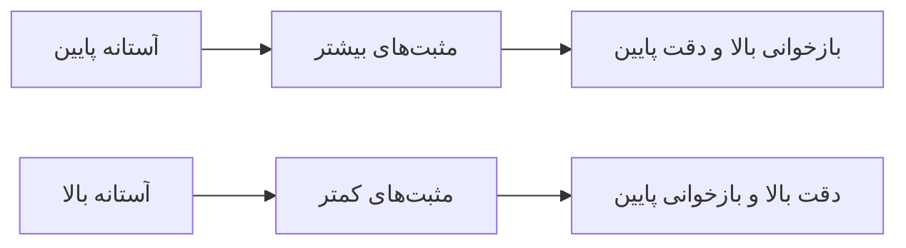
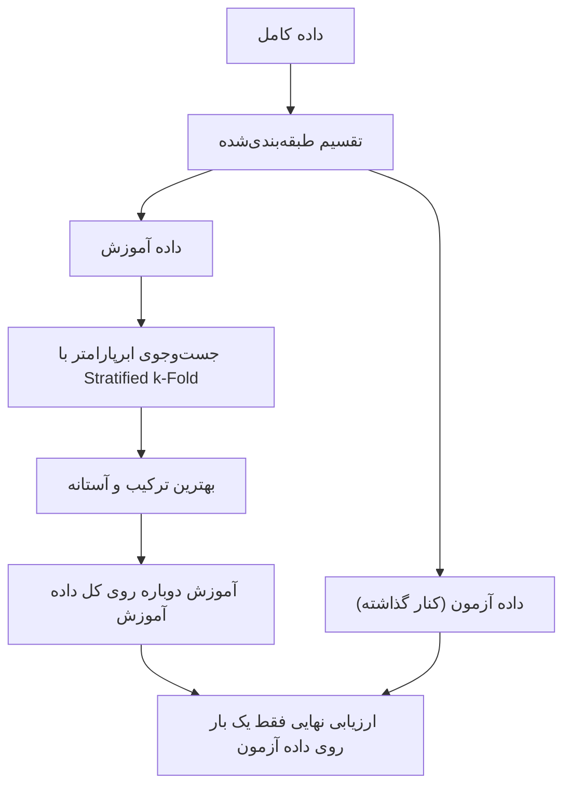

# جلسه ۲۵ — ارزیابی مدل‌های طبقه‌بندی

## چرا «دقت ۹۵ درصد» کافی نیست؟

در جلسات گذشته چند خانواده طبقه‌بند را شناختیم: k-NN ← [[20 -  مبانی طبقه‌بندی و k-NN]]، بیز ساده و رگرسیون لجستیک ← [[21 - بیز ساده و رگرسیون لجستیک]]، درخت تصمیم ← [[22 - درخت تصمیم]]، روش‌های گروهی ← [[23 - روش‌های گروهی]] و ماشین بردار پشتیبان ← [[24 -  ماشین بردار پشتیبان]]. تاکنون بیشتر با یک عدد، یعنی **درصد پیش‌بینی درست**، مدل‌ها را مقایسه کردیم. این جلسه نشان می‌دهد چرا این عدد به‌تنهایی می‌تواند بسیار گمراه‌کننده باشد.

فرض کنید در یک شرکت مخابراتی فقط ۵ درصد مشتریان در ماه آینده قرارداد خود را لغو می‌کنند (ریزش یا Churn). مدلی که **همیشه** بگوید «این مشتری نمی‌رود»، دقتی برابر ۹۵ درصد دارد، اما حتی یک مشتری در حال ریزش را هم پیدا نمی‌کند و برای کسب‌وکار **کاملاً بی‌ارزش** است.

پرسش‌هایی که این جلسه به آن‌ها پاسخ می‌دهد:

- مدل **چه نوع** خطاهایی می‌کند و هزینه هر نوع خطا چقدر است؟
- اگر مدل احتمال خروجی بدهد، **آستانه** تصمیم را کجا بگذاریم؟
- وقتی یک کلاس بسیار کمیاب است، چگونه مدل را آموزش دهیم و بسنجیم؟
- ابرپارامترهای مدل را چگونه **بدون نشت داده** تنظیم کنیم؟

> [!important] نکته کلیدی معیار ارزیابی باید از **هدف کسب‌وکار** بیاید، نه از عادت. در مرحله «درک کسب‌وکار» فرایند CRISP-DM ← [[2 - فرایند CRISP-DM و محیط کار]] باید روشن شود که کدام خطا گران‌تر است؛ این تصمیم انتخاب معیار، آستانه و حتی روش آموزش را تعیین می‌کند.

---

## ماتریس درهم‌ریختگی (Confusion Matrix)

در طبقه‌بندی دودویی، یک کلاس را **مثبت** (Positive) می‌نامیم؛ معمولاً کلاس کمیاب‌تر یا کلاسی که به دنبال آن هستیم (بیمار، تقلب، ریزش، هرزنامه). هر پیش‌بینی در یکی از چهار خانه قرار می‌گیرد:

|کلاس واقعی ↓ / پیش‌بینی →|پیش‌بینی منفی|پیش‌بینی مثبت|
|:-:|:-:|:-:|
|واقعاً منفی|منفی درست (TN)|مثبت کاذب (FP) — خطای نوع اول|
|واقعاً مثبت|منفی کاذب (FN) — خطای نوع دوم|مثبت درست (TP)|

- **مثبت درست** (True Positive): بیمار است و مدل گفته بیمار است.
- **منفی درست** (True Negative): سالم است و مدل گفته سالم است.
- **مثبت کاذب** (False Positive): سالم است اما مدل گفته بیمار است؛ «هشدار اشتباه».
- **منفی کاذب** (False Negative): بیمار است اما مدل گفته سالم است؛ «از دست دادن مورد».

> [!tip] راهنمای حفظ کردن کلمه دوم (مثبت یا منفی) **پیش‌بینی مدل** است و کلمه اول (درست یا کاذب) می‌گوید آیا این پیش‌بینی درست بوده است. پس «منفی کاذب» یعنی مدل گفته منفی و اشتباه کرده است.

> [!warning] ترتیب سطر و ستون در scikit-learn تابع `confusion_matrix` در scikit-learn سطرها را **کلاس واقعی** و ستون‌ها را **کلاس پیش‌بینی‌شده** قرار می‌دهد و کلاس‌ها را به ترتیب صعودی مرتب می‌کند. برای برچسب‌های صفر و یک، خروجی به شکل زیر است و دستور `ravel` چهار عدد را به ترتیب TN، FP، FN و TP برمی‌گرداند. برخی کتاب‌ها جای سطر و ستون یا جای کلاس مثبت را عوض می‌کنند؛ همیشه برچسب محورها را بخوانید.

$$ \begin{bmatrix} TN & FP \ FN & TP \end{bmatrix} $$

### ماتریس درهم‌ریختگی چندکلاسه

برای K کلاس، ماتریس K در K است: خانه سطر i و ستون j تعداد نمونه‌هایی از کلاس i است که به کلاس j نسبت داده شده‌اند. قطر اصلی پیش‌بینی‌های درست است و خانه‌های بیرون قطر نشان می‌دهند **کدام کلاس‌ها با هم اشتباه گرفته می‌شوند**؛ مثلاً در داده Iris، گونه‌های versicolor و virginica ← [[20 -  مبانی طبقه‌بندی و k-NN]]

---

## معیارهای ارزیابی

### تعریف معیارها

**صحت** (Accuracy): نسبت کل پیش‌بینی‌های درست.

$$ \text{Accuracy} = \frac{TP + TN}{TP + TN + FP + FN} $$

**دقت** (Precision): از نمونه‌هایی که مدل مثبت اعلام کرده، چه نسبتی واقعاً مثبت‌اند؟

$$ \text{Precision} = \frac{TP}{TP + FP} $$

**بازخوانی** یا **حساسیت** (Recall / Sensitivity / TPR): از نمونه‌های واقعاً مثبت، چه نسبتی را مدل پیدا کرده است؟

$$ \text{Recall} = \frac{TP}{TP + FN} $$

**ویژگی‌مندی** (Specificity / TNR): از نمونه‌های واقعاً منفی، چه نسبتی درست منفی اعلام شده‌اند؟

$$ \text{Specificity} = \frac{TN}{TN + FP}, \qquad \text{FPR} = 1 - \text{Specificity} = \frac{FP}{FP + TN} $$

**امتیاز F1** (F1-Score): میانگین هارمونیک دقت و بازخوانی.

$$ F_1 = 2 \cdot \frac{\text{Precision} \cdot \text{Recall}}{\text{Precision} + \text{Recall}} = \frac{2,TP}{2,TP + FP + FN} $$

> [!note] چرا میانگین هارمونیک؟ میانگین هارمونیک به مقدار **کوچک‌تر** نزدیک است. اگر دقت ۱ و بازخوانی ۰.۰۱ باشد، میانگین حسابی حدود ۰.۵ است اما امتیاز F1 حدود ۰.۰۲ است. پس مدل فقط وقتی امتیاز F1 بالا می‌گیرد که **هر دو** معیار خوب باشند.

### مقایسه معیارها

|معیار|پرسشی که پاسخ می‌دهد|چه وقت مهم‌تر است|مثال کاربرد|
|:-:|:-:|:-:|:-:|
|صحت|چند درصد پیش‌بینی‌ها درست است؟|کلاس‌های متوازن و هزینه خطای یکسان|تشخیص ارقام دست‌نویس|
|دقت|هشدارهای مدل چقدر قابل اعتمادند؟|وقتی مثبت کاذب گران است|فیلتر هرزنامه (ایمیل مهم نباید حذف شود)|
|بازخوانی|چند درصد موارد مثبت پیدا شدند؟|وقتی منفی کاذب گران است|غربالگری سرطان، تشخیص تقلب|
|ویژگی‌مندی|چند درصد منفی‌ها درست رد شدند؟|وقتی هشدار اشتباه برای افراد سالم هزینه دارد|آزمون تأییدی پزشکی|
|امتیاز F1|توازن میان دقت و بازخوانی|داده نامتوازن، وقتی هر دو خطا مهم‌اند|ریزش مشتری|

> [!example] مثال حل‌شده — غربالگری یک بیماری یک آزمون غربالگری روی ۱۰۰۰ نفر اجرا شده که ۵۰ نفر از آن‌ها واقعاً بیمارند:
> 
> |کلاس واقعی|پیش‌بینی سالم|پیش‌بینی بیمار|جمع|
> |:-:|:-:|:-:|:-:|
> |سالم|890|60|950|
> |بیمار|10|40|50|
> 
> پس TP برابر ۴۰، FN برابر ۱۰، FP برابر ۶۰ و TN برابر ۸۹۰ است: $$ \begin{aligned} \text{Accuracy} &= \frac{40 + 890}{1000} = 0.93 \ \text{Precision} &= \frac{40}{40 + 60} = 0.40 \ \text{Recall} &= \frac{40}{40 + 10} = 0.80 \ \text{Specificity} &= \frac{890}{890 + 60} \approx 0.937 \ F_1 &= \frac{2 \times 40}{2 \times 40 + 60 + 10} = \frac{80}{150} \approx 0.533 \end{aligned} $$ **تفسیر:** آزمون ۸۰ درصد بیماران را پیدا می‌کند، اما از هر ۱۰ نفری که «بیمار» اعلام می‌شوند فقط ۴ نفر واقعاً بیمارند. صحت ۹۳ درصد چشمگیر به نظر می‌رسد، اما آزمونی که **همه** را سالم اعلام کند صحت ۹۵ درصد دارد! برای غربالگری، بازخوانی بالا مهم‌تر است؛ افراد مثبت سپس با آزمون تأییدی دقیق‌تر بررسی می‌شوند.

### معیارهای تکمیلی

**امتیاز F-بتا** (F-beta) وزن بازخوانی را نسبت به دقت تنظیم می‌کند. پارامتر بتا بزرگ‌تر از یک بازخوانی را مهم‌تر و کوچک‌تر از یک دقت را مهم‌تر می‌کند:

$$ F_\beta = (1 + \beta^2) \cdot \frac{\text{Precision} \cdot \text{Recall}}{\beta^2 \cdot \text{Precision} + \text{Recall}} $$

**صحت متوازن** (Balanced Accuracy): میانگین بازخوانی دو کلاس؛ مدل همیشه-اکثریت در آن دقیقاً ۰.۵ می‌گیرد.

$$ \text{Balanced Accuracy} = \frac{\text{Recall} + \text{Specificity}}{2} $$

**ضریب همبستگی متیوز** (MCC): هر چهار خانه ماتریس را در نظر می‌گیرد و بین ۱- و ۱ است؛ صفر یعنی پیش‌بینی در حد شانس.

$$ \text{MCC} = \frac{TP \cdot TN - FP \cdot FN}{\sqrt{(TP+FP)(TP+FN)(TN+FP)(TN+FN)}} $$

> [!example] مثال حل‌شده — ادامه غربالگری برای همان ماتریس: $$ \begin{aligned} F_2 &= \frac{5 \times 0.4 \times 0.8}{4 \times 0.4 + 0.8} = \frac{1.6}{2.4} \approx 0.667 \ F_{0.5} &= \frac{1.25 \times 0.4 \times 0.8}{0.25 \times 0.4 + 0.8} = \frac{0.4}{0.9} \approx 0.444 \ \text{Balanced Accuracy} &= \frac{0.8 + 0.937}{2} \approx 0.868 \ \text{MCC} &= \frac{40 \times 890 - 60 \times 10}{\sqrt{100 \times 50 \times 950 \times 900}} \approx 0.535 \end{aligned} $$ چون این آزمون بازخوانی بالا و دقت پایین دارد، امتیاز F2 (که بازخوانی را مهم‌تر می‌داند) از امتیاز F1 بیشتر و امتیاز F0.5 از آن کمتر است.

### معیارها در مسائل چندکلاسه

در مسائل چندکلاسه، دقت و بازخوانی و F1 **برای هر کلاس جداگانه** (آن کلاس در برابر بقیه) محاسبه و سپس میانگین‌گیری می‌شوند:

|نوع میانگین|روش|ویژگی|
|:-:|:-:|:-:|
|میانگین ماکرو (macro)|میانگین ساده معیار کلاس‌ها|همه کلاس‌ها هم‌وزن؛ کلاس‌های کوچک دیده می‌شوند|
|میانگین وزنی (weighted)|میانگین وزنی با تعداد نمونه هر کلاس|تحت تأثیر کلاس‌های بزرگ|
|میانگین میکرو (micro)|جمع TP و FP و FN همه کلاس‌ها، سپس محاسبه|در طبقه‌بندی تک‌برچسبی برابر صحت است|

> [!tip] گزارش کامل در یک دستور تابع `classification_report` دقت، بازخوانی و F1 هر کلاس را همراه با میانگین ماکرو و وزنی چاپ می‌کند. ستون support تعداد نمونه‌های واقعی هر کلاس است.

---

## منحنی ROC و منحنی Precision-Recall

بیشتر طبقه‌بندها به جای برچسب، یک **امتیاز** یا احتمال تولید می‌کنند (تابع `predict_proba` یا `decision_function`). برچسب نهایی با مقایسه امتیاز با یک **آستانه** به دست می‌آید؛ پیش‌فرض تابع `predict` آستانه ۰.۵ است. با تغییر آستانه، ماتریس درهم‌ریختگی و همه معیارها تغییر می‌کنند. منحنی‌های ROC و PR رفتار مدل را در **همه آستانه‌ها** یک‌جا نشان می‌دهند.

### منحنی ROC

منحنی ROC (Receiver Operating Characteristic) برای هر آستانه، نرخ مثبت درست (بازخوانی) را در برابر نرخ مثبت کاذب رسم می‌کند:

- نقطه (0, 0): آستانه بسیار بالا، هیچ نمونه‌ای مثبت اعلام نمی‌شود.
- نقطه (1, 1): آستانه بسیار پایین، همه نمونه‌ها مثبت اعلام می‌شوند.
- نقطه (0, 1): طبقه‌بند کامل.
- قطر اصلی: طبقه‌بند تصادفی.

**سطح زیر منحنی ROC** (AUC) یک عدد بین صفر و یک است و تفسیر احتمالاتی زیبایی دارد:

$$ \text{AUC} = P\big(\text{score}(x^{+}) > \text{score}(x^{-})\big) $$

یعنی احتمال اینکه یک نمونه مثبت تصادفی امتیاز بیشتری از یک نمونه منفی تصادفی بگیرد. مقدار ۰.۵ یعنی رتبه‌بندی تصادفی و ۱ یعنی جداسازی کامل.

> [!example] مثال حل‌شده — رسم ROC و محاسبه AUC با دست ده نمونه (پنج مثبت و پنج منفی) به ترتیب نزولی امتیاز مدل:
> 
> |نمونه|۱|۲|۳|۴|۵|۶|۷|۸|۹|۱۰|
> |:-:|:-:|:-:|:-:|:-:|:-:|:-:|:-:|:-:|:-:|:-:|
> |امتیاز مدل|0.95|0.85|0.80|0.70|0.55|0.45|0.40|0.30|0.20|0.10|
> |کلاس واقعی|1|1|0|1|1|0|1|0|0|0|
> 
> آستانه را از بالا پایین می‌آوریم. هر نمونه مثبت، نقطه را **۰.۲ به بالا** (یک‌پنجم مثبت‌ها) و هر نمونه منفی، نقطه را **۰.۲ به راست** می‌برد:
> 
> |آستانه|۰.۹۵|۰.۸۵|۰.۸۰|۰.۷۰|۰.۵۵|۰.۴۵|۰.۴۰|۰.۳۰|۰.۲۰|۰.۱۰|
> |:-:|:-:|:-:|:-:|:-:|:-:|:-:|:-:|:-:|:-:|:-:|
> |نرخ مثبت کاذب|0|0|0.2|0.2|0.2|0.4|0.4|0.6|0.8|1|
> |نرخ مثبت درست|0.2|0.4|0.4|0.6|0.8|0.8|1|1|1|1|
> 
> **روش اول (مساحت):** منحنی پله‌ای از نقاط (0, 0.4)، (0.2, 0.4)، (0.2, 0.8)، (0.4, 0.8)، (0.4, 1) و (1, 1) می‌گذرد: $$ \text{AUC} = 0.2 \times 0.4 + 0.2 \times 0.8 + 0.6 \times 1 = 0.08 + 0.16 + 0.60 = 0.84 $$ **روش دوم (شمارش جفت‌ها):** ۵ × ۵ = ۲۵ جفت (مثبت، منفی) داریم. در چند جفت امتیاز مثبت بیشتر است؟ دو مثبت اول از هر ۵ منفی بالاترند (۱۰ جفت)، دو مثبت بعدی از ۴ منفی (۸ جفت) و مثبت آخر از ۳ منفی (۳ جفت): $$ \text{AUC} = \frac{10 + 8 + 3}{25} = \frac{21}{25} = 0.84 $$ هر دو روش با خروجی `roc_auc_score` یکسان است.

### منحنی Precision-Recall

منحنی PR دقت را در برابر بازخوانی برای همه آستانه‌ها رسم می‌کند. خلاصه عددی آن **میانگین دقت** (Average Precision یا AP) است:

$$ \text{AP} = \sum_{n} (R_n - R_{n-1}) , P_n $$

که در آن P و R دقت و بازخوانی در آستانه n-ام هستند. برای مثال بالا، میانگین دقت حدود **۰.۸۵۳** است.

|ویژگی|منحنی ROC|منحنی Precision-Recall|
|:-:|:-:|:-:|
|محورها|نرخ مثبت کاذب و نرخ مثبت درست|بازخوانی و دقت|
|خط پایه مدل تصادفی|قطر، سطح ۰.۵|خط افقی برابر نسبت کلاس مثبت|
|حساسیت به نسبت کلاس‌ها|تقریباً مستقل|به‌شدت وابسته|
|نقطه ایدئال|گوشه بالا-چپ|گوشه بالا-راست|
|مناسب برای|کلاس‌های تقریباً متوازن، مقایسه کلی رتبه‌بندی|داده بسیار نامتوازن، وقتی کلاس مثبت مهم است|

> [!warning] منحنی ROC در داده بسیار نامتوازن خوش‌بین است وقتی منفی‌ها بسیار زیادند (مثلاً ۹۹۰۰ منفی و ۱۰۰ مثبت)، حتی ۵۰۰ مثبت کاذب فقط نرخ مثبت کاذب حدود ۰.۰۵ می‌دهد و منحنی ROC عالی به نظر می‌رسد؛ اما دقت مدل در آن نقطه حداکثر ۱۰۰ از ۶۰۰، یعنی کمتر از ۰.۱۷ است. منحنی PR این مشکل را آشکار می‌کند. در بخش داده نامتوازن خواهیم دید که مدلی با AUC حدود ۰.۸۶ میانگین دقتی حدود ۰.۳۲ دارد.

---

## انتخاب آستانه تصمیم

آستانه پیش‌فرض ۰.۵ هیچ دلیل خاصی ندارد؛ فقط وقتی بهینه است که احتمال‌ها به‌خوبی **کالیبره** باشند و هزینه دو نوع خطا **برابر** باشد. با پایین آوردن آستانه، بازخوانی افزایش و دقت معمولاً کاهش می‌یابد.



### روش‌های انتخاب آستانه

|روش|ایده|مناسب برای|
|:-:|:-:|:-:|
|بیشینه‌سازی F1 یا F-بتا|آستانه‌ای که امتیاز F روی داده اعتبارسنجی بیشینه شود|وقتی هزینه‌ها دقیقاً معلوم نیست|
|شاخص یودن (Youden's J)|بیشینه‌سازی مجموع حساسیت و ویژگی‌مندی منهای یک|مسائل پزشکی با ROC|
|قید روی یک معیار|مثلاً «بازخوانی دست‌کم ۹۵ درصد»، سپس بیشترین دقت|الزامات قانونی یا ایمنی|
|کمینه‌سازی هزینه|تعریف هزینه برای FP و FN و کمینه کردن هزینه کل|وقتی هزینه‌ها معلوم‌اند|

تابع هزینه کل برای هزینه‌های c-FP و c-FN:

$$ \text{Cost}(t) = c_{FP} \cdot FP(t) + c_{FN} \cdot FN(t) $$

اگر احتمال‌ها کالیبره باشند، آستانه بهینه نظری از نسبت هزینه‌ها به دست می‌آید؛ نمونه‌ای را مثبت اعلام می‌کنیم وقتی هزینه مورد انتظار اشتباه در منفی اعلام کردن آن بیشتر باشد:

$$ t^{*} = \frac{c_{FP}}{c_{FP} + c_{FN}} $$

> [!example] مثال حل‌شده — آستانه هزینه‌محور برای تشخیص سرطان فرض کنید از دست دادن یک تومور بدخیم (FN) ۱۰ برابر یک نمونه‌برداری اضافی (FP) هزینه دارد. آستانه نظری: $$ t^{*} = \frac{1}{1 + 10} \approx 0.09 $$ چون احتمال‌های واقعی کاملاً کالیبره نیستند، آستانه را با **پیش‌بینی‌های اعتبارسنجی متقابل روی داده آموزش** انتخاب می‌کنیم. در بخش پیاده‌سازی (رگرسیون لجستیک روی load_breast_cancer) هزینه کل روی داده آموزش در آستانه ۰.۵ برابر **۹۳** و در بهترین آستانه، **۰.۳**، برابر **۴۸** است. روی داده آزمون:
> 
> |آستانه|مثبت درست|مثبت کاذب|منفی کاذب|منفی درست|هزینه کل|
> |:-:|:-:|:-:|:-:|:-:|:-:|
> |۰.۵ (پیش‌فرض)|49|1|4|89|10 × 4 + 1 = 41|
> |۰.۳ (انتخاب‌شده)|51|1|2|89|10 × 2 + 1 = 21|
> 
> فقط با جابه‌جا کردن آستانه، بدون آموزش دوباره مدل، هزینه تقریباً **نصف** شد.

> [!warning] آستانه را روی داده آزمون انتخاب نکنید آستانه نیز یک **ابرپارامتر** است. انتخاب آن با نگاه به داده آزمون، نشت داده است و برآورد خوش‌بینانه می‌دهد ← [[18 - بیش‌برازش و اعتبارسنجی متقابل]]. از داده اعتبارسنجی یا پیش‌بینی‌های خارج از fold (تابع `cross_val_predict`) استفاده کنید. از نسخه ۱.۵ کتابخانه scikit-learn، کلاس `TunedThresholdClassifierCV` این کار را خودکار انجام می‌دهد.

---

## داده نامتوازن (Imbalanced Data)

داده‌ای که در آن یک کلاس بسیار کمتر از دیگری است: تقلب در تراکنش‌ها (کمتر از ۱ درصد)، ریزش مشتری (۲ تا ۱۰ درصد)، خرابی تجهیزات، بیماری‌های نادر.

مشکلات اصلی:

- **صحت گمراه‌کننده است**: مدل همیشه-اکثریت صحت بالا دارد.
- بیشتر الگوریتم‌ها **خطای کل** را کمینه می‌کنند؛ پس نادیده گرفتن کلاس کمیاب «ارزان» است.
- تعداد کم نمونه‌های مثبت، یادگیری مرز تصمیم را دشوار و برآورد معیارها را **پرنوسان** می‌کند.

### راهبردها

|راهبرد|سطح|ایده|مزیت|عیب|
|:-:|:-:|:-:|:-:|:-:|
|کم‌نمونه‌گیری تصادفی (Undersampling)|داده|حذف تصادفی نمونه‌های اکثریت|سریع، داده کوچک‌تر|دور ریختن اطلاعات|
|بیش‌نمونه‌گیری تصادفی (Oversampling)|داده|تکرار تصادفی نمونه‌های اقلیت|بدون از دست دادن داده|خطر بیش‌برازش روی نمونه‌های تکراری|
|روش SMOTE|داده|ساخت نمونه‌های مصنوعی میان همسایه‌های اقلیت|تنوع بیشتر از تکرار ساده|ساخت نمونه در نواحی همپوشان، فقط برای ویژگی‌های عددی|
|وزن‌دهی کلاس‌ها (Class Weight)|الگوریتم|جریمه بیشتر برای خطای کلاس اقلیت|بدون تغییر داده، ساده|همه الگوریتم‌ها پشتیبانی نمی‌کنند|
|تنظیم آستانه|تصمیم|پایین آوردن آستانه برای کلاس اقلیت|بدون آموزش دوباره|نیاز به احتمال‌های معنادار|
|معیار مناسب|ارزیابی|امتیاز F1، میانگین دقت، صحت متوازن|ارزیابی واقع‌بینانه|—|

### وزن‌دهی کلاس‌ها

با گزینه `class_weight="balanced"`، وزن هر کلاس با فراوانی آن نسبت عکس دارد (n تعداد کل نمونه‌ها، K تعداد کلاس‌ها و n-k تعداد نمونه‌های کلاس k):

$$ w_k = \frac{n}{K \cdot n_k} $$

> [!example] مثال حل‌شده — وزن‌های متوازن داده آموزش بخش پیاده‌سازی ۳۷۵۰ نمونه دارد: ۳۵۴۲ منفی و ۲۰۸ مثبت. $$ w_0 = \frac{3750}{2 \times 3542} \approx 0.529, \qquad w_1 = \frac{3750}{2 \times 208} \approx 9.01 $$ یعنی خطای هر نمونه مثبت حدود ۱۷ برابر خطای یک نمونه منفی جریمه می‌شود؛ اثری مشابه تکرار هر نمونه مثبت حدود ۱۷ بار. به همین دلیل در جدول نتایج، رگرسیون لجستیک با وزن‌دهی و با بیش‌نمونه‌گیری تصادفی نتایج تقریباً یکسانی دارند.

### روش SMOTE

روش SMOTE (Synthetic Minority Over-sampling Technique) برای هر نمونه اقلیت، یکی از k همسایه نزدیک **هم‌کلاس** آن را تصادفی انتخاب می‌کند و نقطه‌ای تصادفی روی پاره‌خط میان آن دو می‌سازد (لاندا عدد تصادفی بین صفر و یک است):

$$ x_{\text{new}} = x_i + \lambda , (x_{nn} - x_i), \qquad \lambda \sim U(0, 1) $$

> [!example] مثال حل‌شده — یک نمونه مصنوعی نمونه اقلیت (2, 3) و همسایه هم‌کلاس آن (4, 7) است و عدد تصادفی لاندا برابر ۰.۲۵ شده است: $$ x_{\text{new}} = (2, 3) + 0.25 \times \big((4, 7) - (2, 3)\big) = (2, 3) + (0.5, 1) = (2.5, 4) $$ نقطه جدید یک‌چهارم راه میان دو نمونه واقعی قرار دارد.

> [!note] کتابخانه imbalanced-learn پیاده‌سازی استاندارد SMOTE و روش‌های مشابه (ADASYN، Tomek Links، BorderlineSMOTE) در کتابخانه `imbalanced-learn` است که باید جداگانه نصب شود. این کتابخانه یک `Pipeline` ویژه دارد که نمونه‌سازی را **فقط روی fold آموزش** انجام می‌دهد. در بخش پیاده‌سازی یک نسخه ساده SMOTE را خودمان با numpy می‌نویسیم.

> [!warning] نمونه‌سازی فقط روی داده آموزش و داخل اعتبارسنجی متقابل اگر داده را **پیش از** تقسیم به fold بیش‌نمونه‌گیری کنید، نسخه‌های تکراری یک نمونه هم در آموزش و هم در اعتبارسنجی قرار می‌گیرند و مدل فقط آن‌ها را «به خاطر می‌سپارد». در بخش پیاده‌سازی، بازخوانی جنگل تصادفی با این روش نادرست **۱.۰** و با روش درست حدود **۰.۳۹** است! داده آزمون و fold اعتبارسنجی باید همیشه **توزیع واقعی** را داشته باشند ← [[۱۴- کاهش ابعاد]]

### مقایسه راهبردها روی یک داده ریزش‌مانند

داده مصنوعی با ۵۰۰۰ نمونه، ۲۰ ویژگی و حدود ۵.۵ درصد کلاس مثبت ساختیم و روی ۲۵ درصد داده آزمون سنجیدیم (کد در بخش پیاده‌سازی):

|مدل|صحت|دقت|بازخوانی|امتیاز F1|سطح زیر ROC|میانگین دقت|
|:-:|:-:|:-:|:-:|:-:|:-:|:-:|
|مدل همیشه-اکثریت|0.945|0.000|0.000|0.000|0.500|0.055|
|رگرسیون لجستیک|0.942|0.435|0.145|0.217|0.856|0.319|
|لجستیک + وزن‌دهی|0.782|0.178|0.812|0.292|0.855|0.286|
|لجستیک + بیش‌نمونه‌گیری|0.782|0.178|0.812|0.292|0.858|0.288|
|لجستیک + کم‌نمونه‌گیری|0.762|0.158|0.768|0.262|0.831|0.237|
|لجستیک + SMOTE ساده|0.783|0.176|0.797|0.289|0.853|0.281|
|جنگل تصادفی|0.962|0.958|0.333|0.495|0.921|0.687|
|جنگل تصادفی + وزن‌دهی|0.963|0.745|0.507|0.603|0.927|0.686|
|تقویت گرادیان (HistGB)|0.967|0.938|0.435|0.594|0.923|0.738|

درس‌های این جدول:

- مدل همیشه-اکثریت صحت **۰.۹۴۵** دارد؛ تقریباً برابر رگرسیون لجستیک ساده!
- وزن‌دهی و نمونه‌سازی **بازخوانی** را از ۰.۱۴۵ به حدود ۰.۸ رسانده‌اند، به قیمت کاهش دقت. آن‌ها عمدتاً آستانه مؤثر را جابه‌جا می‌کنند و **سطح زیر ROC** (کیفیت رتبه‌بندی) را تقریباً تغییر نمی‌دهند.
- کم‌نمونه‌گیری به دلیل دور ریختن بیش از ۹۰ درصد داده اکثریت، ضعیف‌ترین رتبه‌بندی را دارد.
- مدل‌های غیرخطی (جنگل و تقویت گرادیان) رتبه‌بندی بسیار بهتری دارند (میانگین دقت حدود ۰.۷). انتخاب **مدل بهتر** معمولاً بیشتر از ترفندهای نمونه‌سازی اثر دارد.

> [!tip] ترتیب پیشنهادی برای داده نامتوازن
> 
> 1. معیار درست را انتخاب کنید (امتیاز F1، میانگین دقت، یا هزینه) و یک مدل پایه همیشه-اکثریت بسازید.
> 2. از تقسیم و اعتبارسنجی **طبقه‌بندی‌شده** استفاده کنید.
> 3. مدل‌های قوی را با وزن‌دهی کلاس امتحان کنید.
> 4. آستانه را روی داده اعتبارسنجی تنظیم کنید.
> 5. فقط اگر لازم بود، روش‌های نمونه‌سازی را (داخل Pipeline) بیازمایید.

---

## تنظیم ابرپارامترها (Hyperparameter Tuning)

**پارامترها** را مدل از داده یاد می‌گیرد (مانند ضرایب رگرسیون). **ابرپارامترها** را ما پیش از آموزش تعیین می‌کنیم: پارامتر k در k-NN، عمق درخت، پارامتر C و gamma در SVM، تعداد درخت‌ها در جنگل تصادفی.

### اعتبارسنجی متقابل طبقه‌بندی‌شده (Stratified k-Fold)

در اعتبارسنجی k-Fold معمولی ← [[18 - بیش‌برازش و اعتبارسنجی متقابل]]، نسبت کلاس‌ها در foldها می‌تواند به‌طور تصادفی تغییر کند. در داده نامتوازن این تغییر بزرگ است. روش **طبقه‌بندی‌شده** نسبت کلاس‌ها را در همه foldها حفظ می‌کند.

> [!example] مثال — تعداد نمونه مثبت در هر fold داده آموزش بخش پیاده‌سازی ۲۰۸ نمونه مثبت دارد. در تقسیم به ۵ fold:
> 
> |روش|fold اول|fold دوم|fold سوم|fold چهارم|fold پنجم|
> |:-:|:-:|:-:|:-:|:-:|:-:|
> |تقسیم معمولی (KFold)|37|49|44|44|34|
> |تقسیم طبقه‌بندی‌شده|41|41|42|42|42|
> 
> در تقسیم معمولی، یک fold ۴۹ و دیگری ۳۴ مثبت دارد؛ معیارهایی مانند بازخوانی بین foldها بی‌دلیل نوسان می‌کنند.

> [!note] پیش‌فرض scikit-learn وقتی به توابعی مانند `cross_val_score` یا `GridSearchCV` یک **عدد** (مثلاً cv برابر ۵) بدهید و مدل طبقه‌بند باشد، به‌طور خودکار از `StratifiedKFold` (بدون بُر زدن) استفاده می‌شود. برای تکرارپذیری و بُر زدن، شیء `StratifiedKFold` با `shuffle=True` و `random_state=42` را صریحاً بسازید. تابع `train_test_split` نیز با پارامتر `stratify=y` تقسیم طبقه‌بندی‌شده انجام می‌دهد.

### جست‌وجوی شبکه‌ای و تصادفی

|ویژگی|جست‌وجوی شبکه‌ای (Grid Search)|جست‌وجوی تصادفی (Random Search)|
|:-:|:-:|:-:|
|روش|امتحان **همه** ترکیب‌های مقادیر داده‌شده|نمونه‌گیری n ترکیب از توزیع‌های داده‌شده|
|هزینه|حاصل‌ضرب تعداد مقادیر × تعداد fold|تعداد تکرار × تعداد fold|
|ابرپارامتر پیوسته|فقط چند مقدار گسسته|نمونه از توزیع پیوسته (مثلاً لگاریتمی-یکنواخت)|
|ابعاد زیاد|انفجار ترکیبی|مقیاس‌پذیر|
|مناسب برای|۲ یا ۳ ابرپارامتر با مقادیر محدود|فضای جست‌وجوی بزرگ|

> [!example] مثال حل‌شده — هزینه جست‌وجوی شبکه‌ای برای جنگل تصادفی با ۲ مقدار عمق بیشینه، ۲ مقدار حداقل نمونه در برگ و ۲ گزینه وزن‌دهی، ۲ × ۲ × ۲ = **۸** ترکیب داریم. با ۵ fold، مدل **۴۰** بار آموزش می‌بیند و یک بار دیگر هم با بهترین ترکیب روی کل داده آموزش (refit). اگر برای هر یک از چهار ابرپارامتر ۵ مقدار امتحان کنیم، ۵ به توان ۴ یعنی ۶۲۵ ترکیب و ۳۱۲۵ بار آموزش لازم است؛ اینجا جست‌وجوی تصادفی با مثلاً ۲۰ تکرار (۱۰۰ بار آموزش) منطقی‌تر است.

> [!tip] چرا جست‌وجوی تصادفی اغلب بهتر است؟ معمولاً فقط چند ابرپارامتر اهمیت زیادی دارند. جست‌وجوی شبکه‌ای با ۹ نقطه در فضای دوبعدی فقط ۳ مقدار متمایز برای هر ابرپارامتر امتحان می‌کند؛ جست‌وجوی تصادفی با همان ۹ نقطه، ۹ مقدار متمایز برای **هر** ابرپارامتر امتحان می‌کند (Bergstra و Bengio، ۲۰۱۲).



> [!warning] امتیاز بهترین ترکیب، برآورد خوش‌بینانه است مقدار `best_score_` بیشینه امتیاز میان چندین ترکیب است و کمی خوش‌بینانه است (سوگیری انتخاب). برآورد بی‌طرف عملکرد را فقط داده آزمون دست‌نخورده یا **اعتبارسنجی متقابل تودرتو** (Nested CV) می‌دهد. همچنین پیش‌پردازش (مقیاس‌بندی، جایگذاری، نمونه‌سازی) باید **داخل Pipeline** باشد تا در هر fold فقط روی بخش آموزش برازش شود.

---

## پیاده‌سازی در پایتون

```python
import matplotlib
matplotlib.use("Agg")
import numpy as np
import pandas as pd
import matplotlib.pyplot as plt
from sklearn.datasets import load_breast_cancer, make_classification
from sklearn.model_selection import (train_test_split, StratifiedKFold, KFold,
                                     cross_val_score, cross_val_predict,
                                     GridSearchCV, RandomizedSearchCV)
from sklearn.pipeline import make_pipeline
from sklearn.preprocessing import StandardScaler
from sklearn.neighbors import NearestNeighbors
from sklearn.linear_model import LogisticRegression
from sklearn.ensemble import RandomForestClassifier, HistGradientBoostingClassifier
from sklearn.dummy import DummyClassifier
from sklearn.metrics import (confusion_matrix, ConfusionMatrixDisplay, classification_report,
                             accuracy_score, precision_score, recall_score, f1_score,
                             fbeta_score, balanced_accuracy_score, matthews_corrcoef,
                             roc_auc_score, average_precision_score, roc_curve,
                             RocCurveDisplay, PrecisionRecallDisplay)
from scipy.stats import loguniform, randint
```

### بررسی مثال‌های حل‌شده

```python
# Screening example: TP=40, FN=10, FP=60, TN=890
y_true = np.array([1] * 50 + [0] * 950)
y_hat = np.array([1] * 40 + [0] * 10 + [1] * 60 + [0] * 890)
print(accuracy_score(y_true, y_hat), precision_score(y_true, y_hat),
      recall_score(y_true, y_hat), round(f1_score(y_true, y_hat), 3))   # 0.93 0.4 0.8 0.533
print(round(fbeta_score(y_true, y_hat, beta=2), 3),                     # 0.667
      round(balanced_accuracy_score(y_true, y_hat), 3),                 # 0.868
      round(matthews_corrcoef(y_true, y_hat), 3))                       # 0.535

# Hand-made ROC example
y_small = np.array([1, 1, 0, 1, 1, 0, 1, 0, 0, 0])
s_small = np.array([0.95, 0.85, 0.80, 0.70, 0.55, 0.45, 0.40, 0.30, 0.20, 0.10])
fpr, tpr, thr = roc_curve(y_small, s_small)
print(roc_auc_score(y_small, s_small))                                  # 0.84
print(round(average_precision_score(y_small, s_small), 3))              # 0.853
pos, neg = s_small[y_small == 1], s_small[y_small == 0]
print(np.mean([p > n for p in pos for n in neg]))                       # 0.84  (21 of 25 pairs)
```

### ماتریس درهم‌ریختگی و گزارش طبقه‌بندی

```python
X, y = load_breast_cancer(return_X_y=True)
y = 1 - y                      # make "malignant" the positive class (1)
print(np.bincount(y))          # [357 212]

X_tr, X_te, y_tr, y_te = train_test_split(X, y, test_size=0.25,
                                          stratify=y, random_state=42)
model = make_pipeline(StandardScaler(), LogisticRegression(max_iter=1000))
model.fit(X_tr, y_tr)
y_pred = model.predict(X_te)
proba = model.predict_proba(X_te)[:, 1]

cm = confusion_matrix(y_te, y_pred)
print(cm)                      # [[89  1]
                               #  [ 4 49]]
tn, fp, fn, tp = cm.ravel()
print(tn / (tn + fp))          # specificity 0.989
print(classification_report(y_te, y_pred, target_names=["benign", "malignant"], digits=3))
#               precision    recall  f1-score   support
#       benign      0.957     0.989     0.973        90
#    malignant      0.980     0.925     0.951        53
#     accuracy                          0.965       143
#    macro avg      0.968     0.957     0.962       143
# weighted avg      0.966     0.965     0.965       143

ConfusionMatrixDisplay.from_predictions(y_te, y_pred, display_labels=["benign", "malignant"])
plt.title("Confusion matrix (threshold 0.5)")
plt.show()
```

### منحنی‌های ROC و Precision-Recall

```python
print(round(roc_auc_score(y_te, proba), 3))             # 0.996
print(round(average_precision_score(y_te, proba), 3))   # 0.994

fig, axes = plt.subplots(1, 2, figsize=(12, 5))
RocCurveDisplay.from_predictions(y_te, proba, ax=axes[0], name="LogReg")
axes[0].plot([0, 1], [0, 1], "k--", label="Random")
axes[0].set_title("ROC curve")
axes[0].legend()
PrecisionRecallDisplay.from_predictions(y_te, proba, ax=axes[1], name="LogReg")
axes[1].axhline(y_te.mean(), color="k", ls="--", label="Random (positive rate)")
axes[1].set_title("Precision-Recall curve")
axes[1].legend()
plt.tight_layout()
plt.show()
```

### اثر آستانه و انتخاب آستانه هزینه‌محور

```python
for t in [0.1, 0.3, 0.5, 0.7]:
    p = (proba >= t).astype(int)
    print(t, confusion_matrix(y_te, p).ravel(),
          round(precision_score(y_te, p), 3), round(recall_score(y_te, p), 3))
# 0.1 [84  6  1 52] 0.897 0.981
# 0.3 [89  1  2 51] 0.981 0.962
# 0.5 [89  1  4 49] 0.98  0.925
# 0.7 [90  0  5 48] 1.0   0.906

# Choose the threshold on out-of-fold predictions of the TRAINING set
cv = StratifiedKFold(n_splits=5, shuffle=True, random_state=42)
oof = cross_val_predict(model, X_tr, y_tr, cv=cv, method="predict_proba")[:, 1]
C_FP, C_FN = 1, 10
thresholds = np.round(np.arange(0.05, 0.96, 0.05), 2)
costs = []
for t in thresholds:
    tn, fp, fn, tp = confusion_matrix(y_tr, (oof >= t).astype(int)).ravel()
    costs.append(C_FP * fp + C_FN * fn)
best_t = thresholds[np.argmin(costs)]
print(best_t, min(costs), costs[list(thresholds).index(0.5)])   # 0.3 48 93

for t in [0.5, best_t]:
    tn, fp, fn, tp = confusion_matrix(y_te, (proba >= t).astype(int)).ravel()
    print(t, C_FP * fp + C_FN * fn)       # 0.5 -> 41,  0.3 -> 21

# sklearn >= 1.5: automatic threshold tuning (here maximizing F1)
from sklearn.model_selection import TunedThresholdClassifierCV
tuned = TunedThresholdClassifierCV(model, scoring="f1", cv=cv, random_state=42).fit(X_tr, y_tr)
print(round(tuned.best_threshold_, 2), round(f1_score(y_te, tuned.predict(X_te)), 3))   # 0.56 0.95
```

### داده نامتوازن ریزش‌مانند

```python
X, y = make_classification(n_samples=5000, n_features=20, n_informative=6, n_redundant=4,
                           weights=[0.95, 0.05], flip_y=0.01, class_sep=1.2,
                           random_state=42)
print(np.bincount(y), y.mean())          # [4723  277] 0.0554
X_tr, X_te, y_tr, y_te = train_test_split(X, y, test_size=0.25,
                                          stratify=y, random_state=42)
print(np.bincount(y_tr), np.bincount(y_te))   # [3542 208] [1181 69]


def random_oversample(X, y, random_state=42):
    """Duplicate random minority rows (label 1) until classes are balanced."""
    rng = np.random.default_rng(random_state)
    idx_min, idx_maj = np.flatnonzero(y == 1), np.flatnonzero(y == 0)
    extra = rng.choice(idx_min, size=len(idx_maj) - len(idx_min), replace=True)
    idx = np.concatenate([idx_maj, idx_min, extra])
    return X[idx], y[idx]


def random_undersample(X, y, random_state=42):
    """Keep a random subset of the majority class of minority size."""
    rng = np.random.default_rng(random_state)
    idx_min, idx_maj = np.flatnonzero(y == 1), np.flatnonzero(y == 0)
    keep = rng.choice(idx_maj, size=len(idx_min), replace=False)
    idx = np.concatenate([keep, idx_min])
    return X[idx], y[idx]


def simple_smote(X, y, k=5, random_state=42):
    """Minimal SMOTE for a binary target (minority class = 1)."""
    rng = np.random.default_rng(random_state)
    X_min = X[y == 1]
    n_new = (y == 0).sum() - (y == 1).sum()
    _, idx = NearestNeighbors(n_neighbors=k + 1).fit(X_min).kneighbors(X_min)
    base = rng.integers(0, len(X_min), n_new)
    neigh = idx[base, rng.integers(1, k + 1, n_new)]     # column 0 is the point itself
    lam = rng.random((n_new, 1))
    X_new = X_min[base] + lam * (X_min[neigh] - X_min[base])
    return np.vstack([X, X_new]), np.concatenate([y, np.ones(n_new, dtype=int)])


def logreg(**kw):
    return make_pipeline(StandardScaler(), LogisticRegression(max_iter=1000, **kw))


setups = {
    "Dummy (majority)": (DummyClassifier(strategy="most_frequent"), None),
    "LogReg": (logreg(), None),
    "LogReg + class_weight": (logreg(class_weight="balanced"), None),
    "LogReg + oversampling": (logreg(), random_oversample),
    "LogReg + undersampling": (logreg(), random_undersample),
    "LogReg + SMOTE": (logreg(), simple_smote),
    "RandomForest": (RandomForestClassifier(n_estimators=300, random_state=42, n_jobs=-1), None),
    "RandomForest + class_weight": (RandomForestClassifier(
        n_estimators=300, class_weight="balanced_subsample", min_samples_leaf=5,
        random_state=42, n_jobs=-1), None),
    "HistGB": (HistGradientBoostingClassifier(random_state=42), None),
}
rows = []
for name, (clf, resampler) in setups.items():
    X_fit, y_fit = (X_tr, y_tr) if resampler is None else resampler(X_tr, y_tr)
    clf.fit(X_fit, y_fit)
    p, s = clf.predict(X_te), clf.predict_proba(X_te)[:, 1]
    rows.append({"model": name, "accuracy": accuracy_score(y_te, p),
                 "precision": precision_score(y_te, p, zero_division=0),
                 "recall": recall_score(y_te, p), "f1": f1_score(y_te, p),
                 "roc_auc": roc_auc_score(y_te, s), "pr_auc": average_precision_score(y_te, s)})
print(pd.DataFrame(rows).set_index("model").round(3).to_string())
#                              accuracy  precision  recall     f1  roc_auc  pr_auc
# Dummy (majority)                0.945      0.000   0.000  0.000    0.500   0.055
# LogReg                          0.942      0.435   0.145  0.217    0.856   0.319
# LogReg + class_weight           0.782      0.178   0.812  0.292    0.855   0.286
# LogReg + oversampling           0.782      0.178   0.812  0.292    0.858   0.288
# LogReg + undersampling          0.762      0.158   0.768  0.262    0.831   0.237
# LogReg + SMOTE                  0.783      0.176   0.797  0.289    0.853   0.281
# RandomForest                    0.962      0.958   0.333  0.495    0.921   0.687
# RandomForest + class_weight     0.963      0.745   0.507  0.603    0.927   0.686
# HistGB                          0.967      0.938   0.435  0.594    0.923   0.738
```

### نسخه استاندارد SMOTE (اختیاری)

```python
# Requires: pip install imbalanced-learn  (not installed in the course environment)
try:
    from imblearn.over_sampling import SMOTE
    from imblearn.pipeline import make_pipeline as imb_pipeline
    smote_model = imb_pipeline(StandardScaler(), SMOTE(random_state=42),
                               LogisticRegression(max_iter=1000))
    print(cross_val_score(smote_model, X_tr, y_tr, cv=5, scoring="f1").mean())
except ImportError:
    print("imbalanced-learn is not installed")
```

### نشت داده در بیش‌نمونه‌گیری

```python
cv = StratifiedKFold(n_splits=5, shuffle=True, random_state=42)
rf = RandomForestClassifier(n_estimators=200, random_state=42, n_jobs=-1)

# WRONG: oversample first, then cross-validate -> duplicates leak into validation folds
X_os, y_os = random_oversample(X_tr, y_tr)
print(cross_val_score(rf, X_os, y_os, cv=cv, scoring="recall").mean())   # 1.0  (!)

# RIGHT: oversample only the training part of each fold
recalls = []
for tr_idx, va_idx in cv.split(X_tr, y_tr):
    X_a, y_a = random_oversample(X_tr[tr_idx], y_tr[tr_idx])
    rf.fit(X_a, y_a)
    recalls.append(recall_score(y_tr[va_idx], rf.predict(X_tr[va_idx])))
print(round(np.mean(recalls), 3))                                          # 0.389

# Positives per fold: plain KFold vs StratifiedKFold
for name, splitter in [("KFold", KFold(5, shuffle=True, random_state=42)), ("Stratified", cv)]:
    print(name, [int(y_tr[va].sum()) for _, va in splitter.split(X_tr, y_tr)])
# KFold [37, 49, 44, 44, 34]
# Stratified [41, 41, 42, 42, 42]
```

### جست‌وجوی شبکه‌ای و تصادفی

```python
grid = GridSearchCV(
    RandomForestClassifier(n_estimators=200, random_state=42),
    param_grid={"max_depth": [None, 10], "min_samples_leaf": [1, 5],
                "class_weight": [None, "balanced_subsample"]},
    scoring="average_precision", cv=cv, n_jobs=-1)
grid.fit(X_tr, y_tr)
print(grid.best_params_)            # class_weight='balanced_subsample', max_depth=None, min_samples_leaf=1
print(round(grid.best_score_, 3))   # 0.680  (CV, slightly optimistic)
print(round(average_precision_score(y_te, grid.predict_proba(X_te)[:, 1]), 3))   # 0.677 (test)

rnd = RandomizedSearchCV(
    HistGradientBoostingClassifier(random_state=42),
    param_distributions={"learning_rate": loguniform(0.01, 0.3),
                         "max_leaf_nodes": randint(8, 64),
                         "min_samples_leaf": randint(5, 50),
                         "l2_regularization": loguniform(1e-3, 10)},
    n_iter=20, scoring="average_precision", cv=cv, random_state=42, n_jobs=-1)
rnd.fit(X_tr, y_tr)
print(round(rnd.best_score_, 3))    # 0.710
print(round(average_precision_score(y_te, rnd.predict_proba(X_te)[:, 1]), 3))    # 0.710 (test)

# Inspect all grid results
res = pd.DataFrame(grid.cv_results_)
print(res[["params", "mean_test_score", "rank_test_score"]].sort_values("rank_test_score").head(3))
```

> [!note] نتیجه جست‌وجو در جست‌وجوی شبکه‌ای، بهترین جنگل تصادفی (وزن‌دهی balanced_subsample، بدون محدودیت عمق) میانگین دقت اعتبارسنجی **۰.۶۸۰** و آزمون **۰.۶۷۷** دارد. جست‌وجوی تصادفی روی تقویت گرادیان با ۲۰ ترکیب به میانگین دقت اعتبارسنجی و آزمون حدود **۰.۷۱۰** رسید. فاصله کم امتیاز اعتبارسنجی و آزمون نشان می‌دهد فرایند تنظیم بیش‌برازش نکرده است.

---

## تمرین عملی کلاس

> [!example] تمرین عملی (۲۵ دقیقه) از داده سرطان سینه یک نسخه **نامتوازن** بسازید: همه ۳۵۷ نمونه خوش‌خیم و ۴۰ نمونه تصادفی بدخیم (کلاس مثبت):
> 
> ```python
> import numpy as np
> from sklearn.datasets import load_breast_cancer
> X, y = load_breast_cancer(return_X_y=True)
> y = 1 - y                                   # malignant = 1
> rng = np.random.default_rng(42)
> mal, ben = np.flatnonzero(y == 1), np.flatnonzero(y == 0)
> keep = np.concatenate([ben, rng.choice(mal, 40, replace=False)])
> X, y = X[keep], y[keep]
> ```
> 
> 1. نسبت کلاس مثبت را محاسبه کنید. صحت مدل همیشه-خوش‌خیم چقدر است؟
> 2. داده را با `test_size=0.3`، `stratify=y` و `random_state=42` تقسیم کنید. هر بخش چند نمونه مثبت دارد؟
> 3. با `StratifiedKFold` پنج‌تایی (بُرخورده، `random_state=42`) و `cross_validate`، این مدل‌ها را با معیارهای صحت، دقت، بازخوانی، امتیاز F1 و میانگین دقت مقایسه کنید: k-NN، رگرسیون لجستیک، رگرسیون لجستیک با وزن‌دهی متوازن، SVM با وزن‌دهی متوازن (همه با StandardScaler) و جنگل تصادفی با ۳۰۰ درخت.
> 4. با `GridSearchCV` روی رگرسیون لجستیک، پارامتر C را از میان 0.01، 0.1، 1، 10 و 100 و وزن‌دهی را از میان None و balanced با معیار F1 انتخاب کنید (برای همگرایی max_iter را ۵۰۰۰ بگذارید).
> 5. مدل نهایی را روی داده آزمون ارزیابی کنید: ماتریس درهم‌ریختگی، دقت، بازخوانی، امتیاز F1، سطح زیر ROC و میانگین دقت.
> 6. آستانه‌ای را که F1 را روی پیش‌بینی‌های خارج از fold داده آموزش بیشینه می‌کند پیدا کنید و روی داده آزمون اعمال کنید.

> [!question]- پاسخ‌های کلیدی تمرین
> 
> - داده ۳۹۷ نمونه دارد که ۴۰ نمونه (حدود ۱۰.۱ درصد) مثبت است. مدل همیشه-خوش‌خیم روی داده آزمون صحت **۰.۹۰** دارد.
> - داده آموزش ۲۷۷ نمونه (۲۸ مثبت) و داده آزمون ۱۲۰ نمونه (۱۲ مثبت) دارد.
> - نتایج اعتبارسنجی متقابل:
> 
> |مدل|صحت|دقت|بازخوانی|امتیاز F1|میانگین دقت|
> |:-:|:-:|:-:|:-:|:-:|:-:|
> |مدل k-NN|0.964|1.000|0.647|0.770|0.859|
> |رگرسیون لجستیک|0.982|1.000|0.827|0.893|0.972|
> |لجستیک متوازن|0.968|0.826|0.860|0.832|0.964|
> |ماشین SVM متوازن|0.964|0.841|0.827|0.811|0.956|
> |جنگل تصادفی|0.968|0.914|0.793|0.811|0.929|
> 
> - مدل k-NN با وجود صحت ۰.۹۶۴ فقط حدود ۶۵ درصد بدخیم‌ها را پیدا می‌کند. وزن‌دهی متوازن بازخوانی لجستیک را کمی بالا برده اما دقت را پایین آورده است.
> - جست‌وجوی شبکه‌ای پارامتر C برابر ۱ و **بدون وزن‌دهی** را انتخاب می‌کند (F1 اعتبارسنجی حدود ۰.۸۹۳). در این داده جداسازی کلاس‌ها آسان است و وزن‌دهی سودی ندارد؛ وزن‌دهی همیشه بهتر نیست و باید آزموده شود.
> - روی داده آزمون: ۱۰۸ منفی درست، صفر مثبت کاذب، ۱ منفی کاذب و ۱۱ مثبت درست؛ دقت ۱.۰، بازخوانی حدود ۰.۹۱۷، امتیاز F1 حدود ۰.۹۵۷ و سطح زیر ROC و میانگین دقت هر دو ۱.۰.
> - آستانه بهینه F1 روی پیش‌بینی‌های خارج از fold حدود **۰.۶۲** است (F1 خارج از fold حدود ۰.۹۰۲). روی داده آزمون همان ماتریس درهم‌ریختگی به دست می‌آید؛ با فقط ۱۲ نمونه مثبت در آزمون، تغییرات کوچک آستانه اثر قابل‌مشاهده‌ای ندارد.

---

## تکلیف ۴ — مدل‌سازی نظارت‌شده

> [!todo] تکلیف ۴ — مدل‌سازی نظارت‌شده روی داده پروژه با استفاده از Pipeline پیش‌پردازشی که در **تکلیف ۳** ساختید ← [[۱۴- کاهش ابعاد]]، یک مسئله **رگرسیون یا طبقه‌بندی** روی داده پروژه خود حل کنید:
> 
> 1. **تعریف مسئله:** متغیر هدف، نوع مسئله و معیار ارزیابی اصلی را با دلیل کسب‌وکاری مشخص کنید (مثلاً «بازخوانی مهم‌تر است چون…»). برای طبقه‌بندی، نسبت کلاس‌ها را گزارش کنید.
> 2. **تقسیم داده:** یک داده آزمون (طبقه‌بندی‌شده برای طبقه‌بندی) کنار بگذارید که تا مرحله آخر **دست‌نخورده** بماند.
> 3. **مدل پایه:** یک مدل ساده (`DummyClassifier` یا `DummyRegressor`) و یک مدل خطی (رگرسیون خطی یا لجستیک) به عنوان خط پایه بسازید.
> 4. **مقایسه مدل‌ها:** دست‌کم **چهار** خانواده مدل از جلسات ۱۶ تا ۲۴ را با اعتبارسنجی متقابل k-Fold (طبقه‌بندی‌شده برای طبقه‌بندی) و دست‌کم دو معیار مقایسه کنید؛ میانگین و انحراف معیار امتیازها را گزارش کنید.
> 5. **تنظیم ابرپارامترها:** برای دو مدل برتر، ابرپارامترها را با `GridSearchCV` یا `RandomizedSearchCV` (همه پیش‌پردازش داخل Pipeline) تنظیم کنید.
> 6. **داده نامتوازن و آستانه (فقط طبقه‌بندی):** اگر کلاس‌ها نامتوازن‌اند، دست‌کم یک راهبرد (وزن‌دهی کلاس یا نمونه‌سازی داخل fold) را بیازمایید و آستانه تصمیم را بر اساس معیار یا هزینه انتخابی روی داده اعتبارسنجی تعیین کنید. **برای رگرسیون:** نمودار باقیمانده‌ها و تحلیل خطا در بازه‌های مقدار هدف.
> 7. **ارزیابی نهایی:** مدل نهایی را فقط **یک بار** روی داده آزمون ارزیابی کنید: ماتریس درهم‌ریختگی، گزارش طبقه‌بندی، منحنی ROC و PR (یا معیارهای MAE، RMSE و R² برای رگرسیون).
> 8. **تفسیر:** اهمیت ویژگی‌ها (ترجیحاً Permutation Importance) و دست‌کم سه نمونه از خطاهای مدل را تحلیل کنید و یک توصیه کسب‌وکاری بنویسید.
> 
> **قالب تحویل:** یک فایل Jupyter Notebook که با «Restart & Run All» بدون خطا اجرا شود (با `random_state=42`)، همراه با گزارش حداکثر ۶ صفحه‌ای. **مهلت:** دو هفته؛ نتایج این تکلیف در پروژه نهایی ← [[30 - جمع‌بندی و ارائه پروژه‌ها]] استفاده می‌شود.

> [!note] معیارهای ارزیابی تکلیف ۴
> 
> |معیار|سهم|
> |:-:|:-:|
> |تعریف مسئله و انتخاب مستدل معیار ارزیابی|۱۰ درصد|
> |طراحی صحیح ارزیابی (داده آزمون دست‌نخورده، اعتبارسنجی متقابل، نبود نشت داده)|۲۵ درصد|
> |مقایسه مدل‌ها و مدل پایه|۲۰ درصد|
> |تنظیم ابرپارامترها و برخورد با عدم توازن یا تحلیل باقیمانده|۲۰ درصد|
> |تفسیر نتایج، تحلیل خطا و توصیه کسب‌وکاری|۱۵ درصد|
> |کیفیت کد، تکرارپذیری و نمودارها|۱۰ درصد|

---

## پرسش‌های مرور

> [!question]- ۱. مدلی روی داده‌ای با ۲ درصد تراکنش تقلبی، صحت ۹۸ درصد دارد. آیا مدل خوبی است؟ نمی‌توان گفت. مدلی که همه تراکنش‌ها را سالم اعلام کند نیز صحت ۹۸ درصد دارد. باید ماتریس درهم‌ریختگی، بازخوانی و دقت کلاس تقلب، یا میانگین دقت را بررسی کرد و با مدل پایه همیشه-اکثریت مقایسه نمود.

> [!question]- ۲. در فیلتر هرزنامه، دقت مهم‌تر است یا بازخوانی؟ در غربالگری سرطان چطور؟ در فیلتر هرزنامه، مثبت کاذب (ایمیل مهم که به پوشه هرزنامه می‌رود) گران است، پس **دقت** مهم‌تر است. در غربالگری سرطان، منفی کاذب (بیمار از دست رفته) بسیار گران است، پس **بازخوانی** مهم‌تر است.

> [!question]- ۳. سطح زیر منحنی ROC یک مدل برابر ۰.۹۲ است. این عدد را به زبان ساده تفسیر کنید. اگر یک نمونه مثبت و یک نمونه منفی را تصادفی انتخاب کنیم، با احتمال ۹۲ درصد مدل به نمونه مثبت امتیاز بیشتری می‌دهد. این عدد کیفیت **رتبه‌بندی** مدل را مستقل از آستانه نشان می‌دهد، اما درباره کیفیت پیش‌بینی در یک آستانه خاص یا در داده بسیار نامتوازن چیزی نمی‌گوید.

> [!question]- ۴. چرا بیش‌نمونه‌گیری پیش از اعتبارسنجی متقابل اشتباه است؟ چون نسخه‌های تکراری (یا مصنوعیِ ساخته‌شده از) یک نمونه اقلیت هم در fold آموزش و هم در fold اعتبارسنجی قرار می‌گیرند و مدل در واقع نمونه‌هایی را می‌سنجد که قبلاً دیده است. نتیجه به‌شدت خوش‌بینانه است؛ در مثال این جلسه بازخوانی ۱.۰ در برابر ۰.۳۹ واقعی. نمونه‌سازی باید فقط روی بخش آموزش هر fold انجام شود.

> [!question]- ۵. با آستانه ۰.۵، بازخوانی مدل ۰.۶ است و مدیر می‌خواهد دست‌کم ۰.۹ باشد. بدون آموزش دوباره مدل چه می‌کنید؟ آستانه تصمیم را پایین می‌آورم. با کمک منحنی Precision-Recall روی داده اعتبارسنجی، بزرگ‌ترین آستانه‌ای را که بازخوانی دست‌کم ۰.۹ می‌دهد پیدا می‌کنم و دقت متناظر آن را به مدیر گزارش می‌کنم تا هزینه هشدارهای اشتباه اضافی روشن باشد.

> [!question]- ۶. تفاوت جست‌وجوی شبکه‌ای و تصادفی چیست و چرا مقدار best_score_ برآورد بی‌طرفی از عملکرد نیست؟ جست‌وجوی شبکه‌ای همه ترکیب‌های مقادیر داده‌شده را امتحان می‌کند و با تعداد ابرپارامترها انفجار ترکیبی دارد؛ جست‌وجوی تصادفی تعداد ثابتی ترکیب را از توزیع‌ها نمونه می‌گیرد و برای فضاهای بزرگ و ابرپارامترهای پیوسته کاراتر است. مقدار best_score_ **بیشینه** امتیاز میان چندین ترکیب است، پس به دلیل سوگیری انتخاب کمی خوش‌بینانه است؛ برآورد بی‌طرف از داده آزمون دست‌نخورده یا اعتبارسنجی تودرتو به دست می‌آید.

---

## نکات کلیدی

> [!summary] خلاصه جلسه
> 
> - **ماتریس درهم‌ریختگی** چهار نوع نتیجه (TP، TN، FP، FN) را جدا می‌کند و پایه همه معیارهاست.
> - **صحت** در داده نامتوازن گمراه‌کننده است. **دقت** کیفیت هشدارها، **بازخوانی** پوشش موارد مثبت و **ویژگی‌مندی** درستی رد منفی‌ها را می‌سنجد؛ **امتیاز F1** میانگین هارمونیک دقت و بازخوانی است.
> - **منحنی ROC** و سطح زیر آن کیفیت رتبه‌بندی را مستقل از آستانه می‌سنجند؛ در داده بسیار نامتوازن **منحنی PR** و **میانگین دقت** گویاترند.
> - **آستانه تصمیم** یک ابرپارامتر است؛ آن را بر اساس هزینه خطاها یا قید کسب‌وکاری، روی داده اعتبارسنجی انتخاب کنید.
> - برای **داده نامتوازن**: معیار مناسب، تقسیم طبقه‌بندی‌شده، **وزن‌دهی کلاس**، تنظیم آستانه و در صورت نیاز **نمونه‌سازی** (تصادفی یا SMOTE) فقط داخل foldهای آموزش.
> - **تنظیم ابرپارامترها** با جست‌وجوی شبکه‌ای یا تصادفی و **اعتبارسنجی متقابل طبقه‌بندی‌شده**، با همه پیش‌پردازش‌ها داخل Pipeline؛ داده آزمون فقط یک بار در پایان استفاده می‌شود.

> [!todo] آمادگی برای جلسه بعد
> 
> 1. تکلیف ۴ را آغاز کنید؛ ابتدا معیار ارزیابی و مدل پایه را مشخص کنید.
> 2. با این جلسه بخش یادگیری نظارت‌شده به پایان می‌رسد. از جلسه بعد وارد **یادگیری بدون نظارت** می‌شویم، جایی که برچسبی وجود ندارد ← [[26 - مبانی خوشه‌بندی و k-Means]]
> 3. فاصله اقلیدسی و اهمیت مقیاس‌بندی در محاسبه فاصله را مرور کنید ← [[۵ - معیارهای شباهت و فاصله]]
> 4. فکر کنید در داده پروژه خود، بدون استفاده از متغیر هدف، چه **گروه‌های طبیعی** از نمونه‌ها ممکن است وجود داشته باشد.