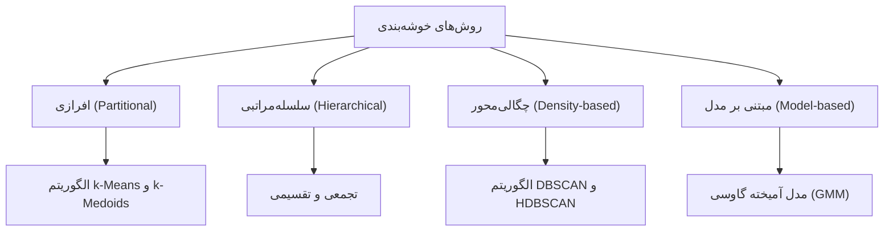
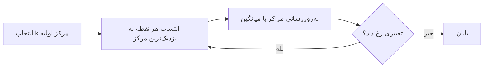

# جلسه ۲۶ — مبانی خوشه‌بندی و k-Means

## از یادگیری با برچسب به یادگیری بدون برچسب

در ده جلسه گذشته، همیشه یک **متغیر هدف** داشتیم: قیمت خانه در رگرسیون ← [[16 - مبانی یادگیری نظارت‌شده و رگرسیون خطی ساده]] یا کلاس نمونه در طبقه‌بندی ← [[20 - مبانی طبقه‌بندی و k-NN]]. مدل از روی نمونه‌های برچسب‌دار یاد می‌گرفت و ما با معیارهایی مانند دقت و بازخوانی آن را می‌سنجیدیم ← [[25 - ارزیابی مدل‌های طبقه‌بندی]]

اما در بسیاری از مسائل واقعی **برچسبی وجود ندارد**:

- یک فروشگاه اینترنتی سوابق خرید یک میلیون مشتری را دارد، اما هیچ‌کس مشتریان را «دسته‌بندی» نکرده است.
- یک بیمارستان هزاران پرونده بیمار دارد و می‌خواهد بداند آیا **زیرگروه‌های** متفاوتی از یک بیماری وجود دارد.
- یک خبرگزاری روزانه هزاران خبر منتشر می‌کند و می‌خواهد خبرهای مشابه را کنار هم بگذارد.

در این مسائل می‌خواهیم **ساختار پنهان** داده را کشف کنیم. خوشه‌بندی (Clustering) مهم‌ترین ابزار این کار است و پنج جلسه آینده به آن اختصاص دارد.

> [!important] نکته کلیدی خوشه‌بندی کاملاً بر پایه **شباهت و فاصله** است ← [[05 - معیارهای شباهت و فاصله]]. انتخاب ویژگی‌ها، مقیاس‌بندی آن‌ها ← [[12 - تبدیل و یکپارچه‌سازی داده]] و انتخاب معیار فاصله، بیش از انتخاب الگوریتم بر نتیجه اثر دارد.

---

## یادگیری بدون نظارت و کاربردهای خوشه‌بندی

**یادگیری بدون نظارت** (Unsupervised Learning) یعنی یافتن الگو در داده‌ای که فقط ویژگی‌ها (ماتریس X) را دارد و متغیر هدف (y) ندارد.

|جنبه|یادگیری نظارت‌شده|یادگیری بدون نظارت|
|:-:|:-:|:-:|
|داده|ویژگی‌ها و برچسب|فقط ویژگی‌ها|
|هدف|پیش‌بینی برچسب نمونه‌های جدید|کشف ساختار، گروه‌ها یا الگوها|
|ارزیابی|مقایسه با برچسب واقعی (عینی)|معیارهای درونی و قضاوت خبره (تا حدی ذهنی)|
|نمونه وظایف|رگرسیون، طبقه‌بندی|خوشه‌بندی، کاهش ابعاد، تشخیص ناهنجاری، قواعد انجمنی|
|نمونه الگوریتم‌ها|رگرسیون لجستیک، درخت تصمیم، SVM|الگوریتم k-Means، خوشه‌بندی سلسله‌مراتبی، DBSCAN، PCA|

### خوشه‌بندی چیست؟

**خوشه‌بندی** یعنی تقسیم اشیای داده به گروه‌هایی (خوشه‌ها) به گونه‌ای که:

- اشیای **درون یک خوشه** تا حد ممکن به هم **شبیه** باشند (انسجام درونی بالا).
- اشیای **خوشه‌های مختلف** تا حد ممکن **متفاوت** باشند (جدایی بیرونی بالا).

> [!note] خوشه‌بندی و طبقه‌بندی را اشتباه نگیرید در طبقه‌بندی، کلاس‌ها **از پیش معلوم‌اند** و مدل یاد می‌گیرد نمونه‌ها را به آن‌ها نسبت دهد. در خوشه‌بندی، گروه‌ها **از پیش وجود ندارند** و الگوریتم آن‌ها را می‌سازد؛ حتی تعداد گروه‌ها معمولاً معلوم نیست. شماره خوشه (۰، ۱، ۲) فقط یک نام است و معنای ذاتی ندارد.

### کاربردها

|حوزه|کاربرد خوشه‌بندی|
|:-:|:-:|
|بازاریابی|بخش‌بندی مشتریان (Customer Segmentation) برای کمپین‌های هدفمند ← [[29 - ارزیابی و تفسیر خوشه‌ها]]|
|زیست‌شناسی و پزشکی|گروه‌بندی ژن‌ها با الگوی بیان مشابه، کشف زیرگونه‌های بیماری|
|متن و وب|گروه‌بندی اسناد و نتایج جست‌وجو بر اساس موضوع|
|تصویر|بخش‌بندی تصویر، فشرده‌سازی رنگ (Color Quantization)|
|جغرافیا|یافتن مناطق با الگوی جرم یا مصرف مشابه، مکان‌یابی انبارها|
|پیش‌پردازش|ساخت ویژگی «شماره خوشه» برای مدل نظارت‌شده، نمونه‌برداری طبقه‌بندی‌شده|
|تشخیص ناهنجاری|نمونه‌هایی که به هیچ خوشه‌ای نزدیک نیستند ← [[11 - داده پرت، نویز و داده تکراری]]|

> [!warning] خوشه‌بندی همیشه جواب می‌دهد الگوریتم k-Means روی داده‌ای کاملاً تصادفی و بی‌ساختار هم k خوشه برمی‌گرداند. وجود خروجی به معنای وجود **ساختار واقعی** نیست. نتیجه را با معیارهای ارزیابی، مصورسازی و دانش حوزه بسنجید ← [[29 - ارزیابی و تفسیر خوشه‌ها]]

---

## انواع خوشه‌بندی



|نوع|ایده|شکل خوشه‌ها|نیاز به تعداد خوشه|جلسه|
|:-:|:-:|:-:|:-:|:-:|
|افرازی|تقسیم داده به k گروه جدا با بهینه‌سازی یک تابع هدف|تقریباً کروی (محدب)|بله|این جلسه|
|سلسله‌مراتبی|ساخت درختی از خوشه‌های تودرتو|بسته به روش پیوند|خیر (برش درخت)|← [[27 - خوشه‌بندی سلسله‌مراتبی]]|
|چگالی‌محور|خوشه = ناحیه پرچگال جداشده با نواحی کم‌چگال|دلخواه|خیر|← [[28 - خوشه‌بندی چگالی‌محور و مبتنی بر مدل]]|
|مبتنی بر مدل|داده از آمیخته‌ای از توزیع‌های احتمال تولید شده است|بیضوی|بله|← [[28 - خوشه‌بندی چگالی‌محور و مبتنی بر مدل]]|

دو تمایز مهم دیگر:

- **خوشه‌بندی سخت** (Hard): هر نمونه دقیقاً به یک خوشه تعلق دارد؛ مانند k-Means.
- **خوشه‌بندی نرم** (Soft/Fuzzy): هر نمونه با درجه یا احتمالی به هر خوشه تعلق دارد؛ مانند GMM.
- **خوشه‌بندی کامل**: همه نمونه‌ها خوشه دارند. **خوشه‌بندی جزئی**: برخی نمونه‌ها «نویز» اعلام می‌شوند؛ مانند DBSCAN.

---

## الگوریتم k-Means

الگوریتم k-Means (میانگین‌های k‌گانه) مشهورترین و ساده‌ترین الگوریتم خوشه‌بندی افرازی است. هر خوشه با **مرکز** (Centroid) خود، یعنی میانگین نقاط آن، نمایش داده می‌شود.

### تابع هدف: مجموع مربعات خطا (SSE)

الگوریتم k-Means به دنبال افرازی از داده به k خوشه است که **مجموع مجذور فاصله** هر نقطه تا مرکز خوشه‌اش کمینه شود (C-j خوشه j-ام و مو-j مرکز آن است):

$$ \text{SSE} = \sum_{j=1}^{k} \sum_{x_i \in C_j} \lVert x_i - \mu_j \rVert^2 $$

$$ \mu_j = \frac{1}{|C_j|} \sum_{x_i \in C_j} x_i $$

به این مقدار **اینرسی** (Inertia) یا **مجموع مربعات درون‌خوشه‌ای** (WCSS) نیز می‌گویند؛ در scikit-learn ویژگی `inertia_` همین مقدار است.

### گام‌های الگوریتم (الگوریتم لوید)

1. پارامتر k را انتخاب و k مرکز اولیه را تعیین کن.
2. **گام انتساب** (Assignment): هر نقطه را به **نزدیک‌ترین** مرکز (با فاصله اقلیدسی) نسبت بده.
3. **گام به‌روزرسانی** (Update): مرکز هر خوشه را برابر **میانگین** نقاط آن خوشه قرار بده.
4. گام‌های ۲ و ۳ را تکرار کن تا انتساب‌ها تغییر نکنند (یا تغییر مراکز از یک آستانه کوچک‌تر شود).



> [!note] چرا الگوریتم همگرا می‌شود؟ هر دو گام، مقدار SSE را **کاهش می‌دهند یا ثابت نگه می‌دارند**: گام انتساب برای مراکز ثابت، بهترین خوشه هر نقطه را انتخاب می‌کند و گام به‌روزرسانی برای خوشه‌های ثابت، بهترین مرکز را (میانگین، که مجموع مجذور فاصله‌ها را کمینه می‌کند) انتخاب می‌کند. چون تعداد افرازهای ممکن متناهی است، الگوریتم در تعداد متناهی گام متوقف می‌شود. اما همگرایی فقط به یک **کمینه محلی** تضمین شده است، نه کمینه سراسری.

> [!example] مثال حل‌شده — دو تکرار k-Means با دست شش نقطه دوبعدی داریم و k برابر ۲ است:
> 
> |نقطه|A|B|C|D|E|F|
> |:-:|:-:|:-:|:-:|:-:|:-:|:-:|
> |مختصات|(1, 1)|(2, 1)|(1, 3)|(5, 4)|(6, 5)|(4, 6)|
> 
> برای نشان دادن اثر مقداردهی اولیه، مراکز اولیه را عمداً **بد** انتخاب می‌کنیم: مرکز اول برابر A یعنی (1, 1) و مرکز دوم برابر B یعنی (2, 1).
> 
> **تکرار ۱ — انتساب.** مجذور فاصله اقلیدسی هر نقطه تا دو مرکز:
> 
> |نقطه|تا مرکز (1, 1)|تا مرکز (2, 1)|خوشه|
> |:-:|:-:|:-:|:-:|
> |نقطه A|0|1|۱|
> |نقطه B|1|0|۲|
> |نقطه C|4|5|۱|
> |نقطه D|25|18|۲|
> |نقطه E|41|32|۲|
> |نقطه F|34|29|۲|
> 
> مقدار SSE در این مرحله: ۰ + ۰ + ۴ + ۱۸ + ۳۲ + ۲۹ = **۸۳**
> 
> **تکرار ۱ — به‌روزرسانی.** $$ \begin{aligned} \mu_1 &= \frac{(1, 1) + (1, 3)}{2} = (1, 2) \ \mu_2 &= \frac{(2, 1) + (5, 4) + (6, 5) + (4, 6)}{4} = (4.25, 4) \end{aligned} $$
> 
> **تکرار ۲ — انتساب.**
> 
> |نقطه|تا مرکز (1, 2)|تا مرکز (4.25, 4)|خوشه|
> |:-:|:-:|:-:|:-:|
> |نقطه A|1|19.56|۱|
> |نقطه B|2|14.06|۱ (تغییر کرد)|
> |نقطه C|1|11.56|۱|
> |نقطه D|20|0.56|۲|
> |نقطه E|34|4.06|۲|
> |نقطه F|25|4.06|۲|
> 
> نقطه B به خوشه اول رفت. مقدار SSE: ۱ + ۲ + ۱ + ۰.۵۶ + ۴.۰۶ + ۴.۰۶ ≈ **۱۲.۶۹**
> 
> **تکرار ۲ — به‌روزرسانی.** $$ \begin{aligned} \mu_1 &= \frac{(1, 1) + (2, 1) + (1, 3)}{3} \approx (1.33, 1.67) \ \mu_2 &= \frac{(5, 4) + (6, 5) + (4, 6)}{3} = (5, 5) \end{aligned} $$
> 
> **تکرار ۳.** با مراکز جدید، هیچ انتسابی تغییر نمی‌کند و الگوریتم متوقف می‌شود. مقدار SSE نهایی: $$ \text{SSE} = (0.56 + 0.89 + 1.89) + (1 + 1 + 2) \approx 7.33 $$ مقدار SSE در هر تکرار کاهش یافت: از ۸۳ به حدود ۱۲.۶۹ و سپس ۷.۳۳. خروجی `KMeans` در scikit-learn با همین مراکز اولیه دقیقاً همین خوشه‌ها، مراکز و اینرسی ۷.۳۳ را می‌دهد.

### پیچیدگی محاسباتی

هزینه هر تکرار از مرتبه حاصل‌ضرب تعداد نقاط (n)، تعداد خوشه‌ها (k) و تعداد ابعاد (d) است. با t تکرار:

$$ O(n \cdot k \cdot d \cdot t) $$

این هزینه **خطی** در n است؛ به همین دلیل k-Means برای داده‌های بزرگ بسیار محبوب است. نسخه `MiniBatchKMeans` در هر گام فقط از یک زیرنمونه کوچک استفاده می‌کند و برای میلیون‌ها نقطه باز هم سریع‌تر است.

---

## مقداردهی اولیه و k-Means++

نتیجه k-Means به **مراکز اولیه** وابسته است. مقداردهی تصادفی ممکن است دو مرکز را در یک خوشه واقعی و هیچ مرکزی را در خوشه دیگر قرار دهد؛ الگوریتم در یک کمینه محلی بد گیر می‌کند.

### راه‌حل اول: اجرای چندباره

الگوریتم را چند بار با مقداردهی‌های متفاوت اجرا و نتیجه‌ای را که **کمترین SSE** دارد انتخاب کن. پارامتر `n_init` در scikit-learn همین کار را می‌کند.

### راه‌حل دوم: الگوریتم k-Means++

ایده: مراکز اولیه را **دور از هم** انتخاب کن.

1. مرکز اول را تصادفی (یکنواخت) از میان نقاط انتخاب کن.
2. برای هر نقطه x، فاصله D(x) تا نزدیک‌ترین مرکز انتخاب‌شده را حساب کن.
3. مرکز بعدی را با احتمالی **متناسب با مجذور این فاصله** انتخاب کن:

$$ P(x) = \frac{D(x)^2}{\sum_{x'} D(x')^2} $$

4. گام‌های ۲ و ۳ را تا انتخاب k مرکز تکرار کن، سپس k-Means معمولی را اجرا کن.

> [!example] مثال حل‌شده — احتمال‌های k-Means++ در همان شش نقطه، فرض کنید مرکز اول به‌طور تصادفی نقطه A یعنی (1, 1) شده است. مجذور فاصله نقاط تا A:
> 
> |نقطه|A|B|C|D|E|F|جمع|
> |:-:|:-:|:-:|:-:|:-:|:-:|:-:|:-:|
> |مجذور فاصله|0|1|4|25|41|34|105|
> |احتمال انتخاب|0|0.010|0.038|0.238|0.390|0.324|1|
> 
> احتمال اینکه مرکز دوم یکی از نقاط D، E یا F (گروه دور) باشد، ۱۰۰ / ۱۰۵ یعنی حدود **۹۵ درصد** است؛ در حالی که با انتخاب یکنواخت این احتمال فقط ۳ از ۵ یعنی ۶۰ درصد بود. انتخاب بدی که در مثال قبل کردیم (نقطه B) فقط **۱ درصد** احتمال دارد.

> [!example] مثال — مقایسه تجربی روی داده‌ای با ۴ خوشه واقعی (۵۰۰ نقطه، make_blobs)، الگوریتم را ۲۰ بار با **یک** مقداردهی اجرا کردیم:
> 
> |روش مقداردهی|کمترین SSE|بیشترین SSE|میانگین SSE|دفعات رسیدن به بهترین جواب|
> |:-:|:-:|:-:|:-:|:-:|
> |تصادفی|948.9|3344.3|1904.0|۱۲ از ۲۰|
> |روش k-Means++|948.9|948.9|948.9|۲۰ از ۲۰|

> [!tip] تنظیمات پیش‌فرض scikit-learn کلاس `KMeans` به‌طور پیش‌فرض از `init="k-means++"` استفاده می‌کند و در نسخه‌های جدید `n_init="auto"` است (با k-Means++ یعنی یک اجرا). برای اطمینان بیشتر و تکرارپذیری، `n_init=10` و `random_state=42` بگذارید.

---

## انتخاب تعداد خوشه

پارامتر k ورودی الگوریتم است، اما معمولاً از پیش معلوم نیست. مقدار SSE را نمی‌توان مستقیم کمینه کرد: با افزایش k همیشه کاهش می‌یابد و اگر k برابر n شود، صفر می‌شود.

### روش آرنج (Elbow Method)

مقدار SSE را برای k از ۱ تا مثلاً ۱۰ رسم کن. ابتدا SSE سریع کاهش می‌یابد (خوشه‌های واقعی جدا می‌شوند) و از جایی به بعد کاهش کند می‌شود (خوشه‌های واقعی تکه‌تکه می‌شوند). نقطه «زانو» یا «آرنج» منحنی، k مناسب است.

> [!example] مثال — داده با ۴ خوشه واقعی
> 
> |تعداد خوشه|۱|۲|۳|۴|۵|۶|۷|۸|
> |:-:|:-:|:-:|:-:|:-:|:-:|:-:|:-:|:-:|
> |مقدار SSE|33903.9|15737.1|3426.3|948.9|856.5|768.0|681.4|608.5|
> 
> از k برابر ۳ به ۴، مقدار SSE حدود ۷۲ درصد کم می‌شود، اما از ۴ به ۵ فقط حدود ۱۰ درصد. آرنج در k برابر **۴** است.

> [!warning] آرنج همیشه واضح نیست در داده واقعی منحنی اغلب **هموار** است و آرنج مشخصی ندارد؛ انتخاب آن ذهنی می‌شود. روش آرنج را همیشه کنار روش دیگری مانند ضریب نیم‌رخ به کار ببرید.

### ضریب نیم‌رخ (Silhouette Coefficient)

برای هر نقطه i دو مقدار حساب می‌شود:

- مقدار a(i): میانگین فاصله نقطه تا **سایر نقاط خوشه خودش** (انسجام).
- مقدار b(i): میانگین فاصله نقطه تا نقاط **نزدیک‌ترین خوشه دیگر** (جدایی).

$$ s(i) = \frac{b(i) - a(i)}{\max\big(a(i), b(i)\big)} $$

|مقدار ضریب نیم‌رخ|تفسیر|
|:-:|:-:|
|نزدیک ۱|نقطه به‌خوبی در خوشه خود قرار دارد و از خوشه‌های دیگر دور است|
|نزدیک ۰|نقطه روی مرز دو خوشه است|
|منفی|نقطه احتمالاً در خوشه اشتباه قرار گرفته است|

میانگین ضریب نیم‌رخ همه نقاط برای هر k محاسبه و kای که **بیشترین** میانگین را دارد انتخاب می‌شود. محاسبه دستی آن برای یک نقطه را در جلسه ۲۹ می‌بینیم ← [[29 - ارزیابی و تفسیر خوشه‌ها]]

> [!example] مثال — همان داده
> 
> |تعداد خوشه|۲|۳|۴|۵|۶|۷|
> |:-:|:-:|:-:|:-:|:-:|:-:|:-:|
> |میانگین ضریب نیم‌رخ|0.596|0.761|0.791|0.663|0.561|0.441|
> 
> بیشینه در k برابر **۴** است و با روش آرنج هم‌خوانی دارد. برای خوشه‌بندی شش نقطه مثال حل‌شده نیز میانگین ضریب نیم‌رخ حدود ۰.۶۳ است.

|روش|مزیت|عیب|
|:-:|:-:|:-:|
|روش آرنج|ساده و سریع، از خود خروجی k-Means|ذهنی، آرنج اغلب مبهم|
|ضریب نیم‌رخ|عدد مشخص، قابل محاسبه برای هر نقطه|محاسبه فاصله همه جفت‌ها (کند برای n بزرگ)، به نفع خوشه‌های کروی|
|دانش حوزه|معنادار و قابل استفاده در عمل|ممکن است با ساختار داده هم‌خوان نباشد|

> [!tip] تعداد خوشه یک تصمیم کسب‌وکاری هم هست اگر تیم بازاریابی فقط برای ۴ گروه مشتری می‌تواند کمپین جداگانه طراحی کند، ۱۲ خوشه حتی با ضریب نیم‌رخ بالاتر کاربردی نیست. معیارهای عددی **راهنما** هستند، نه حکم نهایی.

---

## محدودیت‌های k-Means و معرفی k-Medoids

### فرض‌های پنهان k-Means

الگوریتم k-Means به‌طور ضمنی فرض می‌کند خوشه‌ها **کروی**، **هم‌اندازه از نظر پراکندگی** و تقریباً **هم‌تعداد** هستند، چون هر نقطه را فقط بر اساس فاصله اقلیدسی تا نزدیک‌ترین مرکز نسبت می‌دهد. مرز میان دو خوشه همیشه **عمودمنصف** خط واصل دو مرکز است (نمودار ورونوی).

|محدودیت|علت|نتیجه در آزمایش ما (شاخص ARI، ۱ یعنی کامل)|راه‌حل|
|:-:|:-:|:-:|:-:|
|خوشه‌های غیرمحدب (هلالی)|مرزهای خطی|داده make_moons: حدود ۰.۲۵|الگوریتم DBSCAN، خوشه‌بندی طیفی|
|خوشه‌های کشیده|فاصله اقلیدسی همسانگرد|سه نوار موازی کشیده: حدود ۰.۳۴|مدل GMM با کوواریانس کامل|
|خوشه‌های با اندازه بسیار متفاوت|تقسیم خوشه بزرگ برای کاهش SSE|۵۰۰ در برابر ۳۰ نقطه: حدود ۰.۱۷|مدل GMM، DBSCAN|
|حساسیت به داده پرت|میانگین به داده پرت حساس است|۵ نقطه پرت: حدود ۰.۵۷|الگوریتم k-Medoids، حذف پرت|
|وابستگی به مقیاس|فاصله اقلیدسی|پنگوئن‌ها: ۰.۶۴ بدون و ۰.۸۹ با مقیاس‌بندی|استانداردسازی|
|فقط ویژگی عددی|میانگین برای ویژگی کیفی تعریف نشده|—|الگوریتم k-Modes، k-Prototypes|
|نیاز به تعیین k|ورودی الگوریتم|—|آرنج، نیم‌رخ، روش‌های سلسله‌مراتبی|

> [!note] شاخص رند تعدیل‌شده (ARI) در این جدول برای سنجش کیفیت خوشه‌بندی از **برچسب‌های واقعی** داده‌های مصنوعی و شاخص ARI استفاده کردیم: مقدار ۱ یعنی تطابق کامل و نزدیک صفر یعنی در حد تصادف. این شاخص را در جلسه ۲۹ دقیق بررسی می‌کنیم.

> [!warning] اثر مقیاس در عمل در داده پنگوئن‌ها با دو ویژگی طول نوک (انحراف معیار حدود ۵.۵ میلی‌متر) و طول باله (انحراف معیار حدود ۱۴ میلی‌متر)، بدون مقیاس‌بندی طول باله بر فاصله غالب می‌شود و ARI با گونه‌ها حدود **۰.۶۴** است. پس از استانداردسازی، ARI به حدود **۰.۸۹** می‌رسد. برای ویژگی‌هایی مانند جرم بدن (بر حسب گرم) اختلاف بسیار شدیدتر است: ARI از حدود ۰.۳۲ به ۰.۷۵ می‌رسد.

### الگوریتم k-Medoids

در k-Medoids، نماینده هر خوشه به جای میانگین، یک **نقطه واقعی از داده** است که مجموع فاصله آن تا سایر اعضای خوشه کمینه است؛ به این نقطه **مدوئید** (Medoid) می‌گویند. تابع هدف، مجموع فاصله‌ها (نه مجذور آن‌ها) است:

$$ \text{Cost} = \sum_{j=1}^{k} \sum_{x_i \in C_j} d(x_i, m_j) $$

که در آن m-j مدوئید خوشه j و d **هر معیار فاصله دلخواه** است (منهتن، کسینوسی، گاور برای داده ترکیبی).

> [!example] مثال حل‌شده — میانگین در برابر مدوئید یک خوشه یک‌بعدی با مقادیر ۱، ۲، ۳، ۴ و ۱۰۰ داریم.
> 
> - **میانگین** (مرکز k-Means): برابر ۲۲؛ نقطه‌ای که حتی نزدیک هیچ‌یک از چهار نقطه اصلی نیست!
> - **مدوئید**: مجموع فاصله هر نقطه تا بقیه:
> 
> |نقطه|1|2|3|4|100|
> |:-:|:-:|:-:|:-:|:-:|:-:|
> |مجموع فاصله تا بقیه|105|102|101|102|390|
> 
> کمترین مجموع مربوط به نقطه ۳ است؛ پس مدوئید **۳** است و داده پرت تقریباً اثری بر آن ندارد.

> [!example] مثال — داده پرت در دوبعد به ۳۰۰ نقطه با ۳ خوشه واقعی، ۵ نقطه پرت دور (حوالی مختصات ۳۰ و ۳۰) اضافه کردیم. الگوریتم k-Means با k برابر ۳ یک خوشه کامل را به ۵ نقطه پرت اختصاص داد و **دو خوشه واقعی را ادغام کرد** (ARI حدود ۰.۵۷). الگوریتم k-Medoids هر سه خوشه واقعی را درست یافت (ARI برابر ۱) و ۵ نقطه پرت را به نزدیک‌ترین خوشه نسبت داد.

|ویژگی|الگوریتم k-Means|الگوریتم k-Medoids|
|:-:|:-:|:-:|
|نماینده خوشه|میانگین (ممکن است نقطه واقعی نباشد)|مدوئید (همیشه یک نقطه واقعی)|
|معیار فاصله|فقط اقلیدسی (مجذور)|هر معیار دلخواه|
|حساسیت به داده پرت|زیاد|کم|
|داده کیفی یا ترکیبی|خیر|بله (با فاصله مناسب مانند گاور)|
|هزینه محاسباتی|خطی در n|دست‌کم درجه دو در n (ماتریس فاصله)|
|تفسیرپذیری نماینده|متوسط|بالا (یک مشتری یا سند واقعی)|

> [!note] پیاده‌سازی k-Medoids الگوریتم کلاسیک k-Medoids، روش **PAM** (Partitioning Around Medoids) است که جابه‌جایی هر مدوئید با هر نقطه غیرمدوئید را می‌آزماید. کلاس `KMedoids` در کتابخانه `scikit-learn-extra` موجود است که باید جداگانه نصب شود. در بخش پیاده‌سازی یک نسخه ساده (به سبک الگوریتم لوید) را با numpy می‌نویسیم.

---

## پیاده‌سازی در پایتون

```python
import matplotlib
matplotlib.use("Agg")
import numpy as np
import pandas as pd
import matplotlib.pyplot as plt
import seaborn as sns
from sklearn.cluster import KMeans, MiniBatchKMeans
from sklearn.datasets import make_blobs, make_moons
from sklearn.preprocessing import StandardScaler
from sklearn.metrics import silhouette_score, adjusted_rand_score, pairwise_distances
```

### الگوریتم k-Means از صفر با numpy

```python
def kmeans_numpy(X, init_centers, max_iter=100):
    """Lloyd's algorithm; prints SSE at every assignment step."""
    centers = np.asarray(init_centers, dtype=float)
    for it in range(max_iter):
        d2 = ((X[:, None, :] - centers[None, :, :]) ** 2).sum(axis=2)   # squared distances
        labels = d2.argmin(axis=1)                                       # assignment step
        sse = d2[np.arange(len(X)), labels].sum()
        print(f"iter {it + 1}: labels={labels}, SSE={sse:.2f}")
        new_centers = np.array([X[labels == j].mean(axis=0) for j in range(len(centers))])
        if np.allclose(new_centers, centers):                            # converged
            break
        centers = new_centers                                            # update step
    return labels, centers, sse


P = np.array([[1, 1], [2, 1], [1, 3], [5, 4], [6, 5], [4, 6]], dtype=float)
labels, centers, sse = kmeans_numpy(P, init_centers=[[1, 1], [2, 1]])
# iter 1: labels=[0 1 0 1 1 1], SSE=83.00
# iter 2: labels=[0 0 0 1 1 1], SSE=12.69
# iter 3: labels=[0 0 0 1 1 1], SSE=7.33
print(centers.round(2))     # [[1.33 1.67] [5.   5.  ]]

# Same result with scikit-learn (fixed initial centers, single run)
km = KMeans(n_clusters=2, init=np.array([[1, 1], [2, 1]], dtype=float), n_init=1).fit(P)
print(km.labels_, km.cluster_centers_.round(2), round(km.inertia_, 2))
# [0 0 0 1 1 1] [[1.33 1.67] [5.   5.  ]] 7.33
print(round(silhouette_score(P, km.labels_), 2))   # 0.63
```

### احتمال‌های k-Means++

```python
d2 = ((P - P[0]) ** 2).sum(axis=1)       # squared distance to the first center A
print(d2, d2.sum())                       # [ 0.  1.  4. 25. 41. 34.] 105.0
print((d2 / d2.sum()).round(3))           # [0.    0.01  0.038 0.238 0.39  0.324]
```

### داده نمونه، روش آرنج و ضریب نیم‌رخ

```python
X, y_true = make_blobs(n_samples=500, centers=4, cluster_std=1.0, random_state=42)

ks = range(1, 11)
inertias, silhouettes = [], []
for k in ks:
    model = KMeans(n_clusters=k, n_init=10, random_state=42).fit(X)
    inertias.append(model.inertia_)
    silhouettes.append(silhouette_score(X, model.labels_) if k > 1 else np.nan)
print(np.round(inertias, 1))
# [33903.9 15737.1  3426.3   948.9   856.5   768.    681.4   608.5   546.8   498. ]
print(np.round(silhouettes[1:], 3))
# [0.596 0.761 0.791 0.663 0.561 0.441 0.337 0.347 0.348]

fig, axes = plt.subplots(1, 2, figsize=(12, 4))
axes[0].plot(ks, inertias, "o-")
axes[0].set(title="Elbow method", xlabel="k", ylabel="SSE (inertia)")
axes[1].plot(ks, silhouettes, "o-")
axes[1].set(title="Silhouette score", xlabel="k", ylabel="Mean silhouette")
plt.tight_layout()
plt.show()

best = KMeans(n_clusters=4, n_init=10, random_state=42).fit(X)
print(np.bincount(best.labels_), adjusted_rand_score(y_true, best.labels_))   # [125 125 125 125] 1.0

fig, ax = plt.subplots(figsize=(6, 5))
ax.scatter(X[:, 0], X[:, 1], c=best.labels_, cmap="tab10", s=15, alpha=0.7)
ax.scatter(*best.cluster_centers_.T, c="black", marker="X", s=200, label="Centroids")
ax.set(title="k-Means with k=4", xlabel="x1", ylabel="x2")
ax.legend()
plt.show()
```

### مقایسه مقداردهی تصادفی و k-Means++

```python
for init in ["random", "k-means++"]:
    sse = [KMeans(n_clusters=4, init=init, n_init=1, random_state=s).fit(X).inertia_
           for s in range(20)]
    n_best = np.isclose(sse, min(sse), rtol=1e-3).sum()
    print(init, round(min(sse), 1), round(max(sse), 1), round(np.mean(sse), 1), n_best)
# random    948.9 3344.3 1904.0 12
# k-means++ 948.9  948.9  948.9 20
```

### محدودیت‌ها: شکل، کشیدگی، اندازه نابرابر

```python
rng = np.random.default_rng(42)

X_moons, y_moons = make_moons(n_samples=400, noise=0.05, random_state=42)

centers = [[0, 0], [0, 4], [0, 8]]           # three long horizontal bands
X_long = np.vstack([rng.normal(c, [4, 0.5], (200, 2)) for c in centers])
y_long = np.repeat([0, 1, 2], 200)

rng = np.random.default_rng(42)              # fresh generator for this dataset
X_size = np.vstack([rng.normal([0, 0], 1.0, (500, 2)),     # big cluster
                    rng.normal([4, 0], 0.5, (30, 2))])     # small cluster
y_size = np.r_[np.zeros(500), np.ones(30)]

cases = [("Moons", X_moons, y_moons, 2), ("Elongated", X_long, y_long, 3),
         ("Unequal sizes", X_size, y_size, 2)]
fig, axes = plt.subplots(1, 3, figsize=(15, 4))
for ax, (name, Xc, yc, k) in zip(axes, cases):
    lab = KMeans(n_clusters=k, n_init=10, random_state=42).fit_predict(Xc)
    ari = adjusted_rand_score(yc, lab)
    print(name, round(ari, 2))       # Moons 0.25, Elongated 0.34, Unequal sizes 0.17
    ax.scatter(Xc[:, 0], Xc[:, 1], c=lab, cmap="tab10", s=10)
    ax.set_title(f"{name}: ARI={ari:.2f}")
plt.tight_layout()
plt.show()
```

### اثر مقیاس‌بندی

```python
penguins = sns.load_dataset("penguins").dropna(subset=["bill_length_mm", "flipper_length_mm", "body_mass_g"])
for cols in [["bill_length_mm", "flipper_length_mm"], ["bill_length_mm", "body_mass_g"]]:
    F = penguins[cols].to_numpy()
    for name, Z in [("raw", F), ("scaled", StandardScaler().fit_transform(F))]:
        lab = KMeans(n_clusters=3, n_init=10, random_state=42).fit_predict(Z)
        print(cols[1], name, round(adjusted_rand_score(penguins["species"], lab), 2))
# flipper_length_mm raw 0.64 | scaled 0.89
# body_mass_g       raw 0.32 | scaled 0.75
```

### الگوریتم k-Medoids ساده و مقاومت در برابر داده پرت

```python
def k_medoids(X, k, n_init=10, max_iter=100, random_state=42):
    """Simple alternating k-Medoids (Voronoi iteration) with several restarts."""
    rng = np.random.default_rng(random_state)
    D = pairwise_distances(X)                      # any metric could be used here
    best = None
    for _ in range(n_init):
        medoids = rng.choice(len(X), k, replace=False)
        for _ in range(max_iter):
            labels = D[:, medoids].argmin(axis=1)
            new = np.array([np.flatnonzero(labels == j)[
                D[np.ix_(labels == j, labels == j)].sum(axis=1).argmin()] for j in range(k)])
            if np.array_equal(np.sort(new), np.sort(medoids)):
                break
            medoids = new
        labels = D[:, medoids].argmin(axis=1)
        cost = D[np.arange(len(X)), medoids[labels]].sum()
        if best is None or cost < best[2]:
            best = (medoids, labels, cost)
    return best


# 1-D example: mean vs medoid
v = np.array([1, 2, 3, 4, 100])
print(v.mean(), np.abs(v[:, None] - v[None, :]).sum(axis=1))   # 22.0 [105 102 101 102 390]

# 2-D example: 300 points in 3 blobs + 5 far outliers
X3, y3 = make_blobs(n_samples=300, centers=3, cluster_std=0.8, random_state=42)
outliers = np.array([[30, 30], [32, 29], [31, 31], [29, 32], [30, 28]])
X_out = np.vstack([X3, outliers])

km = KMeans(n_clusters=3, n_init=10, random_state=42).fit(X_out)
print(np.bincount(km.labels_), round(adjusted_rand_score(y3, km.labels_[:300]), 2))
# [100 200   5] 0.57   -> one cluster wasted on outliers, two real clusters merged

medoids, labels, cost = k_medoids(X_out, k=3)
print(np.bincount(labels), round(adjusted_rand_score(y3, labels[:300]), 2))
# [100 100 105] 1.0
```

### نسخه دسته‌کوچک برای داده بزرگ

```python
X_big, _ = make_blobs(n_samples=100_000, centers=5, random_state=42)
mbk = MiniBatchKMeans(n_clusters=5, batch_size=2048, n_init=3, random_state=42).fit(X_big)
print(mbk.cluster_centers_.shape)    # (5, 2)
```

---

## تمرین عملی کلاس

> [!example] تمرین عملی (۲۵ دقیقه) داده پنگوئن‌ها را بارگذاری کنید و فقط دو ویژگی طول نوک و طول باله را نگه دارید:
> 
> ```python
> import seaborn as sns
> pen = sns.load_dataset("penguins").dropna(subset=["bill_length_mm", "flipper_length_mm"])
> F = pen[["bill_length_mm", "flipper_length_mm"]]
> ```
> 
> 1. نمودار پراکندگی دو ویژگی را **بدون رنگ گونه** رسم کنید. چند گروه به چشم می‌آید؟
> 2. ویژگی‌ها را با `StandardScaler` استاندارد کنید.
> 3. برای k از ۲ تا ۸، الگوریتم k-Means (با `n_init=10` و `random_state=42`) را اجرا و مقدار SSE و میانگین ضریب نیم‌رخ را ثبت کنید. نمودار آرنج و نمودار نیم‌رخ را رسم کنید.
> 4. بر اساس دو نمودار، چه kای پیشنهاد می‌کنید؟ اکنون k را برابر ۳ بگیرید و خوشه‌ها را با مراکز رسم کنید.
> 5. جدول توافقی خوشه‌ها و گونه واقعی (`pd.crosstab`) را بسازید و شاخص ARI را حساب کنید.
> 6. همین کار را **بدون استانداردسازی** تکرار کنید. چه تغییری می‌کند و چرا؟
> 7. میانگین دو ویژگی را در هر خوشه حساب کنید و برای هر خوشه یک نام پیشنهاد دهید.

> [!question]- پاسخ‌های کلیدی تمرین
> 
> - پس از حذف مقادیر گمشده، ۳۴۲ پنگوئن باقی می‌ماند.
> - نتایج روی داده استانداردشده:
> 
> |تعداد خوشه|۲|۳|۴|۵|۶|۷|۸|
> |:-:|:-:|:-:|:-:|:-:|:-:|:-:|:-:|
> |مقدار SSE|247.0|157.8|118.8|91.5|78.4|69.3|57.8|
> |ضریب نیم‌رخ|0.543|0.522|0.507|0.435|0.401|0.392|0.376|
> 
> - ضریب نیم‌رخ k برابر **۲** را کمی ترجیح می‌دهد (۰.۵۴۳ در برابر ۰.۵۲۲) و آرنج در حوالی ۲ تا ۳ است، اما دانش حوزه (سه گونه) k برابر ۳ را پیشنهاد می‌کند. این نمونه‌ای واقعی از ابهام انتخاب k است: گونه‌های Adelie و Chinstrap در طول باله هم‌پوشانی دارند و فقط با طول نوک جدا می‌شوند.
> - با k برابر ۳ و استانداردسازی، شاخص ARI حدود **۰.۸۸۷** است. جدول توافقی: خوشه Gentoo شامل ۱۲۲ از ۱۲۳ پنگوئن Gentoo است؛ ۱۴۶ از ۱۵۱ پنگوئن Adelie و ۵۹ از ۶۸ پنگوئن Chinstrap در خوشه‌های خود قرار گرفته‌اند.
> - بدون استانداردسازی، ARI به حدود **۰.۶۴۴** کاهش می‌یابد؛ چون انحراف معیار طول باله (حدود ۱۴.۱) بیش از دو برابر طول نوک (حدود ۵.۵) است و فاصله را طول باله تعیین می‌کند. در نتیجه Adelie و Chinstrap که عمدتاً در طول نوک تفاوت دارند، به‌درستی جدا نمی‌شوند.
> - میانگین خوشه‌ها (طول نوک، طول باله): حدود (۴۷.۶، ۲۱۷.۰) «باله بلند» یا Gentoo، حدود (۳۸.۷، ۱۸۹.۶) «نوک کوتاه» یا Adelie و حدود (۴۹.۰، ۱۹۵.۷) «نوک بلند و باله کوتاه» یا Chinstrap.

---

## پرسش‌های مرور

> [!question]- ۱. تفاوت اصلی خوشه‌بندی و طبقه‌بندی چیست؟ در طبقه‌بندی، داده برچسب‌دار است و کلاس‌ها از پیش معلوم‌اند؛ مدل یاد می‌گیرد برچسب نمونه‌های جدید را پیش‌بینی کند. در خوشه‌بندی برچسبی وجود ندارد و الگوریتم خودش گروه‌ها را بر اساس شباهت می‌سازد؛ تعداد و معنای گروه‌ها نیز از پیش معلوم نیست.

> [!question]- ۲. چرا الگوریتم k-Means همیشه همگرا می‌شود، اما ممکن است به جواب بهینه نرسد؟ هر دو گام انتساب و به‌روزرسانی مقدار SSE را کاهش می‌دهند یا ثابت نگه می‌دارند و تعداد افرازهای ممکن متناهی است؛ پس الگوریتم متوقف می‌شود. اما این فقط یک **کمینه محلی** است و به مراکز اولیه بستگی دارد؛ به همین دلیل از k-Means++ و اجرای چندباره (پارامتر n_init) استفاده می‌کنیم.

> [!question]- ۳. چرا نمی‌توان k را با کمینه کردن SSE انتخاب کرد؟ چون SSE با افزایش k همیشه کاهش می‌یابد و وقتی هر نقطه خوشه خودش باشد، صفر می‌شود. باید به دنبال نقطه‌ای بود که کاهش SSE از آن به بعد ناچیز می‌شود (آرنج) یا از معیاری مانند ضریب نیم‌رخ استفاده کرد که هم انسجام و هم جدایی را در نظر می‌گیرد.

> [!question]- ۴. در الگوریتم k-Means++، چرا احتمال انتخاب با «مجذور» فاصله متناسب است و نه با خود فاصله یا با بیشترین فاصله؟ مجذور فاصله نقاط دور را بسیار محتمل‌تر می‌کند و مراکز را پخش می‌کند. انتخاب قطعی **دورترین** نقطه، تقریباً همیشه داده‌های پرت را به عنوان مرکز برمی‌گزیند؛ انتخاب احتمالاتی تعادلی میان پخش بودن مراکز و مقاومت در برابر داده پرت ایجاد می‌کند.

> [!question]- ۵. سه موقعیت نام ببرید که k-Means نتیجه نامناسبی می‌دهد. خوشه‌های غیرمحدب (مانند هلال‌ها یا حلقه‌های تودرتو)، خوشه‌های کشیده یا با پراکندگی و تعداد بسیار متفاوت، و داده دارای نقاط پرت یا ویژگی‌های با مقیاس متفاوت (بدون استانداردسازی). همچنین برای ویژگی‌های کیفی مستقیماً قابل استفاده نیست.

> [!question]- ۶. در چه شرایطی k-Medoids را بر k-Means ترجیح می‌دهید؟ وقتی داده پرت وجود دارد، وقتی معیار فاصله غیراقلیدسی لازم است (مثلاً فاصله گاور برای داده ترکیبی عددی و کیفی یا فاصله کسینوسی برای متن)، یا وقتی نماینده هر خوشه باید یک **نمونه واقعی** باشد (مثلاً یک مشتری نمونه برای ارائه به مدیران). هزینه آن محاسبه ماتریس فاصله و کندی بیشتر برای داده بزرگ است.

---

## نکات کلیدی

> [!summary] خلاصه جلسه
> 
> - **یادگیری بدون نظارت** ساختار داده بدون برچسب را کشف می‌کند؛ **خوشه‌بندی** اشیای مشابه را در یک گروه و اشیای متفاوت را در گروه‌های جدا قرار می‌دهد.
> - انواع خوشه‌بندی: **افرازی**، **سلسله‌مراتبی**، **چگالی‌محور** و **مبتنی بر مدل**؛ همچنین سخت در برابر نرم.
> - الگوریتم **k-Means** با تکرار دو گام انتساب و به‌روزرسانی، مقدار **SSE** را کمینه می‌کند؛ همگرایی فقط به کمینه محلی تضمین شده است و هزینه آن خطی در تعداد نقاط است.
> - مقداردهی **k-Means++** مراکز اولیه را با احتمال متناسب با مجذور فاصله پخش می‌کند؛ همراه با اجرای چندباره، نتیجه را پایدار می‌کند.
> - برای انتخاب k از **روش آرنج** و **ضریب نیم‌رخ** همراه با دانش حوزه استفاده کنید.
> - الگوریتم k-Means خوشه‌های کروی و هم‌اندازه را فرض می‌کند و به **داده پرت** و **مقیاس** حساس است؛ **k-Medoids** با نماینده واقعی و هر معیار فاصله، مقاوم‌تر اما کندتر است.

> [!todo] آمادگی برای جلسه بعد
> 
> 1. الگوریتم k-Means را روی ویژگی‌های عددی استانداردشده داده پروژه خود اجرا کنید و نمودار آرنج و نیم‌رخ را رسم کنید.
> 2. ماتریس فاصله و انواع معیارهای فاصله را مرور کنید ← [[05 - معیارهای شباهت و فاصله]]
> 3. به این پرسش فکر کنید: اگر نخواهیم k را از پیش تعیین کنیم و بخواهیم **همه سطوح** گروه‌بندی (از تک‌تک نقاط تا یک خوشه بزرگ) را ببینیم، چه کنیم؟ پاسخ در جلسه بعد ← [[27 - خوشه‌بندی سلسله‌مراتبی]]