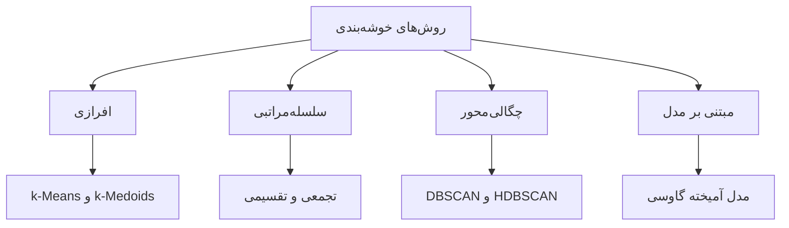
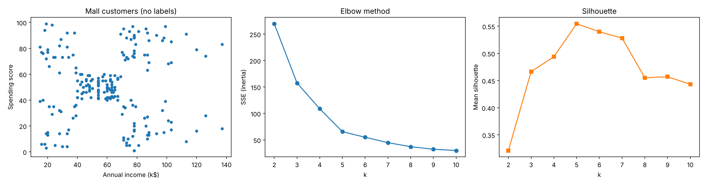
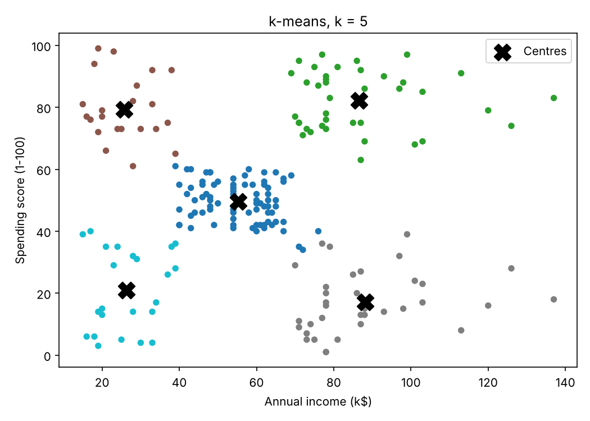
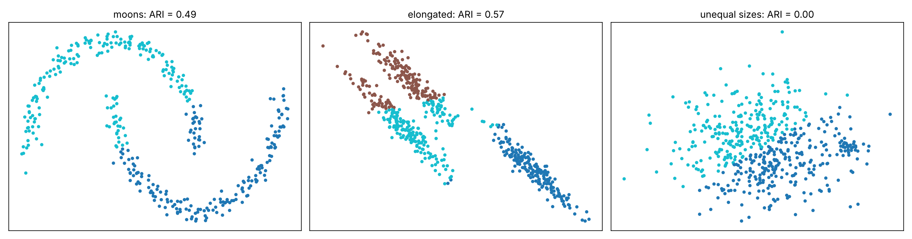

# جلسه ۲۶ — مبانی خوشه‌بندی و k-Means

## از یادگیری با برچسب به یادگیری بدون برچسب

در ده جلسه گذشته همیشه یک **متغیر هدف** داشتیم: قیمت خانه در رگرسیون ← [مبانی یادگیری نظارت‌شده و رگرسیون خطی ساده](../Part%204_Regression/16%20-%20%D9%85%D8%A8%D8%A7%D9%86%DB%8C%20%DB%8C%D8%A7%D8%AF%DA%AF%DB%8C%D8%B1%DB%8C%20%D9%86%D8%B8%D8%A7%D8%B1%D8%AA%E2%80%8C%D8%B4%D8%AF%D9%87%20%D9%88%20%D8%B1%DA%AF%D8%B1%D8%B3%DB%8C%D9%88%D9%86%20%D8%AE%D8%B7%DB%8C%20%D8%B3%D8%A7%D8%AF%D9%87.md) یا کلاس نمونه در طبقه‌بندی ← [مبانی طبقه‌بندی و k-NN](../Part%205_Classification/20%20-%20%20%D9%85%D8%A8%D8%A7%D9%86%DB%8C%20%D8%B7%D8%A8%D9%82%D9%87%E2%80%8C%D8%A8%D9%86%D8%AF%DB%8C%20%D9%88%20k-NN.md). مدل از نمونه‌های برچسب‌دار یاد می‌گرفت و آن را با معیارهایی مانند دقت و بازخوانی می‌سنجیدیم ← [ارزیابی مدل‌های طبقه‌بندی](../Part%205_Classification/25%20-%20%D8%A7%D8%B1%D8%B2%DB%8C%D8%A7%D8%A8%DB%8C%20%D9%85%D8%AF%D9%84%E2%80%8C%D9%87%D8%A7%DB%8C%20%D8%B7%D8%A8%D9%82%D9%87%E2%80%8C%D8%A8%D9%86%D8%AF%DB%8C.md).

اما در بسیاری از مسائل واقعی **برچسبی وجود ندارد**. یک فروشگاه سوابق خرید هزاران مشتری را دارد، اما هیچ‌کس مشتریان را دسته‌بندی نکرده است. این جلسه به سه پرسش پاسخ می‌دهد:

- خوشه‌بندی چیست و چه انواعی دارد؟
- الگوریتم k-Means چگونه کار می‌کند و تعداد خوشه را چگونه انتخاب کنیم؟
- این الگوریتم کجا شکست می‌خورد و چه جایگزینی دارد؟

> [!important] نکته کلیدی
> خوشه‌بندی کاملاً بر پایه **شباهت و فاصله** است ← [معیارهای شباهت و فاصله](../Part%201_Data%20Understanding/%DB%B5%20-%20%D9%85%D8%B9%DB%8C%D8%A7%D8%B1%D9%87%D8%A7%DB%8C%20%D8%B4%D8%A8%D8%A7%D9%87%D8%AA%20%D9%88%20%D9%81%D8%A7%D8%B5%D9%84%D9%87.md). انتخاب ویژگی‌ها، مقیاس‌بندی آن‌ها ← [تبدیل و یکپارچه‌سازی داده](../Part%203_Data%20Preprocessing/%DB%B1%DB%B2%20-%20%D8%AA%D8%A8%D8%AF%DB%8C%D9%84%20%D9%88%20%DB%8C%DA%A9%D9%BE%D8%A7%D8%B1%DA%86%D9%87%E2%80%8C%D8%B3%D8%A7%D8%B2%DB%8C%20%D8%AF%D8%A7%D8%AF%D9%87.md) و معیار فاصله، بیش از انتخاب الگوریتم بر نتیجه اثر دارد.

---

## یادگیری بدون نظارت و خوشه‌بندی

**یادگیری بدون نظارت** یعنی یافتن الگو در داده‌ای که فقط ویژگی‌ها (ماتریس X) را دارد و متغیر هدف (y) ندارد.

| جنبه | یادگیری نظارت‌شده | یادگیری بدون نظارت |
|:---:|:---:|:---:|
| داده | ویژگی‌ها و برچسب | فقط ویژگی‌ها |
| هدف | پیش‌بینی برچسب نمونه‌های جدید | کشف ساختار، گروه‌ها یا الگوها |
| ارزیابی | مقایسه با برچسب واقعی (عینی) | معیارهای درونی و قضاوت خبره (تا حدی ذهنی) |
| نمونه وظایف | رگرسیون، طبقه‌بندی | خوشه‌بندی، کاهش ابعاد، تشخیص ناهنجاری، قواعد انجمنی |

**خوشه‌بندی** (Clustering) یعنی تقسیم اشیا به گروه‌هایی که اشیای **درون یک خوشه** تا حد ممکن **شبیه** (انسجام بالا) و اشیای **خوشه‌های مختلف** تا حد ممکن **متفاوت** باشند (جدایی بالا).

> [!note] خوشه‌بندی با طبقه‌بندی فرق دارد
> در طبقه‌بندی کلاس‌ها **از پیش معلوم‌اند**. در خوشه‌بندی گروه‌ها را الگوریتم می‌سازد و حتی تعداد آن‌ها معمولاً معلوم نیست. شماره خوشه (۰، ۱، ۲) فقط یک نام است و معنای ذاتی ندارد.

| حوزه | کاربرد خوشه‌بندی |
|:---:|:---:|
| بازاریابی | بخش‌بندی مشتریان برای کمپین هدفمند ← [ارزیابی و تفسیر خوشه‌ها](29%20-%20%D8%A7%D8%B1%D8%B2%DB%8C%D8%A7%D8%A8%DB%8C%20%D9%88%20%D8%AA%D9%81%D8%B3%DB%8C%D8%B1%20%D8%AE%D9%88%D8%B4%D9%87%E2%80%8C%D9%87%D8%A7.md) |
| زیست‌شناسی و پزشکی | گروه‌بندی ژن‌ها، کشف زیرگونه‌های بیماری |
| متن و تصویر | گروه‌بندی اسناد، فشرده‌سازی رنگ تصویر |
| پیش‌پردازش | ساخت ویژگی «شماره خوشه» برای مدل نظارت‌شده |
| تشخیص ناهنجاری | نمونه‌هایی که به هیچ خوشه‌ای نزدیک نیستند ← [داده پرت، نویز و داده تکراری](../Part%203_Data%20Preprocessing/11-%20%D8%AF%D8%A7%D8%AF%D9%87%20%D9%BE%D8%B1%D8%AA%D8%8C%20%D9%86%D9%88%DB%8C%D8%B2%20%D9%88%20%D8%AF%D8%A7%D8%AF%D9%87%20%D8%AA%DA%A9%D8%B1%D8%A7%D8%B1%DB%8C.md) |

### خوشه‌بندی همیشه جواب می‌دهد

۳۰۰ نقطه را **کاملاً یکنواخت** در یک مربع پخش می‌کنیم؛ هیچ گروه واقعی وجود ندارد:

```python
import numpy as np
from sklearn.cluster import KMeans
from sklearn.metrics import silhouette_score

# 300 points spread uniformly in a square: no real groups at all
rng = np.random.default_rng(42)
X = rng.uniform(0, 10, size=(300, 2))
km = KMeans(n_clusters=3, n_init=10, random_state=42).fit(X)
print(f"cluster sizes={np.bincount(km.labels_).tolist()}")
print(f"mean silhouette={silhouette_score(X, km.labels_):.2f}")
```

```
cluster sizes=[94, 105, 101]
mean silhouette=0.40
```

الگوریتم سه خوشه تقریباً هم‌اندازه ساخت و ضریب نیم‌رخ ۰.۴۰ هم بد به نظر نمی‌رسد. **وجود خروجی به معنای وجود ساختار نیست**؛ نتیجه را با مصورسازی، معیارهای ارزیابی و دانش حوزه بسنجید ← [ارزیابی و تفسیر خوشه‌ها](29%20-%20%D8%A7%D8%B1%D8%B2%DB%8C%D8%A7%D8%A8%DB%8C%20%D9%88%20%D8%AA%D9%81%D8%B3%DB%8C%D8%B1%20%D8%AE%D9%88%D8%B4%D9%87%E2%80%8C%D9%87%D8%A7.md).

---

## انواع خوشه‌بندی



| نوع | ایده | شکل خوشه‌ها | نیاز به تعداد خوشه | جلسه |
|:---:|:---:|:---:|:---:|:---:|
| افرازی | تقسیم داده به k گروه با بهینه‌سازی یک تابع هدف | تقریباً کروی | بله | همین جلسه |
| سلسله‌مراتبی | درختی از خوشه‌های تودرتو | بسته به روش پیوند | خیر (برش درخت) | [خوشه‌بندی سلسله‌مراتبی](27%20-%20%D8%AE%D9%88%D8%B4%D9%87%E2%80%8C%D8%A8%D9%86%D8%AF%DB%8C%20%D8%B3%D9%84%D8%B3%D9%84%D9%87%E2%80%8C%D9%85%D8%B1%D8%A7%D8%AA%D8%A8%DB%8C.md) |
| چگالی‌محور | ناحیه پرچگال جداشده با نواحی کم‌چگال | دلخواه | خیر | [خوشه‌بندی چگالی‌محور و مبتنی بر مدل](28%20-%20%D8%AE%D9%88%D8%B4%D9%87%E2%80%8C%D8%A8%D9%86%D8%AF%DB%8C%20%DA%86%DA%AF%D8%A7%D9%84%DB%8C%E2%80%8C%D9%85%D8%AD%D9%88%D8%B1%20%D9%88%20%D9%85%D8%A8%D8%AA%D9%86%DB%8C%20%D8%A8%D8%B1%20%D9%85%D8%AF%D9%84.md) |
| مبتنی بر مدل | آمیخته‌ای از توزیع‌های احتمال | بیضوی | بله | [خوشه‌بندی چگالی‌محور و مبتنی بر مدل](28%20-%20%D8%AE%D9%88%D8%B4%D9%87%E2%80%8C%D8%A8%D9%86%D8%AF%DB%8C%20%DA%86%DA%AF%D8%A7%D9%84%DB%8C%E2%80%8C%D9%85%D8%AD%D9%88%D8%B1%20%D9%88%20%D9%85%D8%A8%D8%AA%D9%86%DB%8C%20%D8%A8%D8%B1%20%D9%85%D8%AF%D9%84.md) |

دو تمایز دیگر:

- **سخت در برابر نرم:** در خوشه‌بندی سخت هر نمونه دقیقاً در یک خوشه است (مانند k-Means)؛ در نرم، هر نمونه با یک احتمال به هر خوشه تعلق دارد (مانند GMM).
- **کامل در برابر جزئی:** در خوشه‌بندی جزئی برخی نمونه‌ها «نویز» اعلام می‌شوند (مانند DBSCAN).

---

## الگوریتم k-Means

در k-Means هر خوشه با **مرکز** (Centroid) خود، یعنی میانگین نقاط آن، نمایش داده می‌شود. هدف، کمینه کردن **مجموع مربعات خطا** یا اینرسی است؛ مجموع مجذور فاصله هر نقطه تا مرکز خوشه‌اش:

$$
\text{SSE} = \sum_{j=1}^{k} \sum_{x_i \in C_j} \lVert x_i - \mu_j \rVert^2, \qquad \mu_j = \frac{1}{|C_j|} \sum_{x_i \in C_j} x_i
$$

در scikit-learn این مقدار در ویژگی `inertia_` ذخیره می‌شود. **الگوریتم لوید** دو گام را تکرار می‌کند:

1. **مقداردهی اولیه:** k مرکز اولیه انتخاب کن.
2. **گام انتساب:** هر نقطه را به **نزدیک‌ترین** مرکز (فاصله اقلیدسی) نسبت بده.
3. **گام به‌روزرسانی:** مرکز هر خوشه را **میانگین** نقاط آن قرار بده.
4. گام‌های ۲ و ۳ را تا وقتی انتساب‌ها تغییر نکنند تکرار کن.

هر دو گام SSE را کاهش می‌دهند یا ثابت نگه می‌دارند و تعداد افرازهای ممکن متناهی است، پس الگوریتم **همیشه همگرا** می‌شود؛ اما فقط به یک **کمینه محلی** که به مراکز اولیه بستگی دارد. هزینه هر تکرار از مرتبه زیر است (n نقطه، k خوشه، d بعد، t تکرار) و چون در n خطی است، k-Means برای داده بزرگ مناسب است:

$$
O(n \cdot k \cdot d \cdot t)
$$

### مثال حل‌شده: k-Means با دست

شش نقطه دوبعدی داریم و k برابر ۲ است. برای دیدن اثر مقداردهی اولیه، مراکز اولیه را عمداً **بد** انتخاب می‌کنیم: نقطه A یعنی (1, 1) و نقطه B یعنی (2, 1).

| نقطه | مختصات اول | مختصات دوم |
|:---:|:---:|:---:|
| نقطه A | 1 | 1 |
| نقطه B | 2 | 1 |
| نقطه C | 1 | 3 |
| نقطه D | 5 | 4 |
| نقطه E | 6 | 5 |
| نقطه F | 4 | 6 |

#### گام ۱ — انتساب در تکرار اول

مجذور فاصله هر نقطه تا دو مرکز؛ هر نقطه به مرکز نزدیک‌تر می‌رود:

| نقطه | تا مرکز (1, 1) | تا مرکز (2, 1) | خوشه | سهم در SSE |
|:---:|:---:|:---:|:---:|:---:|
| نقطه A | 0 | 1 | ۱ | 0 |
| نقطه B | 1 | 0 | ۲ | 0 |
| نقطه C | 4 | 5 | ۱ | 4 |
| نقطه D | 25 | 18 | ۲ | 18 |
| نقطه E | 41 | 32 | ۲ | 32 |
| نقطه F | 34 | 29 | ۲ | 29 |
| جمع | | | | 83 |

#### گام ۲ — به‌روزرسانی مراکز

$$
\mu_1 = \frac{(1, 1) + (1, 3)}{2} = (1, 2), \qquad \mu_2 = \frac{(2, 1) + (5, 4) + (6, 5) + (4, 6)}{4} = (4.25, 4)
$$

#### گام ۳ — انتساب در تکرار دوم

| نقطه | تا مرکز (1, 2) | تا مرکز (4.25, 4) | خوشه | سهم در SSE |
|:---:|:---:|:---:|:---:|:---:|
| نقطه A | 1 | 19.56 | ۱ | 1 |
| نقطه B | 2 | 14.06 | ۱ (تغییر کرد) | 2 |
| نقطه C | 1 | 11.56 | ۱ | 1 |
| نقطه D | 20 | 0.56 | ۲ | 0.56 |
| نقطه E | 34 | 4.06 | ۲ | 4.06 |
| نقطه F | 25 | 4.06 | ۲ | 4.06 |
| جمع | | | | 12.69 |

#### گام ۴ — به‌روزرسانی و توقف

$$
\mu_1 = \frac{(1, 1) + (2, 1) + (1, 3)}{3} \approx (1.33, 1.67), \qquad \mu_2 = \frac{(5, 4) + (6, 5) + (4, 6)}{3} = (5, 5)
$$

با این مراکز هیچ انتسابی تغییر نمی‌کند و الگوریتم متوقف می‌شود:

$$
\text{SSE} = (0.56 + 0.89 + 1.89) + (1 + 1 + 2) \approx 7.33
$$

> [!note] بررسی
> مقدار SSE در هر تکرار کم شد: از ۸۳ به ۱۲.۶۹ و سپس ۷.۳۳. کد زیر با همان مراکز اولیه و یک بار اجرا، همین خوشه‌ها، مراکز و اینرسی را می‌دهد.

```python
import numpy as np
import pandas as pd
from sklearn.cluster import KMeans
from sklearn.metrics import pairwise_distances, silhouette_score

# 1. Six points A..F and the deliberately bad initial centres A and B
X = np.array([[1, 1], [2, 1], [1, 3], [5, 4], [6, 5], [4, 6]])
names = list("ABCDEF")
km = KMeans(n_clusters=2, init=X[[0, 1]], n_init=1).fit(X)
labels = {n: int(l) for n, l in zip(names, km.labels_)}
print(f"labels={labels}")
print(f"centres={km.cluster_centers_.round(2).tolist()}  SSE={km.inertia_:.2f}  iterations={km.n_iter_}")
print(f"mean silhouette={silhouette_score(X, km.labels_):.2f}")

# 2. k-means++: probability of each point becoming the 2nd centre when A is the 1st
d2 = pairwise_distances(X, X[[0]]).ravel() ** 2
print(pd.DataFrame({"D^2": d2, "P": (d2 / d2.sum()).round(3)}, index=names))
```

```
labels={'A': 0, 'B': 0, 'C': 0, 'D': 1, 'E': 1, 'F': 1}
centres=[[1.33, 1.67], [5.0, 5.0]]  SSE=7.33  iterations=3
mean silhouette=0.63
    D^2      P
A   0.0  0.000
B   1.0  0.010
C   4.0  0.038
D  25.0  0.238
E  41.0  0.390
F  34.0  0.324
```

بخش دوم کد مقدمه بخش بعد است: اگر مرکز اول نقطه A باشد، k-Means++ مرکز دوم را با احتمال‌های ستون P انتخاب می‌کند.

---

## مقداردهی اولیه و k-Means++

مقداردهی تصادفی ممکن است دو مرکز را در یک گروه واقعی بگذارد و الگوریتم در یک کمینه محلی بد گیر کند. دو راه‌حل:

- **اجرای چندباره:** الگوریتم را چند بار با مقداردهی‌های مختلف اجرا کن و جوابی با کمترین SSE را نگه دار (پارامتر `n_init`).
- **روش k-Means++:** مراکز اولیه را **دور از هم** انتخاب کن. مرکز اول تصادفی انتخاب می‌شود و هر مرکز بعدی با احتمالی متناسب با **مجذور فاصله** تا نزدیک‌ترین مرکز موجود:

$$
P(x) = \frac{D(x)^2}{\sum_{x'} D(x')^2}
$$

### مثال حل‌شده: احتمال‌های k-Means++

در همان شش نقطه فرض کنید مرکز اول نقطه A است.

#### گام ۱ — مجذور فاصله تا A

| نقطه | مجذور فاصله تا A | احتمال انتخاب |
|:---:|:---:|:---:|
| نقطه A | 0 | 0 |
| نقطه B | 1 | 0.010 |
| نقطه C | 4 | 0.038 |
| نقطه D | 25 | 0.238 |
| نقطه E | 41 | 0.390 |
| نقطه F | 34 | 0.324 |
| جمع | 105 | 1 |

#### گام ۲ — تفسیر

احتمال اینکه مرکز دوم از گروه دور (D، E یا F) باشد ۱۰۰ از ۱۰۵، یعنی حدود **۹۵ درصد** است؛ با انتخاب یکنواخت از پنج نقطه باقی‌مانده فقط ۶۰ درصد بود. انتخاب بدی که در مثال قبل کردیم (نقطه B) فقط **۱ درصد** احتمال دارد. این اعداد همان ستون P خروجی کد قبل‌اند.

> [!tip] چرا مجذور فاصله و نه دورترین نقطه؟
> انتخاب قطعی دورترین نقطه تقریباً همیشه یک داده پرت را مرکز می‌کند. انتخاب احتمالاتی میان پخش بودن مراکز و مقاومت در برابر داده پرت تعادل برقرار می‌کند.

---

## روی داده واقعی: مشتریان یک مرکز خرید

داده Mall Customers اطلاعات ۲۰۰ مشتری یک مرکز خرید را دارد: جنسیت، سن، درآمد سالانه (هزار دلار) و امتیاز خرید (۱ تا ۱۰۰، بر اساس رفتار خرید). برچسبی وجود ندارد؛ می‌خواهیم مشتریان را با دو ویژگی درآمد و امتیاز خرید گروه‌بندی کنیم.

### انتخاب تعداد خوشه: آرنج و نیم‌رخ

مقدار SSE را نمی‌توان مستقیماً برای انتخاب k کمینه کرد: با افزایش k همیشه کم می‌شود و اگر k برابر n شود صفر است. دو روش رایج:

- **روش آرنج:** SSE را بر حسب k رسم کن؛ نقطه‌ای که پس از آن کاهش SSE ناچیز می‌شود («آرنج») k مناسب است.
- **ضریب نیم‌رخ:** برای هر نقطه، a میانگین فاصله تا اعضای خوشه خودش و b میانگین فاصله تا نزدیک‌ترین خوشه دیگر است. میانگین s روی همه نقاط را برای هر k حساب و بیشینه را انتخاب کن.

$$
s(i) = \frac{b(i) - a(i)}{\max\big(a(i), b(i)\big)}
$$

| مقدار ضریب نیم‌رخ | تفسیر |
|:---:|:---:|
| نزدیک ۱ | نقطه در خوشه خود است و از خوشه‌های دیگر دور است |
| نزدیک ۰ | نقطه روی مرز دو خوشه است |
| منفی | نقطه احتمالاً در خوشه اشتباه است |

```python
import pandas as pd
import matplotlib.pyplot as plt
from sklearn.preprocessing import StandardScaler
from sklearn.cluster import KMeans
from sklearn.metrics import silhouette_score

# 1. Mall customers: annual income (k$) and spending score (1-100)
path = "../data/Mall_Customers.csv"
mall = pd.read_csv(path)
X = mall[["Annual Income (k$)", "Spending Score (1-100)"]]
print(mall.shape)
print(mall.head(3).to_string(index=False))

# 2. Standardize (a learned step), then SSE and mean silhouette for k = 2..10
Xs = StandardScaler().fit_transform(X)
rows = []
for k in range(2, 11):
    km = KMeans(n_clusters=k, n_init=10, random_state=42).fit(Xs)
    rows.append({"k": k, "SSE": km.inertia_, "silhouette": silhouette_score(Xs, km.labels_)})
res = pd.DataFrame(rows).set_index("k")
print(res.round(3).T.to_string())

fig, axes = plt.subplots(1, 3, figsize=(16, 4.2))
axes[0].scatter(X.iloc[:, 0], X.iloc[:, 1], s=15)
axes[0].set(xlabel="Annual income (k$)", ylabel="Spending score", title="Mall customers (no labels)")
axes[1].plot(res.index, res["SSE"], "o-")
axes[1].set(xlabel="k", ylabel="SSE (inertia)", title="Elbow method")
axes[2].plot(res.index, res["silhouette"], "s-", color="tab:orange")
axes[2].set(xlabel="k", ylabel="Mean silhouette", title="Silhouette")
plt.show()
```

```
(200, 5)
 CustomerID Gender  Age  Annual Income (k$)  Spending Score (1-100)
          1   Male   19                  15                      39
          2   Male   21                  15                      81
          3 Female   20                  16                       6
k                2        3        4       5       6       7       8       9       10
SSE         269.691  157.704  108.921  65.568  55.057  44.865  37.228  32.392  29.982
silhouette    0.321    0.467    0.494   0.555   0.540   0.528   0.455   0.457   0.443
```



- منحنی SSE تا k برابر ۵ تند پایین می‌آید (۲۶۹.۷ ← ۶۵.۶) و پس از آن کند می‌شود (۵۵.۱ و ۴۴.۹): آرنج در **پنج** است.
- ضریب نیم‌رخ هم در k برابر **پنج** بیشینه است (۰.۵۵۵) و نمودار پراکندگی هم پنج توده را نشان می‌دهد. هر دو روش و چشم هم‌نظرند؛ در داده واقعی همیشه این‌طور نیست.

### نیم‌رخ خوشه‌ها و نام‌گذاری

خوشه‌بندی بدون تفسیر ارزشی ندارد. با k برابر ۵ مدل را داخل یک Pipeline می‌سازیم و میانگین هر ویژگی را در هر خوشه **به واحد اصلی** گزارش می‌کنیم:

```python
import pandas as pd
import matplotlib.pyplot as plt
from sklearn.pipeline import make_pipeline
from sklearn.preprocessing import StandardScaler
from sklearn.cluster import KMeans

# 1. Same data; k = 5 inside a pipeline (scaling + k-means)
path = "../data/Mall_Customers.csv"
mall = pd.read_csv(path)
cols = ["Annual Income (k$)", "Spending Score (1-100)"]
model = make_pipeline(StandardScaler(), KMeans(n_clusters=5, n_init=10, random_state=42)).fit(mall[cols])
mall["cluster"] = model[-1].labels_

# 2. Profile: size and mean of each feature per cluster (in original units)
profile = mall.groupby("cluster")[cols + ["Age"]].mean().round(1)
profile["size"] = mall["cluster"].value_counts().sort_index()
print(profile.sort_values("Annual Income (k$)"))

# 3. Centres back on the original scale, and the picture
centres = model[0].inverse_transform(model[-1].cluster_centers_)
fig, ax = plt.subplots(figsize=(7, 5))
ax.scatter(mall[cols[0]], mall[cols[1]], c=mall["cluster"], cmap="tab10", s=20)
ax.scatter(centres[:, 0], centres[:, 1], c="black", marker="X", s=200, label="Centres")
ax.set(xlabel="Annual income (k$)", ylabel="Spending score (1-100)", title="k-means, k = 5")
ax.legend()
plt.show()
```

```
         Annual Income (k$)  Spending Score (1-100)   Age  size
cluster                                                        
2                      25.7                    79.4  25.3    22
4                      26.3                    20.9  45.2    23
0                      55.3                    49.5  42.7    81
1                      86.5                    82.1  32.7    39
3                      88.2                    17.1  41.1    35
```



| خوشه | درآمد | امتیاز خرید | سن | تعداد | نام پیشنهادی |
|:---:|:---:|:---:|:---:|:---:|:---:|
| ۲ | کم (۲۵.۷) | زیاد (۷۹.۴) | ۲۵ | 22 | جوانان پرخرج |
| ۴ | کم (۲۶.۳) | کم (۲۰.۹) | ۴۵ | 23 | محتاط کم‌درآمد |
| ۰ | متوسط (۵۵.۳) | متوسط (۴۹.۵) | ۴۳ | 81 | مشتریان معمولی |
| ۱ | زیاد (۸۶.۵) | زیاد (۸۲.۱) | ۳۳ | 39 | هدف اصلی کمپین |
| ۳ | زیاد (۸۸.۲) | کم (۱۷.۱) | ۴۱ | 35 | پردرآمد کم‌خرج |

سن در خوشه‌بندی شرکت نداشت، اما در نیم‌رخ مفید است: مشتریان پرخرج (خوشه‌های ۱ و ۲) جوان‌ترند. تحلیل نیم‌رخ را در جلسه ۲۹ کامل‌تر می‌کنیم.

### مقایسه مقداردهی تصادفی و k-Means++

روی همین داده، الگوریتم را ۲۰ بار و هر بار با **یک** مقداردهی اجرا می‌کنیم:

```python
import numpy as np
import pandas as pd
from sklearn.preprocessing import StandardScaler
from sklearn.cluster import KMeans

# Same standardized data; 20 single runs with random init vs k-means++ (k = 5)
path = "../data/Mall_Customers.csv"
Xs = StandardScaler().fit_transform(pd.read_csv(path)[["Annual Income (k$)", "Spending Score (1-100)"]])
for init in ["random", "k-means++"]:
    sse = np.array([KMeans(5, init=init, n_init=1, random_state=s).fit(Xs).inertia_ for s in range(20)])
    print(f"{init:10s} min={sse.min():.2f}  max={sse.max():.2f}  mean={sse.mean():.2f}  "
          f"runs reaching the best={np.sum(np.isclose(sse, sse.min()))} of 20")
```

```
random     min=65.57  max=136.27  mean=83.35  runs reaching the best=6 of 20
k-means++  min=65.57  max=98.76  mean=70.54  runs reaching the best=10 of 20
```

| روش مقداردهی | کمترین SSE | بیشترین SSE | میانگین SSE | رسیدن به بهترین جواب |
|:---:|:---:|:---:|:---:|:---:|
| تصادفی | 65.57 | 136.27 | 83.35 | ۶ از ۲۰ |
| روش k-Means++ | 65.57 | 98.76 | 70.54 | ۱۰ از ۲۰ |

هر دو روش گاهی به بهترین جواب می‌رسند، اما k-Means++ بدترین حالت بسیار بهتری دارد. حتی k-Means++ نیمی از اوقات در کمینه محلی گیر کرد؛ به همین دلیل همیشه `n_init=10` بگذارید.

> [!tip] تنظیمات پیش‌فرض
> کلاس `KMeans` به‌طور پیش‌فرض `init="k-means++"` دارد. برای اطمینان و تکرارپذیری `n_init=10` و `random_state=42` را صریحاً بنویسید.

> [!tip] تعداد خوشه یک تصمیم کسب‌وکاری هم هست
> اگر تیم بازاریابی فقط برای چهار گروه می‌تواند کمپین جدا طراحی کند، دوازده خوشه حتی با نیم‌رخ بهتر کاربردی نیست. معیارهای عددی **راهنما** هستند، نه حکم نهایی.

---

## محدودیت‌های k-Means

الگوریتم k-Means به‌طور ضمنی فرض می‌کند خوشه‌ها **کروی**، با **پراکندگی مشابه** و تقریباً **هم‌تعداد** هستند؛ مرز دو خوشه همیشه عمودمنصف خط واصل دو مرکز است. روی سه داده شبیه‌سازی‌شده با گروه‌های معلوم، توافق خوشه‌ها با گروه‌های واقعی را با شاخص ARI می‌سنجیم (۱ یعنی کامل و صفر یعنی در حد تصادف؛ جزئیات در جلسه ۲۹):

```python
import numpy as np
import matplotlib.pyplot as plt
from sklearn.datasets import make_moons, make_blobs
from sklearn.preprocessing import StandardScaler
from sklearn.cluster import KMeans
from sklearn.metrics import adjusted_rand_score

# Three simulated data sets with known groups (labels used only to score the result)
rng = np.random.default_rng(42)
X_aniso, y_aniso = make_blobs(n_samples=600, centers=3, random_state=170)
X_aniso = X_aniso @ np.array([[0.6, -0.64], [-0.4, 0.85]])           # stretch the blobs
X_size, y_size = make_blobs(n_samples=[500, 30], centers=[[0, 0], [4, 0]], cluster_std=[2, 0.3], random_state=42)
data = {"moons": make_moons(n_samples=400, noise=0.05, random_state=42),
        "elongated": (X_aniso, y_aniso), "unequal sizes": (X_size, y_size)}

fig, axes = plt.subplots(1, 3, figsize=(16, 4.2))
for ax, (name, (X, y)) in zip(axes, data.items()):
    k = len(np.unique(y))
    labels = KMeans(n_clusters=k, n_init=10, random_state=42).fit_predict(StandardScaler().fit_transform(X))
    ari = adjusted_rand_score(y, labels)
    print(f"{name:13s} k={k}  ARI={ari:.2f}")
    ax.scatter(X[:, 0], X[:, 1], c=labels, cmap="tab10", s=10)
    ax.set(title=f"{name}: ARI = {ari:.2f}", xticks=[], yticks=[])
plt.show()
```

```
moons         k=2  ARI=0.49
elongated     k=3  ARI=0.57
unequal sizes k=2  ARI=0.00
```



| محدودیت | علت | نتیجه آزمایش | راه‌حل |
|:---:|:---:|:---:|:---:|
| خوشه‌های غیرمحدب (هلالی) | مرزهای خطی | شاخص ARI برابر ۰.۴۹ | الگوریتم DBSCAN |
| خوشه‌های کشیده | فاصله اقلیدسی همسانگرد | شاخص ARI برابر ۰.۵۷ | مدل GMM با کوواریانس کامل |
| اندازه بسیار نابرابر (۵۰۰ در برابر ۳۰) | تقسیم خوشه بزرگ SSE را بیشتر کم می‌کند | شاخص ARI برابر ۰.۰۰ | مدل GMM، الگوریتم DBSCAN |
| داده پرت | میانگین به پرت حساس است | مثال k-Medoids در ادامه | الگوریتم k-Medoids |
| ویژگی کیفی | میانگین برای آن تعریف نشده | — | الگوریتم k-Modes یا k-Prototypes |

در داده اندازه نابرابر، k-Means به جای جدا کردن ۳۰ نقطه کوچک، توده بزرگ را از وسط نصف کرد.

### اثر مقیاس‌بندی

درآمد را به جای هزار دلار با **دلار** می‌نویسیم؛ اطلاعات همان است، فقط واحد عوض شده:

```python
import pandas as pd
from sklearn.preprocessing import StandardScaler
from sklearn.cluster import KMeans
from sklearn.metrics import adjusted_rand_score

# Income written in dollars instead of thousand dollars: same information, different scale
path = "../data/Mall_Customers.csv"
mall = pd.read_csv(path)
X = pd.DataFrame({"income_usd": mall["Annual Income (k$)"] * 1000, "spending": mall["Spending Score (1-100)"]})
print(X.std().round(1).to_dict())

raw = KMeans(5, n_init=10, random_state=42).fit_predict(X)
scaled = KMeans(5, n_init=10, random_state=42).fit_predict(StandardScaler().fit_transform(X))
print(f"agreement of the two clusterings (ARI)={adjusted_rand_score(raw, scaled):.2f}")
print(X.assign(cluster=raw).groupby("cluster").agg(["min", "max"]).round(0))
```

```
{'income_usd': 26264.7, 'spending': 25.8}
agreement of the two clusterings (ARI)=0.43
        income_usd         spending    
               min     max      min max
cluster                                
0            33000   50000        4  92
1            70000   93000        1  97
2            97000  137000        8  97
3            54000   69000       40  91
4            15000   30000        3  99
```

انحراف معیار درآمد حدود ۲۶۰۰۰ و امتیاز خرید حدود ۲۶ است، پس فاصله تقریباً فقط از درآمد می‌آید. بدون استانداردسازی، هر پنج خوشه بازه‌ای از درآمد هستند و امتیاز خرید در همه از نزدیک صفر تا نزدیک ۱۰۰ پخش است؛ توافق با خوشه‌بندی استانداردشده فقط ۰.۴۳ است. **پیش از k-Means همیشه ویژگی‌ها را مقیاس‌بندی کنید.**

---

## الگوریتم k-Medoids

در k-Medoids نماینده هر خوشه به جای میانگین، یک **نقطه واقعی از داده** است که مجموع فاصله آن تا سایر اعضای خوشه کمینه است؛ به آن **مدوئید** می‌گویند. تابع هدف، مجموع فاصله‌ها (نه مجذور آن‌ها) با **هر معیار فاصله دلخواه** است:

$$
\text{Cost} = \sum_{j=1}^{k} \sum_{x_i \in C_j} d(x_i, m_j)
$$

### مثال حل‌شده: میانگین در برابر مدوئید

یک خوشه یک‌بعدی با مقادیر ۱، ۲، ۳، ۴ و ۱۰۰ داریم.

#### گام ۱ — میانگین

$$
\mu = \frac{1 + 2 + 3 + 4 + 100}{5} = 22
$$

مرکز k-Means نقطه ۲۲ است که حتی نزدیک هیچ‌یک از چهار نقطه اصلی نیست.

#### گام ۲ — مجموع فاصله هر نقطه تا بقیه

| نقطه | محاسبه | مجموع فاصله |
|:---:|:---:|:---:|
| 1 | ۱ + ۲ + ۳ + ۹۹ | 105 |
| 2 | ۱ + ۱ + ۲ + ۹۸ | 102 |
| 3 | ۲ + ۱ + ۱ + ۹۷ | 101 |
| 4 | ۳ + ۲ + ۱ + ۹۶ | 102 |
| 100 | ۹۹ + ۹۸ + ۹۷ + ۹۶ | 390 |

#### گام ۳ — مدوئید

کمترین مجموع مربوط به نقطه **۳** است؛ مدوئید ۳ است و داده پرت تقریباً اثری بر آن ندارد.

> [!note] بررسی
> مدوئید یک‌بعدی همان میانه است (۳)؛ همان‌طور که میانه در برابر داده پرت از میانگین مقاوم‌تر است ← [آمار توصیفی](../Part%201_Data%20Understanding/4%20-%20%D8%A2%D9%85%D8%A7%D8%B1%20%D8%AA%D9%88%D8%B5%DB%8C%D9%81%DB%8C.md).

| ویژگی | الگوریتم k-Means | الگوریتم k-Medoids |
|:---:|:---:|:---:|
| نماینده خوشه | میانگین (شاید نقطه واقعی نباشد) | مدوئید (همیشه یک نقطه واقعی) |
| معیار فاصله | فقط اقلیدسی | هر معیار (منهتن، کسینوسی، گاور) |
| حساسیت به داده پرت | زیاد | کم |
| داده کیفی یا ترکیبی | خیر | بله، با فاصله مناسب |
| هزینه محاسبه | خطی در n | دست‌کم درجه دو در n (ماتریس فاصله) |

کلاس `KMedoids` (روش PAM) در کتابخانه جداگانه `scikit-learn-extra` است و جزو scikit-learn نیست.

> [!note] کارگاه عملی
> دفترچه «۲۶ - کارگاه مبانی خوشه‌بندی و k-Means» نسخه دسته‌کوچک k-Means برای داده بزرگ، نسبت دادن مشتری جدید به خوشه‌ها، و تمرین عملی کلاس (خوشه‌بندی مشتریان با سن و امتیاز خرید و انتخاب k) را با پاسخ دارد. نحوه نوشتن این کدها در امتحان پرسیده نمی‌شود.

---

## خطاهای رایج

| خطا | چرا نادرست است | روش درست |
|:---:|:---:|:---:|
| اجرای k-Means روی ویژگی‌های مقیاس‌نشده | ویژگی با واحد بزرگ‌تر فاصله را تعیین می‌کند | استانداردسازی، ترجیحاً داخل Pipeline |
| انتخاب k با کمترین SSE | مقدار SSE با افزایش k همیشه کم می‌شود | روش آرنج، ضریب نیم‌رخ و دانش حوزه |
| یک بار اجرا با مقداردهی تصادفی | گیر کردن در کمینه محلی بد | روش k-Means++ و `n_init=10` |
| معنا دادن به شماره خوشه | شماره‌ها در هر اجرا ممکن است جابه‌جا شوند | نام‌گذاری بر اساس نیم‌رخ خوشه‌ها |
| پذیرفتن خوشه‌ها چون الگوریتم خروجی داد | k-Means روی داده بی‌ساختار هم خوشه می‌سازد | مصورسازی، معیارهای ارزیابی و دانش حوزه |
| استفاده از k-Means برای خوشه‌های هلالی یا بسیار نابرابر | فرض خوشه‌های کروی و هم‌اندازه | الگوریتم DBSCAN یا GMM |

---

## نمونه سؤال‌های امتحانی

### سؤال‌های مفهومی

> [!question]- ۱. تفاوت اصلی خوشه‌بندی و طبقه‌بندی چیست؟
> در طبقه‌بندی داده برچسب‌دار است و کلاس‌ها از پیش معلوم‌اند؛ مدل برچسب نمونه جدید را پیش‌بینی می‌کند. در خوشه‌بندی برچسبی وجود ندارد و الگوریتم گروه‌ها را بر اساس شباهت می‌سازد؛ تعداد و معنای گروه‌ها نیز از پیش معلوم نیست.

> [!question]- ۲. چرا k-Means همیشه همگرا می‌شود، اما ممکن است به بهترین جواب نرسد؟
> هر دو گام انتساب و به‌روزرسانی SSE را کم می‌کنند یا ثابت نگه می‌دارند و تعداد افرازها متناهی است، پس الگوریتم متوقف می‌شود. اما این فقط یک **کمینه محلی** وابسته به مراکز اولیه است؛ به همین دلیل از k-Means++ و اجرای چندباره استفاده می‌کنیم.

> [!question]- ۳. چرا نمی‌توان k را با کمینه کردن SSE انتخاب کرد؟
> چون SSE با افزایش k همیشه کم می‌شود و وقتی هر نقطه خوشه خودش باشد صفر است. باید نقطه آرنج یا بیشینه ضریب نیم‌رخ (که انسجام و جدایی را با هم می‌سنجد) را همراه دانش حوزه به کار برد.

> [!question]- ۴. در چه شرایطی k-Medoids را بر k-Means ترجیح می‌دهید؟
> وقتی داده پرت وجود دارد، وقتی معیار فاصله غیراقلیدسی لازم است (فاصله گاور برای داده ترکیبی یا کسینوسی برای متن)، یا وقتی نماینده هر خوشه باید یک نمونه واقعی باشد. هزینه آن ماتریس فاصله و کندی بیشتر برای داده بزرگ است.

### سؤال‌های محاسباتی

> [!question]- ۵. نقاط یک‌بعدی ۱، ۲، ۴، ۸ و ۹ با k برابر ۲ و مراکز اولیه ۱ و ۹. الگوریتم k-Means را تا همگرایی اجرا و SSE نهایی را حساب کنید.
> انتساب اول: ۱، ۲ و ۴ به مرکز ۱ (فاصله ۴ تا ۱ برابر ۳ و تا ۹ برابر ۵) و ۸ و ۹ به مرکز ۹. مراکز جدید:
> $$
> \mu_1 = \frac{1 + 2 + 4}{3} \approx 2.33, \qquad \mu_2 = \frac{8 + 9}{2} = 8.5
> $$
> انتساب دوم تغییری نمی‌کند (۴ تا ۲.۳۳ فاصله ۱.۶۷ و تا ۸.۵ فاصله ۴.۵ دارد).
> $$
> \text{SSE} = (1.78 + 0.11 + 2.78) + (0.25 + 0.25) \approx 5.17
> $$

> [!question]- ۶. نقاط یک‌بعدی ۰، ۱ و ۳ را داریم و مرکز اول k-Means++ نقطه صفر است. احتمال انتخاب هر نقطه به عنوان مرکز دوم چقدر است؟
> مجذور فاصله‌ها ۰، ۱ و ۹ با جمع ۱۰ است:
> $$
> P(0) = 0, \qquad P(1) = \frac{1}{10} = 0.1, \qquad P(3) = \frac{9}{10} = 0.9
> $$

> [!question]- ۷. برای نقطه‌ای میانگین فاصله تا خوشه خودش ۲ و تا نزدیک‌ترین خوشه دیگر ۵ است. ضریب نیم‌رخ آن چقدر است؟ اگر این دو عدد ۴ و ۳ بودند چه؟
> $$
> s = \frac{5 - 2}{5} = 0.6, \qquad s = \frac{3 - 4}{4} = -0.25
> $$
> حالت دوم منفی است: نقطه به خوشه دیگر نزدیک‌تر است و احتمالاً در خوشه اشتباه قرار گرفته.

> [!question]- ۸. مدوئید مقادیر ۲، ۳، ۵، ۶ و ۵۰ را پیدا کنید و با میانگین مقایسه کنید.
> مجموع فاصله‌ها: برای ۲ برابر ۵۶، برای ۳ برابر ۵۳، برای ۵ برابر ۵۱، برای ۶ برابر ۵۲ و برای ۵۰ برابر ۱۸۴. مدوئید **۵** است (همان میانه)، در حالی که میانگین ۱۳.۲ است و از همه نقاط اصلی دور است.

### سؤال‌های خواندن کد

> [!question]- ۹. ایراد این کد چیست؟
> ```python
> X = mall[["Annual Income (k$)", "Age", "Spending Score (1-100)"]] * [1000, 1, 1]
> labels = KMeans(4, n_init=10, random_state=42).fit_predict(X)
> ```
> درآمد به دلار است و بدون مقیاس‌بندی فاصله را تنها همین ویژگی تعیین می‌کند؛ خوشه‌ها فقط بازه‌های درآمد خواهند بود. باید `StandardScaler` (ترجیحاً در Pipeline) پیش از k-Means استفاده شود.

> [!question]- ۱۰. این کد چه kای انتخاب می‌کند و چرا نادرست است؟
> ```python
> sse = {k: KMeans(k, n_init=10, random_state=42).fit(Xs).inertia_ for k in range(2, 11)}
> best_k = min(sse, key=sse.get)
> ```
> تقریباً همیشه بزرگ‌ترین k یعنی ۱۰ را انتخاب می‌کند، چون SSE با افزایش k کم می‌شود. باید آرنج منحنی را دید یا بیشینه ضریب نیم‌رخ را گرفت.

> [!question]- ۱۱. دانشجویی دو بار k-Means را با `random_state` متفاوت اجرا کرده و می‌گوید «مشتری ۷ در اجرای اول در خوشه ۲ و در اجرای دوم در خوشه ۴ است، پس نتیجه ناپایدار است». درست می‌گوید؟
> لزوماً نه. شماره خوشه فقط یک نام است و در هر اجرا ممکن است جابه‌جا شود. باید توافق دو افراز را با شاخصی مستقل از نام‌گذاری مانند ARI مقایسه کرد یا نیم‌رخ خوشه‌ها را تطبیق داد.

---

## نکات کلیدی

> [!summary] خلاصه جلسه
> - **یادگیری بدون نظارت** ساختار داده بی‌برچسب را کشف می‌کند؛ **خوشه‌بندی** اشیای مشابه را در یک گروه می‌گذارد. خوشه‌بندی همیشه خروجی می‌دهد، حتی روی داده بی‌ساختار.
> - انواع خوشه‌بندی: **افرازی**، **سلسله‌مراتبی**، **چگالی‌محور** و **مبتنی بر مدل**؛ همچنین سخت در برابر نرم.
> - الگوریتم **k-Means** با تکرار انتساب و به‌روزرسانی، **SSE** را کمینه می‌کند؛ همگرایی فقط به کمینه محلی تضمین شده است.
> - مقداردهی **k-Means++** مراکز را با احتمال متناسب با مجذور فاصله پخش می‌کند؛ همراه با `n_init=10` نتیجه پایدار می‌شود.
> - تعداد خوشه را با **روش آرنج**، **ضریب نیم‌رخ** و دانش حوزه انتخاب کنید؛ در داده مشتریان هر دو روش k برابر ۵ را نشان دادند.
> - الگوریتم k-Means خوشه‌های کروی و هم‌اندازه فرض می‌کند و به **مقیاس** و **داده پرت** حساس است؛ **k-Medoids** با نماینده واقعی و هر معیار فاصله مقاوم‌تر اما کندتر است.
