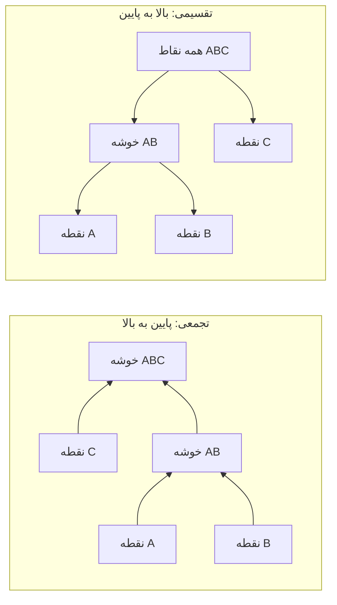

# جلسه ۲۷ — خوشه‌بندی سلسله‌مراتبی

## چرا خوشه‌بندی سلسله‌مراتبی؟

در جلسه قبل الگوریتم k-Means را شناختیم ← [[26 - مبانی خوشه‌بندی و k-Means]]. این الگوریتم سریع و ساده است، اما سه ضعف مهم دارد:

- تعداد خوشه‌ها (پارامتر k) باید **از پیش** تعیین شود.
- خروجی فقط **یک** افراز است؛ رابطه میان خوشه‌ها (کدام خوشه‌ها به هم نزدیک‌ترند) را نشان نمی‌دهد.
- نتیجه به مقداردهی اولیه وابسته است و هر اجرا ممکن است جواب متفاوتی بدهد.

در بسیاری از حوزه‌ها، داده به‌طور طبیعی **سلسله‌مراتبی** است: در زیست‌شناسی، گونه‌ها در جنس، خانواده و راسته قرار می‌گیرند؛ در فروشگاه، محصولات در زیرگروه، گروه و دپارتمان؛ و مشتریان در بخش‌ها و زیربخش‌ها. **خوشه‌بندی سلسله‌مراتبی** (Hierarchical Clustering) به جای یک افراز، یک **درخت کامل** از خوشه‌های تودرتو می‌سازد که می‌توان آن را در هر سطحی برش داد.

> [!important] نکته کلیدی خوشه‌بندی سلسله‌مراتبی فقط به **ماتریس فاصله** نیاز دارد، نه به مختصات نقاط ← [[۵ - معیارهای شباهت و فاصله]]. پس با هر معیار فاصله (اقلیدسی، منهتن، کسینوسی، جاکارد یا گاور برای داده ترکیبی) کار می‌کند و نتیجه آن **قطعی** است: با داده یکسان، همیشه همان درخت ساخته می‌شود.

---

## خوشه‌بندی تجمعی و تقسیمی

دو راهبرد برای ساخت درخت وجود دارد:

|ویژگی|تجمعی (Agglomerative)|تقسیمی (Divisive)|
|:-:|:-:|:-:|
|جهت|پایین به بالا|بالا به پایین|
|شروع|هر نقطه یک خوشه (n خوشه)|همه نقاط در یک خوشه|
|هر گام|ادغام دو خوشه **نزدیک‌تر**|شکستن یک خوشه به دو خوشه|
|پایان|یک خوشه شامل همه نقاط|هر نقطه یک خوشه (یا رسیدن به k خوشه)|
|نمونه الگوریتم|روش‌های پیوند Single، Complete، Average، Ward|الگوریتم DIANA، k-Means دونیم‌کننده (Bisecting)|
|کاربرد|بسیار رایج‌تر|وقتی ساختار سطح بالا مهم‌تر است|
|هزینه|دست‌کم درجه دو در n|تقسیم بهینه نمایی است؛ نیاز به روش‌های ابتکاری|



### الگوریتم عمومی خوشه‌بندی تجمعی

1. ماتریس فاصله همه جفت نقاط را محاسبه کن؛ هر نقطه یک خوشه است.
2. دو خوشه‌ای را که **کمترین فاصله** را دارند پیدا و ادغام کن.
3. فاصله خوشه جدید تا سایر خوشه‌ها را با **روش پیوند** انتخابی به‌روز کن.
4. گام‌های ۲ و ۳ را تا باقی ماندن یک خوشه تکرار کن. ترتیب ادغام‌ها و فاصله هر ادغام را ثبت کن.

> [!note] ادغام‌ها برگشت‌ناپذیرند خوشه‌بندی تجمعی یک روش **حریصانه** است: ادغامی که در یک گام انجام شد، هرگز اصلاح نمی‌شود. اگر دو نقطه در ابتدا به اشتباه ادغام شوند (مثلاً به دلیل نویز)، این خطا تا انتهای درخت باقی می‌ماند. در مقابل، k-Means در هر تکرار می‌تواند انتساب‌ها را اصلاح کند.

### خوشه‌بندی تقسیمی

ساده‌ترین روش تقسیمی، **k-Means دونیم‌کننده** (Bisecting k-Means) است: همه نقاط را در یک خوشه قرار بده؛ سپس در هر گام، خوشه‌ای را که بیشترین SSE (یا بیشترین تعداد نقطه) دارد با k-Means و k برابر ۲ به دو نیم تقسیم کن. این روش در scikit-learn با کلاس `BisectingKMeans` موجود است. الگوریتم کلاسیک **DIANA** در هر گام، نقطه‌ای را که بیشترین میانگین فاصله با بقیه را دارد جدا می‌کند و به‌تدریج نقاط مشابه آن را به گروه جدید منتقل می‌کند.

---

## روش‌های پیوند (Linkage)

مهم‌ترین تصمیم در خوشه‌بندی تجمعی این است که **فاصله دو خوشه** را چگونه تعریف کنیم. برای دو خوشه A و B:

**پیوند تکی** (Single Linkage): فاصله **نزدیک‌ترین** جفت نقاط.

$$ d_{\text{single}}(A, B) = \min_{a \in A, , b \in B} d(a, b) $$

**پیوند کامل** (Complete Linkage): فاصله **دورترین** جفت نقاط.

$$ d_{\text{complete}}(A, B) = \max_{a \in A, , b \in B} d(a, b) $$

**پیوند میانگین** (Average Linkage یا UPGMA): **میانگین** فاصله همه جفت نقاط.

$$ d_{\text{average}}(A, B) = \frac{1}{|A| \cdot |B|} \sum_{a \in A} \sum_{b \in B} d(a, b) $$

**روش وارد** (Ward): دو خوشه‌ای را ادغام کن که **افزایش SSE** (مجموع مربعات درون‌خوشه‌ای) کمینه شود. اگر مراکز دو خوشه مو-A و مو-B باشند:

$$ \Delta \text{SSE}(A, B) = \frac{|A| \cdot |B|}{|A| + |B|} , \lVert \mu_A - \mu_B \rVert^2 $$

> [!note] ارتفاع ادغام در روش وارد در scipy تابع `linkage` در scipy برای روش وارد، ارتفاع ادغام را برابر ریشه دوم دو برابر افزایش SSE گزارش می‌کند تا با فاصله اقلیدسی هم‌مقیاس باشد. برای دو نقطه تنها، این مقدار دقیقاً برابر فاصله اقلیدسی آن‌هاست.

$$ h_{\text{ward}}(A, B) = \sqrt{2 , \Delta \text{SSE}(A, B)} $$

### مقایسه روش‌های پیوند

|روش پیوند|شکل خوشه‌ها|نقطه قوت|نقطه ضعف|
|:-:|:-:|:-:|:-:|
|پیوند تکی|زنجیره‌ای، کشیده، شکل دلخواه|کشف خوشه‌های غیرمحدب (مانند هلال)|**اثر زنجیره‌ای** (Chaining): یک پل باریک از نقاط، دو خوشه را یکی می‌کند؛ حساس به نویز|
|پیوند کامل|فشرده، تقریباً هم‌قطر|مقاوم در برابر زنجیره‌سازی|حساس به داده پرت؛ تمایل به شکستن خوشه‌های بزرگ|
|پیوند میانگین|میان دو حالت قبل|مصالحه خوب، کمتر حساس به نویز|سوگیری کمتر روشن|
|روش وارد|کروی و هم‌اندازه (مانند k-Means)|معمولاً بهترین نتیجه برای خوشه‌های فشرده|فقط با فاصله اقلیدسی؛ مشکلات k-Means را به ارث می‌برد|

> [!warning] روش وارد فقط با فاصله اقلیدسی روش وارد بر پایه SSE و مرکز (میانگین) تعریف شده و فقط با فاصله **اقلیدسی** معنا دارد. در scikit-learn، اگر `linkage="ward"` باشد، معیار فاصله باید اقلیدسی باشد. برای فاصله‌های دیگر (منهتن، کسینوسی، ماتریس فاصله دلخواه) از پیوند تکی، کامل یا میانگین استفاده کنید.

### مثال حل‌شده

> [!example] مثال حل‌شده — پنج نقطه روی یک خط پنج نقطه A، B، C، D و E به ترتیب در مختصات ۰، ۱، ۳، ۷ و ۱۲ قرار دارند (مثلاً فاصله پنج فروشگاه از انبار مرکزی بر حسب کیلومتر). ماتریس فاصله:
> 
> |نقطه|A|B|C|D|E|
> |:-:|:-:|:-:|:-:|:-:|:-:|
> |نقطه A|0|1|3|7|12|
> |نقطه B|1|0|2|6|11|
> |نقطه C|3|2|0|4|9|
> |نقطه D|7|6|4|0|5|
> |نقطه E|12|11|9|5|0|
> 
> **گام ۱ (برای همه روش‌ها):** کمترین فاصله، فاصله A و B برابر ۱ است. خوشه AB در ارتفاع ۱ ساخته می‌شود.
> 
> **پیوند تکی.** فاصله خوشه AB تا بقیه = کمینه فاصله‌ها:
> 
> |خوشه|AB|C|D|E|
> |:-:|:-:|:-:|:-:|:-:|
> |خوشه AB|0|min(3, 2) = 2|min(7, 6) = 6|min(12, 11) = 11|
> |نقطه C|2|0|4|9|
> |نقطه D|6|4|0|5|
> |نقطه E|11|9|5|0|
> 
> - گام ۲: کمترین فاصله ۲ است؛ ادغام AB و C در ارتفاع **۲**.
> - گام ۳: فاصله ABC تا D برابر min(7, 6, 4) = 4 و تا E برابر 9 است؛ فاصله D و E برابر 5 است. ادغام ABC و D در ارتفاع **۴**.
> - گام ۴: فاصله ABCD تا E برابر min(12, 11, 9, 5) = 5؛ ادغام نهایی در ارتفاع **۵**.
> 
> ساختار حاصل: نقاط **یکی‌یکی** به یک خوشه بزرگ اضافه می‌شوند؛ نمونه‌ای از اثر زنجیره‌ای.
> 
> **پیوند کامل.** فاصله خوشه AB تا بقیه = بیشینه فاصله‌ها: تا C برابر max(3, 2) = 3، تا D برابر 7 و تا E برابر 12.
> 
> - گام ۲: کمترین فاصله ۳ (خوشه AB و C) است؛ ادغام در ارتفاع **۳**.
> - گام ۳: فاصله ABC تا D برابر max(7, 6, 4) = 7 و تا E برابر 12 است، اما فاصله D و E برابر 5 است. ادغام D و E در ارتفاع **۵**.
> - گام ۴: فاصله ABC و DE برابر max(7, 12, 6, 11, 4, 9) = 12؛ ادغام نهایی در ارتفاع **۱۲**.
> 
> **پیوند میانگین.**
> 
> - گام ۲: فاصله AB تا C برابر (3 + 2) / 2 = 2.5؛ کمترین است. ادغام در ارتفاع **۲.۵**.
> - گام ۳: فاصله ABC تا D برابر (7 + 6 + 4) / 3 ≈ 5.67 و فاصله D و E برابر 5 است؛ ادغام D و E در ارتفاع **۵**.
> - گام ۴: میانگین شش فاصله میان ABC و DE: $$ d(ABC, DE) = \frac{7 + 12 + 6 + 11 + 4 + 9}{6} = \frac{49}{6} \approx 8.17 $$
> 
> **روش وارد.** افزایش SSE برای ادغام AB (مرکز ۰.۵) و C: $$ \Delta \text{SSE} = \frac{2 \times 1}{2 + 1} \times (3 - 0.5)^2 \approx 4.17, \qquad h = \sqrt{2 \times 4.17} \approx 2.89 $$ این کمترین افزایش ممکن است (ادغام C و D افزایش ۸ و ادغام D و E افزایش ۱۲.۵ دارد). سپس D و E با افزایش ۱۲.۵ (ارتفاع ۵) ادغام می‌شوند و در پایان ABC (مرکز ۴/۳) و DE (مرکز ۹.۵): $$ \Delta \text{SSE} = \frac{3 \times 2}{5} \times \left(9.5 - \tfrac{4}{3}\right)^2 \approx 80.03, \qquad h = \sqrt{2 \times 80.03} \approx 12.65 $$ مجموع افزایش‌ها (۰.۵ + ۴.۱۷ + ۱۲.۵ + ۸۰.۰۳ = ۹۷.۲) دقیقاً برابر SSE کل داده نسبت به میانگین ۴.۶ است.
> 
> **خلاصه ارتفاع ادغام‌ها:**
> 
> |گام|پیوند تکی|پیوند کامل|پیوند میانگین|روش وارد|
> |:-:|:-:|:-:|:-:|:-:|
> |گام ۱|ادغام A و B در 1|ادغام A و B در 1|ادغام A و B در 1|ادغام A و B در 1|
> |گام ۲|ادغام AB و C در 2|ادغام AB و C در 3|ادغام AB و C در 2.5|ادغام AB و C در 2.89|
> |گام ۳|ادغام ABC و D در 4|ادغام D و E در 5|ادغام D و E در 5|ادغام D و E در 5|
> |گام ۴|ادغام ABCD و E در 5|ادغام ABC و DE در 12|ادغام ABC و DE در 8.17|ادغام ABC و DE در 12.65|
> |دو خوشه نهایی|خوشه ABCD و نقطه E|خوشه ABC و خوشه DE|خوشه ABC و خوشه DE|خوشه ABC و خوشه DE|
> 
> همه این اعداد با خروجی تابع `linkage` در scipy یکسان‌اند.

### فرمول به‌روزرسانی لنس-ویلیامز

همه روش‌های پیوند بالا را می‌توان با یک فرمول بازگشتی بیان کرد که فاصله خوشه ادغام‌شده (i ∪ j) تا هر خوشه k را فقط از فاصله‌های قبلی به دست می‌آورد. این فرمول باعث می‌شود نیازی به نگه‌داشتن نقاط اصلی نباشد:

$$ d(i \cup j, k) = \alpha_i , d(i, k) + \alpha_j , d(j, k) + \beta , d(i, j) + \gamma , \lvert d(i, k) - d(j, k) \rvert $$

|روش پیوند|ضریب آلفا-i|ضریب بتا|ضریب گاما|
|:-:|:-:|:-:|:-:|
|پیوند تکی|1/2|0|1/2-|
|پیوند کامل|1/2|0|1/2+|
|پیوند میانگین|نسبت اندازه خوشه i به اندازه خوشه ادغام‌شده|0|0|

برای مثال در پیوند تکی، فرمول برابر نصف مجموع منهای نصف قدرمطلق تفاضل است که دقیقاً همان کمینه دو فاصله است.

---

## دندروگرام و برش آن

### دندروگرام (Dendrogram)

**دندروگرام** نمودار درختی فرایند ادغام است:

- برگ‌ها (پایین نمودار) نقاط داده‌اند.
- هر خط افقی یک **ادغام** است و **ارتفاع** آن برابر فاصله دو خوشه در لحظه ادغام است.
- هرچه دو نقطه در ارتفاع پایین‌تری به هم برسند، شبیه‌ترند.

> [!warning] خطای رایج در خواندن دندروگرام نزدیکی **افقی** دو برگ در دندروگرام معنایی ندارد؛ ترتیب برگ‌ها تا حدی دلخواه است (هر ادغام را می‌توان چپ و راست کرد). شباهت دو نقطه فقط با **ارتفاع** نقطه‌ای که شاخه‌هایشان به هم می‌رسند سنجیده می‌شود.

### برش دندروگرام

برای به دست آوردن یک افراز مشخص، دندروگرام را با یک **خط افقی** برش می‌دهیم. تعداد خطوط عمودی که این خط قطع می‌کند، تعداد خوشه‌هاست.

|روش برش|پارامتر در scipy|پارامتر در scikit-learn|
|:-:|:-:|:-:|
|تعداد خوشه مشخص|تابع fcluster با criterion برابر maxclust|پارامتر n_clusters|
|ارتفاع (فاصله) مشخص|تابع fcluster با criterion برابر distance|پارامتر distance_threshold با n_clusters برابر None|

> [!tip] انتخاب محل برش یک قاعده سرانگشتی: دندروگرام را در **بزرگ‌ترین شکاف عمودی** میان ادغام‌های متوالی برش دهید؛ جایی که برای ادغام بعدی باید فاصله زیادی طی شود، یعنی خوشه‌های جدا از هم ادغام می‌شوند. معیارهایی مانند ضریب نیم‌رخ ← [[26 - مبانی خوشه‌بندی و k-Means]] و دانش حوزه نیز به کار می‌آیند.

> [!example] مثال — برش دندروگرام وارد در داده Iris برای داده استانداردشده Iris با روش وارد، ارتفاع شش ادغام آخر حدود ۴.۲۳، ۴.۲۴، ۶.۶۱، ۸.۰۰، ۱۲.۶۴ و ۲۷.۲۵ است.
> 
> - بزرگ‌ترین شکاف (حدود ۱۴.۶) میان ۱۲.۶۴ و ۲۷.۲۵ است؛ برش در این بازه (مثلاً ارتفاع ۱۵) **دو** خوشه می‌دهد: گونه setosa (۴۹ نقطه) و بقیه (۱۰۱ نقطه).
> - برش در ارتفاع ۱۰ **سه** خوشه و در ارتفاع ۵ **پنج** خوشه می‌دهد.
> 
> این نتیجه با واقعیت زیستی هم‌خوان است: setosa به‌وضوح جداست و دو گونه دیگر هم‌پوشانی دارند.

### ضریب همبستگی کوفنتیک (Cophenetic Correlation)

**فاصله کوفنتیک** دو نقطه، ارتفاعی است که در آن دو نقطه برای اولین بار در یک خوشه قرار می‌گیرند. ضریب همبستگی کوفنتیک، همبستگی پیرسون ← [[8 - تحلیل دومتغیره و چندمتغیره]] میان فاصله‌های اصلی و فاصله‌های کوفنتیک همه جفت نقاط است و نشان می‌دهد دندروگرام چقدر فاصله‌های اصلی را **حفظ کرده است**. هرچه به ۱ نزدیک‌تر، بهتر.

> [!example] مثال — ضریب کوفنتیک مثال پنج نقطه در مثال پنج نقطه، فاصله کوفنتیک A و E در پیوند تکی برابر ۵ است (ارتفاع ادغام نهایی)، در حالی که فاصله واقعی آن‌ها ۱۲ است. ضریب همبستگی کوفنتیک برای این مثال:
> 
> |روش پیوند|پیوند تکی|پیوند کامل|پیوند میانگین|روش وارد|
> |:-:|:-:|:-:|:-:|:-:|
> |ضریب کوفنتیک|0.835|0.783|0.790|0.782|
> 
> ضریب کوفنتیک فقط می‌گوید درخت چقدر به فاصله‌ها **وفادار** است، نه اینکه خوشه‌ها چقدر معنادارند؛ پیوند تکی در اینجا بالاترین ضریب را دارد اما خوشه‌های نامتوازن (ABCD و E) می‌سازد.

---

## پیچیدگی محاسباتی و محدودیت‌ها

### هزینه زمانی و حافظه

|جنبه|هزینه|توضیح|
|:-:|:-:|:-:|
|حافظه ماتریس فاصله|درجه دو در n|تعداد جفت‌ها n(n-1)/2 است|
|زمان، پیاده‌سازی ساده|درجه سه در n|در هر یک از n-1 گام، جست‌وجو در کل ماتریس|
|زمان، با صف اولویت|درجه دو در n ضرب در لگاریتم n|پیاده‌سازی‌های عمومی|
|زمان، پیوند تکی|درجه دو در n|الگوریتم SLINK یا درخت پوشای کمینه|
|مقایسه: k-Means|خطی در n|هر تکرار از مرتبه n·k·d|

$$ \text{Memory} \approx \frac{n(n-1)}{2} \times 8 \ \text{bytes} $$

> [!example] مثال حل‌شده — حافظه لازم با اعداد اعشاری ۸ بایتی:
> 
> |تعداد نقاط|تعداد جفت‌ها|حافظه ماتریس فاصله|
> |:-:|:-:|:-:|
> |۱,۰۰۰|499,500|حدود ۴ مگابایت|
> |۱۰,۰۰۰|49,995,000|حدود ۴۰۰ مگابایت|
> |۱۰۰,۰۰۰|4,999,950,000|حدود ۴۰ گیگابایت|
> 
> با ده برابر شدن داده، حافظه **صد برابر** می‌شود. خوشه‌بندی سلسله‌مراتبی کامل برای بیش از چند ده هزار نقطه عملاً ممکن نیست.

### محدودیت‌ها و راه‌حل‌ها

|محدودیت|راه‌حل|
|:-:|:-:|
|مقیاس‌پذیری ضعیف (حافظه و زمان)|نمونه‌گیری، یا ابتدا k-Means با چند صد خوشه و سپس خوشه‌بندی سلسله‌مراتبی مراکز؛ الگوریتم BIRCH|
|ادغام‌های برگشت‌ناپذیر (حریصانه)|بررسی پایداری با زیرنمونه‌ها؛ مقایسه چند روش پیوند|
|حساسیت به نویز و داده پرت (به‌ویژه پیوند تکی و کامل)|حذف پرت‌ها پیش از خوشه‌بندی ← [[11- داده پرت، نویز و داده تکراری]]، پیوند میانگین یا وارد|
|وابستگی شدید به روش پیوند و معیار فاصله|انتخاب آگاهانه بر اساس شکل مورد انتظار خوشه‌ها؛ مقایسه ضریب کوفنتیک|
|وابستگی به مقیاس ویژگی‌ها|استانداردسازی ← [[۱۲ - تبدیل و یکپارچه‌سازی داده]]|
|تفسیر دشوار دندروگرام برای n بزرگ|دندروگرام بریده (truncate) یا نمایش فقط ادغام‌های بالایی|

> [!tip] قید هم‌جواری (Connectivity Constraint) کلاس `AgglomerativeClustering` پارامتری به نام `connectivity` دارد که ادغام را فقط میان خوشه‌های **همسایه** (مثلاً بر اساس گراف k همسایه نزدیک) مجاز می‌کند. این کار هم سرعت را بالا می‌برد و هم ساختارهای محلی (مانند پیکسل‌های مجاور در تصویر) را حفظ می‌کند.

### مقایسه با k-Means

|ویژگی|الگوریتم k-Means|خوشه‌بندی سلسله‌مراتبی|
|:-:|:-:|:-:|
|تعیین تعداد خوشه|پیش از اجرا|پس از اجرا (برش درخت)|
|خروجی|یک افراز|درخت کامل از افرازهای تودرتو|
|قطعیت|وابسته به مقداردهی اولیه|قطعی|
|ورودی|مختصات نقاط|ماتریس فاصله با هر معیار|
|مقیاس‌پذیری|میلیون‌ها نقطه|چند ده هزار نقطه|
|شکل خوشه‌ها|کروی|بسته به روش پیوند (پیوند تکی: دلخواه)|

---

## پیاده‌سازی در پایتون

```python
import matplotlib
matplotlib.use("Agg")
import numpy as np
import pandas as pd
import matplotlib.pyplot as plt
from scipy.cluster.hierarchy import linkage, dendrogram, fcluster, cophenet
from scipy.spatial.distance import pdist, squareform
from sklearn.cluster import AgglomerativeClustering, BisectingKMeans, KMeans
from sklearn.datasets import load_iris, make_blobs, make_moons
from sklearn.preprocessing import StandardScaler
from sklearn.metrics import adjusted_rand_score, silhouette_score
```

### بررسی مثال حل‌شده با scipy

```python
points = np.array([0, 1, 3, 7, 12], dtype=float).reshape(-1, 1)   # A, B, C, D, E
names = list("ABCDE")
D = pdist(points)                    # condensed distance vector
print(squareform(D))                 # the 5x5 distance matrix

for method in ["single", "complete", "average", "ward"]:
    Z = linkage(points, method=method)
    coph_corr, _ = cophenet(Z, D)
    print(method, Z[:, 2].round(2), round(coph_corr, 3), fcluster(Z, 2, criterion="maxclust"))
# single   [1.   2.   4.   5.  ] 0.835 [1 1 1 1 2]
# complete [ 1.  3.  5. 12.] 0.783 [1 1 1 2 2]
# average  [1.   2.5  5.   8.17] 0.79 [1 1 1 2 2]
# ward     [ 1.    2.89  5.   12.65] 0.782 [1 1 1 2 2]
```

> [!note] ساختار ماتریس پیوند خروجی `linkage` ماتریسی با n-1 سطر و ۴ ستون است. هر سطر یک ادغام است: دو ستون اول شماره دو خوشه ادغام‌شده (شماره‌های n به بعد خوشه‌های ساخته‌شده در گام‌های قبل‌اند)، ستون سوم ارتفاع ادغام و ستون چهارم تعداد نقاط خوشه جدید.

### رسم دندروگرام برای چهار روش پیوند

```python
fig, axes = plt.subplots(1, 4, figsize=(16, 4), sharey=True)
for ax, method in zip(axes, ["single", "complete", "average", "ward"]):
    dendrogram(linkage(points, method=method), labels=names, ax=ax)
    ax.set_title(f"{method} linkage")
axes[0].set_ylabel("Merge height")
plt.tight_layout()
plt.show()
```

### داده Iris: دندروگرام، برش و ضریب کوفنتیک

```python
iris = load_iris()
X = StandardScaler().fit_transform(iris.data)
y = iris.target

Z = linkage(X, method="ward")
print(Z[-6:, 2].round(2))            # [ 4.23  4.24  6.61  8.   12.64 27.25]

fig, ax = plt.subplots(figsize=(12, 5))
dendrogram(Z, truncate_mode="lastp", p=20, show_contracted=True, ax=ax)
ax.axhline(15, color="red", ls="--", label="cut at 15 -> 2 clusters")
ax.axhline(10, color="green", ls="--", label="cut at 10 -> 3 clusters")
ax.set(title="Ward dendrogram (Iris, last 20 merges)", xlabel="Cluster size", ylabel="Height")
ax.legend()
plt.show()

for t in [5, 10, 15]:
    print(t, len(np.unique(fcluster(Z, t, criterion="distance"))))   # 5 -> 5, 10 -> 3, 15 -> 2

labels3 = fcluster(Z, 3, criterion="maxclust")
print(pd.crosstab(pd.Series(iris.target_names[y], name="species"), labels3))
# col_0        1   2   3
# setosa      49   1   0
# versicolor   0  27  23
# virginica    0   2  48
```

### مقایسه روش‌های پیوند روی Iris

```python
D_iris = pdist(X)
rows = []
for method in ["single", "complete", "average", "ward"]:
    Zm = linkage(X, method=method)
    lab = fcluster(Zm, 3, criterion="maxclust")
    rows.append({"linkage": method,
                 "cophenetic": cophenet(Zm, D_iris)[0],
                 "ARI": adjusted_rand_score(y, lab),
                 "silhouette": silhouette_score(X, lab),
                 "sizes": sorted(np.bincount(lab)[1:].tolist(), reverse=True)})
print(pd.DataFrame(rows).round(3).to_string(index=False))
#  linkage  cophenetic   ARI  silhouette         sizes
#   single       0.830 0.558       0.505  [100, 49, 1]
# complete       0.751 0.573       0.450 [77, 49, 24]
#  average       0.854 0.562       0.480  [97, 50, 3]
#     ward       0.823 0.615       0.447 [71, 49, 30]

print(round(adjusted_rand_score(y, KMeans(3, n_init=10, random_state=42).fit_predict(X)), 3))  # 0.62
```

### نقاط قوت و ضعف روش‌های پیوند روی داده‌های مصنوعی

```python
rng = np.random.default_rng(42)
X_moons, y_moons = make_moons(n_samples=400, noise=0.05, random_state=42)
X_blobs, y_blobs = make_blobs(n_samples=500, centers=3, cluster_std=[1.0, 2.5, 0.5],
                              random_state=42)
# two compact groups connected by a thin "bridge" of 15 points
left = rng.normal([0, 0], 0.6, (150, 2))
right = rng.normal([6, 0], 0.6, (150, 2))
bridge = np.c_[np.linspace(0.8, 5.2, 15), rng.normal(0, 0.05, 15)]
X_bridge = np.vstack([left, right, bridge])
y_bridge = np.r_[np.zeros(150), np.ones(150), np.full(15, -1)]   # -1 = bridge (ignored)

datasets = [("Moons", X_moons, y_moons, 2), ("Blobs", X_blobs, y_blobs, 3),
            ("Bridge", X_bridge, y_bridge, 2)]
methods = ["single", "complete", "average", "ward"]
fig, axes = plt.subplots(3, 4, figsize=(16, 11))
for i, (name, Xd, yd, k) in enumerate(datasets):
    for j, method in enumerate(methods):
        lab = AgglomerativeClustering(n_clusters=k, linkage=method).fit_predict(Xd)
        mask = yd >= 0
        ari = adjusted_rand_score(yd[mask], lab[mask])
        axes[i, j].scatter(Xd[:, 0], Xd[:, 1], c=lab, cmap="tab10", s=8)
        axes[i, j].set_title(f"{name} - {method}: ARI={ari:.2f}")
plt.tight_layout()
plt.show()
# Moons : single 1.00 | complete 0.48 | average 0.48 | ward 0.48
# Blobs : single 0.57 | complete 1.00 | average 1.00 | ward 1.00
# Bridge: single 0.00 | complete 0.96 | average 1.00 | ward 1.00
```

### برش با آستانه فاصله در scikit-learn و روش تقسیمی

```python
agg = AgglomerativeClustering(n_clusters=None, distance_threshold=10, linkage="ward").fit(X)
print(agg.n_clusters_)     # 3  (same as cutting the scipy dendrogram at height 10)

bkm = BisectingKMeans(n_clusters=3, random_state=42).fit(X)     # divisive (top-down)
print(np.bincount(bkm.labels_), round(adjusted_rand_score(y, bkm.labels_), 3))   # [50 56 44] 0.592

# Memory of the full distance matrix (8-byte floats)
for n in [1_000, 10_000, 100_000]:
    pairs = n * (n - 1) // 2
    print(n, pairs, round(pairs * 8 / 1e9, 3), "GB")
# 1000 499500 0.004 GB | 10000 49995000 0.4 GB | 100000 4999950000 40.0 GB
```

---

## تمرین عملی کلاس

> [!example] تمرین عملی (۲۵ دقیقه)
> 
> 1. ماتریس فاصله زیر (چهار شهر A، B، C و D) را در نظر بگیرید و خوشه‌بندی تجمعی را **با دست** با پیوند تکی و پیوند کامل انجام دهید. ارتفاع هر ادغام را بنویسید و دندروگرام را روی کاغذ رسم کنید:
> 
> |شهر|A|B|C|D|
> |:-:|:-:|:-:|:-:|:-:|
> |شهر A|0|2|6|10|
> |شهر B|2|0|5|9|
> |شهر C|6|5|0|4|
> |شهر D|10|9|4|0|
> 
> 2. پاسخ خود را با scipy بررسی کنید (از `squareform` برای تبدیل ماتریس به بردار فشرده و سپس `linkage` استفاده کنید).
> 3. داده Iris را استاندارد کنید و دندروگرام روش وارد را رسم کنید. بزرگ‌ترین شکاف عمودی کجاست و چند خوشه پیشنهاد می‌کند؟
> 4. دندروگرام را به ۲ و ۳ خوشه برش دهید و جدول توافقی هر کدام را با گونه واقعی بسازید.
> 5. برای چهار روش پیوند، ضریب کوفنتیک، شاخص ARI و اندازه خوشه‌ها (با ۳ خوشه) را در یک جدول مقایسه کنید. کدام روش خوشه‌های بسیار نامتوازن می‌سازد و چرا؟
> 6. نتیجه بهترین روش را با k-Means (با `n_init=10` و `random_state=42`) مقایسه کنید.

> [!question]- پاسخ‌های کلیدی تمرین
> 
> - **پیوند تکی:** ادغام A و B در ارتفاع ۲؛ سپس C و D در ارتفاع ۴ (فاصله AB تا C برابر ۵ است که بیشتر از ۴ است)؛ سپس AB و CD در ارتفاع min(6, 10, 5, 9) = **۵**.
> - **پیوند کامل:** ادغام A و B در ارتفاع ۲؛ سپس C و D در ارتفاع ۴؛ سپس AB و CD در ارتفاع max(6, 10, 5, 9) = **۱۰**. ساختار هر دو درخت یکسان است، فقط ارتفاع ادغام نهایی فرق دارد.
> - کد بررسی: `linkage(squareform(M), method="single")` ارتفاع‌های ۲، ۴ و ۵ و با `method="complete"` ارتفاع‌های ۲، ۴ و ۱۰ را می‌دهد. توجه کنید که اگر خود ماتریس مربعی به `linkage` داده شود، سطرهای آن به عنوان **نقاط** تفسیر می‌شوند و نتیجه اشتباه است.
> - **داده Iris با روش وارد:** بزرگ‌ترین شکاف میان ارتفاع‌های ۱۲.۶۴ و ۲۷.۲۵ است و **دو** خوشه پیشنهاد می‌کند: خوشه‌ای با ۴۹ نقطه setosa و خوشه‌ای با ۱۰۱ نقطه (همه ۱۰۰ نقطه versicolor و virginica به‌علاوه ۱ نقطه setosa).
> - با سه خوشه: setosa تقریباً کامل جدا می‌شود (۴۹ از ۵۰)، ۴۸ نقطه virginica در یک خوشه‌اند، اما versicolor میان دو خوشه تقسیم می‌شود (۲۷ و ۲۳).
> - جدول مقایسه:
> 
> |روش پیوند|ضریب کوفنتیک|شاخص ARI|اندازه خوشه‌ها|
> |:-:|:-:|:-:|:-:|
> |پیوند تکی|0.830|0.558|100، 49، 1|
> |پیوند کامل|0.751|0.573|77، 49، 24|
> |پیوند میانگین|0.854|0.562|97، 50، 3|
> |روش وارد|0.823|0.615|71، 49، 30|
> 
> - پیوند تکی (و تا حدی پیوند میانگین) یک خوشه تک‌نقطه‌ای یا بسیار کوچک می‌سازد: به دلیل اثر زنجیره‌ای، versicolor و virginica که به هم چسبیده‌اند یک خوشه می‌شوند و سومین خوشه فقط یک نقطه دورافتاده است. بالاترین ضریب کوفنتیک (پیوند میانگین) لزوماً بهترین خوشه‌ها را نمی‌دهد.
> - الگوریتم k-Means به ARI حدود **۰.۶۲** می‌رسد که تقریباً برابر روش وارد (۰.۶۱۵) است؛ هر دو تابع هدف مشابهی (SSE) دارند.

---

## پرسش‌های مرور

> [!question]- ۱. تفاوت خوشه‌بندی تجمعی و تقسیمی چیست؟ کدام رایج‌تر است؟ روش تجمعی از پایین شروع می‌کند (هر نقطه یک خوشه) و در هر گام دو خوشه نزدیک‌تر را ادغام می‌کند؛ روش تقسیمی از بالا شروع می‌کند (همه نقاط یک خوشه) و در هر گام یک خوشه را به دو بخش می‌شکند. روش تجمعی رایج‌تر است، چون انتخاب بهترین ادغام ساده است، در حالی که یافتن بهترین تقسیم یک خوشه از نظر محاسباتی بسیار دشوار است.

> [!question]- ۲. اثر زنجیره‌ای چیست و در کدام روش پیوند رخ می‌دهد؟ در **پیوند تکی** فاصله دو خوشه برابر نزدیک‌ترین جفت نقاط است؛ پس یک رشته باریک از نقاط (مثلاً نویز میان دو گروه) کافی است تا دو خوشه کاملاً متمایز با فاصله کم ادغام شوند. نتیجه، خوشه‌های کشیده و زنجیره‌ای و معمولاً یک خوشه بزرگ و چند خوشه بسیار کوچک است.

> [!question]- ۳. چرا روش وارد نتایجی شبیه k-Means می‌دهد؟ چون هر دو بر پایه **مجموع مربعات درون‌خوشه‌ای** (SSE) هستند: روش وارد در هر گام ادغامی را انتخاب می‌کند که کمترین افزایش SSE را دارد. بنابراین مانند k-Means خوشه‌های فشرده، کروی و تقریباً هم‌اندازه را ترجیح می‌دهد و فقط با فاصله اقلیدسی معنادار است. گاهی از نتیجه روش وارد برای مقداردهی اولیه k-Means استفاده می‌شود.

> [!question]- ۴. در یک دندروگرام، دو برگ کنار هم رسم شده‌اند. آیا این دو نقطه حتماً به هم شبیه‌اند؟ خیر. ترتیب افقی برگ‌ها تا حدی دلخواه است. شباهت دو نقطه با **ارتفاع** محل به هم رسیدن شاخه‌هایشان (فاصله کوفنتیک) سنجیده می‌شود. دو برگ کنار هم ممکن است فقط در ادغام نهایی در بالاترین ارتفاع به هم برسند.

> [!question]- ۵. چرا خوشه‌بندی سلسله‌مراتبی برای یک میلیون مشتری مناسب نیست؟ چه جایگزینی پیشنهاد می‌کنید؟ ماتریس فاصله برای یک میلیون نقطه حدود ۵ ضرب در ۱۰ به توان ۱۱ جفت دارد که با ۸ بایت برای هر عدد، حدود ۴ ترابایت حافظه می‌خواهد و زمان اجرا دست‌کم درجه دو است. جایگزین‌ها: ابتدا k-Means (یا MiniBatchKMeans) با چند صد خوشه و سپس خوشه‌بندی سلسله‌مراتبی روی مراکز؛ الگوریتم BIRCH؛ یا اجرا روی یک نمونه تصادفی و نسبت دادن بقیه نقاط به نزدیک‌ترین خوشه.

> [!question]- ۶. فرض کنید داده شما ترکیبی از ویژگی‌های عددی و کیفی است. آیا می‌توانید از روش وارد استفاده کنید؟ چه می‌کنید؟ خیر، روش وارد به فاصله اقلیدسی و میانگین نیاز دارد. می‌توان ماتریس فاصله را با **فاصله گاور** ← [[۵ - معیارهای شباهت و فاصله]] محاسبه کرد و سپس از پیوند میانگین یا کامل استفاده کرد؛ در scikit-learn با `metric="precomputed"` و در scipy با دادن بردار فاصله فشرده به `linkage`.

---

## نکات کلیدی

> [!summary] خلاصه جلسه
> 
> - خوشه‌بندی **سلسله‌مراتبی** درختی از خوشه‌های تودرتو می‌سازد؛ تعداد خوشه پس از اجرا با **برش دندروگرام** انتخاب می‌شود و نتیجه قطعی است.
> - روش **تجمعی** (پایین به بالا) رایج‌تر از روش **تقسیمی** (بالا به پایین، مانند Bisecting k-Means و DIANA) است.
> - **روش پیوند** فاصله دو خوشه را تعریف می‌کند: **تکی** (کمینه، خوشه‌های دلخواه اما اثر زنجیره‌ای)، **کامل** (بیشینه، خوشه‌های فشرده)، **میانگین** (مصالحه) و **وارد** (کمترین افزایش SSE، شبیه k-Means، فقط اقلیدسی).
> - در **دندروگرام** فقط ارتفاع ادغام معنا دارد؛ برش در **بزرگ‌ترین شکاف عمودی** یک قاعده سرانگشتی است. **ضریب کوفنتیک** وفاداری درخت به فاصله‌های اصلی را می‌سنجد.
> - هزینه حافظه **درجه دو** و زمان دست‌کم درجه دو است؛ برای داده بزرگ از نمونه‌گیری یا ترکیب با k-Means استفاده کنید. ادغام‌ها برگشت‌ناپذیرند و نتیجه به نویز، مقیاس و روش پیوند حساس است.

> [!todo] آمادگی برای جلسه بعد
> 
> 1. روی یک نمونه (حداکثر چند هزار سطر) از داده پروژه خود، دندروگرام روش وارد و پیوند میانگین را رسم کنید و تعداد خوشه پیشنهادی را با نتیجه k-Means مقایسه کنید.
> 2. داده make_moons را با k-Means و پیوند تکی خوشه‌بندی کنید و به این پرسش فکر کنید: آیا راهی هست که خوشه‌ها را بر اساس **چگالی** نقاط تعریف کنیم و نقاط نویز را هم جدا کنیم؟ پاسخ در جلسه بعد ← [[28 - خوشه‌بندی چگالی‌محور و مبتنی بر مدل]]
> 3. مفهوم توزیع نرمال چندمتغیره و ماتریس کوواریانس را مرور کنید ← [[4 - آمار توصیفی]]