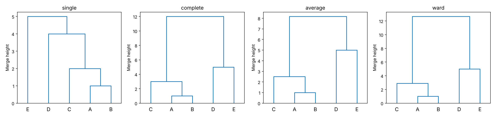
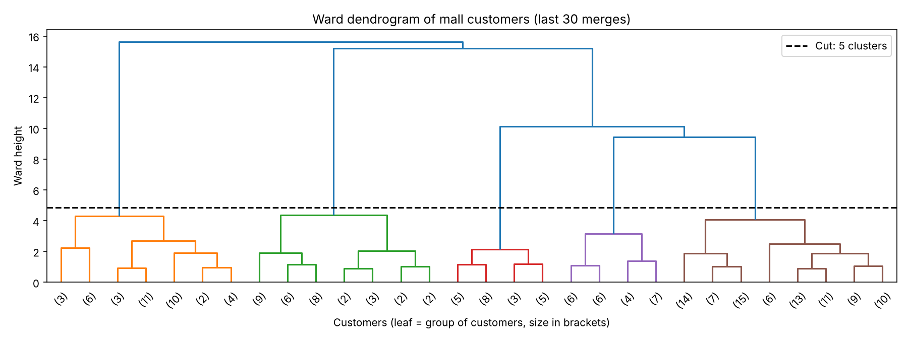
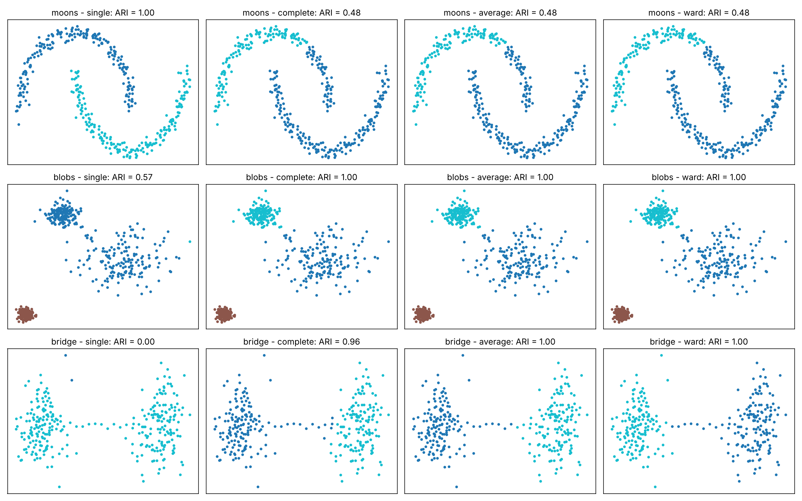

# جلسه ۲۷ — خوشه‌بندی سلسله‌مراتبی

## چرا خوشه‌بندی سلسله‌مراتبی؟

الگوریتم k-Means ← [مبانی خوشه‌بندی و k-Means](26%20-%20%D9%85%D8%A8%D8%A7%D9%86%DB%8C%20%D8%AE%D9%88%D8%B4%D9%87%E2%80%8C%D8%A8%D9%86%D8%AF%DB%8C%20%D9%88%20k-Means.md) سریع و ساده است، اما تعداد خوشه را باید **از پیش** تعیین کرد، فقط **یک** افراز می‌دهد و نتیجه‌اش به مقداردهی اولیه وابسته است. بسیاری از داده‌ها به‌طور طبیعی **سلسله‌مراتبی** هستند: گونه‌ها در جنس و خانواده، محصولات در زیرگروه و دپارتمان، مشتریان در بخش و زیربخش. این جلسه به سه پرسش پاسخ می‌دهد:

- چگونه یک **درخت کامل** از خوشه‌های تودرتو بسازیم؟
- فاصله دو **خوشه** را چگونه تعریف کنیم و این انتخاب چه اثری دارد؟
- درخت (دندروگرام) را چگونه بخوانیم و کجا برش دهیم؟

> [!important] نکته کلیدی
> خوشه‌بندی سلسله‌مراتبی فقط به **ماتریس فاصله** نیاز دارد، نه به مختصات نقاط ← [معیارهای شباهت و فاصله](../Part%201_Data%20Understanding/%DB%B5%20-%20%D9%85%D8%B9%DB%8C%D8%A7%D8%B1%D9%87%D8%A7%DB%8C%20%D8%B4%D8%A8%D8%A7%D9%87%D8%AA%20%D9%88%20%D9%81%D8%A7%D8%B5%D9%84%D9%87.md). پس با هر معیار فاصله (منهتن، کسینوسی، گاور برای داده ترکیبی) کار می‌کند و نتیجه آن **قطعی** است: با داده یکسان همیشه همان درخت ساخته می‌شود.

---

## خوشه‌بندی تجمعی و تقسیمی

| ویژگی | تجمعی (Agglomerative) | تقسیمی (Divisive) |
|:---:|:---:|:---:|
| جهت | پایین به بالا | بالا به پایین |
| شروع | هر نقطه یک خوشه | همه نقاط در یک خوشه |
| هر گام | ادغام دو خوشه **نزدیک‌تر** | شکستن یک خوشه به دو خوشه |
| نمونه الگوریتم | پیوند تکی، کامل، میانگین، وارد | الگوریتم DIANA، k-Means دونیم‌کننده |
| کاربرد | بسیار رایج‌تر | وقتی ساختار سطح بالا مهم‌تر است |

الگوریتم عمومی خوشه‌بندی تجمعی:

1. ماتریس فاصله همه جفت نقاط را حساب کن؛ هر نقطه یک خوشه است.
2. دو خوشه با **کمترین فاصله** را ادغام کن.
3. فاصله خوشه جدید تا بقیه را با **روش پیوند** انتخابی به‌روز کن.
4. گام‌های ۲ و ۳ را تا باقی ماندن یک خوشه تکرار کن و ارتفاع (فاصله) هر ادغام را ثبت کن.

> [!note] ادغام‌ها برگشت‌ناپذیرند
> خوشه‌بندی تجمعی **حریصانه** است: ادغامی که انجام شد هرگز اصلاح نمی‌شود و خطای یک ادغام زودهنگام (مثلاً به دلیل نویز) تا بالای درخت باقی می‌ماند. در مقابل، k-Means در هر تکرار انتساب‌ها را اصلاح می‌کند.

ساده‌ترین روش تقسیمی، **k-Means دونیم‌کننده** است: همه نقاط در یک خوشه‌اند و در هر گام خوشه‌ای که بیشترین SSE را دارد با k-Means دوتایی نصف می‌شود (کلاس `BisectingKMeans`).

---

## روش‌های پیوند

مهم‌ترین تصمیم این است که **فاصله دو خوشه** A و B را چگونه تعریف کنیم:

$$
d_{\text{single}}(A, B) = \min_{a \in A,\, b \in B} d(a, b), \qquad d_{\text{complete}}(A, B) = \max_{a \in A,\, b \in B} d(a, b)
$$

$$
d_{\text{average}}(A, B) = \frac{1}{|A| \cdot |B|} \sum_{a \in A} \sum_{b \in B} d(a, b)
$$

- **پیوند تکی:** فاصله **نزدیک‌ترین** جفت نقاط.
- **پیوند کامل:** فاصله **دورترین** جفت نقاط.
- **پیوند میانگین:** میانگین فاصله همه جفت نقاط.
- **روش وارد:** دو خوشه‌ای را ادغام کن که **افزایش SSE** کمینه شود. تابع `linkage` در scipy ارتفاع ادغام را ریشه دوم دو برابر این افزایش گزارش می‌کند تا با فاصله اقلیدسی هم‌مقیاس باشد:

$$
\Delta \text{SSE}(A, B) = \frac{|A| \cdot |B|}{|A| + |B|} \lVert \mu_A - \mu_B \rVert^2, \qquad h_{\text{ward}} = \sqrt{2 \, \Delta \text{SSE}}
$$

| روش پیوند | شکل خوشه‌ها | نقطه قوت | نقطه ضعف |
|:---:|:---:|:---:|:---:|
| پیوند تکی | زنجیره‌ای، شکل دلخواه | کشف خوشه‌های غیرمحدب | **اثر زنجیره‌ای**: یک پل باریک دو خوشه را یکی می‌کند |
| پیوند کامل | فشرده، هم‌قطر | مقاوم در برابر زنجیره‌سازی | حساس به داده پرت |
| پیوند میانگین | میان دو حالت قبل | مصالحه خوب | سوگیری کمتر روشن |
| روش وارد | کروی و هم‌اندازه (مانند k-Means) | معمولاً بهترین برای خوشه‌های فشرده | فقط با فاصله اقلیدسی |

> [!warning] روش وارد فقط با فاصله اقلیدسی
> روش وارد بر پایه SSE و میانگین تعریف شده است. برای منهتن، کسینوسی یا ماتریس فاصله دلخواه از پیوند تکی، کامل یا میانگین استفاده کنید.

### مثال حل‌شده: پنج فروشگاه روی یک خط

پنج فروشگاه A تا E به ترتیب در فاصله ۰، ۱، ۳، ۷ و ۱۲ کیلومتری انبار مرکزی هستند.

#### گام ۱ — ماتریس فاصله و اولین ادغام

| فروشگاه | A | B | C | D | E |
|:---:|:---:|:---:|:---:|:---:|:---:|
| فروشگاه A | 0 | 1 | 3 | 7 | 12 |
| فروشگاه B | 1 | 0 | 2 | 6 | 11 |
| فروشگاه C | 3 | 2 | 0 | 4 | 9 |
| فروشگاه D | 7 | 6 | 4 | 0 | 5 |
| فروشگاه E | 12 | 11 | 9 | 5 | 0 |

کمترین فاصله، فاصله A و B برابر ۱ است؛ در همه روش‌ها خوشه AB در ارتفاع **۱** ساخته می‌شود.

#### گام ۲ — پیوند تکی

فاصله خوشه AB تا C برابر کمینه ۳ و ۲، یعنی ۲ است؛ تا D برابر ۶ و تا E برابر ۱۱.

| ادغام | فاصله‌های نامزد | ارتفاع |
|:---:|:---:|:---:|
| خوشه AB با C | خوشه AB تا C برابر ۲، C تا D برابر ۴، D تا E برابر ۵ | 2 |
| خوشه ABC با D | خوشه ABC تا D برابر کمینه ۷، ۶، ۴ یعنی ۴؛ D تا E برابر ۵ | 4 |
| خوشه ABCD با E | کمینه ۱۲، ۱۱، ۹، ۵ | 5 |

نقاط **یکی‌یکی** به یک خوشه بزرگ اضافه می‌شوند: اثر زنجیره‌ای.

#### گام ۳ — پیوند کامل

| ادغام | فاصله‌های نامزد | ارتفاع |
|:---:|:---:|:---:|
| خوشه AB با C | خوشه AB تا C برابر بیشینه ۳ و ۲ یعنی ۳؛ C تا D برابر ۴ | 3 |
| نقطه D با E | خوشه ABC تا D برابر ۷، تا E برابر ۱۲؛ D تا E برابر ۵ | 5 |
| خوشه ABC با DE | بیشینه ۷، ۱۲، ۶، ۱۱، ۴، ۹ | 12 |

#### گام ۴ — پیوند میانگین

فاصله AB تا C برابر (۳ + ۲) / ۲ = ۲.۵ و کمترین است. سپس فاصله ABC تا D برابر (۷ + ۶ + ۴) / ۳ ≈ ۵.۶۷ است و D و E با فاصله ۵ ادغام می‌شوند. ادغام نهایی:

$$
d(ABC, DE) = \frac{7 + 12 + 6 + 11 + 4 + 9}{6} = \frac{49}{6} \approx 8.17
$$

#### گام ۵ — روش وارد

ادغام AB (مرکز ۰.۵) و C کمترین افزایش SSE را دارد (ادغام D و E افزایش ۱۲.۵ دارد):

$$
\Delta \text{SSE} = \frac{2 \times 1}{2 + 1} (3 - 0.5)^2 \approx 4.17, \qquad h = \sqrt{2 \times 4.17} \approx 2.89
$$

سپس D و E در ارتفاع ۵ و در پایان ABC (مرکز ۱.۳۳) و DE (مرکز ۹.۵):

$$
\Delta \text{SSE} = \frac{3 \times 2}{5} (9.5 - 1.33)^2 \approx 80.03, \qquad h = \sqrt{2 \times 80.03} \approx 12.65
$$

| گام | پیوند تکی | پیوند کامل | پیوند میانگین | روش وارد |
|:---:|:---:|:---:|:---:|:---:|
| ادغام اول | A و B در 1 | A و B در 1 | A و B در 1 | A و B در 1 |
| ادغام دوم | خوشه AB و C در 2 | خوشه AB و C در 3 | خوشه AB و C در 2.5 | خوشه AB و C در 2.89 |
| ادغام سوم | خوشه ABC و D در 4 | نقطه D و E در 5 | نقطه D و E در 5 | نقطه D و E در 5 |
| ادغام چهارم | خوشه ABCD و E در 5 | خوشه ABC و DE در 12 | خوشه ABC و DE در 8.17 | خوشه ABC و DE در 12.65 |
| دو خوشه نهایی | خوشه ABCD و E | خوشه ABC و DE | خوشه ABC و DE | خوشه ABC و DE |

> [!note] بررسی
> مجموع افزایش‌های وارد (۰.۵ + ۴.۱۷ + ۱۲.۵ + ۸۰.۰۳ = ۹۷.۲) برابر SSE کل داده نسبت به میانگین ۴.۶ است. کد زیر همه ارتفاع‌ها را با تابع `linkage` در scipy بازتولید می‌کند؛ تابع `fcluster` درخت را به دو خوشه می‌برد.

```python
import numpy as np
from scipy.cluster.hierarchy import linkage, fcluster, cophenet
from scipy.spatial.distance import pdist

# Five shops on a line (km from the central warehouse): A, B, C, D, E
X = np.array([[0], [1], [3], [7], [12]])
d = pdist(X)                      # condensed distance vector (10 pairs)
for method in ["single", "complete", "average", "ward"]:
    Z = linkage(X, method=method)
    labels = fcluster(Z, t=2, criterion="maxclust")
    c, _ = cophenet(Z, d)
    print(f"{method:8s} heights={Z[:, 2].round(2).tolist()}  2 clusters={labels.tolist()}  cophenetic={c:.3f}")
```

```
single   heights=[1.0, 2.0, 4.0, 5.0]  2 clusters=[1, 1, 1, 1, 2]  cophenetic=0.835
complete heights=[1.0, 3.0, 5.0, 12.0]  2 clusters=[1, 1, 1, 2, 2]  cophenetic=0.783
average  heights=[1.0, 2.5, 5.0, 8.17]  2 clusters=[1, 1, 1, 2, 2]  cophenetic=0.790
ward     heights=[1.0, 2.89, 5.0, 12.65]  2 clusters=[1, 1, 1, 2, 2]  cophenetic=0.782
```

ستون آخر (ضریب کوفنتیک) را در بخش بعد توضیح می‌دهیم.

---

## دندروگرام و برش آن

**دندروگرام** نمودار درختی فرایند ادغام است: برگ‌ها نقاط داده‌اند، هر خط افقی یک ادغام است و **ارتفاع** آن فاصله دو خوشه در لحظه ادغام. هرچه دو نقطه در ارتفاع پایین‌تری به هم برسند، شبیه‌ترند.

```python
import numpy as np
import matplotlib.pyplot as plt
from scipy.cluster.hierarchy import linkage, dendrogram

# Same five points; one dendrogram per linkage method
X = np.array([[0], [1], [3], [7], [12]])
fig, axes = plt.subplots(1, 4, figsize=(16, 3.8))
for ax, method in zip(axes, ["single", "complete", "average", "ward"]):
    dendrogram(linkage(X, method=method), labels=list("ABCDE"), ax=ax, color_threshold=0)
    ax.set(title=method, ylabel="Merge height")
plt.show()
```

```

```



> [!warning] خطای رایج در خواندن دندروگرام
> نزدیکی **افقی** دو برگ معنایی ندارد؛ هر ادغام را می‌توان چپ و راست کرد (در شکل، ترتیب برگ‌ها در پیوند تکی با بقیه فرق دارد). شباهت دو نقطه فقط با **ارتفاع** محل به هم رسیدن شاخه‌هایشان سنجیده می‌شود.

برای گرفتن یک افراز، دندروگرام را با یک **خط افقی** برش می‌دهیم؛ تعداد خطوط عمودی که قطع می‌شوند تعداد خوشه‌هاست.

| روش برش | در scipy | در scikit-learn |
|:---:|:---:|:---:|
| تعداد خوشه مشخص | تابع fcluster با criterion برابر maxclust | پارامتر n_clusters |
| ارتفاع مشخص | تابع fcluster با criterion برابر distance | پارامتر distance_threshold با n_clusters برابر None |

قاعده سرانگشتی: در **بزرگ‌ترین شکاف عمودی** میان ادغام‌های متوالی برش دهید؛ جایی که ادغام بعدی گروه‌های جدا از هم را به هم می‌چسباند.

**فاصله کوفنتیک** دو نقطه، ارتفاعی است که در آن برای اولین بار هم‌خوشه می‌شوند. **ضریب همبستگی کوفنتیک**، همبستگی پیرسون ← [تحلیل دومتغیره و چندمتغیره](../Part%202_EDA/8%20-%20%D8%AA%D8%AD%D9%84%DB%8C%D9%84%20%D8%AF%D9%88%D9%85%D8%AA%D8%BA%DB%8C%D8%B1%D9%87%20%D9%88%20%DA%86%D9%86%D8%AF%D9%85%D8%AA%D8%BA%DB%8C%D8%B1%D9%87.md) میان فاصله‌های اصلی و فاصله‌های کوفنتیک همه جفت‌هاست و نشان می‌دهد درخت چقدر به فاصله‌ها **وفادار** است. در مثال پنج فروشگاه، فاصله کوفنتیک A و E در پیوند تکی ۵ است، در حالی که فاصله واقعی ۱۲ است. پیوند تکی بالاترین ضریب (۰.۸۳۵) را گرفت اما خوشه‌های نامتوازن (ABCD و E) ساخت: **ضریب کوفنتیک بالا یعنی درخت وفادار، نه لزوماً خوشه‌های معنادار.**

### روی داده واقعی: دندروگرام مشتریان

همان داده مشتریان مرکز خرید جلسه قبل (درآمد و امتیاز خرید، استانداردشده) را با روش وارد خوشه‌بندی می‌کنیم:

```python
import numpy as np
import pandas as pd
import matplotlib.pyplot as plt
from sklearn.preprocessing import StandardScaler
from sklearn.cluster import KMeans
from sklearn.metrics import adjusted_rand_score
from scipy.cluster.hierarchy import linkage, dendrogram, fcluster

# 1. Mall customers, standardized income and spending score; Ward linkage
url = "https://raw.githubusercontent.com/tirthajyoti/Machine-Learning-with-Python/master/Datasets/Mall_Customers.csv"
mall = pd.read_csv(url)
Xs = StandardScaler().fit_transform(mall[["Annual Income (k$)", "Spending Score (1-100)"]])
Z = linkage(Xs, method="ward")

# 2. Heights of the last merges and the gaps between them
last = Z[-8:, 2][::-1]                        # highest first
print(f"last 8 heights={last.round(2).tolist()}")
print(f"gaps={(-np.diff(last)).round(2).tolist()}")

# 3. Cut into 5 clusters and compare with k-means (k = 5)
hc = fcluster(Z, t=5, criterion="maxclust")
km = KMeans(5, n_init=10, random_state=42).fit_predict(Xs)
print(f"cluster sizes={np.bincount(hc)[1:].tolist()}  ARI with k-means={adjusted_rand_score(hc, km):.2f}")

fig, ax = plt.subplots(figsize=(12, 4.5))
dendrogram(Z, truncate_mode="lastp", p=30, ax=ax, color_threshold=Z[-5, 2] + 0.5)
ax.axhline(Z[-5, 2] + 0.5, color="black", ls="--", label="Cut: 5 clusters")
ax.set(xlabel="Customers (leaf = group of customers, size in brackets)", ylabel="Ward height",
       title="Ward dendrogram of mall customers (last 30 merges)")
ax.legend()
plt.show()
```

```
last 8 heights=[15.62, 15.19, 10.14, 9.45, 4.35, 4.31, 4.07, 3.15]
gaps=[0.44, 5.04, 0.69, 5.1, 0.05, 0.24, 0.92]
cluster sizes=[39, 32, 21, 23, 85]  ARI with k-means=0.94
```



| تعداد خوشه پس از ادغام | ۱ | ۲ | ۳ | ۴ | ۵ | ۶ |
|:---:|:---:|:---:|:---:|:---:|:---:|:---:|
| ارتفاع ادغام | 15.62 | 15.19 | 10.14 | 9.45 | 4.35 | 4.31 |

- بزرگ‌ترین شکاف (۵.۱۰) میان ارتفاع‌های ۴.۳۵ و ۹.۴۵ است؛ برش در این بازه **پنج** خوشه می‌دهد، همان k که آرنج و نیم‌رخ در جلسه قبل نشان دادند.
- شکاف دوم (۵.۰۴) میان ۱۰.۱۴ و ۱۵.۱۹ است و سه خوشه پیشنهاد می‌کند؛ دندروگرام هر دو سطح را یک‌جا نشان می‌دهد.
- توافق با k-Means پنج‌خوشه‌ای بسیار بالاست (ARI برابر ۰.۹۴): روش وارد و k-Means هر دو SSE را کمینه می‌کنند.

### مقایسه روش‌های پیوند روی داده مشتریان

```python
import numpy as np
import pandas as pd
from sklearn.preprocessing import StandardScaler
from sklearn.metrics import silhouette_score
from scipy.cluster.hierarchy import linkage, fcluster, cophenet
from scipy.spatial.distance import pdist

# Same standardized data; four linkages, each cut into 5 clusters
url = "https://raw.githubusercontent.com/tirthajyoti/Machine-Learning-with-Python/master/Datasets/Mall_Customers.csv"
Xs = StandardScaler().fit_transform(pd.read_csv(url)[["Annual Income (k$)", "Spending Score (1-100)"]])
d = pdist(Xs)
rows = []
for method in ["single", "complete", "average", "ward"]:
    Z = linkage(Xs, method=method)
    labels = fcluster(Z, t=5, criterion="maxclust")
    rows.append({"linkage": method, "cophenetic": cophenet(Z, d)[0],
                 "silhouette": silhouette_score(Xs, labels),
                 "sizes": sorted(np.bincount(labels)[1:].tolist(), reverse=True)})
print(pd.DataFrame(rows).set_index("linkage").round(3).to_string())
```

```
          cophenetic  silhouette                 sizes
linkage                                               
single         0.722       0.276     [195, 2, 1, 1, 1]
complete       0.667       0.553  [79, 39, 38, 23, 21]
average        0.722       0.479  [102, 38, 36, 21, 3]
ward           0.721       0.554  [85, 39, 32, 23, 21]
```

| روش پیوند | ضریب کوفنتیک | ضریب نیم‌رخ | اندازه خوشه‌ها |
|:---:|:---:|:---:|:---:|
| پیوند تکی | 0.722 | 0.276 | ۱۹۵، ۲، ۱، ۱، ۱ |
| پیوند کامل | 0.667 | 0.553 | ۷۹، ۳۹، ۳۸، ۲۳، ۲۱ |
| پیوند میانگین | 0.722 | 0.479 | ۱۰۲، ۳۸، ۳۶، ۲۱، ۳ |
| روش وارد | 0.721 | 0.554 | ۸۵، ۳۹، ۳۲، ۲۳، ۲۱ |

پیوند تکی با ضریب کوفنتیک برابر با بهترین‌ها، ۱۹۵ مشتری را در یک خوشه گذاشت و چهار خوشه یک‌نفره یا دونفره ساخت: اثر زنجیره‌ای در داده‌ای که گروه‌هایش با چند مشتری مرزی به هم وصل‌اند. روش وارد و پیوند کامل خوشه‌های متعادل و بهترین نیم‌رخ را دارند.

### نقاط قوت هر پیوند روی داده شبیه‌سازی‌شده

سه داده با گروه‌های معلوم: دو هلال، سه توده با پراکندگی متفاوت، و دو توده که با یک **پل** باریک ۱۵ نقطه‌ای به هم وصل‌اند:

```python
import numpy as np
import matplotlib.pyplot as plt
from sklearn.datasets import make_moons, make_blobs
from sklearn.cluster import AgglomerativeClustering
from sklearn.metrics import adjusted_rand_score

# Three simulated data sets with known groups
rng = np.random.default_rng(42)
X_moons, y_moons = make_moons(n_samples=400, noise=0.05, random_state=42)
X_blobs, y_blobs = make_blobs(n_samples=500, centers=3, cluster_std=[1.0, 2.5, 0.5], random_state=42)
left, right = rng.normal([0, 0], 0.6, (150, 2)), rng.normal([6, 0], 0.6, (150, 2))
bridge = np.c_[np.linspace(0.8, 5.2, 15), rng.normal(0, 0.05, 15)]      # thin chain of 15 points
X_bridge = np.vstack([left, right, bridge])
y_bridge = np.r_[np.zeros(150), np.ones(150), np.full(15, -1)]           # -1: bridge, not scored
data = [("moons", X_moons, y_moons, 2), ("blobs", X_blobs, y_blobs, 3), ("bridge", X_bridge, y_bridge, 2)]

methods = ["single", "complete", "average", "ward"]
fig, axes = plt.subplots(3, 4, figsize=(16, 10))
for i, (name, X, y, k) in enumerate(data):
    scores = []
    for j, method in enumerate(methods):
        labels = AgglomerativeClustering(n_clusters=k, linkage=method).fit_predict(X)
        ari = adjusted_rand_score(y[y >= 0], labels[y >= 0])
        scores.append(f"{method} {ari:.2f}")
        axes[i, j].scatter(X[:, 0], X[:, 1], c=labels, cmap="tab10", s=8)
        axes[i, j].set(title=f"{name} - {method}: ARI = {ari:.2f}", xticks=[], yticks=[])
    print(f"{name:7s}" + " | ".join(scores))
plt.show()
```

```
moons  single 1.00 | complete 0.48 | average 0.48 | ward 0.48
blobs  single 0.57 | complete 1.00 | average 1.00 | ward 1.00
bridge single 0.00 | complete 0.96 | average 1.00 | ward 1.00
```



| داده | پیوند تکی | پیوند کامل | پیوند میانگین | روش وارد |
|:---:|:---:|:---:|:---:|:---:|
| دو هلال | 1.00 | 0.48 | 0.48 | 0.48 |
| سه توده | 0.57 | 1.00 | 1.00 | 1.00 |
| دو توده با پل | 0.00 | 0.96 | 1.00 | 1.00 |

هیچ روشی همه‌جا برنده نیست: پیوند تکی تنها روشی است که هلال‌ها را جدا می‌کند، اما پل باریک آن را کاملاً گمراه می‌کند.

---

## برش با ارتفاع، روش تقسیمی و هزینه محاسبه

```python
import numpy as np
import pandas as pd
from sklearn.preprocessing import StandardScaler
from sklearn.cluster import AgglomerativeClustering, BisectingKMeans

url = "https://raw.githubusercontent.com/tirthajyoti/Machine-Learning-with-Python/master/Datasets/Mall_Customers.csv"
Xs = StandardScaler().fit_transform(pd.read_csv(url)[["Annual Income (k$)", "Spending Score (1-100)"]])

# 1. Cut by height instead of number of clusters
for h in [3, 7, 12]:
    agg = AgglomerativeClustering(n_clusters=None, distance_threshold=h, linkage="ward").fit(Xs)
    print(f"cut at height {h}: {agg.n_clusters_} clusters")

# 2. Divisive (top-down): bisecting k-means
bkm = BisectingKMeans(n_clusters=5, random_state=42).fit(Xs)
print(f"bisecting k-means sizes={sorted(np.bincount(bkm.labels_).tolist(), reverse=True)}")

# 3. Memory of the full distance matrix (8-byte floats)
for n in [1_000, 10_000, 100_000]:
    pairs = n * (n - 1) // 2
    print(f"n={n:>7,}  pairs={pairs:>13,}  memory={pairs * 8 / 1e9:.3f} GB")
```

```
cut at height 3: 9 clusters
cut at height 7: 5 clusters
cut at height 12: 3 clusters
bisecting k-means sizes=[78, 44, 34, 26, 18]
n=  1,000  pairs=      499,500  memory=0.004 GB
n= 10,000  pairs=   49,995,000  memory=0.400 GB
n=100,000  pairs=4,999,950,000  memory=40.000 GB
```

- برش در هر ارتفاعی میان ۴.۳۵ و ۹.۴۵ (مثلاً ۷) همان پنج خوشه را می‌دهد.
- روش تقسیمی k-Means دونیم‌کننده خوشه‌هایی با اندازه‌های دیگر ساخت؛ تقسیم‌های اولیه آن نیز برگشت‌ناپذیرند.
- حافظه ماتریس فاصله **درجه دو** در n است: با ده برابر شدن داده، حافظه **صد برابر** می‌شود. زمان اجرا هم دست‌کم درجه دو است.

$$
\text{Memory} \approx \frac{n(n-1)}{2} \times 8 \ \text{bytes}
$$

| محدودیت | راه‌حل |
|:---:|:---:|
| مقیاس‌پذیری ضعیف | نمونه‌گیری، یا k-Means با چند صد خوشه و سپس خوشه‌بندی سلسله‌مراتبی مراکز |
| ادغام‌های برگشت‌ناپذیر | مقایسه چند روش پیوند و بررسی پایداری با زیرنمونه‌ها |
| حساسیت به نویز و پرت | حذف پرت‌ها ← [داده پرت، نویز و داده تکراری](../Part%203_Data%20Preprocessing/11-%20%D8%AF%D8%A7%D8%AF%D9%87%20%D9%BE%D8%B1%D8%AA%D8%8C%20%D9%86%D9%88%DB%8C%D8%B2%20%D9%88%20%D8%AF%D8%A7%D8%AF%D9%87%20%D8%AA%DA%A9%D8%B1%D8%A7%D8%B1%DB%8C.md)، پیوند میانگین یا وارد |
| وابستگی به مقیاس | استانداردسازی ← [تبدیل و یکپارچه‌سازی داده](../Part%203_Data%20Preprocessing/%DB%B1%DB%B2%20-%20%D8%AA%D8%A8%D8%AF%DB%8C%D9%84%20%D9%88%20%DB%8C%DA%A9%D9%BE%D8%A7%D8%B1%DA%86%D9%87%E2%80%8C%D8%B3%D8%A7%D8%B2%DB%8C%20%D8%AF%D8%A7%D8%AF%D9%87.md) |

| ویژگی | الگوریتم k-Means | خوشه‌بندی سلسله‌مراتبی |
|:---:|:---:|:---:|
| تعیین تعداد خوشه | پیش از اجرا | پس از اجرا (برش درخت) |
| خروجی | یک افراز | درخت افرازهای تودرتو |
| قطعیت | وابسته به مقداردهی اولیه | قطعی |
| ورودی | مختصات نقاط | ماتریس فاصله با هر معیار |
| مقیاس‌پذیری | میلیون‌ها نقطه | چند ده هزار نقطه |

> [!note] کارگاه عملی
> دفترچه «۲۷ - کارگاه خوشه‌بندی سلسله‌مراتبی» خوشه‌بندی با ماتریس فاصله دلخواه (منهتن و داده ترکیبی)، قید هم‌جواری، و تمرین عملی کلاس (خوشه‌بندی دستی چهار شهر و مقایسه روش‌های پیوند روی سه ویژگی مشتریان) را با پاسخ دارد. نحوه نوشتن این کدها در امتحان پرسیده نمی‌شود.

---

## خطاهای رایج

| خطا | چرا نادرست است | روش درست |
|:---:|:---:|:---:|
| دادن ماتریس فاصله مربعی به تابع linkage | سطرهای ماتریس به عنوان نقطه تفسیر می‌شوند | تبدیل با squareform یا دادن خود داده |
| قضاوت شباهت از نزدیکی افقی برگ‌ها | ترتیب برگ‌ها دلخواه است | خواندن ارتفاع محل به هم رسیدن شاخه‌ها |
| روش وارد با فاصله منهتن یا کسینوسی | روش وارد بر پایه SSE و فاصله اقلیدسی است | پیوند میانگین یا کامل با فاصله دلخواه |
| انتخاب پیوند فقط با ضریب کوفنتیک | درخت وفادار لزوماً خوشه معنادار نمی‌دهد | بررسی اندازه خوشه‌ها، نیم‌رخ و دانش حوزه |
| خوشه‌بندی سلسله‌مراتبی روی صدها هزار نقطه | حافظه و زمان درجه دو | نمونه‌گیری یا ترکیب با k-Means |
| فراموش کردن استانداردسازی | ویژگی با واحد بزرگ‌تر فاصله را تعیین می‌کند | استانداردسازی پیش از محاسبه فاصله |

---

## نمونه سؤال‌های امتحانی

### سؤال‌های مفهومی

> [!question]- ۱. تفاوت خوشه‌بندی تجمعی و تقسیمی چیست و چرا تجمعی رایج‌تر است؟
> روش تجمعی از پایین شروع می‌کند و در هر گام دو خوشه نزدیک‌تر را ادغام می‌کند؛ روش تقسیمی از بالا شروع می‌کند و در هر گام یک خوشه را می‌شکند. انتخاب بهترین ادغام ساده است، اما یافتن بهترین تقسیم یک خوشه از نظر محاسباتی بسیار دشوار است.

> [!question]- ۲. اثر زنجیره‌ای چیست و در کدام روش پیوند رخ می‌دهد؟
> در **پیوند تکی** فاصله دو خوشه برابر نزدیک‌ترین جفت نقاط است؛ یک رشته باریک از نقاط کافی است تا دو گروه متمایز ادغام شوند. نتیجه معمولاً یک خوشه بزرگ و چند خوشه بسیار کوچک است؛ مانند ۱۹۵ مشتری در یک خوشه در داده مرکز خرید.

> [!question]- ۳. چرا روش وارد نتایجی شبیه k-Means می‌دهد؟
> هر دو بر پایه **مجموع مربعات درون‌خوشه‌ای** هستند: وارد در هر گام ادغامی با کمترین افزایش SSE را انتخاب می‌کند. پس مانند k-Means خوشه‌های فشرده و کروی را ترجیح می‌دهد؛ در داده مشتریان توافق آن‌ها ۰.۹۴ بود.

> [!question]- ۴. داده شما ترکیبی از ویژگی‌های عددی و کیفی است. آیا می‌توانید از روش وارد استفاده کنید؟
> خیر، وارد به فاصله اقلیدسی و میانگین نیاز دارد. ماتریس فاصله را با **فاصله گاور** ← [معیارهای شباهت و فاصله](../Part%201_Data%20Understanding/%DB%B5%20-%20%D9%85%D8%B9%DB%8C%D8%A7%D8%B1%D9%87%D8%A7%DB%8C%20%D8%B4%D8%A8%D8%A7%D9%87%D8%AA%20%D9%88%20%D9%81%D8%A7%D8%B5%D9%84%D9%87.md) حساب کنید و پیوند میانگین یا کامل را به کار ببرید؛ در scikit-learn با `metric="precomputed"`.

### سؤال‌های محاسباتی

> [!question]- ۵. ماتریس فاصله چهار شهر: A و B برابر ۲، A و C برابر ۶، A و D برابر ۱۰، B و C برابر ۵، B و D برابر ۹، C و D برابر ۴. خوشه‌بندی تجمعی را با پیوند تکی و کامل انجام دهید.
> در هر دو روش: ادغام A و B در ارتفاع ۲؛ سپس C و D در ارتفاع ۴ (فاصله AB تا C در پیوند تکی ۵ و در کامل ۶ است، هر دو بیشتر از ۴).
> $$
> h_{\text{single}} = \min(6, 10, 5, 9) = 5, \qquad h_{\text{complete}} = \max(6, 10, 5, 9) = 10
> $$
> ساختار دو درخت یکسان است و فقط ارتفاع ادغام نهایی فرق دارد.

> [!question]- ۶. در همین ماتریس، فاصله خوشه AB و CD با پیوند میانگین چقدر است؟
> $$
> d(AB, CD) = \frac{6 + 10 + 5 + 9}{4} = 7.5
> $$

> [!question]- ۷. نقاط یک‌بعدی ۲ و ۴ (خوشه اول) و ۱۰ (خوشه دوم) را داریم. افزایش SSE روش وارد و ارتفاع ادغام در scipy را حساب کنید.
> مرکز خوشه اول ۳ است:
> $$
> \Delta \text{SSE} = \frac{2 \times 1}{3} (10 - 3)^2 \approx 32.67, \qquad h = \sqrt{2 \times 32.67} \approx 8.08
> $$

> [!question]- ۸. ارتفاع پنج ادغام آخر یک دندروگرام از بالا به پایین ۲۰، ۱۸، ۸، ۷ و ۶.۵ است. با قاعده بزرگ‌ترین شکاف چند خوشه پیشنهاد می‌شود؟
> شکاف‌ها ۲، ۱۰، ۱ و ۰.۵ است. بزرگ‌ترین شکاف میان ۱۸ و ۸ است؛ برش در این بازه (مثلاً ارتفاع ۱۲) دو ادغام بالایی را قطع می‌کند و **سه** خوشه می‌دهد.

### سؤال‌های خواندن کد

> [!question]- ۹. ایراد این کد چیست؟
> ```python
> D = pairwise_distances(X, metric="manhattan")    # square n x n matrix
> Z = linkage(D, method="average")
> ```
> تابع `linkage` ماتریس مربعی را داده (هر سطر یک نقطه n بعدی) تفسیر می‌کند، نه ماتریس فاصله. باید `linkage(squareform(D), method="average")` نوشت یا مستقیماً `linkage(X, method="average", metric="cityblock")`.

> [!question]- ۱۰. خروجی این کد چند خوشه است؟ ارتفاع‌های ادغام ۱، ۲.۵، ۵ و ۸.۱۷ است.
> ```python
> fcluster(Z, t=4, criterion="distance")
> ```
> ادغام‌های بالاتر از ارتفاع ۴ یعنی ۵ و ۸.۱۷ انجام نمی‌شوند؛ پس **سه** خوشه باقی می‌ماند (در مثال پنج فروشگاه با پیوند میانگین: ABC، D و E).

> [!question]- ۱۱. چرا این کد خطا می‌دهد؟
> ```python
> AgglomerativeClustering(n_clusters=3, linkage="ward", metric="cosine").fit(X)
> ```
> روش وارد فقط با فاصله اقلیدسی تعریف شده است و scikit-learn ترکیب آن با کسینوسی را نمی‌پذیرد. برای فاصله کسینوسی `linkage="average"` یا `"complete"` را انتخاب کنید.

---

## نکات کلیدی

> [!summary] خلاصه جلسه
> - خوشه‌بندی **سلسله‌مراتبی** درختی از خوشه‌های تودرتو می‌سازد؛ تعداد خوشه **پس از** اجرا با برش درخت انتخاب می‌شود و نتیجه قطعی است.
> - روش **تجمعی** (پایین به بالا) رایج‌تر از **تقسیمی** است؛ ادغام‌ها برگشت‌ناپذیرند.
> - روش **پیوند** فاصله دو خوشه را تعریف می‌کند: **تکی** (شکل دلخواه اما اثر زنجیره‌ای)، **کامل** (فشرده)، **میانگین** (مصالحه) و **وارد** (کمترین افزایش SSE، شبیه k-Means، فقط اقلیدسی).
> - در **دندروگرام** شباهت با ارتفاع خوانده می‌شود، نه با نزدیکی افقی؛ برش در **بزرگ‌ترین شکاف** تعداد خوشه را پیشنهاد می‌کند. در داده مشتریان این شکاف پنج خوشه داد.
> - **ضریب کوفنتیک** وفاداری درخت به فاصله‌ها را می‌سنجد، نه کیفیت خوشه‌ها را.
> - هزینه حافظه و زمان **درجه دو** است؛ برای داده بزرگ از نمونه‌گیری یا ترکیب با k-Means استفاده کنید.
