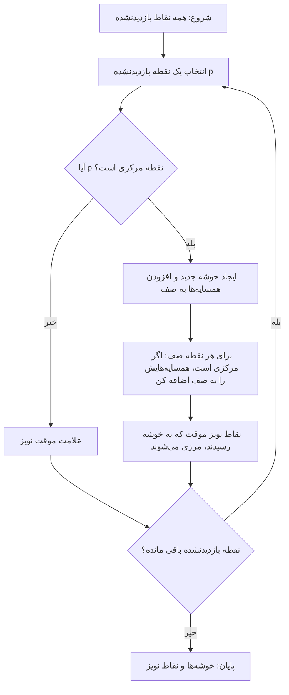
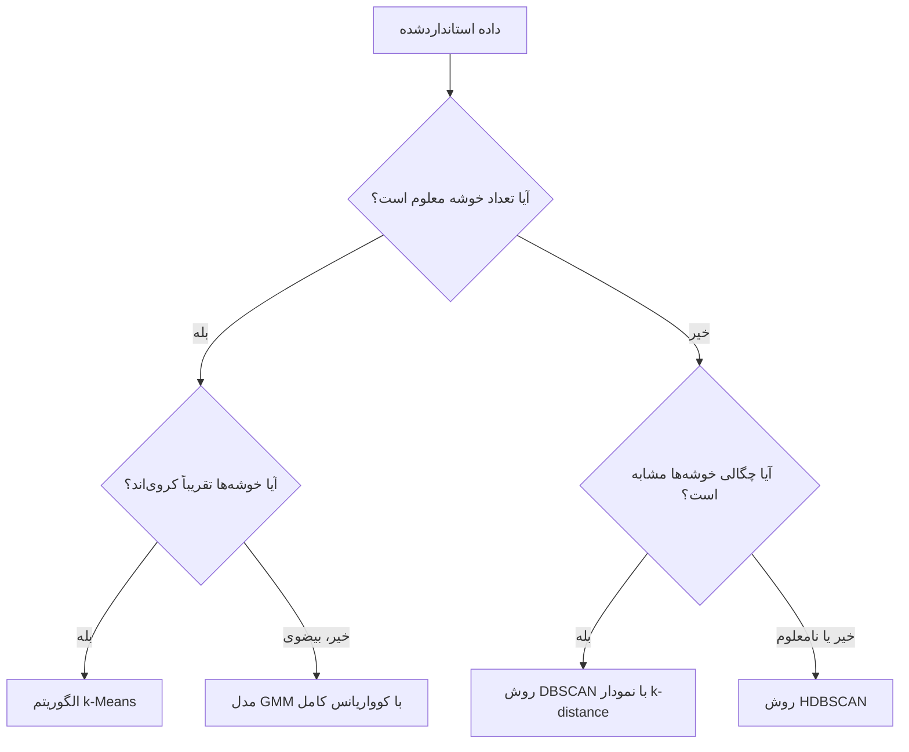

# جلسه ۲۸ — خوشه‌بندی چگالی‌محور و مبتنی بر مدل

## چرا به روش‌های دیگر نیاز داریم؟

در دو جلسه گذشته دو خانواده مهم خوشه‌بندی را دیدیم:

- الگوریتم k-Means هر نقطه را به **نزدیک‌ترین مرکز** نسبت می‌دهد و خوشه‌های تقریباً **کروی و هم‌اندازه** می‌سازد ← [[26 - مبانی خوشه‌بندی و k-Means]]
- خوشه‌بندی سلسله‌مراتبی یک **درخت ادغام** می‌سازد و به انتخاب روش پیوند وابسته است ← [[27 - خوشه‌بندی سلسله‌مراتبی]]

اما در داده‌های واقعی با موقعیت‌هایی روبه‌رو می‌شویم که این روش‌ها در آن‌ها شکست می‌خورند:

|موقعیت|مشکل k-Means|راه‌حل این جلسه|
|:-:|:-:|:-:|
|خوشه‌های هلالی، حلقوی یا مارپیچ|مرز تصمیم همیشه خطی (سلول‌های ورونوی) است|روش چگالی‌محور DBSCAN|
|وجود داده پرت و نویز|هر نقطه باید به یک خوشه برود؛ پرت‌ها مراکز را جابه‌جا می‌کنند|برچسب «نویز» در DBSCAN و HDBSCAN|
|تعداد خوشه نامعلوم|پارامتر k باید از قبل داده شود|روش DBSCAN تعداد خوشه را خودش پیدا می‌کند|
|خوشه‌های کشیده و مورب|فرض کروی بودن خوشه‌ها|مدل آمیخته گاوسی با کوواریانس کامل|
|نقاط مرزی مبهم|تخصیص سخت (هر نقطه فقط یک خوشه)|خوشه‌بندی نرم با احتمال عضویت|

> [!important] دو دیدگاه متفاوت به «خوشه»
> 
> - **دیدگاه چگالی‌محور:** خوشه یک **ناحیه پرتراکم** از نقاط است که با نواحی کم‌تراکم از سایر خوشه‌ها جدا شده است. شکل خوشه هر چیزی می‌تواند باشد.
> - **دیدگاه مبتنی بر مدل:** داده از ترکیب چند **توزیع احتمال** تولید شده و هر خوشه یکی از این توزیع‌هاست. هدف، برآورد پارامترهای این توزیع‌هاست.

---

## خوشه‌بندی چگالی‌محور: DBSCAN

الگوریتم DBSCAN (Density-Based Spatial Clustering of Applications with Noise) در سال ۱۹۹۶ معرفی شد و هنوز یکی از پرکاربردترین الگوریتم‌های خوشه‌بندی است. این الگوریتم فقط **دو پارامتر** دارد:

|پارامتر|نام در scikit-learn|معنا|
|:-:|:-:|:-:|
|شعاع همسایگی|`eps`|بیشترین فاصله‌ای که دو نقطه را همسایه می‌دانیم|
|حداقل نقاط|`min_samples`|کمترین تعداد نقاط داخل همسایگی (شامل خود نقطه) برای پرتراکم بودن|

### همسایگی اپسیلون

همسایگی اپسیلون یک نقطه p، مجموعه همه نقاطی است که فاصله‌شان از p حداکثر برابر eps باشد:

$$ N_{\varepsilon}(p) = {, q \in D ;:; d(p, q) \le \varepsilon ,} $$

### سه نوع نقطه

|نوع نقطه|تعریف|نقش|
|:-:|:-:|:-:|
|نقطه مرکزی (Core)|دست‌کم min_samples نقطه در همسایگی خود دارد|هسته خوشه را می‌سازد و خوشه را گسترش می‌دهد|
|نقطه مرزی (Border)|مرکزی نیست، اما در همسایگی دست‌کم یک نقطه مرکزی قرار دارد|به خوشه تعلق دارد اما آن را گسترش نمی‌دهد|
|نقطه نویز (Noise)|نه مرکزی است و نه در همسایگی یک نقطه مرکزی|به هیچ خوشه‌ای تعلق ندارد (برچسب ۱-)|

شرط مرکزی بودن یک نقطه:

$$ |N_{\varepsilon}(p)| \ge \text{min_samples} $$

### مفاهیم دسترس‌پذیری

- **دسترس‌پذیری مستقیم چگالی** (Directly Density-Reachable): نقطه q از نقطه p به‌طور مستقیم دسترس‌پذیر است اگر p **مرکزی** باشد و q در همسایگی p باشد.
- **دسترس‌پذیری چگالی** (Density-Reachable): زنجیره‌ای از نقاط مرکزی از p به q وجود داشته باشد که هر گام آن دسترس‌پذیری مستقیم است.
- **اتصال چگالی** (Density-Connected): دو نقطه p و q متصل‌اند اگر نقطه مرکزی o وجود داشته باشد که هر دو از آن دسترس‌پذیر باشند.

یک **خوشه** در DBSCAN مجموعه بیشینه‌ای از نقاط است که دوبه‌دو به‌صورت چگالی متصل‌اند.

> [!note] دسترس‌پذیری متقارن نیست یک نقطه مرزی از نقطه مرکزی دسترس‌پذیر است، اما عکس آن برقرار نیست؛ چون از نقطه مرزی نمی‌توان «گسترش» داد. به همین دلیل مفهوم متقارن «اتصال چگالی» برای تعریف خوشه لازم است.

### گام‌های الگوریتم



> [!example] مثال حل‌شده — DBSCAN روی ده نقطه ده نقطه دوبعدی با فاصله اقلیدسی، شعاع همسایگی ۱.۵ و حداقل نقاط ۴ (شامل خود نقطه):
> 
> |نقطه|مختصات|همسایه‌ها (فاصله حداکثر ۱.۵)|تعداد همسایه|نوع نقطه|
> |:-:|:-:|:-:|:-:|:-:|
> |نقطه A|(1, 1)|A, B, C, D|4|مرکزی|
> |نقطه B|(1, 2)|A, B, C, D|4|مرکزی|
> |نقطه C|(2, 1)|A, B, C, D, E|5|مرکزی|
> |نقطه D|(2, 2)|A, B, C, D, E|5|مرکزی|
> |نقطه E|(3, 2)|C, D, E, F|4|مرکزی|
> |نقطه F|(4, 2)|E, F|2|مرزی (همسایه E)|
> |نقطه G|(8, 8)|G, H, I|3|نویز|
> |نقطه H|(8, 9)|G, H, I|3|نویز|
> |نقطه I|(9, 8)|G, H, I|3|نویز|
> |نقطه J|(5, 6)|J|1|نویز|
> 
> برای نمونه، فاصله A تا D برابر است با: $$ d(A, D) = \sqrt{(2-1)^2 + (2-1)^2} = \sqrt{2} \approx 1.41 \le 1.5 $$ اما فاصله A تا E حدود ۲.۲۴ است و همسایه نیستند.
> 
> **نتیجه:** یک خوشه شامل A تا F (پنج نقطه مرکزی و یک نقطه مرزی) و چهار نقطه نویز. نقطه F فقط ۲ همسایه دارد، اما چون در همسایگی نقطه مرکزی E است، **مرزی** است و به خوشه می‌پیوندد.
> 
> **اثر پارامتر:** اگر حداقل نقاط را به ۳ کاهش دهیم، سه نقطه G و H و I هر کدام مرکزی می‌شوند و **خوشه دوم** را می‌سازند؛ فقط J نویز می‌ماند. خروجی scikit-learn برای دو حالت:
> 
> |حداقل نقاط|برچسب‌ها (A تا J)|
> |:-:|:-:|
> |چهار|0 0 0 0 0 0 -1 -1 -1 -1|
> |سه|0 0 0 0 0 0 1 1 1 -1|

> [!warning] تعریف min_samples در کتابخانه‌ها یکسان نیست در scikit-learn، پارامتر `min_samples` **خود نقطه را هم می‌شمارد**. در برخی کتاب‌ها و کتابخانه‌ها (مثلاً MinPts در برخی منابع) فقط همسایه‌های دیگر شمرده می‌شوند. هنگام مقایسه نتایج با کتاب یا کتابخانه دیگر به این تفاوت دقت کنید.

### ویژگی‌های DBSCAN

|ویژگی|توضیح|
|:-:|:-:|
|تعداد خوشه|لازم نیست از قبل تعیین شود|
|شکل خوشه|هر شکل دلخواه (هلالی، حلقوی، نامنظم)|
|داده پرت|به‌صورت طبیعی به‌عنوان نویز شناسایی می‌شود|
|قطعیت|نقاط مرکزی و نویز قطعی‌اند؛ نقطه مرزی مشترک ممکن است به ترتیب پیمایش وابسته باشد|
|پیچیدگی زمانی|حدود n log n با ساختار شاخص (KD-Tree) در ابعاد پایین؛ در بدترین حالت n²|
|نقطه ضعف اصلی|یک eps سراسری؛ برای خوشه‌هایی با **چگالی متفاوت** مناسب نیست|
|ابعاد بالا|فاصله‌ها در ابعاد بالا معنای خود را از دست می‌دهند (نفرین ابعاد)|

> [!tip] مقیاس‌بندی را فراموش نکنید چون DBSCAN با یک شعاع ثابت در **همه جهت‌ها** کار می‌کند، اگر یک ویژگی بر حسب هزار تومان و دیگری بر حسب سال باشد، شعاع eps عملاً فقط روی یک ویژگی اثر دارد. پیش از DBSCAN داده را استاندارد کنید ← [[۱۲ - تبدیل و یکپارچه‌سازی داده]]

---

## انتخاب eps و min_samples

### قواعد سرانگشتی برای min_samples

|قاعده|توضیح|
|:-:|:-:|
|دست‌کم ابعاد به‌علاوه یک|برای داده d بعدی، مقدار min_samples حداقل d+1 باشد|
|دو برابر ابعاد|پیشنهاد رایج برای داده‌های نویزی‌تر|
|مقدار ۴ یا ۵|پیش‌فرض متداول برای داده دوبعدی (پیش‌فرض scikit-learn برابر ۵ است)|
|داده بزرگ و نویزی|مقدار بزرگ‌تر، خوشه‌های پایدارتر و نویز بیشتر|

### نمودار k-distance

ایده: برای هر نقطه، فاصله تا **k‌امین نزدیک‌ترین همسایه** را حساب می‌کنیم (با k برابر min_samples). نقاط داخل خوشه این فاصله را **کوچک** و نقاط نویز آن را **بزرگ** دارند. اگر این فاصله‌ها را مرتب و رسم کنیم، منحنی در جایی **زانو** (Elbow/Knee) می‌زند؛ مقدار عمودی آن نقطه، کاندیدای خوبی برای eps است.

$$ \text{k-dist}(p) = d\big(p, ; \text{k-th nearest neighbor of } p\big) $$

> [!example] مثال — نمودار k-distance روی داده هلالی روی ۳۰۰ نقطه داده هلالی استانداردشده (`make_moons` با نویز ۰.۰۶) و k برابر ۵:
> 
> |صدک فاصله تا پنجمین همسایه|مقدار|
> |:-:|:-:|
> |میانه|0.127|
> |صدک ۹۰|0.183|
> |صدک ۹۵|0.206|
> |صدک ۹۹|0.259|
> |بیشینه|0.383|
> 
> زانوی منحنی حدود ۰.۲ تا ۰.۳ است. اثر eps با حداقل نقاط ۵:
> 
> |شعاع eps|تعداد خوشه|تعداد نویز|شاخص ARI با برچسب واقعی|
> |:-:|:-:|:-:|:-:|
> |0.1|21|160|0.036|
> |0.2|3|5|0.799|
> |0.3|2|0|1.000|
> |0.5|2|0|1.000|
> |1.0|1|0|0.000|
> 
> شعاع خیلی کوچک داده را به ده‌ها خوشه ریز و نویز فراوان می‌شکند؛ شعاع خیلی بزرگ همه را در یک خوشه ادغام می‌کند. بازه نسبتاً پهنی (۰.۳ تا ۰.۵) جواب درست می‌دهد. شاخص ARI را در جلسه بعد دقیق معرفی می‌کنیم ← [[29 - ارزیابی و تفسیر خوشه‌ها]]

> [!warning] زانو همیشه واضح نیست در داده‌های واقعی منحنی k-distance گاهی زانوی واضحی ندارد یا چند زانو دارد (نشانه خوشه‌هایی با چگالی متفاوت). در این حالت چند مقدار اطراف زانو را امتحان کنید، تعداد خوشه و درصد نویز را گزارش کنید و نتیجه را با دانش حوزه بسنجید.

---

## معرفی HDBSCAN

بزرگ‌ترین ضعف DBSCAN این است که یک eps **سراسری** دارد. اگر یک خوشه متراکم و خوشه دیگر پراکنده باشد، هیچ eps واحدی هر دو را درست پیدا نمی‌کند.

الگوریتم HDBSCAN (Hierarchical DBSCAN) این مشکل را با ترکیب ایده چگالی و خوشه‌بندی سلسله‌مراتبی حل می‌کند:

1. برای هر نقطه **فاصله مرکزی** (Core Distance) را حساب می‌کند: فاصله تا min_samples‌امین همسایه.
2. فاصله‌ها را به **فاصله دسترس‌پذیری متقابل** (Mutual Reachability) تبدیل می‌کند تا نقاط پراکنده از هم دورتر دیده شوند.
3. روی این فاصله‌ها یک درخت پوشای کمینه و سپس یک **سلسله‌مراتب خوشه‌ها** می‌سازد (مانند پیوند Single در جلسه قبل).
4. درخت را با حذف خوشه‌های کوچک‌تر از min_cluster_size **فشرده** می‌کند.
5. پایدارترین خوشه‌ها را در سطوح مختلف چگالی انتخاب می‌کند؛ یعنی عملاً برای هر خوشه eps متفاوتی به کار می‌برد.

$$ d_{\text{mreach}}(a, b) = \max\big{\text{core}(a),; \text{core}(b),; d(a, b)\big} $$

|ویژگی|روش DBSCAN|روش HDBSCAN|
|:-:|:-:|:-:|
|پارامتر اصلی|شعاع eps و min_samples|حداقل اندازه خوشه (min_cluster_size)|
|خوشه‌های با چگالی متفاوت|ضعیف|خوب|
|حساسیت به پارامتر|زیاد (به‌ویژه eps)|کمتر|
|خروجی اضافه|ندارد|احتمال عضویت هر نقطه (`probabilities_`)|
|در scikit-learn|`sklearn.cluster.DBSCAN`|`sklearn.cluster.HDBSCAN` (از نسخه ۱.۳)|

> [!note] الگوریتم OPTICS روش OPTICS نیز در scikit-learn وجود دارد و مانند HDBSCAN با چگالی‌های مختلف کنار می‌آید. این روش یک **ترتیب** از نقاط و نمودار دسترس‌پذیری (Reachability Plot) تولید می‌کند که دره‌های آن خوشه‌ها هستند. در عمل HDBSCAN معمولاً ساده‌تر و سریع‌تر است.

---

## مدل آمیخته گاوسی (GMM) و الگوریتم EM

### ایده مدل آمیخته

فرض می‌کنیم هر نقطه داده این‌طور تولید شده است: ابتدا یکی از K مؤلفه با احتمال π انتخاب شده و سپس نقطه از توزیع گاوسی آن مؤلفه نمونه‌گیری شده است. چگالی کل داده:

$$ p(\mathbf{x}) = \sum_{k=1}^{K} \pi_k ; \mathcal{N}(\mathbf{x} \mid \boldsymbol{\mu}_k, \boldsymbol{\Sigma}_k), \qquad \sum_{k=1}^{K} \pi_k = 1 $$

|پارامتر|معنا|نقش در خوشه‌بندی|
|:-:|:-:|:-:|
|وزن مؤلفه (π)|سهم هر مؤلفه از داده|اندازه نسبی خوشه|
|میانگین (μ)|مرکز توزیع گاوسی|مرکز خوشه|
|کوواریانس (Σ)|شکل، جهت و پهنای توزیع|شکل بیضوی و جهت خوشه|

### الگوریتم EM (Expectation-Maximization)

اگر می‌دانستیم هر نقطه از کدام مؤلفه آمده، برآورد میانگین و کوواریانس ساده بود. اگر پارامترها را می‌دانستیم، تعیین مؤلفه هر نقطه ساده بود. الگوریتم EM این دو گام را **به نوبت** تکرار می‌کند:

**گام E (امید ریاضی):** محاسبه **مسئولیت** (Responsibility) هر مؤلفه برای هر نقطه، یعنی احتمال پسین اینکه نقطه i از مؤلفه k آمده باشد:

$$ \gamma_{ik} = \frac{\pi_k , \mathcal{N}(\mathbf{x}_i \mid \boldsymbol{\mu}_k, \boldsymbol{\Sigma}_k)}{\sum_{j=1}^{K} \pi_j , \mathcal{N}(\mathbf{x}_i \mid \boldsymbol{\mu}_j, \boldsymbol{\Sigma}_j)} $$

**گام M (بیشینه‌سازی):** به‌روزرسانی پارامترها با میانگین وزن‌دار (وزن‌ها همان مسئولیت‌ها):

$$ \begin{aligned} N_k &= \sum_{i=1}^{n} \gamma_{ik}, \qquad \pi_k = \frac{N_k}{n} \ \boldsymbol{\mu}_k &= \frac{1}{N_k} \sum_{i=1}^{n} \gamma_{ik} , \mathbf{x}_i \ \boldsymbol{\Sigma}_k &= \frac{1}{N_k} \sum_{i=1}^{n} \gamma_{ik} , (\mathbf{x}_i - \boldsymbol{\mu}_k)(\mathbf{x}_i - \boldsymbol{\mu}_k)^{\top} \end{aligned} $$

این دو گام تا همگرایی **لگاریتم درست‌نمایی** تکرار می‌شوند. هر تکرار EM لگاریتم درست‌نمایی را کاهش نمی‌دهد، اما ممکن است در **بهینه محلی** گیر کند؛ به همین دلیل چند مقداردهی اولیه (`n_init`) مفید است.

> [!example] مثال حل‌شده — یک تکرار EM در یک بعد هفت نقطه یک‌بعدی: 1, 2, 3, 4, 7, 8, 9
> 
> **مقداردهی اولیه:** دو مؤلفه با میانگین‌های ۲ و ۶، واریانس هر دو برابر ۴ (انحراف معیار ۲) و وزن هر دو ۰.۵.
> 
> **گام E:** برای نقطه ۴، فاصله تا هر دو میانگین برابر ۲ است، پس: $$ \gamma_{4,1} = \frac{0.5 \times \mathcal{N}(4 \mid 2, 4)}{0.5 \times \mathcal{N}(4 \mid 2, 4) + 0.5 \times \mathcal{N}(4 \mid 6, 4)} = \frac{0.0605}{0.0605 + 0.0605} = 0.5 $$ برای نقطه ۱، صورت کسر برای مؤلفه اول ۰.۰۸۸ و برای مؤلفه دوم ۰.۰۰۴۴ است: $$ \gamma_{1,1} = \frac{0.088}{0.088 + 0.0044} \approx 0.953 $$ جدول کامل مسئولیت‌ها:
> 
> |نقطه|1|2|3|4|7|8|9|
> |:-:|:-:|:-:|:-:|:-:|:-:|:-:|:-:|
> |مسئولیت مؤلفه ۱|0.953|0.881|0.731|0.500|0.047|0.018|0.007|
> |مسئولیت مؤلفه ۲|0.047|0.119|0.269|0.500|0.953|0.982|0.993|
> 
> **گام M:** مجموع مسئولیت‌ها برای مؤلفه اول حدود ۳.۱۳۷ و برای مؤلفه دوم حدود ۳.۸۶۳ است: $$ \mu_1 = \frac{0.953 \times 1 + 0.881 \times 2 + \dots + 0.007 \times 9}{3.137} \approx 2.373, \qquad \mu_2 \approx 6.874 $$
> 
> |پارامتر|مقدار اولیه|پس از یک تکرار|
> |:-:|:-:|:-:|
> |میانگین مؤلفه ۱|2|2.373|
> |میانگین مؤلفه ۲|6|6.874|
> |واریانس مؤلفه ۱|4|1.724|
> |واریانس مؤلفه ۲|4|4.758|
> |وزن مؤلفه ۱|0.5|0.448|
> |وزن مؤلفه ۲|0.5|0.552|
> 
> این اعداد دقیقاً با `GaussianMixture` در scikit-learn با همین مقداردهی اولیه و یک تکرار برابرند. پس از همگرایی (۸ تکرار)، میانگین‌ها حدود ۲.۵ و ۸.۰ و وزن‌ها حدود ۰.۵۷ و ۰.۴۳ می‌شوند؛ یعنی مدل دو گروه {1, 2, 3, 4} و {7, 8, 9} را یافته است.

### خوشه‌بندی نرم و سخت

|جنبه|خوشه‌بندی سخت (Hard)|خوشه‌بندی نرم (Soft)|
|:-:|:-:|:-:|
|خروجی|یک برچسب برای هر نقطه|بردار احتمال عضویت در همه خوشه‌ها|
|نمونه الگوریتم|الگوریتم k-Means، DBSCAN|مدل GMM، Fuzzy C-Means|
|در scikit-learn|متد `predict`|متد `predict_proba`|
|کاربرد|بخش‌بندی قطعی|شناسایی نقاط مبهم، تصمیم‌گیری با عدم قطعیت|

> [!tip] رابطه k-Means و GMM الگوریتم k-Means را می‌توان حالت خاصی از EM برای GMM دانست: کوواریانس همه مؤلفه‌ها **کروی و برابر** و بسیار کوچک فرض شود تا مسئولیت‌ها صفر و یک شوند. به همین دلیل GMM با کوواریانس کامل، تعمیم انعطاف‌پذیرتر k-Means است.

### نوع کوواریانس

|مقدار `covariance_type`|شکل خوشه|تعداد پارامتر|
|:-:|:-:|:-:|
|کروی (spherical)|دایره با شعاع متفاوت برای هر مؤلفه|کمترین|
|قطری (diag)|بیضی هم‌راستا با محورها|متوسط|
|مشترک (tied)|همه مؤلفه‌ها یک بیضی یکسان|متوسط|
|کامل (full)|هر مؤلفه بیضی دلخواه با جهت دلخواه|بیشترین (پیش‌فرض)|

### انتخاب تعداد مؤلفه با BIC

چون GMM یک مدل احتمالاتی است، می‌توان از **معیار اطلاعات بیزی** (BIC) برای انتخاب تعداد مؤلفه و نوع کوواریانس استفاده کرد. در این فرمول L درست‌نمایی بیشینه، p تعداد پارامترها و n تعداد نقاط است؛ مقدار **کمتر** بهتر است:

$$ \text{BIC} = -2 \ln \hat{L} + p \ln n $$

جمله اول برازش و جمله دوم **جریمه پیچیدگی** است؛ همان ایده منظم‌سازی ← [[19 - منظم‌سازی در رگرسیون]]

> [!example] مثال — BIC برای داده کشیده روی ۶۰۰ نقطه از سه خوشه **کشیده و مورب** (داده blobs با یک تبدیل خطی):
> 
> |نوع کوواریانس|بهترین تعداد مؤلفه با BIC|
> |:-:|:-:|
> |کروی (spherical)|6|
> |قطری (diag)|6|
> |مشترک (tied)|3|
> |کامل (full)|3|
> 
> مدل‌های کروی و قطری نمی‌توانند بیضی مورب را با یک مؤلفه بسازند، پس برای جبران، **مؤلفه‌های بیشتری** می‌خواهند. با کوواریانس کامل، تعداد درست (۳) انتخاب می‌شود و شاخص ARI برابر ۱ است، در حالی که k-Means به حدود ۰.۵۸ و GMM کروی به حدود ۰.۵۷ می‌رسند.

> [!warning] محدودیت‌های GMM
> 
> - فرض **گاوسی بودن** هر خوشه؛ برای خوشه‌های هلالی یا حلقوی مناسب نیست.
> - حساس به مقداردهی اولیه و بهینه محلی.
> - در ابعاد بالا تعداد پارامترهای کوواریانس کامل (از مرتبه مجذور ابعاد) زیاد می‌شود و برآورد ناپایدار است.
> - داده پرت را جدا نمی‌کند؛ اما می‌توان نقاطی با **چگالی بسیار کم** (`score_samples`) را ناهنجار دانست.

---

## مقایسه الگوریتم‌ها روی خوشه‌های با شکل و چگالی متفاوت

سه سناریوی کلاسیک را با شاخص ARI (یک یعنی تطابق کامل با برچسب واقعی) مقایسه می‌کنیم. همه اعداد از کد بخش پیاده‌سازی به دست آمده‌اند.

|داده|الگوریتم k-Means|مدل GMM|روش DBSCAN|روش HDBSCAN|
|:-:|:-:|:-:|:-:|:-:|
|هلال‌ها (۳۰۰ نقطه)|0.479|0.488|1.000 (eps برابر 0.3)|0.980|
|حباب‌ها با چگالی متفاوت (۷۰۰ نقطه)|0.797|0.981|بهترین 0.928 (eps برابر 0.8)|0.825|
|خوشه‌های کشیده (۶۰۰ نقطه)|0.577|1.000 (کوواریانس کامل)|—|—|

> [!example] مثال — حباب‌ها با چگالی متفاوت و DBSCAN سه خوشه با انحراف معیار ۰.۵ و ۲.۰ و ۰.۴ (یکی بسیار پراکنده):
> 
> |شعاع eps|تعداد خوشه|تعداد نویز|شاخص ARI|
> |:-:|:-:|:-:|:-:|
> |0.3|11|225|0.736|
> |0.5|8|95|0.759|
> |0.8|4|16|0.928|
> |1.0|2|6|0.737|
> 
> هیچ eps واحدی دقیقاً سه خوشه نمی‌دهد: eps کوچک خوشه پراکنده را خرد می‌کند و eps بزرگ خوشه‌های نزدیک را ادغام می‌کند. روش HDBSCAN بدون تنظیم eps سه خوشه پیدا می‌کند، اما ۸۴ نقطه از حاشیه خوشه پراکنده را نویز می‌داند. مدل GMM چون هر خوشه واقعاً گاوسی است، بهترین نتیجه را دارد.

### راهنمای انتخاب الگوریتم

|ویژگی داده یا نیاز|الگوریتم پیشنهادی|
|:-:|:-:|
|خوشه‌های کروی، داده بزرگ، نیاز به سرعت|الگوریتم k-Means یا MiniBatchKMeans|
|خوشه‌های با شکل دلخواه و چگالی مشابه|روش DBSCAN|
|خوشه‌های با شکل و چگالی متفاوت، وجود نویز|روش HDBSCAN|
|خوشه‌های بیضوی، نیاز به احتمال عضویت|مدل GMM با کوواریانس کامل|
|نیاز به ساختار تودرتو و دندروگرام|خوشه‌بندی سلسله‌مراتبی|
|تعداد خوشه نامعلوم|روش DBSCAN یا HDBSCAN، یا GMM با BIC|



> [!important] هیچ الگوریتمی همیشه بهترین نیست هر الگوریتم تعریف خاص خود از «خوشه» را دارد. انتخاب الگوریتم یعنی انتخاب **فرض** درباره ساختار داده. همیشه چند الگوریتم را امتحان کنید و نتایج را با معیارهای ارزیابی و دانش حوزه مقایسه کنید ← [[29 - ارزیابی و تفسیر خوشه‌ها]]

---

## پیاده‌سازی در پایتون

```python
import numpy as np
import pandas as pd
import matplotlib
matplotlib.use("Agg")
import matplotlib.pyplot as plt
import seaborn as sns
from sklearn.datasets import make_moons, make_blobs
from sklearn.preprocessing import StandardScaler
from sklearn.cluster import KMeans, DBSCAN, HDBSCAN
from sklearn.mixture import GaussianMixture
from sklearn.neighbors import NearestNeighbors
from sklearn.metrics import adjusted_rand_score
from scipy.stats import norm

sns.set_theme(style="whitegrid")
```

### مثال حل‌شده DBSCAN

```python
P = np.array([[1, 1], [1, 2], [2, 1], [2, 2], [3, 2], [4, 2],
              [8, 8], [8, 9], [9, 8], [5, 6]], dtype=float)

db = DBSCAN(eps=1.5, min_samples=4).fit(P)
print(db.labels_)                 # [ 0  0  0  0  0  0 -1 -1 -1 -1]
print(db.core_sample_indices_)    # [0 1 2 3 4]  -> A..E are core, F is border

print(DBSCAN(eps=1.5, min_samples=3).fit(P).labels_)
# [ 0  0  0  0  0  0  1  1  1 -1]  -> G, H, I form a second cluster
```

### نمودار k-distance و انتخاب eps

```python
X_moons, y_moons = make_moons(n_samples=300, noise=0.06, random_state=42)
X_moons = StandardScaler().fit_transform(X_moons)

k = 5                                             # = min_samples (includes the point itself)
dist, _ = NearestNeighbors(n_neighbors=k).fit(X_moons).kneighbors(X_moons)
k_dist = np.sort(dist[:, -1])
print(np.quantile(k_dist, [0.5, 0.9, 0.95, 0.99, 1]).round(3))
# [0.127 0.183 0.206 0.259 0.383]

fig, ax = plt.subplots(figsize=(7, 4))
ax.plot(k_dist)
ax.axhline(0.3, ls="--", color="red")
ax.set(title="k-distance plot (k=5)", xlabel="Points sorted by distance",
       ylabel="Distance to 5th nearest neighbor")
plt.show()

for eps in [0.1, 0.2, 0.3, 0.5, 1.0]:
    lab = DBSCAN(eps=eps, min_samples=5).fit_predict(X_moons)
    n_clusters = len(set(lab)) - (1 if -1 in lab else 0)
    print(eps, n_clusters, (lab == -1).sum(), round(adjusted_rand_score(y_moons, lab), 3))
# 0.1 21 160 0.036
# 0.2  3   5 0.799
# 0.3  2   0 1.0
# 0.5  2   0 1.0
# 1.0  1   0 0.0
```

### نقاط مرکزی، مرزی و نویز

```python
db = DBSCAN(eps=0.3, min_samples=5).fit(X_moons)
core_mask = np.zeros(len(X_moons), dtype=bool)
core_mask[db.core_sample_indices_] = True
noise_mask = db.labels_ == -1
border_mask = ~core_mask & ~noise_mask
print(core_mask.sum(), border_mask.sum(), noise_mask.sum())   # 299 1 0

fig, ax = plt.subplots(figsize=(6, 4))
ax.scatter(*X_moons[core_mask].T, c=db.labels_[core_mask], cmap="viridis", s=20, label="core")
ax.scatter(*X_moons[border_mask].T, facecolors="none", edgecolors="k", s=60, label="border")
ax.set_title("DBSCAN on moons (eps=0.3, min_samples=5)")
ax.legend()
plt.show()
```

### الگوریتم EM دستی و مقایسه با scikit-learn

```python
x = np.array([1, 2, 3, 4, 7, 8, 9], dtype=float)
mu, var, pi = np.array([2.0, 6.0]), np.array([4.0, 4.0]), np.array([0.5, 0.5])

# E-step: responsibilities
dens = np.column_stack([pi[k] * norm.pdf(x, mu[k], np.sqrt(var[k])) for k in range(2)])
resp = dens / dens.sum(axis=1, keepdims=True)
print(resp[:, 0].round(3))       # [0.953 0.881 0.731 0.5   0.047 0.018 0.007]

# M-step: weighted updates
Nk = resp.sum(axis=0)                                   # [3.137 3.863]
mu_new = (resp * x[:, None]).sum(axis=0) / Nk           # [2.373 6.874]
var_new = (resp * (x[:, None] - mu_new) ** 2).sum(axis=0) / Nk   # [1.724 4.758]
pi_new = Nk / len(x)                                    # [0.448 0.552]

gm1 = GaussianMixture(2, means_init=mu[:, None], precisions_init=(1 / var)[:, None, None],
                      weights_init=pi, max_iter=1, reg_covar=0, random_state=42)
import warnings
with warnings.catch_warnings():
    warnings.simplefilter("ignore")                     # one iteration -> "not converged" warning
    gm1.fit(x[:, None])
print(gm1.means_.ravel().round(3), gm1.covariances_.ravel().round(3))
# [2.373 6.874] [1.724 4.758]  -> identical to the manual step

gm = GaussianMixture(2, means_init=mu[:, None], precisions_init=(1 / var)[:, None, None],
                     weights_init=pi, random_state=42).fit(x[:, None])
print(gm.means_.ravel().round(2), gm.weights_.round(2), gm.n_iter_)   # [2.5 8. ] [0.57 0.43] 8
```

### مقایسه الگوریتم‌ها روی هلال‌ها

```python
models = {
    "k-Means": KMeans(n_clusters=2, n_init=10, random_state=42),
    "GMM": GaussianMixture(n_components=2, random_state=42),
    "DBSCAN": DBSCAN(eps=0.3, min_samples=5),
    "HDBSCAN": HDBSCAN(min_cluster_size=15, copy=True),
}
fig, axes = plt.subplots(1, 4, figsize=(16, 4))
for ax, (name, model) in zip(axes, models.items()):
    lab = model.fit_predict(X_moons)
    ari = adjusted_rand_score(y_moons, lab)
    ax.scatter(X_moons[:, 0], X_moons[:, 1], c=lab, cmap="viridis", s=12)
    ax.set_title(f"{name}  ARI={ari:.2f}")
    print(name, round(ari, 3), (lab == -1).sum())
plt.tight_layout()
plt.show()
# k-Means 0.479 0 | GMM 0.488 0 | DBSCAN 1.0 0 | HDBSCAN 0.98 1
```

### خوشه‌های با چگالی متفاوت

```python
X_b, y_b = make_blobs(n_samples=[300, 300, 100], centers=[[0, 0], [6, 0], [3, 5]],
                      cluster_std=[0.5, 2.0, 0.4], random_state=42)

for eps in [0.3, 0.5, 0.8, 1.0]:
    lab = DBSCAN(eps=eps, min_samples=5).fit_predict(X_b)
    print("DBSCAN", eps, len(set(lab)) - (-1 in lab), (lab == -1).sum(),
          round(adjusted_rand_score(y_b, lab), 3))
# 0.3 11 225 0.736 | 0.5 8 95 0.759 | 0.8 4 16 0.928 | 1.0 2 6 0.737

for name, model in {"k-Means": KMeans(3, n_init=10, random_state=42),
                    "GMM": GaussianMixture(3, random_state=42),
                    "HDBSCAN": HDBSCAN(min_cluster_size=15, copy=True)}.items():
    lab = model.fit_predict(X_b)
    print(name, round(adjusted_rand_score(y_b, lab), 3), (lab == -1).sum())
# k-Means 0.797 0 | GMM 0.981 0 | HDBSCAN 0.825 84

hdb = HDBSCAN(min_cluster_size=15, copy=True).fit(X_b)
print(hdb.probabilities_[:5].round(2))     # membership strength of each point (0 for noise)
```

### خوشه‌های کشیده، نوع کوواریانس و BIC

```python
X_a, y_a = make_blobs(n_samples=600, centers=3, random_state=170)
X_a = X_a @ np.array([[0.6, -0.6], [-0.4, 0.8]])           # stretch and rotate

for ct in ["spherical", "diag", "tied", "full"]:
    bic = [GaussianMixture(k, covariance_type=ct, random_state=42).fit(X_a).bic(X_a)
           for k in range(1, 7)]
    print(ct, "best k =", int(np.argmin(bic)) + 1)
# spherical 6 | diag 6 | tied 3 | full 3

km = KMeans(3, n_init=10, random_state=42).fit_predict(X_a)
gmm = GaussianMixture(3, covariance_type="full", random_state=42).fit(X_a)
print(round(adjusted_rand_score(y_a, km), 3),
      round(adjusted_rand_score(y_a, gmm.predict(X_a)), 3))   # 0.577 1.0

proba = gmm.predict_proba(X_a)               # soft clustering
print((proba.max(axis=1) < 0.9).sum())       # 1 point with membership below 0.9

fig, axes = plt.subplots(1, 2, figsize=(11, 4))
axes[0].scatter(*X_a.T, c=km, cmap="viridis", s=10)
axes[0].set_title("k-Means on stretched blobs")
axes[1].scatter(*X_a.T, c=gmm.predict(X_a), cmap="viridis", s=10)
axes[1].set_title("GMM (full covariance)")
plt.show()
```

---

## تمرین عملی کلاس

> [!example] تمرین عملی (۲۵ دقیقه) دو مجموعه‌داده بسازید و هر دو را استاندارد کنید:
> 
> ```python
> from sklearn.datasets import make_moons, make_blobs
> Xm, ym = make_moons(n_samples=500, noise=0.08, random_state=42)
> Xb, yb = make_blobs(n_samples=500, centers=4, cluster_std=[1.0, 2.5, 0.5, 1.5], random_state=42)
> ```
> 
> 1. برای هر داده، نمودار k-distance را با k برابر ۵ رسم کنید و صدک‌های ۹۰، ۹۵ و ۹۹ آن را گزارش کنید.
> 2. روش DBSCAN را با حداقل نقاط ۵ و شعاع‌های ۰.۱۵، ۰.۲، ۰.۲۵، ۰.۳ و ۰.۴ اجرا کنید و تعداد خوشه، تعداد نویز و شاخص ARI را در یک جدول بنویسید.
> 3. الگوریتم k-Means و GMM را با تعداد خوشه درست (۲ برای هلال‌ها و ۴ برای حباب‌ها) اجرا و ARI را محاسبه کنید.
> 4. روش HDBSCAN را با حداقل اندازه خوشه ۲۰ اجرا کنید.
> 5. برای هر داده، تعداد مؤلفه GMM را با BIC (از ۱ تا ۷) انتخاب کنید. نتیجه را تفسیر کنید.
> 6. برای هر داده، بهترین الگوریتم را انتخاب و دلیل آن را در دو جمله بنویسید.

> [!question]- پاسخ‌های کلیدی تمرین
> 
> - **صدک‌های k-distance:** هلال‌ها حدود ۰.۱۵۹ و ۰.۱۹۰ و ۰.۲۷۱؛ حباب‌ها حدود ۰.۱۸۴ و ۰.۲۶۷ و ۰.۳۷۷.
> - **روش DBSCAN روی هلال‌ها:** با شعاع ۰.۱۵ چهار خوشه و ۲۳ نویز (ARI حدود ۰.۷۹)؛ با ۰.۲ دو خوشه و ۴ نویز (حدود ۰.۹۸)؛ با ۰.۲۵ و بیشتر دو خوشه بدون نویز و ARI برابر **۱**.
> - **روش DBSCAN روی حباب‌ها:** با شعاع ۰.۱۵ چهار خوشه و ۵۰ نویز (حدود ۰.۸۹)؛ با ۰.۲ پنج خوشه (حدود ۰.۹۲)؛ با ۰.۲۵ چهار خوشه (حدود ۰.۶۷)؛ با ۰.۳ و ۰.۴ فقط دو خوشه (حدود ۰.۳۳). چگالی متفاوت خوشه‌ها انتخاب eps را دشوار می‌کند.
> - **الگوریتم k-Means و GMM:** روی هلال‌ها حدود ۰.۴۵ و ۰.۴۶؛ روی حباب‌ها حدود ۰.۹۶ و ۰.۹۹.
> - **روش HDBSCAN:** روی هلال‌ها دو خوشه و ۱۵ نویز (حدود ۰.۹۴)؛ روی حباب‌ها چهار خوشه و ۳۸ نویز (حدود ۰.۹۰).
> - **انتخاب با BIC:** برای حباب‌ها **۴** مؤلفه (درست)؛ برای هلال‌ها **۷** مؤلفه! چون هر هلال گاوسی نیست، GMM آن را با چند گاوسی کوچک تقریب می‌زند. پس تعداد مؤلفه GMM لزوماً برابر تعداد خوشه معنادار نیست.
> - **جمع‌بندی:** برای هلال‌ها DBSCAN (شکل دلخواه، چگالی یکنواخت)؛ برای حباب‌ها GMM (خوشه‌های گاوسی با پراکندگی متفاوت).

---

## پرسش‌های مرور

> [!question]- ۱. تفاوت نقطه مرکزی، مرزی و نویز در DBSCAN چیست؟ نقطه مرکزی دست‌کم min_samples نقطه (شامل خودش) در شعاع eps دارد. نقطه مرزی این شرط را ندارد اما در همسایگی یک نقطه مرکزی است، پس به خوشه می‌پیوندد ولی آن را گسترش نمی‌دهد. نقطه نویز نه مرکزی است و نه همسایه یک نقطه مرکزی و برچسب ۱- می‌گیرد.

> [!question]- ۲. نمودار k-distance چگونه به انتخاب eps کمک می‌کند؟ برای هر نقطه فاصله تا k‌امین همسایه (k برابر min_samples) را حساب و به‌ترتیب صعودی رسم می‌کنیم. نقاط داخل خوشه فاصله کوچک و نقاط نویز فاصله بزرگ دارند؛ جایی که منحنی ناگهان بالا می‌رود (زانو) مرز این دو گروه است و مقدار آن کاندیدای eps است.

> [!question]- ۳. چرا DBSCAN برای خوشه‌هایی با چگالی متفاوت مناسب نیست و HDBSCAN چگونه این مشکل را حل می‌کند؟ چون DBSCAN یک شعاع eps **سراسری** دارد: eps کوچک خوشه پراکنده را به نویز و خوشه‌های ریز تبدیل می‌کند و eps بزرگ خوشه‌های متراکم نزدیک را ادغام می‌کند. روش HDBSCAN سلسله‌مراتبی از خوشه‌ها در همه سطوح چگالی می‌سازد و پایدارترین خوشه‌ها را انتخاب می‌کند؛ عملاً هر خوشه eps مخصوص به خود را دارد.

> [!question]- ۴. گام E و گام M در الگوریتم EM برای GMM چه می‌کنند؟ در گام E، با پارامترهای فعلی، احتمال پسین تعلق هر نقطه به هر مؤلفه (مسئولیت) محاسبه می‌شود. در گام M، وزن، میانگین و کوواریانس هر مؤلفه با میانگین‌گیری وزن‌دار (وزن‌ها همان مسئولیت‌ها) به‌روزرسانی می‌شوند. این دو گام تا همگرایی لگاریتم درست‌نمایی تکرار می‌شوند.

> [!question]- ۵. در مثال یک‌بعدی، چرا مسئولیت هر دو مؤلفه برای نقطه ۴ در تکرار اول دقیقاً ۰.۵ است؟ چون نقطه ۴ از هر دو میانگین اولیه (۲ و ۶) به یک فاصله (۲) است و هر دو مؤلفه واریانس و وزن برابر دارند؛ پس صورت کسر برای هر دو مؤلفه یکسان است. این نقطه نمونه‌ای از نقطه **مبهم** است که خوشه‌بندی نرم آن را آشکار می‌کند و خوشه‌بندی سخت پنهان می‌کند.

> [!question]- ۶. چرا GMM با کوواریانس کروی برای داده کشیده، تعداد مؤلفه بیشتری از مقدار واقعی را با BIC انتخاب می‌کند؟ چون یک مؤلفه کروی نمی‌تواند خوشه بیضوی مورب را به‌خوبی توصیف کند. مدل برای افزایش درست‌نمایی، هر خوشه کشیده را با چند دایره کوچک پوشش می‌دهد. افزایش درست‌نمایی بیشتر از جریمه پارامترهای اضافه است، پس BIC مدل بزرگ‌تر را ترجیح می‌دهد. با کوواریانس کامل تعداد درست (۳) انتخاب می‌شود.

---

## نکات کلیدی

> [!summary] خلاصه جلسه
> 
> - روش **DBSCAN** خوشه را ناحیه پرتراکم تعریف می‌کند؛ با دو پارامتر eps و min_samples نقاط را **مرکزی، مرزی یا نویز** می‌داند، تعداد خوشه را خودش پیدا می‌کند و خوشه‌هایی با **شکل دلخواه** می‌سازد.
> - شعاع eps را با **نمودار k-distance** (زانوی منحنی) انتخاب کنید و پیش از آن داده را **استاندارد** کنید.
> - ضعف اصلی DBSCAN، eps **سراسری** و ناتوانی در خوشه‌های با چگالی متفاوت است؛ **HDBSCAN** با ساختن سلسله‌مراتب چگالی این مشکل را کم می‌کند و فقط حداقل اندازه خوشه را می‌خواهد.
> - مدل **GMM** داده را ترکیبی از چند توزیع گاوسی می‌داند و با **الگوریتم EM** (گام E برای مسئولیت‌ها، گام M برای پارامترها) برازش می‌شود.
> - خروجی GMM **نرم** است (احتمال عضویت)؛ با کوواریانس کامل خوشه‌های **بیضوی و مورب** را پیدا می‌کند و تعداد مؤلفه را می‌توان با **BIC** انتخاب کرد.
> - هر الگوریتم فرض متفاوتی درباره خوشه دارد: کروی (k-Means)، گاوسی (GMM)، پرتراکم (DBSCAN و HDBSCAN). چند الگوریتم را امتحان و مقایسه کنید.

> [!todo] آمادگی برای جلسه بعد
> 
> 1. روی داده پروژه خود (پس از استانداردسازی) الگوریتم‌های k-Means، DBSCAN و GMM را اجرا کنید.
> 2. برای DBSCAN نمودار k-distance رسم کنید و درصد نقاط نویز را گزارش کنید.
> 3. فکر کنید: بدون برچسب واقعی، از کجا بفهمیم کدام خوشه‌بندی «بهتر» است؟ جلسه بعد معیارهای ارزیابی درونی و بیرونی و تفسیر خوشه‌ها را بررسی می‌کنیم ← [[29 - ارزیابی و تفسیر خوشه‌ها]]
> 4. یک مجموعه تراکنش فروش (یا هر داده رفتاری مشتری) در ذهن داشته باشید؛ مطالعه موردی جلسه بعد بخش‌بندی مشتریان با تحلیل RFM است.