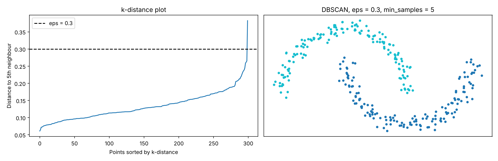
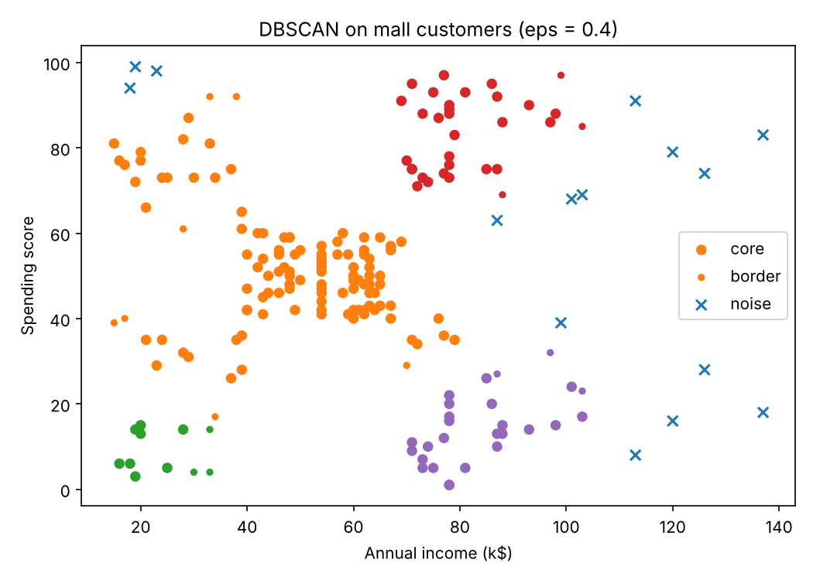
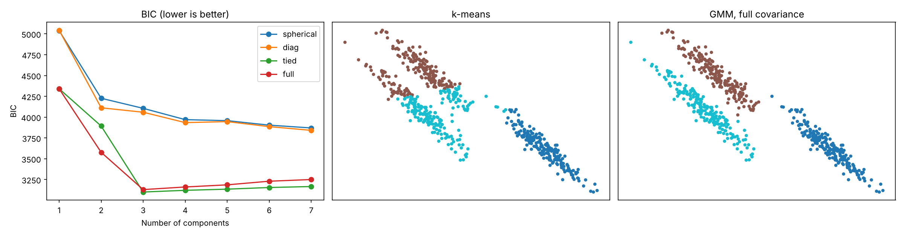
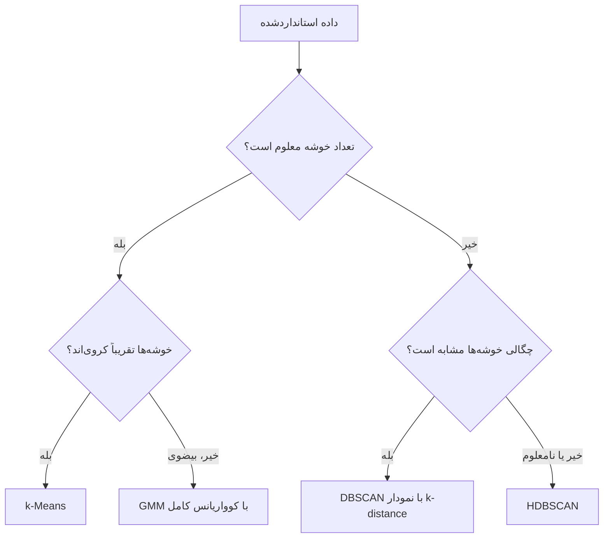

# جلسه ۲۸ — خوشه‌بندی چگالی‌محور و مبتنی بر مدل

## چرا به روش‌های دیگر نیاز داریم؟

الگوریتم k-Means خوشه‌های **کروی و هم‌اندازه** می‌سازد ← [مبانی خوشه‌بندی و k-Means](26%20-%20%D9%85%D8%A8%D8%A7%D9%86%DB%8C%20%D8%AE%D9%88%D8%B4%D9%87%E2%80%8C%D8%A8%D9%86%D8%AF%DB%8C%20%D9%88%20k-Means.md) و خوشه‌بندی سلسله‌مراتبی به روش پیوند وابسته است ← [خوشه‌بندی سلسله‌مراتبی](27%20-%20%D8%AE%D9%88%D8%B4%D9%87%E2%80%8C%D8%A8%D9%86%D8%AF%DB%8C%20%D8%B3%D9%84%D8%B3%D9%84%D9%87%E2%80%8C%D9%85%D8%B1%D8%A7%D8%AA%D8%A8%DB%8C.md). در داده واقعی موقعیت‌هایی هست که این روش‌ها در آن شکست می‌خورند:

| موقعیت | مشکل k-Means | راه‌حل این جلسه |
|:---:|:---:|:---:|
| خوشه‌های هلالی یا نامنظم | مرز تصمیم همیشه خطی است | روش DBSCAN |
| داده پرت و نویز | هر نقطه باید به یک خوشه برود | برچسب «نویز» در DBSCAN و HDBSCAN |
| تعداد خوشه نامعلوم | پارامتر k باید از قبل داده شود | روش DBSCAN خودش تعداد را پیدا می‌کند |
| خوشه‌های کشیده و مورب | فرض کروی بودن | مدل آمیخته گاوسی با کوواریانس کامل |
| نقاط مرزی مبهم | تخصیص سخت | خوشه‌بندی نرم با احتمال عضویت |

این جلسه به سه پرسش پاسخ می‌دهد:

- اگر خوشه را «ناحیه پرتراکم» تعریف کنیم، الگوریتم DBSCAN چگونه آن را پیدا می‌کند و پارامترهایش را چگونه انتخاب کنیم؟
- اگر خوشه را «یک توزیع احتمال» بدانیم، مدل آمیخته گاوسی و الگوریتم EM چگونه کار می‌کنند؟
- برای هر نوع داده کدام الگوریتم مناسب است؟

---

## الگوریتم DBSCAN

الگوریتم DBSCAN فقط **دو پارامتر** دارد: شعاع همسایگی `eps` و حداقل تعداد نقاط همسایگی `min_samples`. همسایگی اپسیلون نقطه p همه نقاطی است که فاصله‌شان تا p حداکثر eps باشد:

$$
N_{\varepsilon}(p) = \{\, q : d(p, q) \le \varepsilon \,\}
$$

| نوع نقطه | تعریف | نقش |
|:---:|:---:|:---:|
| نقطه مرکزی (Core) | دست‌کم min_samples نقطه در همسایگی خود دارد (شامل خودش) | خوشه را می‌سازد و گسترش می‌دهد |
| نقطه مرزی (Border) | مرکزی نیست، اما در همسایگی یک نقطه مرکزی است | به خوشه تعلق دارد اما آن را گسترش نمی‌دهد |
| نقطه نویز (Noise) | نه مرکزی است و نه همسایه نقطه مرکزی | برچسب منفی یک |

الگوریتم از یک نقطه مرکزی شروع می‌کند، همه همسایه‌هایش را به خوشه می‌افزاید و هر همسایه‌ای که خودش مرکزی باشد، خوشه را **ادامه می‌دهد**؛ تا وقتی نقطه مرکزی تازه‌ای پیدا نشود. سپس سراغ نقطه مرکزی بازدیدنشده بعدی می‌رود. پس خوشه یعنی مجموعه نقاطی که با **زنجیره‌ای از نقاط مرکزی** به هم وصل‌اند.

> [!warning] تعریف min_samples یکسان نیست
> در scikit-learn پارامتر `min_samples` **خود نقطه را هم می‌شمارد**؛ در برخی کتاب‌ها فقط همسایه‌های دیگر شمرده می‌شوند. هنگام مقایسه با منابع دیگر به این تفاوت توجه کنید.

### مثال حل‌شده: DBSCAN روی ده نقطه

ده نقطه با فاصله اقلیدسی، شعاع ۱.۵ و حداقل نقاط ۴:

| نقطه | مختصات | همسایه‌ها (فاصله حداکثر ۱.۵) | تعداد | نوع نقطه |
|:---:|:---:|:---:|:---:|:---:|
| نقطه A | (1, 1) | A، B، C، D | 4 | مرکزی |
| نقطه B | (1, 2) | A، B، C، D | 4 | مرکزی |
| نقطه C | (2, 1) | A، B، C، D، E | 5 | مرکزی |
| نقطه D | (2, 2) | A، B، C، D، E | 5 | مرکزی |
| نقطه E | (3, 2) | C، D، E، F | 4 | مرکزی |
| نقطه F | (4, 2) | E، F | 2 | مرزی |
| نقطه G | (8, 8) | G، H، I | 3 | نویز |
| نقطه H | (8, 9) | G، H، I | 3 | نویز |
| نقطه I | (9, 8) | G، H، I | 3 | نویز |
| نقطه J | (5, 6) | J | 1 | نویز |

#### گام ۱ — همسایگی‌ها

فاصله A تا D برابر جذر ۲ یعنی حدود ۱.۴۱ است و همسایه‌اند؛ فاصله A تا E حدود ۲.۲۴ است و همسایه نیستند:

$$
d(A, D) = \sqrt{(2-1)^2 + (2-1)^2} \approx 1.41 \le 1.5, \qquad d(A, E) = \sqrt{(3-1)^2 + (2-1)^2} \approx 2.24
$$

#### گام ۲ — نوع نقاط و خوشه

پنج نقطه A تا E مرکزی‌اند و به هم وصل‌اند. نقطه F فقط ۲ همسایه دارد، اما در همسایگی نقطه مرکزی E است، پس **مرزی** است و به خوشه می‌پیوندد. نقاط G، H، I و J نویزند. نتیجه: **یک خوشه** (A تا F) و چهار نقطه نویز.

#### گام ۳ — اثر min_samples

اگر حداقل نقاط ۳ شود، G، H و I هر کدام مرکزی می‌شوند و **خوشه دوم** را می‌سازند؛ فقط J نویز می‌ماند.

> [!note] بررسی
> کد زیر تعداد همسایه هر نقطه، برچسب‌ها و نقاط مرکزی را برای هر دو حالت بازتولید می‌کند.

```python
import numpy as np
from sklearn.cluster import DBSCAN
from sklearn.neighbors import NearestNeighbors

# Ten points A..J; eps = 1.5
X = np.array([[1, 1], [1, 2], [2, 1], [2, 2], [3, 2], [4, 2], [8, 8], [8, 9], [9, 8], [5, 6]])
names = list("ABCDEFGHIJ")
counts = [len(nb) for nb in NearestNeighbors(radius=1.5).fit(X).radius_neighbors(X, return_distance=False)]
print(f"neighbours incl. itself={dict(zip(names, counts))}")

for m in [4, 3]:
    db = DBSCAN(eps=1.5, min_samples=m).fit(X)
    core = [names[i] for i in db.core_sample_indices_]
    print(f"min_samples={m}  labels={db.labels_.tolist()}  core={''.join(core)}")
```

```
neighbours incl. itself={'A': 4, 'B': 4, 'C': 5, 'D': 5, 'E': 4, 'F': 2, 'G': 3, 'H': 3, 'I': 3, 'J': 1}
min_samples=4  labels=[0, 0, 0, 0, 0, 0, -1, -1, -1, -1]  core=ABCDE
min_samples=3  labels=[0, 0, 0, 0, 0, 0, 1, 1, 1, -1]  core=ABCDEGHI
```

| ویژگی | توضیح |
|:---:|:---:|
| تعداد خوشه | لازم نیست از قبل تعیین شود |
| شکل خوشه | دلخواه (هلالی، حلقوی، نامنظم) |
| داده پرت | به‌صورت طبیعی نویز اعلام می‌شود |
| ضعف اصلی | یک eps سراسری؛ برای خوشه‌های با **چگالی متفاوت** مناسب نیست |
| ابعاد بالا | فاصله‌ها معنای خود را از دست می‌دهند |

---

## انتخاب eps و min_samples

برای min_samples قاعده سرانگشتی دست‌کم «تعداد ابعاد به‌علاوه یک» و معمولاً ۴ یا ۵ برای داده دوبعدی است (پیش‌فرض scikit-learn برابر ۵). برای eps از **نمودار k-distance** استفاده می‌کنیم: فاصله هر نقطه تا k‌امین نزدیک‌ترین همسایه (k برابر min_samples) را حساب، مرتب و رسم می‌کنیم. نقاط درون خوشه این فاصله را کوچک و نقاط نویز آن را بزرگ دارند؛ **زانوی** منحنی eps مناسب است.

$$
\text{k-dist}(p) = d\big(p, \text{k-th nearest neighbour of } p\big)
$$

روی داده دو هلال استانداردشده:

```python
import numpy as np
import pandas as pd
import matplotlib.pyplot as plt
from sklearn.datasets import make_moons
from sklearn.preprocessing import StandardScaler
from sklearn.neighbors import NearestNeighbors
from sklearn.cluster import DBSCAN
from sklearn.metrics import adjusted_rand_score

# 1. Two moons, standardized; distance of each point to its 5th nearest neighbour (itself included)
X, y = make_moons(n_samples=300, noise=0.06, random_state=42)
Xs = StandardScaler().fit_transform(X)
dist, _ = NearestNeighbors(n_neighbors=5).fit(Xs).kneighbors(Xs)
kdist = np.sort(dist[:, -1])
print(f"k-distance percentiles 50/90/95/99/max={np.percentile(kdist, [50, 90, 95, 99, 100]).round(3).tolist()}")

# 2. Effect of eps (min_samples = 5)
rows = []
for eps in [0.1, 0.2, 0.3, 0.5, 1.0]:
    labels = DBSCAN(eps=eps, min_samples=5).fit_predict(Xs)
    rows.append({"eps": eps, "clusters": len(set(labels) - {-1}), "noise": int(np.sum(labels == -1)),
                 "ARI": adjusted_rand_score(y, labels)})
print(pd.DataFrame(rows).round(3).to_string(index=False))

fig, axes = plt.subplots(1, 2, figsize=(13, 4.2))
axes[0].plot(kdist)
axes[0].axhline(0.3, color="black", ls="--", label="eps = 0.3")
axes[0].set(xlabel="Points sorted by k-distance", ylabel="Distance to 5th neighbour", title="k-distance plot")
axes[0].legend()
labels = DBSCAN(eps=0.3, min_samples=5).fit_predict(Xs)
axes[1].scatter(Xs[:, 0], Xs[:, 1], c=labels, cmap="tab10", s=12)
axes[1].set(title="DBSCAN, eps = 0.3, min_samples = 5", xticks=[], yticks=[])
plt.show()
```

```
k-distance percentiles 50/90/95/99/max=[0.127, 0.183, 0.206, 0.259, 0.383]
 eps  clusters  noise   ARI
 0.1        21    160 0.036
 0.2         3      5 0.799
 0.3         2      0 1.000
 0.5         2      0 1.000
 1.0         1      0 0.000
```



| شعاع eps | تعداد خوشه | تعداد نویز | شاخص ARI |
|:---:|:---:|:---:|:---:|
| 0.1 | 21 | 160 | 0.036 |
| 0.2 | 3 | 5 | 0.799 |
| 0.3 | 2 | 0 | 1.000 |
| 0.5 | 2 | 0 | 1.000 |
| 1.0 | 1 | 0 | 0.000 |

- فاصله تا پنجمین همسایه برای ۹۹ درصد نقاط کمتر از ۰.۲۶ است؛ زانوی منحنی حدود ۰.۲ تا ۰.۳ است.
- شعاع خیلی کوچک داده را به ده‌ها خوشه ریز و نویز فراوان می‌شکند؛ شعاع خیلی بزرگ همه را یکی می‌کند. بازه ۰.۳ تا ۰.۵ هر دو هلال را کامل جدا می‌کند؛ کاری که k-Means در جلسه ۲۶ نتوانست (ARI برابر ۰.۴۹).

> [!tip] مقیاس‌بندی را فراموش نکنید
> روش DBSCAN با یک شعاع ثابت در **همه جهت‌ها** کار می‌کند؛ بدون استانداردسازی ← [تبدیل و یکپارچه‌سازی داده](../Part%203_Data%20Preprocessing/%DB%B1%DB%B2%20-%20%D8%AA%D8%A8%D8%AF%DB%8C%D9%84%20%D9%88%20%DB%8C%DA%A9%D9%BE%D8%A7%D8%B1%DA%86%D9%87%E2%80%8C%D8%B3%D8%A7%D8%B2%DB%8C%20%D8%AF%D8%A7%D8%AF%D9%87.md) شعاع عملاً فقط روی ویژگی با واحد بزرگ‌تر اثر دارد.

### روی داده واقعی: مشتریان مرکز خرید

```python
import numpy as np
import pandas as pd
import matplotlib.pyplot as plt
from sklearn.preprocessing import StandardScaler
from sklearn.neighbors import NearestNeighbors
from sklearn.cluster import DBSCAN

# 1. Mall customers, standardized income and spending; k-distance with k = 5
path = "../data/Mall_Customers.csv"
mall = pd.read_csv(path)
cols = ["Annual Income (k$)", "Spending Score (1-100)"]
Xs = StandardScaler().fit_transform(mall[cols])
dist, _ = NearestNeighbors(n_neighbors=5).fit(Xs).kneighbors(Xs)
print(f"k-distance percentiles 50/90/95={np.percentile(dist[:, -1], [50, 90, 95]).round(2).tolist()}")

# 2. DBSCAN with eps near the knee; core, border and noise points
db = DBSCAN(eps=0.4, min_samples=5).fit(Xs)
labels = db.labels_
core = np.zeros(len(Xs), bool)
core[db.core_sample_indices_] = True
kind = np.where(labels == -1, "noise", np.where(core, "core", "border"))
print(pd.Series(kind).value_counts().to_dict())
mall["cluster"] = labels
print(mall.groupby("cluster").agg(n=("Age", "size"), income=(cols[0], "mean"), spending=(cols[1], "mean")).round(1))

fig, ax = plt.subplots(figsize=(7, 5))
for k, marker, size in [("core", "o", 30), ("border", "o", 12), ("noise", "x", 40)]:
    m = kind == k
    ax.scatter(mall.loc[m, cols[0]], mall.loc[m, cols[1]], c=np.where(labels[m] == -1, 0, labels[m] + 1),
               cmap="tab10", vmin=0, vmax=9, marker=marker, s=size, label=k)
ax.set(xlabel="Annual income (k$)", ylabel="Spending score", title="DBSCAN on mall customers (eps = 0.4)")
ax.legend()
plt.show()
```

```
k-distance percentiles 50/90/95=[0.21, 0.47, 0.6]
{'core': 169, 'border': 16, 'noise': 15}
           n  income  spending
cluster                       
-1        15    96.1      61.8
 0       115    48.3      51.7
 1        11    23.7       8.9
 2        32    80.9      83.6
 3        27    83.9      14.4
```



- میانه فاصله تا پنجمین همسایه ۰.۲۱ و صدک ۹۰ آن ۰.۴۷ است؛ eps برابر ۰.۴ را نزدیک زانو انتخاب کردیم.
- ۱۵ مشتری **نویز** شدند؛ بیشتر آن‌ها پردرآمدترین مشتریان (میانگین درآمد ۹۶) که پراکنده‌اند. این مشتریان استثنایی ممکن است برای بازاریابی جالب باشند: DBSCAN آن‌ها را به‌زور در یک خوشه نگذاشت.
- اما گروه «کم‌درآمد پرخرج» و بخشی از «کم‌درآمد کم‌خرج» با زنجیره‌ای از مشتریان مرزی به خوشه میانی وصل شدند (خوشه ۰ با ۱۱۵ نفر). در این داده گروه‌ها با چگالی مشابه به هم نزدیک‌اند و k-Means نتیجه تفسیرپذیرتری داد.

---

## الگوریتم HDBSCAN

بزرگ‌ترین ضعف DBSCAN یک eps **سراسری** است. الگوریتم HDBSCAN چگالی و خوشه‌بندی سلسله‌مراتبی را ترکیب می‌کند:

1. برای هر نقطه **فاصله مرکزی** را حساب می‌کند: فاصله تا min_samples‌امین همسایه.
2. فاصله‌ها را به **فاصله دسترس‌پذیری متقابل** تبدیل می‌کند تا نقاط ناحیه کم‌تراکم از هم دورتر دیده شوند.
3. روی این فاصله‌ها یک سلسله‌مراتب (مانند پیوند تکی) می‌سازد و خوشه‌های کوچک‌تر از min_cluster_size را حذف می‌کند.
4. **پایدارترین** خوشه‌ها را از سطوح مختلف درخت انتخاب می‌کند؛ عملاً برای هر خوشه eps متفاوتی به کار می‌برد.

$$
d_{\text{mreach}}(a, b) = \max\big(\text{core}(a), \text{core}(b), d(a, b)\big)
$$

سه توده با پراکندگی بسیار متفاوت (۰.۵، ۲.۰ و ۰.۴) را می‌سنجیم:

```python
import numpy as np
import pandas as pd
from sklearn.datasets import make_blobs
from sklearn.preprocessing import StandardScaler
from sklearn.cluster import DBSCAN, HDBSCAN, KMeans
from sklearn.mixture import GaussianMixture
from sklearn.metrics import adjusted_rand_score

# Three blobs with very different spreads (0.5, 2.0, 0.4)
X, y = make_blobs(n_samples=[250, 250, 200], centers=[[0, 0], [6, 4], [9, -1]],
                  cluster_std=[0.5, 2.0, 0.4], random_state=42)
Xs = StandardScaler().fit_transform(X)

# 1. No single eps works for DBSCAN
for eps in [0.1, 0.2, 0.3, 0.5]:
    lab = DBSCAN(eps=eps, min_samples=5).fit_predict(Xs)
    print(f"DBSCAN eps={eps}: clusters={len(set(lab) - {-1})}  noise={np.sum(lab == -1)}  ARI={adjusted_rand_score(y, lab):.3f}")

# 2. HDBSCAN needs only a minimum cluster size; k-means and GMM need k = 3
models = {"HDBSCAN": HDBSCAN(min_cluster_size=15, copy=True), "k-means": KMeans(3, n_init=10, random_state=42),
          "GMM": GaussianMixture(3, n_init=5, random_state=42)}
for name, model in models.items():
    lab = model.fit_predict(Xs)
    print(f"{name:8s} clusters={len(set(lab) - {-1})}  noise={np.sum(lab == -1)}  ARI={adjusted_rand_score(y, lab):.3f}")
```

```
DBSCAN eps=0.1: clusters=12  noise=189  ARI=0.793
DBSCAN eps=0.2: clusters=6  noise=44  ARI=0.875
DBSCAN eps=0.3: clusters=4  noise=16  ARI=0.947
DBSCAN eps=0.5: clusters=1  noise=2  ARI=-0.000
HDBSCAN  clusters=3  noise=63  ARI=0.877
k-means  clusters=3  noise=0  ARI=0.859
GMM      clusters=3  noise=0  ARI=0.987
```

| روش | پارامتر | تعداد خوشه | نویز | شاخص ARI |
|:---:|:---:|:---:|:---:|:---:|
| روش DBSCAN | شعاع 0.2 | 6 | 44 | 0.875 |
| روش DBSCAN | شعاع 0.3 | 4 | 16 | 0.947 |
| روش DBSCAN | شعاع 0.5 | 1 | 2 | 0.000 |
| روش HDBSCAN | حداقل اندازه 15 | 3 | 63 | 0.877 |
| الگوریتم k-Means | تعداد 3 | 3 | 0 | 0.859 |
| مدل GMM | تعداد 3 | 3 | 0 | 0.987 |

- هیچ eps واحدی دقیقاً سه خوشه نمی‌دهد: eps کوچک توده پراکنده را خرد می‌کند و eps بزرگ همه را یکی می‌کند.
- روش HDBSCAN **بدون تنظیم شعاع** دقیقاً سه خوشه یافت، اما ۶۳ نقطه از حاشیه توده پراکنده را نویز دانست و ARI آن کمتر از بهترین DBSCAN شد.
- مدل GMM که برای هر خوشه پراکندگی جداگانه برآورد می‌کند، بهترین نتیجه را دارد؛ این داده دقیقاً از آمیخته‌ای از گاوسی‌ها تولید شده است.

---

## مدل آمیخته گاوسی و الگوریتم EM

مدل آمیخته گاوسی (GMM) فرض می‌کند هر نقطه این‌طور تولید شده است: ابتدا یکی از K مؤلفه با احتمال π انتخاب شده و سپس نقطه از توزیع گاوسی آن مؤلفه آمده است:

$$
p(\mathbf{x}) = \sum_{k=1}^{K} \pi_k \, \mathcal{N}(\mathbf{x} \mid \boldsymbol{\mu}_k, \boldsymbol{\Sigma}_k), \qquad \sum_{k=1}^{K} \pi_k = 1
$$

| پارامتر | معنا | نقش در خوشه‌بندی |
|:---:|:---:|:---:|
| وزن مؤلفه (π) | سهم هر مؤلفه از داده | اندازه نسبی خوشه |
| میانگین (μ) | مرکز توزیع | مرکز خوشه |
| کوواریانس (Σ) | شکل، جهت و پهنا | شکل بیضوی خوشه |

اگر می‌دانستیم هر نقطه از کدام مؤلفه آمده، برآورد پارامترها ساده بود و برعکس. **الگوریتم EM** این دو را به نوبت تکرار می‌کند:

- **گام E:** **مسئولیت** هر مؤلفه برای هر نقطه، یعنی احتمال پسین اینکه نقطه i از مؤلفه k آمده باشد.
- **گام M:** به‌روزرسانی وزن، میانگین و کوواریانس با میانگین وزن‌دار (وزن‌ها همان مسئولیت‌ها).

$$
\gamma_{ik} = \frac{\pi_k \, \mathcal{N}(\mathbf{x}_i \mid \boldsymbol{\mu}_k, \boldsymbol{\Sigma}_k)}{\sum_{j=1}^{K} \pi_j \, \mathcal{N}(\mathbf{x}_i \mid \boldsymbol{\mu}_j, \boldsymbol{\Sigma}_j)}
$$

$$
N_k = \sum_{i=1}^{n} \gamma_{ik}, \qquad \pi_k = \frac{N_k}{n}, \qquad \boldsymbol{\mu}_k = \frac{1}{N_k} \sum_{i=1}^{n} \gamma_{ik} \, \mathbf{x}_i
$$

$$
\boldsymbol{\Sigma}_k = \frac{1}{N_k} \sum_{i=1}^{n} \gamma_{ik} \, (\mathbf{x}_i - \boldsymbol{\mu}_k)(\mathbf{x}_i - \boldsymbol{\mu}_k)^{\top}
$$

هر تکرار، لگاریتم درست‌نمایی را کاهش نمی‌دهد، اما ممکن است در **بهینه محلی** گیر کند؛ به همین دلیل `n_init` مفید است.

### مثال حل‌شده: یک تکرار EM در یک بعد

هفت نقطه ۱، ۲، ۳، ۴، ۷، ۸ و ۹ داریم. مقداردهی اولیه: دو مؤلفه با میانگین ۲ و ۶، انحراف معیار ۲ (واریانس ۴) و وزن ۰.۵.

#### گام ۱ — گام E برای یک نقطه

نقطه ۴ از هر دو میانگین ۲ واحد فاصله دارد، پس چگالی‌ها برابرند و مسئولیت ۰.۵ است. برای نقطه ۱:

$$
\gamma_{1,1} = \frac{0.5 \times \mathcal{N}(1 \mid 2, 4)}{0.5 \times \mathcal{N}(1 \mid 2, 4) + 0.5 \times \mathcal{N}(1 \mid 6, 4)} = \frac{0.0880}{0.0880 + 0.0044} \approx 0.953
$$

#### گام ۲ — همه مسئولیت‌ها

| نقطه | مسئولیت مؤلفه ۱ | مسئولیت مؤلفه ۲ |
|:---:|:---:|:---:|
| 1 | 0.953 | 0.047 |
| 2 | 0.881 | 0.119 |
| 3 | 0.731 | 0.269 |
| 4 | 0.500 | 0.500 |
| 7 | 0.047 | 0.953 |
| 8 | 0.018 | 0.982 |
| 9 | 0.007 | 0.993 |
| جمع | 3.137 | 3.863 |

#### گام ۳ — گام M

$$
\pi_1 = \frac{3.137}{7} \approx 0.448, \qquad \mu_1 = \frac{0.953 \times 1 + 0.881 \times 2 + \dots + 0.007 \times 9}{3.137} \approx 2.373, \qquad \mu_2 \approx 6.874
$$

| پارامتر | مقدار اولیه | پس از یک تکرار |
|:---:|:---:|:---:|
| میانگین مؤلفه ۱ | 2 | 2.373 |
| میانگین مؤلفه ۲ | 6 | 6.874 |
| واریانس مؤلفه ۱ | 4 | 1.724 |
| واریانس مؤلفه ۲ | 4 | 4.758 |
| وزن مؤلفه ۱ | 0.5 | 0.448 |
| وزن مؤلفه ۲ | 0.5 | 0.552 |

> [!note] بررسی
> کد زیر مسئولیت‌ها را با چگالی نرمال scipy حساب می‌کند و یک تکرار `GaussianMixture` با همان مقداردهی (`max_iter=1`) دقیقاً همین پارامترها را می‌دهد.

```python
import numpy as np
from scipy.stats import norm
from sklearn.mixture import GaussianMixture

# Seven 1-D points; start: means 2 and 6, standard deviations 2 and 2, weights 0.5 and 0.5
x = np.array([1, 2, 3, 4, 7, 8, 9]).reshape(-1, 1)

# 1. E-step by hand with scipy: weighted densities, then normalize each row
dens = 0.5 * np.c_[norm.pdf(x, loc=2, scale=2), norm.pdf(x, loc=6, scale=2)]
resp = dens / dens.sum(axis=1, keepdims=True)
print(f"responsibility of component 1={resp[:, 0].round(3).tolist()}")

# 2. One full EM iteration with scikit-learn from the same start
init = dict(weights_init=[0.5, 0.5], means_init=[[2], [6]], precisions_init=[[[0.25]], [[0.25]]])
gm1 = GaussianMixture(2, **init, max_iter=1).fit(x)      # stops after one step on purpose (ConvergenceWarning)
print(f"after 1 iteration: means={gm1.means_.ravel().round(3).tolist()}  "
      f"variances={gm1.covariances_.ravel().round(3).tolist()}  weights={gm1.weights_.round(3).tolist()}")

# 3. Run to convergence
gm = GaussianMixture(2, **init).fit(x)
print(f"converged after {gm.n_iter_} iterations: means={gm.means_.ravel().round(2).tolist()}  "
      f"weights={gm.weights_.round(2).tolist()}  labels={gm.predict(x).tolist()}")
```

```
responsibility of component 1=[0.953, 0.881, 0.731, 0.5, 0.047, 0.018, 0.007]
after 1 iteration: means=[2.373, 6.874]  variances=[1.724, 4.758]  weights=[0.448, 0.552]
converged after 8 iterations: means=[2.5, 8.0]  weights=[0.57, 0.43]  labels=[0, 0, 0, 0, 1, 1, 1]
```

پس از ۸ تکرار، میانگین‌ها ۲.۵ و ۸ و وزن‌ها ۰.۵۷ و ۰.۴۳ می‌شوند: مدل دو گروه ۱ تا ۴ و ۷ تا ۹ را یافته است.

### نوع کوواریانس و انتخاب تعداد مؤلفه با BIC

| نوع کوواریانس | شکل خوشه | تعداد پارامتر |
|:---:|:---:|:---:|
| کروی (spherical) | دایره با شعاع جداگانه | کمترین |
| قطری (diag) | بیضی هم‌راستا با محورها | متوسط |
| مشترک (tied) | یک بیضی یکسان برای همه | متوسط |
| کامل (full) | بیضی دلخواه با جهت دلخواه | بیشترین (پیش‌فرض) |

چون GMM مدل احتمالاتی است، تعداد مؤلفه و نوع کوواریانس را می‌توان با **معیار اطلاعات بیزی** انتخاب کرد (L درست‌نمایی بیشینه، p تعداد پارامتر، n تعداد نقاط؛ کمتر بهتر است). جمله دوم **جریمه پیچیدگی** است؛ همان ایده منظم‌سازی ← [منظم‌سازی در رگرسیون](../Part%204_Regression/19%20-%20%D9%85%D9%86%D8%B8%D9%85%E2%80%8C%D8%B3%D8%A7%D8%B2%DB%8C%20%D8%AF%D8%B1%20%D8%B1%DA%AF%D8%B1%D8%B3%DB%8C%D9%88%D9%86.md).

$$
\text{BIC} = -2 \ln \hat{L} + p \ln n
$$

روی سه خوشه **کشیده و مورب** (همان داده جلسه ۲۶):

```python
import numpy as np
import pandas as pd
import matplotlib.pyplot as plt
from sklearn.datasets import make_blobs
from sklearn.cluster import KMeans
from sklearn.mixture import GaussianMixture
from sklearn.metrics import adjusted_rand_score

# Three elongated, tilted blobs
X, y = make_blobs(n_samples=600, centers=3, random_state=170)
X = X @ np.array([[0.6, -0.64], [-0.4, 0.85]])

# 1. BIC for each covariance type and number of components (lower is better)
bic = pd.DataFrame({cov: [GaussianMixture(k, covariance_type=cov, n_init=3, random_state=42).fit(X).bic(X)
                          for k in range(1, 8)] for cov in ["spherical", "diag", "tied", "full"]},
                   index=range(1, 8))
print(f"best number of components={bic.idxmin().to_dict()}")

# 2. Compare k-means with GMM (full covariance), both with 3 clusters
km = KMeans(3, n_init=10, random_state=42).fit_predict(X)
gm = GaussianMixture(3, covariance_type="full", n_init=3, random_state=42).fit_predict(X)
print(f"ARI k-means={adjusted_rand_score(y, km):.2f}  ARI GMM full={adjusted_rand_score(y, gm):.2f}")

fig, axes = plt.subplots(1, 3, figsize=(16, 4.2))
for cov in bic.columns:
    axes[0].plot(bic.index, bic[cov], "o-", label=cov)
axes[0].set(xlabel="Number of components", ylabel="BIC", title="BIC (lower is better)")
axes[0].legend()
for ax, lab, title in [(axes[1], km, "k-means"), (axes[2], gm, "GMM, full covariance")]:
    ax.scatter(X[:, 0], X[:, 1], c=lab, cmap="tab10", s=10)
    ax.set(title=title, xticks=[], yticks=[])
plt.show()
```

```
best number of components={'spherical': 7, 'diag': 7, 'tied': 3, 'full': 3}
ARI k-means=0.59  ARI GMM full=1.00
```



- مدل‌های کروی و قطری نمی‌توانند بیضی مورب را با یک مؤلفه بسازند؛ BIC آن‌ها تا **هفت** مؤلفه (انتهای بازه) همچنان کم می‌شود، یعنی هر خوشه را با چند دایره کوچک تقریب می‌زنند. با کوواریانس مشترک یا کامل، BIC تعداد درست (**سه**) را انتخاب می‌کند.
- با سه خوشه، GMM کامل گروه‌ها را بی‌خطا یافت (ARI برابر ۱)، در حالی که k-Means به ۰.۵۹ رسید.

> [!tip] رابطه k-Means و GMM
> الگوریتم k-Means حالت خاصی از EM است: کوواریانس همه مؤلفه‌ها کروی، برابر و بسیار کوچک فرض شود تا مسئولیت‌ها صفر و یک شوند.

### خوشه‌بندی نرم: احتمال عضویت مشتریان

متد `predict_proba` برای هر مشتری احتمال عضویت در هر خوشه را می‌دهد:

```python
import numpy as np
import pandas as pd
from sklearn.preprocessing import StandardScaler
from sklearn.mixture import GaussianMixture

# Soft clustering of mall customers with GMM (5 components, full covariance)
path = "../data/Mall_Customers.csv"
mall = pd.read_csv(path)
cols = ["Annual Income (k$)", "Spending Score (1-100)"]
Xs = StandardScaler().fit_transform(mall[cols])
gm = GaussianMixture(5, covariance_type="full", n_init=5, random_state=42).fit(Xs)
proba = gm.predict_proba(Xs)
mall["cluster"], mall["p_max"] = proba.argmax(axis=1), proba.max(axis=1)

print(f"customers with max membership < 0.8: {np.sum(mall['p_max'] < 0.8)} of {len(mall)}")
print(mall.sort_values("p_max").head(4)[cols + ["cluster", "p_max"]].round(2).to_string(index=False))
```

```
customers with max membership < 0.8: 6 of 200
 Annual Income (k$)  Spending Score (1-100)  cluster  p_max
                 70                      29        3   0.50
                 40                      42        0   0.61
                 40                      42        0   0.61
                 28                      61        2   0.67
```

۱۹۴ مشتری با احتمال دست‌کم ۰.۸ به یک خوشه تعلق دارند، اما ۶ مشتری **مبهم‌اند**. مشتری با درآمد ۷۰ و امتیاز ۲۹ تقریباً با احتمال برابر به دو خوشه تعلق دارد؛ برای چنین مشتریانی یک تصمیم قطعی (کمپین الف یا ب) پرخطر است.

| جنبه | خوشه‌بندی سخت | خوشه‌بندی نرم |
|:---:|:---:|:---:|
| خروجی | یک برچسب برای هر نقطه | احتمال عضویت در همه خوشه‌ها |
| نمونه | الگوریتم k-Means، DBSCAN | مدل GMM |
| در scikit-learn | متد predict | متد predict_proba |

> [!warning] محدودیت‌های GMM
> - فرض **گاوسی** بودن هر خوشه؛ برای هلال‌ها مناسب نیست (در کارگاه، ARI حدود ۰.۴۷ مانند k-Means).
> - حساسیت به مقداردهی اولیه و بهینه محلی.
> - در ابعاد بالا پارامترهای کوواریانس کامل (از مرتبه مجذور ابعاد) زیاد و برآورد ناپایدار است.
> - داده پرت را جدا نمی‌کند؛ اما نقاط با **چگالی بسیار کم** (`score_samples`) را می‌توان ناهنجار دانست.

---

## راهنمای انتخاب الگوریتم

| ویژگی داده یا نیاز | الگوریتم پیشنهادی |
|:---:|:---:|
| خوشه‌های کروی، داده بزرگ، نیاز به سرعت | الگوریتم k-Means |
| شکل دلخواه با چگالی مشابه | روش DBSCAN با نمودار k-distance |
| شکل و چگالی متفاوت، وجود نویز | روش HDBSCAN |
| خوشه‌های بیضوی، نیاز به احتمال عضویت | مدل GMM با کوواریانس کامل و BIC |
| نیاز به ساختار تودرتو | خوشه‌بندی سلسله‌مراتبی |



> [!important] هیچ الگوریتمی همیشه بهترین نیست
> هر الگوریتم تعریف خودش از «خوشه» را دارد؛ انتخاب الگوریتم یعنی انتخاب **فرض** درباره ساختار داده. چند الگوریتم را امتحان کنید و نتایج را با معیارهای ارزیابی ← [ارزیابی و تفسیر خوشه‌ها](29%20-%20%D8%A7%D8%B1%D8%B2%DB%8C%D8%A7%D8%A8%DB%8C%20%D9%88%20%D8%AA%D9%81%D8%B3%DB%8C%D8%B1%20%D8%AE%D9%88%D8%B4%D9%87%E2%80%8C%D9%87%D8%A7.md) و دانش حوزه مقایسه کنید.

> [!note] کارگاه عملی
> دفترچه «۲۸ - کارگاه خوشه‌بندی چگالی‌محور و مبتنی بر مدل» الگوریتم OPTICS، احتمال عضویت در HDBSCAN، تشخیص ناهنجاری با چگالی GMM، و تمرین عملی کلاس (مقایسه k-Means، DBSCAN و GMM روی داده‌های هلالی و توده‌ای) را با پاسخ دارد. نحوه نوشتن این کدها در امتحان پرسیده نمی‌شود.

---

## خطاهای رایج

| خطا | چرا نادرست است | روش درست |
|:---:|:---:|:---:|
| اجرای DBSCAN روی داده مقیاس‌نشده | شعاع ثابت فقط روی ویژگی با واحد بزرگ اثر دارد | استانداردسازی پیش از DBSCAN |
| انتخاب eps با آزمون و خطای کور | نتیجه به eps بسیار حساس است | نمودار k-distance و گزارش تعداد خوشه و نویز |
| حذف بی‌فکر نقاط نویز | نویز ممکن است مهم‌ترین مشتریان یا ناهنجاری‌ها باشد | بررسی جداگانه نقاط نویز |
| استفاده از DBSCAN برای چگالی‌های بسیار متفاوت | یک eps سراسری برای همه | روش HDBSCAN یا GMM |
| انتخاب تعداد مؤلفه GMM با بیشترین درست‌نمایی | درست‌نمایی با افزایش مؤلفه همیشه زیاد می‌شود | معیار BIC |
| تفسیر برچسب GMM بدون نگاه به احتمال | نقاط مرزی با احتمال حدود ۰.۵ تصادفی برچسب می‌گیرند | بررسی predict_proba و نقاط مبهم |

---

## نمونه سؤال‌های امتحانی

### سؤال‌های مفهومی

> [!question]- ۱. تفاوت نقطه مرکزی، مرزی و نویز در DBSCAN چیست؟
> نقطه مرکزی دست‌کم min_samples نقطه (شامل خودش) در شعاع eps دارد و خوشه را گسترش می‌دهد. نقطه مرزی مرکزی نیست اما در همسایگی یک نقطه مرکزی است؛ عضو خوشه است ولی آن را گسترش نمی‌دهد. نقطه نویز هیچ‌کدام نیست و برچسب منفی یک می‌گیرد.

> [!question]- ۲. چرا DBSCAN برای خوشه‌هایی با چگالی بسیار متفاوت مناسب نیست؟ چه جایگزینی دارد؟
> چون یک eps سراسری دارد: eps کوچک خوشه پراکنده را خرد یا نویز می‌کند و eps بزرگ خوشه‌های متراکم نزدیک را ادغام می‌کند. روش HDBSCAN با ساخت سلسله‌مراتب چگالی عملاً برای هر خوشه eps جداگانه دارد؛ GMM نیز برای هر مؤلفه پراکندگی جداگانه برآورد می‌کند.

> [!question]- ۳. تفاوت خوشه‌بندی سخت و نرم را با یک مثال کاربردی توضیح دهید.
> در خوشه‌بندی سخت هر مشتری دقیقاً یک خوشه دارد؛ در نرم، احتمال عضویت در هر خوشه را داریم. مشتری با احتمال ۰.۵ و ۰.۵ میان دو بخش مبهم است و شاید بهتر باشد پیام عمومی بگیرد یا جداگانه بررسی شود.

> [!question]- ۴. چرا در GMM کروی، BIC برای خوشه‌های مورب تعداد مؤلفه را بیشتر از واقع پیشنهاد می‌کند؟
> مؤلفه کروی نمی‌تواند یک بیضی کشیده و مورب را بپوشاند؛ مدل برای برازش بهتر هر خوشه کشیده را با چند دایره کوچک تقریب می‌زند. با کوواریانس کامل هر خوشه یک مؤلفه است و BIC تعداد درست را می‌دهد.

### سؤال‌های محاسباتی

> [!question]- ۵. نقاط یک‌بعدی ۱، ۲، ۳، ۸، ۹ و ۲۰ را با eps برابر ۱.۵ و min_samples برابر ۳ (شامل خود نقطه) خوشه‌بندی کنید.
> همسایه‌ها: ۱ با {۱، ۲} دو نقطه؛ ۲ با {۱، ۲، ۳} سه نقطه (مرکزی)؛ ۳ با {۲، ۳} دو نقطه؛ ۸ و ۹ هر کدام دو نقطه؛ ۲۰ یک نقطه. تنها نقطه مرکزی ۲ است؛ ۱ و ۳ مرزی‌اند. نتیجه: یک خوشه {۱، ۲، ۳} و نقاط ۸، ۹ و ۲۰ نویز.

> [!question]- ۶. فاصله مرکزی نقطه a برابر ۰.۵، نقطه b برابر ۲ و فاصله اقلیدسی آن‌ها ۱ است. فاصله دسترس‌پذیری متقابل چقدر است؟
> $$
> d_{\text{mreach}}(a, b) = \max(0.5, 2, 1) = 2
> $$
> چون b در ناحیه کم‌تراکم است، فاصله‌اش با a بزرگ‌تر دیده می‌شود.

> [!question]- ۷. دو مؤلفه یک‌بعدی با وزن برابر، میانگین ۰ و ۴ و انحراف معیار ۱ داریم. مسئولیت مؤلفه اول برای نقطه ۲ و برای نقطه صفر چقدر است؟ (چگالی نرمال استاندارد در صفر ۰.۳۹۹، در ۲ برابر ۰.۰۵۴ و در ۴ برابر ۰.۰۰۰۱۳۴ است.)
> نقطه ۲ از هر دو میانگین ۲ واحد فاصله دارد، پس مسئولیت ۰.۵ است. برای نقطه صفر:
> $$
> \gamma = \frac{0.399}{0.399 + 0.000134} \approx 0.9997
> $$

> [!question]- ۸. مدل A با ۵ پارامتر لگاریتم درست‌نمایی منفی ۱۰۰ و مدل B با ۱۱ پارامتر لگاریتم درست‌نمایی منفی ۹۲ دارد (n برابر ۱۰۰، لگاریتم طبیعی ۱۰۰ حدود ۴.۶۱). کدام را BIC انتخاب می‌کند؟
> $$
> \text{BIC}_A = 200 + 5 \times 4.61 \approx 223.0, \qquad \text{BIC}_B = 184 + 11 \times 4.61 \approx 234.7
> $$
> مدل A با BIC کمتر انتخاب می‌شود؛ بهبود برازش B ارزش ۶ پارامتر اضافه را ندارد.

### سؤال‌های خواندن کد

> [!question]- ۹. خروجی این کد برای داده‌ای که فقط ۲ خوشه واقعی دارد چه معنایی دارد؟
> ```python
> labels = DBSCAN(eps=0.1, min_samples=5).fit_predict(Xs)
> print(len(set(labels) - {-1}), (labels == -1).sum())    # 21 160
> ```
> شعاع خیلی کوچک است: ۲۱ خوشه ریز و ۱۶۰ نقطه نویز. باید eps را با نمودار k-distance بزرگ‌تر انتخاب کرد (در داده هلال‌ها ۰.۳).

> [!question]- ۱۰. چرا این کد تعداد مؤلفه را درست انتخاب نمی‌کند؟
> ```python
> scores = {k: GaussianMixture(k, random_state=42).fit(X).score(X) for k in range(1, 10)}
> best_k = max(scores, key=scores.get)
> ```
> متد `score` میانگین لگاریتم درست‌نمایی روی داده آموزش است و با افزایش مؤلفه‌ها تقریباً همیشه بیشتر می‌شود؛ پس بزرگ‌ترین k انتخاب می‌شود. باید کمینه `bic(X)` را گرفت.

> [!question]- ۱۱. این کد چه چیزی را چاپ می‌کند و کاربردش چیست؟
> ```python
> proba = GaussianMixture(5, random_state=42).fit(Xs).predict_proba(Xs)
> print((proba.max(axis=1) < 0.8).sum())
> ```
> تعداد نقاطی را که بیشترین احتمال عضویتشان کمتر از ۰.۸ است، یعنی نقاط **مبهم** میان خوشه‌ها. این نقاط را می‌توان جداگانه بررسی کرد یا در تصمیم‌گیری با احتیاط بیشتری به کار برد.

---

## نکات کلیدی

> [!summary] خلاصه جلسه
> - روش **DBSCAN** خوشه را ناحیه پرتراکم می‌داند؛ نقاط **مرکزی، مرزی و نویز** دارد، تعداد خوشه را خودش پیدا می‌کند و شکل دلخواه را می‌پذیرد.
> - شعاع **eps** را با **نمودار k-distance** و min_samples را با قاعده «ابعاد به‌علاوه یک» یا ۵ انتخاب کنید؛ استانداردسازی الزامی است.
> - ضعف DBSCAN یک eps سراسری است؛ **HDBSCAN** با سلسله‌مراتب چگالی خوشه‌های با چگالی متفاوت را بدون eps پیدا می‌کند.
> - مدل **GMM** داده را آمیخته‌ای از گاوسی‌ها می‌داند و با **EM** (گام E: مسئولیت‌ها، گام M: میانگین‌های وزن‌دار) برازش می‌شود؛ خوشه‌بندی **نرم** با احتمال عضویت می‌دهد.
> - نوع کوواریانس شکل خوشه را تعیین می‌کند و **BIC** تعداد مؤلفه را با جریمه پیچیدگی انتخاب می‌کند.
> - هیچ الگوریتمی همیشه بهترین نیست؛ انتخاب الگوریتم یعنی انتخاب فرض درباره ساختار داده.
