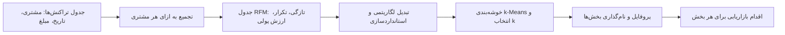

# جلسه ۲۹ — ارزیابی و تفسیر خوشه‌ها

## خوشه‌بندی خوب یعنی چه؟

در سه جلسه گذشته چهار خانواده الگوریتم خوشه‌بندی را دیدیم ← [[26 - مبانی خوشه‌بندی و k-Means]]، [[27 - خوشه‌بندی سلسله‌مراتبی]] و [[28 - خوشه‌بندی چگالی‌محور و مبتنی بر مدل]]. هر الگوریتمی روی هر داده‌ای **همیشه** خروجی می‌دهد؛ حتی روی داده کاملاً تصادفی. پس سه پرسش اساسی پیش می‌آید:

- آیا خوشه‌های به‌دست‌آمده **واقعی** هستند یا ساخته الگوریتم؟
- کدام الگوریتم و کدام تعداد خوشه **بهتر** است؟
- خوشه‌ها چه **معنایی** دارند و چه تصمیمی بر اساس آن‌ها می‌توان گرفت؟

برخلاف یادگیری نظارت‌شده که دقت را با برچسب واقعی می‌سنجیدیم ← [[25 - ارزیابی مدل‌های طبقه‌بندی]]، در خوشه‌بندی معمولاً **برچسب واقعی نداریم**. به همین دلیل سه نوع ارزیابی داریم:

|نوع ارزیابی|پرسش|نیاز به برچسب واقعی|نمونه معیار|
|:-:|:-:|:-:|:-:|
|درونی (Internal)|خوشه‌ها چقدر فشرده و از هم جدا هستند؟|ندارد|نیم‌رخ، دیویس-بولدین، کالینسکی-هاراباز|
|بیرونی (External)|خوشه‌ها چقدر با یک برچسب مرجع تطابق دارند؟|دارد|خلوص، شاخص رند تعدیل‌شده، اطلاعات متقابل نرمال‌شده|
|نسبی و کاربردی|آیا خوشه‌ها قابل تفسیر و قابل اقدام‌اند؟|ندارد|پروفایل خوشه‌ها، پایداری، قضاوت خبره|

> [!important] نکته کلیدی معیارهای عددی **لازم** هستند اما **کافی** نیستند. خوشه‌بندی‌ای که نیم‌رخ عالی دارد اما هیچ تفسیر کسب‌وکاری ندارد، در عمل بی‌فایده است. هدف نهایی خوشه‌بندی در داده‌کاوی، **بینش و اقدام** است.

---

## معیارهای درونی

ایده مشترک همه معیارهای درونی: خوشه خوب **فشرده** (Cohesion: نقاط داخل خوشه به هم نزدیک) و **جدا** (Separation: خوشه‌ها از هم دور) است.

### ضریب نیم‌رخ (Silhouette)

برای هر نقطه i دو مقدار حساب می‌کنیم:

- مقدار a: میانگین فاصله نقطه تا **سایر نقاط خوشه خودش** (فشردگی)
- مقدار b: کمترین میانگین فاصله نقطه تا نقاط **یک خوشه دیگر** (یعنی نزدیک‌ترین خوشه همسایه)

$$ s(i) = \frac{b(i) - a(i)}{\max{a(i),, b(i)}} $$

ضریب نیم‌رخ کل داده، میانگین ضریب همه نقاط است.

|مقدار ضریب نیم‌رخ نقطه|تفسیر|
|:-:|:-:|
|نزدیک ۱|نقطه به‌خوبی در خوشه خودش قرار دارد|
|نزدیک ۰|نقطه روی مرز دو خوشه است|
|منفی|نقطه احتمالاً در خوشه اشتباه قرار گرفته است|

> [!example] مثال حل‌شده — ضریب نیم‌رخ برای یک نقطه شش نقطه یک‌بعدی در دو خوشه: خوشه اول {1, 2, 4} و خوشه دوم {8, 9, 11}. ضریب نیم‌رخ نقطه ۴: $$ a(4) = \frac{|4 - 1| + |4 - 2|}{2} = \frac{3 + 2}{2} = 2.5 $$ $$ b(4) = \frac{|4 - 8| + |4 - 9| + |4 - 11|}{3} = \frac{4 + 5 + 7}{3} \approx 5.333 $$ $$ s(4) = \frac{5.333 - 2.5}{5.333} \approx 0.531 $$ ضریب همه نقاط (محاسبه‌شده با `silhouette_samples`):
> 
> |نقطه|1|2|4|8|9|11|
> |:-:|:-:|:-:|:-:|:-:|:-:|:-:|
> |ضریب نیم‌رخ|0.760|0.795|0.531|0.647|0.775|0.712|
> 
> میانگین کل حدود **۰.۷۰۳** است. نقطه ۴ کمترین ضریب را دارد، چون از بقیه اعضای خوشه‌اش دورتر و به خوشه دوم نزدیک‌تر است.

> [!tip] نمودار نیم‌رخ (Silhouette Plot) ضرایب نیم‌رخ نقاط هر خوشه را مرتب و به‌صورت میله‌ای افقی رسم کنید. خوشه‌هایی که بیشتر نقاطشان زیر میانگین کل است یا ضریب منفی دارند، و خوشه‌هایی با پهنای بسیار نابرابر، نشانه انتخاب نامناسب تعداد خوشه‌اند. این نمودار از یک عدد میانگین بسیار گویاتر است.

### شاخص دیویس-بولدین (Davies-Bouldin)

برای هر خوشه i، پراکندگی S (میانگین فاصله نقاط تا مرکز خوشه) و برای هر جفت خوشه، فاصله مراکز M را حساب می‌کنیم. شاخص، میانگین «بدترین نسبت شباهت» هر خوشه است:

$$ DB = \frac{1}{K} \sum_{i=1}^{K} \max_{j \ne i} \frac{S_i + S_j}{M_{ij}} $$

مقدار **کمتر** بهتر است (کمینه صفر).

> [!example] مثال حل‌شده — شاخص دیویس-بولدین همان شش نقطه. مراکز دو خوشه حدود ۲.۳۳۳ و ۹.۳۳۳ و فاصله مراکز ۷ است. پراکندگی خوشه اول: $$ S_1 = \frac{|1 - 2.333| + |2 - 2.333| + |4 - 2.333|}{3} = \frac{1.333 + 0.333 + 1.667}{3} \approx 1.111 $$ به‌طور مشابه پراکندگی خوشه دوم نیز حدود ۱.۱۱۱ است. با دو خوشه، بیشینه فقط یک جفت دارد: $$ DB = \frac{1.111 + 1.111}{7} \approx 0.317 $$

### شاخص کالینسکی-هاراباز (Calinski-Harabasz)

نسبت پراکندگی **بین خوشه‌ها** (B) به پراکندگی **درون خوشه‌ها** (W)، هر کدام تقسیم بر درجه آزادی‌اش (مانند آماره F در تحلیل واریانس):

$$ CH = \frac{B / (K - 1)}{W / (n - K)}, \qquad B = \sum_{k=1}^{K} n_k , \lVert \mathbf{c}_k - \mathbf{c} \rVert^2, \qquad W = \sum_{k=1}^{K} \sum_{\mathbf{x} \in C_k} \lVert \mathbf{x} - \mathbf{c}_k \rVert^2 $$

مقدار **بیشتر** بهتر است. توجه کنید W همان SSE در k-Means است.

> [!example] مثال حل‌شده — شاخص کالینسکی-هاراباز میانگین کل شش نقطه ۵.۸۳۳ است: $$ B = 3 \times (2.333 - 5.833)^2 + 3 \times (9.333 - 5.833)^2 = 3 \times 12.25 + 3 \times 12.25 = 73.5 $$ $$ W = (1.78 + 0.11 + 2.78) + (1.78 + 0.11 + 2.78) \approx 9.333 $$ $$ CH = \frac{73.5 / 1}{9.333 / 4} = \frac{73.5}{2.333} = 31.5 $$

### مقایسه معیارهای درونی

|معیار|بازه|جهت بهتر|هزینه محاسبه|سوگیری|
|:-:|:-:|:-:|:-:|:-:|
|ضریب نیم‌رخ|از ۱- تا ۱|بیشتر|زیاد (همه فاصله‌های دوبه‌دو)|به خوشه‌های کروی و محدب|
|شاخص دیویس-بولدین|از صفر تا بی‌نهایت|کمتر|کم (فقط مراکز)|به خوشه‌های کروی|
|شاخص کالینسکی-هاراباز|از صفر تا بی‌نهایت|بیشتر|کم|به خوشه‌های کروی و هم‌اندازه|

> [!example] مثال — انتخاب تعداد خوشه روی داده شراب داده Wine (۱۷۸ نمونه، ۱۳ ویژگی شیمیایی، استانداردشده) با k-Means:
> 
> |تعداد خوشه|ضریب نیم‌رخ|شاخص دیویس-بولدین|شاخص کالینسکی-هاراباز|
> |:-:|:-:|:-:|:-:|
> |2|0.259|1.526|69.5|
> |3|**0.285**|**1.389**|**70.9**|
> |4|0.260|1.797|56.2|
> |5|0.202|1.808|47.0|
> |6|0.237|1.554|41.7|
> |7|0.204|1.661|38.7|
> 
> هر سه معیار روی **سه خوشه** توافق دارند؛ که با سه رقم انگور واقعی داده هم‌خوان است. اما توجه کنید که ضریب نیم‌رخ ۰.۲۸۵ «متوسط» است و خوشه‌ها کاملاً جدا نیستند.

> [!warning] محدودیت‌های معیارهای درونی
> 
> - همه این معیارها بر **فاصله و مرکز** تکیه دارند و خوشه‌های **کروی** را ترجیح می‌دهند. برای خوشه‌های هلالی DBSCAN ممکن است نیم‌رخ پایینی بدهند، در حالی که خوشه‌بندی کاملاً درست است.
> - نقاط نویز DBSCAN (برچسب ۱-) را پیش از محاسبه حذف کنید؛ وگرنه به‌عنوان یک «خوشه» شمرده می‌شوند. و درصد نویز را کنار معیار گزارش کنید.
> - مقادیر معیارها بین داده‌های مختلف **قابل مقایسه نیستند**؛ فقط برای مقایسه الگوریتم‌ها یا تعداد خوشه روی **یک داده** به کار می‌روند.

---

## معیارهای بیرونی

وقتی برچسب مرجعی در دسترس است (مثلاً در داده‌های آموزشی، یا برای مقایسه دو خوشه‌بندی با هم)، می‌توانیم تطابق را بسنجیم. نکته مهم: شماره خوشه‌ها **دلخواه** است؛ خوشه ۰ لزوماً با کلاس ۰ متناظر نیست. پس نمی‌توان از Accuracy استفاده کرد.

همه معیارهای بیرونی از **جدول توافقی** (Contingency Table) کلاس‌ها و خوشه‌ها شروع می‌شوند ← [[8 - تحلیل دومتغیره و چندمتغیره]]

> [!example] مثال حل‌شده — جدول توافقی هجده نمونه با سه کلاس واقعی (A و B و C) در سه خوشه:
> 
> |کلاس واقعی|خوشه ۱|خوشه ۲|خوشه ۳|جمع|
> |:-:|:-:|:-:|:-:|:-:|
> |کلاس A|5|1|0|6|
> |کلاس B|1|4|1|6|
> |کلاس C|0|1|5|6|
> |جمع|6|6|6|18|
> 
> این جدول را در سه معیار بعدی استفاده می‌کنیم.

### خلوص (Purity)

هر خوشه را به **کلاس غالب** خود نسبت می‌دهیم و نسبت نقاطی را که درست نسبت داده شده‌اند حساب می‌کنیم:

$$ \text{Purity} = \frac{1}{n} \sum_{k} \max_{j} , n_{kj} $$

> [!example] مثال حل‌شده — خلوص $$ \text{Purity} = \frac{5 + 4 + 5}{18} = \frac{14}{18} \approx 0.778 $$

> [!warning] خلوص با تعداد خوشه زیاد فریب می‌دهد اگر هر نقطه را یک خوشه جداگانه کنیم (۱۸ خوشه تک‌عضوی)، خلوص دقیقاً **۱** می‌شود! خلوص تعداد خوشه را جریمه نمی‌کند، پس فقط برای مقایسه خوشه‌بندی‌هایی با **تعداد خوشه برابر** مناسب است.

### شاخص رند تعدیل‌شده (Adjusted Rand Index)

شاخص رند (RI) همه **جفت‌های** نقاط را بررسی می‌کند: یک جفت «موافق» است اگر در هر دو تقسیم‌بندی با هم باشند یا در هر دو جدا باشند. اما RI حتی برای خوشه‌بندی تصادفی مقدار بزرگی دارد. شاخص تعدیل‌شده این اثر شانس را حذف می‌کند:

$$ \text{ARI} = \frac{\text{Index} - \text{Expected Index}}{\text{Max Index} - \text{Expected Index}} $$

که در آن با a جمع سطرها، b جمع ستون‌ها و n تعداد کل:

$$ \text{Index} = \sum_{ij} \binom{n_{ij}}{2}, \qquad \text{Expected} = \frac{\sum_i \binom{a_i}{2} \sum_j \binom{b_j}{2}}{\binom{n}{2}}, \qquad \text{Max} = \frac{1}{2}\left[\sum_i \binom{a_i}{2} + \sum_j \binom{b_j}{2}\right] $$

> [!example] مثال حل‌شده — شاخص رند تعدیل‌شده جفت‌های هم‌خوشه و هم‌کلاس (فقط خانه‌های بزرگ‌تر از ۱ سهم دارند): $$ \text{Index} = \binom{5}{2} + \binom{4}{2} + \binom{5}{2} = 10 + 6 + 10 = 26 $$ هر سطر و هر ستون ۶ عضو دارد، پس جمع ترکیب‌های دوتایی سطرها و ستون‌ها هر کدام برابر ۴۵ است و تعداد کل جفت‌ها ۱۵۳: $$ \text{Expected} = \frac{45 \times 45}{153} \approx 13.235, \qquad \text{Max} = \frac{45 + 45}{2} = 45 $$ $$ \text{ARI} = \frac{26 - 13.235}{45 - 13.235} \approx 0.402 $$ برای مقایسه، شاخص رند بدون تعدیل حدود ۰.۷۵۲ است؛ عددی که بسیار خوش‌بینانه‌تر به نظر می‌رسد.

### اطلاعات متقابل نرمال‌شده (NMI)

اطلاعات متقابل (Mutual Information) می‌سنجد دانستن خوشه یک نقطه چقدر از عدم قطعیت درباره کلاس آن می‌کاهد ← [[۱۳ - مهندسی و انتخاب ویژگی]]. برای اینکه در بازه صفر تا یک باشد، آن را بر میانگین آنتروپی‌ها تقسیم می‌کنیم:

$$ \text{NMI}(Y, C) = \frac{I(Y; C)}{\tfrac{1}{2}\big[H(Y) + H(C)\big]}, \qquad I(Y; C) = \sum_{j, k} p_{jk} \log \frac{p_{jk}}{p_j , p_k} $$

> [!example] مثال حل‌شده — اطلاعات متقابل نرمال‌شده هر کلاس و هر خوشه یک‌سوم داده است، پس آنتروپی هر دو برابر لگاریتم طبیعی ۳ یعنی حدود ۱.۰۹۹ است. اطلاعات متقابل از جدول توافقی حدود ۰.۵۰۹ به دست می‌آید: $$ \text{NMI} = \frac{0.509}{\tfrac{1}{2}(1.099 + 1.099)} \approx 0.463 $$

### مقایسه معیارهای بیرونی

|معیار|بازه|مقدار برای خوشه‌بندی تصادفی|مقدار برای ۱۸ خوشه تک‌عضوی در مثال|ویژگی|
|:-:|:-:|:-:|:-:|:-:|
|خلوص|از صفر تا ۱|بزرگ‌تر از صفر|1.000|ساده؛ تعداد خوشه را جریمه نمی‌کند|
|شاخص رند تعدیل‌شده|از حدود ۰.۵- تا ۱|حدود صفر|0.000|تصحیح شانس؛ پیشنهاد اول|
|اطلاعات متقابل نرمال‌شده|از صفر تا ۱|نزدیک صفر|0.551|مبتنی بر نظریه اطلاعات|

> [!tip] کاربرد واقعی معیارهای بیرونی در پروژه‌های واقعی برچسب مرجع معمولاً وجود ندارد؛ اما معیارهای بیرونی باز هم مفیدند:
> 
> - **مقایسه دو الگوریتم** با هم (مثلاً ARI بین k-Means و GMM).
> - سنجش **پایداری**: خوشه‌بندی روی چند نمونه بوت‌استرپ یا با چند بذر تصادفی و محاسبه ARI بین نتایج. خوشه‌های پایدار قابل اعتمادترند.
> - اعتبارسنجی روی داده‌های محک با برچسب (مانند Iris و Wine) هنگام توسعه روش.

> [!example] مثال — معیارهای بیرونی روی داده شراب
> 
> |الگوریتم (سه خوشه)|خلوص|شاخص ARI|شاخص NMI|ضریب نیم‌رخ|
> |:-:|:-:|:-:|:-:|:-:|
> |الگوریتم k-Means|0.966|0.897|0.876|0.285|
> |پیوند Ward|0.927|0.790|0.786|0.277|
> |مدل GMM|0.966|0.897|0.876|0.285|
> 
> در این داده GMM دقیقاً همان تقسیم k-Means را یافته است. ضریب نیم‌رخ متوسط (حدود ۰.۲۸) با ARI بالا (حدود ۰.۹) هم‌زمان رخ داده است: خوشه‌ها همپوشانی دارند اما ساختار کلی به‌خوبی با کلاس‌های واقعی منطبق است.

---

## تفسیر و نام‌گذاری خوشه‌ها (Cluster Profiling)

خوشه‌بندی تا زمانی که خوشه‌ها **توصیف و نام‌گذاری** نشوند، کامل نیست. پروفایل خوشه یعنی پاسخ به این پرسش: «اعضای این خوشه چه ویژگی‌هایی دارند که آن‌ها را از بقیه متمایز می‌کند؟»

### روش‌های پروفایل‌سازی

|روش|توضیح|ابزار|
|:-:|:-:|:-:|
|آمار خلاصه هر خوشه|میانگین یا میانه هر ویژگی در هر خوشه، همراه با اندازه خوشه|تابع `groupby().agg()`|
|انحراف از میانگین کل|میانگین استانداردشده هر ویژگی در هر خوشه؛ مقادیر دور از صفر متمایزکننده‌اند|نقشه حرارتی|
|مقایسه توزیع‌ها|نمودار جعبه‌ای یا ویولن هر ویژگی به تفکیک خوشه|تابع `sns.boxplot`|
|ویژگی‌های کیفی|سهم هر دسته در هر خوشه نسبت به کل داده|جدول توافقی با درصد|
|مدل جانشین (Surrogate)|درخت تصمیم کم‌عمقی که برچسب خوشه را پیش‌بینی می‌کند؛ قواعد آن تفسیر خوشه‌هاست|درخت تصمیم و `export_text`|

> [!example] مثال — پروفایل خوشه‌های شراب میانگین استانداردشده چند ویژگی متمایزکننده در سه خوشه k-Means (صفر یعنی برابر میانگین کل):
> 
> |ویژگی|خوشه ۰ (۶۵ نمونه)|خوشه ۱ (۵۱ نمونه)|خوشه ۲ (۶۲ نمونه)|
> |:-:|:-:|:-:|:-:|
> |الکل (alcohol)|-0.93|0.16|0.84|
> |شدت رنگ (color_intensity)|-0.90|0.94|0.17|
> |پرولین (proline)|-0.75|-0.41|1.13|
> |فلاونوئیدها (flavanoids)|0.02|-1.22|0.98|
> |ته‌رنگ (hue)|0.46|-1.16|0.47|
> 
> نام‌گذاری پیشنهادی:
> 
> - **خوشه ۰ — «سبک و کم‌رنگ»:** الکل، رنگ و پرولین پایین.
> - **خوشه ۱ — «تیره و کم‌فنول»:** رنگ بسیار شدید، فلاونوئید و ته‌رنگ پایین.
> - **خوشه ۲ — «قوی و غنی»:** الکل، پرولین و فلاونوئید بالا.
> 
> یک درخت تصمیم با عمق ۲ برچسب خوشه‌ها را با دقت حدود **۹۳.۸ درصد** بازتولید می‌کند و فقط از سه ویژگی proline، flavanoids و od280 استفاده می‌کند؛ قواعدی ساده و قابل توضیح برای مخاطب غیرفنی ← [[22 - درخت تصمیم]]

> [!tip] اصول نام‌گذاری خوب
> 
> - نام باید **رفتار یا ویژگی متمایزکننده** را بیان کند، نه شماره را («مشتریان وفادار پرخرید» به جای «خوشه ۲»).
> - اندازه هر خوشه را همیشه کنار پروفایل گزارش کنید؛ خوشه‌ای با ۳ عضو احتمالاً گروه پرت است، نه بخش بازار.
> - برای پروفایل از **مقادیر اصلی** (نه استانداردشده) استفاده کنید تا برای مخاطب قابل فهم باشد؛ مقادیر استانداردشده را برای یافتن ویژگی‌های متمایزکننده به کار ببرید.
> - برای هر خوشه یک **اقدام پیشنهادی** بنویسید؛ اگر دو خوشه اقدام یکسانی دارند، شاید ادغامشان بهتر باشد.

---

## مصورسازی خوشه‌ها با PCA

خوشه‌بندی معمولاً در فضای چندبعدی انجام می‌شود و نمی‌توان آن را مستقیماً دید. راه متداول: داده را با **PCA** به دو بعد تصویر کنیم و نقاط را بر اساس برچسب خوشه رنگ کنیم ← [[۱۴- کاهش ابعاد]]

|نکته|توضیح|
|:-:|:-:|
|هدف|**مصورسازی** خوشه‌ها، نه لزوماً خوشه‌بندی در فضای PCA|
|واریانس توضیح‌داده‌شده|همیشه گزارش شود؛ در داده شراب دو مؤلفه اول حدود ۵۵.۴ درصد واریانس را توضیح می‌دهند (۳۶.۲ و ۱۹.۲ درصد)|
|همپوشانی در نمودار|ممکن است ناشی از تصویرسازی باشد، نه همپوشانی واقعی در فضای اصلی|
|مراکز خوشه‌ها|مراکز را با همان تبدیل PCA (`pca.transform`) تصویر و روی نمودار علامت بزنید|
|بردارهای بارگذاری|رسم بارگذاری ویژگی‌ها (Biplot) نشان می‌دهد هر جهت در نمودار به کدام ویژگی‌ها مربوط است|
|روش‌های جایگزین|روش t-SNE یا UMAP برای ساختارهای غیرخطی؛ اما فاصله بین خوشه‌ها در آن‌ها قابل تفسیر نیست|

> [!warning] خوشه‌بندی روی t-SNE نکنید روش t-SNE فاصله‌ها و چگالی‌ها را تحریف می‌کند و ممکن است خوشه‌هایی بسازد که در داده اصلی وجود ندارند. از آن فقط برای **دیدن** نتیجه خوشه‌بندی انجام‌شده در فضای اصلی استفاده کنید.

---

## مطالعه موردی: بخش‌بندی مشتریان با تحلیل RFM

### تحلیل RFM چیست؟

تحلیل RFM یکی از پرکاربردترین روش‌های بخش‌بندی مشتریان در بازاریابی است. هر مشتری با سه عدد توصیف می‌شود:

|حرف|نام|تعریف|جهت مطلوب|
|:-:|:-:|:-:|:-:|
|حرف R|تازگی (Recency)|تعداد روز از آخرین خرید تا تاریخ مرجع|کمتر بهتر|
|حرف F|تکرار (Frequency)|تعداد خریدها در دوره|بیشتر بهتر|
|حرف M|ارزش پولی (Monetary)|مجموع مبلغ خریدها در دوره|بیشتر بهتر|



> [!note] دو رویکرد به RFM
> 
> - **رویکرد امتیازدهی:** هر یک از سه شاخص به پنج دسته هم‌فراوانی (پنجک) تقسیم و امتیاز ۱ تا ۵ می‌گیرد؛ ترکیب سه امتیاز (مثلاً ۵۵۵) بخش مشتری را تعیین می‌کند ← [[۱۲ - تبدیل و یکپارچه‌سازی داده]]
> - **رویکرد خوشه‌بندی:** سه شاخص پس از تبدیل مناسب به الگوریتم خوشه‌بندی داده می‌شوند تا بخش‌ها از خود داده کشف شوند. در این جلسه این رویکرد را دنبال می‌کنیم.

### داده تراکنش‌ها

در بخش پیاده‌سازی، یک داده **مصنوعی اما واقع‌گرایانه** با بذر ثابت می‌سازیم: ۸۲۰ مشتری و ۷۳۷۱ تراکنش در سال ۲۰۲۵ با مجموع فروش حدود ۵۱۴ هزار واحد پولی. چهار نوع رفتار پنهان در داده کاشته شده است (وفادار، پرخرج، عادی، ازدست‌رفته) اما الگوریتم از آن خبر ندارد.

> [!example] مثال — خلاصه جدول RFM
> 
> |آماره|تازگی (روز)|تکرار (خرید)|ارزش پولی|
> |:-:|:-:|:-:|:-:|
> |میانه|59|6|285.8|
> |میانگین|125.7|9.0|627.3|
> |کمینه|1|1|3.4|
> |بیشینه|362|35|5055.2|
> |چولگی|0.45|1.38|1.92|
> 
> تکرار و ارزش پولی **چوله به راست** هستند (میانگین بسیار بزرگ‌تر از میانه)؛ پس پیش از خوشه‌بندی تبدیل لگاریتمی (log1p) و سپس استانداردسازی انجام می‌دهیم. بدون این کار، چند مشتری بسیار پرخرج مراکز k-Means را به سمت خود می‌کشند.

### انتخاب تعداد بخش

|تعداد خوشه|ضریب نیم‌رخ|شاخص دیویس-بولدین|
|:-:|:-:|:-:|
|2|0.486|0.743|
|3|0.437|0.886|
|4|0.482|0.809|
|5|0.442|0.796|
|6|0.441|0.782|
|7|0.426|0.805|

ضریب نیم‌رخ برای دو و چهار خوشه تقریباً برابر است. دو خوشه فقط «مشتریان فعال و غیرفعال» را جدا می‌کند که برای بازاریابی بیش از حد کلی است. **چهار خوشه** با معیار درونی تقریباً همان کیفیت را دارد و تفکیک کاربردی‌تری می‌دهد؛ پس آن را انتخاب می‌کنیم.

> [!important] انتخاب k تصمیم کسب‌وکاری نیز هست معیارهای درونی بازه‌ای از مقادیر معقول را نشان می‌دهند. انتخاب نهایی باید به این پرسش پاسخ دهد: «آیا برای هر بخش می‌توانیم اقدام **متفاوتی** انجام دهیم؟» اگر تیم بازاریابی فقط سه نوع کمپین دارد، ده بخش بی‌فایده است.

### پروفایل بخش‌ها

> [!example] مثال حل‌شده — پروفایل چهار بخش مشتری
> 
> |خوشه|تعداد مشتری|میانه تازگی (روز)|میانه تکرار|میانه ارزش پولی|سهم از درآمد|
> |:-:|:-:|:-:|:-:|:-:|:-:|
> |خوشه ۰|164|9|24|1453.2|45.5٪|
> |خوشه ۱|312|269|3|103.0|7.0٪|
> |خوشه ۲|74|58|4|2018.2|29.9٪|
> |خوشه ۳|270|29|8|319.6|17.6٪|
> |کل مشتریان|820|59|6|285.8|100٪|
> 
> نام‌گذاری و اقدام پیشنهادی:
> 
> |خوشه|نام بخش|ویژگی متمایزکننده|اقدام پیشنهادی|
> |:-:|:-:|:-:|:-:|
> |خوشه ۰|قهرمانان وفادار|خرید بسیار مکرر و اخیر؛ ۲۰ درصد مشتریان و ۴۵.۵ درصد درآمد|برنامه وفاداری، دسترسی زودهنگام به محصولات جدید|
> |خوشه ۲|پرخرج‌های گاه‌به‌گاه|فقط حدود ۴ خرید اما با بیشترین ارزش هر سبد|پیشنهاد محصولات مکمل گران‌قیمت، افزایش تکرار خرید|
> |خوشه ۳|مشتریان عادی فعال|تکرار و ارزش متوسط، خرید نسبتاً اخیر|پیشنهاد افزایش سبد خرید (Up-sell)|
> |خوشه ۱|ازدست‌رفته|آخرین خرید حدود ۹ ماه پیش، کم‌خرید|کمپین بازگشت با تخفیف؛ یا عدم صرف هزینه زیاد|
> 
> **بررسی با برچسب پنهان:** چون داده مصنوعی است، می‌دانیم هر مشتری از کدام گروه آمده است. شاخص ARI بین خوشه‌ها و گروه‌های کاشته‌شده حدود **۰.۸۶۸** است: همه ۸۰ مشتری پرخرج به‌جز ۶ نفر در خوشه ۲ و همه ۲۹۰ مشتری ازدست‌رفته در خوشه ۱ قرار گرفته‌اند.

> [!warning] هشدارهای بخش‌بندی RFM
> 
> - بخش‌بندی یک **عکس لحظه‌ای** است؛ مشتریان بین بخش‌ها جابه‌جا می‌شوند. تحلیل را به‌طور دوره‌ای تکرار کنید.
> - تاریخ مرجع (Snapshot) را صریح تعیین کنید؛ معمولاً یک روز پس از آخرین تراکنش داده.
> - شاخص‌های RFM با هم همبسته‌اند (مشتری پرتکرار معمولاً ارزش پولی بالایی دارد)؛ این را در تفسیر در نظر بگیرید.
> - مرجوعی‌ها و تراکنش‌های با مبلغ منفی یا صفر را پیش از محاسبه پاک‌سازی کنید ← [[11- داده پرت، نویز و داده تکراری]]

---

## پیاده‌سازی در پایتون

```python
import numpy as np
import pandas as pd
import matplotlib
matplotlib.use("Agg")
import matplotlib.pyplot as plt
import seaborn as sns
from sklearn.datasets import load_wine
from sklearn.preprocessing import StandardScaler
from sklearn.cluster import KMeans, AgglomerativeClustering
from sklearn.mixture import GaussianMixture
from sklearn.decomposition import PCA
from sklearn.tree import DecisionTreeClassifier, export_text
from sklearn.metrics import (silhouette_score, silhouette_samples, davies_bouldin_score,
                             calinski_harabasz_score, adjusted_rand_score, rand_score,
                             normalized_mutual_info_score)
from sklearn.metrics.cluster import contingency_matrix

sns.set_theme(style="whitegrid")
```

### بررسی مثال‌های حل‌شده

```python
x = np.array([1, 2, 4, 8, 9, 11], dtype=float).reshape(-1, 1)
lab = np.array([0, 0, 0, 1, 1, 1])
print(silhouette_samples(x, lab).round(3))   # [0.76  0.795 0.531 0.647 0.775 0.712]
print(round(silhouette_score(x, lab), 3))    # 0.703
print(round(davies_bouldin_score(x, lab), 3), round(calinski_harabasz_score(x, lab), 1))   # 0.317 31.5

def purity(y_true, y_pred):
    cm = contingency_matrix(y_true, y_pred)
    return cm.max(axis=0).sum() / cm.sum()

y_true = np.array(list("AAAAAB" + "ABBBBC" + "BCCCCC"))
y_clu = np.repeat([1, 2, 3], 6)
print(contingency_matrix(y_true, y_clu))     # [[5 1 0] [1 4 1] [0 1 5]]
print(round(purity(y_true, y_clu), 3),
      round(rand_score(y_true, y_clu), 3),
      round(adjusted_rand_score(y_true, y_clu), 3),
      round(normalized_mutual_info_score(y_true, y_clu), 3))   # 0.778 0.752 0.402 0.463

singletons = np.arange(18)                   # every point its own cluster
print(purity(y_true, singletons), adjusted_rand_score(y_true, singletons),
      round(normalized_mutual_info_score(y_true, singletons), 3))   # 1.0 0.0 0.551
```

### معیارهای درونی و انتخاب تعداد خوشه

```python
wine = load_wine(as_frame=True)
X = StandardScaler().fit_transform(wine.data)
y = wine.target

rows = []
for k in range(2, 8):
    lab = KMeans(n_clusters=k, n_init=10, random_state=42).fit_predict(X)
    rows.append({"k": k, "silhouette": silhouette_score(X, lab),
                 "davies_bouldin": davies_bouldin_score(X, lab),
                 "calinski_harabasz": calinski_harabasz_score(X, lab)})
scores = pd.DataFrame(rows).set_index("k").round(3)
print(scores)          # all three indices pick k = 3 (0.285, 1.389, 70.9)

fig, axes = plt.subplots(1, 3, figsize=(14, 3.5))
for ax, col in zip(axes, scores.columns):
    ax.plot(scores.index, scores[col], marker="o")
    ax.set(title=col, xlabel="Number of clusters")
plt.tight_layout()
plt.show()
```

### نمودار نیم‌رخ

```python
labels = KMeans(n_clusters=3, n_init=10, random_state=42).fit_predict(X)
sil = silhouette_samples(X, labels)

fig, ax = plt.subplots(figsize=(6, 5))
y_low = 0
for c in range(3):
    vals = np.sort(sil[labels == c])
    ax.fill_betweenx(np.arange(y_low, y_low + len(vals)), 0, vals, alpha=0.7)
    ax.text(-0.05, y_low + len(vals) / 2, str(c))
    y_low += len(vals) + 10
ax.axvline(sil.mean(), color="red", ls="--")
ax.set(title="Silhouette plot (k=3)", xlabel="Silhouette coefficient", yticks=[])
plt.show()
print((sil < 0).sum())       # 7 points with a negative silhouette (possibly misassigned)
```

### معیارهای بیرونی

```python
models = {"k-Means": KMeans(3, n_init=10, random_state=42),
          "Ward": AgglomerativeClustering(3),
          "GMM": GaussianMixture(3, random_state=42)}
for name, model in models.items():
    lab = model.fit_predict(X)
    print(name, round(purity(y, lab), 3), round(adjusted_rand_score(y, lab), 3),
          round(normalized_mutual_info_score(y, lab), 3))
# k-Means 0.966 0.897 0.876 | Ward 0.927 0.79 0.786 | GMM 0.966 0.897 0.876

print(pd.crosstab(y, labels, rownames=["class"], colnames=["cluster"]))
# class 0 -> cluster 2 (59), class 1 -> cluster 0 (65 of 71), class 2 -> cluster 1 (48)
```

### پروفایل خوشه‌ها و مدل جانشین

```python
profile_z = (pd.DataFrame(X, columns=wine.data.columns)
             .assign(cluster=labels).groupby("cluster").mean().T)
print(profile_z.round(2).loc[["alcohol", "color_intensity", "proline", "flavanoids", "hue"]])

fig, ax = plt.subplots(figsize=(6, 7))
sns.heatmap(profile_z, cmap="coolwarm", center=0, annot=True, fmt=".1f", ax=ax)
ax.set_title("Cluster profiles (standardized means)")
plt.show()

# Profile in original units for the report
print(wine.data.assign(cluster=labels).groupby("cluster")
      [["alcohol", "flavanoids", "color_intensity", "proline"]].mean().round(2))
# cluster 0: 12.25 2.05 2.97  510 | cluster 1: 13.13 0.82 7.23 619 | cluster 2: 13.68 3.00 5.45 1100

surrogate = DecisionTreeClassifier(max_depth=2, random_state=42).fit(wine.data, labels)
print(export_text(surrogate, feature_names=list(wine.data.columns)))
print(round(surrogate.score(wine.data, labels), 3))      # 0.938
```

### مصورسازی خوشه‌ها با PCA

```python
pca = PCA(n_components=2).fit(X)
Z = pca.transform(X)
print(pca.explained_variance_ratio_.round(3))     # [0.362 0.192] -> 55.4% in total

km = KMeans(3, n_init=10, random_state=42).fit(X)
centers_2d = pca.transform(km.cluster_centers_)

fig, ax = plt.subplots(figsize=(7, 5))
sc = ax.scatter(Z[:, 0], Z[:, 1], c=km.labels_, cmap="viridis", s=25, alpha=0.8)
ax.scatter(centers_2d[:, 0], centers_2d[:, 1], c="red", marker="X", s=200)
for name, vec in zip(wine.data.columns, pca.components_.T):
    if name in ["alcohol", "flavanoids", "color_intensity", "proline", "hue"]:
        ax.arrow(0, 0, vec[0] * 3, vec[1] * 3, color="gray", head_width=0.08)
        ax.text(vec[0] * 3.3, vec[1] * 3.3, name, fontsize=8)
ax.set(title="Wine clusters in PCA space",
       xlabel=f"PC1 ({pca.explained_variance_ratio_[0]:.0%})",
       ylabel=f"PC2 ({pca.explained_variance_ratio_[1]:.0%})")
plt.show()
```

### مطالعه موردی RFM: ساخت داده تراکنش‌ها

```python
rng = np.random.default_rng(42)
segments = {              # n_customers, mean orders/year, mean basket, active window (days)
    "loyal":   (150, 24, 60, 365),
    "big":     (80, 4, 500, 365),
    "regular": (300, 8, 40, 365),
    "lost":    (290, 3, 35, 120),
}
start = pd.Timestamp("2025-01-01")
rows, cid = [], 0
for seg, (n, freq, basket, window) in segments.items():
    for _ in range(n):
        cid += 1
        n_orders = max(1, rng.poisson(freq))
        days = rng.integers(0, window, size=n_orders)
        amounts = rng.gamma(shape=2.0, scale=basket / 2.0, size=n_orders).round(2)
        for d, a in zip(days, amounts):
            rows.append((cid, start + pd.Timedelta(days=int(d)), a))
tx = pd.DataFrame(rows, columns=["customer_id", "date", "amount"])
hidden_segment = np.repeat(list(segments), [v[0] for v in segments.values()])
print(tx.shape, tx["customer_id"].nunique(), round(tx["amount"].sum()))   # (7371, 3) 820 514403
```

### محاسبه RFM و خوشه‌بندی

```python
snapshot = tx["date"].max() + pd.Timedelta(days=1)
rfm = tx.groupby("customer_id").agg(
    recency=("date", lambda d: (snapshot - d.max()).days),
    frequency=("date", "count"),
    monetary=("amount", "sum"))
print(rfm.median().round(1).to_dict())   # recency 59, frequency 6, monetary 285.8
print(rfm.skew().round(2).to_dict())     # recency 0.45, frequency 1.38, monetary 1.92

X_rfm = StandardScaler().fit_transform(np.log1p(rfm))
for k in range(2, 8):
    lab = KMeans(k, n_init=10, random_state=42).fit_predict(X_rfm)
    print(k, round(silhouette_score(X_rfm, lab), 3), round(davies_bouldin_score(X_rfm, lab), 3))
# 2 0.486 0.743 | 3 0.437 0.886 | 4 0.482 0.809 | 5 0.442 0.796 | 6 0.441 0.782 | 7 0.426 0.805

km_rfm = KMeans(n_clusters=4, n_init=10, random_state=42).fit(X_rfm)
rfm["cluster"] = km_rfm.labels_
```

### پروفایل بخش‌ها

```python
profile = rfm.groupby("cluster").agg(
    n=("recency", "size"),
    recency=("recency", "median"),
    frequency=("frequency", "median"),
    monetary=("monetary", "median"))
profile["revenue_share_%"] = (rfm.groupby("cluster")["monetary"].sum()
                              / rfm["monetary"].sum() * 100).round(1)
print(profile.round(1))
#          n  recency  frequency  monetary  revenue_share_%
# 0      164      9.0       24.0    1453.2             45.5
# 1      312    269.0        3.0     103.0              7.0
# 2       74     58.0        4.0    2018.2             29.9
# 3      270     29.0        8.0     319.6             17.6

names = {0: "Loyal champions", 1: "Lost", 2: "Big spenders", 3: "Regular active"}
rfm["segment"] = rfm["cluster"].map(names)

print(round(adjusted_rand_score(hidden_segment, rfm["cluster"]), 3))   # 0.868
print(pd.crosstab(hidden_segment, rfm["segment"]))

fig, axes = plt.subplots(1, 3, figsize=(15, 4))
for ax, col in zip(axes, ["recency", "frequency", "monetary"]):
    sns.boxplot(data=rfm, x="segment", y=col, ax=ax, log_scale=(col == "monetary"))
    ax.set(title=col.capitalize(), xlabel="")
    ax.tick_params(axis="x", rotation=20)
plt.tight_layout()
plt.show()
```

---

## تمرین عملی کلاس

> [!example] تمرین عملی (۲۵ دقیقه) با داده تراکنش‌های مصنوعی بخش پیاده‌سازی (همان بذر ۴۲) کار کنید:
> 
> 1. جدول RFM را بسازید و میانه و چولگی سه شاخص را گزارش کنید. چرا تبدیل لگاریتمی لازم است؟
> 2. پس از تبدیل لگاریتمی و استانداردسازی، k-Means را برای k از ۲ تا ۷ اجرا کنید و ضریب نیم‌رخ، شاخص دیویس-بولدین و شاخص کالینسکی-هاراباز را در یک جدول بنویسید. آیا سه معیار توافق دارند؟
> 3. پروفایل بخش‌ها را برای k برابر **۳** و **۵** نیز بسازید (تعداد، میانه R و F و M، سهم از درآمد). کدام بخش در k برابر ۵ تقسیم شده است؟
> 4. مدل GMM با چهار مؤلفه را اجرا کنید. شاخص ARI بین برچسب‌های GMM و k-Means چقدر است؟ چند مشتری بیشینه احتمال عضویت کمتر از ۰.۸ دارند؟
> 5. خوشه‌ها را در فضای PCA دوبعدی رسم کنید. دو مؤلفه اول چند درصد واریانس را توضیح می‌دهند؟
> 6. برای هر بخش یک نام و یک اقدام بازاریابی پیشنهاد دهید.

> [!question]- پاسخ‌های کلیدی تمرین
> 
> - **میانه‌ها:** تازگی ۵۹ روز، تکرار ۶ خرید، ارزش پولی حدود ۲۸۵.۸؛ **چولگی:** ۰.۴۵ و ۱.۳۸ و ۱.۹۲. تکرار و ارزش پولی چوله به راست‌اند و چند مشتری بزرگ مراکز را جابه‌جا می‌کنند.
> - **معیارها:** نیم‌رخ برای k برابر ۲ بیشترین (۰.۴۸۶) و برای ۴ تقریباً برابر (۰.۴۸۲) است؛ دیویس-بولدین برای ۲ کمترین (۰.۷۴۳) است؛ کالینسکی-هاراباز نیز برای ۲ بیشترین (حدود ۱۱۴۸) است و برای ۴ حدود ۹۶۶ است. معیارها k برابر ۲ را ترجیح می‌دهند، اما ۴ از نظر کاربردی بهتر است.
> - **سه خوشه:** قهرمانان (۱۷۸ مشتری، ۴۹.۴ درصد درآمد)، ازدست‌رفته (۳۱۱، ۷.۱ درصد) و یک بخش «فعال» (۳۳۱، ۴۳.۵ درصد) که پرخرج‌ها و عادی‌ها را با هم ادغام کرده است.
> - **پنج خوشه:** بخش **ازدست‌رفته** دو تکه می‌شود: یکی با ۲۴۵ مشتری (میانه تازگی ۲۶۰ روز و ۴ خرید) و دیگری با ۱۰۳ مشتری یک‌بارخرید (میانه تازگی ۲۹۳ روز، سهم درآمد ۰.۹ درصد). سه بخش دیگر با اندکی جابه‌جایی باقی می‌مانند: پرخرج‌ها (۷۴ مشتری، بدون تغییر)، قهرمانان (۱۵۷) و عادی‌ها (۲۴۱).
> - **مدل GMM:** شاخص ARI با k-Means حدود **۰.۸۵۴** و ۱۰ مشتری بیشینه احتمال کمتر از ۰.۸ دارند؛ این‌ها مشتریان مرزی‌اند.
> - **مدل PCA:** دو مؤلفه اول حدود ۸۱.۲ و ۱۱.۶ درصد (در مجموع حدود ۹۲.۸ درصد) واریانس سه شاخص لگاریتمی را توضیح می‌دهند؛ پس نمودار دوبعدی تصویر قابل اعتمادی است.

---

## پرسش‌های مرور

> [!question]- ۱. تفاوت معیارهای درونی و بیرونی ارزیابی خوشه‌بندی چیست؟ هر کدام کجا کاربرد دارد؟ معیارهای درونی (نیم‌رخ، دیویس-بولدین، کالینسکی-هاراباز) فقط از خود داده و برچسب خوشه‌ها استفاده می‌کنند و فشردگی و جدایی خوشه‌ها را می‌سنجند؛ برای انتخاب k و مقایسه الگوریتم‌ها در پروژه‌های واقعی بدون برچسب. معیارهای بیرونی (خلوص، ARI، NMI) به یک برچسب مرجع نیاز دارند؛ برای داده‌های محک، مقایسه دو خوشه‌بندی و سنجش پایداری.

> [!question]- ۲. ضریب نیم‌رخ یک نقطه منفی است. این یعنی چه؟ یعنی میانگین فاصله نقطه تا اعضای خوشه خودش (a) **بیشتر** از میانگین فاصله‌اش تا نزدیک‌ترین خوشه دیگر (b) است. احتمالاً نقطه در خوشه اشتباه قرار گرفته یا روی مرز دو خوشه همپوشان است.

> [!question]- ۳. چرا برای مقایسه خوشه‌ها با برچسب واقعی از Accuracy استفاده نمی‌کنیم و چرا ARI بر شاخص رند ساده ترجیح دارد؟ چون شماره خوشه‌ها دلخواه است و خوشه ۰ لزوماً متناظر کلاس ۰ نیست؛ معیارهای بیرونی نسبت به جایگشت برچسب‌ها ناوردا هستند. شاخص رند ساده حتی برای تقسیم تصادفی مقدار بزرگی می‌دهد (در مثال ۰.۷۵۲ در برابر ARI برابر ۰.۴۰۲)؛ ARI اثر شانس را حذف می‌کند تا خوشه‌بندی تصادفی حدود صفر بگیرد.

> [!question]- ۴. خوشه‌بندی DBSCAN روی داده هلالی ضریب نیم‌رخ پایین‌تری از k-Means دارد. آیا k-Means بهتر است؟ لزوماً نه. ضریب نیم‌رخ بر فاصله‌های میانگین تکیه دارد و خوشه‌های **کروی و محدب** را ترجیح می‌دهد. خوشه‌های هلالی که DBSCAN درست پیدا می‌کند، از نظر نیم‌رخ «بد» به نظر می‌رسند. انتخاب معیار باید با تعریف خوشه در مسئله سازگار باشد و نمودار و دانش حوزه کنار عدد بررسی شوند.

> [!question]- ۵. سه روش برای تفسیر و پروفایل‌سازی خوشه‌ها نام ببرید. مقایسه میانگین یا میانه هر ویژگی در هر خوشه (با مقادیر اصلی و استانداردشده و نقشه حرارتی)، نمودار جعبه‌ای ویژگی‌ها به تفکیک خوشه، و برازش یک **درخت تصمیم کم‌عمق** به‌عنوان مدل جانشین که برچسب خوشه را پیش‌بینی می‌کند و قواعد ساده‌ای برای توصیف خوشه‌ها می‌دهد.

> [!question]- ۶. در تحلیل RFM چرا پیش از k-Means تبدیل لگاریتمی و استانداردسازی انجام می‌دهیم؟ تکرار و ارزش پولی معمولاً به‌شدت چوله به راست‌اند و چند مشتری بسیار بزرگ دارند که مراکز k-Means را به سمت خود می‌کشند و بقیه مشتریان را در یک خوشه فشرده می‌کنند. تبدیل لگاریتمی چولگی را کم می‌کند. استانداردسازی هم لازم است چون سه شاخص واحدهای متفاوت (روز، تعداد، پول) دارند و k-Means به مقیاس حساس است.

---

## نکات کلیدی

> [!summary] خلاصه جلسه
> 
> - خوشه‌بندی همیشه خروجی می‌دهد؛ ارزیابی برای تشخیص ساختار **واقعی** و انتخاب الگوریتم و k لازم است.
> - **معیارهای درونی:** ضریب نیم‌رخ (بیشتر بهتر، از ۱- تا ۱)، شاخص دیویس-بولدین (کمتر بهتر) و شاخص کالینسکی-هاراباز (بیشتر بهتر). همه خوشه‌های کروی را ترجیح می‌دهند.
> - **معیارهای بیرونی:** خلوص (ساده اما با خوشه‌های زیاد فریب می‌دهد)، **ARI** (تصحیح شانس، پیشنهاد اول) و NMI. برای مقایسه دو خوشه‌بندی و سنجش پایداری نیز به کار می‌روند.
> - **پروفایل‌سازی:** آمار هر خوشه، انحراف استانداردشده از میانگین کل، نمودار جعبه‌ای و درخت تصمیم جانشین؛ سپس **نام‌گذاری** و **اقدام** برای هر خوشه.
> - **مصورسازی با PCA:** تصویر دوبعدی همراه با درصد واریانس توضیح‌داده‌شده؛ روی خروجی t-SNE خوشه‌بندی نکنید.
> - **تحلیل RFM:** تازگی، تکرار و ارزش پولی؛ تبدیل لگاریتمی، استانداردسازی، k-Means و انتخاب k با ترکیب معیارهای درونی و نیاز کسب‌وکار.

> [!todo] آمادگی برای جلسه بعد
> 
> 1. جلسه بعد، **جلسه پایانی** و ارائه پروژه‌هاست ← [[30 - جمع‌بندی و ارائه پروژه‌ها]]
> 2. اسلایدهای ارائه پروژه خود را با ساختار گام‌های CRISP-DM آماده کنید و زمان ارائه را تمرین کنید.
> 3. اگر پروژه شما بخش بدون نظارت دارد، دست‌کم دو معیار درونی و یک جدول پروفایل خوشه‌ها را در گزارش بیاورید.
> 4. نوت‌بوک پروژه را با «Restart & Run All» بررسی کنید تا بدون خطا اجرا شود.