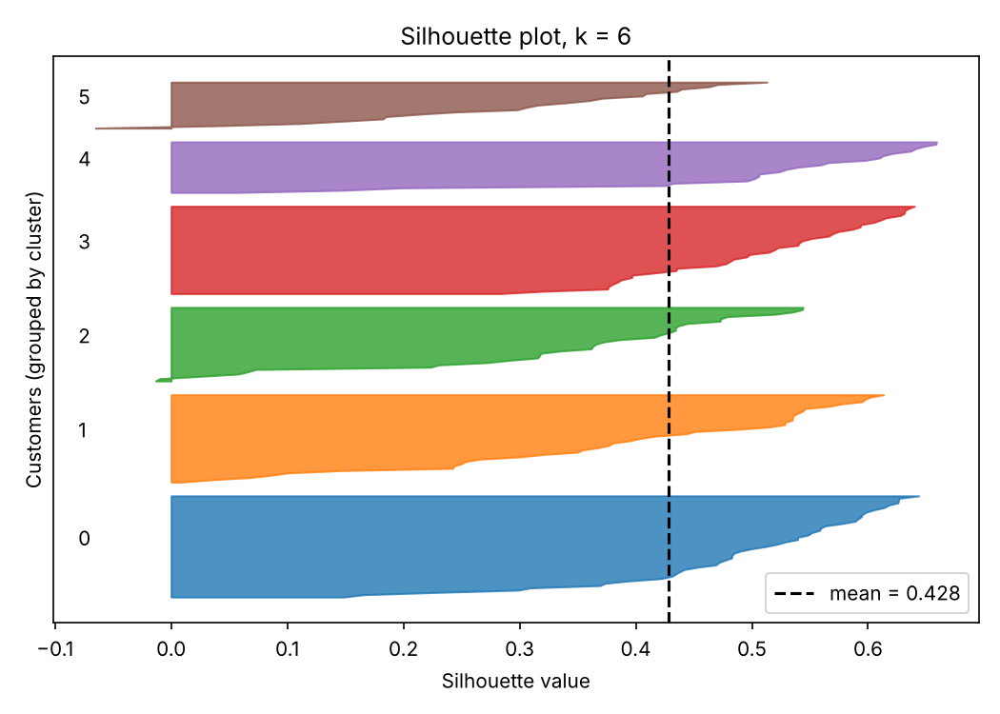
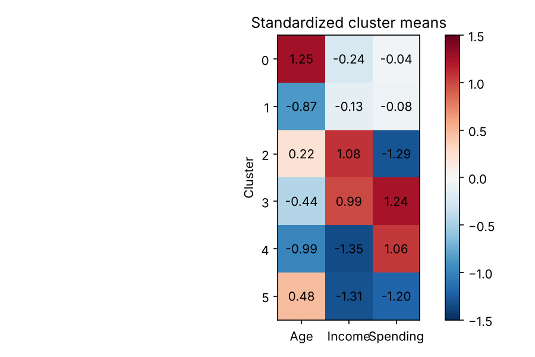
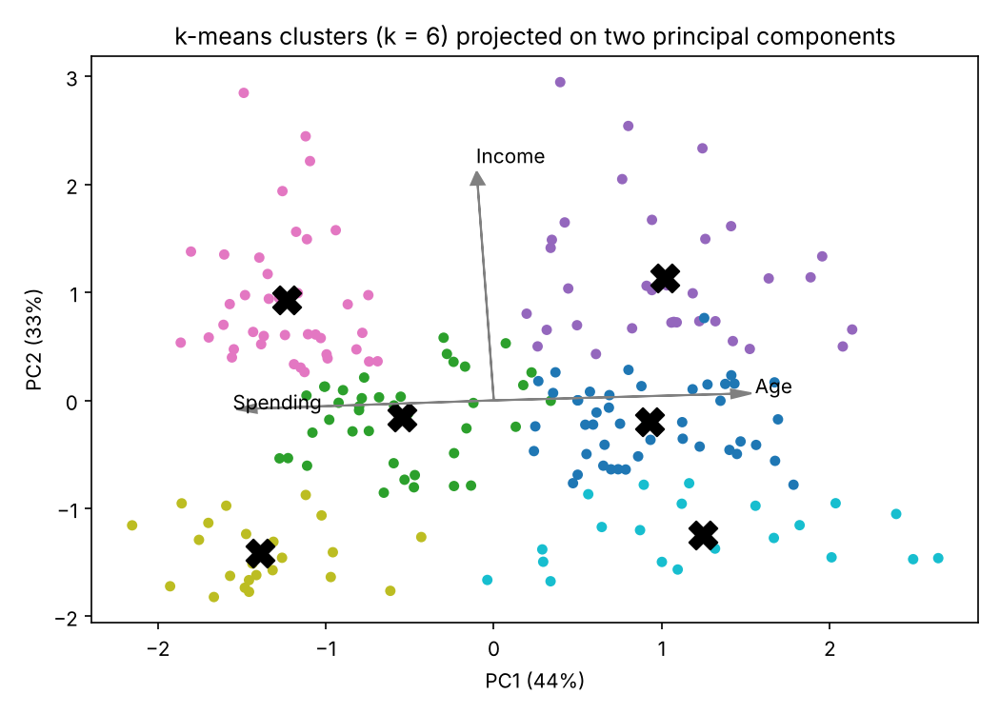
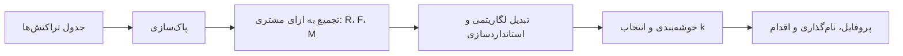

# جلسه ۲۹ — ارزیابی و تفسیر خوشه‌ها

## خوشه‌بندی خوب یعنی چه؟

در سه جلسه گذشته چهار خانواده الگوریتم خوشه‌بندی را دیدیم ← [مبانی خوشه‌بندی و k-Means](26%20-%20%D9%85%D8%A8%D8%A7%D9%86%DB%8C%20%D8%AE%D9%88%D8%B4%D9%87%E2%80%8C%D8%A8%D9%86%D8%AF%DB%8C%20%D9%88%20k-Means.md)، [خوشه‌بندی سلسله‌مراتبی](27%20-%20%D8%AE%D9%88%D8%B4%D9%87%E2%80%8C%D8%A8%D9%86%D8%AF%DB%8C%20%D8%B3%D9%84%D8%B3%D9%84%D9%87%E2%80%8C%D9%85%D8%B1%D8%A7%D8%AA%D8%A8%DB%8C.md) و [خوشه‌بندی چگالی‌محور و مبتنی بر مدل](28%20-%20%D8%AE%D9%88%D8%B4%D9%87%E2%80%8C%D8%A8%D9%86%D8%AF%DB%8C%20%DA%86%DA%AF%D8%A7%D9%84%DB%8C%E2%80%8C%D9%85%D8%AD%D9%88%D8%B1%20%D9%88%20%D9%85%D8%A8%D8%AA%D9%86%DB%8C%20%D8%A8%D8%B1%20%D9%85%D8%AF%D9%84.md). هر الگوریتمی روی هر داده‌ای خروجی می‌دهد، حتی روی داده بی‌ساختار. برخلاف طبقه‌بندی ← [ارزیابی مدل‌های طبقه‌بندی](../Part%205_Classification/25%20-%20%D8%A7%D8%B1%D8%B2%DB%8C%D8%A7%D8%A8%DB%8C%20%D9%85%D8%AF%D9%84%E2%80%8C%D9%87%D8%A7%DB%8C%20%D8%B7%D8%A8%D9%82%D9%87%E2%80%8C%D8%A8%D9%86%D8%AF%DB%8C.md) معمولاً **برچسب واقعی نداریم**. این جلسه به سه پرسش پاسخ می‌دهد:

- خوشه‌ها چقدر **فشرده و جدا** هستند و کدام k یا الگوریتم بهتر است؟
- اگر برچسب مرجعی داشته باشیم، تطابق خوشه‌ها با آن را چگونه بسنجیم؟
- خوشه‌ها چه **معنایی** دارند و چه اقدامی بر اساس آن‌ها می‌توان کرد؟

| نوع ارزیابی | پرسش | نیاز به برچسب | نمونه معیار |
|:---:|:---:|:---:|:---:|
| درونی | خوشه‌ها چقدر فشرده و جدا هستند؟ | ندارد | نیم‌رخ، دیویس-بولدین، کالینسکی-هاراباز |
| بیرونی | خوشه‌ها چقدر با یک برچسب مرجع تطابق دارند؟ | دارد | خلوص، ARI، NMI |
| کاربردی | آیا خوشه‌ها پایدار، تفسیرپذیر و قابل اقدام‌اند؟ | ندارد | پایداری، پروفایل، قضاوت خبره |

> [!important] نکته کلیدی
> معیارهای عددی **لازم** هستند اما **کافی** نیستند. خوشه‌بندی‌ای با نیم‌رخ عالی که هیچ تفسیر و اقدامی پشتش نیست، در عمل بی‌فایده است.

---

## معیارهای درونی

خوشه خوب **فشرده** (نقاط درون خوشه به هم نزدیک) و **جدا** (خوشه‌ها از هم دور) است. سه معیار رایج:

- **ضریب نیم‌رخ:** a میانگین فاصله نقطه تا اعضای خوشه خودش و b کمترین میانگین فاصله تا اعضای یک خوشه دیگر است؛ میانگین روی همه نقاط، بین منفی یک و یک، **بیشتر بهتر**.
- **شاخص دیویس-بولدین:** برای هر خوشه، پراکندگی S (میانگین فاصله تا مرکز) و فاصله مراکز M؛ میانگین «بدترین نسبت شباهت» هر خوشه، **کمتر بهتر**.
- **شاخص کالینسکی-هاراباز:** نسبت پراکندگی بین خوشه‌ها (B) به درون خوشه‌ها (W)، هر کدام تقسیم بر درجه آزادی (مانند آماره F)، **بیشتر بهتر**. مقدار W همان SSE در k-Means است.

$$
s(i) = \frac{b(i) - a(i)}{\max\big(a(i), b(i)\big)}, \qquad DB = \frac{1}{K} \sum_{i=1}^{K} \max_{j \ne i} \frac{S_i + S_j}{M_{ij}}
$$

$$
CH = \frac{B / (K - 1)}{W / (n - K)}, \qquad B = \sum_{k=1}^{K} n_k \lVert \mathbf{c}_k - \mathbf{c} \rVert^2, \qquad W = \sum_{k=1}^{K} \sum_{\mathbf{x} \in C_k} \lVert \mathbf{x} - \mathbf{c}_k \rVert^2
$$

### مثال حل‌شده: سه معیار درونی با دست

شش نقطه یک‌بعدی در دو خوشه: خوشه اول ۱، ۲ و ۴ و خوشه دوم ۸، ۹ و ۱۱.

#### گام ۱ — ضریب نیم‌رخ نقطه ۴

$$
a(4) = \frac{|4 - 1| + |4 - 2|}{2} = 2.5, \qquad b(4) = \frac{|4 - 8| + |4 - 9| + |4 - 11|}{3} \approx 5.333
$$

$$
s(4) = \frac{5.333 - 2.5}{5.333} \approx 0.531
$$

| نقطه | خوشه | ضریب نیم‌رخ |
|:---:|:---:|:---:|
| 1 | اول | 0.760 |
| 2 | اول | 0.795 |
| 4 | اول | 0.531 |
| 8 | دوم | 0.647 |
| 9 | دوم | 0.775 |
| 11 | دوم | 0.712 |
| میانگین | | 0.703 |

نقطه ۴ کمترین ضریب را دارد: از بقیه اعضای خوشه‌اش دورتر و به خوشه دوم نزدیک‌تر است.

#### گام ۲ — شاخص دیویس-بولدین

مراکز ۲.۳۳۳ و ۹.۳۳۳ و فاصله آن‌ها ۷ است. پراکندگی هر دو خوشه برابر است:

$$
S_1 = \frac{1.333 + 0.333 + 1.667}{3} \approx 1.111, \qquad S_2 \approx 1.111, \qquad DB = \frac{1.111 + 1.111}{7} \approx 0.317
$$

#### گام ۳ — شاخص کالینسکی-هاراباز

میانگین کل ۵.۸۳۳ است:

$$
B = 3 (2.333 - 5.833)^2 + 3 (9.333 - 5.833)^2 = 73.5, \qquad W = (1.78 + 0.11 + 2.78) \times 2 \approx 9.333
$$

$$
CH = \frac{73.5 / 1}{9.333 / 4} = 31.5
$$

> [!note] بررسی
> توابع scikit-learn همین اعداد را می‌دهند:

```python
import numpy as np
from sklearn.metrics import silhouette_samples, silhouette_score, davies_bouldin_score, calinski_harabasz_score

# Six 1-D points in two clusters: {1, 2, 4} and {8, 9, 11}
x = np.array([1, 2, 4, 8, 9, 11]).reshape(-1, 1)
labels = np.array([0, 0, 0, 1, 1, 1])
print(f"silhouette per point={silhouette_samples(x, labels).round(3).tolist()}")
print(f"mean silhouette={silhouette_score(x, labels):.3f}")
print(f"Davies-Bouldin={davies_bouldin_score(x, labels):.3f}  Calinski-Harabasz={calinski_harabasz_score(x, labels):.1f}")
```

```
silhouette per point=[0.76, 0.795, 0.531, 0.647, 0.775, 0.712]
mean silhouette=0.703
Davies-Bouldin=0.317  Calinski-Harabasz=31.5
```

| معیار | بازه | جهت بهتر | هزینه محاسبه | سوگیری |
|:---:|:---:|:---:|:---:|:---:|
| ضریب نیم‌رخ | منفی یک تا یک | بیشتر | زیاد (همه جفت‌ها) | خوشه‌های محدب |
| شاخص دیویس-بولدین | صفر تا بی‌نهایت | کمتر | کم (فقط مراکز) | خوشه‌های کروی |
| شاخص کالینسکی-هاراباز | صفر تا بی‌نهایت | بیشتر | کم | خوشه‌های کروی و هم‌اندازه |

### روی داده واقعی: انتخاب k برای مشتریان

این بار سه ویژگی عددی مشتریان مرکز خرید (سن، درآمد، امتیاز خرید) را به کار می‌بریم:

```python
import pandas as pd
from sklearn.preprocessing import StandardScaler
from sklearn.cluster import KMeans
from sklearn.metrics import silhouette_score, davies_bouldin_score, calinski_harabasz_score

# Mall customers, three numeric features, standardized; three internal measures for k = 2..10
url = "https://raw.githubusercontent.com/tirthajyoti/Machine-Learning-with-Python/master/Datasets/Mall_Customers.csv"
mall = pd.read_csv(url)
Xs = StandardScaler().fit_transform(mall[["Age", "Annual Income (k$)", "Spending Score (1-100)"]])
rows = []
for k in range(2, 11):
    labels = KMeans(k, n_init=10, random_state=42).fit_predict(Xs)
    rows.append({"k": k, "silhouette": silhouette_score(Xs, labels), "DB": davies_bouldin_score(Xs, labels),
                 "CH": calinski_harabasz_score(Xs, labels)})
res = pd.DataFrame(rows).set_index("k")
print(res.round(3).T.to_string())
print(f"best k: silhouette={res['silhouette'].idxmax()}  DB={res['DB'].idxmin()}  CH={res['CH'].idxmax()}")
```

```
k                2        3        4        5        6        7        8        9        10
silhouette    0.335    0.358    0.404    0.417    0.428    0.417    0.408    0.418    0.407
DB            1.261    1.050    0.931    0.875    0.825    0.793    0.892    0.820    0.868
CH          107.096  101.695  125.676  125.101  135.102  132.774  131.006  130.004  132.638
best k: silhouette=6  DB=7  CH=6
```

- ضریب نیم‌رخ (۰.۴۲۸) و کالینسکی-هاراباز (۱۳۵.۱) در k برابر **۶** بیشینه‌اند؛ دیویس-بولدین k برابر ۷ را کمی ترجیح می‌دهد (۰.۷۹۳ در برابر ۰.۸۲۵).
- اختلاف‌ها کوچک است؛ معیارها یک **بازه معقول** (۵ تا ۷) را نشان می‌دهند، نه یک عدد قطعی.

**نمودار نیم‌رخ** ضرایب نقاط هر خوشه را مرتب و به‌صورت میله افقی رسم می‌کند تا خوشه‌های ضعیف دیده شوند:

```python
import numpy as np
import pandas as pd
import matplotlib.pyplot as plt
from sklearn.preprocessing import StandardScaler
from sklearn.cluster import KMeans
from sklearn.metrics import silhouette_samples

# Silhouette plot for k = 6 (same data)
url = "https://raw.githubusercontent.com/tirthajyoti/Machine-Learning-with-Python/master/Datasets/Mall_Customers.csv"
mall = pd.read_csv(url)
Xs = StandardScaler().fit_transform(mall[["Age", "Annual Income (k$)", "Spending Score (1-100)"]])
labels = KMeans(6, n_init=10, random_state=42).fit_predict(Xs)
s = silhouette_samples(Xs, labels)
print(pd.DataFrame({"cluster": labels, "s": s}).groupby("cluster")["s"]
      .agg(size="size", mean="mean", negative=lambda v: int((v < 0).sum())).round(3))

fig, ax = plt.subplots(figsize=(7, 5))
y0 = 0
for c in range(6):
    vals = np.sort(s[labels == c])
    ax.fill_betweenx(np.arange(y0, y0 + len(vals)), 0, vals, color=plt.cm.tab10(c), alpha=0.8)
    ax.text(-0.08, y0 + len(vals) / 2, str(c))
    y0 += len(vals) + 5
ax.axvline(s.mean(), color="black", ls="--", label=f"mean = {s.mean():.3f}")
ax.set(xlabel="Silhouette value", ylabel="Customers (grouped by cluster)", yticks=[], title="Silhouette plot, k = 6")
ax.legend()
plt.show()
```

```
         size   mean  negative
cluster                       
0          45  0.491         0
1          39  0.387         0
2          33  0.331         2
3          39  0.505         0
4          23  0.508         0
5          21  0.294         1
```



خوشه‌های ۴ و ۳ با میانگین حدود ۰.۵۱ قوی‌ترند؛ خوشه ۵ (۰.۲۹۴) و خوشه ۲ (۰.۳۳۱) ضعیف‌ترند و سه مشتری ضریب منفی دارند، یعنی به خوشه دیگری نزدیک‌ترند.

> [!warning] محدودیت‌های معیارهای درونی
> - بر **فاصله و مرکز** تکیه دارند و خوشه‌های کروی را ترجیح می‌دهند؛ خوشه‌بندی درست DBSCAN روی هلال‌ها ممکن است نیم‌رخ پایینی بگیرد.
> - نقاط نویز DBSCAN را پیش از محاسبه حذف و درصد نویز را کنار معیار گزارش کنید.
> - مقادیر بین داده‌های مختلف **قابل مقایسه نیستند**؛ فقط روی یک داده برای مقایسه k یا الگوریتم‌ها.

---

## معیارهای بیرونی

وقتی برچسب مرجعی داریم، تطابق را از **جدول توافقی** کلاس‌ها و خوشه‌ها می‌سنجیم ← [تحلیل دومتغیره و چندمتغیره](../Part%202_EDA/8%20-%20%D8%AA%D8%AD%D9%84%DB%8C%D9%84%20%D8%AF%D9%88%D9%85%D8%AA%D8%BA%DB%8C%D8%B1%D9%87%20%D9%88%20%DA%86%D9%86%D8%AF%D9%85%D8%AA%D8%BA%DB%8C%D8%B1%D9%87.md). شماره خوشه‌ها **دلخواه** است، پس معیارها باید به نام‌گذاری حساس نباشند.

- **خلوص:** هر خوشه به کلاس غالبش نسبت داده می‌شود؛ نسبت نقاط درست. تعداد خوشه را جریمه نمی‌کند.
- **شاخص رند تعدیل‌شده (ARI):** همه **جفت** نقاط را می‌سنجد (هم‌گروه یا جدا در هر دو افراز) و برای شانس تصحیح می‌کند؛ صفر یعنی در حد تصادف و یک یعنی تطابق کامل.
- **اطلاعات متقابل نرمال‌شده (NMI):** دانستن خوشه چقدر از عدم قطعیت کلاس می‌کاهد ← [مهندسی و انتخاب ویژگی](../Part%203_Data%20Preprocessing/%DB%B1%DB%B3%20-%20%D9%85%D9%87%D9%86%D8%AF%D8%B3%DB%8C%20%D9%88%20%D8%A7%D9%86%D8%AA%D8%AE%D8%A7%D8%A8%20%D9%88%DB%8C%DA%98%DA%AF%DB%8C.md)؛ بین صفر و یک.

$$
\text{Purity} = \frac{1}{n} \sum_{k} \max_{j} n_{jk}, \qquad \text{ARI} = \frac{\text{Index} - \text{Expected}}{\text{Max} - \text{Expected}}
$$

$$
\text{Index} = \sum_{jk} \binom{n_{jk}}{2}, \qquad \text{Expected} = \frac{\sum_j \binom{a_j}{2} \sum_k \binom{b_k}{2}}{\binom{n}{2}}, \qquad \text{Max} = \frac{1}{2}\Big[\sum_j \binom{a_j}{2} + \sum_k \binom{b_k}{2}\Big]
$$

$$
\text{NMI}(Y, C) = \frac{I(Y; C)}{\tfrac{1}{2}\big[H(Y) + H(C)\big]}
$$

در فرمول ARI، a جمع سطرها (اندازه کلاس‌ها) و b جمع ستون‌ها (اندازه خوشه‌ها) است.

### مثال حل‌شده: سه معیار بیرونی با دست

هجده نمونه با سه کلاس واقعی در سه خوشه:

| کلاس واقعی | خوشه ۱ | خوشه ۲ | خوشه ۳ | جمع |
|:---:|:---:|:---:|:---:|:---:|
| کلاس A | 5 | 1 | 0 | 6 |
| کلاس B | 1 | 4 | 1 | 6 |
| کلاس C | 0 | 1 | 5 | 6 |
| جمع | 6 | 6 | 6 | 18 |

#### گام ۱ — خلوص

$$
\text{Purity} = \frac{5 + 4 + 5}{18} \approx 0.778
$$

#### گام ۲ — شاخص رند تعدیل‌شده

جفت‌های هم‌کلاس و هم‌خوشه (فقط خانه‌های بزرگ‌تر از یک سهم دارند):

$$
\text{Index} = \binom{5}{2} + \binom{4}{2} + \binom{5}{2} = 10 + 6 + 10 = 26
$$

هر سطر و ستون ۶ عضو دارد و جمع ترکیب‌های دوتایی سطرها و ستون‌ها هر کدام ۳ ضرب در ۱۵ یعنی ۴۵ است:

$$
\text{Expected} = \frac{45 \times 45}{153} \approx 13.24, \qquad \text{Max} = 45, \qquad \text{ARI} = \frac{26 - 13.24}{45 - 13.24} \approx 0.402
$$

#### گام ۳ — اطلاعات متقابل نرمال‌شده

هر کلاس و هر خوشه یک‌سوم داده است، پس هر دو آنتروپی لگاریتم طبیعی ۳ یعنی ۱.۰۹۹ است. اطلاعات متقابل از جدول حدود ۰.۵۰۹ است:

$$
\text{NMI} = \frac{0.509}{1.099} \approx 0.463
$$

#### گام ۴ — خوشه‌بندی بدیهی

اگر هر نمونه یک خوشه جداگانه باشد (۱۸ خوشه تک‌عضوی)، هر خوشه «خالص» است و خلوص **یک** می‌شود، اما هیچ جفتی هم‌خوشه نیست و ARI صفر است.

> [!note] بررسی
> کد زیر جدول توافقی و هر سه معیار را برای هر دو خوشه‌بندی حساب می‌کند.

```python
import numpy as np
from sklearn.metrics import adjusted_rand_score, normalized_mutual_info_score
from sklearn.metrics.cluster import contingency_matrix

# Eighteen samples: true classes A, B, C (6 each) and three clusters
y_true = np.repeat(["A", "B", "C"], 6)
y_pred = np.array([1, 1, 1, 1, 1, 2,  1, 2, 2, 2, 2, 3,  2, 3, 3, 3, 3, 3])
M = contingency_matrix(y_true, y_pred)
print(M)
purity = M.max(axis=0).sum() / M.sum()
print(f"purity={purity:.3f}  ARI={adjusted_rand_score(y_true, y_pred):.3f}  "
      f"NMI={normalized_mutual_info_score(y_true, y_pred):.3f}")

# Every sample in its own cluster
single = np.arange(18)
M1 = contingency_matrix(y_true, single)
print(f"18 singletons: purity={M1.max(axis=0).sum() / 18:.3f}  ARI={adjusted_rand_score(y_true, single):.3f}  "
      f"NMI={normalized_mutual_info_score(y_true, single):.3f}")
```

```
[[5 1 0]
 [1 4 1]
 [0 1 5]]
purity=0.778  ARI=0.402  NMI=0.463
18 singletons: purity=1.000  ARI=0.000  NMI=0.551
```

| معیار | بازه | مقدار برای خوشه‌بندی تصادفی | ۱۸ خوشه تک‌عضوی | ویژگی |
|:---:|:---:|:---:|:---:|:---:|
| خلوص | صفر تا یک | بزرگ‌تر از صفر | 1.000 | ساده؛ تعداد خوشه را جریمه نمی‌کند |
| شاخص ARI | حدود منفی ۰.۵ تا یک | حدود صفر | 0.000 | تصحیح شانس؛ پیشنهاد اول |
| شاخص NMI | صفر تا یک | نزدیک صفر | 0.551 | مبتنی بر نظریه اطلاعات؛ کمی به خوشه زیاد خوش‌بین |

### معیار بیرونی بدون برچسب: توافق و پایداری

در پروژه واقعی برچسب مرجع نداریم، اما ARI باز هم مفید است: برای **مقایسه دو الگوریتم** با هم و برای **پایداری**؛ خوشه‌بندی روی نمونه‌های بوت‌استرپ و مقایسه با خوشه‌بندی کل داده. خوشه‌های پایدار قابل اعتمادترند.

```python
import numpy as np
import pandas as pd
from sklearn.preprocessing import StandardScaler
from sklearn.cluster import KMeans, AgglomerativeClustering
from sklearn.mixture import GaussianMixture
from sklearn.metrics import adjusted_rand_score

url = "https://raw.githubusercontent.com/tirthajyoti/Machine-Learning-with-Python/master/Datasets/Mall_Customers.csv"
mall = pd.read_csv(url)
Xs = StandardScaler().fit_transform(mall[["Age", "Annual Income (k$)", "Spending Score (1-100)"]])

# 1. Agreement between three algorithms (k = 6), no true labels needed
labels = {"k-means": KMeans(6, n_init=10, random_state=42).fit_predict(Xs),
          "Ward": AgglomerativeClustering(6, linkage="ward").fit_predict(Xs),
          "GMM": GaussianMixture(6, n_init=5, random_state=42).fit_predict(Xs)}
names = list(labels)
for i in range(3):
    for j in range(i + 1, 3):
        print(f"ARI({names[i]}, {names[j]})={adjusted_rand_score(labels[names[i]], labels[names[j]]):.2f}")

# 2. Stability: fit k-means on 30 bootstrap samples, label all customers, compare with the full-data fit
rng = np.random.default_rng(42)
for k in [4, 5, 6, 7]:
    full = KMeans(k, n_init=10, random_state=42).fit(Xs).labels_
    aris = []
    for b in range(30):
        idx = rng.integers(0, len(Xs), len(Xs))
        boot = KMeans(k, n_init=10, random_state=b).fit(Xs[idx])
        aris.append(adjusted_rand_score(full, boot.predict(Xs)))
    print(f"k={k}: bootstrap ARI mean={np.mean(aris):.2f}  min={np.min(aris):.2f}")
```

```
ARI(k-means, Ward)=0.89
ARI(k-means, GMM)=0.70
ARI(Ward, GMM)=0.65
k=4: bootstrap ARI mean=0.96  min=0.87
k=5: bootstrap ARI mean=0.81  min=0.63
k=6: bootstrap ARI mean=0.91  min=0.75
k=7: bootstrap ARI mean=0.83  min=0.63
```

| تعداد خوشه | میانگین ARI بوت‌استرپ | کمینه |
|:---:|:---:|:---:|
| ۴ | 0.96 | 0.87 |
| ۵ | 0.81 | 0.63 |
| ۶ | 0.91 | 0.75 |
| ۷ | 0.83 | 0.63 |

- الگوریتم k-Means و روش Ward روی شش خوشه بسیار هم‌نظرند (۰.۸۹)؛ مدل GMM افراز کمی متفاوتی می‌دهد (۰.۶۵ تا ۰.۷۰).
- چهار و شش خوشه پایدارند؛ پنج و هفت خوشه با تغییر نمونه بیشتر جابه‌جا می‌شوند. همراه با معیارهای درونی، **شش خوشه** انتخاب معقولی است.

---

## تفسیر و نام‌گذاری خوشه‌ها

خوشه‌بندی تا خوشه‌ها **توصیف و نام‌گذاری** نشوند کامل نیست. ابزارهای پروفایل‌سازی:

| روش | توضیح |
|:---:|:---:|
| آمار خلاصه | میانگین یا میانه هر ویژگی در هر خوشه **به واحد اصلی**، همراه با اندازه خوشه |
| انحراف استانداردشده | میانگین استانداردشده هر ویژگی؛ مقادیر دور از صفر متمایزکننده‌اند |
| ویژگی‌های کیفی | سهم هر دسته (مثلاً جنسیت) در هر خوشه نسبت به کل |
| مدل جانشین | درخت تصمیم کم‌عمق که خوشه را پیش‌بینی می‌کند ← [درخت تصمیم](../Part%205_Classification/22%20-%20%D8%AF%D8%B1%D8%AE%D8%AA%20%D8%AA%D8%B5%D9%85%DB%8C%D9%85.md) |

```python
import pandas as pd
import matplotlib.pyplot as plt
from sklearn.preprocessing import StandardScaler
from sklearn.cluster import KMeans
from sklearn.tree import DecisionTreeClassifier, export_text

# 1. Six clusters; profile in original units and as standardized deviations from the overall mean
url = "https://raw.githubusercontent.com/tirthajyoti/Machine-Learning-with-Python/master/Datasets/Mall_Customers.csv"
mall = pd.read_csv(url)
cols = ["Age", "Annual Income (k$)", "Spending Score (1-100)"]
Xs = StandardScaler().fit_transform(mall[cols])
mall["cluster"] = KMeans(6, n_init=10, random_state=42).fit_predict(Xs)
profile = mall.groupby("cluster")[cols].mean().round(1)
profile["female_%"] = (mall["Gender"] == "Female").groupby(mall["cluster"]).mean().mul(100).round(0)
profile["size"] = mall["cluster"].value_counts().sort_index()
print(profile)
z = pd.DataFrame(Xs, columns=["Age", "Income", "Spending"]).groupby(mall["cluster"]).mean()

# 2. Surrogate model: a shallow tree that predicts the cluster from the original features
tree = DecisionTreeClassifier(max_depth=3, random_state=42).fit(mall[cols], mall["cluster"])
print(f"tree accuracy={tree.score(mall[cols], mall['cluster']):.3f}")
print(export_text(tree, feature_names=["Age", "Income", "Spending"]))

fig, ax = plt.subplots(figsize=(6, 4))
im = ax.imshow(z.values, cmap="RdBu_r", vmin=-1.5, vmax=1.5)
ax.set(xticks=range(3), xticklabels=z.columns, yticks=range(6), ylabel="Cluster", title="Standardized cluster means")
for i in range(6):
    for j in range(3):
        ax.text(j, i, f"{z.values[i, j]:.2f}", ha="center", va="center")
fig.colorbar(im)
plt.show()
```

```
          Age  Annual Income (k$)  Spending Score (1-100)  female_%  size
cluster                                                                  
0        56.3                54.3                    49.1      58.0    45
1        26.8                57.1                    48.1      64.0    39
2        41.9                88.9                    17.0      42.0    33
3        32.7                86.5                    82.1      54.0    39
4        25.0                25.3                    77.6      57.0    23
5        45.5                26.3                    19.4      62.0    21
tree accuracy=0.865
|--- Spending <= 62.00
|   |--- Income <= 70.50
|   |   |--- Age <= 41.00
|   |   |   |--- class: 1
|   |   |--- Age >  41.00
|   |   |   |--- class: 0
|   |--- Income >  70.50
|   |   |--- Age <= 30.00
|   |   |   |--- class: 1
|   |   |--- Age >  30.00
|   |   |   |--- class: 2
|--- Spending >  62.00
|   |--- Income <= 54.00
|   |   |--- class: 4
|   |--- Income >  54.00
|   |   |--- class: 3
```



| خوشه | سن | درآمد | امتیاز خرید | زنان | تعداد | نام پیشنهادی | اقدام |
|:---:|:---:|:---:|:---:|:---:|:---:|:---:|:---:|
| ۳ | ۳۳ | ۸۷ | ۸۲ | ۵۴٪ | 39 | پردرآمد پرخرج | برنامه وفاداری و محصولات ویژه |
| ۴ | ۲۵ | ۲۵ | ۷۸ | ۵۷٪ | 23 | جوانان کم‌درآمد پرخرج | تخفیف و خرید قسطی |
| ۲ | ۴۲ | ۸۹ | ۱۷ | ۴۲٪ | 33 | پردرآمد کم‌خرج | شناخت نیاز؛ پیشنهاد کالای باکیفیت |
| ۱ | ۲۷ | ۵۷ | ۴۸ | ۶۴٪ | 39 | جوانان میانه‌رو | کمپین شبکه‌های اجتماعی |
| ۰ | ۵۶ | ۵۴ | ۴۹ | ۵۸٪ | 45 | مسن‌ترهای میانه‌رو | خدمات و آسایش خرید |
| ۵ | ۴۶ | ۲۶ | ۱۹ | ۶۲٪ | 21 | محتاط کم‌درآمد | هزینه بازاریابی کم |

- جنسیت در خوشه‌بندی شرکت نداشت و سهم زنان در خوشه‌ها نزدیک به کل داده (۵۶ درصد) است؛ جنسیت بخش‌ها را متمایز نمی‌کند.
- درخت عمق ۳ با دقت ۸۶.۵ درصد خوشه‌ها را بازتولید می‌کند و قواعدی ساده برای مخاطب غیرفنی می‌دهد؛ مثلاً «امتیاز خرید بالای ۶۲ و درآمد تا ۵۴ ← خوشه ۴».

> [!tip] اصول نام‌گذاری خوب
> - نام باید **رفتار متمایزکننده** را بگوید، نه شماره را.
> - اندازه هر خوشه را کنار پروفایل گزارش کنید؛ خوشه سه‌نفره احتمالاً گروه پرت است، نه بخش بازار.
> - برای هر خوشه یک **اقدام** بنویسید؛ اگر دو خوشه اقدام یکسان دارند، شاید ادغامشان بهتر باشد.

---

## مصورسازی خوشه‌ها با PCA

خوشه‌بندی معمولاً در فضای چندبعدی انجام می‌شود. برای **دیدن** نتیجه، داده را با PCA به دو بعد تصویر و نقاط را با برچسب خوشه رنگ می‌کنیم ← [کاهش ابعاد](../Part%203_Data%20Preprocessing/%DB%B1%DB%B4-%20%DA%A9%D8%A7%D9%87%D8%B4%20%D8%A7%D8%A8%D8%B9%D8%A7%D8%AF.md). خوشه‌بندی در فضای اصلی انجام می‌شود و PCA فقط برای نمایش است.

```python
import pandas as pd
import matplotlib.pyplot as plt
from sklearn.preprocessing import StandardScaler
from sklearn.decomposition import PCA
from sklearn.cluster import KMeans

# Cluster in the full 3-D standardized space, then project to 2-D only for the picture
url = "https://raw.githubusercontent.com/tirthajyoti/Machine-Learning-with-Python/master/Datasets/Mall_Customers.csv"
mall = pd.read_csv(url)
cols = ["Age", "Annual Income (k$)", "Spending Score (1-100)"]
Xs = StandardScaler().fit_transform(mall[cols])
km = KMeans(6, n_init=10, random_state=42).fit(Xs)
pca = PCA(n_components=2).fit(Xs)
P, C = pca.transform(Xs), pca.transform(km.cluster_centers_)
print(f"explained variance={pca.explained_variance_ratio_.round(3).tolist()}  total={pca.explained_variance_ratio_.sum():.3f}")
print(pd.DataFrame(pca.components_.T, index=["Age", "Income", "Spending"], columns=["PC1", "PC2"]).round(2))

fig, ax = plt.subplots(figsize=(7, 5))
ax.scatter(P[:, 0], P[:, 1], c=km.labels_, cmap="tab10", s=18)
ax.scatter(C[:, 0], C[:, 1], c="black", marker="X", s=200)
for name, (a, b) in zip(["Age", "Income", "Spending"], pca.components_.T):
    ax.arrow(0, 0, 2 * a, 2 * b, color="gray", head_width=0.08)
    ax.text(2.2 * a, 2.2 * b, name)
ax.set(xlabel=f"PC1 ({pca.explained_variance_ratio_[0]:.0%})", ylabel=f"PC2 ({pca.explained_variance_ratio_[1]:.0%})",
       title="k-means clusters (k = 6) projected on two principal components")
plt.show()
```

```
explained variance=[0.443, 0.333]  total=0.776
           PC1   PC2
Age       0.71  0.03
Income   -0.05  1.00
Spending -0.71 -0.04
```



- دو مؤلفه ۷۷.۶ درصد واریانس را توضیح می‌دهند؛ این عدد را همیشه گزارش کنید.
- مؤلفه اول تقابل **سن و امتیاز خرید** است (بارگذاری ۰.۷۱ و منفی ۰.۷۱) و مؤلفه دوم تقریباً همان **درآمد** است. پیکان‌ها (بارگذاری‌ها) این تفسیر را روی نمودار نشان می‌دهند.
- همپوشانی ظاهری خوشه‌ها ممکن است ناشی از تصویرسازی باشد، نه همپوشانی واقعی در سه بعد.

> [!warning] روی خروجی t-SNE خوشه‌بندی نکنید
> روش‌های t-SNE و UMAP فاصله‌ها و چگالی‌ها را تحریف می‌کنند و ممکن است خوشه‌هایی بسازند که در داده اصلی نیست. از آن‌ها فقط برای دیدن نتیجه خوشه‌بندی انجام‌شده در فضای اصلی استفاده کنید.

---

## مطالعه موردی: بخش‌بندی مشتریان با RFM

تحلیل RFM هر مشتری را با سه عدد توصیف می‌کند:

| شاخص | نام | تعریف | جهت مطلوب |
|:---:|:---:|:---:|:---:|
| حرف R | تازگی (Recency) | تعداد روز از آخرین خرید تا تاریخ مرجع | کمتر بهتر |
| حرف F | تکرار (Frequency) | تعداد فاکتورهای خرید | بیشتر بهتر |
| حرف M | ارزش پولی (Monetary) | مجموع مبلغ خریدها | بیشتر بهتر |



دو رویکرد وجود دارد: **امتیازدهی** (هر شاخص به پنج دسته هم‌فراوانی و امتیاز ۱ تا ۵ ← [تبدیل و یکپارچه‌سازی داده](../Part%203_Data%20Preprocessing/%DB%B1%DB%B2%20-%20%D8%AA%D8%A8%D8%AF%DB%8C%D9%84%20%D9%88%20%DB%8C%DA%A9%D9%BE%D8%A7%D8%B1%DA%86%D9%87%E2%80%8C%D8%B3%D8%A7%D8%B2%DB%8C%20%D8%AF%D8%A7%D8%AF%D9%87.md)) و **خوشه‌بندی** (بخش‌ها از خود داده کشف شوند). اینجا رویکرد دوم را دنبال می‌کنیم.

### مثال حل‌شده: محاسبه RFM با دست

هفت سطر فاکتور از سه مشتری؛ تاریخ مرجع ۱ آوریل ۲۰۲۴ است:

| مشتری | تاریخ | شماره فاکتور | مبلغ |
|:---:|:---:|:---:|:---:|
| مشتری P | 2024-01-05 | 1 | 40 |
| مشتری P | 2024-02-10 | 2 | 25 |
| مشتری P | 2024-03-25 | 3 | 30 |
| مشتری P | 2024-03-25 | 3 | 15 |
| مشتری Q | 2024-01-20 | 4 | 200 |
| مشتری Q | 2024-03-30 | 5 | 150 |
| مشتری R | 2023-12-01 | 6 | 60 |

#### گام ۱ — تازگی

آخرین خرید P در ۲۵ مارس، یعنی ۷ روز پیش از تاریخ مرجع است؛ Q در ۳۰ مارس (۲ روز). برای R از ۱ دسامبر: ۳۱ روز دسامبر، ۳۱ روز ژانویه، ۲۹ روز فوریه (سال کبیسه) و ۳۱ روز مارس، یعنی **۱۲۲** روز.

#### گام ۲ — تکرار

تکرار، تعداد **فاکتورهای متمایز** است، نه تعداد سطرها: فاکتور ۳ مشتری P دو قلم کالا دارد ولی یک خرید است. پس P سه، Q دو و R یک خرید دارد.

#### گام ۳ — ارزش پولی

$$
M_P = 40 + 25 + 30 + 15 = 110, \qquad M_Q = 200 + 150 = 350, \qquad M_R = 60
$$

> [!note] بررسی
> یک `groupby` با سه تجمیع همین جدول را می‌سازد:

```python
import pandas as pd

# Seven purchases of three customers; reference date = 2024-04-01
tx = pd.DataFrame({"customer": ["P", "P", "P", "Q", "Q", "R", "P"],
                   "date": pd.to_datetime(["2024-01-05", "2024-02-10", "2024-03-25", "2024-01-20",
                                           "2024-03-30", "2023-12-01", "2024-03-25"]),
                   "invoice": [1, 2, 3, 4, 5, 6, 3],
                   "amount": [40, 25, 30, 200, 150, 60, 15]})
ref = pd.Timestamp("2024-04-01")
rfm = tx.groupby("customer").agg(recency=("date", lambda d: (ref - d.max()).days),
                                 frequency=("invoice", "nunique"), monetary=("amount", "sum"))
print(rfm)
```

```
          recency  frequency  monetary
customer                              
P               7          3       110
Q               2          2       350
R             122          1        60
```

### روی داده واقعی: فروشگاه اینترنتی

داده Online Retail همه تراکنش‌های یک فروشگاه اینترنتی هدایا در بریتانیا از دسامبر ۲۰۱۰ تا دسامبر ۲۰۱۱ است (بیش از نیم میلیون سطر). ابتدا سطرهای بدون شناسه مشتری، فاکتورهای **لغوشده** (شماره با حرف C) و مقادیر نامثبت را حذف می‌کنیم ← [کیفیت داده](../Part%201_Data%20Understanding/%DB%B6%20-%20%DA%A9%DB%8C%D9%81%DB%8C%D8%AA%20%D8%AF%D8%A7%D8%AF%D9%87.md):

```python
import pandas as pd

# 1. Online Retail: all transactions of a UK online gift shop, Dec 2010 - Dec 2011
url = "https://raw.githubusercontent.com/databricks/Spark-The-Definitive-Guide/master/data/retail-data/all/online-retail-dataset.csv"
tx = pd.read_csv(url)
print(f"raw rows={len(tx):,}")

# 2. Keep sales with a known customer; drop cancellations (invoice starting with C) and non-positive values
tx = tx.dropna(subset=["CustomerID"])
tx = tx[~tx["InvoiceNo"].astype(str).str.startswith("C") & (tx["Quantity"] > 0) & (tx["UnitPrice"] > 0)].copy()
tx["InvoiceDate"] = pd.to_datetime(tx["InvoiceDate"], format="%m/%d/%Y %H:%M")
tx["amount"] = tx["Quantity"] * tx["UnitPrice"]
print(f"clean rows={len(tx):,}  customers={tx['CustomerID'].nunique():,}  "
      f"period={tx['InvoiceDate'].min().date()} to {tx['InvoiceDate'].max().date()}")

# 3. RFM table, reference date = day after the last purchase
ref = tx["InvoiceDate"].max() + pd.Timedelta(days=1)
rfm = tx.groupby("CustomerID").agg(recency=("InvoiceDate", lambda d: (ref - d.max()).days),
                                   frequency=("InvoiceNo", "nunique"), monetary=("amount", "sum"))
print(rfm.describe().loc[["50%", "mean", "min", "max"]].round(1))
print(f"skewness={rfm.skew().round(1).to_dict()}")
```

```
raw rows=541,909
clean rows=397,884  customers=4,338  period=2010-12-01 to 2011-12-09
      recency  frequency  monetary
50%      51.0        2.0     674.5
mean     92.5        4.3    2054.3
min       1.0        1.0       3.8
max     374.0      209.0  280206.0
skewness={'recency': 1.2, 'frequency': 12.1, 'monetary': 19.3}
```

- از ۵۴۱٬۹۰۹ سطر، ۳۹۷٬۸۸۴ سطر از ۴٬۳۳۸ مشتری باقی ماند.
- تکرار و ارزش پولی به‌شدت **چوله به راست** هستند (چولگی ۱۲ و ۱۹؛ میانه ارزش ۶۷۴ در برابر میانگین ۲۰۵۴ و بیشینه ۲۸۰ هزار). بدون تبدیل، چند مشتری عمده‌فروش مراکز k-Means را به سمت خود می‌کشند؛ پس ابتدا `log1p` و سپس استانداردسازی ← [تبدیل و یکپارچه‌سازی داده](../Part%203_Data%20Preprocessing/%DB%B1%DB%B2%20-%20%D8%AA%D8%A8%D8%AF%DB%8C%D9%84%20%D9%88%20%DB%8C%DA%A9%D9%BE%D8%A7%D8%B1%DA%86%D9%87%E2%80%8C%D8%B3%D8%A7%D8%B2%DB%8C%20%D8%AF%D8%A7%D8%AF%D9%87.md).

```python
import numpy as np
import pandas as pd
from sklearn.pipeline import make_pipeline
from sklearn.preprocessing import FunctionTransformer, StandardScaler
from sklearn.cluster import KMeans
from sklearn.metrics import silhouette_score, davies_bouldin_score

# 1. Same cleaning and RFM table as above
url = "https://raw.githubusercontent.com/databricks/Spark-The-Definitive-Guide/master/data/retail-data/all/online-retail-dataset.csv"
tx = pd.read_csv(url).dropna(subset=["CustomerID"])
tx = tx[~tx["InvoiceNo"].astype(str).str.startswith("C") & (tx["Quantity"] > 0) & (tx["UnitPrice"] > 0)].copy()
tx["InvoiceDate"] = pd.to_datetime(tx["InvoiceDate"], format="%m/%d/%Y %H:%M")
tx["amount"] = tx["Quantity"] * tx["UnitPrice"]
ref = tx["InvoiceDate"].max() + pd.Timedelta(days=1)
rfm = tx.groupby("CustomerID").agg(recency=("InvoiceDate", lambda d: (ref - d.max()).days),
                                   frequency=("InvoiceNo", "nunique"), monetary=("amount", "sum"))

# 2. log1p then standardize; internal measures for k = 2..7
prep = make_pipeline(FunctionTransformer(np.log1p), StandardScaler())
Z = prep.fit_transform(rfm)
for k in range(2, 8):
    lab = KMeans(k, n_init=10, random_state=42).fit_predict(Z)
    print(f"k={k}  silhouette={silhouette_score(Z, lab):.3f}  DB={davies_bouldin_score(Z, lab):.3f}")

# 3. Four segments: medians in original units and share of revenue
rfm["segment"] = KMeans(4, n_init=10, random_state=42).fit_predict(Z)
profile = rfm.groupby("segment").agg(n=("recency", "size"), recency=("recency", "median"),
                                     frequency=("frequency", "median"), monetary=("monetary", "median"))
profile["revenue_%"] = (rfm.groupby("segment")["monetary"].sum() / rfm["monetary"].sum() * 100).round(1)
print(profile.sort_values("monetary", ascending=False).round(1))
```

```
k=2  silhouette=0.433  DB=0.892
k=3  silhouette=0.337  DB=1.048
k=4  silhouette=0.337  DB=1.010
k=5  silhouette=0.316  DB=0.990
k=6  silhouette=0.313  DB=1.013
k=7  silhouette=0.310  DB=0.973
            n  recency  frequency  monetary  revenue_%
segment                                               
1         716      8.0       10.0    3733.9       64.9
2        1173     56.0        4.0    1345.6       23.7
0         837     17.0        2.0     471.7        5.2
3        1612    177.0        1.0     298.3        6.2
```

- ضریب نیم‌رخ دو بخش را ترجیح می‌دهد (۰.۴۳۳) که فقط «فعال و غیرفعال» را جدا می‌کند و برای بازاریابی بیش از حد کلی است. سه و چهار بخش نیم‌رخ یکسان (۰.۳۳۷) دارند و دیویس-بولدین چهار را کمی بهتر می‌داند؛ **چهار بخش** را انتخاب می‌کنیم.

| بخش | تعداد | میانه تازگی | میانه تکرار | میانه ارزش | سهم درآمد | نام | اقدام پیشنهادی |
|:---:|:---:|:---:|:---:|:---:|:---:|:---:|:---:|
| ۱ | 716 | 8 | 10 | 3734 | ۶۴.۹٪ | قهرمانان | برنامه وفاداری، دسترسی زودهنگام |
| ۲ | 1173 | 56 | 4 | 1346 | ۲۳.۷٪ | وفاداران متوسط | پیشنهاد افزایش سبد خرید |
| ۰ | 837 | 17 | 2 | 472 | ۵.۲٪ | تازه‌واردها | خوش‌آمدگویی و تشویق به خرید دوم |
| ۳ | 1612 | 177 | 1 | 298 | ۶.۲٪ | ازدست‌رفته | کمپین بازگشت کم‌هزینه |

**۱۶ درصد مشتریان (قهرمانان) حدود ۶۵ درصد درآمد را می‌سازند** و ۳۷ درصد مشتریان یک بار خرید کرده و حدود شش ماه برنگشته‌اند. این جدول، نه عدد نیم‌رخ، چیزی است که به مدیر بازاریابی ارائه می‌شود.

> [!important] انتخاب k تصمیم کسب‌وکاری هم هست
> معیارهای درونی بازه‌ای از مقادیر معقول را نشان می‌دهند. انتخاب نهایی به این پرسش پاسخ می‌دهد: «آیا برای هر بخش می‌توانیم اقدام **متفاوتی** انجام دهیم؟»

> [!note] کارگاه عملی
> دفترچه «۲۹ - کارگاه ارزیابی و تفسیر خوشه‌ها» رویکرد امتیازدهی RFM با پنجک‌ها، نمودار مار (Snake Plot) برای مقایسه بخش‌ها، و تمرین عملی کلاس (بخش‌بندی مشتریان فروشگاه با RFM و ویژگی‌های تکمیلی و پروفایل بخش‌ها) را با پاسخ دارد. نحوه نوشتن این کدها در امتحان پرسیده نمی‌شود.

---

## خطاهای رایج

| خطا | چرا نادرست است | روش درست |
|:---:|:---:|:---:|
| مقایسه ضریب نیم‌رخ دو داده متفاوت | مقدار معیار به داده وابسته است | مقایسه فقط روی یک داده |
| گزارش خلوص با تعداد خوشه زیاد | خلوص با افزایش خوشه‌ها به یک می‌رسد | شاخص ARI یا NMI |
| حساب کردن نویز DBSCAN به‌عنوان یک خوشه | معیارها گمراه می‌شوند | حذف نویز و گزارش درصد آن |
| پروفایل با مقادیر استانداردشده برای مدیر | برای مخاطب نامفهوم است | میانگین یا میانه به واحد اصلی |
| خوشه‌بندی RFM بدون تبدیل لگاریتمی | چند مشتری عمده مراکز را می‌کشند | ابتدا log1p سپس استانداردسازی |
| شمردن سطرها به‌جای فاکتورها برای تکرار | هر فاکتور چند سطر کالا دارد | شمارش فاکتورهای متمایز |

---

## نمونه سؤال‌های امتحانی

### سؤال‌های مفهومی

> [!question]- ۱. تفاوت معیارهای درونی و بیرونی چیست؟ در پروژه‌ای بدون برچسب، معیار بیرونی چه کاربردی دارد؟
> معیار درونی فقط از داده و خوشه‌ها استفاده می‌کند (فشردگی و جدایی)؛ معیار بیرونی تطابق با یک برچسب مرجع را می‌سنجد. بدون برچسب، ARI برای مقایسه دو الگوریتم با هم و سنجش پایداری روی نمونه‌های بوت‌استرپ به کار می‌رود.

> [!question]- ۲. چرا خلوص برای مقایسه خوشه‌بندی‌هایی با تعداد خوشه متفاوت مناسب نیست؟
> چون تعداد خوشه را جریمه نمی‌کند: با افزایش خوشه‌ها خلوص زیاد می‌شود و اگر هر نقطه خوشه خودش باشد، خلوص یک است. شاخص ARI در همین حالت صفر است.

> [!question]- ۳. خوشه‌بندی DBSCAN روی دو هلال کاملاً درست است اما ضریب نیم‌رخ آن کم است. چرا؟
> ضریب نیم‌رخ بر میانگین فاصله‌ها تکیه دارد و خوشه‌های فشرده و محدب را ترجیح می‌دهد. در هلال، نقاط دو سر یک هلال از هم دورند و ممکن است به هلال دیگر نزدیک‌تر باشند؛ پس a بزرگ و b کوچک است، با اینکه خوشه‌بندی درست است.

> [!question]- ۴. چرا در RFM پیش از k-Means از تبدیل لگاریتمی استفاده می‌کنیم؟
> تکرار و ارزش پولی به‌شدت چوله به راست‌اند (در داده فروشگاه چولگی ۱۲ و ۱۹). بدون تبدیل، چند مشتری با ارزش بسیار زیاد فاصله‌ها و مراکز را تعیین می‌کنند و بیشتر مشتریان در یک خوشه فشرده می‌شوند. تبدیل لگاریتمی توزیع را متقارن‌تر می‌کند.

### سؤال‌های محاسباتی

> [!question]- ۵. برای نقطه‌ای میانگین فاصله تا اعضای خوشه خودش ۳ و تا اعضای دو خوشه دیگر ۴ و ۹ است. ضریب نیم‌رخ آن چقدر است؟
> مقدار b کمترین میانگین فاصله تا یک خوشه دیگر، یعنی ۴ است:
> $$
> s = \frac{4 - 3}{4} = 0.25
> $$

> [!question]- ۶. جدول توافقی دو کلاس و دو خوشه: کلاس اول ۸ در خوشه ۱ و ۲ در خوشه ۲؛ کلاس دوم ۱ در خوشه ۱ و ۹ در خوشه ۲. خلوص چقدر است؟
> $$
> \text{Purity} = \frac{8 + 9}{20} = 0.85
> $$

> [!question]- ۷. دو خوشه یک‌بعدی ۲ و ۴ و ۱۰ و ۱۲ را داریم. شاخص دیویس-بولدین را حساب کنید.
> مراکز ۳ و ۱۱ و فاصله آن‌ها ۸؛ پراکندگی هر خوشه میانگین فاصله تا مرکز یعنی ۱ است:
> $$
> DB = \frac{1 + 1}{8} = 0.25
> $$

> [!question]- ۸. مشتری‌ای در تاریخ‌های ۱ و ۱۰ و ۲۰ ژوئن با مبالغ ۵۰، ۳۰ و ۷۰ خرید کرده است (خرید ۱۰ ژوئن دو سطر ۲۰ و ۱۰ دارد). با تاریخ مرجع ۳۰ ژوئن، RFM او چیست؟
> تازگی ۱۰ روز، تکرار ۳ فاکتور و ارزش پولی ۵۰ + ۳۰ + ۷۰ یعنی ۱۵۰ (مبلغ ۳۰ همان مجموع دو سطر ۲۰ و ۱۰ است).

### سؤال‌های خواندن کد

> [!question]- ۹. ایراد این کد چیست؟
> ```python
> labels = DBSCAN(eps=0.3, min_samples=5).fit_predict(Xs)
> print(silhouette_score(Xs, labels))
> ```
> نقاط نویز (برچسب منفی یک) به‌عنوان یک خوشه شمرده می‌شوند. باید `mask = labels != -1` و سپس `silhouette_score(Xs[mask], labels[mask])` را حساب کرد و درصد نویز را کنار آن گزارش داد.

> [!question]- ۱۰. این کد چه چیزی را می‌سنجد و عدد ۰.۹۶ چه معنایی دارد؟
> ```python
> idx = rng.integers(0, len(Xs), len(Xs))
> boot = KMeans(4, n_init=10).fit(Xs[idx])
> adjusted_rand_score(full_labels, boot.predict(Xs))
> ```
> پایداری خوشه‌بندی را: مدل روی یک نمونه بوت‌استرپ آموزش می‌بیند و برچسب همه نقاط با خوشه‌بندی کل داده مقایسه می‌شود. میانگین ۰.۹۶ یعنی چهار خوشه با تغییر نمونه تقریباً ثابت می‌مانند.

> [!question]- ۱۱. چرا این محاسبه تکرار خرید اشتباه است؟
> ```python
> rfm["frequency"] = tx.groupby("CustomerID")["InvoiceNo"].count()
> ```
> تابع `count` همه **سطرها** (اقلام کالا) را می‌شمارد؛ یک فاکتور با ده کالا ده خرید حساب می‌شود. باید `nunique()` به کار برد.

---

## نکات کلیدی

> [!summary] خلاصه جلسه
> - **معیارهای درونی** (نیم‌رخ و کالینسکی-هاراباز بیشتر بهتر، دیویس-بولدین کمتر بهتر) فشردگی و جدایی را می‌سنجند، خوشه‌های کروی را ترجیح می‌دهند و فقط روی یک داده قابل مقایسه‌اند.
> - **معیارهای بیرونی** تطابق با برچسب مرجع را می‌سنجند؛ **ARI** با تصحیح شانس پیشنهاد اول است و خلوص با خوشه‌های زیاد فریب می‌دهد. بدون برچسب، ARI برای مقایسه الگوریتم‌ها و **پایداری** بوت‌استرپ به کار می‌رود.
> - **نمودار نیم‌رخ** خوشه‌های ضعیف و نقاط با ضریب منفی را نشان می‌دهد.
> - **پروفایل خوشه‌ها** با مقادیر اصلی، انحراف استانداردشده و **مدل جانشین** (درخت کم‌عمق) خوشه‌ها را قابل فهم و نام‌گذاری می‌کند؛ برای هر خوشه یک اقدام بنویسید.
> - **PCA** برای نمایش خوشه‌ها در دو بعد است؛ واریانس توضیح‌داده‌شده و بارگذاری‌ها را گزارش کنید.
> - **تحلیل RFM**: پاک‌سازی، تجمیع تازگی، تکرار و ارزش، تبدیل لگاریتمی، خوشه‌بندی و پروفایل. در فروشگاه اینترنتی ۱۶ درصد مشتریان ۶۵ درصد درآمد را ساختند.
