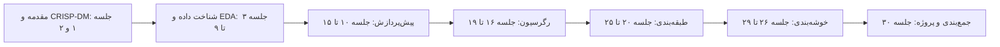
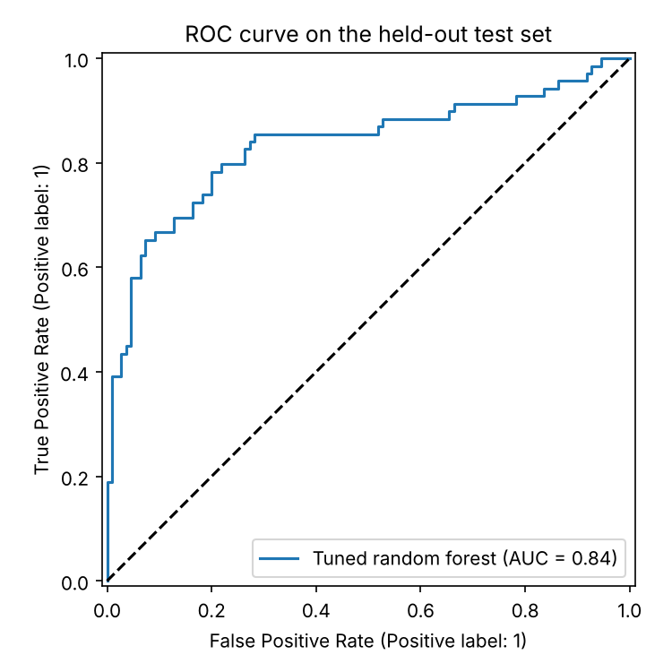

# جلسه ۳۰ — جمع‌بندی و ارائه پروژه‌ها

## پایان یک مسیر

در ۲۹ جلسه از پرسش «داده‌کاوی چیست؟» ← [مقدمه‌ای بر داده‌کاوی](../Part%200_Introduction/%DB%B1%20-%20%D9%85%D9%82%D8%AF%D9%85%D9%87%E2%80%8C%D8%A7%DB%8C%20%D8%A8%D8%B1%20%D8%AF%D8%A7%D8%AF%D9%87%E2%80%8C%DA%A9%D8%A7%D9%88%DB%8C.md) تا ارزیابی و تفسیر خوشه‌ها ← [ارزیابی و تفسیر خوشه‌ها](29%20-%20%D8%A7%D8%B1%D8%B2%DB%8C%D8%A7%D8%A8%DB%8C%20%D9%88%20%D8%AA%D9%81%D8%B3%DB%8C%D8%B1%20%D8%AE%D9%88%D8%B4%D9%87%E2%80%8C%D9%87%D8%A7.md) پیش آمدیم. این جلسه سه هدف دارد:

- **مرور یکپارچه** فرایند داده‌کاوی با یک مثال کامل، از داده خام تا مدل ذخیره‌شده.
- **ارائه پروژه‌های پایانی** و معیارهای ارزیابی آن‌ها.
- **معرفی مسیرهای ادامه**: قواعد انجمنی، تشخیص ناهنجاری، کاوش متن و یادگیری عمیق.



---

## مرور فرایند داده‌کاوی

در جلسه دوم چرخه CRISP-DM را معرفی کردیم ← [فرایند CRISP-DM و محیط کار](../Part%200_Introduction/2%20-%20%D9%81%D8%B1%D8%A7%DB%8C%D9%86%D8%AF%20CRISP-DM%20%D9%88%20%D9%85%D8%AD%DB%8C%D8%B7%20%DA%A9%D8%A7%D8%B1.md). اکنون هر فاز را به ابزارهای درس وصل می‌کنیم:

| فاز CRISP-DM | جلسات | خروجی کلیدی | اشتباه رایج |
|:---:|:---:|:---:|:---:|
| درک کسب‌وکار | ۱ و ۲ | تعریف مسئله، معیار موفقیت قابل اندازه‌گیری | شروع مستقیم از مدل‌سازی |
| درک داده | ۳ تا ۹ | گزارش کیفیت داده و EDA | نادیده گرفتن گمشده پنهان و نشت بالقوه |
| آماده‌سازی داده | ۱۰ تا ۱۵ | خط لوله مستند و تکرارپذیر | پیش‌پردازش روی کل داده پیش از تقسیم |
| مدل‌سازی | ۱۶ تا ۲۴ و ۲۶ تا ۲۸ | چند مدل نامزد تنظیم‌شده | نداشتن مدل پایه |
| ارزیابی | ۱۷، ۱۸، ۲۵ و ۲۹ | برآورد بی‌طرف عملکرد و تحلیل خطا | انتخاب مدل یا آستانه با داده آزمون |
| استقرار | ۳۰ | مدل ذخیره‌شده، گزارش، برنامه پایش | فراموش کردن تغییر توزیع داده در زمان |

> [!important] نکته کلیدی درس
> بیشتر زمان یک پروژه واقعی صرف **درک و آماده‌سازی داده** می‌شود، نه انتخاب الگوریتم. مدل ساده روی داده تمیز و ویژگی‌های خوب تقریباً همیشه از مدل پیچیده روی داده نامرتب بهتر است.

| نوع مسئله | پرسش نمونه | روش‌های اصلی درس | معیار ارزیابی |
|:---:|:---:|:---:|:---:|
| رگرسیون | قیمت این خانه چقدر است؟ | خطی، Ridge و Lasso، درخت، روش‌های گروهی | معیارهای MAE، RMSE و ضریب تعیین |
| طبقه‌بندی | آیا این مشتری ترک می‌کند؟ | الگوریتم k-NN، بیز ساده، لجستیک، درخت، روش‌های گروهی، SVM | معیارهای F1، AUC، دقت و بازخوانی |
| خوشه‌بندی | مشتریان ما چند گروه‌اند؟ | الگوریتم k-Means، سلسله‌مراتبی، DBSCAN، GMM | ضریب نیم‌رخ، پایداری، پروفایل |
| کاهش ابعاد | ۵۰ ویژگی را چگونه خلاصه کنیم؟ | روش PCA | واریانس توضیح‌داده‌شده |
| قواعد انجمنی | چه کالاهایی با هم خریده می‌شوند؟ | الگوریتم Apriori (همین جلسه) | پشتیبان، اطمینان، لیفت |

> [!tip] ده قاعده طلایی درس
> 1. ابتدا **پرسش** را روشن کنید، سپس سراغ داده بروید.
> 2. پیش از هر مدل، داده را **ببینید**.
> 3. داده آزمون را **همان ابتدا** کنار بگذارید.
> 4. همه پیش‌پردازش‌ها را داخل **Pipeline** قرار دهید.
> 5. همیشه یک **مدل پایه** ساده داشته باشید.
> 6. مدل و ابرپارامتر را با **اعتبارسنجی متقابل** انتخاب کنید.
> 7. معیار ارزیابی را از **هزینه واقعی خطاها** بگیرید.
> 8. همبستگی **علیت** نیست.
> 9. مدل ساده را به مدل پیچیده با بهبود ناچیز ترجیح دهید.
> 10. نتیجه را با زبان **مخاطب** گزارش کنید: بینش و اقدام، نه فقط عدد.

---

## مثال کامل: از داده خام تا مدل ذخیره‌شده

همه گام‌های فنی درس را روی داده تایتانیک (همان داده جلسات ۲۰ تا ۲۵) مرور می‌کنیم:

| گام | کار انجام‌شده | جلسه مرجع |
|:---:|:---:|:---:|
| تقسیم داده | ۸۰ درصد آموزش و ۲۰ درصد آزمون، طبقه‌بندی‌شده بر اساس بقا | ۱۵ و ۱۸ |
| پیش‌پردازش عددی | جایگذاری میانه و استانداردسازی | ۱۰ و ۱۲ |
| پیش‌پردازش کیفی | جایگذاری مد و کدگذاری One-Hot | ۱۰ و ۱۲ |
| مقایسه مدل‌ها | اعتبارسنجی متقابل طبقه‌بندی‌شده ۵ بخشی با معیار AUC | ۱۸ و ۲۵ |
| تنظیم ابرپارامتر | جست‌وجوی شبکه‌ای روی جنگل تصادفی | ۲۳ و ۲۵ |
| ارزیابی نهایی | فقط یک بار روی داده آزمون | ۲۵ |
| استقرار | ذخیره کل Pipeline | همین جلسه |

### گام ۱ تا ۳: تقسیم، Pipeline و مقایسه مدل‌ها

```python
import seaborn as sns
from sklearn.model_selection import train_test_split, StratifiedKFold, cross_val_score
from sklearn.compose import ColumnTransformer
from sklearn.pipeline import make_pipeline
from sklearn.impute import SimpleImputer
from sklearn.preprocessing import StandardScaler, OneHotEncoder
from sklearn.dummy import DummyClassifier
from sklearn.linear_model import LogisticRegression
from sklearn.ensemble import RandomForestClassifier, HistGradientBoostingClassifier

# 1. Data understanding and split FIRST (stratified); the test set waits until the end
titanic = sns.load_dataset("titanic")
num = ["age", "fare", "sibsp", "parch", "pclass"]
cat = ["sex", "embarked"]
X_train, X_test, y_train, y_test = train_test_split(titanic[num + cat], titanic["survived"],
                                                    test_size=0.2, stratify=titanic["survived"],
                                                    random_state=42)
print(f"train={X_train.shape}  test={X_test.shape}  survival rate in train={y_train.mean():.3f}")

# 2. Data preparation inside a pipeline (no leakage)
preprocess = ColumnTransformer([
    ("num", make_pipeline(SimpleImputer(strategy="median"), StandardScaler()), num),
    ("cat", make_pipeline(SimpleImputer(strategy="most_frequent"), OneHotEncoder(handle_unknown="ignore")), cat)])

# 3. Modelling: compare candidates with stratified 5-fold CV on the training set only
cv = StratifiedKFold(n_splits=5, shuffle=True, random_state=42)
candidates = {"Baseline": DummyClassifier(strategy="most_frequent"),
              "Logistic": LogisticRegression(max_iter=1000),
              "Random forest": RandomForestClassifier(n_estimators=300, random_state=42),
              "HistGB": HistGradientBoostingClassifier(random_state=42)}
for name, model in candidates.items():
    scores = cross_val_score(make_pipeline(preprocess, model), X_train, y_train, cv=cv, scoring="roc_auc")
    print(f"{name:13s} AUC={scores.mean():.3f} +/- {scores.std():.3f}")
```

```
train=(712, 7)  test=(179, 7)  survival rate in train=0.383
Baseline      AUC=0.500 +/- 0.000
Logistic      AUC=0.855 +/- 0.021
Random forest AUC=0.863 +/- 0.010
HistGB        AUC=0.876 +/- 0.015
```

| مدل | میانگین AUC | انحراف معیار |
|:---:|:---:|:---:|
| مدل پایه (کلاس غالب) | 0.500 | 0.000 |
| رگرسیون لجستیک | 0.855 | 0.021 |
| جنگل تصادفی | 0.863 | 0.010 |
| تقویت گرادیان هیستوگرامی | 0.876 | 0.015 |

اختلاف سه مدل اصلی در حد یک تا دو انحراف معیار است. همه آن‌ها بسیار بهتر از مدل پایه‌اند.

### گام ۴ و ۵: تنظیم ابرپارامتر و ارزیابی یک‌باره

```python
import seaborn as sns
import matplotlib.pyplot as plt
from sklearn.model_selection import train_test_split, StratifiedKFold, GridSearchCV
from sklearn.compose import ColumnTransformer
from sklearn.pipeline import Pipeline, make_pipeline
from sklearn.impute import SimpleImputer
from sklearn.preprocessing import StandardScaler, OneHotEncoder
from sklearn.ensemble import RandomForestClassifier
from sklearn.metrics import roc_auc_score, accuracy_score, f1_score, confusion_matrix, RocCurveDisplay

# Same data, split and preprocessing
titanic = sns.load_dataset("titanic")
num = ["age", "fare", "sibsp", "parch", "pclass"]
cat = ["sex", "embarked"]
X_train, X_test, y_train, y_test = train_test_split(titanic[num + cat], titanic["survived"],
                                                    test_size=0.2, stratify=titanic["survived"],
                                                    random_state=42)
preprocess = ColumnTransformer([
    ("num", make_pipeline(SimpleImputer(strategy="median"), StandardScaler()), num),
    ("cat", make_pipeline(SimpleImputer(strategy="most_frequent"), OneHotEncoder(handle_unknown="ignore")), cat)])

# 4. Hyperparameter tuning with grid search (training data only)
pipe = Pipeline([("prep", preprocess), ("model", RandomForestClassifier(n_estimators=300, random_state=42))])
grid = GridSearchCV(pipe, {"model__max_depth": [4, 6, 8, None], "model__min_samples_leaf": [1, 3, 5]},
                    cv=StratifiedKFold(n_splits=5, shuffle=True, random_state=42), scoring="roc_auc", n_jobs=-1)
grid.fit(X_train, y_train)
print(f"best={ {k.split('__')[1]: v for k, v in grid.best_params_.items()} }  CV AUC={grid.best_score_:.3f}")

# 5. Evaluation: ONE final look at the test set
best = grid.best_estimator_
proba, pred = best.predict_proba(X_test)[:, 1], best.predict(X_test)
print(f"test AUC={roc_auc_score(y_test, proba):.3f}  accuracy={accuracy_score(y_test, pred):.3f}  F1={f1_score(y_test, pred):.3f}")
print(confusion_matrix(y_test, pred))

fig, ax = plt.subplots(figsize=(5, 5))
RocCurveDisplay.from_predictions(y_test, proba, ax=ax, name="Tuned random forest")
ax.plot([0, 1], [0, 1], "k--")
ax.set_title("ROC curve on the held-out test set")
plt.show()
```

```
best={'max_depth': None, 'min_samples_leaf': 3}  CV AUC=0.878
test AUC=0.835  accuracy=0.821  F1=0.738
[[102   8]
 [ 24  45]]
```



بهترین ترکیب (عمق نامحدود و حداقل ۳ نمونه در برگ) به AUC اعتبارسنجی **۰.۸۷۸** رسید. روی داده آزمون:

| معیار | مقدار |
|:---:|:---:|
| سطح زیر منحنی ROC | 0.835 |
| صحت | 0.821 |
| دقت کلاس بازمانده | ۴۵ از ۵۳ یعنی 0.849 |
| بازخوانی کلاس بازمانده | ۴۵ از ۶۹ یعنی 0.652 |
| امتیاز F1 | 0.738 |

از ۱۱۰ فوت‌شده ۱۰۲ نفر و از ۶۹ بازمانده ۴۵ نفر درست پیش‌بینی شدند. مدل در شناسایی بازماندگان محتاط است؛ اگر بازخوانی مهم‌تر باشد، آستانه را با داده آموزش پایین بیاورید ← [ارزیابی مدل‌های طبقه‌بندی](../Part%205_Classification/25%20-%20%D8%A7%D8%B1%D8%B2%DB%8C%D8%A7%D8%A8%DB%8C%20%D9%85%D8%AF%D9%84%E2%80%8C%D9%87%D8%A7%DB%8C%20%D8%B7%D8%A8%D9%82%D9%87%E2%80%8C%D8%A8%D9%86%D8%AF%DB%8C.md).

> [!warning] وسوسه نگاه به داده آزمون
> عملکرد آزمون (۰.۸۳۵) کمتر از برآورد اعتبارسنجی (۰.۸۷۸) است: بهترین نتیجه از میان چند ترکیب کمی **خوش‌بینانه** است و آزمون ۱۷۹ نفری نیز نوسان دارد. رگرسیون لجستیک روی همین آزمون AUC حدود ۰.۸۴۴ می‌گیرد، اما **نباید** اکنون مدل را عوض کرد؛ آن‌وقت آزمون در انتخاب مدل شرکت کرده و برآورد نهایی بی‌طرف نیست. درس درست: وقتی اختلاف مدل‌ها در اعتبارسنجی کمتر از یک یا دو انحراف معیار است، مدل **ساده‌تر** را **پیش از** دیدن آزمون انتخاب کنید ← [رگرسیون چندجمله‌ای، بیش‌برازش و اعتبارسنجی متقابل](../Part%204_Regression/18%20-%20%D8%B1%DA%AF%D8%B1%D8%B3%DB%8C%D9%88%D9%86%20%DA%86%D9%86%D8%AF%D8%AC%D9%85%D9%84%D9%87%E2%80%8C%D8%A7%DB%8C%D8%8C%20%D8%A8%DB%8C%D8%B4%E2%80%8C%D8%A8%D8%B1%D8%A7%D8%B2%D8%B4%20%D9%88%20%D8%A7%D8%B9%D8%AA%D8%A8%D8%A7%D8%B1%D8%B3%D9%86%D8%AC%DB%8C%20%D9%85%D8%AA%D9%82%D8%A7%D8%A8%D9%84.md).

### گام ۶: استقرار

پس از ارزیابی، مدل منتخب را روی **همه** داده برچسب‌دار دوباره آموزش می‌دهیم و **کل Pipeline** را ذخیره می‌کنیم:

```python
import os
import tempfile
import joblib
import pandas as pd
import seaborn as sns
from sklearn.compose import ColumnTransformer
from sklearn.pipeline import make_pipeline
from sklearn.impute import SimpleImputer
from sklearn.preprocessing import StandardScaler, OneHotEncoder
from sklearn.ensemble import RandomForestClassifier

# 6. Deployment (sketch): refit the chosen pipeline on all labelled data and save the WHOLE pipeline
titanic = sns.load_dataset("titanic")
num = ["age", "fare", "sibsp", "parch", "pclass"]
cat = ["sex", "embarked"]
preprocess = ColumnTransformer([
    ("num", make_pipeline(SimpleImputer(strategy="median"), StandardScaler()), num),
    ("cat", make_pipeline(SimpleImputer(strategy="most_frequent"), OneHotEncoder(handle_unknown="ignore")), cat)])
final = make_pipeline(preprocess, RandomForestClassifier(n_estimators=300, min_samples_leaf=3, random_state=42))
final.fit(titanic[num + cat], titanic["survived"])

path = os.path.join(tempfile.gettempdir(), "titanic_model.joblib")
joblib.dump(final, path)
loaded = joblib.load(path)

# Raw, unprocessed new passengers (one with a missing age)
new = pd.DataFrame([{"age": 30, "fare": 15.0, "sibsp": 0, "parch": 0, "pclass": 2, "sex": "female", "embarked": "S"},
                    {"age": None, "fare": 8.0, "sibsp": 0, "parch": 0, "pclass": 3, "sex": "male", "embarked": "S"}])
print(f"survival probabilities={loaded.predict_proba(new)[:, 1].round(2).tolist()}")
```

```
survival probabilities=[0.94, 0.05]
```

مسافر دوم سن ندارد؛ Pipeline ذخیره‌شده خودش آن را با **میانه داده آموزش** جایگذاری می‌کند. اگر فقط مدل ذخیره شود، باید همه پیش‌پردازش‌ها (میانه، میانگین و انحراف معیار، دسته‌های کدگذاری) را دستی تکرار کرد و خطر ناهماهنگی میان آموزش و استقرار پیش می‌آید. پس از استقرار، توزیع داده ورودی و عملکرد مدل باید **پایش** شود.

---

## ارائه پروژه‌های پایانی

پروژه پایانی، اجرای **کامل چرخه CRISP-DM** روی یک داده واقعی است. تکلیف‌های درس گام‌های این پروژه بودند:

| تکلیف | جلسه | بخش پروژه |
|:---:|:---:|:---:|
| تکلیف ۱ | ۶ | شناخت داده و گزارش کیفیت ← [کیفیت داده](../Part%201_Data%20Understanding/%DB%B6%20-%20%DA%A9%DB%8C%D9%81%DB%8C%D8%AA%20%D8%AF%D8%A7%D8%AF%D9%87.md) |
| تکلیف ۲ | ۹ | گزارش EDA ← [مطالعه موردی EDA](../Part%202_EDA/9%20-%20%D9%85%D8%B7%D8%A7%D9%84%D8%B9%D9%87%20%D9%85%D9%88%D8%B1%D8%AF%DB%8C%20EDA.md) |
| تکلیف ۳ | ۱۵ | خط لوله پیش‌پردازش ← [طراحی آزمایش و Pipeline](../Part%203_Data%20Preprocessing/%DB%B1%DB%B5%20-%20%D8%B7%D8%B1%D8%A7%D8%AD%DB%8C%20%D8%A2%D8%B2%D9%85%D8%A7%DB%8C%D8%B4%20%D9%88%20Pipeline.md) |
| تکلیف ۴ | ۲۵ | مدل‌سازی نظارت‌شده ← [ارزیابی مدل‌های طبقه‌بندی](../Part%205_Classification/25%20-%20%D8%A7%D8%B1%D8%B2%DB%8C%D8%A7%D8%A8%DB%8C%20%D9%85%D8%AF%D9%84%E2%80%8C%D9%87%D8%A7%DB%8C%20%D8%B7%D8%A8%D9%82%D9%87%E2%80%8C%D8%A8%D9%86%D8%AF%DB%8C.md) |

### ساختار و زمان‌بندی ارائه

هر گروه **۱۲ دقیقه** ارائه و **۵ دقیقه** پرسش و پاسخ دارد:

| بخش ارائه | زمان | تعداد اسلاید | محتوا |
|:---:|:---:|:---:|:---:|
| مسئله و انگیزه | ۱.۵ دقیقه | ۱ تا ۲ | پرسش کسب‌وکار، اهمیت، معیار موفقیت |
| داده | ۱.۵ دقیقه | ۱ تا ۲ | منبع، اندازه، متغیر هدف، مشکلات کیفیت |
| بینش‌های EDA | ۲ دقیقه | ۲ | دو یا سه نمودار با عنوان پیام‌دار |
| آماده‌سازی داده | ۱.۵ دقیقه | ۱ | نمودار خط لوله و تصمیم‌های کلیدی |
| مدل‌سازی و ارزیابی | ۳ دقیقه | ۲ تا ۳ | مدل پایه، مدل‌های نامزد، جدول اعتبارسنجی، نتیجه آزمون |
| تفسیر و تحلیل خطا | ۱.۵ دقیقه | ۱ تا ۲ | ویژگی‌های مهم، نمونه‌های خطا، محدودیت‌ها |
| جمع‌بندی و اقدام | ۱ دقیقه | ۱ | پاسخ به پرسش اولیه و پیشنهاد عملی |

> [!tip] نکات ارائه خوب
> - با **پرسش** شروع کنید، نه با «داده را بارگذاری کردیم».
> - هر اسلاید **یک پیام** داشته باشد و عنوانش همان پیام باشد ← [مطالعه موردی EDA](../Part%202_EDA/9%20-%20%D9%85%D8%B7%D8%A7%D9%84%D8%B9%D9%87%20%D9%85%D9%88%D8%B1%D8%AF%DB%8C%20EDA.md).
> - کد را روی اسلاید نیاورید؛ فقط خروجی‌ها و نمودارها.
> - اعداد را با **مقایسه** معنادار کنید: «AUC برابر ۰.۸۵ در برابر ۰.۵ مدل پایه».
> - محدودیت‌ها را صادقانه بگویید و ارائه را دست‌کم دو بار با زمان‌سنج تمرین کنید.

### قالب گزارش نهایی

> [!note] ساختار گزارش نهایی (نوت‌بوک Jupyter همراه فایل PDF حداکثر ۱۵ صفحه)
> 1. **خلاصه مدیریتی:** پرسش، روش، نتیجه اصلی و پیشنهاد در یک بند.
> 2. **درک کسب‌وکار:** مسئله، ذی‌نفعان، معیار موفقیت فنی و کسب‌وکاری.
> 3. **درک داده:** منبع و مجوز، فرهنگ داده، گزارش کیفیت.
> 4. **تحلیل اکتشافی:** بینش‌های کلیدی با نمودار و تصمیم‌های حاصل.
> 5. **آماده‌سازی داده:** خط لوله، دلیل هر تصمیم، جلوگیری از نشت داده.
> 6. **مدل‌سازی:** مدل پایه، دست‌کم سه مدل نامزد، تنظیم ابرپارامتر با اعتبارسنجی متقابل.
> 7. **ارزیابی:** نتیجه نهایی آزمون، ماتریس درهم‌ریختگی یا تحلیل باقیمانده، تحلیل خطا.
> 8. **تفسیر:** اهمیت ویژگی‌ها و پاسخ به پرسش کسب‌وکار.
> 9. **بخش اختیاری بدون نظارت:** خوشه‌بندی یا کاهش ابعاد با پروفایل و تفسیر.
> 10. **محدودیت‌ها، ملاحظات اخلاقی و کارهای آینده.**
> 11. **پیوست:** کتابخانه‌ها و نسخه‌ها، دستور اجرای نوت‌بوک.

| معیار ارزیابی پروژه | سهم | توضیح |
|:---:|:---:|:---:|
| تعریف مسئله و درک کسب‌وکار | ۱۰ درصد | پرسش روشن، معیار موفقیت قابل اندازه‌گیری |
| درک داده و EDA | ۱۵ درصد | کیفیت داده، بینش‌های مستند و مرتبط |
| آماده‌سازی داده | ۱۵ درصد | خط لوله کامل، بدون نشت، تصمیم‌های مستدل |
| مدل‌سازی | ۲۰ درصد | مدل پایه، تنوع مدل‌ها، اعتبارسنجی و تنظیم درست |
| ارزیابی و تفسیر | ۱۵ درصد | معیار مناسب، آزمون بی‌طرف، تحلیل خطا |
| کیفیت کد و تکرارپذیری | ۱۰ درصد | اجرای بدون خطا، بذر ثابت، کد خوانا |
| ارائه شفاهی | ۱۰ درصد | ساختار، رعایت زمان، پاسخ به پرسش‌ها |
| گزارش مکتوب | ۵ درصد | خلاصه مدیریتی، نگارش، نمودارهای خوانا |

> [!todo] چک‌لیست تحویل پروژه
> - [ ] نوت‌بوک با «Restart & Run All» بدون خطا اجرا می‌شود.
> - [ ] همه بذرهای تصادفی ثابت‌اند (`random_state=42`).
> - [ ] داده آزمون پیش از هر پیش‌پردازشی جدا شده و فقط یک بار استفاده شده است.
> - [ ] همه پیش‌پردازش‌ها داخل `Pipeline` یا `ColumnTransformer` هستند.
> - [ ] مدل پایه گزارش شده است.
> - [ ] انتخاب معیار ارزیابی با هدف کسب‌وکار توضیح داده شده است.
> - [ ] همه نمودارها عنوان، برچسب محور و واحد دارند.
> - [ ] محدودیت‌ها و ملاحظات اخلاقی (سوگیری، حریم خصوصی) بحث شده‌اند.
> - [ ] منبع داده و مجوز استفاده ذکر شده است.
> - [ ] اسلایدها با زمان ۱۲ دقیقه تمرین شده‌اند.

> [!question]- پرسش‌های متداول داوران در جلسه ارائه
> - چرا این معیار ارزیابی؟ هزینه خطای نوع اول و دوم در مسئله شما چیست؟
> - مدل پایه چه عملکردی داشت و بهبود مدل نهایی نسبت به آن چقدر است؟
> - آیا ویژگی‌ای دارید که پس از رخداد هدف ثبت می‌شود (نشت داده)؟
> - اگر داده جدید شش ماه بعد بیاید، مدل چگونه پایش و به‌روز می‌شود؟
> - مهم‌ترین ویژگی‌ها کدام‌اند و آیا با دانش حوزه سازگارند؟
> - اگر یک هفته دیگر وقت داشتید، چه چیزی را بهبود می‌دادید؟

---

## مسیرهای ادامه

| مسیر | پرسش اصلی | ارتباط با این درس | ابزارهای پیشنهادی |
|:---:|:---:|:---:|:---:|
| قواعد انجمنی | چه اقلامی با هم رخ می‌دهند؟ | داده تراکنشی، مانند مطالعه موردی RFM | کتابخانه mlxtend |
| تشخیص ناهنجاری | کدام نمونه‌ها غیرعادی‌اند؟ | داده پرت، نویز DBSCAN، چگالی GMM | کتابخانه‌های scikit-learn و PyOD |
| کاوش متن | از متن چه الگوهایی استخراج می‌شود؟ | بیز ساده و خوشه‌بندی | کتابخانه‌های scikit-learn و hazm برای فارسی |
| یادگیری عمیق | چگونه از داده خام ویژگی بیاموزیم؟ | رگرسیون لجستیک، گرادیان کاهشی، منظم‌سازی | کتابخانه‌های PyTorch و Keras |

### قواعد انجمنی

هدف: یافتن قواعدی به شکل «اگر X آنگاه Y» در داده تراکنشی؛ کاربرد کلاسیک آن **تحلیل سبد خرید** است. سه معیار برای قاعده X ← Y:

$$
\text{support}(X \Rightarrow Y) = P(X \cup Y), \qquad \text{confidence}(X \Rightarrow Y) = \frac{\text{support}(X \cup Y)}{\text{support}(X)}
$$

$$
\text{lift}(X \Rightarrow Y) = \frac{\text{confidence}(X \Rightarrow Y)}{\text{support}(Y)} = \frac{P(X \cup Y)}{P(X) \, P(Y)}
$$

- **پشتیبان:** کسری از تراکنش‌ها که هر دو را دارند.
- **اطمینان:** از تراکنش‌های دارای X، چه کسری Y هم دارند.
- **لیفت:** بیشتر از ۱ یعنی وابستگی مثبت، برابر ۱ یعنی استقلال، کمتر از ۱ یعنی وابستگی منفی.

**اصل Apriori:** اگر مجموعه‌ای از اقلام **پرتکرار** نباشد، هیچ ابرمجموعه‌ای از آن پرتکرار نیست. پس مجموعه‌های نامزد سطح به سطح (تک‌عضوی، دوعضوی، ...) فقط از مجموعه‌های پرتکرار سطح قبل ساخته می‌شوند و فضای جست‌وجو به‌شدت هرس می‌شود.

### مثال حل‌شده: پنج سبد خرید

| سبد | نان | شیر | پوشک | نوشیدنی | تخم‌مرغ | نوشابه |
|:---:|:---:|:---:|:---:|:---:|:---:|:---:|
| سبد ۱ | ✓ | ✓ | | | | |
| سبد ۲ | ✓ | | ✓ | ✓ | ✓ | |
| سبد ۳ | | ✓ | ✓ | ✓ | | ✓ |
| سبد ۴ | ✓ | ✓ | ✓ | ✓ | | |
| سبد ۵ | ✓ | ✓ | ✓ | | | ✓ |
| پشتیبان | 0.8 | 0.8 | 0.8 | 0.6 | 0.2 | 0.4 |

#### گام ۱ — اقلام پرتکرار

با حداقل پشتیبان ۰.۴ (دست‌کم ۲ سبد از ۵)، تخم‌مرغ (۰.۲) **حذف** می‌شود و طبق اصل Apriori هیچ ترکیبی با تخم‌مرغ بررسی نمی‌شود.

#### گام ۲ — قاعده پوشک ← نوشیدنی

$$
\text{support} = \frac{3}{5} = 0.6, \qquad \text{confidence} = \frac{0.6}{0.8} = 0.75, \qquad \text{lift} = \frac{0.75}{0.6} = 1.25
$$

خریداران پوشک ۲۵ درصد بیشتر از میانگین نوشیدنی می‌خرند.

#### گام ۳ — قاعده نان ← شیر

$$
\text{support} = 0.6, \qquad \text{confidence} = \frac{0.6}{0.8} = 0.75, \qquad \text{lift} = \frac{0.75}{0.8} \approx 0.94
$$

اطمینان این قاعده هم ۰.۷۵ است، اما لیفت آن **کمتر از ۱** است: شیر در ۸۰ درصد سبدهاست، پس خریداران نان کمتر از میانگین شیر می‌خرند.

#### گام ۴ — یک قاعده سه‌عضوی

قاعده نوشابه ← شیر و پوشک: هر دو سبد دارای نوشابه، شیر و پوشک هم دارند و شیر و پوشک با هم در سه سبد (۳، ۴ و ۵) هستند:

$$
\text{support} = 0.4, \qquad \text{confidence} = \frac{0.4}{0.4} = 1, \qquad \text{lift} = \frac{1}{0.6} \approx 1.67
$$

> [!note] بررسی
> کد زیر سبدها را به جدول صفر و یک (سطر = سبد) تبدیل می‌کند و همه قواعد دوعضوی با پشتیبان دست‌کم ۰.۴ را با سه معیار می‌دهد.

```python
from itertools import combinations
import pandas as pd

# Five baskets as a one-hot table (row = basket)
baskets = [["bread", "milk"], ["bread", "diapers", "beer", "eggs"], ["milk", "diapers", "beer", "cola"],
           ["bread", "milk", "diapers", "beer"], ["bread", "milk", "diapers", "cola"]]
onehot = pd.DataFrame([{item: 1 for item in b} for b in baskets]).notna()

def support(items):
    return onehot[list(items)].all(axis=1).mean()

# 1. Frequent items (min support 0.4)
print(onehot.mean().sort_values(ascending=False).to_dict())

# 2. Rules X -> Y with one item on each side
rows = []
for x, y in combinations(onehot.columns, 2):
    for a, b in [(x, y), (y, x)]:
        s = support([a, b])
        if s >= 0.4:
            conf = s / support([a])
            rows.append({"rule": f"{a} -> {b}", "support": s, "confidence": conf, "lift": conf / support([b])})
rules = pd.DataFrame(rows).sort_values(["lift", "confidence"], ascending=False)
print(rules.round(3).to_string(index=False))
```

```
{'bread': 0.8, 'milk': 0.8, 'diapers': 0.8, 'beer': 0.6, 'cola': 0.4, 'eggs': 0.2}
            rule  support  confidence  lift
    cola -> milk      0.4       1.000 1.250
 beer -> diapers      0.6       1.000 1.250
 cola -> diapers      0.4       1.000 1.250
    milk -> cola      0.4       0.500 1.250
 diapers -> cola      0.4       0.500 1.250
 diapers -> beer      0.6       0.750 1.250
   bread -> milk      0.6       0.750 0.937
   milk -> bread      0.6       0.750 0.937
bread -> diapers      0.6       0.750 0.937
diapers -> bread      0.6       0.750 0.937
 milk -> diapers      0.6       0.750 0.937
 diapers -> milk      0.6       0.750 0.937
   beer -> bread      0.4       0.667 0.833
    beer -> milk      0.4       0.667 0.833
   bread -> beer      0.4       0.500 0.833
    milk -> beer      0.4       0.500 0.833
```

قاعده نوشیدنی ← پوشک اطمینان ۱ دارد اما عکس آن ۰.۷۵؛ لیفت هر دو ۱.۲۵ است، چون لیفت متقارن است.

> [!warning] اطمینان بالا کافی نیست
> قاعده‌ای که سمت راستش کالای بسیار پرفروش است، تقریباً همیشه اطمینان بالایی دارد، حتی بدون هیچ رابطه‌ای. همیشه **لیفت** را کنار اطمینان ببینید. قاعده انجمنی مانند همبستگی **علیت** را نشان نمی‌دهد ← [تحلیل دومتغیره و چندمتغیره](../Part%202_EDA/8%20-%20%D8%AA%D8%AD%D9%84%DB%8C%D9%84%20%D8%AF%D9%88%D9%85%D8%AA%D8%BA%DB%8C%D8%B1%D9%87%20%D9%88%20%DA%86%D9%86%D8%AF%D9%85%D8%AA%D8%BA%DB%8C%D8%B1%D9%87.md).

### تشخیص ناهنجاری

در جلسه ۱۱ داده پرت را **مشکل کیفیت** دیدیم ← [داده پرت، نویز و داده تکراری](../Part%203_Data%20Preprocessing/11-%20%D8%AF%D8%A7%D8%AF%D9%87%20%D9%BE%D8%B1%D8%AA%D8%8C%20%D9%86%D9%88%DB%8C%D8%B2%20%D9%88%20%D8%AF%D8%A7%D8%AF%D9%87%20%D8%AA%DA%A9%D8%B1%D8%A7%D8%B1%DB%8C.md)؛ اما در کشف تقلب، نفوذ به شبکه و خرابی تجهیزات، ناهنجاری **خود هدف** است.

| رویکرد | ایده | نمونه روش |
|:---:|:---:|:---:|
| آماری | احتمال کم در یک توزیع | امتیاز Z، چگالی پایین GMM |
| فاصله و چگالی | دور از همسایه‌ها یا در ناحیه کم‌تراکم | روش LOF، نویز DBSCAN |
| جداسازی | نقاط ناهنجار با برش‌های تصادفی کمتری جدا می‌شوند | روش Isolation Forest |
| نیمه‌نظارت‌شده | یادگیری مرز داده عادی | روش One-Class SVM، خودرمزگذار |

نسبت ناهنجاری‌ها معمولاً کمتر از یک درصد است و برچسب نایاب است؛ ارزیابی با منحنی **دقت و بازخوانی** مناسب‌تر از ROC است ← [ارزیابی مدل‌های طبقه‌بندی](../Part%205_Classification/25%20-%20%D8%A7%D8%B1%D8%B2%DB%8C%D8%A7%D8%A8%DB%8C%20%D9%85%D8%AF%D9%84%E2%80%8C%D9%87%D8%A7%DB%8C%20%D8%B7%D8%A8%D9%82%D9%87%E2%80%8C%D8%A8%D9%86%D8%AF%DB%8C.md).

### کاوش متن

متن **بدون ساختار** است و باید به بردار عددی تبدیل شود: پاک‌سازی و نرمال‌سازی (برای فارسی: یکسان‌سازی «ی» و «ک» و نیم‌فاصله)، واحدسازی و حذف کلمات توقف، ریشه‌یابی، و نمایش برداری با کیسه کلمات یا **TF-IDF**. سپس روش‌های همین درس به کار می‌روند: طبقه‌بندی (تشخیص هرزنامه با بیز ساده ← [بیز ساده و رگرسیون لجستیک](../Part%205_Classification/21%20-%20%D8%A8%DB%8C%D8%B2%20%D8%B3%D8%A7%D8%AF%D9%87%20%D9%88%20%D8%B1%DA%AF%D8%B1%D8%B3%DB%8C%D9%88%D9%86%20%D9%84%D8%AC%D8%B3%D8%AA%DB%8C%DA%A9.md)) یا خوشه‌بندی (کشف موضوع). در فرمول زیر tf تعداد تکرار واژه در سند، df تعداد اسناد دارای واژه و N تعداد کل اسناد است؛ واژه‌ای که در همه اسناد هست وزن نزدیک صفر می‌گیرد:

$$
\text{tfidf}(t, d) = \text{tf}(t, d) \times \log \frac{N}{\text{df}(t)}
$$

### یادگیری عمیق

شبکه‌های عصبی عمیق تعمیم چندلایه رگرسیون لجستیک‌اند که با **گرادیان کاهشی** آموزش می‌بینند ← [مبانی یادگیری نظارت‌شده و رگرسیون خطی ساده](../Part%204_Regression/16%20-%20%D9%85%D8%A8%D8%A7%D9%86%DB%8C%20%DB%8C%D8%A7%D8%AF%DA%AF%DB%8C%D8%B1%DB%8C%20%D9%86%D8%B8%D8%A7%D8%B1%D8%AA%E2%80%8C%D8%B4%D8%AF%D9%87%20%D9%88%20%D8%B1%DA%AF%D8%B1%D8%B3%DB%8C%D9%88%D9%86%20%D8%AE%D8%B7%DB%8C%20%D8%B3%D8%A7%D8%AF%D9%87.md)؛ مزیت اصلی آن‌ها **یادگیری خودکار ویژگی** از داده خام (تصویر، صوت، متن) است.

| نوع داده | معماری رایج | نکته |
|:---:|:---:|:---:|
| داده جدولی | پرسپترون چندلایه | روش‌های گروهی درخت هنوز رقیب سرسختی‌اند |
| تصویر | شبکه پیچشی | تشخیص بیماری از تصاویر پزشکی |
| متن و دنباله | ترنسفورمر | ترجمه ماشینی، مدل‌های زبانی بزرگ |
| سری زمانی | شبکه بازگشتی یا ترنسفورمر | پیش‌بینی تقاضا |

> [!tip] توصیه برای ادامه مسیر
> - برای داده **جدولی**، روش‌های این درس (به‌ویژه روش‌های گروهی) هنوز معمولاً بهترین گزینه‌اند.
> - مفاهیم پایه درس (بیش‌برازش، اعتبارسنجی، منظم‌سازی، نشت داده، معیارهای ارزیابی) در یادگیری عمیق **عیناً** کاربرد دارند.
> - با پروژه واقعی و داده واقعی تمرین کنید.

> [!note] کارگاه عملی
> دفترچه «۳۰ - کارگاه جمع‌بندی و مسیرهای ادامه» قواعد انجمنی روی سبدهای واقعی فروشگاه اینترنتی، تشخیص ناهنجاری با Isolation Forest، خوشه‌بندی متن توضیحات کالاها با TF-IDF، و تمرین عملی کلاس (انتخاب آستانه برای مثال کامل و قواعد انجمنی با پشتیبان بالاتر) را با پاسخ دارد. نحوه نوشتن این کدها در امتحان پرسیده نمی‌شود.

---

## خطاهای رایج

| خطا | چرا نادرست است | روش درست |
|:---:|:---:|:---:|
| تعویض مدل پس از دیدن نتیجه آزمون | آزمون در انتخاب مدل شرکت می‌کند و برآورد خوش‌بینانه می‌شود | انتخاب نهایی فقط با اعتبارسنجی متقابل |
| ذخیره فقط مدل بدون پیش‌پردازش | ناهماهنگی میان آموزش و استقرار | ذخیره کل Pipeline |
| گزارش قاعده انجمنی فقط با اطمینان | کالای پرفروش اطمینان را بالا می‌برد | بررسی لیفت |
| تعبیر قاعده انجمنی به رابطه علّی | هم‌رخدادی علیت نیست | آزمایش کنترل‌شده برای اثبات اثر |
| ارائه کد و جزئیات فنی به مدیر | پیام اصلی گم می‌شود | پرسش، بینش، اقدام |
| ارزیابی تشخیص ناهنجاری با صحت | ناهنجاری‌ها بسیار نادرند | منحنی دقت و بازخوانی |

---

## نمونه سؤال‌های امتحانی

### سؤال‌های مفهومی

> [!question]- ۱. شش فاز CRISP-DM را به ترتیب نام ببرید و برای هر کدام یک خروجی مشخص بگویید.
> درک کسب‌وکار (تعریف مسئله و معیار موفقیت)، درک داده (گزارش کیفیت و EDA)، آماده‌سازی داده (خط لوله پیش‌پردازش)، مدل‌سازی (مدل‌های نامزد تنظیم‌شده)، ارزیابی (برآورد بی‌طرف و بررسی تحقق هدف کسب‌وکار) و استقرار (مدل ذخیره‌شده، گزارش، برنامه پایش). فرایند چرخه‌ای است و بازگشت به فازهای قبل طبیعی است.

> [!question]- ۲. چرا در مثال کامل، پس از دیدن AUC بهتر رگرسیون لجستیک روی آزمون، مدل را عوض نمی‌کنیم؟
> چون آزمون در **انتخاب مدل** شرکت می‌کند و دیگر برآورد بی‌طرفی از عملکرد روی داده جدید نیست. اگر مدل ساده‌تر را ترجیح می‌دهیم، باید **پیش از** دیدن آزمون و با اعتبارسنجی متقابل تصمیم بگیریم.

> [!question]- ۳. چرا در استقرار کل Pipeline ذخیره می‌شود؟
> پیش‌پردازش‌ها پارامترهایی دارند که از داده آموزش یاد گرفته شده‌اند (میانه، میانگین و انحراف معیار، دسته‌های کدگذاری). ذخیره کل Pipeline تضمین می‌کند داده خام جدید دقیقاً با همان پارامترها تبدیل شود.

> [!question]- ۴. اصل Apriori چیست و چه کمکی می‌کند؟
> اگر مجموعه‌ای پرتکرار نباشد، هیچ ابرمجموعه‌اش پرتکرار نیست، چون پشتیبان با افزودن قلم کم می‌شود یا ثابت می‌ماند. پس نامزدهای هر سطح فقط از مجموعه‌های پرتکرار سطح قبل ساخته می‌شوند و فضای جست‌وجوی نمایی هرس می‌شود.

### سؤال‌های محاسباتی

> [!question]- ۵. در ۱۰۰۰ سبد، ۲۰۰ سبد قهوه، ۴۰۰ سبد شکر و ۱۵۰ سبد هر دو را دارند. پشتیبان، اطمینان و لیفت قاعده قهوه ← شکر را حساب کنید.
> $$
> \text{support} = \frac{150}{1000} = 0.15, \qquad \text{confidence} = \frac{0.15}{0.2} = 0.75, \qquad \text{lift} = \frac{0.75}{0.4} = 1.875
> $$
> خریداران قهوه تقریباً دو برابر میانگین شکر می‌خرند.

> [!question]- ۶. در همین داده، لیفت قاعده شکر ← قهوه چقدر است؟ اطمینان آن چطور؟
> لیفت متقارن است و همان ۱.۸۷۵ است. اطمینان متقارن نیست:
> $$
> \text{confidence}(\text{sugar} \Rightarrow \text{coffee}) = \frac{0.15}{0.4} = 0.375
> $$

> [!question]- ۷. ماتریس درهم‌ریختگی مثال کامل: ۱۰۲ منفی درست، ۸ مثبت کاذب، ۲۴ منفی کاذب و ۴۵ مثبت درست. دقت و بازخوانی کلاس بازمانده را حساب کنید.
> $$
> \text{Precision} = \frac{45}{45 + 8} \approx 0.849, \qquad \text{Recall} = \frac{45}{45 + 24} \approx 0.652
> $$

> [!question]- ۸. واژه‌ای در ۱۰ سند از ۱۰۰۰ سند آمده و در یک سند ۳ بار تکرار شده است. وزن TF-IDF آن در این سند (با لگاریتم طبیعی) چقدر است؟ واژه‌ای که در همه ۱۰۰۰ سند هست چطور؟
> $$
> 3 \times \ln \frac{1000}{10} = 3 \times 4.61 \approx 13.8, \qquad \ln \frac{1000}{1000} = 0
> $$

### سؤال‌های خواندن کد

> [!question]- ۹. ایراد این کد چیست؟
> ```python
> X_scaled = StandardScaler().fit_transform(X)
> X_train, X_test, y_train, y_test = train_test_split(X_scaled, y, test_size=0.2, random_state=42)
> ```
> استانداردسازی پیش از تقسیم روی کل داده انجام شده و میانگین و انحراف معیار آزمون به آموزش نشت کرده است. باید ابتدا تقسیم کرد و `StandardScaler` را داخل Pipeline گذاشت.

> [!question]- ۱۰. این کد در استقرار چه مشکلی دارد؟
> ```python
> joblib.dump(grid.best_estimator_[-1], "model.joblib")     # only the last step
> ```
> فقط مدل (گام آخر Pipeline) ذخیره شده است؛ داده خام جدید جایگذاری، استانداردسازی و کدگذاری نمی‌شود و یا خطا می‌دهد یا پیش‌بینی نادرست. باید کل `grid.best_estimator_` ذخیره شود.

> [!question]- ۱۱. خروجی این کد برای پنج سبد مثال حل‌شده چیست؟
> ```python
> onehot[["bread", "milk"]].all(axis=1).mean()
> ```
> پشتیبان مجموعه نان و شیر: سبدهای ۱، ۴ و ۵ هر دو را دارند، پس **۰.۶**.

---

## نکات کلیدی

> [!summary] خلاصه جلسه و درس
> - داده‌کاوی یک **فرایند** چرخه‌ای است (CRISP-DM)، نه فقط اجرای یک الگوریتم؛ بیشتر زمان صرف درک و آماده‌سازی داده می‌شود.
> - الگوی استاندارد فنی: **تقسیم اولیه**، پیش‌پردازش داخل **Pipeline**، مقایسه و تنظیم با **اعتبارسنجی متقابل**، **یک بار** ارزیابی روی آزمون و ذخیره **کل Pipeline** برای استقرار.
> - همیشه یک **مدل پایه** داشته باشید و معیار ارزیابی را با هزینه واقعی خطاها انتخاب کنید.
> - پروژه پایانی کل چرخه را روی داده واقعی اجرا می‌کند؛ ارائه با **پرسش** شروع و با **پاسخ و اقدام** تمام می‌شود.
> - **قواعد انجمنی** با پشتیبان، اطمینان و **لیفت** سنجیده می‌شوند؛ اصل Apriori جست‌وجو را هرس می‌کند.
> - مسیرهای ادامه: **تشخیص ناهنجاری**، **کاوش متن** و **یادگیری عمیق**؛ مفاهیم پایه این درس در همه آن‌ها پابرجاست.
