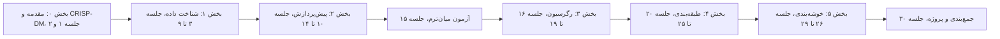
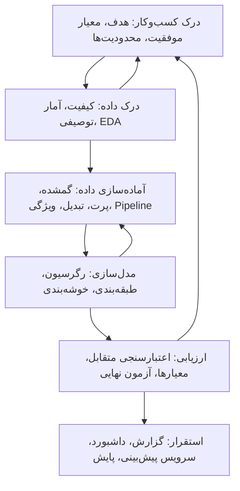

# جلسه ۳۰ — جمع‌بندی و ارائه پروژه‌ها

## پایان یک مسیر

به جلسه پایانی رسیدیم. در طول ۲۹ جلسه، از پرسش «داده‌کاوی چیست؟» ← [[۱ - مقدمه‌ای بر داده‌کاوی]] تا ارزیابی و تفسیر خوشه‌ها ← [[29 - ارزیابی و تفسیر خوشه‌ها]] پیش آمدیم. این جلسه سه هدف دارد:

- **مرور یکپارچه** کل فرایند داده‌کاوی، از داده خام تا مدل نهایی، با یک مثال کامل و فشرده.
- **ارائه پروژه‌های پایانی** دانشجویان و ارزیابی آن‌ها.
- **معرفی مسیرهای ادامه** برای کسانی که می‌خواهند در این حوزه عمیق‌تر شوند.

نقشه کلی درس:



---

## مرور کلی فرایند داده‌کاوی

### چرخه CRISP-DM و جلسات درس

در جلسه دوم چرخه CRISP-DM را معرفی کردیم ← [[2 - فرایند CRISP-DM و محیط کار]]. اکنون می‌توانیم هر فاز آن را به ابزارهایی که در طول درس آموختیم وصل کنیم:



|فاز CRISP-DM|جلسات مرتبط|خروجی کلیدی|اشتباه رایج|
|:-:|:-:|:-:|:-:|
|درک کسب‌وکار|۱ و ۲|تعریف مسئله، معیار موفقیت قابل اندازه‌گیری|شروع مستقیم از مدل‌سازی بدون پرسش روشن|
|درک داده|۳ تا ۹|گزارش کیفیت داده، گزارش EDA و بینش‌ها|نادیده گرفتن مقادیر گمشده پنهان و نشت‌های بالقوه|
|آماده‌سازی داده|۱۰ تا ۱۴|خط لوله (Pipeline) مستند و قابل تکرار|پیش‌پردازش روی کل داده پیش از تقسیم (نشت داده)|
|مدل‌سازی|۱۶ تا ۲۴ و ۲۶ تا ۲۸|چند مدل نامزد با ابرپارامترهای تنظیم‌شده|نداشتن مدل پایه (Baseline) برای مقایسه|
|ارزیابی|۱۷، ۱۸، ۲۵ و ۲۹|برآورد بی‌طرفانه عملکرد و تحلیل خطا|انتخاب مدل یا آستانه بر اساس داده آزمون|
|استقرار|۳۰|گزارش، مدل ذخیره‌شده، برنامه پایش|فراموش کردن تغییر توزیع داده در طول زمان|

> [!important] نکته کلیدی درس بیشتر زمان یک پروژه واقعی صرف **درک و آماده‌سازی داده** می‌شود، نه انتخاب الگوریتم. مدل ساده روی داده تمیز و ویژگی‌های خوب، تقریباً همیشه از مدل پیچیده روی داده نامرتب بهتر است.

### جدول تصمیم انتخاب روش

|نوع مسئله|پرسش نمونه|روش‌های اصلی درس|معیار ارزیابی|
|:-:|:-:|:-:|:-:|
|رگرسیون|قیمت این خانه چقدر است؟|خطی، Ridge و Lasso، درخت، جنگل تصادفی|معیارهای MAE، RMSE و R²|
|طبقه‌بندی|آیا این مشتری ترک می‌کند؟|الگوریتم k-NN، بیز ساده، لجستیک، درخت، روش‌های گروهی، SVM|معیارهای F1، AUC، Precision و Recall|
|خوشه‌بندی|مشتریان ما چند گروه‌اند؟|الگوریتم k-Means، سلسله‌مراتبی، DBSCAN، GMM|ضریب نیم‌رخ، پروفایل و تفسیر|
|کاهش ابعاد|چگونه ۵۰ ویژگی را خلاصه کنیم؟|روش PCA، t-SNE|واریانس توضیح‌داده‌شده|
|کاوش قواعد انجمنی|چه کالاهایی با هم خریده می‌شوند؟|الگوریتم Apriori (همین جلسه)|پشتیبان، اطمینان، لیفت|

### قواعد طلایی درس

> [!tip] ده قاعده که باید از این درس به خاطر بسپارید
> 
> 1. ابتدا **پرسش** را روشن کنید، سپس سراغ داده بروید.
> 2. قبل از هر مدل، داده را **ببینید** (EDA).
> 3. داده آزمون را **همان ابتدا** کنار بگذارید و تا پایان به آن دست نزنید.
> 4. همه پیش‌پردازش‌ها را داخل **Pipeline** قرار دهید تا از نشت داده جلوگیری شود.
> 5. همیشه یک **مدل پایه** ساده (مانند پیش‌بینی کلاس غالب یا میانگین) داشته باشید.
> 6. برای انتخاب مدل و ابرپارامتر از **اعتبارسنجی متقابل** استفاده کنید.
> 7. معیار ارزیابی را بر اساس **هزینه واقعی خطاها** انتخاب کنید، نه عادت (دقت در داده نامتوازن فریبنده است).
> 8. همبستگی **علیت** نیست.
> 9. مدل ساده و قابل تفسیر را به مدل پیچیده با بهبود ناچیز ترجیح دهید.
> 10. نتایج را با زبان **مخاطب** گزارش کنید: بینش و اقدام، نه فقط عدد.

### مثال کامل: از داده خام تا ارزیابی نهایی

در این مثال فشرده، همه گام‌های فنی درس را روی داده Titanic مرور می‌کنیم. کد کامل در بخش پیاده‌سازی آمده است.

|گام|کار انجام‌شده|جلسه مرجع|
|:-:|:-:|:-:|
|تقسیم داده|۸۰ درصد آموزش (۷۱۲ نفر) و ۲۰ درصد آزمون (۱۷۹ نفر)، طبقه‌بندی‌شده بر اساس بقا|۱۴ و ۱۶|
|پیش‌پردازش عددی|جایگذاری میانه و استانداردسازی برای سن، کرایه، تعداد همراهان|۱۰ و ۱۲|
|پیش‌پردازش کیفی|جایگذاری مد و کدگذاری One-Hot برای کلاس، جنسیت، بندر|۱۰ و ۱۲|
|مقایسه مدل‌ها|اعتبارسنجی متقابل طبقه‌بندی‌شده ۵ لایه با معیار AUC|۱۸ و ۲۵|
|تنظیم ابرپارامتر|جست‌وجوی شبکه‌ای روی جنگل تصادفی|۲۳ و ۲۵|
|ارزیابی نهایی|فقط یک بار روی داده آزمون|۲۵|

> [!example] مثال حل‌شده — مقایسه مدل‌ها با اعتبارسنجی متقابل میانگین و انحراف معیار AUC در ۵ لایه (فقط روی داده آموزش):
> 
> |مدل|میانگین AUC|انحراف معیار|
> |:-:|:-:|:-:|
> |مدل پایه (کلاس غالب)|0.500|0.000|
> |رگرسیون لجستیک|0.853|0.022|
> |جنگل تصادفی (۳۰۰ درخت)|0.865|0.011|
> |تقویت گرادیان هیستوگرامی|0.877|0.018|
> 
> اختلاف سه مدل اصلی در حد یک انحراف معیار است. جنگل تصادفی را برای تنظیم انتخاب کردیم؛ بهترین ترکیب (عمق نامحدود و حداقل ۳ نمونه در برگ) به AUC اعتبارسنجی حدود **۰.۸۷۶** رسید.
> 
> **ارزیابی نهایی روی داده آزمون (یک بار):**
> 
> |معیار|مقدار|
> |:-:|:-:|
> |مساحت زیر منحنی (AUC)|0.835|
> |دقت (Accuracy)|0.816|
> |دقت مثبت کلاس بازمانده (Precision)|0.846|
> |بازیابی کلاس بازمانده (Recall)|0.638|
> |امتیاز F1 کلاس بازمانده|0.727|
> 
> ماتریس درهم‌ریختگی: از ۱۱۰ فوت‌شده، ۱۰۲ نفر درست و ۸ نفر اشتباه پیش‌بینی شدند؛ از ۶۹ بازمانده، ۴۴ نفر درست و ۲۵ نفر اشتباه. مدل در شناسایی بازماندگان محتاط است؛ اگر بازیابی مهم‌تر باشد، باید آستانه تصمیم را پایین آورد ← [[25 - ارزیابی مدل‌های طبقه‌بندی]]

> [!warning] وسوسه نگاه به داده آزمون عملکرد آزمون (۰.۸۳۵) کمتر از برآورد اعتبارسنجی (۰.۸۷۶) است. این طبیعی است: بهترین نتیجه از میان چند مدل و چند ترکیب ابرپارامتر کمی **خوش‌بینانه** است و داده آزمون ۱۷۹ نفری نیز نوسان دارد. اگر رگرسیون لجستیک را هم روی داده آزمون بسنجیم، AUC حدود ۰.۸۴۳ می‌گیرد؛ اما **نباید** اکنون مدل را عوض کنیم، چون این کار یعنی انتخاب مدل با داده آزمون و برآورد نهایی دیگر بی‌طرف نخواهد بود. درس درست: وقتی اختلاف مدل‌ها در اعتبارسنجی کمتر از یک انحراف معیار است، مدل **ساده‌تر و قابل تفسیرتر** گزینه معقول‌تری است ← [[18 - بیش‌برازش و اعتبارسنجی متقابل]]

---

## ارائه پروژه‌های پایانی دانشجویان

پروژه پایانی، اجرای **کامل چرخه CRISP-DM** روی یک داده واقعی است و ۲۵ درصد نمره درس را تشکیل می‌دهد. تکلیف‌های ۱ تا ۴ گام‌های این پروژه بودند:

|تکلیف|جلسه|بخش پروژه|
|:-:|:-:|:-:|
|تکلیف ۱|۶|شناخت داده و گزارش کیفیت ← [[۶ - کیفیت داده]]|
|تکلیف ۲|۹|گزارش EDA ← [[9 - مطالعه موردی EDA]]|
|تکلیف ۳|۱۴|خط لوله پیش‌پردازش ← [[۱۴- کاهش ابعاد]]|
|تکلیف ۴|۲۵|مدل‌سازی نظارت‌شده ← [[25 - ارزیابی مدل‌های طبقه‌بندی]]|

### ساختار و زمان‌بندی ارائه

هر گروه **۱۲ دقیقه** ارائه و **۵ دقیقه** پرسش و پاسخ دارد. ساختار پیشنهادی:

|بخش ارائه|زمان|تعداد اسلاید|محتوا|
|:-:|:-:|:-:|:-:|
|مسئله و انگیزه|۱.۵ دقیقه|۱ تا ۲|پرسش کسب‌وکار، اهمیت آن، معیار موفقیت|
|داده|۱.۵ دقیقه|۱ تا ۲|منبع، اندازه، ویژگی‌ها، متغیر هدف، مشکلات کیفیت|
|بینش‌های EDA|۲ دقیقه|۲|دو یا سه نمودار با عنوان پیام‌دار|
|آماده‌سازی داده|۱.۵ دقیقه|۱|نمودار خط لوله و تصمیم‌های کلیدی|
|مدل‌سازی و ارزیابی|۳ دقیقه|۲ تا ۳|مدل پایه، مدل‌های نامزد، جدول اعتبارسنجی، نتیجه آزمون|
|تفسیر و تحلیل خطا|۱.۵ دقیقه|۱ تا ۲|ویژگی‌های مهم، نمونه‌های خطا، محدودیت‌ها|
|جمع‌بندی و اقدام|۱ دقیقه|۱|پاسخ به پرسش اولیه، پیشنهاد عملی، کارهای آینده|

> [!tip] نکات ارائه خوب
> 
> - با **پرسش** شروع کنید، نه با «ما داده را بارگذاری کردیم».
> - هر اسلاید **یک پیام** داشته باشد و عنوانش همان پیام باشد ← [[9 - مطالعه موردی EDA]]
> - کد را روی اسلاید نیاورید؛ کد در نوت‌بوک است. فقط خروجی‌ها و نمودارها.
> - اعداد را با **مقایسه** معنادار کنید: «AUC برابر ۰.۸۵ در برابر ۰.۵ مدل پایه».
> - محدودیت‌ها را صادقانه بگویید؛ داوران به صداقت امتیاز می‌دهند.
> - ارائه را با زمان‌سنج دست‌کم دو بار تمرین کنید.

### قالب گزارش نهایی

> [!note] ساختار گزارش نهایی (نوت‌بوک Jupyter به همراه فایل PDF حداکثر ۱۵ صفحه)
> 
> 1. **خلاصه مدیریتی:** یک بند شامل پرسش، روش، نتیجه اصلی و پیشنهاد.
> 2. **درک کسب‌وکار:** مسئله، ذی‌نفعان، معیار موفقیت فنی و کسب‌وکاری.
> 3. **درک داده:** منبع و مجوز داده، فرهنگ داده (Data Dictionary)، گزارش کیفیت.
> 4. **تحلیل اکتشافی:** بینش‌های کلیدی با نمودار و تصمیم‌های حاصل.
> 5. **آماده‌سازی داده:** خط لوله، دلیل هر تصمیم، جلوگیری از نشت داده.
> 6. **مدل‌سازی:** مدل پایه، دست‌کم سه مدل نامزد، تنظیم ابرپارامتر با اعتبارسنجی متقابل.
> 7. **ارزیابی:** نتیجه نهایی آزمون، ماتریس درهم‌ریختگی یا تحلیل باقیمانده، تحلیل خطا.
> 8. **تفسیر:** اهمیت ویژگی‌ها، پاسخ به پرسش کسب‌وکار.
> 9. **بخش اختیاری بدون نظارت:** خوشه‌بندی یا کاهش ابعاد با پروفایل و تفسیر.
> 10. **محدودیت‌ها، ملاحظات اخلاقی و کارهای آینده.**
> 11. **پیوست:** فهرست کتابخانه‌ها و نسخه‌ها، دستور اجرای نوت‌بوک.

### معیارهای ارزیابی پروژه پایانی

> [!note] معیارهای ارزیابی پروژه پایانی
> 
> |معیار|سهم|توضیح|
> |:-:|:-:|:-:|
> |تعریف مسئله و درک کسب‌وکار|۱۰ درصد|پرسش روشن، معیار موفقیت قابل اندازه‌گیری|
> |درک داده و EDA|۱۵ درصد|کیفیت داده، بینش‌های مستند و مرتبط با هدف|
> |آماده‌سازی داده|۱۵ درصد|خط لوله کامل، بدون نشت، تصمیم‌های مستدل|
> |مدل‌سازی|۲۰ درصد|مدل پایه، تنوع مدل‌ها، اعتبارسنجی متقابل و تنظیم درست|
> |ارزیابی و تفسیر|۱۵ درصد|معیار مناسب، آزمون بی‌طرف، تحلیل خطا، اهمیت ویژگی|
> |کیفیت کد و تکرارپذیری|۱۰ درصد|اجرای بدون خطا، بذر تصادفی ثابت، کد خوانا|
> |ارائه شفاهی|۱۰ درصد|ساختار، رعایت زمان، پاسخ به پرسش‌ها|
> |گزارش مکتوب|۵ درصد|خلاصه مدیریتی، نگارش، نمودارهای خوانا|

### چک‌لیست پیش از تحویل

> [!todo] چک‌لیست تحویل پروژه
> 
> - [ ] نوت‌بوک با «Restart & Run All» بدون خطا اجرا می‌شود.
> - [ ] همه بذرهای تصادفی ثابت‌اند (`random_state=42`).
> - [ ] داده آزمون پیش از هر پیش‌پردازشی جدا شده و فقط یک بار استفاده شده است.
> - [ ] همه پیش‌پردازش‌ها داخل `Pipeline` یا `ColumnTransformer` هستند.
> - [ ] مدل پایه گزارش شده است.
> - [ ] معیار ارزیابی با هدف کسب‌وکار سازگار است و انتخاب آن توضیح داده شده است.
> - [ ] همه نمودارها عنوان، برچسب محور و واحد دارند.
> - [ ] محدودیت‌ها و ملاحظات اخلاقی (سوگیری، حریم خصوصی) بحث شده‌اند.
> - [ ] منبع داده و مجوز استفاده ذکر شده است.
> - [ ] اسلایدها با زمان ۱۲ دقیقه تمرین شده‌اند.

> [!question]- پرسش‌های متداول داوران در جلسه ارائه
> 
> - چرا این معیار ارزیابی را انتخاب کردید؟ هزینه خطای نوع اول و دوم در مسئله شما چیست؟
> - مدل پایه شما چه عملکردی داشت؟ بهبود مدل نهایی نسبت به آن چقدر است؟
> - آیا امکان نشت داده در ویژگی‌های شما وجود دارد؟ (مثلاً ویژگی‌ای که پس از رخداد هدف ثبت می‌شود.)
> - اگر داده جدید شش ماه بعد بیاید، مدل شما چگونه پایش و به‌روزرسانی می‌شود؟
> - مهم‌ترین ویژگی‌ها کدام‌اند و آیا با دانش حوزه سازگارند؟
> - اگر یک هفته دیگر وقت داشتید، چه چیزی را بهبود می‌دادید؟

---

## معرفی مسیرهای ادامه

داده‌کاوی بسیار گسترده‌تر از سرفصل‌های این درس است. چهار مسیر مهم برای ادامه:

|مسیر|پرسش اصلی|ارتباط با این درس|ابزارهای پیشنهادی|
|:-:|:-:|:-:|:-:|
|کاوش قواعد انجمنی|چه اقلامی با هم رخ می‌دهند؟|داده تراکنشی، مانند مطالعه موردی RFM|کتابخانه mlxtend|
|تشخیص ناهنجاری|کدام نمونه‌ها غیرعادی‌اند؟|داده پرت، Isolation Forest، LOF، DBSCAN|کتابخانه‌های scikit-learn و PyOD|
|کاوش متن|از متن چه الگوهایی استخراج می‌شود؟|بیز ساده چندجمله‌ای و کیسه کلمات|کتابخانه‌های scikit-learn، hazm (برای فارسی)، spaCy|
|یادگیری عمیق|چگونه از داده خام (تصویر، صوت، متن) ویژگی بیاموزیم؟|رگرسیون لجستیک، گرادیان کاهشی، منظم‌سازی|کتابخانه‌های PyTorch و Keras|

### کاوش قواعد انجمنی (Association Rule Mining)

هدف: یافتن قواعدی به شکل «اگر X آنگاه Y» در داده‌های تراکنشی؛ مثلاً «مشتریانی که پوشک می‌خرند، معمولاً نوشیدنی هم می‌خرند». کاربرد کلاسیک آن **تحلیل سبد خرید** (Market Basket Analysis) است.

سه معیار اصلی برای قاعده X ← Y:

**پشتیبان (Support):** کسری از تراکنش‌ها که هر دو مجموعه را دارند.

$$ \text{support}(X \Rightarrow Y) = P(X \cup Y) = \frac{\text{count}(X \cup Y)}{N} $$

**اطمینان (Confidence):** از میان تراکنش‌هایی که X دارند، چه کسری Y هم دارند.

$$ \text{confidence}(X \Rightarrow Y) = P(Y \mid X) = \frac{\text{support}(X \cup Y)}{\text{support}(X)} $$

**لیفت (Lift):** اطمینان قاعده نسبت به احتمال پایه Y.

$$ \text{lift}(X \Rightarrow Y) = \frac{\text{confidence}(X \Rightarrow Y)}{\text{support}(Y)} = \frac{P(X \cup Y)}{P(X),P(Y)} $$

|مقدار لیفت|تفسیر|
|:-:|:-:|
|بیشتر از ۱|وابستگی مثبت: وجود X احتمال Y را افزایش می‌دهد|
|برابر ۱|استقلال: X هیچ اطلاعاتی درباره Y نمی‌دهد|
|کمتر از ۱|وابستگی منفی: وجود X احتمال Y را کاهش می‌دهد|

> [!note] اصل Apriori اگر یک مجموعه اقلام **پرتکرار** نباشد، هیچ ابرمجموعه‌ای از آن نیز پرتکرار نیست. مثلاً اگر «تخم‌مرغ» به حداقل پشتیبان نرسد، هیچ ترکیبی شامل تخم‌مرغ بررسی نمی‌شود. الگوریتم Apriori با این اصل، مجموعه‌های کاندید را سطح به سطح (یک‌عضوی، دوعضوی، ...) می‌سازد و فضای جست‌وجو را به‌شدت هرس می‌کند.

> [!example] مثال حل‌شده — قواعد انجمنی در پنج سبد خرید
> 
> |تراکنش|اقلام|
> |:-:|:-:|
> |سبد ۱|نان، شیر|
> |سبد ۲|نان، پوشک، نوشیدنی، تخم‌مرغ|
> |سبد ۳|شیر، پوشک، نوشیدنی، نوشابه|
> |سبد ۴|نان، شیر، پوشک، نوشیدنی|
> |سبد ۵|نان، شیر، پوشک، نوشابه|
> 
> **گام ۱ — اقلام پرتکرار** با حداقل پشتیبان ۰.۴ (دست‌کم ۲ سبد از ۵): نان، شیر و پوشک هر کدام ۰.۸؛ نوشیدنی ۰.۶؛ نوشابه ۰.۴. تخم‌مرغ (۰.۲) **حذف** می‌شود. در مجموع ۱۷ مجموعه پرتکرار یک تا سه‌عضوی به دست می‌آید.
> 
> **گام ۲ — قاعده پوشک ← نوشیدنی:** $$ \text{support} = \frac{3}{5} = 0.6, \qquad \text{confidence} = \frac{0.6}{0.8} = 0.75, \qquad \text{lift} = \frac{0.75}{0.6} = 1.25 $$ مشتریانی که پوشک می‌خرند، ۲۵ درصد بیشتر از میانگین نوشیدنی می‌خرند.
> 
> **گام ۳ — قاعده نان ← شیر:** $$ \text{support} = \frac{3}{5} = 0.6, \qquad \text{confidence} = \frac{0.6}{0.8} = 0.75, \qquad \text{lift} = \frac{0.75}{0.8} = 0.9375 $$ اطمینان این قاعده هم ۰.۷۵ است، اما لیفت آن **کمتر از ۱** است: شیر در کل ۸۰ درصد سبدها هست، پس خریداران نان کمتر از میانگین شیر می‌خرند!
> 
> **گام ۴ — قاعده سه‌عضوی شیر و پوشک ← نوشیدنی:** $$ \text{support} = \frac{2}{5} = 0.4, \qquad \text{confidence} = \frac{0.4}{0.6} \approx 0.667, \qquad \text{lift} = \frac{0.667}{0.6} \approx 1.11 $$
> 
> |قاعده|پشتیبان|اطمینان|لیفت|
> |:-:|:-:|:-:|:-:|
> |نوشابه ← شیر و پوشک|0.4|1.000|1.667|
> |نوشیدنی ← پوشک|0.6|1.000|1.250|
> |پوشک ← نوشیدنی|0.6|0.750|1.250|
> |شیر و پوشک ← نوشیدنی|0.4|0.667|1.111|
> |نان ← شیر|0.6|0.750|0.9375|

> [!warning] اطمینان بالا کافی نیست قاعده‌ای که سمت راستش کالای بسیار پرفروش است (مانند شیر یا نان)، تقریباً همیشه اطمینان بالایی دارد، حتی اگر هیچ رابطه‌ای وجود نداشته باشد. همیشه **لیفت** را کنار اطمینان بررسی کنید. و مانند همبستگی، قاعده انجمنی **علیت** را نشان نمی‌دهد ← [[8 - تحلیل دومتغیره و چندمتغیره]]

### تشخیص ناهنجاری (Anomaly Detection)

در جلسه ۱۱ داده پرت را به‌عنوان **مشکل کیفیت** دیدیم ← [[11- داده پرت، نویز و داده تکراری]]؛ اما در بسیاری از کاربردها، ناهنجاری **خود هدف** است: کشف تقلب در تراکنش‌های بانکی، نفوذ به شبکه، خرابی تجهیزات صنعتی و خطای پزشکی.

|رویکرد|ایده|نمونه روش|
|:-:|:-:|:-:|
|آماری|نقاط با احتمال کم در یک توزیع|امتیاز Z، چگالی پایین در GMM|
|مبتنی بر فاصله و چگالی|نقاط دور از همسایه‌ها یا در ناحیه کم‌تراکم|روش LOF، نویز در DBSCAN|
|مبتنی بر جداسازی|نقاط ناهنجار با برش‌های تصادفی کمتری جدا می‌شوند|روش Isolation Forest|
|نیمه‌نظارت‌شده|یادگیری مرز داده «عادی»|روش One-Class SVM، خودرمزگذار|

> [!note] چالش‌های خاص تشخیص ناهنجاری نسبت ناهنجاری‌ها معمولاً بسیار کم است (کمتر از ۱ درصد)، برچسب کم یا نایاب است و الگوی ناهنجاری‌ها با زمان تغییر می‌کند. ارزیابی با منحنی **Precision-Recall** مناسب‌تر از ROC است ← [[25 - ارزیابی مدل‌های طبقه‌بندی]]

### کاوش متن (Text Mining)

داده متنی **بدون ساختار** است و باید ابتدا به بردار عددی تبدیل شود:

1. پاک‌سازی و نرمال‌سازی (برای فارسی: یکسان‌سازی «ی» و «ک»، نیم‌فاصله، حذف اعراب)
2. واحدسازی (Tokenization) و حذف کلمات توقف (Stop Words)
3. ریشه‌یابی (Stemming) یا بن‌واژه‌یابی (Lemmatization)
4. نمایش برداری: کیسه کلمات، **TF-IDF**، یا بردارهای معنایی (Embeddings)
5. اعمال روش‌های همین درس: طبقه‌بندی (تحلیل احساسات، تشخیص هرزنامه)، خوشه‌بندی (کشف موضوع) ← [[21 - بیز ساده و رگرسیون لجستیک]]

$$ \text{tfidf}(t, d) = \text{tf}(t, d) \times \log \frac{N}{\text{df}(t)} $$

در این فرمول tf تعداد تکرار واژه در سند، df تعداد اسنادی که واژه را دارند و N تعداد کل اسناد است. واژه‌ای که در همه اسناد هست (مانند «است») وزن نزدیک صفر می‌گیرد.

### یادگیری عمیق (Deep Learning)

شبکه‌های عصبی عمیق، تعمیم چندلایه رگرسیون لجستیک هستند که با **گرادیان کاهشی** آموزش می‌بینند ← [[16 - مبانی یادگیری نظارت‌شده و رگرسیون خطی ساده]]. مزیت اصلی آن‌ها **یادگیری خودکار ویژگی** از داده خام است.

|نوع داده|معماری رایج|نمونه کاربرد|
|:-:|:-:|:-:|
|داده جدولی|شبکه پرسپترون چندلایه (MLP)|اغلب جنگل تصادفی و تقویت گرادیان هنوز رقیب سرسختی‌اند|
|تصویر|شبکه پیچشی (CNN)|تشخیص بیماری از تصاویر پزشکی|
|متن و دنباله|ترنسفورمر (Transformer)|ترجمه ماشینی، مدل‌های زبانی بزرگ|
|سری زمانی|شبکه بازگشتی (LSTM) یا ترنسفورمر|پیش‌بینی تقاضا|

> [!tip] توصیه برای ادامه مسیر
> 
> - برای داده‌های **جدولی**، روش‌های این درس (به‌ویژه روش‌های گروهی) هنوز معمولاً بهترین گزینه‌اند.
> - مفاهیم پایه این درس (بیش‌برازش، اعتبارسنجی، منظم‌سازی، نشت داده، معیارهای ارزیابی) در یادگیری عمیق نیز **عیناً** کاربرد دارند.
> - با یک پروژه واقعی و داده واقعی تمرین کنید؛ مسابقه‌های داده‌کاوی و مجموعه‌داده‌های عمومی نقطه شروع خوبی‌اند.

---

## پیاده‌سازی در پایتون

### مثال کامل: Pipeline، اعتبارسنجی متقابل و ارزیابی آزمون

```python
import numpy as np
import pandas as pd
import matplotlib
matplotlib.use("Agg")
import matplotlib.pyplot as plt
import seaborn as sns
from sklearn.model_selection import train_test_split, StratifiedKFold, cross_val_score, GridSearchCV
from sklearn.pipeline import Pipeline
from sklearn.compose import ColumnTransformer
from sklearn.impute import SimpleImputer
from sklearn.preprocessing import StandardScaler, OneHotEncoder
from sklearn.linear_model import LogisticRegression
from sklearn.ensemble import RandomForestClassifier, HistGradientBoostingClassifier
from sklearn.dummy import DummyClassifier
from sklearn.metrics import (roc_auc_score, accuracy_score, f1_score, confusion_matrix,
                             classification_report, RocCurveDisplay)

# 1. Data understanding: load and select features
df = sns.load_dataset("titanic")
num_features = ["age", "fare", "sibsp", "parch"]
cat_features = ["pclass", "sex", "embarked"]
X = df[num_features + cat_features]
y = df["survived"]

# 2. Split FIRST (stratified), then never touch the test set until the end
X_train, X_test, y_train, y_test = train_test_split(
    X, y, test_size=0.2, stratify=y, random_state=42)
print(X_train.shape, X_test.shape, round(y_train.mean(), 3))   # (712, 7) (179, 7) 0.383
```

```python
# 3. Data preparation inside a pipeline (no leakage)
preprocess = ColumnTransformer([
    ("num", Pipeline([("impute", SimpleImputer(strategy="median")),
                      ("scale", StandardScaler())]), num_features),
    ("cat", Pipeline([("impute", SimpleImputer(strategy="most_frequent")),
                      ("onehot", OneHotEncoder(handle_unknown="ignore"))]), cat_features),
])

# 4. Modelling: compare candidates with stratified 5-fold CV on the training set
cv = StratifiedKFold(n_splits=5, shuffle=True, random_state=42)
candidates = {
    "Baseline": DummyClassifier(strategy="most_frequent"),
    "LogReg": LogisticRegression(max_iter=1000),
    "RandomForest": RandomForestClassifier(n_estimators=300, random_state=42),
    "HistGB": HistGradientBoostingClassifier(random_state=42),
}
for name, model in candidates.items():
    pipe = Pipeline([("prep", preprocess), ("model", model)])
    scores = cross_val_score(pipe, X_train, y_train, cv=cv, scoring="roc_auc")
    print(f"{name:13s} AUC = {scores.mean():.3f} +/- {scores.std():.3f}")
# Baseline      AUC = 0.500 +/- 0.000
# LogReg        AUC = 0.853 +/- 0.022
# RandomForest  AUC = 0.865 +/- 0.011
# HistGB        AUC = 0.877 +/- 0.018
```

```python
# 5. Hyperparameter tuning with grid search (still only training data)
pipe = Pipeline([("prep", preprocess), ("model", RandomForestClassifier(random_state=42))])
param_grid = {"model__n_estimators": [300],
              "model__max_depth": [4, 6, 8, None],
              "model__min_samples_leaf": [1, 3, 5]}
grid = GridSearchCV(pipe, param_grid, cv=cv, scoring="roc_auc", n_jobs=-1)
grid.fit(X_train, y_train)
print(grid.best_params_, round(grid.best_score_, 3))
# {'model__max_depth': None, 'model__min_samples_leaf': 3, 'model__n_estimators': 300} 0.876

# 6. Evaluation: ONE final look at the test set
best = grid.best_estimator_
proba = best.predict_proba(X_test)[:, 1]
pred = best.predict(X_test)
print(round(roc_auc_score(y_test, proba), 3),
      round(accuracy_score(y_test, pred), 3),
      round(f1_score(y_test, pred), 3))          # 0.835 0.816 0.727
print(confusion_matrix(y_test, pred))            # [[102   8] [ 25  44]]
print(classification_report(y_test, pred, digits=3))

fig, ax = plt.subplots(figsize=(5, 5))
RocCurveDisplay.from_predictions(y_test, proba, ax=ax, name="Tuned random forest")
ax.plot([0, 1], [0, 1], "k--")
ax.set_title("ROC curve on the held-out test set")
plt.show()
```

```python
# 7. Deployment (sketch): persist the whole pipeline, not just the model
import joblib, os, tempfile
path = os.path.join(tempfile.gettempdir(), "titanic_model.joblib")
joblib.dump(best, path)
loaded = joblib.load(path)
new_passenger = pd.DataFrame([{"age": 30, "fare": 15.0, "sibsp": 0, "parch": 0,
                               "pclass": 2, "sex": "female", "embarked": "S"}])
print(loaded.predict_proba(new_passenger)[:, 1].round(2))   # [0.94] survival probability
```

> [!tip] چرا کل Pipeline ذخیره می‌شود؟ اگر فقط مدل را ذخیره کنید، هنگام استقرار باید همه پیش‌پردازش‌ها (جایگذاری با **میانه داده آموزش**، استانداردسازی با میانگین و انحراف معیار آموزش، کدگذاری) را دقیقاً تکرار کنید. ذخیره کل Pipeline این خطر ناهماهنگی را حذف می‌کند و داده خام جدید را مستقیماً می‌پذیرد.

### کاوش قواعد انجمنی با یک Apriori ساده

```python
from itertools import combinations

baskets = [{"bread", "milk"},
           {"bread", "diapers", "beer", "eggs"},
           {"milk", "diapers", "beer", "cola"},
           {"bread", "milk", "diapers", "beer"},
           {"bread", "milk", "diapers", "cola"}]
n = len(baskets)

def support(itemset):
    return sum(itemset <= b for b in baskets) / n

# Level-wise search for frequent itemsets (Apriori principle)
min_support = 0.4
level = [frozenset([item]) for item in sorted(set().union(*baskets))]
frequent = {}
while level:
    level = [s for s in level if support(s) >= min_support]      # prune infrequent
    frequent.update({s: support(s) for s in level})
    level = list({a | b for a in level for b in level if len(a | b) == len(a) + 1})
print(len(frequent))          # 17 frequent itemsets ("eggs" is pruned at level 1)

# Generate rules X -> Y from each frequent itemset
rules = []
for itemset, sup in frequent.items():
    for r in range(1, len(itemset)):
        for lhs in map(frozenset, combinations(itemset, r)):
            rhs = itemset - lhs
            conf = sup / frequent[lhs]
            rules.append({"lhs": ", ".join(sorted(lhs)), "rhs": ", ".join(sorted(rhs)),
                          "support": sup, "confidence": round(conf, 3),
                          "lift": round(conf / frequent[rhs], 3)})
rules = pd.DataFrame(rules)
print(len(rules))             # 40 rules
print(rules.query("lhs == 'diapers' and rhs == 'beer'"))     # 0.6  0.75   1.25
print(rules.query("lhs == 'bread' and rhs == 'milk'"))       # 0.6  0.75   0.937  (= 0.9375)
print(rules.query("confidence >= 0.6").sort_values("lift", ascending=False).head())
# top two (lift 1.667): cola -> {diapers, milk} (confidence 1.0) and {diapers, milk} -> cola (0.667)
```

> [!note] کتابخانه mlxtend برای داده‌های واقعی از کتابخانه mlxtend استفاده کنید (نیاز به نصب دارد: `pip install mlxtend`). توابع `apriori` و `association_rules` آن روی جدول دودویی تراکنش‌ها کار می‌کنند و الگوریتم سریع‌تر FP-Growth را نیز دارد. این کتابخانه در محیط کلاس نصب نیست؛ کد بالا همان منطق را بدون وابستگی نشان می‌دهد.

---

## تمرین عملی کلاس

> [!example] تمرین عملی (۲۵ دقیقه) — پیش از ارائه‌ها روی مثال کامل بخش پیاده‌سازی کار کنید:
> 
> 1. ستون `alone` و `who` داده Titanic را بررسی کنید. چرا افزودن ستون‌های `alive` یا `deck` به ویژگی‌ها خطرناک یا مشکل‌دار است؟
> 2. با پیش‌بینی‌های مدل نهایی روی داده آزمون، آستانه تصمیم را از ۰.۵ به ۰.۴ کاهش دهید. بازیابی و دقت مثبت کلاس بازمانده چگونه تغییر می‌کند؟
> 3. در مثال قواعد انجمنی، پشتیبان، اطمینان و لیفت قاعده «نوشابه ← شیر» را دستی حساب کنید و با کد مقایسه کنید.
> 4. حداقل پشتیبان را به ۰.۶ افزایش دهید. چند مجموعه پرتکرار و چند قاعده باقی می‌ماند؟
> 5. برای پروژه خود، جدول «فاز CRISP-DM، کار انجام‌شده، جلسه مرجع» را مانند جدول مثال کامل پر کنید و در اسلاید آخر ارائه بگذارید.

> [!question]- پاسخ‌های کلیدی تمرین
> 
> - ستون `alive` همان متغیر هدف به‌صورت متنی است (نشت کامل هدف). ستون `deck` حدود ۷۷ درصد مقدار گمشده دارد و گمشدگی آن با کلاس بلیت مرتبط است (گمشدگی غیرتصادفی). ستون‌های `alone` و `who` از ستون‌های موجود مشتق شده‌اند و اطلاعات تکراری دارند ← [[۱۰ - مدیریت داده گمشده]]
> - با آستانه ۰.۴، بازیابی کلاس بازمانده از حدود ۰.۶۳۸ به حدود ۰.۶۹۶ می‌رسد و دقت مثبت از حدود ۰.۸۴۶ به حدود ۰.۶۹۶ کاهش می‌یابد (۴۸ بازمانده درست شناسایی‌شده به جای ۴۴، اما ۲۱ مثبت کاذب به جای ۸). کاهش آستانه بازیابی را کمی بالا می‌برد اما هزینه آن در دقت مثبت زیاد است.
> - قاعده نوشابه ← شیر: پشتیبان ۰.۴ (۲ سبد از ۵)، اطمینان ۱ (هر دو سبد دارای نوشابه شیر هم دارند)، لیفت برابر ۱ تقسیم بر ۰.۸ یعنی ۱.۲۵.
> - با حداقل پشتیبان ۰.۶، فقط **۸** مجموعه پرتکرار (چهار تک‌عضوی نان، شیر، پوشک و نوشیدنی و چهار دوعضوی) و **۸** قاعده باقی می‌ماند؛ نوشابه و همه مجموعه‌های سه‌عضوی حذف می‌شوند.

---

## پرسش‌های مرور

> [!question]- ۱. شش فاز CRISP-DM را به ترتیب نام ببرید و برای هر کدام یک خروجی مشخص بگویید. درک کسب‌وکار (تعریف مسئله و معیار موفقیت)، درک داده (گزارش کیفیت و EDA)، آماده‌سازی داده (خط لوله پیش‌پردازش)، مدل‌سازی (مدل‌های نامزد تنظیم‌شده)، ارزیابی (برآورد بی‌طرف عملکرد و بررسی تحقق هدف کسب‌وکار) و استقرار (مدل ذخیره‌شده، گزارش یا سرویس، برنامه پایش). این فرایند چرخه‌ای است و بازگشت به فازهای قبل طبیعی است.

> [!question]- ۲. چرا در مثال کامل، پس از دیدن AUC بهتر رگرسیون لجستیک روی داده آزمون، مدل را عوض نمی‌کنیم؟ چون در آن صورت داده آزمون در **انتخاب مدل** شرکت کرده و دیگر برآورد بی‌طرفی از عملکرد روی داده جدید نمی‌دهد. انتخاب مدل باید فقط با اعتبارسنجی متقابل روی داده آموزش انجام شود. اگر ترجیح مدل ساده‌تر داریم، باید آن را **پیش از** نگاه به آزمون (مثلاً با قاعده «اختلاف کمتر از یک انحراف معیار») تصمیم بگیریم.

> [!question]- ۳. تفاوت اطمینان و لیفت یک قاعده انجمنی چیست؟ چرا اطمینان به‌تنهایی کافی نیست؟ اطمینان احتمال شرطی Y به شرط X است؛ لیفت این احتمال را با احتمال پایه Y مقایسه می‌کند. اگر Y کالای بسیار پرفروشی باشد، اطمینان هر قاعده‌ای که به Y ختم شود بالاست، حتی بدون رابطه واقعی. در مثال، قاعده نان ← شیر اطمینان ۰.۷۵ اما لیفت ۰.۹۴ (کمتر از ۱) دارد.

> [!question]- ۴. اصل Apriori چیست و چه کمکی می‌کند؟ اگر مجموعه‌ای از اقلام پرتکرار نباشد، هیچ ابرمجموعه‌ای از آن پرتکرار نیست (چون پشتیبان با افزودن قلم کاهش می‌یابد یا ثابت می‌ماند). پس مجموعه‌های کاندید سطح بعد فقط از مجموعه‌های پرتکرار سطح فعلی ساخته می‌شوند و فضای جست‌وجوی نمایی به‌شدت هرس می‌شود.

> [!question]- ۵. چرا در استقرار، کل Pipeline (و نه فقط مدل) ذخیره می‌شود؟ چون پیش‌پردازش‌ها (جایگذاری، مقیاس‌بندی، کدگذاری) پارامترهایی دارند که از داده آموزش یاد گرفته شده‌اند. ذخیره کل Pipeline تضمین می‌کند داده جدید دقیقاً با همان پارامترها تبدیل شود و از ناهماهنگی بین آموزش و استقرار (Training-Serving Skew) جلوگیری می‌کند.

> [!question]- ۶. تشخیص ناهنجاری چه تفاوتی با طبقه‌بندی معمولی دارد و چه روش‌هایی از این درس در آن کاربرد دارند؟ در تشخیص ناهنجاری، نمونه‌های ناهنجار بسیار نادرند، معمولاً برچسب ندارند و الگویشان متنوع و متغیر است؛ پس بیشتر از روش‌های بدون نظارت یا نیمه‌نظارت‌شده استفاده می‌شود. از این درس: امتیاز Z و IQR، روش‌های Isolation Forest و LOF (جلسه ۱۱)، نقاط نویز DBSCAN و چگالی پایین GMM (جلسه ۲۸)، و ارزیابی با منحنی Precision-Recall (جلسه ۲۵).

---

## نکات کلیدی

> [!summary] خلاصه جلسه و درس
> 
> - داده‌کاوی یک **فرایند** چرخه‌ای است (CRISP-DM)، نه فقط اجرای یک الگوریتم؛ بیشتر زمان صرف درک و آماده‌سازی داده می‌شود.
> - الگوی استاندارد فنی: **تقسیم اولیه** داده، پیش‌پردازش داخل **Pipeline**، مقایسه مدل‌ها و تنظیم ابرپارامتر با **اعتبارسنجی متقابل**، و **یک بار** ارزیابی روی داده آزمون.
> - همیشه یک **مدل پایه** داشته باشید و معیار ارزیابی را با هزینه واقعی خطاها انتخاب کنید.
> - پروژه پایانی کل چرخه را روی داده واقعی اجرا می‌کند؛ ارائه با **پرسش** شروع و با **پاسخ و اقدام** تمام می‌شود.
> - **قواعد انجمنی** با پشتیبان، اطمینان و **لیفت** سنجیده می‌شوند؛ اصل Apriori جست‌وجو را هرس می‌کند و لیفت کمتر از ۱ یعنی وابستگی منفی.
> - مسیرهای ادامه: **تشخیص ناهنجاری**، **کاوش متن** و **یادگیری عمیق**؛ مفاهیم پایه این درس در همه آن‌ها پابرجاست.

> [!todo] پایان درس — چک‌لیست آمادگی برای آزمون پایانی (۳۰ درصد نمره)
> 
> 1. **فرمول‌ها:** میانگین و انحراف معیار، همبستگی پیرسون و اسپیرمن، کای‌دو، فاصله‌ها و شباهت‌ها، OLS، معیارهای رگرسیون (MAE، RMSE، R² و R² تعدیل‌شده)، آنتروپی، بهره اطلاعاتی و جینی، قضیه بیز، Precision و Recall و F1، SSE در k-Means، ضریب نیم‌رخ، پشتیبان و اطمینان و لیفت را بدون نگاه به جزوه بنویسید.
> 2. **محاسبات دستی:** مثال‌های حل‌شده جلسات را دوباره و بدون نگاه به پاسخ حل کنید؛ به‌ویژه k-NN (جلسه ۲۰)، بیز ساده (۲۱)، بهره اطلاعاتی (۲۲)، ماتریس درهم‌ریختگی (۲۵)، تکرار k-Means (۲۶)، پیوندها (۲۷)، DBSCAN (۲۸) و ضریب نیم‌رخ (۲۹).
> 3. **مقایسه‌ها:** برای هر خانواده روش، جدول «مزایا، معایب، فرض‌ها، حساسیت به مقیاس، ابرپارامترهای کلیدی» تهیه کنید.
> 4. **مفاهیم:** نشت داده، بیش‌برازش و مصالحه بایاس-واریانس، اعتبارسنجی متقابل، منظم‌سازی، داده نامتوازن، انتخاب آستانه و ارزیابی خوشه‌بندی را با یک مثال توضیح دهید.
> 5. **کدخوانی:** خروجی قطعه‌کدهای sklearn (Pipeline، cross_val_score، GridSearchCV، KMeans، DBSCAN) را پیش‌بینی کنید و خطاهای رایج را بیابید.
> 6. **پرسش‌های مرور** همه جلسات (به‌ویژه ۱۶ تا ۳۰) را پاسخ دهید و نمونه‌سؤال‌های جلسه ۱۵ را مرور کنید ← [[۱۵ - طراحی آزمایش و Pipeline]]
> 7. گزارش و نوت‌بوک نهایی پروژه را تا مهلت اعلام‌شده تحویل دهید ← [[Teaching Plan]]
> 
> از همراهی شما در این درس سپاسگزارم. موفق باشید!